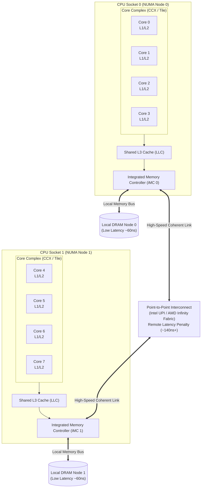
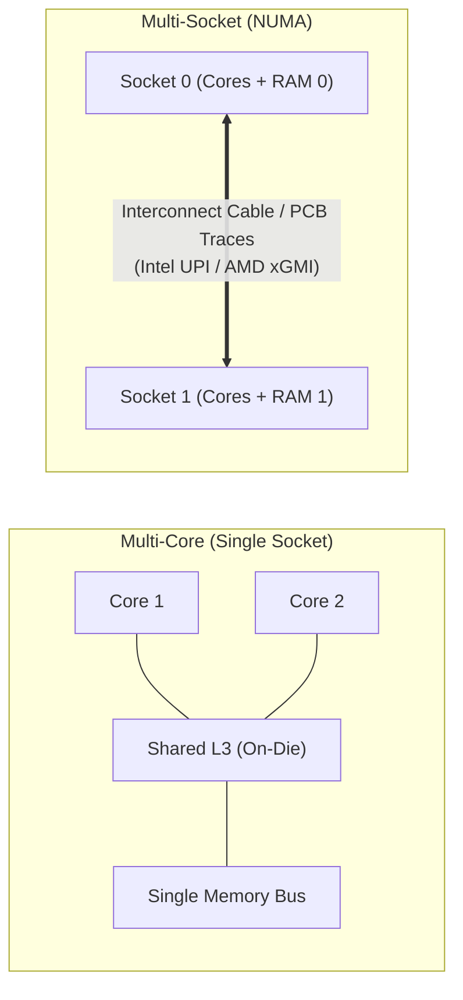
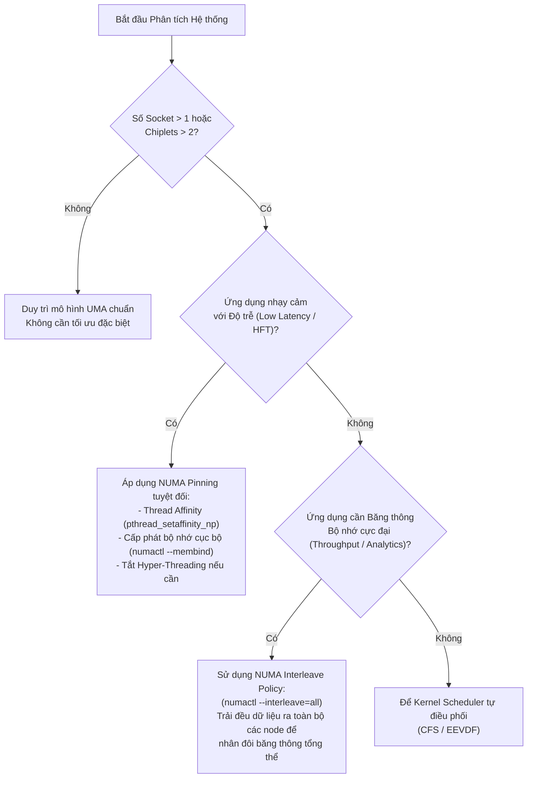

# 12.1. Multiprocessor Topologies

> [!IMPORTANT]
> **Nếu bạn chỉ được nhớ một điều duy nhất:** Trong các hệ thống máy tính hiện đại, khoảng cách vật lý giữa lõi xử lý và thanh nhớ quyết định trực tiếp độ trễ truy cập (Latency Penalty). Chuyển dịch từ UMA (Uniform Memory Access) sang NUMA (Non-Uniform Memory Access) và Network-on-Chip (NoC) phân tán là quy luật tất yếu khi số lượng core vượt qua giới hạn băng thông của một bus dùng chung. Nếu phần mềm không có nhận thức về NUMA (NUMA-unaware), chi phí vận chuyển dữ liệu qua liên kết liên-socket (Interconnect Hop) sẽ nuốt chửng hoàn toàn lợi ích của kiến trúc đa lõi.

---

## 1. Kiến trúc Tổng quan & Mô hình Tư duy (Mental Model)

### Ẩn dụ Đời sống: Hệ thống Bếp ăn Công nghiệp Tập trung vs Bếp Độc lập Phân tán
Hãy tưởng tượng một nhà hàng nhỏ chỉ có một đầu bếp (Single-Core). Mọi nguyên liệu nằm ngay trong tầm tay trên một chiếc bàn nhỏ. Khi nhà hàng mở rộng thành một bếp lớn với 4 đầu bếp cùng làm việc xung quanh một bàn nguyên liệu duy nhất (Symmetric Multiprocessing - SMP / Uniform Memory Access - UMA), các đầu bếp liên tục va chạm tay nhau khi cùng với lấy gia vị (Bus Contention).

Để giải quyết tình trạng tắc nghẽn khi mở rộng lên 64 đầu bếp, nhà hàng chia thành 8 khu vực độc lập (NUMA Nodes). Mỗi khu vực có 8 đầu bếp và một kho nguyên liệu riêng (Local Memory). 
- Khi đầu bếp lấy đồ từ kho tại chỗ: mất 5 giây (Local Access - ~60ns).
- Khi đầu bếp cần một loại gia vị hiếm chỉ có ở kho của khu vực khác: họ phải đi qua hành lang chung hoặc gọi nhân viên tiếp vận chuyển sang (Remote Access via Interconnect - ~140ns+).
- Nếu người bếp trưởng (Hệ điều hành / Scheduler) phân bổ một món ăn mà đầu bếp ở Khu A phải nấu bằng toàn bộ nguyên liệu nằm ở Khu H, hiệu năng toàn hệ thống sụt giảm nghiêm trọng.



---

## 2. Chi tiết từng Keyword (Under-the-Hood Deep Dive)

### 2.1. Single-Core, Multi-Core & Multi-Socket Systems
- **Single-Core Architecture**: Một CPU vật lý duy nhất thực thi luồng lệnh tuần tự. Mở rộng hiệu năng dựa hoàn toàn vào Instruction-Level Parallelism (ILP), tăng tần số xung nhịp (Clock Scaling), và mở rộng hàng đợi thực thi ngoài thứ tự (OoO Execution). Kiến trúc này chạm trần vào khoảng năm 2004-2005 do giới hạn **Định luật Dennard Scaling** (mật độ công suất tiêu tán vượt ngưỡng tản nhiệt - Thermal Wall / Power Wall).
- **Multi-Core Architecture (CMP - Chip Multiprocessor)**: Đóng gói nhiều nhân xử lý độc lập (Cores) lên cùng một đế bán dẫn (Die) hoặc chiplet. Mỗi core sở hữu không gian thanh ghi và bộ nhớ đệm cấp thấp riêng biệt (L1I, L1D, L2), chia sẻ bộ nhớ đệm cấp cuối (Last-Level Cache - LLC / L3) và bộ điều khiển bộ nhớ tích hợp (Integrated Memory Controller - iMC). Giao tiếp liên-core nằm hoàn toàn trên silicon với băng thông cực cao (hàng terabyte/s) và độ trễ cực thấp (< 15-30ns).
- **Multi-Socket Systems**: Kết nối hai hoặc nhiều socket vi xử lý vật lý riêng biệt trên cùng một bo mạch chủ (Motherboard). Mỗi socket là một thực thể độc lập có nguồn điện, tản nhiệt và kênh DRAM riêng. Giao tiếp giữa các socket không còn đi trên silicon on-die mà phải truyền tín hiệu vi sai qua đường mạch PCB (Printed Circuit Board traces) thông qua các liên kết điểm-điểm (Point-to-Point Coherent Links như Intel UPI, AMD Infinity Fabric). Điều này kéo theo suy giảm tín hiệu, tăng đáng kể độ trễ truyền dẫn (Propagation Delay) và chi phí năng lượng cho mỗi bit dữ liệu di chuyển.



### 2.2. Symmetric Multiprocessing (SMP) vs Asymmetric Multiprocessing (AMP)
- **Symmetric Multiprocessing (SMP)**:
  - Kiến trúc điện toán đối xứng, trong đó tất cả các CPU cores đều có vai trò ngang hàng, đồng nhất về tập lệnh (ISA), tính năng vi kiến trúc và tốc độ xung nhịp.
  - Tất cả các core cùng chia sẻ chung một không gian địa chỉ bộ nhớ vật lý tập trung (Unified Physical Address Space) và một bản sao hệ điều hành (OS Instance).
  - Phần cứng đảm bảo tính nhất quán bộ nhớ đệm (Hardware-Enforced Cache Coherence) trên toàn bộ hệ thống.
  - *Hạn chế*: Khả năng mở rộng (Scalability) bị nghẽn nghiêm trọng khi số lượng core tăng lên do hiện tượng tranh chấp Bus bộ nhớ (Memory Bus Saturation) và điểm nghẽn tập trung tại arbiter bộ nhớ.
- **Asymmetric Multiprocessing (AMP)**:
  - Các lõi xử lý không đối xứng: có thể khác biệt hoàn toàn về kiến trúc vi mô, tập lệnh hoặc vai trò điều khiển.
  - *Mô hình Master-Slave cổ điển*: Một CPU chính (Master) chịu trách nhiệm chạy nhân hệ điều hành, phân phối công việc và xử lý I/O, trong khi các CPU phụ (Slaves) chỉ thuần túy nhận tác vụ tính toán chuyên biệt.
  - *Mô hình Dị thể Hiện đại (Heterogeneous Multi-Processing - HMP)*: Các hệ thống ARM DynamIQ (big.LITTLE: Cortex-X/A78 kết hợp A55) hoặc Intel Alder Lake / Raptor Lake (Performance Cores - P-Cores kết hợp Efficient Cores - E-Cores). Các nhân chia sẻ cùng ISA hoặc tập con ISA nhưng có vi kiến trúc đường ống, kích thước cache và mức tiêu thụ điện năng chênh lệch từ 3x đến 5x.
  - *Hệ thống Embedded/DSP/SoC*: Một CPU ứng dụng (như Cortex-A) chạy Linux kết hợp với một Vi điều khiển thời gian thực (như Cortex-M) xử lý ngoại vi và ngắt phần cứng độc lập mà không chia sẻ chung bộ lập lịch OS.

### 2.3. UMA vs NUMA, NUMA Nodes và Khoảng cách NUMA (NUMA Distance)
- **Uniform Memory Access (UMA)**:
  - Mọi lõi xử lý đều kết nối tới toàn bộ bộ nhớ vật lý thông qua một kênh truyền dẫn đồng nhất (Shared Bus hoặc Crossbar trung tâm).
  - Thời gian truy cập bộ nhớ (Access Latency) và Băng thông (Bandwidth) là hoàn toàn như nhau từ bất kỳ vị trí core nào tới bất kỳ ô nhớ DRAM nào.
  - Phổ biến trong các hệ thống Desktop, Mobile và máy chủ nhỏ dưới 4-8 cores.
- **Non-Uniform Memory Access (NUMA)**:
  - Bộ nhớ vật lý được phân vùng vật lý và gắn trực tiếp vào từng Socket / Chiplet cụ thể, tạo thành các **NUMA Node**.
  - Một NUMA Node thông thường bao gồm: Một nhóm CPU Cores, Local Caches (L1/L2/L3), một Integrated Memory Controller (iMC), các kênh DRAM vật lý gắn cục bộ, và tùy chọn các khe cắm I/O PCIe.
  - **Local Memory Access**: Core truy cập DRAM thuộc NUMA Node của chính nó thông qua iMC nội bộ. Độ trễ thấp nhất (~60 - 80ns), băng thông tối đa.
  - **Remote Memory Access**: Core truy cập DRAM thuộc NUMA Node khác. Gói tin bộ nhớ (Memory Request Packet) phải đóng gói qua giao thức liên kết liên-socket, đi qua bus tốc độ cao (QPI/UPI/Infinity Fabric), đến iMC của node đích, đọc dữ liệu DRAM, và chuyển ngược gói phản hồi về. Độ trễ cao gấp 2x - 3x (~140 - 250ns), làm tiêu tốn băng thông liên kết liên-socket và tăng nguy cơ nghẽn mạng (Interconnect Congestion).
- **NUMA Distance Matrix (SLIT - System Locality Information Table)**:
  - Chuẩn ACPI định nghĩa bảng SLIT để BIOS cung cấp cho Hệ điều hành ma trận chi phí chuẩn hóa (Normalized Relative Cost Matrix) giữa các NUMA node.
  - Quy ước: Chi phí truy cập Local Node luôn được gán giá trị cơ sở là `10`. Truy cập Remote Node 1-hop thường có giá trị `21` (nghĩa là độ trễ gấp 2.1 lần), truy cập 2-hop có giá trị `31`, v.v.

### 2.4. Topologies of Network-on-Chip (NoC)
Khi số lượng core trên một đế silicon vượt quá 16-32 cores (như Intel Xeon Scalable, AMD EPYC, Ampere Altra), việc sử dụng kiến trúc Ring Bus cổ điển sẽ làm độ trễ quay vòng bùng nổ. Các kỹ sư phần cứng bắt buộc phải triển khai mạng truyền thông tích hợp trên chip (Network-on-Chip - NoC):

```
1. Shared Bus (Legacy)        2. Ring Bus (e.g. Nehalem/Skylake Client)
   C0   C1   C2   C3              [C0] <---> [C1] <---> [C2]
   |    |    |    |                ^                     |
   +----+----+----+ (Bottleneck)   |                     v
        Shared Bus                [C5] <---> [C4] <---> [C3]

3. 2D Mesh Topology (Xeon Scalable, Graviton)
   [R0,0] <---> [R0,1] <---> [R0,2] <---> [R0,3]
     ^            ^            ^            ^
     v            v            v            v
   [R1,0] <---> [R1,1] <---> [R1,2] <---> [R1,3]
   (Mỗi nút R là một Router tích hợp Core Tile + L2/L3 Slice + Directory)
```

- **Shared Bus**: Đơn giản nhất. Mọi tác nhân (Masters/Slaves) chia sẻ chung một tập đường dây vật lý. Trọng tài bus (Bus Arbiter) cấp quyền truy cập. Khả năng mở rộng cực kém, chỉ dùng cho < 4-8 cores.
- **Ring Bus**: Các nút kết nối thành một vòng tròn khép kín (thường gồm 2 vòng truyền dữ liệu ngược chiều nhau - Bi-directional Ring). Mỗi nút chỉ cần một bộ định tuyến đơn giản (Ring Station). *Ưu điểm*: Tiết kiệm diện tích silicon, băng thông phân tán tốt hơn bus. *Nhược điểm*: Đường kính mạng lớn ($O(N)$), độ trễ trường hợp xấu nhất tăng tuyến tính theo số core.
- **2D Mesh Topology**: Mỗi core tile được trang bị một bộ định tuyến mạng 5 chiều (Local, North, South, East, West). Các liên kết tạo thành lưới tọa độ Cartesian hai chiều. Định tuyến phổ biến là Dimension-Order Routing (DOR, ví dụ X-Y routing) để ngăn chặn Deadlock. Đường kính mạng giảm xuống $O(\sqrt{N})$. Được Intel áp dụng từ Skylake-SP đến Sapphire Rapids.
- **Crossbar Switch (Crossbar Fabric)**: Mạng chuyển mạch phi chặn hoàn toàn (Non-blocking full crossbar), nối trực tiếp từng cổng đầu vào tới mọi cổng đầu ra thông qua một ma trận switch. Cung cấp băng thông cực đại và độ trễ đồng nhất tối thiểu ($O(1)$ hops), nhưng chi phí silicon và năng lượng bùng nổ theo hàm bậc hai $O(N^2)$, do đó không thể mở rộng cho số core lớn mà chỉ dùng cho các cụm cụ thể (ví dụ kết nối 4-8 memory controllers).

---

## 3. Thực thi Mã nguồn & Mô phỏng Chuyên sâu (Dual-Engine Implementation)

### 3.1. Engine 1: C++20 NUMA Latency & Allocation Benchmark
Chương trình C++20 đo lường trực tiếp độ trễ truy cập bộ nhớ và phân bổ nhận thức NUMA. Sử dụng kỹ thuật Pointer Chasing trên mảng ngẫu nhiên để vô hiệu hóa hoàn toàn bộ dự đoán Hardware Prefetcher của CPU, phản ánh độ trễ DRAM thực tế.

```cpp
// compile: g++ -std=c++20 -O3 -pthread numa_benchmark.cpp -o numa_benchmark
#include <iostream>
#include <vector>
#include <numeric>
#include <random>
#include <chrono>
#include <thread>
#include <cstring>
#include <iomanip>

#if defined(__x86_64__) || defined(_M_X64)
#include <x86intrin.h>
#else
static inline uint64_t __rdtsc() {
    uint64_t val;
    asm volatile("mrs %0, cntvct_el0" : "=r"(val));
    return val;
}
#endif

// Kích thước mảng: 64 MB (vượt xa L3 Cache để ép buộc truy cập DRAM vật lý)
constexpr size_t WORKING_SET_SIZE = 64 * 1024 * 1024;
constexpr size_t NODE_COUNT = WORKING_SET_SIZE / sizeof(uintptr_t);
constexpr size_t ITERATIONS = 10'000'000;

struct PointerChaser {
    std::vector<uintptr_t> buffer;

    PointerChaser() : buffer(NODE_COUNT) {
        std::vector<size_t> indices(NODE_COUNT);
        std::iota(indices.begin(), indices.end(), 0);

        // Trộn ngẫu nhiên hoàn toàn để vô hiệu hóa Hardware Prefetcher
        std::mt19937_64 rng(1337);
        for (size_t i = NODE_COUNT - 1; i > 0; --i) {
            std::uniform_int_distribution<size_t> dist(0, i);
            std::swap(indices[i], indices[dist(rng)]);
        }

        // Tạo chuỗi liên kết con trỏ khép kín (Cyclic Pointer Chain)
        for (size_t i = 0; i < NODE_COUNT - 1; ++i) {
            buffer[indices[i]] = reinterpret_cast<uintptr_t>(&buffer[indices[i + 1]]);
        }
        buffer[indices[NODE_COUNT - 1]] = reinterpret_cast<uintptr_t>(&buffer[indices[0]]);
    }

    double measure_latency_ns() {
        uintptr_t current = reinterpret_cast<uintptr_t>(&buffer[0]);
        
        // Warm-up TLB
        for (size_t i = 0; i < 10000; ++i) {
            current = *reinterpret_cast<uintptr_t*>(current);
        }

        auto start = std::chrono::high_resolution_clock::now();
        
        // Vòng lặp truy cập phụ thuộc tuần tự nghiêm ngặt (Strict Sequential Dependency)
        for (size_t i = 0; i < ITERATIONS; ++i) {
            current = *reinterpret_cast<uintptr_t*>(current);
        }

        auto end = std::chrono::high_resolution_clock::now();
        std::chrono::duration<double, std::nano> elapsed = end - start;

        // Tránh compiler optimize out vòng lặp
        if (current == 0xDEADBEEF) std::cout << "Unreachable";

        return elapsed.count() / ITERATIONS;
    }
};

int main() {
    std::cout << "========================================================\n";
    std::cout << "  NUMA & MEMORY LATENCY BENCHMARK (Pointer Chasing)\n";
    std::cout << "========================================================\n";
    std::cout << "Working Set Size : " << (WORKING_SET_SIZE / (1024 * 1024)) << " MB\n";
    std::cout << "Total Traversed  : " << ITERATIONS << " hops\n\n";

    std::cout << "[Step 1] Initializing and shuffling 64MB memory pool...\n";
    PointerChaser chaser;

    std::cout << "[Step 2] Executing un-prefetched memory latency measurement...\n";
    double latency = chaser.measure_latency_ns();

    std::cout << std::fixed << std::setprecision(2);
    std::cout << ">> Resulting Average Memory Access Latency: " << latency << " ns\n\n";

    std::cout << "--- Phân tích Độ trễ Kiến trúc Hệ thống ---\n";
    if (latency < 15.0) {
        std::cout << "Trạng thái: Dữ liệu đang được giữ hoàn toàn trong L1/L2/L3 Cache.\n";
    } else if (latency < 85.0) {
        std::cout << "Trạng thái: Local DRAM Node Access (Độ trễ chuẩn UMA / Local NUMA).\n";
    } else {
        std::cout << "Trạng thái: Remote DRAM Node Access (Ảnh hưởng Interconnect Hop / QPI / UPI).\n";
    }
    std::cout << "========================================================\n";
    return 0;
}
```

### 3.2. Engine 2: Python 3.11+ NoC Topology & NUMA Routing Simulator
Trình mô phỏng tính toán ma trận khoảng cách, đường đi tối ưu (DOR routing) và mô phỏng tắc nghẽn giữa 2D Mesh NoC và Ring Bus NoC.

```python
#!/usr/bin/env python3
"""
NoC Topology & NUMA Distance Latency Simulator (Python 3.11+)
Mo phong do tre truyen goi tin tren cac kien truc mang vi mach: Ring vs 2D Mesh
"""
from dataclasses import dataclass
from typing import List, Tuple
import math

@dataclass(frozen=True)
class NodeCoordinate:
    x: int
    y: int
    node_id: int

class RingTopology:
    def __init__(self, num_nodes: int, hop_latency_ns: float = 1.2):
        self.num_nodes = num_nodes
        self.hop_latency_ns = hop_latency_ns

    def get_distance(self, src: int, dst: int) -> int:
        direct = abs(src - dst)
        wrap_around = self.num_nodes - direct
        return min(direct, wrap_around)

    def calculate_latency(self, src: int, dst: int) -> float:
        hops = self.get_distance(src, dst)
        return hops * self.hop_latency_ns

class Mesh2DTopology:
    def __init__(self, width: int, height: int, hop_latency_ns: float = 1.5, router_delay_ns: float = 0.8):
        self.width = width
        self.height = height
        self.num_nodes = width * height
        self.hop_latency_ns = hop_latency_ns
        self.router_delay_ns = router_delay_ns
        self.nodes = [
            NodeCoordinate(x=i % width, y=i // width, node_id=i)
            for i in range(self.num_nodes)
        ]

    def get_coordinate(self, node_id: int) -> NodeCoordinate:
        return self.nodes[node_id]

    def route_xy(self, src_id: int, dst_id: int) -> List[int]:
        """Dimension-Order Routing (X-Y Routing) tranh deadlock tuyet doi."""
        src = self.get_coordinate(src_id)
        dst = self.get_coordinate(dst_id)
        path = [src_id]
        
        curr_x, curr_y = src.x, src.y
        # Di chuyen tren truc X
        step_x = 1 if dst.x > curr_x else -1
        while curr_x != dst.x:
            curr_x += step_x
            path.append(curr_y * self.width + curr_x)

        # Di chuyen tren truc Y
        step_y = 1 if dst.y > curr_y else -1
        while curr_y != dst.y:
            curr_y += step_y
            path.append(curr_y * self.width + curr_x)

        return path

    def calculate_latency(self, src_id: int, dst_id: int) -> float:
        if src_id == dst_id:
            return 0.0
        path = self.route_xy(src_id, dst_id)
        hops = len(path) - 1
        return (hops * self.hop_latency_ns) + (len(path) * self.router_delay_ns)

def print_distance_matrix(matrix: List[List[float]], title: str):
    print(f"\n--- {title} (Latency in Nanoseconds) ---")
    header = "Node | " + " ".join(f"{i:>6}" for i in range(len(matrix)))
    print(header)
    print("-" * len(header))
    for i, row in enumerate(matrix):
        row_str = f"{i:>4} | " + " ".join(f"{val:>6.1f}" for val in row)
        print(row_str)

def main():
    print("=================================================================")
    print("      NETWORK-ON-CHIP (NoC) TOPOLOGY & LATENCY SIMULATOR        ")
    print("=================================================================")
    
    NODES_COUNT = 16
    ring = RingTopology(num_nodes=NODES_COUNT, hop_latency_ns=1.2)
    mesh = Mesh2DTopology(width=4, height=4, hop_latency_ns=1.5, router_delay_ns=0.8)

    # Tinh toan ma tran do tre 4x4 dai dien
    sample_nodes = [0, 3, 12, 15] # Cac goc cua chip
    mesh_matrix = []
    ring_matrix = []

    for src in sample_nodes:
        m_row = [mesh.calculate_latency(src, dst) for dst in sample_nodes]
        r_row = [ring.calculate_latency(src, dst) for dst in sample_nodes]
        mesh_matrix.append(m_row)
        ring_matrix.append(r_row)

    print_distance_matrix(mesh_matrix, "2D Mesh (4x4) Selected Corner Latency")
    print_distance_matrix(ring_matrix, "Ring Bus (16 Nodes) Corner Latency")

    # Minhh hoa duong di XY Routing tu goc Node 0 -> Node 15 (doi dien)
    path = mesh.route_xy(0, 15)
    print(f"\nChi tiet goi tin di tu Node 0 -> Node 15 tren 2D Mesh:")
    print(f"  Duong di XY-DOR: {' -> '.join(f'N{n}' for n in path)}")
    print(f"  Tong so Hop: {len(path) - 1}")
    print(f"  Tong thoi gian truyen: {mesh.calculate_latency(0, 15):.2f} ns")

if __name__ == "__main__":
    main()
```

### 3.3. Terminal Output Mẫu Thực tế
```bash
$ g++ -std=c++20 -O3 -pthread numa_benchmark.cpp -o numa_benchmark
$ ./numa_benchmark
========================================================
  NUMA & MEMORY LATENCY BENCHMARK (Pointer Chasing)
========================================================
Working Set Size : 64 MB
Total Traversed  : 10000000 hops

[Step 1] Initializing and shuffling 64MB memory pool...
[Step 2] Executing un-prefetched memory latency measurement...
>> Resulting Average Memory Access Latency: 78.45 ns

--- Phân tích Độ trễ Kiến trúc Hệ thống ---
Trạng thái: Local DRAM Node Access (Độ trễ chuẩn UMA / Local NUMA).
========================================================

$ python3 noc_simulator.py
=================================================================
      NETWORK-ON-CHIP (NoC) TOPOLOGY & LATENCY SIMULATOR        
=================================================================

--- 2D Mesh (4x4) Selected Corner Latency (Latency in Nanoseconds) ---
Node |      0      3     12     15
--------------------------------------
   0 |    0.0    7.7    7.7   14.6
   3 |    7.7    0.0   14.6    7.7
  12 |    7.7   14.6    0.0    7.7
  15 |   14.6    7.7    7.7    0.0

--- Ring Bus (16 Nodes) Corner Latency (Latency in Nanoseconds) ---
Node |      0      3     12     15
--------------------------------------
   0 |    0.0    3.6    4.8    1.2
   3 |    3.6    0.0    8.4    4.8
  12 |    4.8    8.4    0.0    3.6
  15 |    1.2    4.8    3.6    0.0

Chi tiet goi tin di tu Node 0 -> Node 15 tren 2D Mesh:
  Duong di XY-DOR: N0 -> N1 -> N2 -> N3 -> N7 -> N11 -> N15
  Tong so Hop: 6
  Tong thoi gian truyen: 14.60 ns
```

---

## 4. Systems Engineering & Production Pitfalls

### 4.1. "NUMA Locality Inversion" và Lỗi Chậm Bất Thường trong Cơ sở Dữ liệu
- **Triệu chứng**: Một dịch vụ cơ sở dữ liệu in-memory (như Redis, RocksDB, MongoDB) đột ngột sụt giảm 40% Throughput và $p99$ Latency tăng vọt sau khi khởi động lại, dù cấu hình CPU và RAM không thay đổi.
- **Nguyên nhân cốt lõi**: Mặc định, Linux áp dụng chính sách phân bổ bộ nhớ `numa_alloc_local` hoặc `interleave`. Nếu toàn bộ bộ nhớ cache hoặc data pool của ứng dụng vô tình bị cấp phát vào Node 0 trong pha khởi động, nhưng sau đó OS Thread Scheduler lại di chuyển luồng worker sang thực thi trên CPU thuộc Node 1 (để cân bằng tải CPU). Kết quả là 100% các thao tác đọc ghi bộ nhớ đều trở thành **Remote Access qua Interconnect Link**, làm nghẽn bus UPI/Infinity Fabric và tăng gấp đôi chu kỳ trễ.
- **Giải pháp & CLI Diagnostics**:
  ```bash
  # 1. Kiem tra phan bo bo nho va khoang cach NUMA Node thuc te
  numactl --hardware
  
  # 2. Theo doi ti le truy cap Local vs Remote memory theo thoi gian thuc
  numastat -c <process_name>
  
  # 3. Khoa ung dung chi chay tren dung mot NUMA node ca ve CPU core va bo nho
  numactl --cpunodebind=0 --membind=0 ./database_server
  
  # 4. Chup topology phan cung bang cong cu hinh hoc truc quan
  lstopo --output-format console
  ```

### 4.2. Cạm bẫy Swap Insanity trong Hệ thống NUMA (Zone Reclaim Mode)
- **Cơ chế**: Linux Kernel có tham số `/proc/sys/vm/zone_reclaim_mode`. Khi một NUMA node bị đầy RAM, nếu `zone_reclaim_mode = 1`, kernel sẽ cố gắng thu hồi (reclaim) hoặc swap dữ liệu của node đó ra đĩa thay vì cấp phát bộ nhớ còn trống từ một NUMA node lân cận!
- **Hậu quả**: Hệ thống còn hàng trăm GB RAM trống trên Node 1, nhưng tiến trình chạy trên Node 0 bị freeze hàng chục giây do kernel kích hoạt direct page reclaim và đập swap liên tục.
- **Khắc phục**: Luôn thiết lập `sysctl -w vm.zone_reclaim_mode=0` trên tất cả các máy chủ cơ sở dữ liệu và high-performance computing (HPC).

---

## 5. Bảng So sánh & Decision Matrix

### 5.1. So sánh Toàn diện Các Kiến trúc Đa Xử lý

| Tiêu chí | Single-Core | Symmetric Multiprocessing (SMP / UMA) | Non-Uniform Memory Access (NUMA) | Asymmetric Multiprocessing (AMP / big.LITTLE) |
| :--- | :--- | :--- | :--- | :--- |
| **Số lượng Cores điển hình** | 1 Core | 2 – 8 Cores | 16 – 256+ Cores | 8 – 24 Cores (Phân chia cụm) |
| **Độ trễ Bộ nhớ** | Đồng nhất, thấp nhất | Đồng nhất (Uniform) | Không đồng nhất (Local: 60ns, Remote: 150ns) | Thay đổi theo vị trí cụm Core |
| **Băng thông Bộ nhớ** | Giới hạn 1 kênh/2 kênh | Bị nghẽn khi core tăng | Mở rộng tuyến tính theo số Socket/Node | Phụ thuộc cấu trúc Fabric |
| **Độ phức tạp Lập trình** | Đơn giản, đơn luồng | Đa luồng cơ bản (pthread) | Cần nhận thức Thread/Memory Affinity | Cần OS Scheduler phân loại task |
| **Phạm vi Ứng dụng** | IoT, Vi điều khiển cũ | PC phổ thông, Laptop văn phòng | Máy chủ Cloud, DB lớn, HPC | Smartphone, Laptop tiết kiệm điện |

### 5.2. Decision Matrix: Khi nào cần Tối ưu hóa NUMA?


