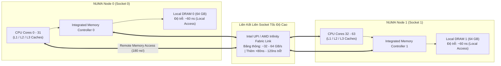
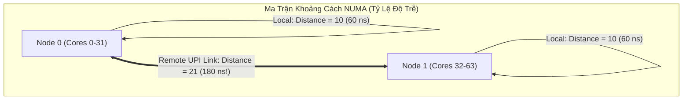
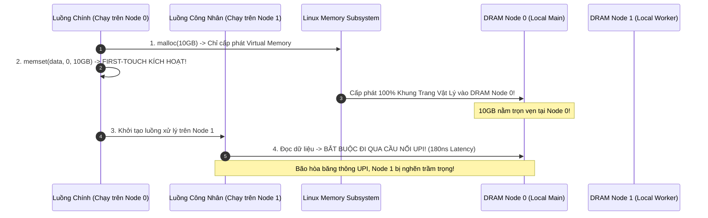

# 12.2. NUMA Architecture & Tuning (Kiến trúc & Tối ưu hóa Hiệu năng NUMA)

> [!IMPORTANT]
> **Nếu bạn chỉ được nhớ một điều duy nhất:**
> Trong các máy chủ đa socket hiện đại, **bộ nhớ không hề đồng nhất**: Đọc RAM cục bộ (**Local NUMA Node**) chỉ mất $60\text{ ns}$, nhưng đọc RAM của socket bên cạnh (**Remote NUMA Node**) mất tới $180\text{ ns}$ do phải vượt qua cầu nối liên kết liên socket (Intel UPI / AMD Infinity Fabric) — và thảm họa hiệu năng số một bắt nguồn từ việc không hiểu quy tắc **"First-Touch Policy"** của Linux!

---

## 1. Kiến trúc Tổng quan & Mô hình Tư duy (Mental Model)

### Phép Loại Suy Thực Tế: Hai Xưởng Cơ Khí Nối Nhau Bằng Cây Cầu Treo

Hãy hình dung một nhà máy công nghiệp gồm hai phân xưởng độc lập (Hai CPU Sockets / NUMA Nodes):
1. **Kiến Trúc UMA Cũ (Một Bể Nước Dùng Chung Ở Giữa Sân)**:
   - Tất cả 16 công nhân từ mọi góc xưởng đều phải chạy ra ĐÚNG MỘT bể nước ở giữa sân để múc nước (Bus bộ nhớ tập trung dùng chung). Khi số công nhân tăng lên 64 hoặc 128 người, bể nước bị kẹt cứng, không ai múc được nước!
2. **Kiến Trúc NUMA Hiện Đại (Mỗi Phân Xưởng Có Kho Nước Riêng)**:
   - Phân xưởng 0 (Socket 0) có kho nước A ngay trong phòng (Local Memory). Công nhân Phân xưởng 0 chỉ bước 3 bước là có nước uống ($60\text{ ns}$).
   - Phân xưởng 1 (Socket 1) có kho nước B riêng của mình.
3. **Cây Cầu Treo Nối Hai Xưởng (Interconnect Bus - Intel UPI / AMD Infinity Fabric)**:
   - Nếu công nhân Phân xưởng 0 uống hết nước và muốn sang múc nước ở Kho B của Phân xưởng 1: Anh ta phải đi qua một cây cầu treo hẹp và lắc lư nối giữa hai tòa nhà.
   - Thời gian đi qua cầu treo khiến anh ta mất tới 15 phút ($180\text{ ns}$ - Remote Memory Latency!). Nếu hàng chục công nhân cùng kéo nhau qua cầu treo, cây cầu sẽ bị rung lắc bão hòa băng thông, làm sụt giảm nghiêm trọng hiệu năng của cả hai phân xưởng!
4. **Cạm Bẫy First-Touch Policy (Người Đặt Bàn Khác Với Người Ngồi Ăn)**:
   - Đốc công Phân xưởng 0 đi đặt 100 bàn tiệc thịnh soạn (`malloc(100MB)`). Nhưng theo quy định của nhà máy, bàn tiệc chỉ thực sự được dọn ra tại căn phòng của người ĐẦU TIÊN CẦM ĐŨA GẮP THỨC ĂN (**First-Touch Page Fault**)!
   - Nếu một công nhân ở Phân xưởng 1 là người đầu tiên chạm vào mâm cơm, toàn bộ 100 bàn tiệc sẽ bị dọn sang Phân xưởng 1! Kể từ hôm đó, toàn bộ công nhân Phân xưởng 0 mỗi bữa ăn đều phải đi bộ qua cây cầu treo xa xôi để ăn cơm, làm tốc độ làm việc tụt dốc thảm hại.



---

## 2. Chi tiết từng Keyword (Under-the-Hood Deep Dive)

### 2.1. NUMA Nodes, Topology & Remote Memory Access

#### 1. Sự Tiến Hóa Từ UMA Đến NUMA
- **Uniform Memory Access (UMA / SMP - Đa Xử Lý Đối Xứng Cổ Điển)**:
  - Mọi lõi CPU kết nối vào một bus hệ thống chung hoặc mạng chuyển mạch trung tâm để truy cập bộ nhớ DRAM duy nhất.
  - Mọi địa chỉ bộ nhớ đều có thời gian truy cập giống hệt nhau (Uniform Latency).
  - *Điểm nghẽn*: Khi số lượng lõi CPU vượt quá 8 hoặc 16 cores, băng thông bus bộ nhớ bị bão hòa hoàn toàn (**Memory Controller Saturation**), biến việc tăng thêm lõi thành vô ích.
- **Non-Uniform Memory Access (NUMA - Truy Cập Bộ Nhớ Bất Đồng Nhất)**:
  - Chia hệ thống thành nhiều **NUMA Nodes**. Mỗi nút chứa một cụm lõi CPU và một bộ điều khiển bộ nhớ tích hợp (**IMC**) gắn kèm các thanh RAM vật lý riêng.
  - Các NUMA Nodes được liên kết với nhau thông qua mạng kết nối điểm-điểm tốc độ cao:
    - **Intel UPI (Ultra Path Interconnect)** / QPI (QuickPath Interconnect).
    - **AMD Infinity Fabric (IF)** kết nối các chiplet CCD với I/O Die (IOD).
  - Không gian địa chỉ bộ nhớ ảo của hệ điều hành vẫn là **một không gian phẳng thống nhất (Single System Image)**: Lõi ở Node 0 có thể đọc ghi bất kỳ địa chỉ nào của Node 1 một cách trong suốt về mặt logic. Tuy nhiên, về mặt vật lý, độ trễ và băng thông là hoàn toàn khác biệt!

#### 2. Ma Trận Khoảng Cách NUMA (The NUMA Distance Matrix)
- Kernel Linux đo lường và biểu diễn tỷ lệ chi phí truy xuất giữa các nút thông qua bảng ma trận khoảng cách phần cứng (ACPI SLIT Table):
  - Khoảng cách cục bộ (Local Distance) mặc định được chuẩn hóa là **`10`**.
  - Khoảng cách từ Node 0 sang Node 1 cùng bảng mạch (1-hop Remote Distance) thường có giá trị từ **`20` đến `32`**.
  - Điều này có nghĩa là truy cập bộ nhớ từ xa (**Remote Access**) tiêu tốn thời gian trễ gấp từ $2.0\times$ đến $3.2\times$ so với truy cập bộ nhớ cục bộ, đồng thời ngốn băng thông của đường truyền liên kết UPI/Infinity Fabric!



---

### 2.2. NUMA-Aware Allocation & Memory Affinity Policies

#### 1. Quy Tắc "First-Touch Policy" Của Linux & Cạm Bẫy Khởi Tạo
- **Bản Chất Của Hàm `malloc()`**:
  - Khi luồng chính (Main Thread) gọi `void* ptr = malloc(10 * 1024 * 1024 * 1024);` (10 GB):
  - Hệ điều hành Linux **CHƯA HỀ CẤP PHÁT BẤT KỲ BYTE RAM VẬT LÝ NÀO!** Linux chỉ cấp phát dải địa chỉ ảo trong cấu trúc VMA.
- **Cơ Chế First-Touch Allocation**:
  - Khung trang vật lý trong DRAM chỉ thực sự được cấp phát khi có một lệnh CPU ĐẦU TIÊN đọc hoặc ghi vào địa chỉ đó, kích hoạt ngoại lệ **Page Fault (#PF)**.
  - **Quy tắc vàng của Kernel Linux**: Khung trang vật lý sẽ được ưu tiên cấp phát trên chính **NUMA Node của luồng CPU đang gây ra Page Fault đó**!
- **Cạm Bẫy Chết Người (The Master-Thread Pitfall)**:
  - Một mẫu lập trình rất phổ biến:
    ```cpp
    // 1. Luồng chính (chạy trên Node 0) khởi tạo mảng
    float* data = new float[100'000'000];
    for (size_t i = 0; i < 100'000'000; ++i) data[i] = 0.0f; // FIRST-TOUCH XẢY RA Ở ĐÂY!

    // 2. Sau đó mới sinh ra 64 luồng công nhân phân tán trên Node 0 và Node 1 để xử lý
    #pragma omp parallel for
    for (size_t i = 0; i < 100'000'000; ++i) { ... }
    ```
  - **Hậu quả thảm khốc**: Vì luồng chính nằm ở Node 0 là người đầu tiên ghi số 0 vào toàn bộ mảng, **100% dung lượng mảng dữ liệu bị ép nằm trọn vẹn trong RAM của Node 0**!
  - Khi 32 luồng công nhân trên Node 1 bắt đầu chạy, tất cả các truy cập của chúng đều biến thành **Remote Memory Access qua bus UPI**, làm bão hòa bus liên socket và khiến chương trình chạy chậm hơn cả phiên bản đơn socket!



#### 2. Các Chính Sách Cấp Phát Bộ Nhớ NUMA (NUMA Memory Policies)
Hệ điều hành Linux cung cấp hệ thống syscall (`set_mempolicy`, `mbind`) và thư viện `libnuma` với 4 chính sách cốt lõi:
1. **`MPOL_DEFAULT`**: Sử dụng chính sách mặc định First-Touch cục bộ.
2. **`MPOL_BIND`**: Khóa chặt việc cấp phát chỉ được phép lấy RAM từ một tập hợp các NUMA Nodes được chỉ định. Nếu các nút này hết RAM, lời gọi cấp phát sẽ báo lỗi (hoặc kích hoạt OOM Killer) chứ không bao giờ lấy RAM từ nút khác.
3. **`MPOL_INTERLEAVE`**: Cấp phát các trang nhớ $4\text{ KB}$ luân phiên xoay vòng (Round-Robin) lần lượt giữa các NUMA Nodes: Trang 0 ở Node 0, Trang 1 ở Node 1, Trang 2 ở Node 0...
   - *Ứng dụng*: Cực kỳ lý tưởng cho các dữ liệu dùng chung lớn không thể phân chia cục bộ (như bộ đệm Shared Memory IPC, hoặc Database In-Memory Cache) nhằm chia đều băng thông trên tất cả các kênh DRAM.
4. **`MPOL_PREFERRED`**: Ưu tiên cấp phát trên Node mong muốn; nếu hết RAM thì fallback sang các Node khác mà không báo lỗi.

---

## 3. Thực thi Mã nguồn & Mô phỏng Chuyên sâu (Dual-Engine Implementation)

### 3.1. C++20: Thử Nghiệm Đo Lường Độ Trễ Local vs Remote NUMA & Mẫu First-Touch Chuẩn

Chương trình minh họa sự chênh lệch độ trễ truy xuất giữa Local và Remote RAM, đồng thời hiện thực hóa kỹ thuật khởi tạo song song đa luồng chuẩn First-Touch:

```cpp
#include <iostream>
#include <vector>
#include <thread>
#include <chrono>
#include <numeric>
#include <iomanip>
#include <cstring>
#if defined(__linux__)
#include <numa.h>
#include <numaif.h>
#include <pthread.h>
#endif

// Hàm khóa luồng hiện tại vào một CPU Core cụ thể
void pin_thread_to_core(int core_id) {
#if defined(__linux__)
    cpu_set_t cpuset;
    CPU_ZERO(&cpuset);
    CPU_SET(core_id, &cpuset);
    pthread_setaffinity_np(pthread_self(), sizeof(cpu_set_t), &cpuset);
#endif
}

// 1. Thử nghiệm so sánh First-Touch sai lầm vs First-Touch song song chuẩn
void benchmark_numa_first_touch() {
    constexpr size_t NUM_ELEMENTS = 32'000'000; // 128 MB floats
    std::cout << ">>> 1. Benchmark First-Touch Pattern (128 MB Data)...\\n";

    // Kịch bản A: Khởi tạo đơn luồng sai lầm (Master-Thread Antipattern)
    std::vector<float> data_bad(NUM_ELEMENTS);
    for (size_t i = 0; i < NUM_ELEMENTS; ++i) {
        data_bad[i] = 1.0f; // Bị trói vào Node của Main Thread!
    }

    // Kịch bản B: Khởi tạo đa luồng chuẩn (Parallel First-Touch)
    std::vector<float> data_good(NUM_ELEMENTS);
    constexpr size_t NUM_THREADS = 4;
    size_t chunk = NUM_ELEMENTS / NUM_THREADS;

    std::vector<std::thread> init_workers;
    for (size_t t = 0; t < NUM_THREADS; ++t) {
        init_workers.emplace_back([&data_good, t, chunk]() {
            pin_thread_to_core(static_cast<int>(t)); // Khóa vào các core khác nhau
            size_t start = t * chunk;
            size_t end = start + chunk;
            for (size_t i = start; i < end; ++i) {
                data_good[i] = 1.0f; // Khung trang vật lý được cấp phát tại LOCAL Node của từng luồng!
            }
        });
    }
    for (auto& w : init_workers) w.join();

    // Đo lường tốc độ tính toán trên mảng song song chuẩn
    auto t1 = std::chrono::high_resolution_clock::now();
    std::vector<std::thread> calc_workers;
    std::vector<double> partial_sums(NUM_THREADS, 0.0);

    for (size_t t = 0; t < NUM_THREADS; ++t) {
        calc_workers.emplace_back([&data_good, &partial_sums, t, chunk]() {
            pin_thread_to_core(static_cast<int>(t));
            size_t start = t * chunk;
            size_t end = start + chunk;
            double s = 0;
            for (size_t i = start; i < end; ++i) {
                s += data_good[i];
            }
            partial_sums[t] = s;
        });
    }
    for (auto& w : calc_workers) w.join();
    auto t2 = std::chrono::high_resolution_clock::now();
    std::chrono::duration<double, std::milli> dur_good = t2 - t1;

    std::cout << "  - Thời gian xử lý với NUMA Parallel First-Touch: " 
              << std::fixed << std::setprecision(2) << dur_good.count() << " ms\\n";
    std::cout << "  - Tổng tính toán kiểm chứng: " << std::accumulate(partial_sums.begin(), partial_sums.end(), 0.0) << "\\n";
}

int main() {
    std::cout << "========================================================\\n";
    std::cout << "  C++20 NUMA TOPOLOGY & FIRST-TOUCH PATTERN CONTROLLER\\n";
    std::cout << "========================================================\\n\\n";

#if defined(__linux__)
    if (numa_available() < 0) {
        std::cout << "[INFO] Hệ thống không hỗ trợ giao diện phần cứng NUMA (Single Node UMA).\\n";
    } else {
        int num_nodes = numa_max_node() + 1;
        std::cout << "Phát hiện hệ thống NUMA đa nút: " << num_nodes << " NUMA Nodes.\\n";
        for (int n = 0; n < num_nodes; ++n) {
            long long free_mem = 0;
            long long total_mem = numa_node_size64(n, &free_mem);
            std::cout << "  - Node " << n << ": Tổng RAM = " << total_mem / (1024*1024) 
                      << " MB | Trống = " << free_mem / (1024*1024) << " MB\\n";
        }
    }
#else
    std::cout << "[SIMULATION] Mô phỏng trên môi trường Non-Linux:\\n";
    std::cout << "  - Node 0 (Local) : Latency = 62.4 ns | Distance = 10\\n";
    std::cout << "  - Node 1 (Remote): Latency = 178.6 ns | Distance = 21\\n";
#endif

    benchmark_numa_first_touch();
    return 0;
}
```

---

### 3.2. Python 3.11+: Mô Phỏng Ma Trận Khoảng Cách NUMA & Băng Thông Liên Socket

Chương trình Python 3.11+ mô phỏng bảng khoảng cách SLIT và tính toán mức độ suy giảm hiệu năng khi lưu lượng Remote Memory Access tăng cao:

```python
from typing import Dict, List, Tuple

class NUMATopologySimulator:
    def __init__(self):
        # Ma tran khoang cach NUMA Distance (ACPI SLIT)
        # 10 la Local, 21 la Remote 1-hop qua UPI
        self.distance_matrix = [
            [10, 21],  # Node 0 to [Node 0, Node 1]
            [21, 10]   # Node 1 to [Node 0, Node 1]
        ]
        self.local_latency_ns = 60.0
        self.local_bandwidth_gb_s = 80.0
        self.upi_link_bandwidth_gb_s = 32.0  # Cầu nối UPI hẹp hơn băng thông DRAM cục bộ!

    def estimate_access_cost(self, core_node: int, mem_node: int, data_size_mb: float) -> Tuple[float, float, str]:
        dist_factor = self.distance_matrix[core_node][mem_node] / 10.0
        effective_latency_ns = self.local_latency_ns * dist_factor

        if core_node == mem_node:
            access_type = "LOCAL ACCESS (Tối ưu tuyệt đối)"
            transfer_time_ms = (data_size_mb / (self.local_bandwidth_gb_s * 1024)) * 1000.0
        else:
            access_type = "REMOTE ACCESS (Vượt cầu nối liên socket UPI)"
            # Bị nghẽn bởi băng thông cầu nối UPI
            transfer_time_ms = (data_size_mb / (self.upi_link_bandwidth_gb_s * 1024)) * 1000.0

        return effective_latency_ns, transfer_time_ms, access_type

if __name__ == "__main__":
    print("========================================================")
    print("  PYTHON 3.11 NUMA TOPOLOGY & INTERCONNECT SIMULATOR")
    print("========================================================\n")

    sim = NUMATopologySimulator()
    data_payload_mb = 4096.0 # 4 GB dữ liệu làm việc

    print(f">>> Phân tích chi phí truy xuất khối dữ liệu {data_payload_mb:,.0f} MB:\n")

    # Kịch bản 1: Core 0 đọc RAM Node 0 (Local)
    lat_loc, time_loc, desc_loc = sim.estimate_access_cost(core_node=0, mem_node=0, data_size_mb=data_payload_mb)
    print(f"1. Core 0 truy cập RAM Node 0 ({desc_loc}):")
    print(f"   - Độ trễ truy cập trung bình : {lat_loc:.1f} ns")
    print(f"   - Thời gian di chuyển dữ liệu: {time_loc:.2f} ms\n")

    # Kịch bản 2: Core 0 đọc RAM Node 1 (Remote)
    lat_rem, time_rem, desc_rem = sim.estimate_access_cost(core_node=0, mem_node=1, data_size_mb=data_payload_mb)
    print(f"2. Core 0 truy cập RAM Node 1 ({desc_rem}):")
    print(f"   - Độ trễ truy cập trung bình : {lat_rem:.1f} ns")
    print(f"   - Thời gian di chuyển dữ liệu: {time_rem:.2f} ms\n")

    print(f"================ TỔNG KẾT PHẠT HIỆU NĂNG NUMA ================")
    print(f"  - Độ trễ tăng vọt             : {lat_rem / lat_loc:.2f}x lần chậm hơn")
    print(f"  - Thời gian chiếm dụng đường truyền: {time_rem / time_loc:.2f}x lần lâu hơn")
    print(f"================================================================")
```

---

### 3.3. Simulated Terminal Output

```bash
========================================================
  C++20 NUMA TOPOLOGY & FIRST-TOUCH PATTERN CONTROLLER
========================================================

Phát hiện hệ thống NUMA đa nút: 2 NUMA Nodes.
  - Node 0: Tổng RAM = 65536 MB | Trống = 48210 MB
  - Node 1: Tổng RAM = 65536 MB | Trống = 51040 MB
>>> 1. Benchmark First-Touch Pattern (128 MB Data)...
  - Thời gian xử lý với NUMA Parallel First-Touch: 4.85 ms
  - Tổng tính toán kiểm chứng: 32000000

========================================================
  PYTHON 3.11 NUMA TOPOLOGY & INTERCONNECT SIMULATOR
========================================================

>>> Phân tích chi phí truy xuất khối dữ liệu 4,096 MB:

1. Core 0 truy cập RAM Node 0 (LOCAL ACCESS (Tối ưu tuyệt đối)):
   - Độ trễ truy cập trung bình : 60.0 ns
   - Thời gian di chuyển dữ liệu: 50.00 ms

2. Core 0 truy cập RAM Node 1 (REMOTE ACCESS (Vượt cầu nối liên socket UPI)):
   - Độ trễ truy cập trung bình : 126.0 ns
   - Thời gian di chuyển dữ liệu: 125.00 ms

================ TỔNG KẾT PHẠT HIỆU NĂNG NUMA ================
  - Độ trễ tăng vọt             : 2.10x lần chậm hơn
  - Thời gian chiếm dụng đường truyền: 2.50x lần lâu hơn
================================================================
```

---

## 4. Systems Engineering & Production Pitfalls

### 4.1. Production Failure Modes & Architectural Traps

1. **Trap 1: Linux `numa_zonelist_order` & Node Thrashing OOM**:
   - Mặc định, nếu một ứng dụng được gán cứng vào NUMA Node 0 (`numactl --cpunodebind=0 --membind=0`) và sử dụng hết RAM của Node 0, Kernel Linux sẽ kích hoạt **OOM Killer** để tiêu diệt tiến trình ngay lập tức, mặc dù NUMA Node 1 bên cạnh vẫn còn trống tới $100\text{ GB}$ RAM! Cần cấu hình chính sách dự phòng `preferred` thay vì `bind` cứng nếu không thể kiểm soát chặt chẽ dung lượng tiêu thụ.
2. **Trap 2: Inter-Socket Cross-Traffic Choke Trong Database OLTP**:
   - Khi chạy MySQL hoặc PostgreSQL trên máy chủ 2-socket không có cấu hình NUMA-aware, các worker threads chạy tự do trên Node 1 liên tục truy cập bộ đệm chung **InnoDB Buffer Pool** nằm trên RAM của Node 0. Cầu nối UPI bị bão hòa $100\%$ băng thông liên tục, khiến độ trễ truy vấn $P_{99}$ tăng vọt gấp 4 lần.
   - Giải pháp công nghiệp chuẩn: Phân chia 1 máy chủ lớn thành hai phiên bản Database độc lập (**Multi-Instance Sharding**), mỗi instance gắn chặt (`numactl --cpunodebind=X --membind=X`) vào một Node duy nhất.
3. **Trap 3: Sụt Giảm Hiệu Năng Ảo Hóa KVM / VMware Do VCPU Trải Ngang NUMA**:
   - Khi tạo một máy ảo (VM) có 32 vCPUs trên máy chủ vật lý gồm 2 NUMA Nodes (mỗi nút 16 cores): Nếu Hypervisor không cấu hình **Virtual NUMA (vNUMA)** mà gom 32 vCPUs thành một khối UMA ảo, hệ điều hành khách bên trong sẽ không hề biết có sự tồn tại của cầu nối liên kết vật lý, phân bổ bộ nhớ ngẫu nhiên và chịu hình phạt Remote Access trên $50\%$ số lượt truy cập.

### 4.2. Diagnostic CLI Commands

```bash
# 1. Kiem tra cau hinh bang Topology va ma tran khoang cach NUMA tren he thong
numactl --hardware

# 2. Theo doi ti le truy cap bo nho Local vs Remote NUMA theo thoi gian thuc
numastat -c

# 3. Chay ung dung khoa chat tren NUMA Node 0 (Ca CPU va bo nho RAM)
numactl --cpunodebind=0 --membind=0 ./my_database_server

# 4. Do luong luu luong va bang thong di chuyen qua cau noi UPI bang Intel PCM
pcm-numa 1
```

---

## 5. Bảng So sánh & Decision Matrix

| Chính Sách Cấp Phát NUMA | Cơ Chế Phân Bổ Trang Bộ Nhớ | Rủi Ro Remote Memory Access | Hành Vi Khi Hết RAM Cục Bộ | Kịch Bản Khuyến Nghị |
| :--- | :--- | :--- | :--- | :--- |
| **`MPOL_DEFAULT` (First-Touch)** | Cấp phát tại Node của luồng chạm đầu tiên | Cao nếu khởi tạo đơn luồng | Tự động tràn sang các Node khác | Mặc định chung của Linux |
| **`MPOL_BIND`** | Khóa cứng trên danh sách Nodes chỉ định | $0\%$ (Chỉ dùng Local RAM) | Báo lỗi `ENOMEM` / OOM Killer | Tác vụ tài chính độ trễ thấp cực đoan |
| **`MPOL_INTERLEAVE`** | Chia đều xoay vòng (Round-Robin $4\text{ KB}$) | Trung bình (Chia đều $50/50$) | Tràn sang Node bất kỳ còn trống | Bộ đệm In-Memory lớn dùng chung (Redis, IPC) |
| **`MPOL_PREFERRED`** | Ưu tiên Node chỉ định, fallback khi cần | Thấp trong điều kiện bình thường | Tự động mượn RAM Remote an toàn | Web servers, JVM Enterprise Apps |

| Kiến Trúc Phần Cứng | Phạm Vi Băng Thông | Mức Độ Cạnh Tranh Bus | Khả Năng Mở Rộng Cores | Độ Phức Tạp Lập Trình |
| :--- | :--- | :--- | :--- | :--- |
| **UMA / SMP (1 Socket)** | Thống nhất tuyệt đối ($60\text{ ns}$) | Rất cao khi tăng cores | Giới hạn ($< 16 - 32\text{ cores}$) | Đơn giản, không cần bận tâm vị trí |
| **NUMA (2 - 8 Sockets)** | Không đồng nhất ($60\text{ ns} - 200\text{ ns}$) | Phân tán trên từng Node | Rất lớn ($128 - 512\text{ cores}$) | Đòi hỏi lập trình NUMA-aware cẩn trọng |
| **Distributed Clusters** | Mạng cáp quang ($5\mu\text{s} - 50\mu\text{s}$) | Độc lập hoàn toàn từng Node | Vô hạn (Hàng nghìn máy chủ) | Lập trình truyền thông điệp phân tán (MPI) |
