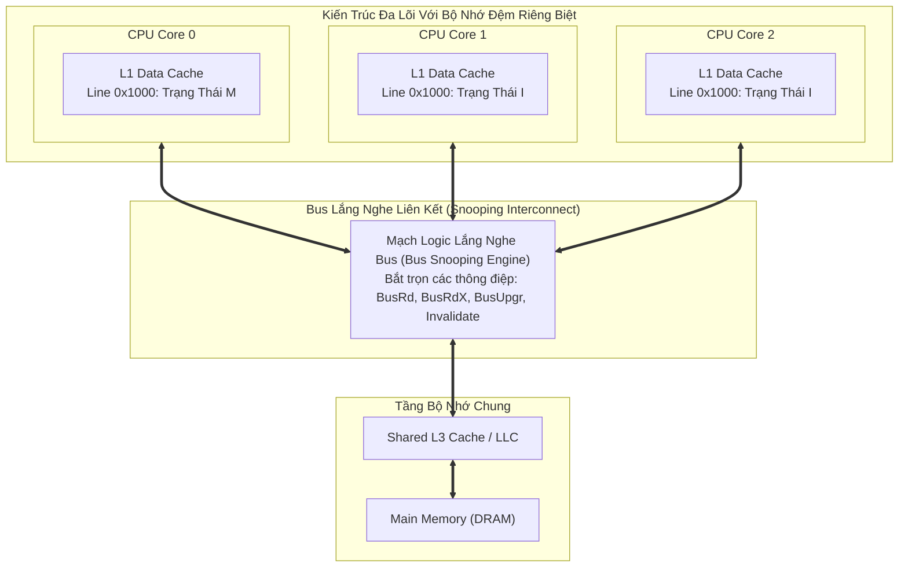
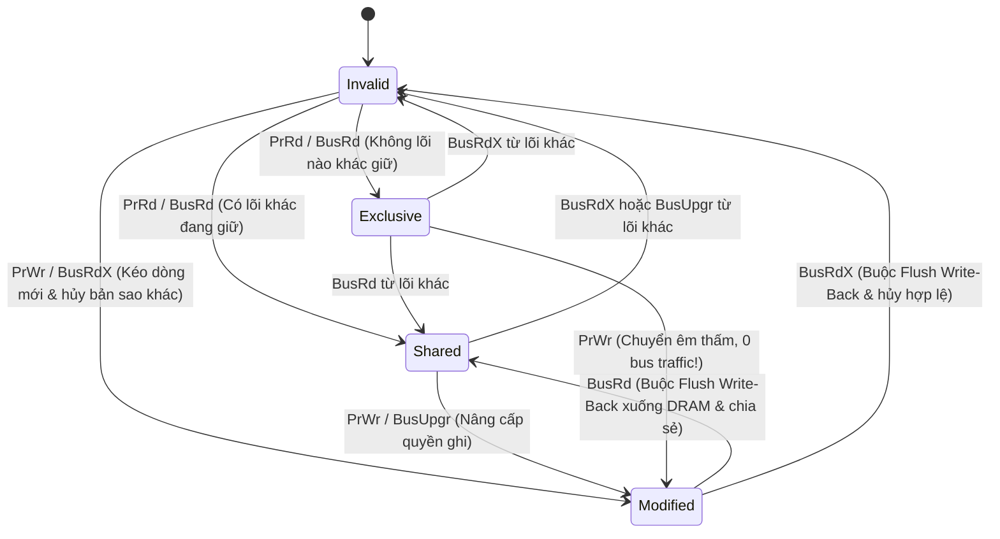
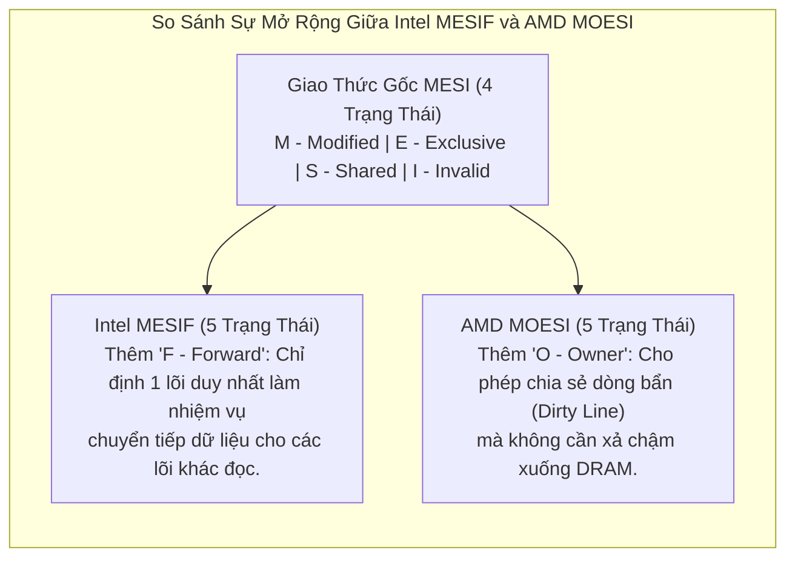

# 12.3. Cache Coherence Protocols: MESI, MESIF & MOESI (Các Giao thức Nhất quán Bộ nhớ đệm)

> [!IMPORTANT]
> **Nếu bạn chỉ được nhớ một điều duy nhất:**
> Trong hệ thống đa nhân, mỗi lõi CPU đều sở hữu một bản sao dữ liệu trong bộ nhớ đệm riêng: **Giao thức Nhất quán Bộ nhớ đệm (Cache Coherence Protocol)** là bản hiệp ước phần cứng bảo đảm mọi lõi CPU luôn luôn nhìn thấy cùng một giá trị chính xác của ô nhớ thông qua các máy trạng thái hữu hạn **MESI, MESIF (Intel Forward State)** và **MOESI (AMD Owner State)** — ngăn chặn triệt để thảm họa dữ liệu cũ và hiện tượng "nhảy bóng" dòng đệm (Cache Line Bouncing).

---

## 1. Kiến trúc Tổng quan & Mô hình Tư duy (Mental Model)

### Phép Loại Suy Thực Tế: Hội Đồng Quản Trị & Cuốn Sổ Kế Toán Dùng Chung

Hãy tưởng tượng một ban điều hành công ty gồm 4 vị phó giám đốc (4 Lõi CPU) đang cùng làm việc:
1. **Vấn Đề Bất Nhất Quán (Cache Incoherency - Mỗi Người Sửa Một Bản Sao Riêng)**:
   - Trong phòng lưu trữ có một cuốn sổ cái kế toán duy nhất (DRAM). Mỗi vị giám đốc photocopy một bản về bàn làm việc của mình (L1 Cache).
   - Nếu Giám đốc A tự ý lấy bút gạch số dư $100\text{ triệu}$ sửa thành $500\text{ triệu}$ mà không báo cho ai, thì Giám đốc B ngồi bên cạnh vẫn nhìn vào bản sao cũ và nghĩ công ty chỉ có $100\text{ triệu}$ (**Stale Data Hazard**)! Công ty sẽ phá sản vì quyết định sai lầm.
2. **Giao Thức MESI (Hệ Thống Bộ Đàm Thông Báo Trạng Thái)**:
   - Các giám đốc đeo bộ đàm kết nối chung một kênh sóng (**Shared Bus / Snooping Bus**). Mỗi bản sao tài liệu trên bàn được kẹp 1 trong 4 chiếc kẹp màu:
     - **I (Invalid - Kẹp Đen)**: Tài liệu rác, đã bị người khác sửa đổi, không được phép đọc.
     - **S (Shared - Kẹp Vàng)**: Tài liệu dùng chung sạch sẽ, nhiều người cùng có bản sao giống hệt nhau, ai cũng được đọc nhưng KHÔNG AI ĐƯỢC PHÉP TỰ Ý SỬA.
     - **E (Exclusive - Kẹp Xanh Lá)**: Duy nhất MÌNH TÔI có bản sao này, dữ liệu hoàn toàn khớp với sổ cái trong kho. Tôi có thể sửa ngay mà không cần xin phép ai.
     - **M (Modified - Kẹp Đỏ)**: Duy nhất MÌNH TÔI có và TÔI ĐÃ SỬA ĐỔI. Dữ liệu trong kho hiện đã bị cũ. Khi nào tôi vứt bản này đi, tôi có nghĩa vụ phải cập nhật lại sổ cái trong kho (**Write-Back**).
3. **Intel MESIF (Chỉ Định Người Phát Ngôn - Forward State)**:
   - Khi có người thứ 5 bước vào hỏi: *"Ai có bản sao cho tôi đọc nhờ với?"*, thay vì cả 4 giám đốc cùng đồng thanh hét vào bộ đàm gây nghẽn sóng (**Bus Traffic Storm**), chỉ DUY NHẤT một người được gắn thẻ **F (Forward)** có trách nhiệm photocopy chuyển cho người mới.
4. **AMD MOESI (Người Đứng Tên Nhận Nợ - Owner State)**:
   - Trong MESI, nếu Giám đốc A đang cầm bản Kẹp Đỏ (Modified) mà Giám đốc B muốn đọc, Giám đốc A bắt buộc phải chạy xuống kho cập nhật sổ cái (DRAM) rồi mới chuyển sang trạng thái Shared.
   - AMD MOESI đưa ra thẻ **O (Owner)**: Giám đốc A đưa thẳng bản sao cho Giám đốc B đọc (cả hai cùng đọc dữ liệu mới nhất), nhưng Giám đốc A vẫn giữ thẻ Owner chịu trách nhiệm cập nhật kho sau này, tiết kiệm được một chuyến đi xuống kho DRAM tốn kém!



---

## 2. Chi tiết từng Keyword (Under-the-Hood Deep Dive)

### 2.1. The Classic MESI Protocol (4 States Deep Dive)

Giao thức MESI (còn gọi là giao thức Illinois) là nền tảng của toàn bộ vi xử lý máy tính đa lõi hiện đại. Mỗi dòng cache line $64\text{ bytes}$ được gắn thêm **2 bits trạng thái** đại diện cho 4 trạng thái:

```
+---------------+--------------------------------------------------------------------------+
| Trạng Thái    | Ý Nghĩa Vi Kiến Trúc & Quyền Hạn Của Lõi CPU                            |
+---------------+--------------------------------------------------------------------------+
| M - Modified  | Dòng cache ĐÃ BỊ SỬA ĐỔI, chỉ tồn tại duy nhất trên L1/L2 của lõi này.   |
|               | Dữ liệu trong DRAM/L3 là dữ liệu CŨ (Stale). Lõi có quyền Đọc và Ghi.    |
+---------------+--------------------------------------------------------------------------+
| E - Exclusive | Dòng cache CHƯA BỊ SỬA, chỉ tồn tại duy nhất trên L1/L2 của lõi này.     |
|               | Dữ liệu KHỚP TUYỆT ĐỐI với DRAM. Lõi có thể nâng cấp lên M mà không cần  |
|               | phát tín hiệu vô hiệu hóa trên bus!                                      |
+---------------+--------------------------------------------------------------------------+
| S - Shared    | Dòng cache có thể ĐANG TỒN TẠI TRÊN NHIỀU LÕI CPU KHÁC NHAU.             |
|               | Dữ liệu sạch khớp với DRAM. Lõi chỉ có quyền ĐỌC, không được tự ý GHI.   |
+---------------+--------------------------------------------------------------------------+
| I - Invalid   | Dòng cache KHÔNG HỢP LỆ (Rác). Không chứa dữ liệu có nghĩa.              |
|               | Bất kỳ truy cập đọc/ghi nào cũng bị coi là Cache Miss.                   |
+---------------+--------------------------------------------------------------------------+
```

#### Máy Trạng Thái Hữu Hạn MESI (State Transition FSM)
Các chuyển đổi trạng thái được kích hoạt bởi hai nguồn sự kiện:
1. **Yêu cầu từ chính lõi CPU (Local Processor Requests)**:
   - `PrRd` (Processor Read): Lõi CPU muốn đọc dòng nhớ.
   - `PrWr` (Processor Write): Lõi CPU muốn ghi vào dòng nhớ.
2. **Yêu cầu lắng nghe từ Bus (Snooped Bus Requests do các lõi khác phát ra)**:
   - `BusRd`: Một lõi khác muốn đọc dòng nhớ nhưng không có ý định sửa đổi.
   - `BusRdX` (Bus Read Invalidate): Một lõi khác muốn ghi vào dòng nhớ và yêu cầu tất cả các lõi khác phải lập tức hủy hợp lệ bản sao của mình!
   - `BusUpgr` (Bus Upgrade): Một lõi đang có bản sao ở trạng thái $S$ muốn nâng cấp lên $M$ để ghi, yêu cầu các bản sao $S$ khác tự hủy sang $I$.



#### Cơ Chế Bus Snooping vs Directory-Based Coherence
- **Snooping Protocol (Lắng Nghe Đường Truyền Dùng Chung)**:
  - Mọi bộ điều khiển cache L1/L2 đều liên tục "nghe trộm" mọi gói tin broadcast trên bus kết nối.
  - *Hạn chế*: Băng thông bus broadcast bão hòa nhanh chóng khi số lõi vượt quá 16 hoặc 32 cores.
- **Directory-Based Protocol (Dựa Trên Thư Mục Trung Tâm)**:
  - Dành cho các hệ thống máy chủ lớn (64 đến 512 cores NUMA).
  - Một bảng thư mục trung tâm (Directory) lưu trữ một danh sách bitmask (**Sharer Mask**) ghi nhận chính xác lõi nào đang giữ bản sao của dòng nhớ nào.
  - Khi có lệnh ghi, tín hiệu vô hiệu hóa (**Invalidate**) chỉ được gửi điểm-điểm (Point-to-Point) tới đúng các lõi đang giữ bản sao, triệt tiêu hoàn toàn sự nghẽn mạng do broadcast!

---

### 2.2. Advanced Protocols: Intel MESIF vs AMD MOESI

Để tối ưu hóa lưu lượng bus và độ trễ truy xuất trong các kiến trúc đa nhân khổng lồ, hai ông lớn bán dẫn đã mở rộng chuẩn MESI 4 trạng thái thành các chuẩn 5 trạng thái chuyên biệt:

#### 1. Intel MESIF: Bổ Sung Trạng Thái Forward (F-State)
- **Vấn Đề Của MESI Khi Có Nhiều Lõi Chia Sẻ**:
  - Giả sử 16 lõi CPU cùng giữ một dòng cache ở trạng thái $S$. Khi một lõi thứ 17 phát lệnh đọc `BusRd`, theo giao thức MESI chuẩn, **cả 16 lõi đều có thể cố gắng phản hồi dữ liệu** hoặc yêu cầu đọc phải đi xuống tận bộ nhớ DRAM chậm chạp.
- **Giải Pháp Forward (F)**:
  - Trạng thái **F (Forward)** là một dạng đặc biệt của trạng thái Shared: Nó đại diện cho bản sao Shared *duy nhất* có trách nhiệm phản hồi dữ liệu khi có một lõi khác yêu cầu đọc!
  - Trong số tất cả các lõi đang giữ dòng nhớ sạch, chỉ có duy nhất $1$ lõi giữ trạng thái **F**, các lõi còn lại giữ trạng thái **S**.
  - Khi một lõi mới nạp dòng nhớ, quyền hạn **F** thường được chuyển giao cho lõi mới nhất này. Nhờ đó, yêu cầu đọc luôn được phục vụ từ cache L1/L2 của hàng xóm với tốc độ nhanh nhất mà không gây bão hòa bus.

#### 2. AMD MOESI: Bổ Sung Trạng Thái Owner (O-State)
- **Vấn Đề Của MESI Khi Chia Sẻ Dòng Đã Bị Sửa (Dirty Sharing)**:
  - Trong MESI, nếu Lõi 0 đang giữ dòng nhớ ở trạng thái **Modified (M)** và Lõi 1 muốn đọc dòng nhớ đó: Lõi 0 bắt buộc phải ghi dữ liệu bị sửa xuống L3/DRAM (**Memory Write-Back**), sau đó cả Lõi 0 và Lõi 1 mới chuyển về trạng thái **Shared (S)**. Thao tác ghi trả này tốn hàng trăm chu kỳ clock không cần thiết.
- **Giải Pháp Owner (O)**:
  - Trạng thái **O (Owner)** cho phép **chia sẻ một dòng cache đã bị sửa đổi (Dirty Line) cho các lõi khác mà KHÔNG CẦN ghi trả về DRAM**!
  - Lõi 0 chuyển từ **M** sang **O**, và Lõi 1 chuyển sang **S**.
  - Cả hai lõi đều có thể thoải mái đọc dữ liệu mới nhất.
  - Lõi giữ trạng thái **O** đóng vai trò là "chủ nhân hợp pháp": Nó chịu trách nhiệm phản hồi dữ liệu cho các yêu cầu đọc tiếp theo, và khi dòng nhớ bị trục xuất (Eviction), nó là người duy nhất có nghĩa vụ xả dữ liệu xuống DRAM!



---

## 3. Thực thi Mã nguồn & Mô phỏng Chuyên sâu (Dual-Engine Implementation)

### 3.1. C++20: Trình Giả Lập Máy Trạng Thái Hữu Hạn (FSM) Giao Thức MESI Đa Lõi

Chương trình minh họa triển khai đầy đủ logic chuyển đổi trạng thái của máy trạng thái hữu hạn MESI trên một hệ thống đa lõi ảo:

```cpp
#include <iostream>
#include <vector>
#include <string>
#include <iomanip>

enum class MESIState { MODIFIED, EXCLUSIVE, SHARED, INVALID };

std::string to_string(MESIState state) {
    switch (state) {
        case MESIState::MODIFIED:  return "MODIFIED  (M)";
        case MESIState::EXCLUSIVE: return "EXCLUSIVE (E)";
        case MESIState::SHARED:    return "SHARED    (S)";
        case MESIState::INVALID:   return "INVALID   (I)";
    }
    return "UNKNOWN";
}

struct CacheLine {
    uint64_t tag = 0;
    MESIState state = MESIState::INVALID;
    uint32_t data = 0;
};

class SimulatedMulticoreMESI {
private:
    size_t num_cores;
    std::vector<CacheLine> cores_cache;

public:
    SimulatedMulticoreMESI(size_t cores) : num_cores(cores), cores_cache(cores) {}

    // 1. Thao tác ĐỌC từ Lõi core_id (Processor Read - PrRd)
    void processor_read(size_t core_id, uint64_t tag) {
        std::cout << ">>> CORE " << core_id << " PHÁT LỆNH ĐỌC (PrRd) Tag 0x" << std::hex << tag << std::dec << ":\n";

        if (cores_cache[core_id].state != MESIState::INVALID && cores_cache[core_id].tag == tag) {
            std::cout << "  -> L1 Cache Hit trên chính Core " << core_id << " (State: " 
                      << to_string(cores_cache[core_id].state) << ")\n\n";
            return;
        }

        // Cache Miss: Lắng nghe trên Bus (Snooping)
        bool other_has_it = false;
        for (size_t c = 0; c < num_cores; ++c) {
            if (c != core_id && cores_cache[c].tag == tag && cores_cache[c].state != MESIState::INVALID) {
                other_has_it = true;
                if (cores_cache[c].state == MESIState::MODIFIED) {
                    std::cout << "  [Bus Snoop] Core " << c << " đang giữ MODIFIED -> Buộc Flush Write-Back xuống RAM!\n";
                    cores_cache[c].state = MESIState::SHARED;
                } else if (cores_cache[c].state == MESIState::EXCLUSIVE) {
                    cores_cache[c].state = MESIState::SHARED;
                }
            }
        }

        cores_cache[core_id].tag = tag;
        cores_cache[core_id].data = 100; // Nạp từ DRAM hoặc Cache khác
        cores_cache[core_id].state = other_has_it ? MESIState::SHARED : MESIState::EXCLUSIVE;

        std::cout << "  -> Trạng thái mới của Core " << core_id << ": " 
                  << to_string(cores_cache[core_id].state) << "\n\n";
    }

    // 2. Thao tác GHI từ Lõi core_id (Processor Write - PrWr)
    void processor_write(size_t core_id, uint64_t tag, uint32_t val) {
        std::cout << ">>> CORE " << core_id << " PHÁT LỆNH GHI (PrWr) Tag 0x" << std::hex << tag << std::dec 
                  << " = " << val << ":\n";

        // Phát tín hiệu vô hiệu hóa (Invalidate / BusRdX) tới toàn bộ các lõi khác!
        for (size_t c = 0; c < num_cores; ++c) {
            if (c != core_id && cores_cache[c].tag == tag && cores_cache[c].state != MESIState::INVALID) {
                std::cout << "  [Bus Snoop] Core " << c << " nhận tín hiệu Invalidate -> Chuyển sang INVALID (I)!\n";
                cores_cache[c].state = MESIState::INVALID;
            }
        }

        cores_cache[core_id].tag = tag;
        cores_cache[core_id].data = val;
        cores_cache[core_id].state = MESIState::MODIFIED;

        std::cout << "  -> Trạng thái mới của Core " << core_id << ": " 
                  << to_string(cores_cache[core_id].state) << "\n\n";
    }

    void print_cache_states() {
        std::cout << "--- TÌNH TRẠNG BỘ NHỚ ĐỆM CÁC CORES ---\n";
        for (size_t c = 0; c < num_cores; ++c) {
            std::cout << "  Core " << c << " | State: " << std::left << std::setw(15) 
                      << to_string(cores_cache[c].state) << " | Data: " << cores_cache[c].data << "\n";
        }
        std::cout << "---------------------------------------\n\n";
    }
};

int main() {
    std::cout << "========================================================\n";
    std::cout << "  C++20 HARDWARE MESI PROTOCOL STATE MACHINE EMULATOR\n";
    std::cout << "========================================================\n\n";

    SimulatedMulticoreMESI system(4); // Hệ thống 4 lõi CPU

    // Kịch bản chuyển đổi trạng thái thực tế:
    system.processor_read(0, 0x1000);  // Core 0 đọc đầu tiên -> EXCLUSIVE
    system.processor_read(1, 0x1000);  // Core 1 cùng đọc -> Cả hai chuyển SHARED
    system.processor_write(0, 0x1000, 42); // Core 0 ghi -> Core 0 lên MODIFIED, Core 1 bị INVALID!
    system.print_cache_states();

    system.processor_read(2, 0x1000);  // Core 2 đọc -> Core 0 Flush Write-Back, cả hai về SHARED
    system.print_cache_states();

    return 0;
}
```

---

### 3.2. Python 3.11+: Trình Giả Lập AMD MOESI & Đo Lường Tiết Kiệm Băng Thông Bus

Chương trình Python 3.11+ mô phỏng giao thức AMD MOESI với trạng thái Owner (O), đo lường số lần tiết kiệm được các chu kỳ xả Write-Back xuống DRAM:

```python
from dataclasses import dataclass
from typing import Dict, List

@dataclass
class MOESILine:
    state: str = 'I'  # M, O, E, S, I
    data: int = 0

class MOESISystemSimulator:
    def __init__(self, num_cores: int = 4):
        self.num_cores = num_cores
        self.caches: List[MOESILine] = [MOESILine() for _ in range(num_cores)]
        self.dram_writes = 0
        self.dram_reads = 0

    def read(self, core_id: int):
        current = self.caches[core_id]
        if current.state in ['M', 'O', 'E', 'S']:
            return f"Core {core_id} Hit ({current.state})"

        # Miss: Tìm xem có Core nào đang giữ Owner hoặc Modified không
        owner_core = None
        for c in range(self.num_cores):
            if c != core_id and self.caches[c].state in ['M', 'O']:
                owner_core = c
                break

        if owner_core is not None:
            # Sức mạnh của AMD MOESI: Chuyển thẳng dữ liệu từ Owner sang Sharer
            # KHÔNG CẦN GHI TRẢ XUỐNG DRAM! (DRAM Writes = 0)
            self.caches[owner_core].state = 'O' # Chuyển sang Owner
            self.caches[core_id].state = 'S'
            self.caches[core_id].data = self.caches[owner_core].data
            return (f"MOESI DIRTY SHARING: Core {core_id} nhận dữ liệu trực tiếp từ Core {owner_core} (Owner). "
                    f"DRAM KHÔNG BỊ GHI TRẢ!")
        else:
            self.dram_reads += 1
            self.caches[core_id].state = 'S'
            return f"Core {core_id} Miss -> Nạp từ DRAM"

    def write(self, core_id: int, new_val: int):
        # Vô hiệu hóa toàn bộ các lõi khác
        for c in range(self.num_cores):
            if c != core_id:
                self.caches[c].state = 'I'

        self.caches[core_id].state = 'M'
        self.caches[core_id].data = new_val
        return f"Core {core_id} Ghi Mới (MODIFIED) -> Toàn bộ các Cores khác bị INVALID hóa"

if __name__ == "__main__":
    print("========================================================")
    print("  PYTHON 3.11 AMD MOESI DIRTY SHARING SIMULATOR")
    print("========================================================\n")

    sim = MOESISystemSimulator(num_cores=4)

    print("1. Core 0 thực hiện Ghi giá trị 99:")
    print(f"   {sim.write(0, 99)}\n")

    print("2. Core 1 muốn ĐỌC dòng dữ liệu đó:")
    msg_read = sim.read(1)
    print(f"   {msg_read}")
    print(f"   - Trạng thái Core 0: {sim.caches[0].state} (Đang là Chủ Nhân Owner)")
    print(f"   - Trạng thái Core 1: {sim.caches[1].state} (Shared)")
    print(f"   - Lượng DRAM Writes : {sim.dram_writes} (Tiết kiệm hoàn toàn bus bộ nhớ!)\n")

    print("3. Core 2 tiếp tục muốn ĐỌC dòng dữ liệu đó:")
    msg_read2 = sim.read(2)
    print(f"   {msg_read2}")
    print(f"   - Lượng DRAM Writes : {sim.dram_writes}")
```

---

### 3.3. Simulated Terminal Output

```bash
========================================================
  C++20 HARDWARE MESI PROTOCOL STATE MACHINE EMULATOR
========================================================

>>> CORE 0 PHÁT LỆNH ĐỌC (PrRd) Tag 0x1000:
  -> Trạng thái mới của Core 0: EXCLUSIVE (E)

>>> CORE 1 PHÁT LỆNH ĐỌC (PrRd) Tag 0x1000:
  -> Trạng thái mới của Core 0: SHARED (S)
  -> Trạng thái mới của Core 1: SHARED (S)

>>> CORE 0 PHÁT LỆNH GHI (PrWr) Tag 0x1000 = 42:
  [Bus Snoop] Core 1 nhận tín hiệu Invalidate -> Chuyển sang INVALID (I)!
  -> Trạng thái mới của Core 0: MODIFIED  (M)

--- TÌNH TRẠNG BỘ NHỚ ĐỆM CÁC CORES ---
  Core 0 | State: MODIFIED  (M)   | Data: 42
  Core 1 | State: INVALID   (I)   | Data: 0
  Core 2 | State: INVALID   (I)   | Data: 0
  Core 3 | State: INVALID   (I)   | Data: 0
---------------------------------------

>>> CORE 2 PHÁT LỆNH ĐỌC (PrRd) Tag 0x1000:
  [Bus Snoop] Core 0 đang giữ MODIFIED -> Buộc Flush Write-Back xuống RAM!
  -> Trạng thái mới của Core 2: SHARED    (S)

--- TÌNH TRẠNG BỘ NHỚ ĐỆM CÁC CORES ---
  Core 0 | State: SHARED    (S)   | Data: 42
  Core 1 | State: INVALID   (I)   | Data: 0
  Core 2 | State: SHARED    (S)   | Data: 42
  Core 3 | State: INVALID   (I)   | Data: 0
---------------------------------------

========================================================
  PYTHON 3.11 AMD MOESI DIRTY SHARING SIMULATOR
========================================================

1. Core 0 thực hiện Ghi giá trị 99:
   Core 0 Ghi Mới (MODIFIED) -> Toàn bộ các Cores khác bị INVALID hóa

2. Core 1 muốn ĐỌC dòng dữ liệu đó:
   MOESI DIRTY SHARING: Core 1 nhận dữ liệu trực tiếp từ Core 0 (Owner). DRAM KHÔNG BỊ GHI TRẢ!
   - Trạng thái Core 0: O (Đang là Chủ Nhân Owner)
   - Trạng thái Core 1: S (Shared)
   - Lượng DRAM Writes : 0 (Tiết kiệm hoàn toàn bus bộ nhớ!)

3. Core 2 tiếp tục muốn ĐỌC dòng dữ liệu đó:
   MOESI DIRTY SHARING: Core 2 nhận dữ liệu trực tiếp từ Core 0 (Owner). DRAM KHÔNG BỊ GHI TRẢ!
   - Lượng DRAM Writes : 0
```

---

## 4. Systems Engineering & Production Pitfalls

### 4.1. Production Failure Modes & Architectural Traps

1. **Trap 1: False Sharing & The Cache Line Bouncing Storm (Bão Nhảy Bóng Dòng Đệm)**:
   - Hai biến độc lập `counterA` và `counterB` được hai luồng trên Core 0 và Core 1 cập nhật liên tục. Do người lập trình không căn chỉnh ô nhớ, hai biến này nằm chung trên một Cache Line $64\text{ bytes}$.
   - Khi Core 0 ghi `counterA`, nó phát tín hiệu Invalidate hủy hợp lệ dòng cache của Core 1 (chuyển sang $I$). Ngay nano-giây sau, Core 1 muốn ghi `counterB`, nó lại phát tín hiệu Invalidate hủy dòng của Core 0!
   - Dòng cache liên tục bị giằng xé "nhảy bóng" qua lại giữa hai lõi (**Cache Line Bouncing**), làm bão hòa bus liên kết và làm giảm tốc độ xử lý xuống tới **50 lần**! Giải pháp bắt buộc: Dùng `alignas(64)` hoặc padding để cách ly hai biến sang hai Cache Lines khác nhau.
2. **Trap 2: Tắc Nghẽn Hàng Đợi Vô Hiệu Hóa (Invalidation Queue Saturation)**:
   - Để tránh việc CPU phải dừng lại chờ các lõi khác xác nhận việc vô hiệu hóa, phần cứng sử dụng **Store Buffers** và **Invalidate Queues**. Nếu một luồng ghi dồn dập vào nhiều biến chia sẻ, Invalidate Queue bị đầy, buộc CPU phải đình chỉ toàn bộ các chỉ thị lệnh nạp tiếp theo, gây ra hiện tượng giật lag hệ thống bất thường.
3. **Trap 3: Lạm Dụng Biến Atomic Trong Vòng Lặp Spinlock (Bus Lock Choke)**:
   - Sử dụng vòng lặp kiểm tra cờ nguyên tử `while (flag.exchange(true))` liên tục phát ra các lệnh khóa bus và thông điệp BusRdX trong giao thức MESI, triệt tiêu băng thông của tất cả các lõi CPU khác. Bắt buộc phải dùng mẫu kiểm tra kép **Test and Test-and-Set**: `while (flag.load(relaxed)) { pause(); }` để vòng lặp chỉ đọc ở trạng thái **Shared (S)** trong L1 nội bộ mà không sinh ra lưu lượng trên bus.

### 4.2. Diagnostic CLI Commands

```bash
# 1. Chuan doan hien tuong False Sharing va Cache Line Bouncing bang perf c2c
sudo perf c2c record -F 60000 -- ./high_contention_service
sudo perf c2c report --stdio | head -n 40

# 2. Theo doi so luong thong diep Invalidation va xung dot Cache Coherence
perf stat -e mem_load_l3_hit_retired.xsnp_hitm,mem_load_l3_hit_retired.xsnp_hit ./high_contention_service

# 3. Kiem tra tinh trang can chinh 64 bytes cua cac struct bang cong cu pahole
pahole -C MySharedState ./high_contention_service

# 4. Kiem tra so chu ky CPU bi lang phi cho khoa dong bo va Bus Locks
perf stat -e lock:lock_acquire,lock:lock_contended ./high_contention_service
```

---

## 5. Bảng So sánh & Decision Matrix

| Giao Thức Nhất Quán | Số Lượng Trạng Thái | Trạng Thái Bổ Sung | Cơ Chế Tối Ưu Hóa Trọng Tâm | Hãng Thiết Kế Vi Xử Lý |
| :--- | :--- | :--- | :--- | :--- |
| **MESI** (Illinois) | 4 Trạng Thái | Không có ($M, E, S, I$) | Tiêu chuẩn cơ bản, hỗ trợ Exclusive Clean | Chuẩn công nghiệp chung |
| **MESIF** | 5 Trạng Thái | **F (Forward)** | Chỉ định duy nhất 1 lõi chuyển tiếp phản hồi đọc | **Intel** (Core, Xeon Nehalem trở đi) |
| **MOESI** | 5 Trạng Thái | **O (Owner)** | Cho phép chia sẻ dòng bẩn mà không cần xả DRAM | **AMD** (Opteron, Zen EPYC), ARM |

| Trạng Thái Dòng Cache | Có Thể Đọc? | Có Thể Ghi Trực Tiếp? | Bản Sao Có Ở Lõi Khác? | Dữ Liệu Có Khớp Với DRAM? | Hành Vi Khi Có Lệnh PrWr |
| :--- | :--- | :--- | :--- | :--- | :--- |
| **M (Modified)** | Có ($1$ cycle) | Có ($1$ cycle) | Không (Duy nhất 1 lõi) | **Không khớp (Dirty)** | Ghi đè trực tiếp, giữ nguyên $M$ |
| **E (Exclusive)** | Có ($1$ cycle) | Có ($1$ cycle) | Không (Duy nhất 1 lõi) | **Khớp tuyệt đối (Clean)** | Nâng cấp thẳng lên $M$ ($0$ bus traffic) |
| **S (Shared)** | Có ($1$ cycle) | **Không được phép** | Có (Nhiều lõi khác cùng giữ) | Khớp tuyệt đối | Phát `BusUpgr` hủy lõi khác, lên $M$ |
| **I (Invalid)** | **Không (Miss)** | **Không (Miss)** | Không có ý nghĩa | Không có ý nghĩa | Phát `BusRdX` kéo dòng mới, lên $M$ |
| **O (Owner - MOESI)** | Có ($1$ cycle) | Có (Sau khi Invalidate) | Có (Các lõi khác ở trạng thái $S$) | **Không khớp (Dirty)** | Phát `BusUpgr` hủy lõi khác, lên $M$ |
| **F (Forward - MESIF)**| Có ($1$ cycle) | Không được phép | Có (Các lõi khác ở trạng thái $S$) | Khớp tuyệt đối | Phát `BusUpgr` và phản hồi dữ liệu |
