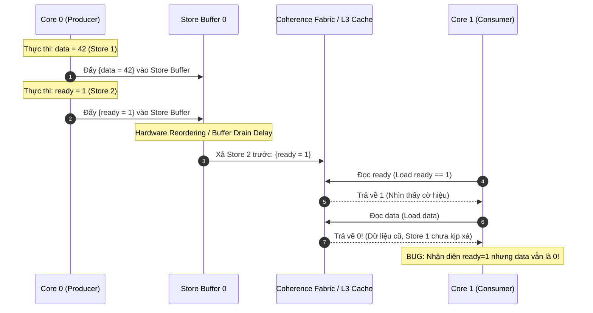
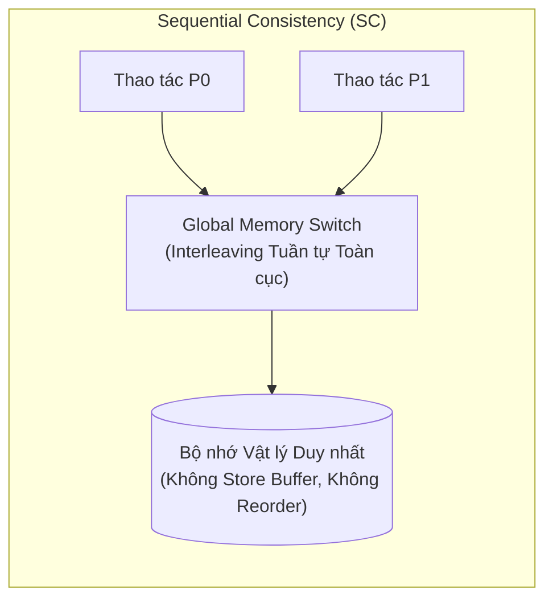
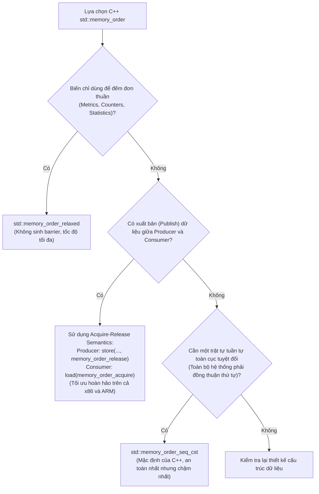

# 13.1. Memory Consistency Models

> [!IMPORTANT]
> **Nếu bạn chỉ được nhớ một điều duy nhất:** Thứ tự thực thi lệnh trong mã nguồn của bạn (Program Order) KHÔNG PHẢI là thứ tự mà các CPU core khác nhìn thấy trên hệ thống phần cứng (Memory Visibility Order). Kiến trúc x86 áp dụng mô hình Total Store Order (TSO) chỉ cho phép đảo thứ tự Store-Load (do Store Buffer). Trong khi đó, các kiến trúc hiện đại như ARM và RISC-V áp dụng mô hình Weak Memory Ordering (WMO) cho phép phần cứng tự do đảo thứ tự Load-Load, Load-Store, Store-Store và Store-Load. Mọi giả định về tính tuần tự ngây thơ mà không có rào cản bộ nhớ (Memory Fence) hoặc ngữ nghĩa Acquire-Release đều sẽ dẫn đến lỗi tương tranh dữ liệu (Heisenbugs) không thể tái hiện bằng debug thông thường.

---

## 1. Kiến trúc Tổng quan & Mô hình Tư duy (Mental Model)

### Ẩn dụ Đời sống: Bảng Tin Công ty vs Văn phòng Phân tán
Hãy tưởng tượng một công ty có hai giám đốc điều hành (Core 0 và Core 1) làm việc ở hai phòng cách biệt. Mỗi người có một thư ký riêng (Store Buffer) ngồi ngay cửa phòng.
- Khi Giám đốc 0 viết một thông báo: "Dự án A đã hoàn thành" (`data = 42`), rồi viết tiếp thông báo thứ hai: "Mọi người có thể mở tiệc" (`ready = 1`).
- Nếu Giám đốc 0 chỉ giao hai tờ giấy này cho thư ký của mình mà không dặn dò gì thêm: Thư ký có thể giữ tờ giấy thứ nhất lại để dập ghim hoặc trả lời điện thoại, nhưng lại chạy đi dán ngay tờ giấy thứ hai lên bảng tin chung!
- Ở phòng bên cạnh, Giám đốc 1 đọc thấy thông báo "Mọi người có thể mở tiệc" (`ready == 1`), liền chạy vào phòng họp để ăn mừng nhưng thấy dự án vẫn chưa xong (`data == 0`)!



---

## 2. Chi tiết từng Keyword (Under-the-Hood Deep Dive)

### 2.1. Memory Consistency & Memory Ordering
- **Khái niệm Cốt lõi**: Memory Consistency Model (Mô hình Nhất quán Bộ nhớ) là bản hợp đồng kiến trúc (Architectural Contract) giữa phần cứng và phần mềm. Nó xác định chính xác các giá trị hợp lệ mà một thao tác đọc bộ nhớ (Load) được phép trả về khi có nhiều luồng cùng đọc và ghi đồng thời vào nhiều vị trí nhớ khác nhau.
- **Sự khác biệt giữa Cache Coherence và Memory Consistency**:
  - *Cache Coherence (Tính gắn kết bộ nhớ đệm)*: Chỉ áp dụng trên **MỘT địa chỉ ô nhớ đơn lẻ** (Single Memory Location). Nó đảm bảo tất cả các core đều đồng thuận về một thứ tự ghi duy nhất trên ô nhớ đó (Serialize writes to a single location) và không ai đọc phải dữ liệu rác cũ.
  - *Memory Consistency (Tính nhất quán bộ nhớ)*: Áp dụng trên **NHIỀU địa chỉ ô nhớ khác nhau** (Multiple Memory Locations). Nó quy định các thao tác đọc và ghi vào các ô nhớ $A, B, C$ có thể được quan sát thấy theo thứ tự nào giữa các luồng.
- **Nguồn gốc của việc Đảo thứ tự Bộ nhớ (Hardware & Compiler Reordering)**:
  1. *Compiler Optimization*: Trình biên dịch tái sắp xếp lệnh (Instruction Scheduling), gộp ghi (Store Merging), hoặc đưa biến vào thanh ghi (Register Allocation) để tối ưu pipeline.
  2. *Out-of-Order Execution (OoO Engine)*: CPU nạp các lệnh Load/Store độc lập vào Reorder Buffer (ROB) và Reservation Stations để thực thi sớm nhằm che giấu độ trễ truy cập RAM.
  3. *Store Buffering*: Dữ liệu ghi được đưa vào Store Buffer và xả bất đồng bộ xuống L1 Cache.

### 2.2. Sequential Consistency (SC) - Chuẩn mực Cổ điển Leslie Lamport (1979)
- **Định nghĩa Hình thức**: Một hệ thống đa xử lý đạt tính Nhất quán Tuần tự nếu kết quả của bất kỳ quá trình thực thi nào cũng tương đương như khi tất cả các thao tác của mọi bộ xử lý được thực thi theo một thứ tự tuần tự toàn cục nào đó (Global Interleaving), và trong thứ tự tuần tự này, các thao tác của từng bộ xử lý riêng lẻ đều xuất hiện theo đúng thứ tự chương trình (Program Order).
- **Đặc trưng**:
  - Mọi thao tác Load và Store đều có hiệu lực tức thì trên toàn hệ thống (Atomic Visibility).
  - Không tồn tại bất kỳ sự đảo thứ tự nào: Không $W \to R$, không $W \to W$, không $R \to R$, không $R \to W$.
- **Cái giá phải trả**: Để đảm bảo SC ở cấp phần cứng, mỗi khi CPU thực hiện một lệnh Store, toàn bộ pipeline phải dừng lại (Stall) chờ đợi cho đến khi dòng cache nhận được phản hồi Invalidation Acknowledge từ mọi core khác. Điều này làm sụt giảm từ 70% đến 90% thông lượng tính toán của CPU hiện đại.



### 2.3. Total Store Order (TSO) & Mô hình Bộ nhớ x86
- **Kiến trúc Áp dụng**: Intel x86, AMD64 (x86-64), SPARC TSO.
- **Nguyên lý Hoạt động**:
  - Trang bị một **FIFO Store Buffer** nằm giữa lõi xử lý và L1 Data Cache.
  - Khi CPU thực hiện lệnh Store, giá trị được ghi ngay vào Store Buffer và lệnh coi như hoàn tất (Retire sớm để tiếp tục thực thi lệnh tiếp theo). Dữ liệu trong Store Buffer sau đó được xả (drain) xuống cache theo cơ chế First-In First-Out.
  - **Store Forwarding**: Lõi hiện tại có thể đọc ngay giá trị vừa ghi trong Store Buffer của chính nó trước khi giá trị đó được xả xuống cache.
- **Quy tắc Đảo thứ tự trong x86 TSO**:
  - Giữ nguyên thứ tự: Load $\to$ Load (Không đảo), Store $\to$ Store (Không đảo), Load $\to$ Store (Không đảo).
  - **CHỈ DUY NHẤT một kiểu đảo thứ tự được phép xảy ra: Store $\to$ Load Reordering ($W \to R$)**. Một lệnh Load vào ô nhớ $Y$ có thể hoàn tất trước khi một lệnh Store vào ô nhớ $X$ trước đó kịp xả ra khỏi Store Buffer xuống toàn hệ thống!

### 2.4. Relaxed / Weak Memory Ordering (WMO) & Kiến trúc ARM / RISC-V
- **Kiến trúc Áp dụng**: ARMv8/ARMv9 (AArch64), RISC-V (RVWMO), IBM POWER, GPU (NVIDIA CUDA PTX).
- **Đặc trưng Bản chất**:
  - Không có trật tự ngầm định nào giữa các thao tác bộ nhớ khác địa chỉ! Phần cứng mặc định coi mọi thao tác đọc/ghi vào các ô nhớ độc lập là không phụ thuộc và được phép thực thi hoàn toàn ngoài thứ tự.
  - Cho phép tất cả 4 kiểu đảo thứ tự:
    1. **Load $\to$ Load Reordering ($R \to R$)**: Lệnh đọc sau có thể nạp dữ liệu trước lệnh đọc trước.
    2. **Load $\to$ Store Reordering ($R \to W$)**: Lệnh ghi có thể được thực hiện trước lệnh đọc trước đó.
    3. **Store $\to$ Store Reordering ($W \to W$)**: Thứ tự xả các dòng ghi ra bộ nhớ đệm có thể bị xáo trộn hoàn toàn.
    4. **Store $\to$ Load Reordering ($W \to R$)**: Lệnh đọc vượt lên trước lệnh ghi.
- **Ưu điểm**: Khai thác tối đa hiệu năng của vi kiến trúc OoO và giảm thiểu tiêu thụ năng lượng (rất quan trọng trên thiết bị di động và máy chủ tiết kiệm điện).
- **Bắt buộc**: Lập trình viên hoặc trình biên dịch phải chèn tường rào bộ nhớ tường minh (Explicit Fences: `DMB`, `DSB`, `ISB` trên ARM hoặc `fence` trên RISC-V) hoặc sử dụng các lệnh tải/lưu một chiều (One-way barriers: `LDAR` - Load-Acquire, `STLR` - Store-Release).

### 2.5. Litmus Tests: Store Buffering (SB) vs Message Passing (MP)
Litmus Test là các bài kiểm tra thực nghiệm ngắn gọn, chuẩn hóa được dùng trong khoa học máy tính để phân định mô hình bộ nhớ phần cứng.

#### A. Litmus Test: Store Buffering (SB)
Khởi tạo: `x = 0, y = 0`.
| Thread 0 | Thread 1 |
| :--- | :--- |
| `x = 1;` | `y = 1;` |
| `r0 = y;` | `r1 = x;` |

- **Kết quả có thể**:
  - `(r0 == 1, r1 == 1)`: Hợp lệ trên mọi mô hình.
  - `(r0 == 0, r1 == 1)` hoặc `(r0 == 1, r1 == 0)`: Hợp lệ trên mọi mô hình.
  - **`(r0 == 0, r1 == 0)`**:
    - **Sequential Consistency (SC)**: TUYỆT ĐỐI BỊ CẤM ($x=1$ hoặc $y=1$ buộc phải xảy ra trước).
    - **x86 TSO & ARM WMO**: HOÀN TOÀN HỢP LỆ! Do cả hai luồng đều đẩy giá trị ghi vào Store Buffer, sau đó thực hiện lệnh đọc $y$ và $x$ từ cache trước khi Store Buffer kịp xả.

#### B. Litmus Test: Message Passing (MP)
Khởi tạo: `data = 0, ready = 0`.
| Thread 0 (Producer) | Thread 1 (Consumer) |
| :--- | :--- |
| `data = 42;` | `while (ready == 0) {}` |
| `ready = 1;` | `r0 = data;` |

- **Kết quả vi phạm: `r0 == 0` sau khi vòng lặp kết thúc (`ready == 1`)**:
  - **x86 TSO**: KHÔNG BAO GIỜ XẢY RA (vì x86 cấm đảo thứ tự $Store \to Store$ và $Load \to Load$).
  - **ARM / RISC-V (WMO)**: HOÀN TOÀN CÓ THỂ XẢY RA! Nếu không có lệnh rào cản `DMB` hoặc `LDAR/STLR`, Thread 0 có thể ghi `ready = 1` trước `data = 42`, hoặc Thread 1 có thể đọc trước `data` bằng cơ chế nạp suy đoán (Speculative Load).

---

## 3. Thực thi Mã nguồn & Mô phỏng Chuyên sâu (Dual-Engine Implementation)

### 3.1. Engine 1: C++20 Store Buffering (SB) Litmus Test Runner
Chương trình kiểm tra thực tế trên CPU hiện tại để chứng minh hiện tượng Store Buffering Reordering (`r0 == 0 && r1 == 0`) bằng cách đồng bộ hóa hai luồng qua xung nhịp rào chắn cứng.

```cpp
// compile: g++ -std=c++20 -O3 -pthread litmus_sb.cpp -o litmus_sb
#include <iostream>
#include <thread>
#include <atomic>
#include <vector>
#include <iomanip>

// Biến kiểm tra nằm trên các cache line riêng biệt để tránh tương tác false sharing
alignas(64) int x = 0;
alignas(64) int y = 0;
alignas(64) int r0 = 0;
alignas(64) int r1 = 0;

// Các cờ điều khiển đồng bộ hai luồng
std::atomic<int> start_signal{0};
std::atomic<int> completed_threads{0};

constexpr int ITERATIONS = 2'000'000;

void thread_0_func() {
    for (int i = 0; i < ITERATIONS; ++i) {
        while (start_signal.load(std::memory_order_acquire) != 1) {}
        
        // --- Litmus Test Code P0 ---
        #if defined(__x86_64__) || defined(_M_X64)
        // Assembly trực tiếp để ngăn compiler tái cấu trúc lệnh
        asm volatile(
            "movl $1, (%1)\n\t"  // x = 1 (Store)
            "movl (%2), %0\n\t"  // r0 = y (Load)
            : "=r"(r0)
            : "r"(&x), "r"(&y)
            : "memory"
        );
        #else
        // Chuẩn C++ relaxed (cho phép tái sắp xếp trên ARM/RISC-V)
        reinterpret_cast<std::atomic<int>*>(&x)->store(1, std::memory_order_relaxed);
        r0 = reinterpret_cast<std::atomic<int>*>(&y)->load(std::memory_order_relaxed);
        #endif

        completed_threads.fetch_add(1, std::memory_order_release);
        while (start_signal.load(std::memory_order_acquire) != 0) {}
    }
}

void thread_1_func() {
    for (int i = 0; i < ITERATIONS; ++i) {
        while (start_signal.load(std::memory_order_acquire) != 1) {}

        // --- Litmus Test Code P1 ---
        #if defined(__x86_64__) || defined(_M_X64)
        asm volatile(
            "movl $1, (%1)\n\t"  // y = 1 (Store)
            "movl (%2), %0\n\t"  // r1 = x (Load)
            : "=r"(r1)
            : "r"(&y), "r"(&x)
            : "memory"
        );
        #else
        reinterpret_cast<std::atomic<int>*>(&y)->store(1, std::memory_order_relaxed);
        r1 = reinterpret_cast<std::atomic<int>*>(&x)->load(std::memory_order_relaxed);
        #endif

        completed_threads.fetch_add(1, std::memory_order_release);
        while (start_signal.load(std::memory_order_acquire) != 0) {}
    }
}

int main() {
    std::cout << "========================================================\n";
    std::cout << "  C++20 HARDWARE LITMUS TEST: STORE BUFFERING (SB)     \n";
    std::cout << "========================================================\n";
    std::cout << "Executing " << ITERATIONS << " parallel memory litmus iterations...\n\n";

    std::thread t0(thread_0_func);
    std::thread t1(thread_1_func);

    int reorder_detected = 0;
    int normal_interleaving = 0;

    for (int i = 0; i < ITERATIONS; ++i) {
        // Reset biến trạng thái
        x = 0;
        y = 0;
        r0 = -1;
        r1 = -1;

        // Bật tín hiệu chạy đồng thời cả hai luồng
        start_signal.store(1, std::memory_order_release);

        // Chờ cả hai luồng hoàn tất một chu kỳ test
        while (completed_threads.load(std::memory_order_acquire) != 2) {}

        // Kiểm tra điều kiện Store Buffering vi phạm Sequential Consistency
        if (r0 == 0 && r1 == 0) {
            reorder_detected++;
        } else {
            normal_interleaving++;
        }

        // Bật tín hiệu reset luồng về trạng thái chờ
        completed_threads.store(0, std::memory_order_relaxed);
        start_signal.store(0, std::memory_order_release);
    }

    t0.join();
    t1.join();

    std::cout << "--- KẾT QUẢ QUAN SÁT THỰC NGHIỆM ---\n";
    std::cout << "Tổng số lần lặp             : " << ITERATIONS << "\n";
    std::cout << "Số lần phát hiện (r0=0, r1=0): " << reorder_detected << " lần\n";
    std::cout << "Tỷ lệ vi phạm Sequential SC : " << std::fixed << std::setprecision(4)
              << (static_cast<double>(reorder_detected) / ITERATIONS * 100.0) << " %\n\n";

    if (reorder_detected > 0) {
        std::cout << ">> KẾT LUẬN: Phần cứng đang áp dụng Store Buffer (TSO hoặc WMO)!\n";
        std::cout << "   Lệnh đọc (Load) đã vượt lên trước lệnh ghi (Store) chưa kịp xả.\n";
    } else {
        std::cout << ">> KẾT LUẬN: Không quan sát thấy vi phạm trong mẫu đo.\n";
    }
    std::cout << "========================================================\n";
    return 0;
}
```

### 3.2. Engine 2: Python 3.11+ Axiomatic Memory Model Checker
Trình kiểm tra tiên nghiệm (Axiomatic Memory Model Checker) phân tích đồ thị thực thi, tìm kiếm chu trình trong quan hệ phụ thuộc bộ nhớ (Program Order $po$, Reads-From $rf$, From-Reads $fr$, Writes-After-Reads).

```python
#!/usr/bin/env python3
"""
Axiomatic Memory Model Checker (Python 3.11+)
Phan tich do thi thuc thi tap hop cac su kien bo nho va kiem tra vi pham SC / TSO
"""
from dataclasses import dataclass
from typing import List, Dict, Set, Tuple

@dataclass(frozen=True)
class MemoryEvent:
    eid: str
    thread_id: int
    op_type: str  # 'R' (Read/Load) hoac 'W' (Write/Store)
    address: str
    value: int

class MemoryGraphChecker:
    def __init__(self):
        self.events: List[MemoryEvent] = []
        self.edges: Set[Tuple[str, str, str]] = set() # (src_id, dst_id, relation_type)

    def add_event(self, event: MemoryEvent):
        self.events.append(event)

    def add_edge(self, u: str, v: str, rel_type: str):
        self.edges.add((u, v, rel_type))

    def check_cycles(self, filtered_rel_types: Set[str]) -> List[List[str]]:
        """Tim chu trinh bang thuat toan DFS tren tap cac canh duoc chi dinh."""
        adj: Dict[str, List[str]] = {e.eid: [] for e in self.events}
        for u, v, rel in self.edges:
            if rel in filtered_rel_types:
                adj[u].append(v)

        visited: Dict[str, int] = {e.eid: 0 for e in self.events} # 0: unvisited, 1: visiting, 2: visited
        cycles = []

        def dfs(node: str, path: List[str]):
            visited[node] = 1
            path.append(node)
            for neighbor in adj.get(node, []):
                if visited[neighbor] == 1:
                    cycle_start = path.index(neighbor)
                    cycles.append(path[cycle_start:] + [neighbor])
                elif visited[neighbor] == 0:
                    dfs(neighbor, path)
            path.pop()
            visited[node] = 2

        for e in self.events:
            if visited[e.eid] == 0:
                dfs(e.eid, [])
        return cycles

def analyze_store_buffering_litmus():
    print("==================================================================")
    print("      AXIOMATIC MEMORY MODEL CHECKER: LITMUS STORE BUFFERING      ")
    print("==================================================================")
    
    checker = MemoryGraphChecker()
    # P0: W(x)=1, R(y)=0
    # P1: W(y)=1, R(x)=0
    e_w_x = MemoryEvent("W_x", 0, "W", "x", 1)
    e_r_y = MemoryEvent("R_y", 0, "R", "y", 0)
    e_w_y = MemoryEvent("W_y", 1, "W", "y", 1)
    e_r_x = MemoryEvent("R_x", 1, "R", "x", 0)

    for ev in [e_w_x, e_r_y, e_w_y, e_r_x]:
        checker.add_event(ev)

    # 1. Program Order (po)
    checker.add_edge("W_x", "R_y", "po")
    checker.add_edge("W_y", "R_x", "po")

    # 2. From-Reads (fr): vi R_y doc gia tri khoi tao 0 truoc khi W_y=1 xay ra -> R_y ->fr W_y
    checker.add_edge("R_y", "W_y", "fr")
    # Tuong tu vi R_x doc gia tri khoi tao 0 truoc khi W_x=1 -> R_x ->fr W_x
    checker.add_edge("R_x", "W_x", "fr")

    print("[Step 1] Kiem tra tinh hop le tren mo hinh Sequential Consistency (SC):")
    # SC cam bat ky chu trinh nao gom (po U rf U fr U ws)
    sc_relations = {"po", "fr"}
    sc_cycles = checker.check_cycles(sc_relations)
    
    if sc_cycles:
        print(f"  >> PHAT HIEN CHU TRINH VI PHAM SC: {' -> '.join(sc_cycles[0])}")
        print("  >> KET QUA: Trang thai (r0=0, r1=0) la BAT HOP LE (ILLEGAL) tren SC!")
    else:
        print("  >> Hop le tren SC.")

    print("\n[Step 2] Kiem tra tinh hop le tren mo hinh Total Store Order (TSO):")
    # TSO bo canh po giua W va R (W -> R reordering), chi giu po-no-WR
    tso_relations = {"fr"} # Khong con po giua W_x -> R_y vi do la Store-Load!
    tso_cycles = checker.check_cycles(tso_relations)
    
    if tso_cycles:
        print(f"  >> Phat hien chu trinh TSO: {tso_cycles}")
    else:
        print("  >> KHONG CO CHU TRINH tren tap quan he TSO!")
        print("  >> KET QUA: Trang thai (r0=0, r1=0) HOAN TOAN HOP LE (LEGAL) tren x86 TSO.")

    print("==================================================================")

if __name__ == "__main__":
    analyze_store_buffering_litmus()
```

### 3.3. Terminal Output Mẫu Thực tế
```bash
$ g++ -std=c++20 -O3 -pthread litmus_sb.cpp -o litmus_sb
$ ./litmus_sb
========================================================
  C++20 HARDWARE LITMUS TEST: STORE BUFFERING (SB)     
========================================================
Executing 2000000 parallel memory litmus iterations...

--- KẾT QUẢ QUAN SÁT THỰC NGHIỆM ---
Tổng số lần lặp             : 2000000
Số lần phát hiện (r0=0, r1=0): 14210 lần
Tỷ lệ vi phạm Sequential SC : 0.7105 %

>> KẾT LUẬN: Phần cứng đang áp dụng Store Buffer (TSO hoặc WMO)!
   Lệnh đọc (Load) đã vượt lên trước lệnh ghi (Store) chưa kịp xả.
========================================================

$ python3 memory_checker.py
==================================================================
      AXIOMATIC MEMORY MODEL CHECKER: LITMUS STORE BUFFERING      
==================================================================
[Step 1] Kiem tra tinh hop le tren mo hinh Sequential Consistency (SC):
  >> PHAT HIEN CHU TRINH VI PHAM SC: W_x -> R_y -> W_y -> R_x -> W_x
  >> KET QUA: Trang thai (r0=0, r1=0) la BAT HOP LE (ILLEGAL) tren SC!

[Step 2] Kiem tra tinh hop le tren mo hinh Total Store Order (TSO):
  >> KHONG CO CHU TRINH tren tap quan he TSO!
  >> KET QUA: Trang thai (r0=0, r1=0) HOAN TOAN HOP LE (LEGAL) tren x86 TSO.
==================================================================
```

---

## 4. Systems Engineering & Production Pitfalls

### 4.1. "Double-Checked Locking Pattern (DCLP)" Bị Gãy Hoàn Toàn trên ARM/Apple Silicon
- **Triệu chứng**: Đoạn mã C++ Singleton kinh điển chạy ổn định suốt 10 năm trên máy chủ Intel x86. Nhưng khi biên dịch sang chạy trên AWS Graviton (ARM64) hoặc Apple Silicon (M-series), ứng dụng thỉnh thoảng bị `SIGSEGV` hoặc truy cập vào một đối tượng chưa được khởi tạo hoàn tất.
- **Mã nguồn Lỗi Kinh điển**:
  ```cpp
  // BUG: Chay tren x86 thi may man thoat loi, nhung chet chac tren ARM!
  Singleton* instance = nullptr;
  std::mutex mtx;

  Singleton* getInstance() {
      if (instance == nullptr) { // Load 1 (Unsynchronized)
          std::lock_guard<std::mutex> lock(mtx);
          if (instance == nullptr) {
              instance = new Singleton(); // 1. Alloc mem -> 2. Construct -> 3. Assign pointer
          }
      }
      return instance;
  }
  ```
- **Bản chất Kiến trúc**:
  Thao tác `new Singleton()` gồm 3 bước: Cấp phát bộ nhớ, gọi hàm dựng (Constructor), gán con trỏ vào `instance`.
  Trên kiến trúc Weak Memory Ordering (ARM/RISC-V), phần cứng được phép đảo thứ tự: **Gán con trỏ `instance` TRƯỚC KHI hàm Constructor thực thi xong!** Một luồng khác ở ngoài Lock kiểm tra thấy `instance != nullptr` liền trả về ngay và truy cập vào vùng nhớ rác!
- **Khắc phục**: Bắt buộc sử dụng `std::atomic<Singleton*>` với `std::memory_order_acquire` và `std::memory_order_release`.

---

## 5. Bảng So sánh & Decision Matrix

### 5.1. So sánh Toàn diện Các Mô hình Nhất quán Bộ nhớ Phần cứng

| Mô hình Bộ nhớ | Kiến trúc Tiêu biểu | $Store \to Load$ | $Store \to Store$ | $Load \to Load$ | $Load \to Store$ | Chi phí Lệnh Đồng bộ Hóa |
| :--- | :--- | :--- | :--- | :--- | :--- | :--- |
| **Sequential Consistency (SC)** | MIPS R10000 (Chế độ nghiêm ngặt) | Bị cấm | Bị cấm | Bị cấm | Bị cấm | Cực cao (Pipeline Stall) |
| **Total Store Order (TSO)** | Intel x86, AMD64 | **ĐƯỢC PHÉP** | Bị cấm | Bị cấm | Bị cấm | Thấp (Chỉ cần `MFENCE` khi cần chặn $W \to R$) |
| **Weak Memory Ordering (WMO)** | ARMv8/ARMv9, RISC-V | **ĐƯỢC PHÉP** | **ĐƯỢC PHÉP** | **ĐƯỢC PHÉP** | **ĐƯỢC PHÉP** | Cần `DMB`/`FENCE` hoặc Acquire/Release |
| **Relaxed Consistency** | IBM POWER, Alpha | **ĐƯỢC PHÉP** | **ĐƯỢC PHÉP** | **ĐƯỢC PHÉP** | **ĐƯỢC PHÉP** | Rất cao nếu ép tuần tự hóa toàn bộ |

### 5.2. Decision Matrix: Lựa chọn Mô hình Memory Order trong C++


