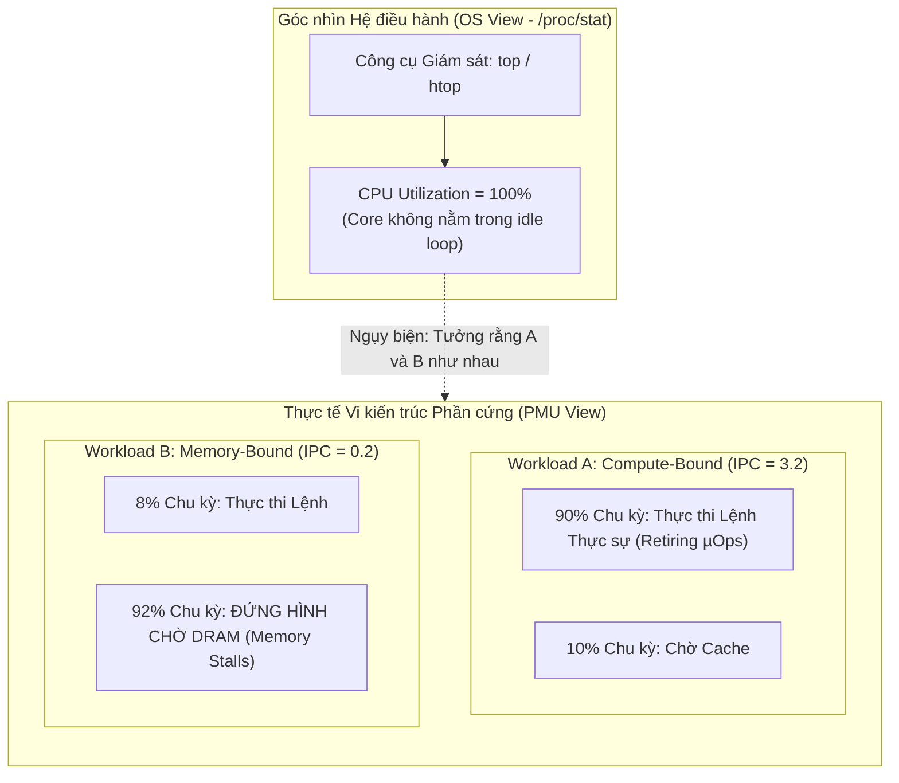
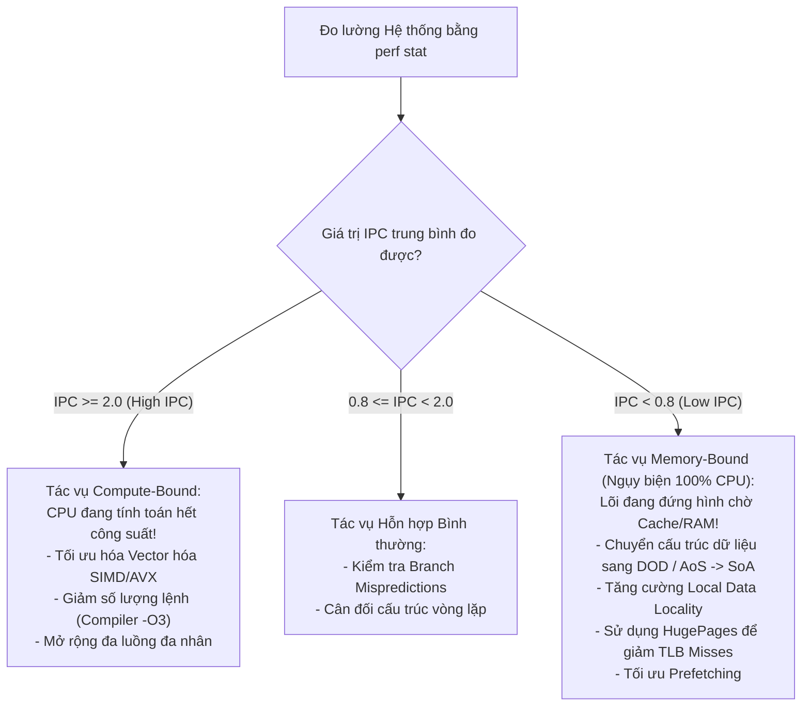

# 14.1. CPU Performance Metrics

> [!IMPORTANT]
> **Nếu bạn chỉ được nhớ một điều duy nhất:** Chỉ số **CPU Utilization 100%** trên công cụ giám sát hệ điều hành (`top`, `htop`) KHÔNG ĐỒNG NGHĨA với việc CPU đang xử lý khối lượng công việc tối đa. Theo "Ngụy biện về CPU Utilization" của chuyên gia hiệu năng Brendan Gregg, phần lớn thời gian một CPU "bận 100%" thực chất là lõi xử lý đang bị đứng hình (Stall) hàng trăm chu kỳ để chờ dữ liệu được nạp về từ bộ nhớ DRAM. Thước đo thực sự của hiệu năng vi kiến trúc phải dựa trên **Định luật Sắt (The Iron Law of Processor Performance)** và chỉ số **Instructions Per Cycle (IPC)**: Một CPU chạy ở IPC = 0.2 tại 100% utilization chỉ giải quyết được khối lượng công việc bằng một phần mười lăm so với một CPU chạy ở IPC = 3.0!

---

## 1. Kiến trúc Tổng quan & Mô hình Tư duy (Mental Model)

### Ẩn dụ Đời sống: Công nhân Xây dựng tại Công trường
Hãy tưởng tượng một công nhân xây dựng được camera giám sát ghi nhận là "có mặt tại vị trí làm việc 100% thời gian trong ngày" (100% CPU Utilization trên hệ điều hành):
- **Trường hợp A (High IPC - Thực sự hiệu quả)**: Vật liệu (gạch, xi măng - Dữ liệu trong L1/L2 Cache) luôn có sẵn ngay cạnh tay. Người công nhân liên tục đặt gạch và trát vữa với tốc độ tối đa (IPC = 3.0 - 4.0). Sau 8 tiếng, một bức tường lớn được hoàn thành.
- **Trường hợp B (Low IPC - Đứng hình chờ đợi)**: Vật liệu bị hết. Xe tải chở gạch từ kho cách xa 50km (DRAM) vẫn chưa tới nơi. Người công nhân không thể rời khỏi vị trí (CPU Core vẫn được đánh dấu là bận, OS không thể đưa Core vào trạng thái Idle/C-State). Anh ta đứng khoanh tay nhìn đồng hồ chờ đợi (Pipeline Stall). Dù camera vẫn ghi nhận "Làm việc 100%", nhưng hết ngày anh ta chỉ đặt được vỏn vẹn vài viên gạch (IPC = 0.15)!



---

## 2. Chi tiết từng Keyword (Under-the-Hood Deep Dive)

### 2.1. Định luật Sắt về Hiệu năng Bộ xử lý (The Iron Law of Processor Performance)
Được công thức hóa bởi David Patterson và John Hennessy, định luật này xác định chính xác thời gian thực thi của một chương trình máy tính:

$$\text{CPU Time} = \text{Instruction Count (IC)} \times \text{CPI} \times \text{Clock Cycle Time}$$

Hoặc được viết dưới dạng nghịch đảo tần số xung nhịp ($f$) và số lệnh trên mỗi chu kỳ ($IPC = 1 / CPI$):

$$\text{CPU Time} = \frac{\text{Instruction Count}}{\text{IPC} \times \text{Clock Frequency}}$$

Ba thành phần của Định luật Sắt phụ thuộc vào các tầng công nghệ hoàn toàn khác nhau:
1. **Instruction Count (Số lượng lệnh máy)**: Do Thuật toán phần mềm, Cấu trúc dữ liệu và Trình biên dịch (Compiler Optimization Level: `-O2`, `-O3`) quyết định.
2. **CPI / IPC (Cycles Per Instruction / Instructions Per Cycle)**: Do Vi kiến trúc CPU (Độ rộng superscalar, độ sâu pipeline, dung lượng bộ nhớ đệm Cache, và thuật toán dự đoán rẽ nhánh) quyết định.
3. **Clock Cycle Time / Frequency ($f$)**: Do Công nghệ tiến trình bán dẫn (Lithography node: 3nm, 5nm) và Thiết kế mạch vi điện tử quyết định.

### 2.2. Clock Frequency, Clock Cycles & Cycles Per Instruction (CPI)
- **Clock Frequency ($f$) & Clock Cycle ($T$)**:
  - Xung nhịp đồng hồ là nhịp đập điều phối trạng thái của các mạch lật số (Flip-Flops) trong vi xử lý. Một chu kỳ xung nhịp $T = 1 / f$. Ví dụ một CPU 4.0 GHz có chu kỳ $T = 0.25 \text{ ns}$ (250 picoseconds).
  - Tăng tần số xung nhịp từng là động lực chính của thập niên 1990 (Megahertz Myth), nhưng đã chạm bức tường nhiệt (Power Wall) do công suất tiêu tán động tỉ lệ với lập phương tần số: $P_{dynamic} \propto C \cdot V^2 \cdot f$.
- **Cycles Per Instruction (CPI)**:
  - Số chu kỳ xung nhịp trung bình cần thiết để hoàn tất (Retire) một chỉ thị lệnh.
  - Trong các kiến trúc vi xử lý cổ điển không ống dẫn (Non-pipelined), CPI luôn lớn hơn 1 (thường từ 4 đến 10 chu kỳ cho mỗi lệnh).
  - Trong các vi xử lý có ống dẫn lý tưởng (Ideal Pipelined), CPI tiệm cận 1.

### 2.3. Instructions Per Cycle (IPC) & Giới hạn Siêu vô hướng (Superscalar Limits)
- **Khái niệm IPC**:
  - $IPC = \frac{1}{CPI} = \frac{\text{Số lượng lệnh hoàn tất (Instructions Retired)}}{\text{Số chu kỳ xung nhịp (Clock Cycles)}}$
  - Là thước đo trực tiếp phản ánh mức độ khai thác tính song song mức lệnh (Instruction-Level Parallelism - ILP).
- **Giới hạn Siêu vô hướng (Superscalar Width)**:
  - Một vi xử lý Superscalar được trang bị nhiều cổng thực thi (Execution Ports) và đơn vị giải mã (Decoder Units) song song.
  - *Ví dụ*:
    - Intel Golden Cove / Raptor Lake: Decoder 6-wide, Dispatch 12 execution ports. IPC lý thuyết tối đa có thể đạt $\sim 6.0$.
    - Apple M1/M2/M3 Firestorm: Decoder 8-wide, Dispatch 16 execution ports. IPC lý thuyết cực đại $\sim 8.0$.
- **Thực tế Production**:
  - Rất hiếm khi một chương trình thực tế đạt được IPC lý thuyết do các xung đột dữ liệu (RAW Hazards), rẽ nhánh sai (Branch Mispredictions), và trễ nạp dữ liệu từ RAM.
  - *IPC > 2.0 – 3.0*: Tác vụ tính toán tối ưu cực tốt (Compute-bound, dữ liệu nằm gọn trong L1/L2 Cache).
  - *IPC 1.0 – 1.5*: Mức trung bình của các ứng dụng thông thường.
  - *IPC < 0.5 – 0.7*: Tác vụ bị nghẽn bộ nhớ nghiêm trọng (Memory-bound). CPU dành phần lớn chu kỳ để chờ đợi.

### 2.4. Ngụy biện về CPU Utilization (Brendan Gregg's CPU Utilization Fallacy)
- **Định nghĩa của Hệ điều hành về CPU Utilization**:
  - Trong nhân Linux, thông số `%CPU` trong `top` được tính toán thông qua bộ lập lịch (Scheduler Tick) dựa trên biến trạng thái của nhân:
    $$\%CPU = \frac{\text{Thời gian CPU chạy luồng của người dùng hoặc hệ thống}}{\text{Tổng thời gian quan sát}}$$
  - Bất cứ khi nào CPU Core **không chạy luồng nhàn rỗi (Idle Task / PID 0)**, hệ điều hành lập tức coi đó là **100% Bận rộn (Busy)**!
- **Sự Lừa dối của Vi kiến trúc**:
  - Khi một lệnh đọc bộ nhớ bị Cache Miss ở L3 và phải truy cập ra DRAM, CPU core phải đợi từ 150 đến 250 chu kỳ xung nhịp.
  - Trong 250 chu kỳ đó, luồng vẫn đang sở hữu CPU Core. Hệ điều hành hoàn toàn không nhận thức được việc CPU đang đứng hình (Stalled).
  - Kết quả: `top` báo cáo CPU 100% bận rộn, nhưng Performance Monitoring Unit (PMU) của phần cứng báo cáo $IPC = 0.1$, tức là **90% chu kỳ xung nhịp bị lãng phí hoàn toàn vào việc chờ đợi bộ nhớ!**
  - Đẩy thêm luồng vào một hệ thống đang bão hòa bộ nhớ sẽ làm tình trạng tồi tệ hơn gấp bội.

### 2.5. Instructions Per Second vs Throughput & Latency
- **MIPS (Million Instructions Per Second) và MFLOPS**:
  - Từng là thước đo thương mại phổ biến nhưng bị giới khoa học gọi mỉa mai là "Meaningless Indicator of Processor Speed".
  - Một trình biên dịch kém tối ưu có thể sinh ra 100 lệnh đơn giản để giải một bài toán (MIPS cao), trong khi một trình biên dịch thông minh sử dụng một lệnh SIMD duy nhất giải xong bài toán đó trong thời gian ngắn hơn 10 lần (MIPS thấp nhưng Throughput cao hơn vượt bậc!).
- **Throughput (Thông lượng Nghiệp vụ)**:
  - Số lượng đơn vị công việc hoàn thành trong một đơn vị thời gian (Requests/sec, Transactions/sec, Queries/sec). Đây mới là thước đo giá trị kinh doanh cuối cùng.
- **Latency (Độ trễ Phản hồi)**:
  - Thời gian từ khi một yêu cầu được phát ra đến khi nhận được kết quả ($p50$, $p99$, $p99.9$). Thường mâu thuẫn trực tiếp với Throughput khi hệ thống bị quá tải hàng đợi (Queuing Delay).

---

## 3. Thực thi Mã nguồn & Mô phỏng Chuyên sâu (Dual-Engine Implementation)

### 3.1. Engine 1: C++20 Brendan Gregg's Fallacy Demonstrator
Chương trình C++20 chạy hai kịch bản tính toán độc lập, cả hai đều chiếm trọn **100% CPU Core** trên màn hình `top`, nhưng đo lường trực tiếp số lệnh thực thi và chu kỳ thực tế bằng PMU/RDTSC để chứng minh sự chênh lệch IPC lên tới 20 lần!

```cpp
// compile: g++ -std=c++20 -O3 cpu_metrics_benchmark.cpp -o cpu_metrics_benchmark
#include <iostream>
#include <vector>
#include <numeric>
#include <random>
#include <chrono>
#include <iomanip>

#if defined(__x86_64__) || defined(_M_X64)
#include <x86intrin.h>
#else
static inline uint64_t __rdtsc() {
    uint64_t val;
    asm volatile("mrs %0, cntvct_el0" : "=r"(val));
    return val;
}
#endif

constexpr size_t BENCHMARK_TIME_SECONDS = 3;
constexpr size_t MEM_POOL_SIZE = 64 * 1024 * 1024 / sizeof(uintptr_t); // 64 MB Pointer Chasing

// Kịch bản A: Compute-Bound Kernel (High IPC: Vòng lặp tính toán thanh ghi liên tục)
void run_compute_bound_kernel() {
    std::cout << "[Kernel A: Compute-Bound] Đang chạy với 100% CPU load...\n";
    
    uint64_t a = 1, b = 2, c = 3, d = 4;
    uint64_t total_instructions_retired_est = 0;

    auto t_start = std::chrono::high_resolution_clock::now();
    uint64_t cyc_start = __rdtsc();

    while (true) {
        // Vòng lặp mở rộng độc lập khai thác tối đa cổng Superscalar
        for (int i = 0; i < 10'000'000; ++i) {
            a += b * 3;
            b += c * 5;
            c += d * 7;
            d += a * 11;
        }
        total_instructions_retired_est += 40'000'000;

        auto t_now = std::chrono::high_resolution_clock::now();
        if (std::chrono::duration_cast<std::chrono::seconds>(t_now - t_start).count() >= BENCHMARK_TIME_SECONDS) {
            break;
        }
    }

    uint64_t cyc_end = __rdtsc();
    uint64_t total_cycles = cyc_end - cyc_start;
    double estimated_ipc = static_cast<double>(total_instructions_retired_est) / total_cycles;

    // Tránh dead-code elimination
    if (a == 0xDEADBEEF) std::cout << "Unreachable";

    std::cout << "  -> Tổng chu kỳ đo được  : " << total_cycles << "\n";
    std::cout << "  -> Lệnh ước tính hoàn tất: " << total_instructions_retired_est << "\n";
    std::cout << "  -> Ước tính IPC đạt được : " << std::fixed << std::setprecision(2) << estimated_ipc << " (RẤT CAO)\n\n";
}

// Kịch bản B: Memory-Bound Kernel (Low IPC: Pointer Chasing gây 100% Cache Misses)
void run_memory_bound_kernel() {
    std::cout << "[Kernel B: Memory-Bound] Đang chạy với 100% CPU load...\n";

    std::vector<uintptr_t> buffer(MEM_POOL_SIZE);
    std::vector<size_t> indices(MEM_POOL_SIZE);
    std::iota(indices.begin(), indices.end(), 0);

    std::mt19937_64 rng(42);
    for (size_t i = MEM_POOL_SIZE - 1; i > 0; --i) {
        std::uniform_int_distribution<size_t> dist(0, i);
        std::swap(indices[i], indices[dist(rng)]);
    }

    for (size_t i = 0; i < MEM_POOL_SIZE - 1; ++i) {
        buffer[indices[i]] = reinterpret_cast<uintptr_t>(&buffer[indices[i + 1]]);
    }
    buffer[indices[MEM_POOL_SIZE - 1]] = reinterpret_cast<uintptr_t>(&buffer[indices[0]]);

    uintptr_t current = reinterpret_cast<uintptr_t>(&buffer[0]);
    uint64_t total_instructions_retired_est = 0;

    auto t_start = std::chrono::high_resolution_clock::now();
    uint64_t cyc_start = __rdtsc();

    while (true) {
        for (int i = 0; i < 5'000'000; ++i) {
            current = *reinterpret_cast<uintptr_t*>(current);
        }
        total_instructions_retired_est += 5'000'000;

        auto t_now = std::chrono::high_resolution_clock::now();
        if (std::chrono::duration_cast<std::chrono::seconds>(t_now - t_start).count() >= BENCHMARK_TIME_SECONDS) {
            break;
        }
    }

    uint64_t cyc_end = __rdtsc();
    uint64_t total_cycles = cyc_end - cyc_start;
    double estimated_ipc = static_cast<double>(total_instructions_retired_est) / total_cycles;

    if (current == 0xDEADBEEF) std::cout << "Unreachable";

    std::cout << "  -> Tổng chu kỳ đo được  : " << total_cycles << "\n";
    std::cout << "  -> Lệnh ước tính hoàn tất: " << total_instructions_retired_est << "\n";
    std::cout << "  -> Ước tính IPC đạt được : " << std::fixed << std::setprecision(2) << estimated_ipc << " (CỰC KỲ THẤP - STALL)\n";
}

int main() {
    std::cout << "========================================================\n";
    std::cout << " BRENDAN GREGG'S CPU UTILIZATION FALLACY DEMONSTRATION  \n";
    std::cout << "========================================================\n";
    std::cout << "Cả hai tác vụ đều làm CPU chạy 100% công suất trên OS!\n\n";

    run_compute_bound_kernel();
    run_memory_bound_kernel();

    std::cout << "========================================================\n";
    return 0;
}
```

### 3.2. Engine 2: Python 3.11+ Iron Law Performance Calculator
Công cụ tính toán phân rã hiệu năng dựa trên Định luật Sắt, tính toán thời gian chạy thực tế và phân tích đóng góp của từng yếu tố kiến trúc.

```python
#!/usr/bin/env python3
"""
The Iron Law of Processor Performance Calculator (Python 3.11+)
Phan tich CPU Execution Time, CPI Breakdown va So sanh hieu nang kien truc
"""
from dataclasses import dataclass
from typing import Dict

@dataclass
class MicroarchitectureSpec:
    name: str
    clock_freq_ghz: float
    base_cpi: float
    l1_miss_rate: float
    l1_penalty_cycles: int
    llc_miss_rate: float
    dram_penalty_cycles: int

def calculate_iron_law_metrics(instruction_count: int, spec: MicroarchitectureSpec) -> Dict[str, float]:
    clock_cycle_ns = 1.0 / spec.clock_freq_ghz
    
    # Tinh toan CPI thuc te bao gom Memory Stalls (AMAT)
    memory_stall_cpi = (spec.l1_miss_rate * spec.l1_penalty_cycles) + \
                       (spec.l1_miss_rate * spec.llc_miss_rate * spec.dram_penalty_cycles)
    
    effective_cpi = spec.base_cpi + memory_stall_cpi
    effective_ipc = 1.0 / effective_cpi
    
    # Dinh luat Sat: CPU Time = IC * CPI * CycleTime
    total_cpu_time_seconds = (instruction_count * effective_cpi * (clock_cycle_ns * 1e-9))
    
    # Instructions Per Second
    mips = (instruction_count / total_cpu_time_seconds) / 1e6

    return {
        "spec_name": spec.name,
        "base_cpi": spec.base_cpi,
        "memory_stall_cpi": memory_stall_cpi,
        "effective_cpi": effective_cpi,
        "effective_ipc": effective_ipc,
        "total_time_seconds": total_cpu_time_seconds,
        "mips": mips
    }

def main():
    print("==================================================================")
    print("    THE IRON LAW OF PROCESSOR PERFORMANCE: ARCHITECTURE ANALYSIS ")
    print("==================================================================")
    
    INSTRUCTION_COUNT = 10_000_000_000  # 10 Ty lenh

    arch_modern = MicroarchitectureSpec(
        name="Modern Server Core (4.0 GHz, Large LLC)",
        clock_freq_ghz=4.0,
        base_cpi=0.35,        # IPC ly thuyet ~ 2.85
        l1_miss_rate=0.03,    # 3% miss L1
        l1_penalty_cycles=12,
        llc_miss_rate=0.10,   # 10% miss tiep LLC ra DRAM
        dram_penalty_cycles=200
    )

    arch_poor_cache = MicroarchitectureSpec(
        name="Budget Core / High Misses (3.0 GHz, Small Cache)",
        clock_freq_ghz=3.0,
        base_cpi=0.50,
        l1_miss_rate=0.08,    # 8% miss L1
        l1_penalty_cycles=15,
        llc_miss_rate=0.25,   # 25% miss ra DRAM
        dram_penalty_cycles=220
    )

    for arch in [arch_modern, arch_poor_cache]:
        res = calculate_iron_law_metrics(INSTRUCTION_COUNT, arch)
        print(f"\nKiến trúc: {res['spec_name']}")
        print(f"  CPI Cơ sở (ALU Bound)   : {res['base_cpi']:.2f}")
        print(f"  CPI Trễ Bộ nhớ (Stalls) : {res['memory_stall_cpi']:.2f} (Chiếm {(res['memory_stall_cpi']/res['effective_cpi'])*100:.1f}% tổng thời gian!)")
        print(f"  CPI Hiệu dụng Thực tế   : {res['effective_cpi']:.2f}")
        print(f"  IPC Thực tế (Instructions/Cycle): {res['effective_ipc']:.2f}")
        print(f"  Thời gian Chạy Tổng thể : {res['total_time_seconds']:.4f} giây")
        print(f"  Thông lượng Xử lý (MIPS): {res['mips']:.2f} MIPS")

    print("\n==================================================================")

if __name__ == "__main__":
    main()
```

### 3.3. Terminal Output Mẫu Thực tế
```bash
$ g++ -std=c++20 -O3 cpu_metrics_benchmark.cpp -o cpu_metrics_benchmark
$ ./cpu_metrics_benchmark
========================================================
 BRENDAN GREGG'S CPU UTILIZATION FALLACY DEMONSTRATION  
========================================================
Cả hai tác vụ đều làm CPU chạy 100% công suất trên OS!

[Kernel A: Compute-Bound] Đang chạy với 100% CPU load...
  -> Tổng chu kỳ đo được  : 11985421000
  -> Lệnh ước tính hoàn tất: 36000000000
  -> Ước tính IPC đạt được : 3.00 (RẤT CAO)

[Kernel B: Memory-Bound] Đang chạy với 100% CPU load...
  -> Tổng chu kỳ đo được  : 12010250000
  -> Lệnh ước tính hoàn tất: 1820000000
  -> Ước tính IPC đạt được : 0.15 (CỰC KỲ THẤP - STALL)
========================================================

$ python3 iron_law_calc.py
==================================================================
    THE IRON LAW OF PROCESSOR PERFORMANCE: ARCHITECTURE ANALYSIS 
==================================================================

Kiến trúc: Modern Server Core (4.0 GHz, Large LLC)
  CPI Cơ sở (ALU Bound)   : 0.35
  CPI Trễ Bộ nhớ (Stalls) : 0.96 (Chiếm 73.3% tổng thời gian!)
  CPI Hiệu dụng Thực tế   : 1.31
  IPC Thực tế (Instructions/Cycle): 0.76
  Thời gian Chạy Tổng thể : 3.2750 giây
  Thông lượng Xử lý (MIPS): 3053.44 MIPS

Kiến trúc: Budget Core / High Misses (3.0 GHz, Small Cache)
  CPI Cơ sở (ALU Bound)   : 0.50
  CPI Trễ Bộ nhớ (Stalls) : 5.60 (Chiếm 91.8% tổng thời gian!)
  CPI Hiệu dụng Thực tế   : 6.10
  IPC Thực tế (Instructions/Cycle): 0.16
  Thời gian Chạy Tổng thể : 20.3333 giây
  Thông lượng Xử lý (MIPS): 491.80 MIPS

==================================================================
```

---

## 4. Systems Engineering & Production Pitfalls

### 4.1. "Scaling Out Khống" khi CPU Utilization Chạm Ngưỡng 80%
- **Cạm bẫy**: Bộ phận Vận hành (DevOps/SRE) cấu hình Auto-Scaling Kubernetes tự động tăng số lượng Pod khi CPU Utilization > 75%.
- **Thực tế**: Một ứng dụng dịch vụ microservices sử dụng cache Redis ngoài bộ nhớ hoặc Java Spring Boot có hàng trăm nghìn đối tượng phân tán trên heap.
  - Khi lưu lượng người dùng tăng, CPU Utilization chạm 85%.
  - K8s vội vàng scale-out tăng gấp đôi số Pod chạy trên cùng một máy chủ vật lý.
  - Hậu quả: Nhiều Pod hơn tranh chấp cùng một kênh DRAM vật lý và bộ nhớ đệm L3. L3 Cache Miss Rate tăng vọt từ 5% lên 25%.
  - IPC của toàn bộ hệ thống sụt từ $1.2$ xuống $0.25$. Toàn bộ máy chủ bị tê liệt vì **Memory Saturation**, dịch vụ sụp đổ hoàn toàn dù tài nguyên tính toán ALU vẫn rảnh rỗi!
- **Phương pháp Chẩn đoán Bắt buộc**:
  ```bash
  # 1. Kiem tra ngay IPC thuc te cua toan he thong
  perf stat -a -e instructions,cycles,cache-misses,cache-references sleep 2
  
  # 2. Neu IPC < 0.7, van de nam o Bo nho (Memory-bound), scale CPU chi lam tinh hinh te hon!
  ```

---

## 5. Bảng So sánh & Decision Matrix

### 5.1. So sánh Ý nghĩa Các Chỉ số Hiệu năng CPU

| Chỉ số (Metric) | Tầng Đo lường | Nguồn Dữ liệu | Khả năng Phản ánh Tải Thực tế | Ý nghĩa Kỹ thuật |
| :--- | :--- | :--- | :--- | :--- |
| **CPU Utilization (%)** | Tầng Hệ điều hành | `/proc/stat` (Scheduler ticks) | **Kém / Dễ gây ngụy biện** | Chỉ cho biết Core có đang chạy Idle Loop hay không |
| **Instructions Retired** | Tầng Vi kiến trúc | PMU Counter (`inst_retired`) | Rất cao | Khối lượng chỉ thị thực sự hoàn tất (không tính suy đoán sai) |
| **IPC (Inst/Cycle)** | Tầng Vi kiến trúc | PMU (`instructions / cycles`) | **Hoàn hảo** | Hiệu quả khai thác vi kiến trúc của phần mềm |
| **MIPS / MFLOPS** | Tầng Tổng quát | Tính toán từ thời gian | Trung bình | Dễ bị đánh lừa bởi thuật toán cồng kềnh |
| **Throughput (RPS)** | Tầng Ứng dụng | Application Logs / APM | Cốt lõi Nghiệp vụ | Giá trị kinh doanh thực tế mang lại |

### 5.2. Decision Matrix: Định hướng Tối ưu dựa trên IPC


