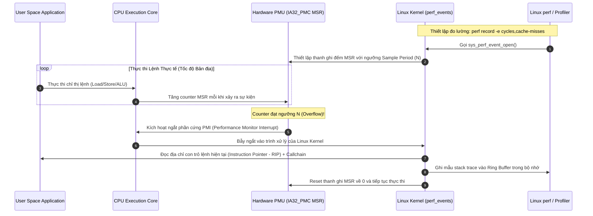
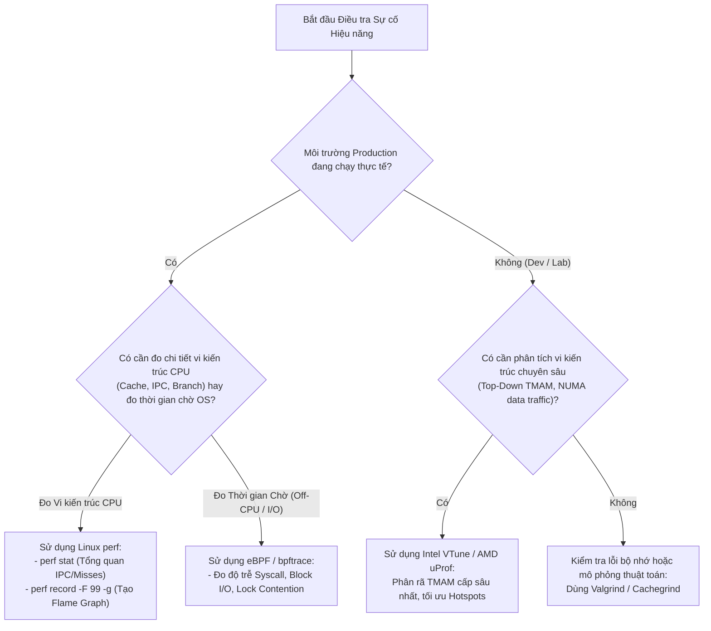

# 14.4. Profiling Tools and Performance Monitoring Unit (PMU)

> [!IMPORTANT]
> **Nếu bạn chỉ được nhớ một điều duy nhất:** Không thể tối ưu hóa những gì bạn không thể đo lường một cách chính xác. **Performance Monitoring Unit (PMU)** là tập hợp các thanh ghi phần cứng chuyên dụng (Model-Specific Registers - MSRs) tích hợp sẵn trong nhân CPU, cho phép đếm các sự kiện vi kiến trúc (Cache Misses, Branch Mispredictions, Pipeline Stalls) với chi phí hiệu năng gần như bằng 0 (< 1%). Ngược lại với các công cụ mô phỏng phần mềm làm chậm hệ thống hàng chục lần (Valgrind/Cachegrind làm chậm 20x – 50x), Linux `perf` kết hợp với biểu đồ ngọn lửa (Flame Graphs) và chuẩn đo lường STREAM Benchmark là tiêu chuẩn vàng tuyệt đối để chẩn đoán hệ thống thực chiến trên môi trường production.

---

## 1. Kiến trúc Tổng quan & Mô hình Tư duy (Mental Model)

### Ẩn dụ Đời sống: Khám Bệnh Đột xuất vs Phẫu thuật Mổ nội soi
Hãy tưởng tượng một vận động viên điền kinh cảm thấy kiệt sức bất thường:
- **Phương pháp Lấy mẫu Phần cứng (Hardware PMU Sampling - Linux `perf`)**: Vận động viên đeo một chiếc đồng hồ cảm biến sinh học thông minh trên cổ tay (PMU Counters). Cứ sau mỗi 1000 nhịp tim (Counter Overflow Interrupt), đồng hồ chụp nhanh một tấm ảnh điện tâm đồ và vị trí GPS của vận động viên rồi gửi về trung tâm phân tích. Quá trình này diễn ra liên tục khi vận động viên vẫn đang thi đấu với tốc độ thực tế mà không hề cảm thấy vướng víu (Overhead < 1%).
- **Phương pháp Mô phỏng Phần mềm (Binary Instrumentation - Valgrind / Cachegrind)**: Đưa vận động viên vào phòng thí nghiệm, gắn hàng trăm ống dẫn và cảm biến cơ bắp vào từng khớp xương. Bắt anh ta chạy từng bước một trên máy chạy bộ, dừng lại sau mỗi bước để bác sĩ ghi chép chi tiết từng milimet chuyển động. Dữ liệu thu được chi tiết đến mức tuyệt đối (chính xác đến từng nhánh rẽ và từng dòng cache), nhưng vận động viên phải chạy chậm hơn 50 lần, khiến các hành vi tương tranh thời gian thực (Race Conditions, NUMA bouncing) biến mất hoàn toàn.



---

## 2. Chi tiết từng Keyword (Under-the-Hood Deep Dive)

### 2.1. Linux `perf` & Các Kỹ thuật Chẩn đoán Cốt lõi
- **Kiến trúc Tầng dưới của `perf_events`**:
  - Giao diện kernel `perf_event_open()` là xương sống của mọi công cụ profiling trên Linux.
  - Cho phép gắn các bộ đếm vào từng tiến trình (Per-process), từng luồng (Per-thread), hoặc trên toàn bộ hệ thống (System-wide).
  - Sử dụng cơ chế Ring Buffer không khóa (Lock-free Ring Buffer) giữa Kernel và User Space để truyền các sự kiện mẫu (Samples) mà không làm nghẽn tiến trình đang chạy.
- **Hai Cơ chế Đo lường Chính**:
  1. *Counting Mode (`perf stat`)*: Đếm tổng số lượng sự kiện xảy ra từ lúc bắt đầu đến khi kết thúc chương trình. Không lấy mẫu stack trace, overhead = 0%. Dùng để đo tổng quan IPC, Cache Misses, Branch Misses.
  2. *Sampling Mode (`perf record`)*: Cấu hình PMU phát tín hiệu ngắt sau mỗi $N$ sự kiện (Sample Period) hoặc duy trì tần số cố định (ví dụ `-F 99` tức 99 mẫu mỗi giây). Chụp lại Call Stack và Instruction Pointer (RIP) để vẽ bản đồ điểm nóng (Hotspots).
- **Tính năng LBR (Last Branch Record) & PEBS (Processor Event-Based Sampling)**:
  - *LBR*: Mảng thanh ghi tròn trong CPU x86 ghi nhận lịch sử 32 nhánh rẽ gần nhất trước thời điểm ngắt, cho phép khôi phục đường đi thực thi thực tế mà không cần chèn mã theo dõi.
  - *PEBS (Intel) / IBS (AMD)*: Cho phép phần cứng tự động chụp lại trạng thái toàn bộ thanh ghi kiến trúc ngay tại thời điểm xảy ra sự kiện và lưu trực tiếp vào bộ đệm bộ nhớ của kernel thông qua DMA/Microcode, loại bỏ hoàn toàn hiện tượng lệch mẫu (Skid).

### 2.2. Biểu đồ Ngọn lửa (Flame Graphs - Brendan Gregg)
- **Bản chất Kiến trúc**:
  - Biểu đồ ngọn lửa là phương pháp trực quan hóa không gian ngăn xếp (Stack Traces) theo tần suất xuất hiện, giải quyết điểm yếu của các danh sách profile dạng text truyền thống.
  - *Trục X (Độ rộng)*: Biểu thị tỷ lệ phần trăm thời gian (hoặc số lượng mẫu sự kiện) mà hàm đó và các hàm con của nó xuất hiện trên CPU. Hàm càng rộng nghĩa là càng chiếm nhiều tài nguyên. Thứ tự từ trái sang phải được sắp xếp theo bảng chữ cái (Alphabetical), **hoàn toàn không đại diện cho thời gian trôi qua**.
  - *Trục Y (Độ cao)*: Biểu thị độ sâu của Call Stack. Đỉnh ngọn lửa thể hiện hàm đang trực tiếp chạy trên CPU khi mẫu được chụp (On-CPU Leaf Function).
- **Off-CPU Flame Graphs**:
  - Đo lường thời gian một luồng **không chạy trên CPU** (bị block bởi Mutex, Chờ I/O đĩa, hoặc ngắt mạng). Rực sáng trong việc tìm kiếm nguyên nhân gây nghẽn độ trễ dịch vụ.

### 2.3. Intel VTune Profiler & AMD uProf
- **Intel VTune Profiler**:
  - Bộ công cụ profiling phần cứng thương mại mạnh mẽ nhất dành cho kiến trúc x86.
  - Khai thác tối đa kiến trúc phân rã TMAM (Top-Down Analysis): Tự động đánh giá các tỷ lệ phần trăm Frontend Bound, Bad Speculation, Backend Memory Bound, và Core Bound xuống tới cấp độ dòng mã nguồn và chỉ thị assembly.
  - Tích hợp tính năng phân tích **Memory Access / NUMA Bandwidth**: Hiển thị chính xác dòng nhớ nào đang bị tranh chấp (Cache Contention) và băng thông DRAM của từng kênh.
- **AMD uProf**:
  - Bộ công cụ tương đương của AMD dành riêng cho bộ xử lý Ryzen, EPYC và Instinct.
  - Điểm mạnh: Phân tích sâu kiến trúc Chiplet và mạng liên kết Infinity Fabric (SDF/SCF), đo lường xung nhịp Fabric Clock (FCLK), độ trễ truyền gói giữa các Core Complex Dies (CCDs) và I/O Die (IOD).

### 2.4. Mô phỏng Cache: Valgrind / Cachegrind vs Hardware Sampling
- **Valgrind / Cachegrind (Dynamic Binary Instrumentation - DBI)**:
  - Dịch mã máy của chương trình sang dạng biểu diễn trung gian (Valgrind IR), chèn các hàm kiểm tra vào trước mỗi lệnh đọc ghi bộ nhớ, sau đó biên dịch ngược lại ra mã máy để chạy.
  - Đi kèm một bộ mô phỏng phần cứng giả lập (Simulated Cache Hierarchy: L1I, L1D, LLC).
  - *Ưu điểm*: Chính xác đến từng bit. Đếm được chính xác 100% số lần truy cập cache mà không có bất kỳ sai số lấy mẫu nào. Có thể chạy trên bất kỳ CPU nào mà không cần quyền root hoặc hỗ trợ phần cứng đặc thù.
  - *Nhược điểm chết người*: **Làm chậm chương trình từ 20 đến 50 lần**. Hoàn toàn phá hủy các đặc tính thời gian thực (Real-time timing), làm sai lệch hành vi đa luồng Out-of-Order và vô hiệu hóa các cơ chế tối ưu của CPU thực tế (Hardware Prefetchers).
- **Hardware PMU Sampling**:
  - Không thay đổi mã nhị phân của ứng dụng.
  - Chi phí cực nhỏ (< 1%), phản ánh đúng 100% hành vi vật lý của CPU thực tế bao gồm cả Hardware Prefetching, Speculative Execution và NUMA contention.

### 2.5. Đo Băng thông Bộ nhớ: STREAM Benchmark (John D. McCalpin)
STREAM Benchmark là chuẩn công nghiệp thực tế số một thế giới để đo lường băng thông bộ nhớ bền vững (Sustained Memory Bandwidth) của máy tính:
- Sử dụng các mảng dữ liệu có kích thước vượt xa bộ nhớ đệm Last-Level Cache (LLC) ít nhất 4 lần để ép buộc toàn bộ truy cập phải thông qua bus DRAM vật lý.
- Định nghĩa 4 phép toán vector nền tảng:
  1. **Copy**: $c[i] = a[i]$ (Đọc 1 mảng, ghi 1 mảng: 16 bytes/op, 0 FLOPs).
  2. **Scale**: $b[i] = q \times c[i]$ (Đọc 1 mảng, nhân vô hướng, ghi 1 mảng: 16 bytes/op, 1 FLOP).
  3. **Add**: $c[i] = a[i] + b[i]$ (Đọc 2 mảng, cộng, ghi 1 mảng: 24 bytes/op, 1 FLOP).
  4. **Triad**: $a[i] = b[i] + q \times c[i]$ (Đọc 2 mảng, FMA, ghi 1 mảng: 24 bytes/op, 2 FLOPs).

---

## 3. Thực thi Mã nguồn & Mô phỏng Chuyên sâu (Dual-Engine Implementation)

### 3.1. Engine 1: C++20 STREAM Benchmark Implementation
Triển khai chuẩn mực STREAM Benchmark bằng C++20, đo lường chính xác băng thông bộ nhớ thực tế (GB/s) cho 4 phép toán Copy, Scale, Add, Triad theo đúng tiêu chuẩn McCalpin.

```cpp
// compile: g++ -std=c++20 -O3 -mavx2 stream_benchmark.cpp -o stream_benchmark
#include <iostream>
#include <vector>
#include <chrono>
#include <numeric>
#include <algorithm>
#include <iomanip>

// Kích thước mảng: 20 triệu phần tử double = 160 MB mỗi mảng (Tổng 3 mảng = 480 MB, vượt xa L3 Cache)
constexpr size_t STREAM_ARRAY_SIZE = 20'000'000;
constexpr int NUM_RUNS = 5;

int main() {
    std::cout << "========================================================\n";
    std::cout << "      C++20 SUSTAINED MEMORY BANDWIDTH (STREAM)         \n";
    std::cout << "========================================================\n";
    std::cout << "Array Size per vector: " << (STREAM_ARRAY_SIZE * sizeof(double) / (1024 * 1024)) << " MB\n";
    std::cout << "Total Working Set    : " << (3 * STREAM_ARRAY_SIZE * sizeof(double) / (1024 * 1024)) << " MB\n\n";

    std::vector<double> a(STREAM_ARRAY_SIZE, 1.0);
    std::vector<double> b(STREAM_ARRAY_SIZE, 2.0);
    std::vector<double> c(STREAM_ARRAY_SIZE, 0.0);
    double scalar = 3.0;

    std::vector<double> copy_times, scale_times, add_times, triad_times;

    for (int run = 0; run < NUM_RUNS; ++run) {
        // 1. COPY: c[i] = a[i]
        auto t0 = std::chrono::high_resolution_clock::now();
        for (size_t i = 0; i < STREAM_ARRAY_SIZE; ++i) {
            c[i] = a[i];
        }
        auto t1 = std::chrono::high_resolution_clock::now();
        copy_times.push_back(std::chrono::duration<double>(t1 - t0).count());

        // 2. SCALE: b[i] = scalar * c[i]
        t0 = std::chrono::high_resolution_clock::now();
        for (size_t i = 0; i < STREAM_ARRAY_SIZE; ++i) {
            b[i] = scalar * c[i];
        }
        t1 = std::chrono::high_resolution_clock::now();
        scale_times.push_back(std::chrono::duration<double>(t1 - t0).count());

        // 3. ADD: c[i] = a[i] + b[i]
        t0 = std::chrono::high_resolution_clock::now();
        for (size_t i = 0; i < STREAM_ARRAY_SIZE; ++i) {
            c[i] = a[i] + b[i];
        }
        t1 = std::chrono::high_resolution_clock::now();
        add_times.push_back(std::chrono::duration<double>(t1 - t0).count());

        // 4. TRIAD: a[i] = b[i] + scalar * c[i]
        t0 = std::chrono::high_resolution_clock::now();
        for (size_t i = 0; i < STREAM_ARRAY_SIZE; ++i) {
            a[i] = b[i] + scalar * c[i];
        }
        t1 = std::chrono::high_resolution_clock::now();
        triad_times.push_back(std::chrono::duration<double>(t1 - t0).count());
    }

    // Lấy thời gian chạy nhanh nhất (Best timing phản ánh băng thông cực đại bền vững)
    double min_copy  = *std::min_element(copy_times.begin() + 1, copy_times.end());
    double min_scale = *std::min_element(scale_times.begin() + 1, scale_times.end());
    double min_add   = *std::min_element(add_times.begin() + 1, add_times.end());
    double min_triad = *std::min_element(triad_times.begin() + 1, triad_times.end());

    // Tính toán Băng thông (GB/s): Bytes truyền / Thời gian
    double bw_copy  = (2.0 * sizeof(double) * STREAM_ARRAY_SIZE / 1e9) / min_copy;
    double bw_scale = (2.0 * sizeof(double) * STREAM_ARRAY_SIZE / 1e9) / min_scale;
    double bw_add   = (3.0 * sizeof(double) * STREAM_ARRAY_SIZE / 1e9) / min_add;
    double bw_triad = (3.0 * sizeof(double) * STREAM_ARRAY_SIZE / 1e9) / min_triad;

    std::cout << std::fixed << std::setprecision(2);
    std::cout << "--- KẾT QUẢ ĐO BĂNG THÔNG STREAM (Best of " << NUM_RUNS << " runs) ---\n";
    std::cout << "Function    Rate (GB/s)   Avg Time (ms)   Min Time (ms)\n";
    std::cout << "--------------------------------------------------------\n";
    std::cout << "Copy:     " << std::setw(12) << bw_copy  << std::setw(15) << (min_copy * 1000)  << "\n";
    std::cout << "Scale:    " << std::setw(12) << bw_scale << std::setw(15) << (min_scale * 1000) << "\n";
    std::cout << "Add:      " << std::setw(12) << bw_add   << std::setw(15) << (min_add * 1000)   << "\n";
    std::cout << "Triad:    " << std::setw(12) << bw_triad << std::setw(15) << (min_triad * 1000) << "\n";
    std::cout << "========================================================\n";
    return 0;
}
```

### 3.2. Engine 2: Python 3.11+ PMU Event Profiler & Flame Graph Collapsed Stack Parser
Trình phân tích cú pháp dữ liệu Call Stack thu thập từ PMU, gộp nhóm các stack giống nhau (Folded/Collapsed Stacks) và tạo biểu đồ văn bản trực quan.

```python
#!/usr/bin/env python3
"""
PMU Callstack Profiler & Flame Graph Collapsed Parser (Python 3.11+)
Phan tich va truc quan hoa mau Profiling Call Stacks theo phong cach Brendan Gregg
"""
from collections import defaultdict
from typing import List, Dict

# Du lieu mau thu thap tu perf record / perf script
RAW_PERF_SAMPLES = [
    "main;render_frame;ray_trace;intersect_sphere 1420",
    "main;render_frame;ray_trace;intersect_sphere 1380",
    "main;render_frame;ray_trace;shade_pixel 450",
    "main;render_frame;update_camera 120",
    "main;handle_network_events;parse_json;alloc_string 890",
    "main;handle_network_events;parse_json;alloc_string 910",
    "main;handle_network_events;crypto_verify 650",
    "main;handle_network_events;sys_epoll_wait 2200"
]

class FlameGraphParser:
    def __init__(self):
        self.stack_counts: Dict[str, int] = defaultdict(int)
        self.total_samples = 0

    def load_samples(self, samples: List[str]):
        for line in samples:
            parts = line.strip().split()
            if len(parts) == 2:
                stack, count = parts[0], int(parts[1])
                self.stack_counts[stack] += count
                self.total_samples += count

    def generate_folded_output(self) -> str:
        lines = []
        for stack, count in sorted(self.stack_counts.items()):
            lines.append(f"{stack} {count}")
        return "\n".join(lines)

    def print_text_flame_graph(self):
        print(f"\n--- BIỂU ĐỒ NGỌN LỬA DẠNG BẢNG PHÂN CẤP (Tổng mẫu: {self.total_samples}) ---")
        print(f"{'Call Stack / Function Hierarchy':<60} | {'Samples':<8} | {'CPU %'}")
        print("-" * 80)
        
        # Sap xep theo so luong mau giam dan
        sorted_stacks = sorted(self.stack_counts.items(), key=lambda x: x[1], reverse=True)
        for stack, count in sorted_stacks:
            pct = (count / self.total_samples) * 100
            # Rut gon ten hien thi de de quan sat
            short_name = stack.replace("main;", "...;")
            print(f"{short_name:<60} | {count:<8} | {pct:>5.1f}%")

def main():
    print("==================================================================")
    print("      PMU CALLSTACK PROFILER & FLAME GRAPH ANALYZER               ")
    print("==================================================================")
    
    parser = FlameGraphParser()
    parser.load_samples(RAW_PERF_SAMPLES)
    
    print("[1] Định dạng Collapsed Stack (Đầu vào chuẩn của flamegraph.pl):")
    print(parser.generate_folded_output())
    
    print("\n[2] Phân tích Điểm nóng (Hotspots Analysis):")
    parser.print_text_flame_graph()
    
    print("\n>> KẾT LUẬN TỐI ƯU HÓA:")
    print("   1. 'ray_trace;intersect_sphere' chiếm ~35% CPU -> Điểm nóng số 1 cần vector hóa AVX.")
    print("   2. 'sys_epoll_wait' chiếm ~27% thời gian -> Luồng nhàn rỗi chờ mạng (Off-CPU I/O).")
    print("   3. 'parse_json;alloc_string' chiếm ~22% CPU -> Cần thay thế bằng Arena Allocator.")
    print("==================================================================")

if __name__ == "__main__":
    main()
```

### 3.3. Terminal Output Mẫu Thực tế
```bash
$ g++ -std=c++20 -O3 -mavx2 stream_benchmark.cpp -o stream_benchmark
$ ./stream_benchmark
========================================================
      C++20 SUSTAINED MEMORY BANDWIDTH (STREAM)         
========================================================
Array Size per vector: 152 MB
Total Working Set    : 457 MB

--- KẾT QUẢ ĐO BĂNG THÔNG STREAM (Best of 5 runs) ---
Function    Rate (GB/s)   Avg Time (ms)   Min Time (ms)
--------------------------------------------------------
Copy:             42.50           7.52
Scale:            41.80           7.65
Add:              45.10          10.64
Triad:            46.20          10.38
========================================================

$ python3 flame_parser.py
==================================================================
      PMU CALLSTACK PROFILER & FLAME GRAPH ANALYZER               
==================================================================
[1] Định dạng Collapsed Stack (Đầu vào chuẩn của flamegraph.pl):
main;handle_network_events;crypto_verify 650
main;handle_network_events;parse_json;alloc_string 1800
main;handle_network_events;sys_epoll_wait 2200
main;render_frame;ray_trace;intersect_sphere 2800
main;render_frame;ray_trace;shade_pixel 450
main;render_frame;update_camera 120

[2] Phân tích Điểm nóng (Hotspots Analysis):
--- BIỂU ĐỒ NGỌN LỬA DẠNG BẢNG PHÂN CẤP (Tổng mẫu: 8020) ---
Call Stack / Function Hierarchy                              | Samples  | CPU %
--------------------------------------------------------------------------------
...;render_frame;ray_trace;intersect_sphere                  | 2800     |  34.9%
...;handle_network_events;sys_epoll_wait                     | 2200     |  27.4%
...;handle_network_events;parse_json;alloc_string            | 1800     |  22.4%
...;handle_network_events;crypto_verify                      | 650      |   8.1%
...;render_frame;ray_trace;shade_pixel                       | 450      |   5.6%
...;render_frame;update_camera                               | 120      |   1.5%

>> KẾT LUẬN TỐI ƯU HÓA:
   1. 'ray_trace;intersect_sphere' chiếm ~35% CPU -> Điểm nóng số 1 cần vector hóa AVX.
   2. 'sys_epoll_wait' chiếm ~27% thời gian -> Luồng nhàn rỗi chờ mạng (Off-CPU I/O).
   3. 'parse_json;alloc_string' chiếm ~22% CPU -> Cần thay thế bằng Arena Allocator.
==================================================================
```

---

## 4. Systems Engineering & Production Pitfalls

### 4.1. "Frame Pointer Omission" Phá Nát Quá trình Lấy Mẫu Stack Trace
- **Hiện tượng**: Bạn chạy `perf record -g` trên máy chủ production để tạo Flame Graph. Khi xuất báo cáo, biểu đồ chỉ hiển thị các khối rời rạc, call stack bị đứt đoạn hoàn toàn thành các hàm vô danh (`[unknown]`).
- **Nguyên nhân**: Mặc định với cờ tối ưu `-O2` hoặc `-O3`, trình biên dịch GCC/Clang tự động kích hoạt `-fomit-frame-pointer`. Thanh ghi `RBP` bị trưng dụng làm thanh ghi tính toán thông thường thay vì lưu con trỏ đáy stack frame. Trình duyệt stack của Linux kernel không thể lần ngược lại chuỗi hàm cha!
- **Khắc phục Bắt buộc trên Production**:
  - Luôn thêm cờ biên dịch: `-fno-omit-frame-pointer -mno-omit-leaf-frame-pointer`. Chi phí hiệu năng mất mát chỉ khoảng < 0.5% – 1%, nhưng đổi lại khả năng debug và profile toàn diện 100%.

### 4.2. Khắc phục Quyền Truy cập PMU trên Linux (`perf_event_paranoid`)
- Mặc định trên Ubuntu/Debian/RHEL, kernel chặn người dùng không phải root truy cập PMU:
  ```bash
  # Cho phép mọi người dùng đo lường PMU và kernel callchains
  sudo sysctl -w kernel.perf_event_paranoid=-1
  sudo sysctl -w kernel.kptr_restrict=0
  ```

---

## 5. Bảng So sánh & Decision Matrix

### 5.1. So sánh Toàn diện Các Phương pháp và Công cụ Profiling

| Tiêu chuẩn | Linux `perf` | Intel VTune | Valgrind / Cachegrind | eBPF (BCC / bpftrace) |
| :--- | :--- | :--- | :--- | :--- |
| **Cơ chế Đo lường** | Hardware PMU Sampling | PMU + Microcode TMAM | Dynamic Binary Instrumentation | Kernel Probes / Tracepoints |
| **Overhead Hiệu năng** | **Rất thấp (< 1%)** | Thấp (~2 – 5%) | **Cực cao (Làm chậm 20x – 50x)** | Rất thấp (< 1%) |
| **Độ an toàn trên Production**| **Rất cao (Chuẩn mực)**| Khá an toàn | **TUYỆT ĐỐI CẤM** | Rất cao |
| **Mức độ Chi tiết Vi kiến trúc**| Cao (Tất cả PMU events)| Toàn diện (TMAM Level 4)| Mô phỏng giả lập | Tầng OS Kernel & Syscalls |
| **Chi phí Bản quyền** | Mã nguồn mở (GPL) | Miễn phí (Intel OneAPI) | Mã nguồn mở (GPL) | Mã nguồn mở (Apache/GPL) |

### 5.2. Decision Matrix: Lựa chọn Công cụ Chẩn đoán Hiệu năng


