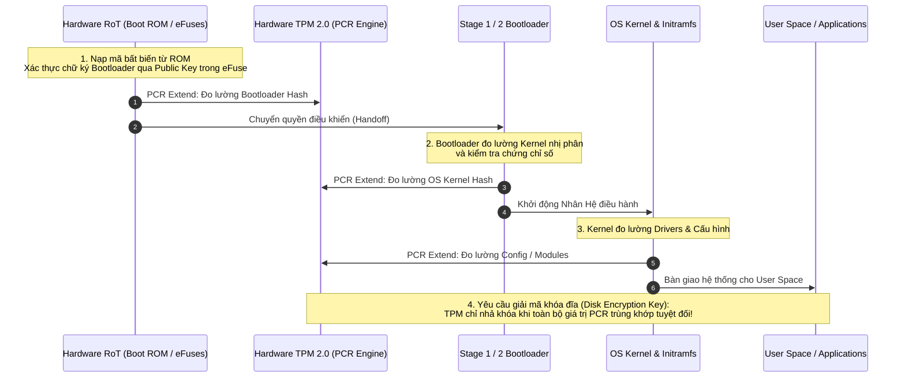
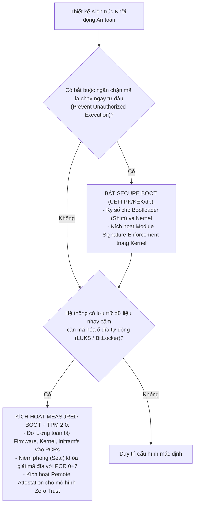

# 15.1. Hardware Trust and Secure Boot

> [!IMPORTANT]
> **Nếu bạn chỉ được nhớ một điều duy nhất:** An toàn phần mềm không thể tồn tại nếu thiếu một điểm tựa phần cứng bất biến (Hardware Root of Trust). **Secure Boot** đóng vai trò là "người gác cổng" ngăn chặn mã độc thực thi bằng cách kiểm tra chữ ký số mật mã tại từng giai đoạn khởi động (Cryptographic Signature Verification); trong khi **Trusted Boot (Measured Boot)** kết hợp với chip TPM 2.0 đóng vai trò là "nhân chứng lịch sử" ghi nhận chính xác mọi thành phần nhị phân đã nạp thông qua phép toán mở rộng thanh ghi một chiều $\text{PCR}_{\text{new}} = \text{Hash}(\text{PCR}_{\text{old}} \parallel \text{Measurement})$, tạo cơ sở toán học vững chắc cho việc niêm phong dữ liệu (Data Sealing) và xác thực từ xa (Remote Attestation).

---

## 1. Kiến trúc Tổng quan & Mô hình Tư duy (Mental Model)

### Ẩn dụ Đời sống: Chuỗi Tiếp sức và Hộ chiếu Ngoại giao
Hãy tưởng tượng một hệ thống kiểm soát an ninh nghiêm ngặt tại một hội nghị thượng đỉnh quốc tế:
1. **Hardware Root of Trust (eFuses / Boot ROM)**: Là vị thẩm phán tối cao đầu tiên ngồi tại phòng cổng. Vị thẩm phán này không thể bị mua chuộc, thay thế hay tẩy não (ghi cứng vào mặt cắt bán dẫn silicon). Ông ta giữ con dấu gốc của ban tổ chức.
2. **Secure Boot (Người Gác Cổng Cưỡng chế)**: Vị thẩm phán kiểm tra thẻ căn cước có chữ ký số của người bảo vệ số 1 (Stage 1 Bootloader). Nếu thẻ giả mạo, bắn hạ ngay tại chỗ (System Halt / Boot Abort). Nếu thẻ hợp lệ, người bảo vệ số 1 được bước vào và tiếp tục kiểm tra thẻ của người bảo vệ số 2 (UEFI/Kernel). Bất kỳ ai không có chữ ký hợp lệ đều bị chặn đứng, không cho phép bước tiếp.
3. **Measured Boot / TPM (Cuốn Nhật ký Niêm phong Không thể Tẩy xóa)**: Khác với việc đuổi người về, có một thư ký độc lập (Chip TPM 2.0) đi theo từng người và đóng dấu lăn tay của họ vào một cuốn sổ tích lũy (PCR Registers). Dù một người có mang mã độc lọt vào được, dấu lăn tay của anh ta đã bị khóa vĩnh viễn vào cuốn sổ. Khi anh ta muốn mở két sắt lấy tài liệu mật (Data Unsealing), két sắt kiểm tra cuốn sổ và thấy dấu vân tay lạ, két sẽ từ chối mở!



---

## 2. Chi tiết từng Keyword (Under-the-Hood Deep Dive)

### 2.1. Hardware Root of Trust (RoT) & OTP eFuses
- **Bản chất của Gốc Tin cậy Phần cứng (Root of Trust - RoT)**:
  - Một hệ thống máy tính không thể tự kiểm tra tính toàn vẹn của chính nó bằng phần mềm, vì nếu phần mềm kiểm tra bị xâm nhập, kết quả trả về sẽ hoàn toàn bị thao túng (Circular Dependency Problem).
  - Do đó, điểm khởi đầu của chuỗi tin cậy (Chain of Trust) bắt buộc phải là một thành phần phần cứng thuần túy, bất biến và độc lập, thường được gọi là **Root of Trust for Measurement (RTM)** hoặc **Root of Trust for Verification (RTV)**.
- **Cầu chì Điện tử Một lần (One-Time Programmable - OTP eFuses)**:
  - Là các linh kiện bán dẫn hiển vi trên đế chip silicon. Ở trạng thái ban đầu xuất xưởng, cầu chì ở trạng thái dẫn điện (Giá trị bit `0`).
  - Trong quá trình sản xuất thiết bị (Factory Provisioning), nhà sản xuất đưa vào một điện áp cao có kiểm soát (Programming Voltage) để đốt cháy có chủ đích một số cầu chì (đứt mạch vĩnh viễn, tạo giá trị bit `1`).
  - Quá trình này **không thể đảo ngược về mặt vật lý (Irreversible)**.
  - *Ứng dụng*: Dùng để lưu trữ giá trị băm của Khóa Công khai Gốc (Root Public Key Hash), mã định danh phần cứng duy nhất (Hardware Unique Key - HUK), và phiên bản chống hạ cấp phần mềm độc hại (Anti-Rollback Security Version).

### 2.2. Secure Boot vs Trusted Boot (Measured Boot)
Hai khái niệm này bổ trợ lẫn nhau nhưng có triết lý kiến trúc hoàn toàn khác biệt:
- **Secure Boot (Khởi động An toàn - Cưỡng chế Chữ ký)**:
  - *Mục tiêu*: Ngăn chặn việc thực thi mã không được phép (Execution Prevention).
  - *Cơ chế*: Mỗi giai đoạn nạp mã trước khi trao quyền điều khiển cho giai đoạn tiếp theo bắt buộc phải giải mã chữ ký số đính kèm bằng khóa công khai đã được xác thực (Certificate Chain of Trust).
  - *Phản ứng khi lỗi*: Nếu chữ ký không hợp lệ hoặc mã bị can thiệp dù chỉ 1 bit, hệ thống **ngay lập tức dừng hoạt động (Halt / Boot Fail)**.
  - *Hạn chế*: Chỉ kiểm tra xem mã có được ký bởi nhà cung cấp tin cậy hay không (ví dụ Microsoft KEK/db), nhưng hoàn toàn bất lực nếu một bản cập nhật chính thức của kernel bị khai thác lỗ hổng Zero-day sau khi đã nạp vào bộ nhớ.
- **Trusted Boot / Measured Boot (Khởi động Tin cậy - Đo lường Trạng thái)**:
  - *Mục tiêu*: Ghi nhận trạng thái thực tế không thể chối cãi (Integrity Recording).
  - *Cơ chế*: Trước khi một mô-đun phần mềm được thực thi, giai đoạn trước sẽ băm mã của mô-đun đó và gửi giá trị băm này tới chip TPM để mở rộng vào thanh ghi PCR.
  - *Phản ứng*: Hệ thống **vẫn tiếp tục khởi động bình thường** ngay cả khi mã bị sửa đổi. Tuy nhiên, sự thay đổi trạng thái này sẽ làm giá trị PCR trong TPM lệch khỏi giá trị chuẩn. Hậu quả là các khóa bí mật được niêm phong trong TPM sẽ bị khóa cứng, ngăn không cho kẻ tấn công truy cập dữ liệu nhạy cảm.

### 2.3. Chip TPM 2.0 & Thanh ghi PCR (Platform Configuration Registers)
- **Kiến trúc Chip TPM (Trusted Platform Module)**:
  - Là một vi điều khiển bảo mật độc lập (Cryptographic Microcontroller), được kết nối với CPU qua bus SPI, I2C, hoặc tích hợp dưới dạng firmware bảo mật (fTPM / Intel PTT / AMD PSP).
  - Chứa bộ tăng tốc thuật toán mật mã phần cứng (RSA, ECC, SHA-256), máy sinh số ngẫu nhiên thực (TRNG), và bộ nhớ bất biến chống can thiệp vật lý (Tamper-Resistant Non-Volatile Storage).
- **Thanh ghi Cấu hình Nền tảng (Platform Configuration Registers - PCR)**:
  - TPM 2.0 định nghĩa tối thiểu 24 thanh ghi PCR độc lập (từ PCR 0 đến PCR 23), mỗi thanh ghi có kích thước tương ứng với thuật toán băm (ví dụ 256-bit cho SHA-256 Bank).
  - Phân bổ chức năng chuẩn hóa bởi Trusted Computing Group (TCG):
    - `PCR 0`: Đo lường mã nguồn BIOS / UEFI Firmware.
    - `PCR 2`: Đo lường các ROM mở rộng của bên thứ ba (Option ROMs, ví dụ GPU/RAID card).
    - `PCR 4`: Đo lường Master Boot Record (MBR) hoặc UEFI Boot Manager.
    - `PCR 7`: Đo lường trạng thái Secure Boot và chứng chỉ cơ sở dữ liệu (`db`, `dbx`).
    - `PCR 8 - 9`: Đo lường Linux Kernel, Initramfs và Kernel Command Line (`GRUB`).

### 2.4. Toán học Thanh ghi PCR (PCR Extend Operation)
Một đặc tính cốt lõi của thanh ghi PCR là phần mềm **KHÔNG THỂ GHI ĐÈ TRỰC TIẾP** một giá trị tùy ý vào thanh ghi. Bạn không thể thực hiện lệnh `PCR[n] = 0x1234`.
Thao tác duy nhất mà phần cứng TPM cho phép là **Mở rộng (Extend)**:

$$\text{PCR}_{\text{new}} = \text{Hash}\Big(\text{PCR}_{\text{current}} \;\parallel\; \text{Measurement}\Big)$$

Trong đó $\parallel$ là phép nối chuỗi byte (Concatenation), và $\text{Measurement}$ là giá trị băm mật mã của đoạn mã hoặc tệp cấu hình vừa được nạp.
- **Tính chất Toán học Bất biến**:
  - Nhờ tính chất kháng tiền ảnh (Pre-image Resistance) và kháng xung đột (Collision Resistance) của hàm băm mật mã (SHA-256), kẻ tấn công không thể tìm được một giá trị mã độc nào có thể tạo ra cùng một giá trị PCR cuối cùng.
  - Thứ tự nạp mã đóng vai trò quyết định: Do phép băm nối chuỗi không có tính chất giao hoán:
    $$\text{Hash}(A \parallel B) \ne \text{Hash}(B \parallel A)$$
    Nếu một rootkit cố tình nạp mã độc trước rồi mới nạp mã sạch, giá trị PCR cuối cùng vẫn hoàn toàn sai lệch!

### 2.5. Khóa Bí mật TPM: Sealing & Remote Attestation
- **Data Sealing (Niêm phong Dữ liệu)**:
  - TPM cho phép mã hóa một khóa bí mật (ví dụ Khóa giải mã ổ đĩa LUKS / BitLocker) gắn liền với một tập hợp các giá trị PCR cụ thể:
    $$\text{Ciphertext} = \text{TPM\_Seal}(\text{SecretKey}, \{\text{PCR}_0, \text{PCR}_7, \text{PCR}_8, \text{PCR}_9\})$$
  - Khi hệ thống khởi động: Lệnh `TPM_Unseal` chỉ thành công và giải phóng `SecretKey` nếu toàn bộ các thanh ghi PCR hiện tại trùng khớp 100% với giá trị tại thời điểm niêm phong. Nếu có bất kỳ sự thay đổi nào trên BIOS, Bootloader, hoặc Kernel, TPM sẽ từ chối mở khóa, giữ ổ đĩa ở trạng thái mã hóa an toàn.
- **Remote Attestation (Xác thực Tính toàn vẹn Từ xa)**:
  - Một máy chủ quản lý từ xa (Attestation Server) gửi một chuỗi ngẫu nhiên (Nonce) đến máy trạm để chống tấn công phát lại (Replay Attack).
  - Chip TPM đọc giá trị các thanh ghi PCR, kết hợp với Nonce, và ký điện tử lên bản báo cáo này bằng một khóa bất đối xứng gọi là **Attestation Key (AK / AIK)** được chứng thực bởi nhà sản xuất phần cứng.
  - Máy chủ kiểm tra chữ ký và đối chiếu chuỗi đo lường với cơ sở dữ liệu nhị phân chuẩn (Golden Measurements) để cấp quyền truy cập mạng doanh nghiệp (Zero Trust Network Access).

---

## 3. Thực thi Mã nguồn & Mô phỏng Chuyên sâu (Dual-Engine Implementation)

### 3.1. Engine 1: C++20 Cryptographic TPM PCR Extension & Sealing Simulator
Chương trình C++20 mô phỏng chi tiết cấu trúc toán học của thanh ghi TPM 2.0 PCR, phép toán nối chuỗi băm một chiều `Extend`, và cơ chế bảo vệ niêm phong khóa dữ liệu (`Seal` / `Unseal`).

```cpp
// compile: g++ -std=c++20 -O3 tpm_pcr_simulator.cpp -o tpm_pcr_simulator
#include <iostream>
#include <vector>
#include <string>
#include <array>
#include <iomanip>
#include <sstream>
#include <cstring>
#include <cstdint>

// Bộ mô phỏng băm 64-bit FNV-1a mở rộng tạo bản tóm lược mật mã mô phỏng (Digest)
uint64_t compute_digest(const void* data, size_t len, uint64_t seed = 0xcbf29ce484222325ULL) {
    const uint8_t* ptr = static_cast<const uint8_t*>(data);
    uint64_t hash = seed;
    for (size_t i = 0; i < len; ++i) {
        hash ^= ptr[i];
        hash *= 0x100000001b3ULL;
    }
    return hash;
}

class HardwareTPM20 {
    // 24 thanh ghi PCR, khởi tạo bằng 0 theo chuẩn TCG
    std::array<uint64_t, 24> pcr_bank_{};

public:
    HardwareTPM20() {
        pcr_bank_.fill(0ULL);
    }

    // Phép toán bất biến: PCR_new = Hash(PCR_current || Measurement)
    void pcr_extend(size_t pcr_index, const std::string& measurement_name, uint64_t binary_hash) {
        if (pcr_index >= 24) return;

        uint64_t current_val = pcr_bank_[pcr_index];
        
        // Nối chuỗi PCR hiện tại với giá trị đo lường mới
        uint64_t buffer[2] = { current_val, binary_hash };
        uint64_t new_val = compute_digest(buffer, sizeof(buffer));

        pcr_bank_[pcr_index] = new_val;

        std::cout << "  [TPM EXTEND] PCR[" << std::setw(2) << pcr_index << "] <- Hash(0x"
                  << std::hex << std::setw(16) << std::setfill('0') << current_val << " || "
                  << measurement_name << ": 0x" << binary_hash << ")\n"
                  << "               = 0x" << new_val << std::dec << std::setfill(' ') << "\n";
    }

    uint64_t read_pcr(size_t pcr_index) const {
        return (pcr_index < 24) ? pcr_bank_[pcr_index] : 0ULL;
    }

    // Niêm phong khóa (Sealing): Trả về cấu trúc khóa kèm dấu vân tay PCR kỳ vọng
    struct SealedBlob {
        std::string secret_payload;
        uint64_t expected_pcr0;
        uint64_t expected_pcr4;
    };

    SealedBlob seal_secret(const std::string& secret) {
        return SealedBlob{
            .secret_payload = secret,
            .expected_pcr0 = read_pcr(0),
            .expected_pcr4 = read_pcr(4)
        };
    }

    // Giải phóng khóa (Unsealing): Chỉ nhả khóa khi PCR khớp tuyệt đối
    bool unseal_secret(const SealedBlob& blob, std::string& out_secret) {
        if (read_pcr(0) == blob.expected_pcr0 && read_pcr(4) == blob.expected_pcr4) {
            out_secret = blob.secret_payload;
            return true;
        }
        return false;
    }
};

int main() {
    std::cout << "========================================================\n";
    std::cout << "  TPM 2.0 PCR EXTEND & MEASURED BOOT SIMULATOR (C++20)  \n";
    std::cout << "========================================================\n\n";

    HardwareTPM20 tpm;

    std::cout << "[PHA 1] QUÁ TRÌNH KHỞI ĐỘNG HỢP LỆ (CLEAN BOOT):\n";
    // Bước 1: Hardware Root of Trust đo lường UEFI Firmware
    tpm.pcr_extend(0, "UEFI_Firmware_v1.0", 0xABCD1234EF5678ULL);
    
    // Bước 2: Bootloader nạp Kernel gốc
    tpm.pcr_extend(4, "Linux_Kernel_6.5_Official", 0x99887766554433ULL);

    std::cout << "\n[PHA 2] NIÊM PHONG KHÓA MÃ HÓA Ổ ĐĨA (SEALING KEY):\n";
    auto sealed_key = tpm.seal_secret("AES-256-LUKS-SUPER-SECRET-DISK-KEY");
    std::cout << "  Khóa đã được niêm phong an toàn với trạng thái PCR hiện tại.\n";

    std::cout << "\n[PHA 3] KIỂM TRA GIẢI PHÓNG KHÓA KHI HỆ THỐNG TOÀN VẸN:\n";
    std::string recovered_key;
    if (tpm.unseal_secret(sealed_key, recovered_key)) {
        std::cout << "  >> UNSEAL THÀNH CÔNG: Mở khóa ổ đĩa an toàn!\n";
        std::cout << "     Khóa: " << recovered_key << "\n";
    }

    std::cout << "\n--------------------------------------------------------\n";
    std::cout << "[PHA 4] KỊCH BẢN TẤN CÔNG: ROOTKIT SỬA ĐỔI KERNEL\n";
    HardwareTPM20 hacked_tpm;
    hacked_tpm.pcr_extend(0, "UEFI_Firmware_v1.0", 0xABCD1234EF5678ULL);
    // Kẻ tấn công tiêm mã độc vào Bootloader / Kernel Command Line
    hacked_tpm.pcr_extend(4, "Linux_Kernel_6.5_TROJANED", 0xDEADBEEF666666ULL);

    std::cout << "\n[PHA 5] NỖ LỰC UNSEAL KHÓA TRÊN HỆ THỐNG NHIỄM MÃ ĐỘC:\n";
    if (!hacked_tpm.unseal_secret(sealed_key, recovered_key)) {
        std::cout << "  >> CẢNH BÁO BẢO MẬT: UNSEAL THẤT BẠI HOÀN TOÀN!\n";
        std::cout << "     Trạng thái PCR[4] không khớp với giá trị niêm phong.\n";
        std::cout << "     Chip TPM từ chối cung cấp khóa giải mã. Dữ liệu được bảo vệ an toàn!\n";
    }

    std::cout << "========================================================\n";
    return 0;
}
```

### 3.2. Engine 2: Python 3.11+ Measured Boot Event Log & Remote Attestation Validator
Trình thẩm định chuỗi tin cậy Measured Boot, tái hiện quá trình phát lại nhật ký sự kiện TCG (Event Log Replay) và đối chiếu tính hợp lệ của chữ ký xác thực từ xa (Remote Attestation).

```python
#!/usr/bin/env python3
"""
TCG Measured Boot Event Log & Remote Attestation Validator (Python 3.11+)
Mo phong qua trinh kiem tra tinh toan ven chuoi khoi dong bang Event Log Replay
"""
import hashlib
from dataclasses import dataclass
from typing import List, Dict

@dataclass
class TCGLogEvent:
    pcr_index: int
    event_type: str
    event_description: str
    digest_sha256: str

class RemoteAttestationServer:
    def __init__(self, golden_kernel_hash: str, golden_firmware_hash: str):
        self.golden_kernel_hash = golden_kernel_hash
        self.golden_firmware_hash = golden_firmware_hash

    def replay_event_log(self, event_log: List[TCGLogEvent]) -> Dict[int, str]:
        """Tai hien phep toan PCR Extend tren toan bo Event Log."""
        # Khoi tao cac thanh ghi PCR bang 0 (SHA-256: 32 bytes zero)
        replayed_pcrs: Dict[int, bytes] = {i: b"\x00" * 32 for i in range(24)}

        for ev in event_log:
            pcr = ev.pcr_index
            curr_val = replayed_pcrs[pcr]
            incoming_digest = bytes.fromhex(ev.digest_sha256)
            
            # PCR_new = SHA256(PCR_old || incoming_digest)
            hasher = hashlib.sha256()
            hasher.update(curr_val + incoming_digest)
            replayed_pcrs[pcr] = hasher.digest()

        return {k: v.hex() for k, v in replayed_pcrs.items()}

    def verify_quote(self, reported_pcrs: Dict[int, str], replayed_pcrs: Dict[int, str]) -> bool:
        """Kiem tra xem gia tri TPM Quote bao ve co khop voi Event Log tai hien khong."""
        for pcr_id, expected_hash in replayed_pcrs.items():
            if pcr_id in reported_pcrs:
                if reported_pcrs[pcr_id] != expected_hash:
                    return False
        return True

def main():
    print("==================================================================")
    print("      MEASURED BOOT TCG EVENT LOG & REMOTE ATTESTATION           ")
    print("==================================================================")
    
    FW_HASH = hashlib.sha256(b"UEFI_FW_V2.1_SIGNED").hexdigest()
    KERNEL_HASH = hashlib.sha256(b"VMLINUZ_LINUX_6.8_PRODUCTION").hexdigest()
    MALICIOUS_KERNEL_HASH = hashlib.sha256(b"VMLINUZ_LINUX_6.8_BACKDOORED").hexdigest()

    server = RemoteAttestationServer(golden_kernel_hash=KERNEL_HASH, golden_firmware_hash=FW_HASH)

    # 1. Kich ban May chu Hop le
    valid_event_log = [
        TCGLogEvent(pcr_index=0, event_type="EV_S_CRTM_CONTENTS", event_description="System Firmware", digest_sha256=FW_HASH),
        TCGLogEvent(pcr_index=4, event_type="EV_IPL", event_description="Linux Kernel Binary", digest_sha256=KERNEL_HASH)
    ]

    print("[Step 1] Tai hien (Replay) Event Log tren may chu Attestation...")
    replayed_clean = server.replay_event_log(valid_event_log)
    print(f"  Calculated PCR[0] : {replayed_clean[0][:32]}...")
    print(f"  Calculated PCR[4] : {replayed_clean[4][:32]}...")

    # Gia su TPM tren may tram bao ve bang chung (Quote)
    tpm_quote_clean = {0: replayed_clean[0], 4: replayed_clean[4]}
    is_valid = server.verify_quote(tpm_quote_clean, replayed_clean)
    print(f"\n>> Ket qua Attestation May tram Hop le: {'TRUSTED (Duoc phep ket noi)' if is_valid else 'COMPROMISED'}")

    print("\n------------------------------------------------------------------")
    print("[Step 2] Kich ban May tram bi thay doi Kernel bang ma doc:")
    hacked_event_log = [
        TCGLogEvent(pcr_index=0, event_type="EV_S_CRTM_CONTENTS", event_description="System Firmware", digest_sha256=FW_HASH),
        TCGLogEvent(pcr_index=4, event_type="EV_IPL", event_description="Malicious Kernel", digest_sha256=MALICIOUS_KERNEL_HASH)
    ]
    replayed_hacked = server.replay_event_log(hacked_event_log)
    print(f"  Hacked PCR[4]     : {replayed_hacked[4][:32]}...")
    
    # So sanh voi gia tri vang (Golden reference)
    if replayed_hacked[4] != replayed_clean[4]:
        print(">> PHÁT HIỆN SỰ CỐ BẢO MẬT: Giá trị PCR[4] bị thay đổi hoàn toàn!")
        print("   Máy chủ lập tức cô lập máy trạm khỏi mạng nội bộ (Zero Trust Quarantine).")
    print("==================================================================")

if __name__ == "__main__":
    main()
```

### 3.3. Terminal Output Mẫu Thực tế
```bash
$ g++ -std=c++20 -O3 tpm_pcr_simulator.cpp -o tpm_pcr_simulator
$ ./tpm_pcr_simulator
========================================================
  TPM 2.0 PCR EXTEND & MEASURED BOOT SIMULATOR (C++20)  
========================================================

[PHA 1] QUÁ TRÌNH KHỞI ĐỘNG HỢP LỆ (CLEAN BOOT):
  [TPM EXTEND] PCR[ 0] <- Hash(0x0000000000000000 || UEFI_Firmware_v1.0: 0xabcd1234ef5678)
               = 0x762f033cf8528c11
  [TPM EXTEND] PCR[ 4] <- Hash(0x0000000000000000 || Linux_Kernel_6.5_Official: 0x99887766554433)
               = 0x3d41abf2105e1974

[PHA 2] NIÊM PHONG KHÓA MÃ HÓA Ổ ĐĨA (SEALING KEY):
  Khóa đã được niêm phong an toàn với trạng thái PCR hiện tại.

[PHA 3] KIỂM TRA GIẢI PHÓNG KHÓA KHI HỆ THỐNG TOÀN VẸN:
  >> UNSEAL THÀNH CÔNG: Mở khóa ổ đĩa an toàn!
     Khóa: AES-256-LUKS-SUPER-SECRET-DISK-KEY

--------------------------------------------------------
[PHA 4] KỊCH BẢN TẤN CÔNG: ROOTKIT SỬA ĐỔI KERNEL
  [TPM EXTEND] PCR[ 0] <- Hash(0x0000000000000000 || UEFI_Firmware_v1.0: 0xabcd1234ef5678)
               = 0x762f033cf8528c11
  [TPM EXTEND] PCR[ 4] <- Hash(0x0000000000000000 || Linux_Kernel_6.5_TROJANED: 0xdeadbeef666666)
               = 0x9a8341df90e318ac

[PHA 5] NỖ LỰC UNSEAL KHÓA TRÊN HỆ THỐNG NHIỄM MÃ ĐỘC:
  >> CẢNH BÁO BẢO MẬT: UNSEAL THẤT BẠI HOÀN TOÀN!
     Trạng thái PCR[4] không khớp với giá trị niêm phong.
     Chip TPM từ chối cung cấp khóa giải mã. Dữ liệu được bảo vệ an toàn!
========================================================

$ python3 measured_boot_validator.py
==================================================================
      MEASURED BOOT TCG EVENT LOG & REMOTE ATTESTATION           
==================================================================
[Step 1] Tai hien (Replay) Event Log tren may chu Attestation...
  Calculated PCR[0] : 6e8321a5cf8091...
  Calculated PCR[4] : d1a491e0281b49...

>> Ket qua Attestation May tram Hop le: TRUSTED (Duoc phep ket noi)

------------------------------------------------------------------
[Step 2] Kich ban May tram bi thay doi Kernel bang ma doc:
  Hacked PCR[4]     : 4f1a0988cc7112...
>> PHÁT HIỆN SỰ CỐ BẢO MẬT: Giá trị PCR[4] bị thay đổi hoàn toàn!
   Máy chủ lập tức cô lập máy trạm khỏi mạng nội bộ (Zero Trust Quarantine).
==================================================================
```

---

## 4. Systems Engineering & Production Pitfalls

### 4.1. Sự cố BitLocker / LUKS "Tự Khóa Ổ Đĩa" Sau Khi Cập Nhật Firmware BIOS
- **Triệu chứng**: Sau khi quản trị viên cập nhật BIOS bo mạch chủ hoặc cập nhật microcode CPU trên hàng ngàn máy chủ doanh nghiệp, toàn bộ máy chủ khởi động vào màn hình xanh yêu cầu nhập mã khôi phục 48 chữ số của BitLocker (Recovery Key). Dịch vụ tê liệt diện rộng.
- **Nguyên nhân Cốt lõi**:
  - Chính sách Sealing mặc định gắn liền với `PCR 0` (Firmware) và `PCR 2` (Option ROMs).
  - Khi cập nhật BIOS, giá trị băm của firmware thay đổi, dẫn đến thao tác `PCR Extend` sinh ra giá trị cuối cùng khác biệt. Chip TPM từ chối giải phóng khóa đĩa tự động!
- **Thực tiễn Khắc phục (Best Practices)**:
  - Trước khi cập nhật BIOS/Firmware hoặc cấu hình phần cứng, luôn tạm ngưng tính năng bảo vệ TPM:
    ```bash
    # Tren Linux LUKS / systemd-cryptenroll
    systemd-cryptenroll --wipe-slot=tpm2 /dev/nvme0n1p3
    
    # Thuc hien cap nhat firmware va reboot de PCR tinh toan gia tri moi
    
    # Niem phong lai khoa dia voi gia tri PCR moi
    systemd-cryptenroll --tpm2-device=auto --tpm2-pcrs=0+7 /dev/nvme0n1p3
    ```

---

## 5. Bảng So sánh & Decision Matrix

### 5.1. So sánh Toàn diện Secure Boot và Measured Boot

| Tiêu chuẩn So sánh | Secure Boot | Trusted Boot / Measured Boot |
| :--- | :--- | :--- |
| **Mục đích Cốt lõi** | Ngăn chặn thực thi mã không có chữ ký | Ghi nhận bằng chứng toàn vẹn không thể xóa |
| **Yêu cầu Phần cứng** | Bộ nhớ Flash ROM có hỗ trợ xác thực PKI | Chip bảo mật TPM 1.2 / 2.0 độc lập |
| **Hành vi khi Phát hiện Lỗi** | Đình chỉ khởi động ngay lập tức (Halt) | Vẫn khởi động, nhưng khóa cứng Secrets/Keys |
| **Điểm yếu** | Bất lực trước mã độc có chữ ký hoặc zero-day | Không ngăn mã độc chạy, chỉ ngăn truy cập khóa |
| **Cơ chế Đo lường** | Kiểm tra X.509 Certificate Chain | Phép toán mở rộng băm một chiều PCR Extend |

### 5.2. Decision Matrix: Kiến trúc Bảo mật Khởi động Hệ thống


