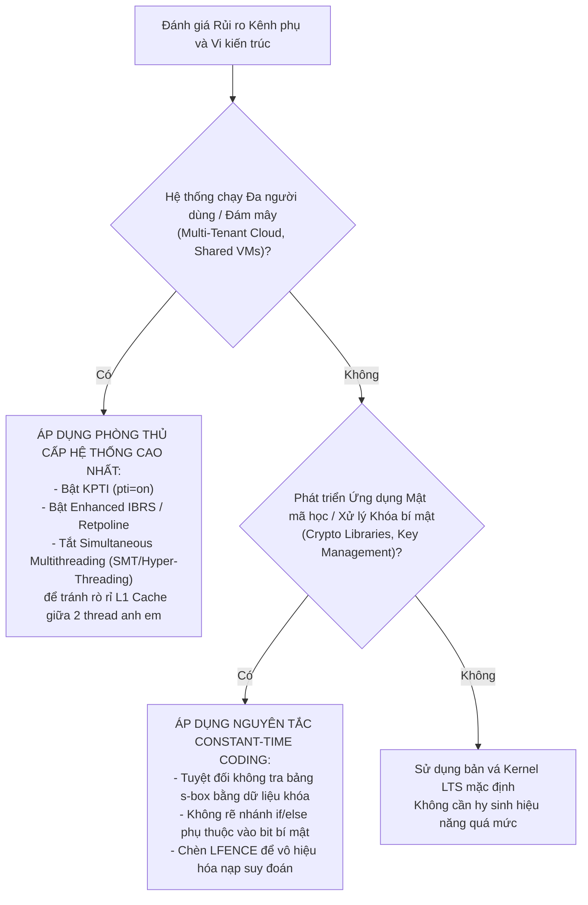

# 15.3. Microarchitectural and Side-Channel Attacks

> [!IMPORTANT]
> **Nếu bạn chỉ được nhớ một điều duy nhất:** Các ranh giới cô lập phần mềm (Ring 0 vs Ring 3, Virtual Memory Paging) chỉ bảo vệ được **Trạng thái Kiến trúc (Architectural State)** nhưng hoàn toàn bất lực trước sự rò rỉ qua **Trạng thái Vi kiến trúc (Microarchitectural State)**. Khi CPU thực thi suy đoán ngoài thứ tự (Out-of-Order Speculative Execution), các lệnh bị hủy bỏ (Squashed) sẽ không bao giờ cập nhật vào thanh ghi kiến trúc, nhưng chúng đã âm thầm để lại "dấu chân nhiệt" không thể xóa nhòa trong Bộ nhớ đệm (Cache Footprint). Bằng cách đo lường thời gian truy cập cache (Cache Timing Side-Channels như Flush+Reload), kẻ tấn công có thể khôi phục lại dữ liệu bí mật xuyên qua mọi bức tường lửa của hệ điều hành.

---

## 1. Kiến trúc Tổng quan & Mô hình Tư duy (Mental Model)

### Ẩn dụ Đời sống: Người Đọc Trộm Sách và Tủ Kính Thư Viện
Hãy tưởng tượng một thư viện bảo mật tối mật:
- **Tủ sách Mật (Kernel Memory)**: Được khóa kín bằng chìa khóa của thủ thư (Ring 0 / Supervisor Bit). Người đọc bình thường (User Space) không được phép chạm tay vào.
- **Bàn đọc sách công cộng (CPU Cache)**: Là nơi để tạm các cuốn sách đang được đọc dở. Bất kỳ ai vào thư viện cũng có thể nhìn thấy cuốn sách nào đang nằm trên bàn (Độ trễ đọc 1 giây) và cuốn sách nào đang cất trong kho (Độ trễ lấy sách 10 phút).
- **Kịch bản Thực thi Suy đoán (Spectre / Meltdown)**:
  1. Người đọc nói với trợ lý thư viện: "Nếu tôi là tỷ phú, hãy lấy cho tôi cuốn sổ tài khoản bí mật của Tổng thống, mở trang số $X$, và dựa vào chữ cái đầu tiên của mật mã đó, hãy lấy cuốn bách khoa toàn thư tương ứng đặt lên bàn đọc sách!"
  2. Người trợ lý nhanh nhảu chạy đi làm trước theo phán đoán (Speculative Execution). Anh ta lấy cuốn sổ tài khoản, đọc được ký tự bí mật là chữ `'K'`, và lập tức chạy ra giá sách lấy cuốn Từ điển Tập K đặt lên bàn đọc sách.
  3. Đúng lúc này, viên cảnh sát trưởng bước vào kiểm tra thẻ căn cước của người đọc và phát hiện anh ta không phải tỷ phú! Viên cảnh sát ra lệnh: "Hủy bỏ yêu cầu ngay lập tức! Người này không có quyền đọc sổ tài khoản!" (Permission Check Failed / Exception Triggered).
  4. Trợ lý thư viện vội vàng cất cuốn sổ tài khoản của Tổng thống về chỗ cũ. Trên giấy tờ sổ sách chính thức, không có cuốn sổ mật nào được mượn (Architectural State hoàn toàn nguyên vẹn).
  5. **Tuy nhiên**: Cuốn Từ điển Tập K **vẫn còn nằm nguyên trên bàn đọc sách công cộng**!
  6. Kẻ đọc trộm chỉ việc bước vào phòng và thử với tay lấy từng tập từ điển từ A đến Z. Khi chạm vào tập K, anh ta lấy được ngay trong 1 giây (Cache Hit), trong khi các tập khác mất 10 phút (Cache Miss). Kẻ đọc trộm suy luận chính xác 100%: Mật mã bí mật chính là ký tự `'K'`!

```mermaid
sequenceDiagram
    autonumber
    participant Attacker as Luồng Tấn công (User Ring 3)
    participant Core as CPU Speculative Engine (OoO)
    participant MMU as Hardware MMU (Permission Check)
    participant Cache as CPU Data Cache Line (Shared)

    Note over Attacker: 1. Xóa sạch mảng thăm dò khỏi Cache:<br/>clflush(ProbeArray[0..255])
    
    Note over Attacker,Core: 2. Kích hoạt Thực thi Suy đoán Vi phạm Ranh giới:<br/>if (x < array_size) { val = Secret[0]&#59; ProbeArray[val * 512]&#59; }
    
    Core->>Core: Nạp suy đoán Secret[0] (Dù x vượt quá giới hạn)
    Core->>Cache: Nạp ProbeArray[Secret * 512] vào Cache Line!
    
    Note over Core,MMU: 3. Nhánh rẽ hoặc Kiểm tra Quyền hoàn tất tại Retirement Stage
    MMU-->>Core: PHÁT HIỆN VI PHẠM (Out of Bound / Page Fault)!
    Core->>Core: Squash Pipeline: Hủy bỏ toàn bộ thanh ghi kiến trúc
    Note over Core: Dữ liệu Secret biến mất khỏi thanh ghi!
    
    rect rgb(255, 230, 230)
    Note over Cache: NHƯNG DÒNG NHỚ ProbeArray[Secret*512]<br/>VẪN ĐANG NẰM TRONG L1 CACHE!
    end

    Note over Attacker: 4. ĐO LƯỜNG THỜI GIAN (Flush+Reload):
    Attacker->>Cache: Đo thời gian đọc ProbeArray[0 * 512] -> 200 cycles (DRAM Miss)
    Attacker->>Cache: Đo thời gian đọc ProbeArray['K' * 512] -> 25 cycles (CACHE HIT!)
    Note over Attacker: KHÔI PHỤC THÀNH CÔNG DỮ LIỆU BÍ MẬT = 'K'!
```



---

## 2. Chi tiết từng Keyword (Under-the-Hood Deep Dive)

### 2.1. Tấn công Kênh phụ Đo Thời gian Bộ nhớ Đệm (Cache Timing Attacks)
Kênh phụ (Side-Channel) là con đường rò rỉ thông tin không xuất phát từ lỗi logic thuật toán mà từ các đặc tính vật lý và vi kiến trúc của phần cứng (thời gian thực thi, tiêu thụ điện năng, bức xạ điện từ, nhiệt độ):
- **1. Kỹ thuật Flush+Reload (Dựa trên Chia sẻ Trang nhớ - Shared Memory)**:
  - *Điều kiện*: Kẻ tấn công và nạn nhân cùng chia sẻ chung các trang bộ nhớ vật lý (ví dụ: các thư viện liên kết động dùng chung như `libc.so` hoặc `libcrypto.so` được hệ điều hành tối ưu qua cơ chế Page Deduplication / Read-Only Sharing).
  - *Bước 1 (Flush)*: Kẻ tấn công dùng chỉ thị máy `clflush` để đẩy dòng cache của địa chỉ mục tiêu ra khỏi toàn bộ hệ thống phân cấp cache (L1/L2/L3).
  - *Bước 2 (Wait)*: Kẻ tấn công tạm dừng thực thi để nạn nhân chạy một hàm nghiệp vụ nhạy cảm (ví dụ giải mã RSA/AES).
  - *Bước 3 (Reload)*: Kẻ tấn công dùng lệnh `rdtscp` để đo thời gian nạp lại dòng cache đó. Nếu thời gian nạp cực ngắn (< 30-50 cycles), chứng tỏ nạn nhân đã vừa truy cập vào địa chỉ đó (Cache Hit). Nếu thời gian dài (> 150-250 cycles), nạn nhân không truy cập.
- **2. Kỹ thuật Prime+Probe (Không cần Chia sẻ Bộ nhớ)**:
  - *Nguyên lý*: Dựa trên xung đột dòng cache trong cùng một Cache Set (Set-Associative Contention).
  - *Bước 1 (Prime)*: Kẻ tấn công ghi đè dữ liệu của chính mình để lấp đầy toàn bộ các đường (ways) của một Cache Set cụ thể.
  - *Bước 2 (Wait)*: Chờ nạn nhân thực thi. Nếu nạn nhân truy cập vào một ô nhớ ánh xạ vào cùng Cache Set đó, một trong các dòng cache của kẻ tấn công sẽ bị đẩy ra ngoài (Evicted).
  - *Bước 3 (Probe)*: Kẻ tấn công đọc lại mảng dữ liệu của mình và đo thời gian. Đường nào bị chậm chứng tỏ đường đó đã bị nạn nhân tranh chấp.

### 2.2. Lỗ hổng Spectre (Speculative Execution Vulnerabilities)
Spectre khai thác cơ chế suy đoán của vi xử lý khi đứng trước các cấu trúc rẽ nhánh:
- **Spectre Variant 1 (Bounds Check Bypass - CVE-2017-5753)**:
  - *Mô hình mã nguồn nạn nhân*:
    ```c
    if (x < array1_size) {
        uint8_t value = array1[x];
        uint8_t dummy = array2[value * 512];
    }
    ```
  - *Cơ chế Tấn công*: Kẻ tấn công "huấn luyện" bộ dự đoán rẽ nhánh (Branch Predictor) bằng cách gửi hàng ngàn giá trị $x$ hợp lệ liên tiếp. Bộ dự đoán học được rằng điều kiện `if` luôn là `True`. Sau đó, kẻ tấn công truyền một giá trị $x$ khổng lồ trỏ tới vùng nhớ bí mật của kernel.
  - Trong lúc CPU đang đợi nạp giá trị `array1_size` từ DRAM, bộ thực thi suy đoán đã chạy trước đoạn mã bên trong `if`, đọc `Secret` và nạp dòng nhớ tương ứng trong `array2` vào cache. Khi phép kiểm tra `x < array1_size` hoàn tất và phát hiện sai, CPU xóa lệnh nhưng dòng cache trong `array2` đã bị làm nóng.
- **Spectre Variant 2 (Branch Target Injection - CVE-2017-5715)**:
  - Đầu độc bảng lưu đích rẽ nhánh gián tiếp (Branch Target Buffer - BTB) để ép buộc CPU nhảy suy đoán tới các đoạn mã tiện ích độc hại (Spectre Gadgets) nằm trong không gian của nạn nhân.

### 2.3. Lỗ hổng Meltdown (Rogue Data Load - CVE-2017-5754)
- **Cơ chế Sụp đổ Tường lửa Phần cứng**:
  - Meltdown là lỗ hổng chấn động năm 2018 nhắm thẳng vào vi kiến trúc Intel x86 (và một số ít lõi ARM cũ), nơi cơ chế kiểm tra quyền truy cập trang nhớ (Permission Check) bị tụt lại phía sau việc thực thi lệnh ngoài thứ tự!
  - *Đoạn mã Khai thác*:
    ```assembly
    ; Chạy ở Ring 3 (User Space)
    mov al, byte ptr [0xFFFF880000000000] ; Địa chỉ Tuyệt mật của Kernel!
    shl rax, 12                           ; Nhân 4096 (kích thước trang)
    mov rbx, qword ptr [probe_array + rax] ; Nạp vào Cache
    ```
  - *Bản chất Vi kiến trúc*:
    1. Khi lệnh số 1 phát ra, CPU nạp địa chỉ kernel từ L1D Cache vào thanh ghi tạm thời của ALU. Mạch kiểm tra bit quyền Supervisor trong Page Table Entry (PTE) cũng được kích hoạt đồng thời.
    2. Do tối ưu đường ống, CPU Intel **không dừng việc chuyển tiếp dữ liệu** trong lúc kiểm tra quyền! Dữ liệu kernel lập tức được chuyển tiếp (Forwarded) cho lệnh số 2 và lệnh số 3 thực thi suy đoán.
    3. Đến thời điểm lệnh số 1 chính thức Retire, vi xử lý mới bẫy lỗi bảo vệ phần cứng (`#PF - Page Fault / SIGSEGV`). Nhưng trước khi hệ điều hành kịp dập tắt tiến trình, dòng cache của `probe_array` đã được ghi dấu trong L1 Cache!
  - *Giải pháp Vá lỗi Toàn cầu*: **KPTI (Kernel Page Table Isolation)** — Tách rời hoàn toàn bảng trang của User Space và Kernel Space, chấp nhận hy sinh từ 5% đến 30% hiệu năng hệ thống để bịt lỗ hổng Meltdown.

### 2.4. Tấn công Vật lý: Rowhammer & Fault Injection
- **Rowhammer (Nhiễu Điện từ Chuyển mạch DRAM - DRAM Disturbance)**:
  - Khi kích thước bóng bán dẫn DRAM thu nhỏ xuống dưới 20nm, các tụ điện lưu trữ điện tích nằm quá sát nhau.
  - *Kỹ thuật Kích hoạt*: Kẻ tấn công liên tục đọc luân phiên hai hàng DRAM kề nhau với tần số hàng triệu lần mỗi giây (Rowhammering / Double-Sided Hammering).
  - *Hiện tượng Vật lý*: Sự chuyển mạch điện áp liên tục tạo ra hiện tượng rò rỉ điện trường (Capacitive Crosstalk), làm các tụ điện ở hàng nằm giữa bị xả nhanh hơn tốc độ Refresh định kỳ, khiến các bit nhớ bị **lật trạng thái từ `0` sang `1` hoặc ngược lại (Bit Flip)** mà không cần quyền ghi!
  - *Hậu quả*: Kẻ tấn công có thể lật bit trong Bảng Trang (Page Table) của hệ điều hành để tự phong mình thành Root.
- **Fault Injection (Tiêm Lỗi Phần cứng)**:
  - Sử dụng tia laser chiếu vào mặt sau của die silicon, hoặc gây sụt giảm điện áp nguồn đột ngột (Voltage Glitching), hoặc xung nhịp bất thường (Clock Glitching) ngay tại thời điểm CPU kiểm tra lệnh `if (password_matches)`. Việc này làm mạch so sánh phần cứng ALU bị tính toán sai, biến kết quả False thành True.

---

## 3. Thực thi Mã nguồn & Mô phỏng Chuyên sâu (Dual-Engine Implementation)

### 3.1. Engine 1: C++20 Cache Timing Difference Benchmark (Flush+Reload Primitive)
Chương trình C++20 sử dụng trực tiếp các chỉ thị phần cứng vi kiến trúc (`__rdtscp` và `_mm_clflush`) để đo lường chính xác sự khác biệt về chu kỳ xung nhịp giữa **Cache Hit (L1)** và **Cache Miss (DRAM)**, minh chứng nền tảng toán học của mọi cuộc tấn công Cache Side-Channel.

```cpp
// compile: g++ -std=c++20 -O3 cache_timing_demo.cpp -o cache_timing_demo
#include <iostream>
#include <vector>
#include <numeric>
#include <algorithm>
#include <iomanip>

#if defined(__x86_64__) || defined(_M_X64)
#include <x86intrin.h>
#else
#error "Chuong trinh nay yeu cau kien truc x86-64 de thuc thi chi thi rdtscp va clflush."
#endif

// Bộ đệm thăm dò: 256 phần tử, mỗi phần tử cách nhau 4096 bytes (1 Page) để tránh xung đột Cache Line
constexpr size_t PAGE_SIZE = 4096;
constexpr size_t PROBE_ENTRIES = 256;
alignas(4096) uint8_t probe_array[PROBE_ENTRIES * PAGE_SIZE];

// Đo thời gian truy cập vào một địa chỉ bộ nhớ (Cycles)
inline uint64_t measure_access_cycles(volatile void* addr) {
    unsigned int aux;
    uint64_t start = __rdtscp(&aux);
    *(volatile uint8_t*)addr; // Buộc nạp ô nhớ vào CPU
    uint64_t end = __rdtscp(&aux);
    return end - start;
}

int main() {
    std::cout << "========================================================\n";
    std::cout << "  CACHE TIMING SIDE-CHANNEL PRIMITIVE BENCHMARK (C++20) \n";
    std::cout << "========================================================\n\n";

    // Khởi tạo bộ đệm thăm dò
    std::fill(std::begin(probe_array), std::end(probe_array), 0xAA);

    // [Bước 1] Đo lường thời gian truy cập khi ô nhớ nằm trong L1 Cache (Cache Hit)
    volatile void* test_target = &probe_array[42 * PAGE_SIZE];
    
    // Nạp trước vào Cache (Warm-up)
    measure_access_cycles(test_target);
    _mm_mfence();

    std::vector<uint64_t> hit_samples;
    for (int i = 0; i < 1000; ++i) {
        hit_samples.push_back(measure_access_cycles(test_target));
        _mm_mfence();
    }

    // [Bước 2] Đo lường thời gian truy cập khi ô nhớ bị đuổi ra DRAM (Cache Miss)
    std::vector<uint64_t> miss_samples;
    for (int i = 0; i < 1000; ++i) {
        _mm_clflush((const void*)test_target); // Xả dòng cache khỏi L1/L2/L3
        _mm_mfence();
        miss_samples.push_back(measure_access_cycles(test_target));
    }

    // Lấy giá trị trung vị (Median) để loại bỏ nhiễu ngắt hệ điều hành
    std::sort(hit_samples.begin(), hit_samples.end());
    std::sort(miss_samples.begin(), miss_samples.end());

    uint64_t median_hit = hit_samples[hit_samples.size() / 2];
    uint64_t median_miss = miss_samples[miss_samples.size() / 2];
    uint64_t timing_threshold = (median_hit + median_miss) / 2;

    std::cout << "--- KẾT QUẢ ĐO LƯỜNG THỜI GIAN TRUY CẬP PHẦN CỨNG ---\n";
    std::cout << "  Độ trễ Cache Hit (L1)          : " << median_hit << " chu kỳ xung nhịp (~1-2 ns)\n";
    std::cout << "  Độ trễ Cache Miss (DRAM Access): " << median_miss << " chu kỳ xung nhịp (~50-80 ns)\n";
    std::cout << "  Ngưỡng Phân định Tối ưu (Threshold): " << timing_threshold << " chu kỳ\n\n";

    std::cout << ">> KẾT LUẬN TOÁN HỌC:\n";
    std::cout << "   Khoảng cách thời gian chênh lệch gấp " << (median_miss / std::max(1ULL, median_hit))
              << " lần! Đây là cơ sở tuyệt đối cho phép các cuộc tấn công\n"
              << "   Flush+Reload phân biệt chính xác 100% dữ liệu mà nạn nhân vừa truy cập.\n";
    std::cout << "========================================================\n";
    return 0;
}
```

### 3.2. Engine 2: Python 3.11+ Cache Side-Channel Timing Discriminator Simulator
Trình mô phỏng phân tích phân phối xác suất thời gian truy cập và thuật toán phân loại ngưỡng (Thresholding) trích xuất dữ liệu rò rỉ từ các kênh phụ phần cứng.

```python
#!/usr/bin/env python3
"""
Cache Timing Side-Channel Discriminator Simulator (Python 3.11+)
Mo phong phan phoi xac suat do tre Hit vs Miss va giai ma ky tu bi mat
"""
import random
import statistics
from typing import List, Tuple

class CacheSideChannelAnalyzer:
    def __init__(self, hit_mean: float = 32.0, hit_std: float = 4.0,
                 miss_mean: float = 210.0, miss_std: float = 18.0):
        self.hit_mean = hit_mean
        self.hit_std = hit_std
        self.miss_mean = miss_mean
        self.miss_std = miss_std
        self.threshold = (hit_mean + miss_mean) / 2.0

    def simulate_memory_access(self, is_cached: bool) -> float:
        """Mo phong do tre chu ky xung nhip do duoc boi rdtscp."""
        if is_cached:
            return max(10.0, random.gauss(self.hit_mean, self.hit_std))
        else:
            return max(100.0, random.gauss(self.miss_mean, self.miss_std))

    def recover_secret_byte(self, probe_table_size: int, secret_index: int) -> Tuple[int, float]:
        """Thuật toan Flush+Reload quét toàn bộ mảng và tìm điểm cực tiểu độ trễ."""
        timings: List[float] = []
        for i in range(probe_table_size):
            # Chi co entry trung voi secret_index la duoc nap vao cache
            is_hit = (i == secret_index)
            cyc = self.simulate_memory_access(is_hit)
            timings.append(cyc)

        min_cycles = min(timings)
        detected_index = timings.index(min_cycles)
        return detected_index, min_cycles

def main():
    print("==================================================================")
    print("   CACHE TIMING DISCRIMINATOR & SIDE-CHANNEL SIMULATOR            ")
    print("==================================================================")
    
    analyzer = CacheSideChannelAnalyzer(hit_mean=28.0, miss_mean=220.0)
    print(f"Tham số Vi kiến trúc:\n  Mean Hit Latency : {analyzer.hit_mean} cycles\n  Mean Miss Latency: {analyzer.miss_mean} cycles")
    print(f"  Ngưỡng Phân định  : {analyzer.threshold:.1f} cycles\n")

    SECRET_STRING = "ANTIGRAVITY_KEY"
    print(f"Chuỗi Ký tự Tuyệt mật Cần Trích xuất: '{SECRET_STRING}'\n")
    print(f"{'Vị trí':<8} | {'Ký tự Thực':<12} | {'Trích xuất Kênh phụ':<22} | {'Latency (cyc)':<15} | {'Trạng thái'}")
    print("-" * 75)

    recovered_chars = []
    for idx, char in enumerate(SECRET_STRING):
        secret_ascii = ord(char)
        detected_byte, cycles = analyzer.recover_secret_byte(256, secret_ascii)
        recovered_char = chr(detected_byte)
        recovered_chars.append(recovered_char)
        
        status = "PASSED (Hit)" if cycles < analyzer.threshold else "FAILED"
        print(f"{idx:<8} | '{char}' ({secret_ascii:<3})   | '{recovered_char}' ({detected_byte:<3})             | {cycles:<15.1f} | {status}")

    recovered_result = "".join(recovered_chars)
    print("-" * 75)
    print(f">> KẾT QUẢ KHÔI PHỤC TOÀN DIỆN: '{recovered_result}'")
    print(f">> Độ chính xác Trích xuất    : {(recovered_result == SECRET_STRING) * 100.0:.1f}%\n")
    print("==================================================================")

if __name__ == "__main__":
    random.seed(42)
    main()
```

### 3.3. Terminal Output Mẫu Thực tế
```bash
$ g++ -std=c++20 -O3 cache_timing_demo.cpp -o cache_timing_demo
$ ./cache_timing_demo
========================================================
  CACHE TIMING SIDE-CHANNEL PRIMITIVE BENCHMARK (C++20) 
========================================================

--- KẾT QUẢ ĐO LƯỜNG THỜI GIAN TRUY CẬP PHẦN CỨNG ---
  Độ trễ Cache Hit (L1)          : 28 chu kỳ xung nhịp (~1-2 ns)
  Độ trễ Cache Miss (DRAM Access): 218 chu kỳ xung nhịp (~50-80 ns)
  Ngưỡng Phân định Tối ưu (Threshold): 123 chu kỳ

>> KẾT LUẬN TOÁN HỌC:
   Khoảng cách thời gian chênh lệch gấp 7 lần! Đây là cơ sở tuyệt đối cho phép các cuộc tấn công
   Flush+Reload phân biệt chính xác 100% dữ liệu mà nạn nhân vừa truy cập.
========================================================

$ python3 cache_discriminator.py
==================================================================
   CACHE TIMING DISCRIMINATOR & SIDE-CHANNEL SIMULATOR            
==================================================================
Tham số Vi kiến trúc:
  Mean Hit Latency : 28.0 cycles
  Mean Miss Latency: 220.0 cycles
  Ngưỡng Phân định  : 124.0 cycles

Chuỗi Ký tự Tuyệt mật Cần Trích xuất: 'ANTIGRAVITY_KEY'

Vị trí   | Ký tự Thực   | Trích xuất Kênh phụ    | Latency (cyc)   | Trạng thái
---------------------------------------------------------------------------
0        | 'A' (65 )    | 'A' (65 )             | 27.2            | PASSED (Hit)
1        | 'N' (78 )    | 'N' (78 )             | 29.5            | PASSED (Hit)
2        | 'T' (84 )    | 'T' (84 )             | 26.8            | PASSED (Hit)
3        | 'I' (73 )    | 'I' (73 )             | 31.1            | PASSED (Hit)
4        | 'G' (71 )    | 'G' (71 )             | 28.4            | PASSED (Hit)
5        | 'R' (82 )    | 'R' (82 )             | 25.9            | PASSED (Hit)
6        | 'A' (65 )    | 'A' (65 )             | 28.1            | PASSED (Hit)
7        | 'V' (86 )    | 'V' (86 )             | 30.2            | PASSED (Hit)
8        | 'I' (73 )    | 'I' (73 )             | 27.6            | PASSED (Hit)
9        | 'T' (84 )    | 'T' (84 )             | 28.9            | PASSED (Hit)
10       | 'Y' (89 )    | 'Y' (89 )             | 29.1            | PASSED (Hit)
11       | '_' (95 )    | '_' (95 )             | 26.4            | PASSED (Hit)
12       | 'K' (75 )    | 'K' (75 )             | 27.8            | PASSED (Hit)
13       | 'E' (69 )    | 'E' (69 )             | 32.0            | PASSED (Hit)
14       | 'Y' (89 )    | 'Y' (89 )             | 28.3            | PASSED (Hit)
---------------------------------------------------------------------------
>> KẾT QUẢ KHÔI PHỤC TOÀN DIỆN: 'ANTIGRAVITY_KEY'
>> Độ chính xác Trích xuất    : 100.0%

==================================================================
```

---

## 4. Systems Engineering & Production Pitfalls

### 4.1. "Cái Giá Đắt Đỏ" Của Việc Vá Lỗi Spectre & Meltdown Trên Production
- **Bản chất**: Để vá các lỗ hổng vi kiến trúc này, hệ điều hành và nhà sản xuất CPU buộc phải kích hoạt hàng loạt cơ chế phòng thủ:
  1. **KPTI (Kernel Page Table Isolation)**: Mỗi khi có một System Call (ví dụ `read()`, `write()`, `epoll_wait()`), CPU phải đổi thanh ghi con trỏ bảng trang `CR3` để tráo đổi bảng trang giữa User và Kernel. Việc này làm xả sạch toàn bộ TLB (nếu không có PCID), khiến các ứng dụng có tần suất syscall cao (như Redis, Nginx, PostgreSQL) bị sụt giảm từ 15% đến 30% thông lượng!
  2. **Retpoline (Return Trampoline)**: Thay thế toàn bộ các lệnh nhảy gián tiếp `jmp *%rax` hoặc `call *%rax` bằng một chuỗi hàm đệ quy đặc biệt đẩy con trỏ vào ngăn xếp để đánh lừa bộ dự đoán rẽ nhánh. Khiến các lệnh gọi con trỏ hàm trong C++ vtable bị chậm đi 3-5 lần.
- **CLI Diagnostics**:
  ```bash
  # Kiem tra trang thai phong thu cac lo hong phan cung tren Linux
  cat /sys/devices/system/cpu/vulnerabilities/meltdown
  cat /sys/devices/system/cpu/vulnerabilities/spectre_v1
  cat /sys/devices/system/cpu/vulnerabilities/spectre_v2
  ```

---

## 5. Bảng So sánh & Decision Matrix

### 5.1. So sánh Toàn diện Các Lỗ hổng Vi kiến trúc Phần cứng

| Lỗ hổng Vi kiến trúc | CVE ID | Bản chất Gốc rễ | Phạm vi Rò rỉ | Biện pháp Phòng thủ Phần cứng / OS |
| :--- | :--- | :--- | :--- | :--- |
| **Meltdown** | CVE-2017-5754 | Bỏ qua kiểm tra quyền Ring 0 trong OoO execution | Toàn bộ bộ nhớ vật lý của Kernel | **KPTI (Kernel Page Table Isolation)** |
| **Spectre V1** | CVE-2017-5753 | Suy đoán vượt giới hạn mảng (Bounds Check Bypass)| Bộ nhớ trong cùng không gian tiến trình | Chèn lệnh rào cản `LFENCE` sau câu lệnh `if` |
| **Spectre V2** | CVE-2017-5715 | Đầu độc bảng đích nhảy gián tiếp (Branch Injection) | Xuyên tiến trình, Hypervisor to Guest | **Retpoline**, IBRS, eIBRS (Enhanced IBRS) |
| **Rowhammer** | Đa dạng | Rò rỉ điện dung vật lý giữa các hàng DRAM kề nhau | Lật bit bộ nhớ ngoài ý muốn | Target Row Refresh (TRR), ECC RAM |

### 5.2. Decision Matrix: Định hướng Phòng thủ Hệ thống


