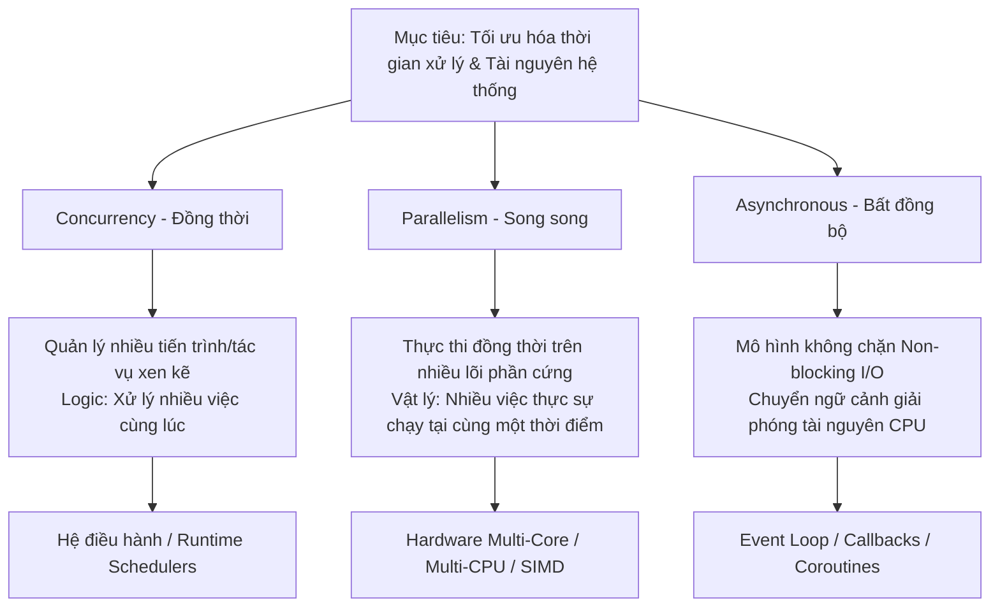
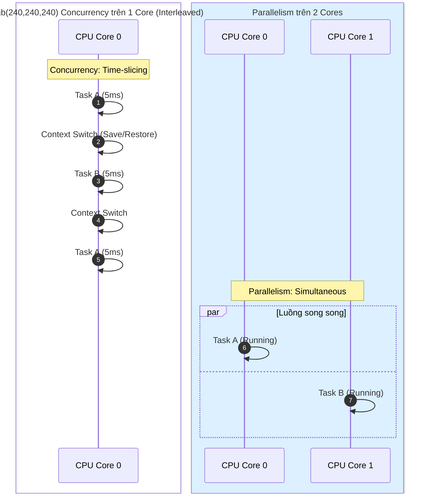
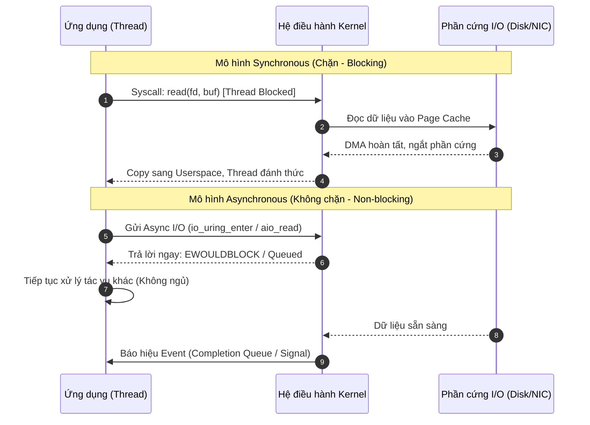
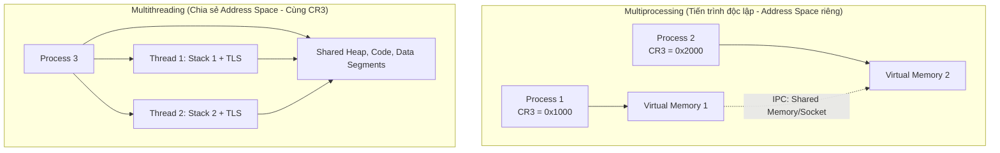
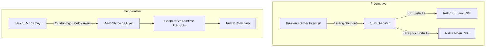
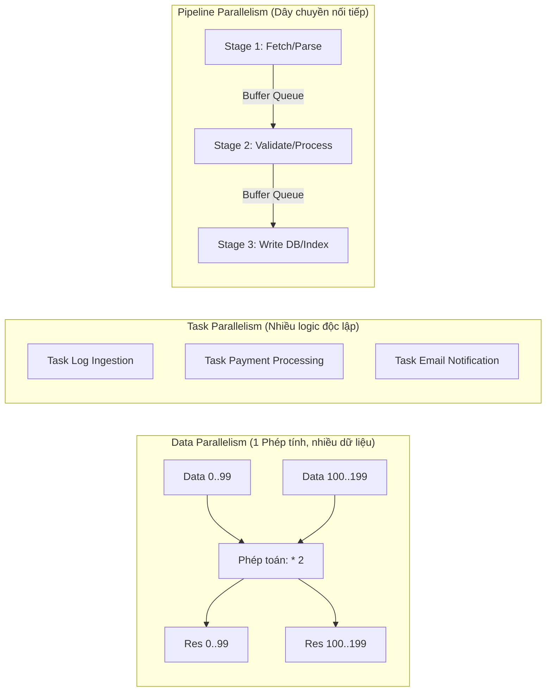
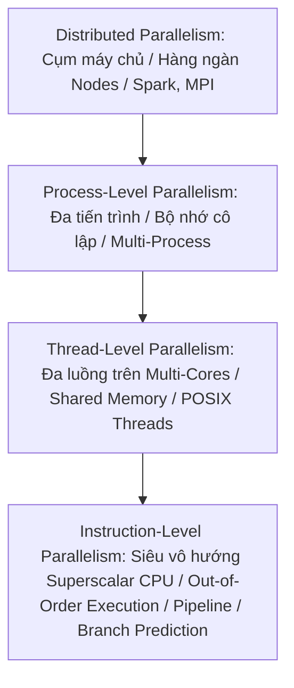
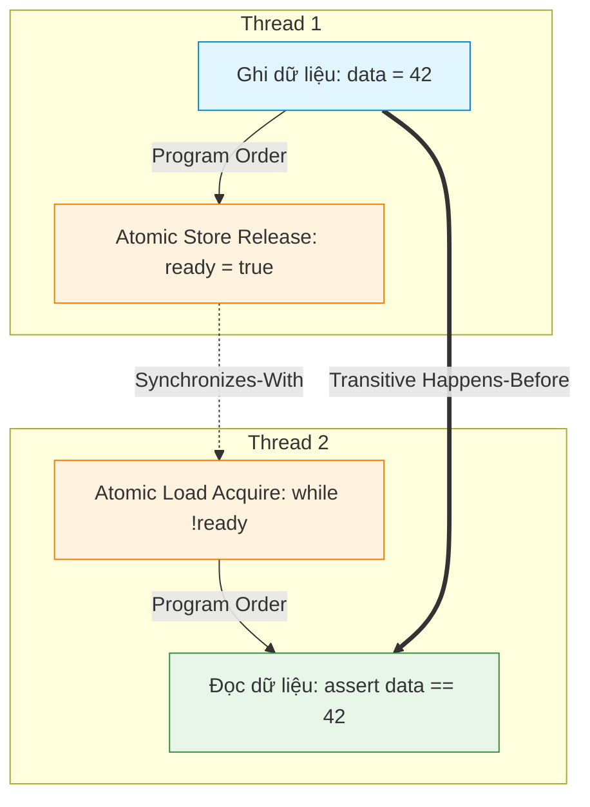

# 15.1. Parallel & Concurrent Programming Fundamentals

## Tổng quan về Nền tảng Song song và Đồng thời

Trong kỹ nghệ phần mềm hiện đại và đặc biệt là hệ thống phân tán, xử lý tải cao (High-throughput Systems), sự hiểu biết sâu sắc về điện toán đồng thời (Concurrent Computing) và điện toán song song (Parallel Computing) là lằn ranh phân chia giữa một kỹ sư thông thường và một chuyên gia hệ thống backend. 

Bản chất vật lý của vi kiến trúc máy tính đã chạm tới **Power Wall** (giới hạn tiêu thụ điện năng và tỏa nhiệt của bóng bán dẫn) từ những năm 2004-2005. Định luật Dennard Scaling chấm dứt, buộc các nhà sản xuất phần cứng phải chuyển dịch từ việc tăng xung nhịp đơn nhân (Single-core Frequency Scaling) sang kiến trúc đa lõi (Multi-core / Many-core Architecture). Để khai thác tối đa năng lực phần cứng, phần mềm bắt buộc phải được thiết kế theo các mô hình đồng thời và song song.



---

## 2. Chi tiết từng Keyword (Under-the-Hood Deep Dive)

---

### 1. Parallel Computing & 2. Concurrent Computing

#### 1. Khái niệm bản chất (What & Why)
- **Concurrent Computing (Điện toán đồng thời)**: Là mô hình tính toán trong đó nhiều luồng thực thi (threads/tasks) có cấu trúc logic đan xen và có thể tiến triển độc lập trong cùng một khoảng thời gian (overlapping time interval). Concurrency giải quyết bài toán **cấu trúc phần mềm (structure)**: chia nhỏ một chương trình lớn thành các phần độc lập có thể điều phối và thực thi linh hoạt.
- **Parallel Computing (Điện toán song song)**: Là kỹ thuật phần cứng và phần mềm cho phép nhiều lệnh hoặc tác vụ được **vật lý hóa thực thi tại cùng một chu kỳ xung nhịp CPU** (exact same physical instant) trên các đơn vị tính toán riêng biệt (Cores, ALUs, GPUs). Parallelism giải quyết bài toán **tốc độ thực thi (execution throughput)**.

#### 2. Cơ chế hoạt động sâu (Under the hood / Hardcore Internals)
- **Tầng CPU & Phần cứng**:
  - Với **Concurrency trên đơn lõi (Single-core)**: CPU sử dụng ngắt đồng hồ phần cứng (Timer Interrupt - IRQ0) từ Local APIC. Hệ điều hành thực hiện ngắt ngắt quãng (preemption), hoán đổi ngữ cảnh thanh ghi (Register Context: RIP, RSP, RAX, RBX, v.v.), làm tràn bộ đệm TLB (Translation Lookaside Buffer) và phá vỡ tính liên tục của Pipeline.
  - Với **Parallelism trên đa lõi (Multi-core)**: Mỗi lõi CPU có pipeline riêng biệt, bộ đếm chương trình (Program Counter - PC/RIP) riêng và bộ nhớ đệm L1/L2 độc lập. Hai lệnh thuộc hai luồng khác nhau chạy song song mà không tranh chấp chu kỳ xung nhịp ALU.
- **Cache Coherence**: Khi song song ghi dữ liệu chung, giao thức duy trì nhất quán bộ nhớ đệm (như MESI, MOESI) gửi tín hiệu qua Ring Bus / Interconnect, gây hiện tượng Invalidations trên L1/L2 cache lines (64 bytes).

#### 3. Sơ đồ minh họa (Mermaid Diagram)



#### 4. Code ví dụ thực chiến (C++20)

```cpp
#include <iostream>
#include <vector>
#include <thread>
#include <numeric>
#include <execution>
#include <chrono>

// Minh họa Parallel Computing sử dụng C++17/20 Parallel Algorithms
void demonstrate_parallel_computing() {
    constexpr size_t DATA_SIZE = 100'000'000;
    std::vector<int64_t> data(DATA_SIZE, 1);

    auto start = std::chrono::high_resolution_clock::now();
    
    // std::execution::par: Phân rã dữ liệu chạy song song trên các hardware threads
    int64_t sum = std::reduce(std::execution::par, data.begin(), data.end(), 0LL);

    auto end = std::chrono::high_resolution_clock::now();
    std::chrono::duration<double, std::milli> elapsed = end - start;
    
    std::cout << "[Parallel Computing] Sum: " << sum 
              << " | Time: " << elapsed.count() << " ms\n";
}

int main() {
    demonstrate_parallel_computing();
    return 0;
}
```

#### 5. Cạm bẫy & Anti-patterns (Pitfalls)
- **Nhầm lẫn Concurrency đem lại tốc độ cao hơn trên I/O-bound**: Tạo quá nhiều OS Threads để đạt được Concurrency cho các tác vụ tính toán CPU-bound trên máy tính có ít lõi sẽ gây **CPU Thrashing** (thời gian CPU dùng cho Context Switching lớn hơn thời gian chạy logic thực sự).
- **False Sharing**: Chạy song song nhiều lõi nhưng cập nhật hai biến nằm chung một Cache Line 64-byte khiến hiệu năng tụt dốc trầm trọng do CPU bus liên tục invalid cache.

#### 6. Ứng dụng thực tế trong Backend / Systems
- **Concurrency**: Node.js Event Loop hoặc Go Goroutines phục vụ 100,000 kết nối WebSocket đồng thời mà không cần 100,000 nhân CPU.
- **Parallelism**: ClickHouse, PostgreSQL Parallel Query Scanning, hoặc Apache Spark tính toán phân tán MapReduce trên hàng ngàn lõi CPU vật lý.

---

### 3. Asynchronous Programming & 4. Synchronous Programming

#### 1. Khái niệm bản chất (What & Why)
- **Synchronous Programming (Lập trình đồng bộ)**: Mô hình thực thi tuần tự tuyến tính. Khi một lời gọi hàm hoặc I/O diễn ra, luồng gọi (calling thread) bị chặn (blocked), dừng toàn bộ hoạt động cho đến khi có kết quả trả về.
- **Asynchronous Programming (Lập trình bất đồng bộ)**: Mô hình thực thi không chặn (non-blocking). Luồng gọi khởi tạo một tác vụ (thường là tác vụ tốn thời gian như Network I/O hoặc Disk I/O), đăng ký một cơ chế thông báo (Callback, Promise, Future, Coroutine) và lập tức quay lại xử lý các tác vụ khác.

#### 2. Cơ chế hoạt động sâu (Under the hood / Hardcore Internals)
- **Trạng thái luồng ở Kernel**:
  - Với **Synchronous I/O**: Thread thực thi System Call (ví dụ `read()`), Kernel chuyển trạng thái Thread từ `TASK_RUNNING` sang `TASK_INTERRUPTIBLE`. Luồng bị loại khỏi CPU Runqueue. Khi dữ liệu đến từ Card mạng (NIC DMA transfer to RAM) và phát sinh phần cứng ngắt (Hardware Interrupt), Kernel xử lý bottom half/softirq, đánh thức Thread quay lại `TASK_RUNNING`.
  - Với **Asynchronous I/O (epoll / io_uring / IOCP)**: Chương trình gọi `epoll_ctl` để đăng ký File Descriptor (FD) với kernel state, hoặc nạp request vào ring buffer của `io_uring`. Thread không hề bị đưa vào trạng thái ngủ mà tiếp tục xử lý các kết nối khác.

#### 3. Sơ đồ minh họa (Mermaid Diagram)



#### 4. Code ví dụ thực chiến (C++20 Coroutines & TypeScript)

**C++20 Coroutine Async Flow:**
```cpp
#include <iostream>
#include <coroutine>
#include <chrono>
#include <thread>

// Khởi tạo một Minimal Task Wrapper cho C++20 Coroutine
struct AsyncTask {
    struct promise_type {
        AsyncTask get_return_object() {
            return AsyncTask{std::coroutine_handle<promise_type>::from_promise(*this)};
        }
        std::suspend_never initial_suspend() noexcept { return {}; }
        std::suspend_always final_suspend() noexcept { return {}; }
        void return_void() noexcept {}
        void unhandled_exception() { std::terminate(); }
    };

    std::coroutine_handle<promise_type> handle;
};

// Custom Awaitable giả lập Non-blocking Timer
struct AsyncSleep {
    int duration_ms;
    bool await_ready() const noexcept { return false; }
    void await_suspend(std::coroutine_handle<> h) const {
        std::thread([h, d = duration_ms]() {
            std::this_thread::sleep_for(std::chrono::milliseconds(d));
            h.resume(); // Đánh thức coroutine tại thread khác hoặc event pool
        }).detach();
    }
    void await_resume() const noexcept {}
};

AsyncTask fetch_database_record_async() {
    std::cout << "[Async] Bắt đầu gọi truy vấn database không chặn...\n";
    co_await AsyncSleep{100}; // Nhường luồng tại điểm đình chỉ (suspension point)
    std::cout << "[Async] Nhận kết quả từ database, tiếp tục thực thi.\n";
}

int main() {
    fetch_database_record_async();
    std::cout << "[Main] Luồng chính không hề bị chặn, tiếp tục làm việc khác!\n";
    std::this_thread::sleep_for(std::chrono::milliseconds(200));
    return 0;
}
```

#### 5. Cạm bẫy & Anti-patterns (Pitfalls)
- **Async over Sync Trap**: Gọi các thư viện blocking (như JDBC hoặc `fs.readFileSync`) bên trong các worker thread của runtime bất đồng bộ (như Node.js event loop hoặc Tokio single-threaded runtime), khiến toàn bộ server bị nghẽn (starvation).
- **Uncontrolled Asynchrony**: Khởi tạo hàng triệu async promises mà không áp dụng Backpressure/Concurrency limit, dẫn tới OOM (Out Of Memory).

#### 6. Ứng dụng thực tế trong Backend / Systems
- Nền tảng Netty (Java), Tokio (Rust), Node.js (V8 + libuv), và FastAPI (Python ASGI) sử dụng lập trình bất đồng bộ để xử lý hàng trăm nghìn RPS (Requests Per Second) với số lượng threads cố định (Thread-per-core architecture).

---

### 5. Concurrency & 6. Parallelism (Deep Distinction)

*(Chi tiết sự khác biệt cốt lõi: Rob Pike đã khẳng định: "Concurrency is about dealing with lots of things at once. Parallelism is about doing lots of things at once." Concurrency là cấu trúc thiết kế, Parallelism là mô hình phần cứng).*

---

### 7. Multitasking, 8. Multiprocessing, 9. Multithreading

#### 1. Khái niệm bản chất (What & Why)
- **Multitasking (Đa nhiệm)**: Khả năng của hệ điều hành cho phép thực thi đồng thời hoặc giả đồng thời nhiều chương trình/công việc độc lập bằng cách chia sẻ tài nguyên CPU.
- **Multiprocessing (Đa tiến trình)**: Kiến trúc hệ thống sử dụng hai hoặc nhiều vi xử lý (CPUs) hoặc nhiều tiến trình độc lập (Processes) có không gian địa chỉ bộ nhớ (Address Space) hoàn toàn riêng biệt.
- **Multithreading (Đa luồng)**: Mô hình thực thi trong đó một tiến trình duy nhất sở hữu nhiều luồng thực thi (Threads) cùng chia sẻ chung không gian địa chỉ bộ nhớ và tài nguyên của tiến trình đó.

#### 2. Cơ chế hoạt động sâu (Under the hood / Hardcore Internals)
- **Không gian bộ nhớ (Address Space & MMU)**:
  - Trong **Multiprocessing**: Mỗi tiến trình có một bảng phân trang riêng (`CR3` register trên x86_64 chứa địa chỉ vật lý của Page Global Directory). Khi chuyển đổi giữa hai tiến trình, CPU bắt buộc phải thay đổi giá trị thanh ghi `CR3`, dẫn đến toàn bộ **TLB Cache bị xóa (flush/invalidate)**. Chi phí Context Switch rất cao (vài micro giây).
  - Trong **Multithreading**: Tất cả các threads thuộc cùng một process dùng chung `CR3`. Bộ nhớ ảo ánh xạ giống nhau. Chuyển đổi giữa các threads không làm flush TLB, chỉ tốn công lưu/phục hồi tập thanh ghi (Instruction Pointer, Stack Pointer, General Purpose Registers). Chi phí Context Switch thấp hơn nhiều (vài trăm nano giây).

#### 3. Sơ đồ minh họa (Mermaid Diagram)



#### 4. Code ví dụ thực chiến (C++ POSIX)

```cpp
#include <iostream>
#include <unistd.h>
#include <sys/wait.h>
#include <thread>
#include <vector>

int global_counter = 0; // Biến nằm trên Data Segment

void test_multiprocessing() {
    pid_t pid = fork(); // Sao chép không gian bộ nhớ qua Copy-On-Write (COW)
    if (pid == 0) {
        // Tiến trình con
        global_counter += 10;
        std::cout << "[Child Process] Counter: " << global_counter << " (Address: " << &global_counter << ")\n";
        _exit(0);
    } else {
        wait(nullptr);
        std::cout << "[Parent Process] Counter: " << global_counter << " (Address: " << &global_counter << ")\n";
    }
}

void test_multithreading() {
    auto worker = []() {
        global_counter += 10;
    };
    std::thread t1(worker);
    t1.join();
    std::cout << "[Multithreading] Counter sau khi Thread cập nhật: " << global_counter << "\n";
}

int main() {
    std::cout << "--- Kiểm tra Multiprocessing ---\n";
    test_multiprocessing();
    std::cout << "\n--- Kiểm tra Multithreading ---\n";
    test_multithreading();
    return 0;
}
```

#### 5. Cạm bẫy & Anti-patterns (Pitfalls)
- **Data Corruption trong Multithreading**: Vì các threads chia sẻ chung bộ nhớ Heap và Data segments, việc không đồng bộ khi truy cập biến toàn cục dẫn tới Data Race và lỗi Undefined Behavior.
- **IPC Overhead trong Multiprocessing**: Dữ liệu gửi giữa các process phải tuần tự hóa (serialization) và sao chép qua kernel buffers (ngoại trừ Shared Memory kết hợp Semaphores).

#### 6. Ứng dụng thực tế trong Backend / Systems
- **Multiprocessing**: NGINX master-worker architecture, PostgreSQL (mỗi client kết nối tạo một backend process độc lập), Python Celery workers.
- **Multithreading**: MySQL (InnoDB engine), Java Spring Boot, Envoy Proxy, C++ Redis forks (KeyDB).

---

### 10. Single-Threaded Concurrency vs 11. Multi-Threaded Concurrency

#### 1. Khái niệm bản chất (What & Why)
- **Single-Threaded Concurrency**: Hệ thống chỉ dùng duy nhất một luồng thực thi (Single Thread) để quản lý nhiều tác vụ đồng thời thông qua cơ chế Event Multiplexing (Vòng lặp sự kiện - Event Loop). Loại bỏ hoàn toàn chi phí khóa (Locks) và bài toán Data Race.
- **Multi-Threaded Concurrency**: Hệ thống khởi tạo nhiều luồng đồng thời, có thể chạy trên nhiều nhân CPU, chia sẻ tài nguyên bộ nhớ và cần cơ chế đồng bộ hóa (Mutex, Atomics, Semaphores).

#### 2. So sánh chuyên sâu & Bảng đối chiếu

| Đặc tính | Single-Threaded Concurrency | Multi-Threaded Concurrency |
| :--- | :--- | :--- |
| **Độ phức tạp lập trình** | Thấp hơn (Không cần Mutex, không Deadlock) | Rất cao (Race conditions, Deadlocks, Memory Models) |
| **Khai thác Multi-Core** | Không tự nhiên (Cần chạy multiple instances/processes) | Tự nhiên (Mỗi thread có thể gán lên 1 CPU core) |
| **Rủi ro Blocking** | Cực kỳ nguy hiểm (1 hàm CPU-heavy chặn toàn bộ event loop) | Thấp hơn (Chỉ block 1 thread, các thread khác vẫn chạy) |
| **Bộ nhớ & Overhead** | Rất thấp (Không tốn Stack 2MB-8MB cho mỗi thread) | Cao hơn (Mỗi OS thread có Stack cố định và metadata) |

---

### 12. Cooperative Concurrency vs 13. Preemptive Concurrency

#### 1. Khái niệm bản chất (What & Why)
- **Cooperative Concurrency (Đồng thời hợp tác)**: Tác vụ tự quyết định khi nào nhường quyền điều khiển CPU (yield control) cho tác vụ khác. Hệ điều hành hoặc Runtime không cưỡng chế thu hồi CPU.
- **Preemptive Concurrency (Đồng thời ưu tiên/Cưỡng chế)**: Bộ lập lịch (Scheduler - HĐH hoặc Runtime) có quyền chủ động ngắt (interrupt/preempt) một tác vụ đang chạy để phân phối chu kỳ CPU cho tác vụ khác dựa trên Time-slice (Quantum) hoặc mức độ ưu tiên.

#### 2. Cơ chế hoạt động sâu (Under the hood / Hardcore Internals)
- **Preemption**:
  - HĐH sử dụng xung ngắt phần cứng (Hardware Timer Interrupt). Khi ngắt kích hoạt, CPU chuyển sang Kernel Mode (Ring 0), lưu giữ toàn bộ con trỏ lệnh và thanh ghi vào kernel stack của luồng, sau đó gọi hàm `schedule()` của Linux Kernel (CFS Scheduler) để chọn luồng tiếp theo từ Red-Black Tree hoặc Runqueue.
- **Cooperation**:
  - Tác vụ chỉ nhường quyền khi chạm vào câu lệnh tường minh (ví dụ: `co_yield`, `sched_yield()`, `await`). Nếu một tác vụ rơi vào vòng lặp vô tận `while(true) {}`, toàn bộ hệ thống hoặc luồng runtime đó bị "đóng băng" vĩnh viễn vì không ai có quyền cưỡng chế thu hồi quyền điều khiển.



---

### 14. Task Parallelism, 15. Data Parallelism, 16. Pipeline Parallelism

#### 1. Khái niệm bản chất (What & Why)
- **Data Parallelism (Song song dữ liệu)**: Cùng một thuật toán/thao tác tính toán được áp dụng đồng thời trên các phần phân vùng khác nhau của cùng một tập dữ liệu lớn (Single Instruction, Multiple Data - SIMD).
- **Task Parallelism (Song song tác vụ)**: Nhiều tác vụ hoàn toàn khác nhau về mặt logic được thực thi đồng thời trên cùng một tập dữ liệu hoặc các tập dữ liệu khác nhau (Multiple Instruction, Multiple Data - MIMD).
- **Pipeline Parallelism (Song song đường ống)**: Một quy trình tính toán được chia thành một chuỗi các công đoạn nối tiếp nhau (Stages). Mỗi công đoạn do một đơn vị xử lý đảm nhiệm, dữ liệu chảy liên tục từ công đoạn $N$ sang công đoạn $N+1$ giống như một dây chuyền lắp ráp công nghiệp.

#### 2. Sơ đồ minh họa (Mermaid Diagram)



#### 3. Code ví dụ thực chiến (C++ Data Parallelism & SIMD Concepts)

```cpp
#include <iostream>
#include <vector>
#include <immintrin.h> // Intel AVX2 SIMD Intrinsics

// Ví dụ Data Parallelism ở cấp độ phần cứng sử dụng SIMD 256-bit Vectorization
void vector_add_avx2(const float* a, const float* b, float* c, size_t n) {
    // 1 vector AVX2 chứa được 8 số float 32-bit (256 bits / 32 bits = 8)
    for (size_t i = 0; i < n; i += 8) {
        __m256 va = _mm256_loadu_ps(&a[i]); // Tải 8 floats song song
        __m256 vb = _mm256_loadu_ps(&b[i]); // Tải 8 floats song song
        __m256 vc = _mm256_add_ps(va, vb);   // 1 chu kỳ ALU tính tổng cả 8 phần tử cùng lúc!
        _mm256_storeu_ps(&c[i], vc);
    }
}
```

---

### 17. Instruction-Level Parallelism (ILP), 18. Thread-Level Parallelism (TLP), 19. Process-Level Parallelism (PLP), 20. Distributed Parallelism

#### 1. Khái niệm phân cấp (Hierarchy of Parallelism)
Sự song song trong khoa học máy tính trải dài trên một dải quang phổ từ cấp độ nano-giây ở tầng mạch điện tử đến cấp độ mili-giây ở tầng mạng toàn cầu:



#### 2. Chi tiết kỹ thuật từng tầng
- **Instruction-Level Parallelism (ILP)**: Do phần cứng CPU thực hiện trong vi kiến trúc (Microarchitecture). Bộ vi xử lý hiện đại (Superscalar) phân tích luồng lệnh máy và thực thi nhiều lệnh máy độc lập (không có phụ thuộc dữ liệu - RAW, WAR, WAW Hazards) trong cùng một chu kỳ xung nhịp nhờ kỹ thuật **Out-of-Order Execution (OoOE)** và **Register Renaming**.
- **Thread-Level Parallelism (TLP)**: Khai thác nhiều lõi vật lý hoặc công nghệ đa luồng đồng thời (Simultaneous Multithreading - SMT / Intel Hyper-Threading) để chạy các luồng khác nhau của cùng một phần mềm.
- **Process-Level Parallelism (PLP)**: Chạy nhiều tiến trình độc lập trên cùng một hệ điều hành. Cách ly lỗi tuyệt đối: nếu 1 process bị `SIGSEGV` (Segfault), các process khác hoàn toàn không bị ảnh hưởng.
- **Distributed Parallelism**: Thực thi tính toán song song qua kết nối mạng mạng máy tính (Network Sockets, InfiniBand, RDMA) giữa nhiều server vật lý (ví dụ: MPI, Ray, Apache Flink).

---

### 21. Concurrent Execution, 22. Interleaved Execution, 23. Non-Deterministic Execution

#### 1. Khái niệm bản chất (What & Why)
- **Concurrent Execution (Thực thi đồng thời)**: Khái niệm rộng nhất chỉ trạng thái nhiều luồng tính toán đang trong quá trình tiến triển.
- **Interleaved Execution (Thực thi đan xen)**: Cơ chế cụ thể khi thực hiện Concurrency trên số lượng lõi CPU ít hơn số lượng luồng: hệ điều hành chia nhỏ thời gian và chạy luân phiên từng phần của từng tác vụ.
- **Non-Deterministic Execution (Thực thi phi đơn định)**: Hiện tượng mà cùng một đầu vào (input) và cùng một đoạn code, nhưng hai lần chạy khác nhau có thể cho ra thứ tự thực thi khác nhau hoặc kết quả khác nhau. Điều này do bộ lập lịch OS, độ trễ bộ đệm phần cứng, và trạng thái tải động của CPU quyết định.

#### 2. Cơ chế gây lỗi Non-determinism (Under the hood)
Khi hai luồng $T_1$ và $T_2$ cùng tăng giá trị biến đếm $x$ (ban đầu $x = 0$):
- Phép toán `x++` gồm 3 lệnh máy (ASM):
  1. `MOV RAX, [x]` (Đọc từ RAM vào thanh ghi)
  2. `ADD RAX, 1` (Cộng 1 trên ALU)
  3. `MOV [x], RAX` (Ghi ngược lại RAM)
- Nếu có **Interleaved Execution** xảy ra giữa lệnh 1 và lệnh 3:
  - $T_1$ nạp $x = 0$.
  - HĐH ngắt chuyển ngữ cảnh sang $T_2$.
  - $T_2$ nạp $x = 0$, cộng 1, ghi $x = 1$.
  - HĐH chuyển lại $T_1$, $T_1$ tiếp tục từ lệnh 2: cộng 1 vào 0, ghi $x = 1$.
  - Kết quả cuối cùng là $1$ thay vì $2$! Đây chính là **Non-deterministic Concurrency Bug**.

---

### 24. Execution Ordering, 25. Happens-Before Relationship, 26. Partial Ordering, 27. Total Ordering

#### 1. Khái niệm bản chất (What & Why)
- **Execution Ordering (Thứ tự thực thi)**: Trình tự mà các thao tác đọc/ghi bộ nhớ thực sự xảy ra đối với hệ thống quan sát.
- **Happens-Before Relationship ($\to$)**: Nền tảng toán học của mọi mô hình nhất quán bộ nhớ hiện đại (Java JMM, C++ Memory Model). Được Leslie Lamport định nghĩa: Nếu thao tác $A$ happens-before thao tác $B$ ($A \to B$), thì mọi hiệu ứng phụ (side-effects) và thay đổi bộ nhớ của $A$ **đảm bảo phải hiển thị đầy đủ và có thể quan sát được** bởi $B$.
- **Partial Ordering (Thứ tự bộ phận)**: Thứ tự quan hệ giữa một tập hợp các sự kiện trong đó không phải cặp sự kiện nào cũng so sánh được với nhau. Hai sự kiện độc lập diễn ra song song trên hai máy hoặc hai lõi mà không có giao tiếp/đồng bộ hóa thì không có thứ tự trước sau xác định ($A \not\to B$ và $B \not\to A$).
- **Total Ordering (Thứ tự toàn phần)**: Thứ tự mà mọi cặp phần tử bất kỳ $(A, B)$ đều có thể xác định rõ ràng: hoặc $A$ xảy ra trước $B$, hoặc $B$ xảy ra trước $A$. Một hệ thống muốn đạt được Sequential Consistency bắt buộc phải duy trì được một Total Order cho mọi thao tác bộ nhớ.

#### 2. Sơ đồ minh họa Happens-Before



#### 3. Code ví dụ thực chiến (C++20 Acquire-Release Semantics)

```cpp
#include <iostream>
#include <atomic>
#include <thread>
#include <cassert>

std::atomic<bool> ready{false};
int payload_data = 0; // Biến thông thường không phải atomic

void producer_thread() {
    payload_data = 1337; // (1) Ghi dữ liệu
    // (2) release store đảm bảo (1) happens-before (2) và đẩy bộ đệm Store Buffer
    ready.store(true, std::memory_order_release); 
}

void consumer_thread() {
    // (3) acquire load đồng bộ hóa (synchronizes-with) với release store (2)
    while (!ready.load(std::memory_order_acquire)) {
        // Chờ dữ liệu sẵn sàng
    }
    // (4) Đảm bảo thấy payload_data == 1337, tuyệt đối không bị trình biên dịch/CPU đảo lệnh
    assert(payload_data == 1337); 
    std::cout << "[Happens-Before] Nhận payload an toàn tuyệt đối: " << payload_data << "\n";
}

int main() {
    std::thread t2(consumer_thread);
    std::thread t1(producer_thread);
    t1.join();
    t2.join();
    return 0;
}
```

---

### 28. Concurrency Model & 29. Parallel Programming Model

#### 1. Khái niệm bản chất (What & Why)
- **Concurrency Model (Mô hình đồng thời)**: Khuôn mẫu kiến trúc trừu tượng quy định cách thức các tác vụ đồng thời giao tiếp, phối hợp và chia sẻ tài nguyên với nhau trong một hệ thống phần mềm (ví dụ: Shared-Memory Model, Message-Passing Actor Model, CSP Model, Event-Loop Model).
- **Parallel Programming Model (Mô hình lập trình song song)**: Tập hợp các API, chỉ thị biên dịch (Pragmas), hoặc ngôn ngữ được thiết kế để diễn đạt thuật toán song song xuống phần cứng vật lý (ví dụ: OpenMP cho Multi-core shared memory, CUDA cho GPU SIMT, OpenMPI cho distributed clusters).

---

## Bảng tra cứu tóm tắt các Keywords trong Chuyên đề 15.1

| Keyword | Cấp độ | Vấn đề cốt lõi giải quyết | Công nghệ / Primitives đại diện |
| :--- | :--- | :--- | :--- |
| **Parallel Computing** | Hardware / Cores | Tối đa hóa throughput, giảm thời gian tính toán thực tế | Multi-core, AVX-512, GPU Compute |
| **Concurrent Computing** | Architecture | Cấu trúc hóa nhiều tiến trình độc lập, tăng khả năng phản hồi | Schedulers, Event Loop, Coroutines |
| **Asynchronous I/O** | OS / Kernel | Loại bỏ việc block luồng khi chờ mạng/đĩa | `epoll`, `io_uring`, IOCP, Kqueue |
| **Happens-Before ($\to$)** | Memory Model | Đảm bảo tính hiển thị bộ nhớ giữa các lõi CPU | Memory Fences, Acquire/Release Atomics |
| **Preemption vs Cooperation** | Scheduler | Quyền hạn phân bổ và tước đoạt chu kỳ CPU | Linux CFS, RTOS vs Fibers, JS Event Loop |
