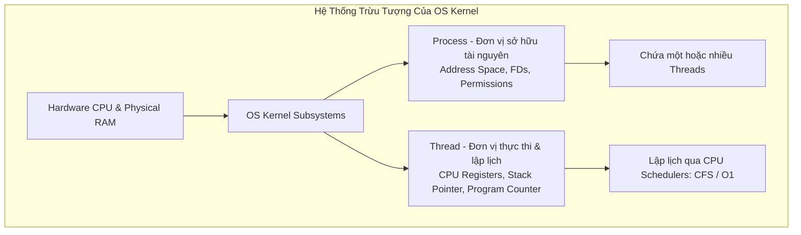
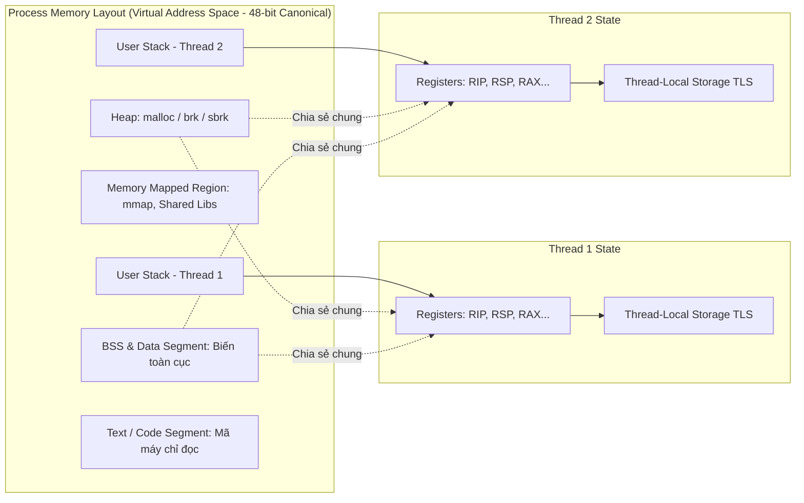
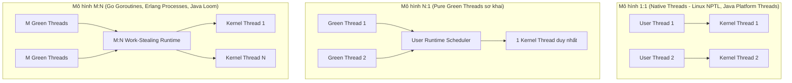
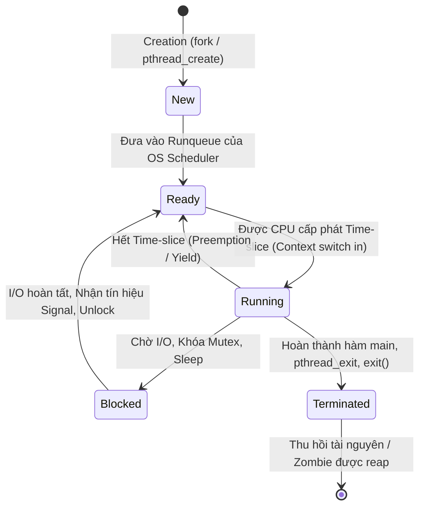
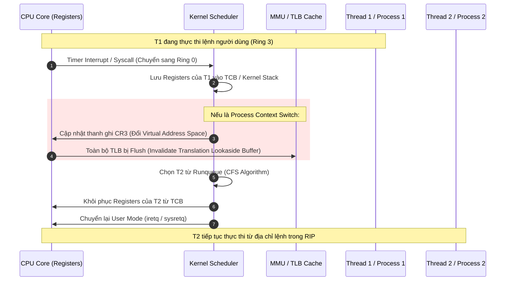
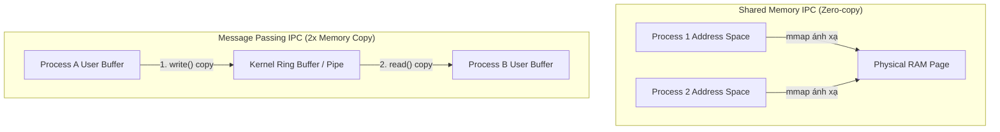

# 15.2. Process & Thread Internals

## Tổng quan về Bản chất Tiến trình và Luồng

Tiến trình (Process) và Luồng (Thread) là hai đơn vị trừu tượng nền tảng mà Hệ điều hành (Operating System Kernel) cung cấp để trừu tượng hóa phần cứng vi xử lý (CPU) và không gian bộ nhớ vật lý (RAM). Mọi phần mềm backend hiện đại—từ các Web Server như NGINX, Envoy, cơ sở dữ liệu như PostgreSQL, MySQL, cho đến các runtime như JVM, Go Runtime hay Node.js—đều được xây dựng trực tiếp trên các cơ chế quản trị tiến trình và luồng của nhân hệ điều hành.



---

## 2. Chi tiết từng Keyword (Under-the-Hood Deep Dive)

---

### 1. Process & 2. Thread

#### 1. Khái niệm bản chất (What & Why)
- **Process (Tiến trình)**: Là một thể hiện đang chạy của một chương trình máy tính. Nó đóng vai trò là **vùng chứa tài nguyên (Resource Container)** được cấp phát độc lập bởi hệ điều hành, bao gồm: không gian địa chỉ bộ nhớ ảo (Virtual Address Space), bảng mô tả tệp tin (File Descriptor Table), thông tin định danh (PID, UID, GID), biến môi trường và tài nguyên bảo mật.
- **Thread (Luồng - Thread of Execution)**: Là **đơn vị thực thi nhỏ nhất được bộ lập lịch (Scheduler) của CPU cấp phát thời gian tính toán**. Một tiến trình có thể chứa nhiều luồng. Các luồng trong cùng một tiến trình chia sẻ chung toàn bộ không gian địa chỉ của tiến trình đó nhưng sở hữu ngăn xếp (Stack) và ngữ cảnh thanh ghi (Registers) riêng biệt.

#### 2. Cấu trúc cấu tạo sâu trong OS Kernel (Under the hood)
- **Trong Linux Kernel**:
  - Không có sự phân biệt rạch ròi thành hai struct khác nhau cho Process và Thread. Cả hai đều được biểu diễn bởi cùng một cấu trúc dữ liệu khổng lồ: `struct task_struct` (được định nghĩa trong `<linux/sched.h>`).
  - Điểm khác biệt nằm ở cờ chia sẻ khi gọi System Call `clone()`:
    - Nếu cờ `CLONE_VM`, `CLONE_FS`, `CLONE_FILES`, `CLONE_SIGHAND` được bật: thực thể mới tạo ra là một **Thread** (chia sẻ Virtual Memory, File Table, Signal Handlers).
    - Nếu không bật các cờ này: thực thể mới tạo ra là một **Process** độc lập hoàn toàn.
  - Mỗi Thread trong Linux có một mã định danh duy nhất là TID (Thread ID), và tất cả các Threads trong cùng một process có chung TGID (Thread Group ID - chính là PID của process).

#### 3. Sơ đồ cấu trúc bộ nhớ (Memory Layout)



#### 4. Code ví dụ thực chiến (C++ POSIX Thread API)

```cpp
#include <iostream>
#include <thread>
#include <vector>
#include <sys/syscall.h>
#include <unistd.h>

void inspect_thread_internals(int id) {
    // Lấy PID (TGID trong kernel) và TID (Thread ID trong kernel)
    pid_t pid = getpid();
    pid_t tid = syscall(SYS_gettid);

    int stack_variable = 42; // Biến cấp phát trên Stack riêng của Thread này

    std::cout << "[Worker Thread " << id << "] PID (TGID): " << pid 
              << " | TID: " << tid 
              << " | Stack Var Address: " << &stack_variable << "\n";
}

int main() {
    std::cout << "[Main Thread] PID: " << getpid() 
              << " | Main TID: " << syscall(SYS_gettid) << "\n";

    std::thread t1(inspect_thread_internals, 1);
    std::thread t2(inspect_thread_internals, 2);

    t1.join();
    t2.join();
    return 0;
}
```

---

### 3. Main Thread & 4. Worker Thread

- **Main Thread**: Luồng thực thi đầu tiên được tạo ra tự động bởi OS khi tiến trình bắt đầu (điểm nhập `_start` gọi `main()`). Luồng này sở hữu Stack chính của tiến trình (kích thước mặc định thường là 8MB trên Linux). Nếu Main Thread gọi `exit()` hoặc kết thúc mà không chờ các luồng khác (join), toàn bộ tiến trình sẽ bị hủy diệt ngay lập tức.
- **Worker Thread**: Các luồng thứ cấp do Main Thread hoặc các luồng khác tạo ra một cách chủ động nhằm mục đích chia nhỏ công việc (offloading) hoặc xử lý song song các tác vụ nền (Background processing, I/O handling, Compute tasks).

---

### 5. Kernel Thread, 6. User-Level Thread, 7. Lightweight Thread, 8. Green Thread, 9. Native Thread

#### 1. Khái niệm bản chất & So sánh các mô hình Luồng
Sự tiến hóa của luồng dẫn đến các mô hình quản lý ánh xạ giữa Userspace và Kernelspace:

| Loại Luồng | Khái niệm bản chất | Tồn tại ở đâu | Chi phí Context Switch | Khả năng chạy Đa lõi |
| :--- | :--- | :--- | :--- | :--- |
| **Native Thread / Kernel Thread** | Luồng do chính OS Kernel quản lý trực tiếp (`task_struct`). | Kernel Space | Trung bình ($\sim 1-2 \mu s$) do cần System Call trap vào Ring 0 | Có (Kernel lập lịch trực tiếp lên các CPU cores) |
| **User-Level Thread (ULT)** | Luồng được quản lý hoàn toàn bởi thư viện ở Userspace; Kernel chỉ nhìn thấy 1 single process. | User Space | Cực thấp ($\sim 10-50 ns$), không cần trap vào Kernel | Không (Nếu 1 ULT bị I/O blocking, toàn bộ process bị block) |
| **Green Thread / Lightweight Thread** | Dạng User-level thread hiện đại được điều phối bởi Runtime (như Go Goroutine, Java Virtual Thread). | User Space + Runtime | Rất thấp ($\sim 100 ns$), Stack động co giãn từ 2KB | Có (Ánh xạ $M:N$ lên $N$ Native Kernel Threads) |

#### 2. Sơ đồ các mô hình phân luồng (Threading Models: 1:1, N:1, M:N)



---

### 10. Thread Lifecycle & 11. Process Lifecycle

#### 1. Các trạng thái trong vòng đời (State Machine)



- **New**: Vừa được cấp phát bộ nhớ (PCB/TCB).
- **Ready (TASK_RUNNING trong Runqueue)**: Sẵn sàng thực thi, đang chờ lõi CPU khả dụng.
- **Running**: Đang trực tiếp chiếm giữ CPU Core và thực thi lệnh máy.
- **Blocked / Waiting (TASK_INTERRUPTIBLE / TASK_UNINTERRUPTIBLE)**: Ngủ chờ tài nguyên I/O hoặc Mutex. Lưu ý: `TASK_UNINTERRUPTIBLE` (trạng thái 'D' trong `ps`) không thể bị kill bởi `SIGKILL` vì đang chờ phần cứng Disk phản hồi.
- **Terminated / Zombie**: Đã chạy xong nhưng PCB chưa được giải phóng vì tiến trình cha chưa gọi `wait()`.

---

### 12. Process Creation, 13. Thread Creation, 14. Process Termination, 15. Thread Termination

#### 1. Cơ chế Kernel (Under the hood)
- **Process Creation (`fork()` & `execve()`)**:
  - `fork()` nhân bản tiến trình hiện tại. Để tránh chi phí sao chép toàn bộ hàng GB RAM, Linux sử dụng cơ chế **Copy-On-Write (COW)**: Nhân bản bảng phân trang (Page Tables), đánh dấu tất cả các trang là Read-Only. Chỉ khi một trong hai tiến trình ghi dữ liệu, ngoại lệ `Page Fault` mới phát sinh và OS mới cấp phát trang vật lý mới.
  - `execve()` thay thế toàn bộ không gian địa chỉ bộ nhớ hiện tại bằng một binary thực thi mới từ ổ cứng (ELF binary).
- **Thread Creation (`clone()`)**:
  - `pthread_create()` gọi syscall `clone(child_stack, flags, ...)`. Nó cấp phát một vùng nhớ làm Stack mới (thường dùng `mmap()`) và con trỏ Stack Pointer (`%rsp`) được trỏ vào đỉnh vùng nhớ đó.
- **Process Termination (`exit()`)**:
  - Đóng toàn bộ File Descriptors, giải phóng vùng nhớ ảo, gửi tín hiệu `SIGCHLD` cho tiến trình cha. Nếu cha không bắt tín hiệu qua `waitpid()`, tiến trình biến thành **Zombie Process**.
- **Thread Termination (`pthread_exit()`)**:
  - Hủy ngăn xếp của luồng, kích hoạt các hàm Thread Cleanup Handlers, trả mã thoát cho luồng gọi `pthread_join()`.

---

### 16. Process Context, 17. Thread Context, 18. Execution Context

- **Execution Context (Ngữ cảnh thực thi)**: Trạng thái tức thời tối thiểu cần thiết để CPU có thể tiếp tục thực thi một chuỗi lệnh máy mà không bị mất dữ liệu logic.
- **Thread Context**: Tập hợp các thanh ghi vi xử lý dành riêng cho luồng đó:
  - Thanh ghi con trỏ lệnh (Program Counter / RIP).
  - Thanh ghi con trỏ ngăn xếp (Stack Pointer / RSP, Base Pointer / RBP).
  - Các thanh ghi đa dụng (General Purpose Registers: RAX, RBX, RCX, RDX, RDI, RSI...).
  - Thanh ghi trạng thái cờ CPU (EFLAGS / RFLAGS).
  - Vùng nhớ Thread-Local Storage (FS/GS Segment Registers).
- **Process Context**: Bao gồm toàn bộ **Thread Context** của luồng đang chạy, cộng thêm:
  - Bảng phân trang bộ nhớ ảo (CR3 Register).
  - File Descriptor Table (bảng ánh xạ FD int sang `struct file`).
  - Signal Disposition Table (bảng xử lý tín hiệu).
  - Credentials & Capabilities (User ID, Group ID, SELinux context).

---

### 19. Context Switching, 20. Process Context Switching, 21. Thread Context Switching

#### 1. Cơ chế thực hiện chi tiết (Under the hood)
Context Switch là một trong những nguồn gây độ trễ (latency jitter) lớn nhất trong các hệ thống backend chịu tải cao.



#### 2. Chi phí ẩn của Context Switch (The Hidden Cost)
- **Direct Overhead**: 1000 - 3000 chu kỳ CPU để lưu và phục hồi thanh ghi.
- **Indirect Overhead (Nghiêm trọng nhất)**: 
  - **Cache Pollution**: L1, L2 Cache đang chứa dữ liệu "nóng" (Hot data) của T1 bị dữ liệu của T2 ghi đè. Khi T1 chạy lại, nó phải chịu hàng loạt **L1/L2 Cache Misses**, buộc CPU phải chờ nạp từ L3 hoặc DRAM (mất hàng trăm chu kỳ CPU stall).
  - **TLB Misses**: Trong Process Context Switch, việc nạp lại bản đồ ánh xạ địa chỉ ảo sang vật lý khiến hàng loạt truy cập bộ nhớ sau đó bị chậm lại.

---

### 22. Scheduling, 23. Preemption, 24. Cooperative Scheduling, 25. Preemptive Scheduling, 26. Thread Scheduling, 27. Process Scheduling, 28. CPU Scheduling

#### 1. Khái niệm bản chất & Giải thuật Lập lịch
- **CPU Scheduling**: Quyết định tiến trình/luồng nào trong hàng đợi Ready sẽ được cấp quyền sử dụng lõi CPU tiếp theo và trong thời gian bao lâu.
- **Preemptive Scheduling (Lập lịch cưỡng chế)**: Thuật toán tiêu chuẩn của hệ điều hành đa nhiệm hiện đại (Linux CFS - Completely Fair Scheduler).
  - **Cơ chế CFS (vruntime)**: Mỗi luồng được gán một biến `vruntime` (Virtual Runtime) tính bằng nano giây. Luồng nào có `vruntime` nhỏ nhất (nghĩa là đã dùng ít thời gian CPU nhất) sẽ được ưu tiên chạy trước. CFS sử dụng cấu trúc **Red-Black Tree** ($O(\log N)$) để tìm luồng có `vruntime` nhỏ nhất ở node cực trái (`rb_leftmost`).

---

### 29. Thread Pool, 30. Process Pool, 31. Worker Pool

#### 1. Khái niệm bản chất (What & Why)
Việc khởi tạo và hủy một Thread/Process tốn rất nhiều tài nguyên hệ điều hành (System call, cấp phát Virtual Memory, tạo Kernel Task Struct). **Pool Pattern** khởi tạo sẵn một số lượng cố định các worker và tái sử dụng chúng bằng cách cho worker liên tục lấy công việc từ một hàng đợi chung (Work Queue).

#### 2. C++20 Thread Pool Implementation (Sản xuất chuẩn Clean Code)

```cpp
#include <iostream>
#include <vector>
#include <queue>
#include <thread>
#include <mutex>
#include <condition_variable>
#include <functional>
#include <future>

class ProductionThreadPool {
public:
    explicit ProductionThreadPool(size_t threads) : stop_(false) {
        for (size_t i = 0; i < threads; ++i) {
            workers_.emplace_back([this]() {
                while (true) {
                    std::function<void()> task;
                    {
                        std::unique_lock<std::mutex> lock(this->queue_mutex_);
                        this->cv_.wait(lock, [this]() {
                            return this->stop_ || !this->tasks_.empty();
                        });
                        if (this->stop_ && this->tasks_.empty()) {
                            return; // Thoát luồng an toàn
                        }
                        task = std::move(this->tasks_.front());
                        this->tasks_.pop();
                    }
                    task(); // Thực thi tác vụ độc lập
                }
            });
        }
    }

    template<class F, class... Args>
    auto enqueue(F&& f, Args&&... args) 
        -> std::future<typename std::invoke_result<F, Args...>::type> {
        using return_type = typename std::invoke_result<F, Args...>::type;

        auto task = std::make_shared<std::packaged_task<return_type()>>(
            std::bind(std::forward<F>(f), std::forward<Args>(args)...)
        );
        std::future<return_type> res = task->get_future();
        {
            std::unique_lock<std::mutex> lock(queue_mutex_);
            if (stop_) {
                throw std::runtime_error("Không thể submit task vào ThreadPool đã dừng");
            }
            tasks_.emplace([task]() { (*task)(); });
        }
        cv_.notify_one();
        return res;
    }

    ~ProductionThreadPool() {
        {
            std::unique_lock<std::mutex> lock(queue_mutex_);
            stop_ = true;
        }
        cv_.notify_all();
        for (std::thread &worker : workers_) {
            if (worker.joinable()) {
                worker.join();
            }
        }
    }

private:
    std::vector<std::thread> workers_;
    std::queue<std::function<void()>> tasks_;
    std::mutex queue_mutex_;
    std::condition_variable cv_;
    bool stop_;
};
```

---

### 32. Thread Affinity, 33. CPU Affinity, 34. Thread Migration

#### 1. Khái niệm bản chất (What & Why)
- **CPU Affinity (Ái lực CPU / Ghim luồng - CPU Pinning)**: Kỹ thuật ràng buộc (bind) một tiến trình hoặc luồng chỉ được phép thực thi trên một tập hợp các CPU cores cụ thể đã được chỉ định trước.
- **Thread Migration**: Hiện tượng OS Scheduler điều phối một luồng đang chạy trên Core A chuyển sang Core B ở lần lập lịch tiếp theo.

#### 2. Cơ chế vật lý & Tối ưu hiệu năng (Under the hood)
- Khi một luồng bị di cư (Thread Migration) giữa các Cores thuộc các CPU Sockets khác nhau (NUMA Node - Non-Uniform Memory Access):
  - Dữ liệu của luồng đang nằm ở thanh RAM cục bộ của NUMA Node 1. Khi chạy ở Core thuộc NUMA Node 2, CPU phải truy cập qua QPI/UPI Interconnect với độ trễ cao gấp 2-3 lần (Remote Memory Access Penalty).
  - Bằng cách sử dụng **CPU Affinity** thông qua syscall `pthread_setaffinity_np()`, kỹ sư backend có thể giữ cho dữ liệu luôn nằm trong L1/L2 Cache của một Core duy nhất, triệt tiêu hoàn toàn Cache Miss do Thread Migration.

```cpp
#include <pthread.h>
#include <sched.h>

void pin_thread_to_core(int core_id) {
    cpu_set_t cpuset;
    CPU_ZERO(&cpuset);
    CPU_SET(core_id, &cpuset);

    pthread_t current_thread = pthread_self();
    int rc = pthread_setaffinity_np(current_thread, sizeof(cpu_set_t), &cpuset);
    if (rc != 0) {
        std::cerr << "Lỗi khi ghim thread vào CPU core\n";
    }
}
```

---

### 35. Thread Local Storage (TLS)

#### 1. Khái niệm bản chất (What & Why)
**Thread Local Storage (TLS)** là cơ chế cấp phát bộ nhớ cho phép mỗi luồng sở hữu một bản sao biến độc lập mang tên giống nhau, nhưng nằm ở các địa chỉ bộ nhớ vật lý khác nhau. TLS giải quyết bài toán chia sẻ dữ liệu mà không cần sử dụng khóa Mutex (Lock-free context).

#### 2. Cơ chế phần cứng (x86_64 Register: FS/GS Segments)
- Trên x86_64, CPU sử dụng các thanh ghi đoạn (Segment Registers) đặc biệt là `%fs` (trên Linux) hoặc `%gs` (trên Windows) để trỏ đến vùng nhớ TLS của luồng hiện tại.
- Mỗi truy cập biến `thread_local` được trình biên dịch chuyển thành một phép toán offset tương đối: `mov %fs:offset, %rax`. Tốc độ truy cập nhanh ngang bằng biến toàn cục thông thường mà không có bất kỳ tranh chấp luồng nào.

```cpp
#include <iostream>
#include <thread>

thread_local int thread_transaction_id = 0; // Mỗi luồng có 1 bản sao độc lập

void process_request(int tx_id) {
    thread_transaction_id = tx_id;
    std::cout << "[Thread " << std::this_thread::get_id() 
              << "] Active Transaction ID: " << thread_transaction_id << "\n";
}

int main() {
    std::thread t1(process_request, 1001);
    std::thread t2(process_request, 2002);
    t1.join();
    t2.join();
    return 0;
}
```

---

### 36. Process Isolation, 37. Shared Address Space, 38. Separate Address Space

- **Process Isolation**: Nguyên lý an ninh và ổn định của HĐH: Một tiến trình bị lỗi (ví dụ: truy cập con trỏ Null dẫn đến `SIGSEGV`) chỉ phá hủy chính nó mà không thể làm sập các tiến trình khác hoặc làm hỏng bộ nhớ của nhân HĐH.
- **Separate Address Space**: Được hiện thực hóa bằng **MMU (Memory Management Unit)** và cơ chế Phân trang (Paging). Địa chỉ ảo `0x00400000` của Process A ánh xạ tới khung trang vật lý RAM `Page Frame 45`, trong khi cùng địa chỉ `0x00400000` của Process B lại ánh xạ tới `Page Frame 120`. Hai bên hoàn toàn mù tịt về dữ liệu của nhau.
- **Shared Address Space**: Toàn bộ không gian ảo của một Process được hiển thị đồng nhất cho tất cả các Threads con của nó. Đây là con dao hai lưỡi: giúp giao tiếp siêu tốc nhưng dễ gây lỗi làm hỏng bộ nhớ nếu thiếu đồng bộ hóa.

---

### 39. Inter-Process Communication (IPC), 40. Shared Memory, 41. Message Passing

#### 1. Khái niệm bản chất (What & Why)
Khi các tiến trình bị cô lập hoàn toàn bởi Separate Address Space, chúng bắt buộc phải sử dụng các cơ chế **IPC (Inter-Process Communication)** do OS cung cấp để trao đổi dữ liệu:
- **Shared Memory (Bộ nhớ chia sẻ)**: Phương thức IPC có tốc độ cao nhất (Zero-copy). OS ánh xạ cùng một trang bộ nhớ vật lý vào không gian địa chỉ ảo của hai hay nhiều tiến trình khác nhau.
- **Message Passing (Truyền thông điệp)**: Dữ liệu được đóng gói thành các thông điệp và truyền qua trung gian Kernel (như Pipes, Sockets, Message Queues) hoặc qua mạng. Đòi hỏi thao tác sao chép dữ liệu (Memory Copy) giữa User Space và Kernel Space.

#### 2. Sơ đồ đối chiếu IPC Models



---

## Bảng tra cứu tóm tắt các Primitives trong Chuyên đề 15.2

| Primitive | Cấp độ | Chi phí khởi tạo | Cơ chế cách ly | Trường hợp sử dụng chuẩn |
| :--- | :--- | :--- | :--- | :--- |
| **Process** | OS Resource | Rất cao ($\sim 1-5$ ms) | MMU Virtual Memory, Pagetables | Tác vụ cần an toàn, cô lập lỗi, Worker nodes |
| **Thread** | OS Execution | Trung bình ($\sim 10-50 \mu s$) | Stack riêng, chung Address Space | Tác vụ đa luồng CPU-bound cần chia sẻ RAM |
| **Green Thread / Goroutine** | Runtime Userspace | Cực thấp ($\sim 1 \mu s$) | Stack động 2KB, M:N Scheduler | Xử lý hàng triệu kết nối I/O đồng thời |
| **Thread Local Storage** | Compiler / Hardware | Zero runtime overhead | Offset segment register `%fs` | Caching con trỏ DB, Context ID, Trace ID |
| **Shared Memory IPC** | Kernel / MMU | Zero-copy | Phải dùng thêm Semaphores/Mutex | Giao tiếp cực nhanh giữa các process (Shared Cache) |
