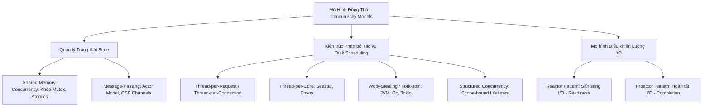
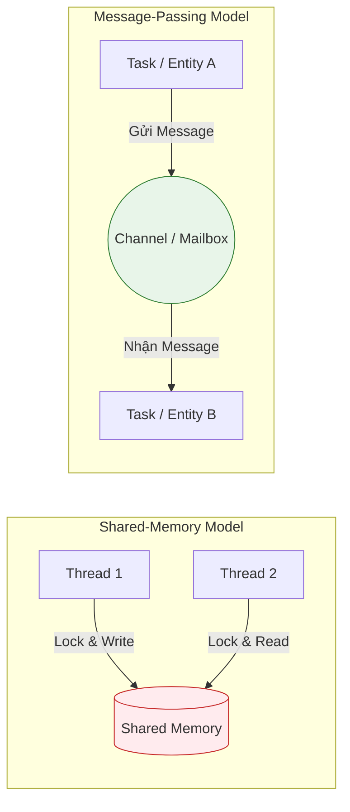
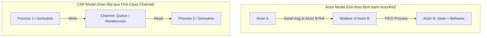
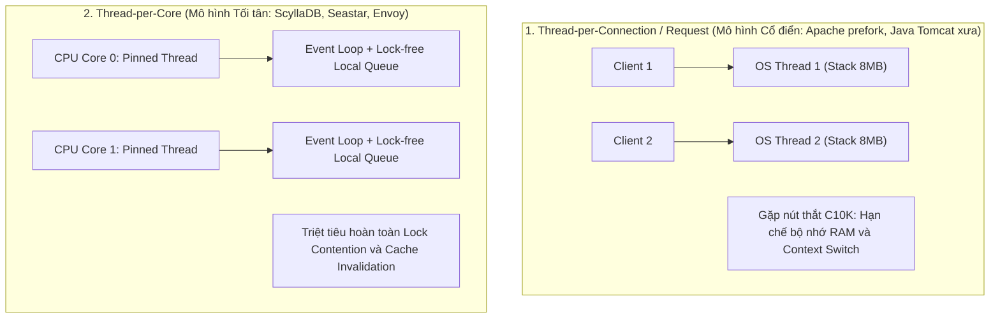
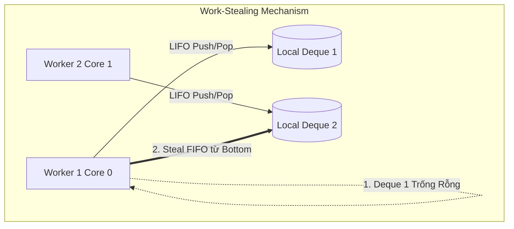
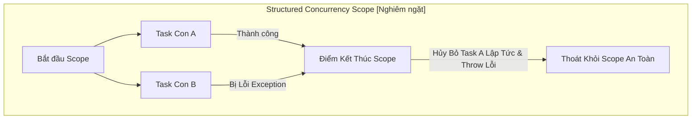

# 15.3. Concurrency Models

## Tổng quan về Các Mô hình Đồng thời

Mô hình đồng thời (Concurrency Model) định nghĩa triết lý thiết kế và quy tắc tương tác giữa các luồng tính toán, phương thức phân bổ công việc và cơ chế đồng bộ hóa trạng thái trong hệ thống phần mềm. Không có một mô hình nào là tối ưu cho mọi trường hợp; việc lựa chọn kiến trúc đồng thời phù hợp quyết định trực tiếp đến thông lượng (throughput), độ trễ (latency SLA), khả năng mở rộng (scalability) và tính dễ bảo trì của các hệ thống backend chịu tải cao.



---

## 2. Chi tiết từng Keyword (Under-the-Hood Deep Dive)

---

### 1. Shared-Memory Concurrency vs 2. Message-Passing Concurrency

#### 1. Khái niệm bản chất (What & Why)
- **Shared-Memory Concurrency (Đồng thời dựa trên Bộ nhớ chia sẻ)**: Các tác vụ đồng thời giao tiếp ngầm bằng cách đọc và ghi vào cùng một vùng không gian địa chỉ bộ nhớ chung. Mọi tác vụ đều có thể truy cập cùng một đối tượng dữ liệu. Để duy trì tính toàn vẹn, lập trình viên bắt buộc phải sử dụng các cơ chế đồng bộ hóa rõ ràng (Mutex, Locks, Barriers, Atomics).
- **Message-Passing Concurrency (Đồng thời dựa trên Truyền thông điệp)**: Các tác vụ hoàn toàn cô lập, không chia sẻ bất kỳ vùng nhớ chung nào. Mọi sự phối hợp và trao đổi dữ liệu diễn ra thông qua việc gửi và nhận các thông điệp (Messages) qua các kênh truyền thông tin (Channels/Mailboxes). Triết lý nổi tiếng của ngôn ngữ Go tóm tắt trọn vẹn mô hình này: *"Do not communicate by sharing memory; instead, share memory by communicating."*

#### 2. So sánh chuyên sâu & Đánh đổi kiến trúc



| Tiêu chí | Shared-Memory Concurrency | Message-Passing Concurrency |
| :--- | :--- | :--- |
| **Bản chất giao tiếp** | Truy cập trực tiếp qua con trỏ bộ nhớ | Copy hoặc Move dữ liệu qua Channel/Mailbox |
| **Hiệu năng & Độ trễ** | Cực cao trên máy đơn (Zero-copy) | Có thể chịu chi phí tuần tự hóa (serialization) và sao chép |
| **Cạm bẫy tiềm tàng** | Data race, Deadlock, Cache invalidation traffic | Deadlock do nghẽn buffer kênh, Channel leaks, Memory bloat |
| **Khả năng mở rộng (Scale)** | Giới hạn trong 1 máy vật lý (Scale-up) | Mở rộng tự nhiên ra cụm mạng phân tán (Scale-out) |

---

### 3. Actor Model vs 4. CSP (Communicating Sequential Processes)

#### 1. Khái niệm bản chất (What & Why)
Đây là hai nhánh rực rỡ nhất của trường phái Message-Passing:
- **Actor Model (Được đề xuất bởi Carl Hewitt, hiện thực hóa trong Erlang/OTP, Akka)**:
  - **Actor** là đơn vị tính toán cơ bản. Mỗi Actor sở hữu:
    1. Trạng thái nội bộ (Private State) tuyệt đối không thể bị truy cập từ bên ngoài.
    2. Một Hộp thư (Mailbox) chứa các thông điệp đến.
    3. Hành vi (Behavior).
  - Khi nhận một tin nhắn, Actor có thể: Tạo thêm Actors mới, gửi tin nhắn đến các Actors khác, hoặc thay đổi hành vi/trạng thái nội bộ cho tin nhắn tiếp theo.
  - **Địa chỉ hóa (Addressing)**: Tin nhắn được gửi trực tiếp đến **Định danh của Actor** (`ActorRef`).
- **CSP - Communicating Sequential Processes (Được đề xuất bởi C.A.R. Hoare, hiện thực hóa trong Go, Rust Crossbeam)**:
  - Trọng tâm của CSP là **Kênh truyền thông (Channel)**, không phải là thực thể gửi hay nhận.
  - Các tiến trình tuần tự (Sequential Processes / Goroutines) hoàn toàn ẩn danh đối với nhau. Bên gửi chỉ biết đẩy dữ liệu vào `Channel`, bên nhận chỉ biết lấy từ `Channel`.
  - Hỗ trợ cơ chế đồng bộ hóa mạnh mẽ thông qua kênh unbuffered (Rendezvous) và lệnh rẽ nhánh đa kênh (`select`).

#### 2. Sơ đồ đối chiếu cấu trúc Actor vs CSP



#### 3. Code ví dụ thực chiến (C++ CSP Channel Implementation)

```cpp
#include <iostream>
#include <queue>
#include <mutex>
#include <condition_variable>
#include <optional>
#include <thread>

// Hiện thực CSP Unbuffered/Bounded Channel chuẩn C++20
template <typename T>
class CSPChannel {
public:
    explicit CSPChannel(size_t capacity = 0) : capacity_(capacity), closed_(false) {}

    void send(T value) {
        std::unique_lock<std::mutex> lock(mtx_);
        // Chờ kênh có chỗ trống hoặc rendezvous
        cv_send_.wait(lock, [this]() {
            return closed_ || queue_.size() < (capacity_ == 0 ? 1 : capacity_);
        });

        if (closed_) throw std::runtime_error("Gửi dữ liệu vào kênh đã đóng!");

        queue_.push(std::move(value));
        cv_recv_.notify_one();
    }

    std::optional<T> receive() {
        std::unique_lock<std::mutex> lock(mtx_);
        cv_recv_.wait(lock, [this]() {
            return closed_ || !queue_.empty();
        });

        if (queue_.empty() && closed_) return std::nullopt;

        T val = std::move(queue_.front());
        queue_.pop();
        cv_send_.notify_one();
        return val;
    }

    void close() {
        std::unique_lock<std::mutex> lock(mtx_);
        closed_ = true;
        cv_send_.notify_all();
        cv_recv_.notify_all();
    }

private:
    size_t capacity_;
    std::queue<T> queue_;
    std::mutex mtx_;
    std::condition_variable cv_send_;
    std::condition_variable cv_recv_;
    bool closed_;
};
```

---

### 5. Fork-Join Model, 6. Pipeline Model, 7. Dataflow Model

#### 1. Khái niệm bản chất (What & Why)
- **Fork-Join Model**: Mô hình chia để trị song song (Divide and Conquer). Một tác vụ cha chia nhỏ thành nhiều tác vụ con độc lập (**Fork**), các tác vụ con chạy song song (thường trên Work-stealing pool), sau đó tác vụ cha đồng bộ hóa và chờ toàn bộ kết quả của các con để gộp lại (**Join**). (Đại diện: Java `ForkJoinPool`, Cilk, OpenMP `#pragma omp parallel`).
- **Pipeline Model**: Chia một quy trình nghiệp vụ thành nhiều bước tuần tự chuyên biệt, mỗi bước chạy trên một worker thread riêng kết nối bởi hàng đợi đệm. Tối ưu hóa throughput tổng thể bằng cách duy trì tất cả các công đoạn luôn bận rộn.
- **Dataflow Model**: Việc thực thi các tác vụ được kích hoạt tự động **chỉ khi toàn bộ dữ liệu đầu vào cần thiết đã sẵn sàng**, không phụ thuộc vào bộ đếm lệnh tuần tự (Program Counter). (Đại diện: Apache Airflow, DAG engines, TensorFlow Graph Execution).

---

### 8. Event-Driven Concurrency, 9. Event Loop Model, 10. Reactor Pattern, 11. Proactor Pattern

#### 1. Khái niệm bản chất (What & Why)
Mô hình hướng sự kiện (Event-Driven Concurrency) giải phóng hệ thống khỏi sự ràng buộc: "Mỗi kết nối mạng cần 1 OS thread". Thay vào đó, một nhóm rất ít luồng (thậm chí 1 luồng) lắng nghe hàng triệu sự kiện I/O.

#### 2. Phân biệt chuyên sâu: Reactor vs Proactor (Under the hood)

```mermaid
graph TD
    subgraph "Reactor Pattern (Readiness-based: Linux epoll / BSD kqueue)"
        A1["Event Demultiplexer: epoll_wait"] -->|"Thông báo: FD đã SẴN SÀNG đọc"| R["Reactor / Event Loop"]
        R -->|Dispatch tới Event Handler| H1[Application Handler]
        H1 -->|"Tự gọi read() để kéo byte vào buffer"| OS1[OS Kernel Space]
    end

    subgraph "Proactor Pattern (Completion-based: Windows IOCP / Linux io_uring)"
        A2[Proactor Initiator] -->|"Yêu cầu: Kernel hãy đọc 1024 bytes vào buffer này"| OS2[OS Kernel Space]
        OS2 -->|Tự copy dữ liệu xong| A3[Completion Event Queue]
        A3 -->|"Thông báo: ĐÃ ĐỌC XONG HOÀN TOÀN"| H2[Application Handler]
    end
```



- **Reactor Pattern (Cơ chế Sẵn sàng - Readiness)**:
  - Nhân HĐH chỉ thông báo cho ứng dụng biết rằng: "Socket FD này đang **sẵn sàng để đọc** dữ liệu (Read Ready)".
  - Nhiệm vụ của ứng dụng là phải tự phát lệnh System Call `read()` để sao chép byte từ Kernel socket buffer sang không gian bộ nhớ Userspace.
  - Đại diện tiêu chuẩn: NGINX, Redis, Netty, Node.js libuv.
- **Proactor Pattern (Cơ chế Hoàn tất - Completion)**:
  - Ứng dụng khởi tạo một thao tác I/O bất đồng bộ và chuyển sẵn con trỏ vùng đệm (buffer) cho Kernel.
  - Kernel (thông qua DMA phần cứng) tự động nạp dữ liệu từ card mạng trực tiếp vào buffer của người dùng. Khi toàn bộ dữ liệu đã nằm gọn gàng trong buffer, Kernel mới đẩy một sự kiện báo hiệu: "I/O **đã hoàn thành** (Completed)".
  - Đại diện tiêu chuẩn: Windows I/O Completion Ports (IOCP), Linux `io_uring`, Boost.ASIO Proactor service.

---

### 12. Active Object Pattern

- **Active Object Pattern**: Mô hình thiết kế tách biệt việc **gọi phương thức** (Method Invocation) khỏi việc **thực thi phương thức** (Method Execution). Đối tượng sở hữu một luồng riêng và một hàng đợi lệnh (Servant + Proxy + Activation List). Khi client gọi hàm trên proxy, một bản ghi lệnh (Method Request) được đưa vào hàng đợi và trả về ngay một `Future/Promise`. Luồng của Active Object sẽ tuần tự lấy lệnh ra thực thi.

---

### 13. Thread-per-Request, 14. Thread-per-Connection, 15. Thread-per-Core

#### 1. Khái niệm bản chất & Tiến hóa kiến trúc Backend



- **Thread-per-Request / Thread-per-Connection**: Mỗi khi có client kết nối hoặc gửi request, server cấp phát một OS thread phục vụ. Mô hình này cực kỳ trực quan khi lập trình (mã chạy tuần tự) nhưng sụp đổ khi số kết nối tăng lên hàng chục ngàn do cạn kiệt Virtual Memory (Stack size) và CPU chết chìm trong Context Switch.
- **Thread-per-Core (Shared-Nothing Architecture)**:
  - Số lượng luồng được gán cứng chính xác bằng số lõi CPU vật lý.
  - Mỗi luồng được ghim chặt vào một lõi qua CPU Affinity.
  - Tuyệt đối **không chia sẻ bộ nhớ** giữa các lõi (Shared-Nothing). Mọi dữ liệu đều được phân vùng cục bộ (Local State). Khi cần trao đổi giữa các Core, hệ thống sử dụng các hàng đợi vòng Lock-Free Ring Buffers (SPSC Queues) liên lõi.
  - Đạt hiệu năng cực hạn (hàng triệu RPS trên 1 server duy nhất).

---

### 16. Work-Stealing Model vs 17. Work-Queue Model

#### 1. Khái niệm bản chất (What & Why)
- **Work-Queue Model (Hàng đợi tập trung - Centralized Queue)**: Tất cả các worker threads trong Thread Pool cùng tranh chấp để lấy công việc từ một hàng đợi toàn cục (Global Queue).
  - *Điểm yếu*: Điểm nghẽn tranh chấp khóa nghiêm trọng (Lock Contention trên mutex của hàng đợi) khi số lượng threads vượt quá 8-16 cores.
- **Work-Stealing Model (Trộm việc - C. Leiserson & R. Blumofe)**:
  - Mỗi Worker Thread sở hữu một hàng đợi hai đầu cục bộ (**Local Deque - Double-Ended Queue**).
  - Luồng chủ sở hữu tự đẩy và lấy việc ở **Đầu đỉnh (Top/Head)** theo cơ chế LIFO (tối ưu Cache Locality).
  - Khi một Worker Thread xử lý hết việc trong Deque của mình, nó trở thành kẻ đi "trộm việc" (Thief): nó chọn ngẫu nhiên một Worker khác và trộm tác vụ ở **Đầu đáy (Bottom/Tail)** theo cơ chế FIFO bằng một lệnh nguyên tử.
  - Nền tảng của Go Scheduler, Java ForkJoinPool, Rust Tokio Runtime.



---

### 18. Structured Concurrency vs 19. Unstructured Concurrency

#### 1. Khái niệm bản chất (What & Why)
- **Unstructured Concurrency (Đồng thời vô tổ chức - Fire and Forget)**: Luồng hoặc tác vụ con được phóng thích tự do vào môi trường (ví dụ `go func()`, `pthread_create()`, hoặc `new Thread().start()`). Luồng cha không sở hữu vòng đời của luồng con.
  - *Hậu quả*: **Goroutine Leaks / Thread Leaks**, không thể hủy bỏ hàng loạt khi có lỗi (Cancellation cascade), mất dấu vết Stack Trace (Stack Trace Fragmentation).
- **Structured Concurrency (Đồng thời có cấu trúc - Martin Sústrik, Roman Elizarov)**:
  - Đưa nguyên lý Lập trình có cấu trúc (Control Flow: `if/else`, `while`, block `{}`) vào Concurrency: **Một tác vụ đồng thời không bao giờ được phép sống lâu hơn phạm vi (Scope) nơi nó được sinh ra**.
  - Nếu một tác vụ con thất bại với ngoại lệ, phạm vi cấu trúc tự động phát tín hiệu hủy bỏ (Cancel) toàn bộ các tác vụ con anh em còn lại và thu dọn tài nguyên trước khi thoát khỏi block.
  - Hiện thực trong: Kotlin Coroutines (`coroutineScope`), Python Trio/TaskGroup, Java 21+ (`StructuredTaskScope`), C++ Libunifex / `std::execution` (P2300).



---

### 20. Task-Based, 21. Coroutine-Based, 22. Fiber-Based Concurrency, 23. Green Thread Model, 24. Hybrid Concurrency Model

- **Task-Based Concurrency**: Lập trình viên không quản lý Thread mà chỉ mô tả công việc dưới dạng các đơn vị tính toán rời rạc (`Task`, `Job`, `Future`). Runtime tự phân phối Task lên Thread Pool.
- **Coroutine-Based Concurrency**: Dựa trên các hàm có khả năng đình chỉ và tái kích hoạt (`yield`, `await`), bảo lưu trạng thái bằng con trỏ máy trạng thái (Stackless State Machine).
- **Fiber-Based / Green Thread Concurrency**: Các luồng người dùng siêu nhẹ có ngăn xếp riêng (Stackful) được điều phối hoàn toàn ở tầng Userspace.
- **Hybrid Concurrency Model**: Kết hợp đa tầng, ví dụ: Sử dụng Actor Model hoặc Coroutines ở tầng ứng dụng, chạy trên nền một Work-Stealing Native Thread Pool ở tầng giữa, và tương tác với nhân HĐH thông qua non-blocking I/O multiplexing (`epoll`/`io_uring`) ở tầng đáy.

---

## Bảng tra cứu tóm tắt Mô hình Đồng thời

| Concurrency Model | Điểm mạnh nhất | Điểm yếu cốt lõi | Hệ thống áp dụng thực tế |
| :--- | :--- | :--- | :--- |
| **Actor Model** | Cô lập lỗi hoàn hảo, mở rộng phân tán | Chi phí serialization thông điệp | Erlang/Elixir Telecom, Akka Cluster |
| **CSP Channels** | Luồng dữ liệu rõ ràng, dễ phân tích logic | Dễ deadlock nếu buffer kênh bị đầy | Go Runtime, Rust Crossbeam |
| **Reactor** | Xử lý lượng kết nối cực lớn với ít RAM | Dễ nghẽn nếu dính blocking compute | Node.js, Redis, NGINX |
| **Thread-per-Core** | Không lock contention, tối đa hóa L1/L2 cache | Lập trình rất khó, chia phân vùng dữ liệu phức tạp | ScyllaDB, Seastar Framework, Envoy |
| **Work-Stealing** | Tự động cân bằng tải giữa các lõi | Phức tạp trong cấu trúc deques Lock-free | Go Scheduler, Tokio, Java ForkJoin |
| **Structured Concurrency**| Loại bỏ hoàn toàn Resource & Thread Leaks | Đòi hỏi hỗ trợ sâu từ ngôn ngữ / runtime | Kotlin, Java Loom, Swift Concurrency |
