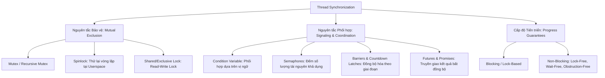
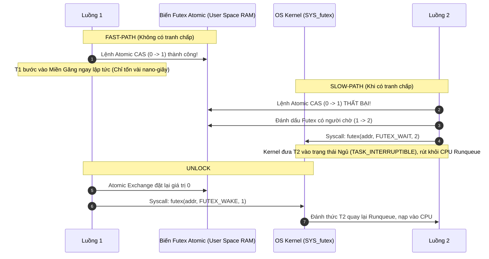
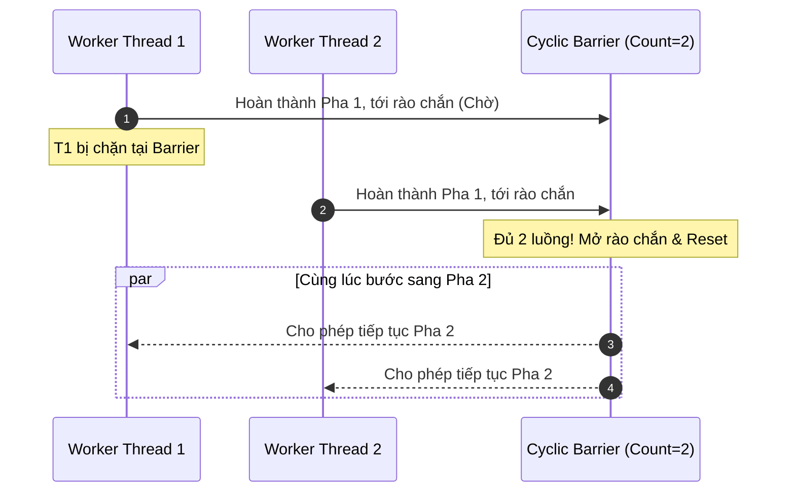
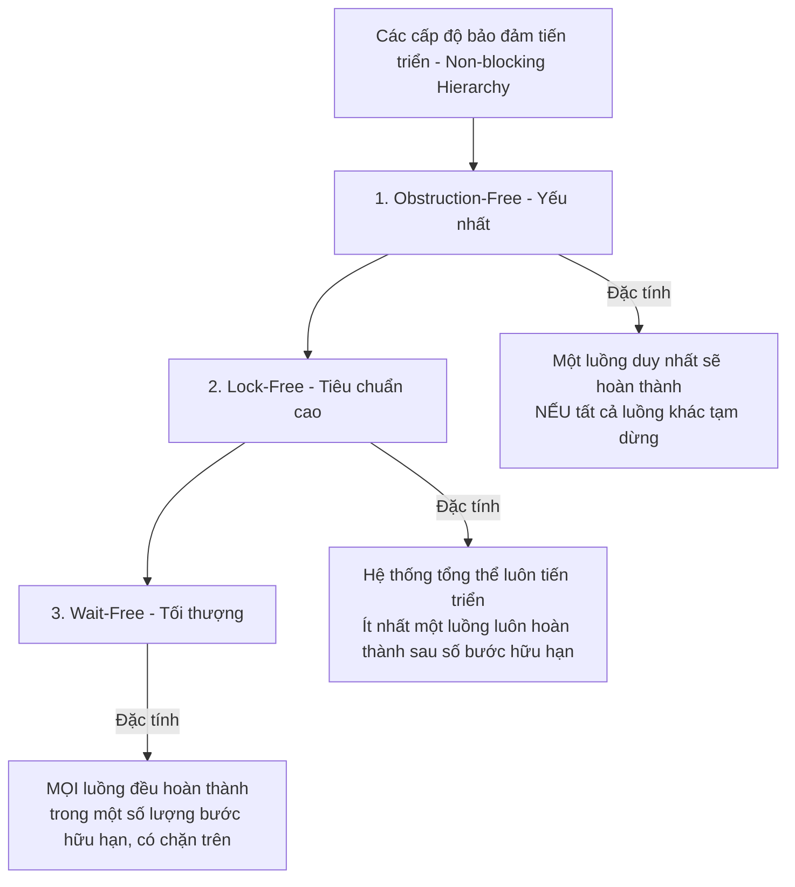

# 15.4. Thread Synchronization

## Tổng quan về Đồng bộ hóa Luồng

Khi nhiều luồng thực thi đồng thời chia sẻ chung không gian bộ nhớ (Shared Address Space) và cùng thao tác trên các vùng dữ liệu có thể thay đổi (**Shared Mutable State**), trật tự thực thi không xác định của CPU Scheduler sẽ phá vỡ tính đúng đắn của dữ liệu. Đồng bộ hóa luồng (Thread Synchronization) là tập hợp các cơ chế toán học, phần cứng vi xử lý và nguyên thủy hệ điều hành (OS Primitives) nhằm kiểm soát trật tự thực thi và đảm bảo tính cô lập khi truy cập tài nguyên găng.



---

## 2. Chi tiết từng Keyword (Under-the-Hood Deep Dive)

---

### 1. Thread Synchronization, 2. Critical Section, 3. Shared State, 4. Shared Mutable State

#### 1. Khái niệm bản chất (What & Why)
- **Shared State (Trạng thái chia sẻ)**: Bất kỳ biến, cấu trúc dữ liệu hoặc tài nguyên phần cứng nào mà nhiều hơn một luồng có thể truy cập thông qua con trỏ hoặc tham chiếu bộ nhớ. Nếu trạng thái là bất biến (Immutable), đa luồng có thể đọc song song an toàn tuyệt đối mà không cần bất kỳ sự đồng bộ hóa nào.
- **Shared Mutable State (Trạng thái chia sẻ khả biến)**: Cội nguồn của mọi lỗi đồng thời (Concurrency Bugs). Khi ít nhất một luồng có hành động ghi (Write/Mutate) vào dữ liệu đang được chia sẻ, hệ thống rơi vào trạng thái nguy hiểm.
- **Critical Section (Miền găng)**: Đoạn mã nguồn máy tính truy cập vào Shared Mutable State. Một miền găng phải được bảo vệ sao cho tại bất kỳ một thời điểm vật lý nào, tối đa chỉ có một luồng được phép bước vào thực thi.
- **Thread Synchronization (Đồng bộ hóa luồng)**: Cơ chế cưỡng chế một trật tự thực thi xác định lên các luồng độc lập, nhằm bảo vệ Critical Section và phối hợp nhịp nhàng giữa các tác vụ.

---

### 5. Mutual Exclusion, 6. Mutual Exclusion Lock, 7. Mutex, 8. Recursive Mutex

#### 1. Khái niệm bản chất (What & Why)
- **Mutual Exclusion (Loại trừ tương hỗ)**: Thuộc tính bảo đảm rằng nếu luồng $A$ đang thực thi trong miền găng thì không một luồng $B$ nào khác có thể đồng thời nằm trong miền găng đó.
- **Mutex (Mutual Exclusion Lock)**: Một đối tượng đồng bộ hóa cung cấp hai thao tác cơ bản: `lock()` (Acquire) và `unlock()` (Release).
- **Recursive Mutex (Reentrant Lock)**: Loại Mutex cho phép chính luồng đang nắm giữ khóa được phép khóa lại nó nhiều lần mà không tự gây ra Deadlock. Khóa duy trì một biến đếm (Recursion Count); luồng phải gọi số lần `unlock()` chính xác bằng số lần `lock()` thì khóa mới thực sự được giải phóng cho các luồng khác.

#### 2. Cơ chế Kernel & Phần cứng: Linux Futex (Fast Userspace Mutex)
Các thư viện C++ hiện đại (như `std::mutex` trên nền `pthread_mutex`) không đơn thuần gọi System Call mỗi lần khóa vì Syscall rất đắt đỏ ($\sim 100-300 ns$). Chúng sử dụng cơ chế **Futex (Fast Userspace Mutex)**:



---

### 9. Spinlock

#### 1. Khái niệm bản chất & Cơ chế hoạt động (Under the hood)
- **Spinlock (Khóa xoay vòng)**: Thay vì chuyển sang trạng thái ngủ (Sleep/Block) và nhường CPU cho luồng khác khi khóa bị chiếm giữ, luồng sẽ liên tục chạy một vòng lặp bận (Busy-waiting loop) trên thanh ghi và bộ nhớ đệm CPU để liên tục thăm dò trạng thái của khóa cho đến khi nó được mở.
- **Lệnh phần cứng vi xử lý (x86_64 `PAUSE`)**:
  Trong vòng lặp Spinlock, lập trình viên bắt buộc phải chèn chỉ thị máy `PAUSE` (`_mm_pause()`). Lệnh này:
  1. Giảm thiểu hiện tượng nghẽn đường truyền bộ nhớ (Memory Bus Contention) và tiết kiệm điện năng CPU.
  2. Ngăn chặn hiện tượng **Pipeline Flush** khi CPU thoát khỏi vòng lặp xoay do vi phạm phỏng đoán rẽ nhánh (Speculative execution violation).

#### 2. Khi nào nên dùng Spinlock vs Mutex?
- **Dùng Spinlock**: Khi thời gian thực thi trong Miền găng cực ngắn (vài nano-giây, ít hơn thời gian của 2 lần Context Switch $\sim 2-4 \mu s$), và hệ thống chạy trên môi trường đa nhân có CPU chuyên dụng (thường dùng trong OS Kernel Interrupt Handlers).
- **Tuyệt đối không dùng Spinlock**: Trên hệ thống đơn nhân (Single-core CPU) vì luồng xoay vòng sẽ chiếm trọn 100% CPU và không bao giờ cho luồng đang giữ khóa cơ hội chạy để mở khóa!

```cpp
#include <atomic>
#include <immintrin.h> // _mm_pause

class HardwareSpinlock {
public:
    void lock() noexcept {
        // Test-and-Test-and-Set (TTAS) Pattern để giảm Cache Coherence Invalidation Traffic
        while (true) {
            // Bước 1: Đọc bằng Relaxed Load ở L1 Cache cục bộ
            if (!lock_flag_.load(std::memory_order_relaxed)) {
                // Bước 2: Thử chiếm khóa bằng Acquire CAS trên Bus
                if (!lock_flag_.exchange(true, std::memory_order_acquire)) {
                    return; // Chiếm khóa thành công
                }
            }
            _mm_pause(); // Giảm tải Pipeline và tiết kiệm điện
        }
    }

    void unlock() noexcept {
        lock_flag_.store(false, std::memory_order_release);
    }

private:
    std::atomic<bool> lock_flag_{false};
};
```

---

### 10. Read-Write Lock & 11. Reader-Writer Lock

#### 1. Khái niệm bản chất (What & Why)
- **Read-Write Lock (Khóa Đọc-Ghi / Shared-Exclusive Lock)**: Giải quyết bài toán tải dữ liệu không đối xứng trong các hệ thống backend (Ví dụ: 99% đọc Cache, 1% ghi cập nhật).
  - **Shared Mode (Chế độ Đọc)**: Nhiều luồng được phép cùng nắm giữ khóa đọc đồng thời.
  - **Exclusive Mode (Chế độ Ghi)**: Chỉ duy nhất một luồng được phép giữ khóa ghi; khi luồng ghi đang giữ khóa hoặc đang chờ, toàn bộ luồng đọc mới đều bị chặn lại.

#### 2. Cạm bẫy Reader Starvation vs Writer Starvation
- **Reader-Preferred Lock**: Nếu liên tục có các luồng đọc mới đến, chúng được vào ngay, khiến luồng ghi phải chờ vô tận (**Writer Starvation**).
- **Writer-Preferred Lock (Chuẩn mực trong C++20 `std::shared_mutex`)**: Khi một luồng ghi yêu cầu khóa, mọi luồng đọc đến sau bắt buộc phải xếp hàng chờ sau luồng ghi, ngăn ngừa triệt để tình trạng bỏ đói luồng ghi.

```cpp
#include <iostream>
#include <shared_mutex>
#include <thread>
#include <vector>

class ThreadSafeCache {
public:
    int read_data() {
        std::shared_lock<std::shared_mutex> lock(rw_mutex_); // Khóa đọc (Shared)
        return cache_value_;
    }

    void update_data(int new_value) {
        std::unique_lock<std::shared_mutex> lock(rw_mutex_); // Khóa ghi (Exclusive)
        cache_value_ = new_value;
    }

private:
    int cache_value_ = 0;
    std::shared_mutex rw_mutex_;
};
```

---

### 12. Semaphore, 13. Binary Semaphore, 14. Counting Semaphore

#### 1. Khái niệm bản chất (Edsger Dijkstra, 1965)
Semaphore là một biến nguyên vẹn không âm được bảo vệ, đóng vai trò là một cơ chế đếm số lượng tài nguyên khả dụng, với hai thao tác nguyên tử:
- **$P()$ (Chờ - Wait / Down / Acquire)**: Giảm giá trị của biến đếm đi 1. Nếu giá trị biến đếm đang bằng 0, luồng gọi bị chặn lại cho đến khi biến đếm lớn hơn 0.
- **$V()$ (Tín hiệu - Signal / Up / Release)**: Tăng giá trị của biến đếm lên 1. Nếu có các luồng khác đang bị chặn chờ, một trong số chúng sẽ được đánh thức.

#### 2. Phân biệt Binary Semaphore vs Mutex
- **Binary Semaphore**: Biến đếm chỉ nhận giá trị $\{0, 1\}$.
- **Điểm khác biệt chí mạng giữa Mutex và Binary Semaphore (Ownership Principle)**:
  - **Mutex có khái niệm Quyền sở hữu (Ownership)**: Luồng nào gọi `lock()` thì **bắt buộc** phải là luồng gọi `unlock()`. Nếu Thread A mở khóa một Mutex do Thread B khóa, hành vi là Undefined Behavior.
  - **Semaphore KHÔNG CÓ quyền sở hữu**: Thread A có thể gọi `wait()` và Thread B hoàn toàn có thể là luồng gọi `signal()` để giải phóng. Semaphore được dùng làm công cụ **báo hiệu (Signaling)**, còn Mutex dùng để **bảo vệ tài nguyên (Locking)**.
- **Counting Semaphore**: Quản lý một nhóm hữu hạn các tài nguyên đồng nhất (ví dụ: Database Connection Pool có 50 kết nối).

---

### 15. Condition Variable & 16. Monitor

#### 1. Khái niệm bản chất & Vấn đề Spurious Wakeup
- **Condition Variable (Biến điều kiện)**: Cho phép một luồng tự đưa mình vào giấc ngủ (chờ đợi một vị ngữ logic nào đó trở thành đúng) đồng thời **giải phóng nguyên tử (atomically release)** Mutex đang nắm giữ để các luồng khác có cơ hội thay đổi trạng thái đó.
- **Monitor (Hoare / Brinch Hansen)**: Một mô hình lập trình cấu trúc hóa cấp cao kết hợp một Mutex, dữ liệu nội bộ và một hoặc nhiều Condition Variables lại thành một thực thể đóng gói (ví dụ: khối `synchronized` trong Java).

#### 2. Quy tắc Sống Còn: Luôn kiểm tra Condition Variable trong Vòng lặp `while`
Một hiện tượng xảy ra ở cấp độ OS Kernel và vi xử lý gọi là **Spurious Wakeup (Thức giấc giả tạo)**: Một luồng đang chờ có thể bị đánh thức ngẫu nhiên mà không hề có bất kỳ luồng nào phát tín hiệu `notify`/`signal` (do các tín hiệu ngắt phần mềm của nhân HĐH).

```cpp
#include <mutex>
#include <condition_variable>

std::mutex cv_mtx;
std::condition_variable cv;
bool resource_available = false;

void consumer() {
    std::unique_lock<std::mutex> lock(cv_mtx);
    
    // SAI LẦM KINH ĐIỂN: Dùng if (dễ dính Spurious Wakeup làm hỏng dữ liệu)
    // if (!resource_available) cv.wait(lock);

    // CHUẨN MỰC: Luôn đặt trong vòng lặp while hoặc lambda predicate
    cv.wait(lock, []() { return resource_available; });

    // Lúc này chắc chắn resource_available == true và lock đã được tái chiếm
}
```

---

### 17. Barrier, 18. Latch, 19. Countdown Latch, 20. Event

#### 1. Khái niệm bản chất (What & Why)
- **Countdown Latch (Khóa đếm lùi - C++20 `std::latch`)**: Một cơ chế đồng bộ hóa một chiều (Single-use point). Nó được khởi tạo với một số đếm $N$. Các luồng gọi `count_down()` để giảm số đếm. Luồng chờ gọi `wait()` sẽ bị chặn cho đến khi số đếm giảm về chính xác bằng 0. Khi đã về 0, Latch mở ra vĩnh viễn và không thể tái thiết lập lại.
- **Barrier (Rào chắn đồng bộ - C++20 `std::barrier`)**: Cơ chế đồng bộ hóa đa chu kỳ (Reusable). Một nhóm $N$ luồng cùng tham gia một thuật toán lặp theo từng pha (Phased algorithm). Mỗi luồng khi hoàn thành pha của mình sẽ gọi `arrive_and_wait()`. Rào chắn chỉ mở khi toàn bộ $N$ luồng đã cùng tới rào chắn; sau đó Barrier tự động đặt lại (reset) trạng thái và toàn bộ các luồng cùng lúc bước sang pha tiếp theo.



---

### 21. Future & 22. Promise

#### 1. Khái niệm bản chất (What & Why)
Mô hình tách biệt hai đầu của một kênh truyền kết quả tính toán dùng một lần:
- **Promise**: Điểm truyền kết quả (Writing end). Tác vụ tính toán nắm giữ Promise và có nhiệm vụ thiết lập giá trị trả về (`set_value()`) hoặc báo ngoại lệ lỗi (`set_exception()`).
- **Future**: Điểm nhận kết quả (Reading end). Luồng tiêu thụ nắm giữ Future và có thể truy vấn trạng thái hoặc gọi `get()` (thao tác này sẽ chặn luồng cho đến khi Promise có dữ liệu).

---

### 23. Atomic Variable, 24. Atomic Operation, 25. Memory Fence, 26. Memory Barrier

#### 1. Khái niệm bản chất (What & Why)
- **Atomic Operation (Thao tác nguyên tử)**: Một thao tác đọc, ghi hoặc sửa đổi bộ nhớ mà đối với toàn bộ phần còn lại của hệ thống, nó diễn ra như một điểm duy nhất không thể phân chia (Indivisible). Tuyệt đối không thể quan sát thấy trạng thái dở dang (half-completed) của một atomic operation.
- **Memory Barrier / Fence (Rào cản bộ nhớ)**: Một chỉ thị phần cứng của CPU (như `mfence`, `lfence`, `sfence` trên x86, hoặc `dmb` trên ARM) nhằm cưỡng chế trình biên dịch (Compiler) và vi kiến trúc CPU không được phép tái sắp xếp (reorder) các lệnh đọc/ghi vượt qua ranh giới của rào cản đó.

---

### 27. Lock Acquisition, 28. Lock Release, 29. Lock Contention, 30. Lock Granularity

- **Lock Acquisition (Chiếm khóa)**: Thao tác tranh chấp để giành quyền độc quyền kiểm soát Mutex.
- **Lock Release (Nhả khóa)**: Thao tác giải phóng quyền kiểm soát và đánh thức luồng tiếp theo trong hàng đợi.
- **Lock Contention (Tranh chấp khóa)**: Trạng thái khi một luồng cố gắng chiếm một khóa đang bị luồng khác nắm giữ. Tranh chấp khóa cao dẫn đến CPU bị lãng phí cho Context Switches hoặc Spinlock loops, bóp nghẹt khả năng mở rộng của hệ thống.
- **Lock Granularity (Độ mịn của khóa)**:
  - **Coarse-Grained Locking (Khóa hạt thô)**: Dùng một khóa duy nhất để bảo vệ toàn bộ cấu trúc dữ liệu lớn (Ví dụ: Big Kernel Lock BKL trong Linux xưa, hoặc một Mutex duy nhất cho toàn bộ Hash Table). Đơn giản, không bao giờ deadlock nội bộ nhưng hiệu năng song song tê liệt.
  - **Fine-Grained Locking (Khóa hạt mịn)**: Chia nhỏ cấu trúc dữ liệu thành hàng ngàn khóa độc lập (Ví dụ: Lock-striping trên từng bucket của ConcurrentHashMap). Tối đa hóa khả năng xử lý song song nhưng làm tăng độ phức tạp và rủi ro Deadlock chéo.

---

### 31. Lock-Free, 32. Wait-Free, 33. Obstruction-Free Synchronization

#### 1. Hệ thống phân cấp Tiến triển của Maurice Herlihy (Progress Guarantees)
Đây là đỉnh cao lý thuyết của lập trình đồng thời cấp thấp:



- **Obstruction-Free (Không cản trở)**: Nếu một luồng chạy đơn độc (tất cả các luồng tranh chấp khác bị đình chỉ), nó được đảm bảo sẽ hoàn thành tác vụ sau một số bước hữu hạn. Không bảo đảm ngăn chặn hiện tượng Livelock khi nhiều luồng cùng tranh chấp.
- **Lock-Free (Không dùng khóa)**: Đảm bảo rằng **toàn bộ hệ thống luôn tiến triển (System-wide progress)**. Có thể có một vài luồng cá biệt bị bỏ đói (Starvation) do liên tục thất bại trong vòng lặp CAS (Compare-And-Swap), nhưng **chắc chắn luôn có ít nhất một luồng thành công** tại mỗi chu kỳ.
- **Wait-Free (Không phải chờ)**: Đảm bảo rằng **mọi luồng riêng lẻ đều tiến triển (Per-thread progress)**. Mỗi luồng đều được bảo đảm hoàn thành thao tác của mình sau một số lượng bước thực thi hữu hạn bị chặn trên bởi một hằng số $O(k)$, hoàn toàn triệt tiêu nguy cơ Starvation. Rất khó hiện thực và thường yêu cầu các thuật toán hỗ trợ (Helping schemes).

---

## Bảng tra cứu tổng kết Synchronization Primitives

| Primitive | Loại trừ | Trạng thái luồng khi chờ | Chi phí Overhead | Mục đích kiến trúc |
| :--- | :--- | :--- | :--- | :--- |
| **Mutex** | Độc quyền | Ngủ (Kernel Sleep qua Futex) | Thấp nếu uncontented; cao nếu tranh chấp | Bảo vệ Critical Section tổng quát |
| **Spinlock** | Độc quyền | Quay vòng CPU bận (Busy-wait) | 0 context switch; đốt 100% CPU core | Critical section siêu ngắn, Kernel IRQ |
| **Shared Mutex** | Chia sẻ đọc / Độc quyền ghi | Ngủ | Cao hơn Mutex thường do quản lý counter | Caching, Read-heavy workloads |
| **Counting Semaphore**| Đa luồng tới hạn | Ngủ | Thấp | Rate Limiter, Connection Pool |
| **Condition Variable**| Theo vị ngữ logic | Ngủ | Phụ thuộc Mutex đi kèm | Producer-Consumer, Event notification |
| **Barrier / Latch** | Theo số luồng / đếm | Ngủ | Thấp | Tính toán song song theo pha, Fork-Join |
| **Lock-Free (CAS)** | Không khóa | Thử lại vòng lặp nguyên tử | Phụ thuộc mức độ tranh chấp bus | Hàng đợi, ngăn xếp siêu cao tải |
