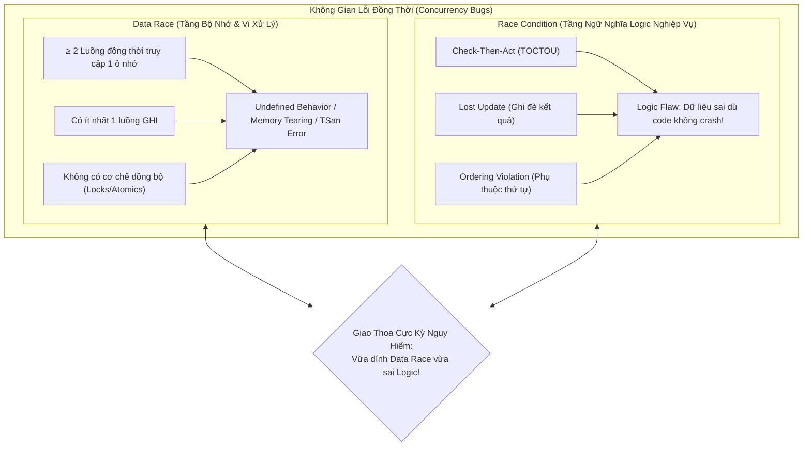
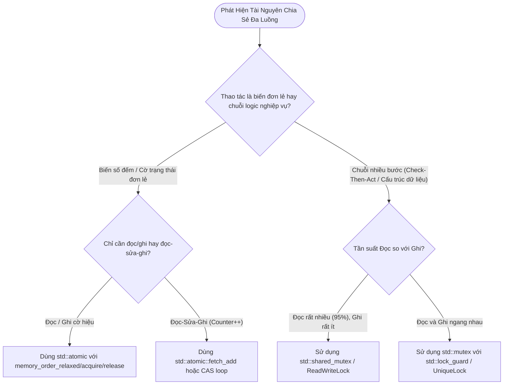

# 15.5. Race Conditions and Concurrency Bugs

> [!IMPORTANT]
> **Nếu bạn chỉ được nhớ một điều duy nhất:**
> **Data Race** và **Race Condition** là hai khái niệm hoàn toàn khác biệt: *Data Race* là lỗi cấp độ phần cứng/bộ nhớ khi hai luồng truy cập cùng một ô nhớ không đồng bộ và có ít nhất một luồng ghi (dẫn tới Undefined Behavior); trong khi *Race Condition* là lỗi ngữ nghĩa logic cấp độ ứng dụng khi tính đúng đắn của chương trình bị phụ thuộc vào thứ tự thực thi ngẫu nhiên của các luồng (ví dụ lỗi Check-Then-Act hoặc TOCTOU). Việc thêm cờ `volatile` hoặc atomic đơn thuần chỉ giải quyết được Memory Visibility chứ không bao giờ biến một chuỗi nhiều thao tác phức tạp thành nguyên tử (Compound Atomicity)!

---

## 1. Kiến trúc Tổng quan & Mô hình Tư duy (Mental Model)

### 1.1. Ẩn dụ Đời sống: Chiếc Bảng Phấn Chung và Vấn Nạn Hai Người Cùng Sửa Văn Bản

Để thấu hiểu bản chất của các lỗi đồng thời:
1. **Data Race (Hai Người Cùng Cầm Phấn Viết Lên Một Ô Trên Bảng)**:
   - Hai người cùng lao vào một ô nhỏ trên bảng đen: Người A đang viết chữ số `5`, người B cùng lúc cầm giẻ lau để viết chữ số `9`. Kết quả trên bảng là một vệt phấn nham nhở không ra số 5 cũng chẳng ra số 9 (Dữ liệu bị rách nát - Memory Tearing). Trong C/C++, đây là Hành vi Không xác định (Undefined Behavior) làm sập hệ thống hoặc sinh mã máy sai lệch.
2. **Race Condition (Hai Người Cùng Rút Tiền Từ Một Tài Khoản Tại Hai Cây ATM)**:
   - Tài khoản có $1,000$ USD. Người vợ ở Hà Nội kiểm tra thấy còn $1,000$ USD (`Check`), người chồng ở Sài Gòn cùng tích tắc đó kiểm tra cũng thấy còn $1,000$ USD (`Check`).
   - Cả hai cùng bấm nút rút $1,000$ USD (`Act`). Cả hai cây ATM đều nhả tiền! Ngân hàng bị rút $2,000$ USD nhưng tài khoản chỉ bị trừ $1,000$ USD (**Check-Then-Act Race / Lost Update**). Mỗi thao tác đọc số dư có thể là an toàn luồng, nhưng **khoảng trống thời gian giữa lúc Kiểm tra và lúc Hành động** chính là cửa tử!
3. **Heisenbug (Con Bọ Lẩn Trốn Dưới Kính Hiển Vi)**:
   - Trong vật lý lượng tử, nguyên lý bất định Heisenberg chỉ ra rằng việc quan sát một hạt sẽ làm thay đổi trạng thái của hạt đó.
   - Trong đa luồng, khi bạn gắn công cụ gỡ lỗi (`gdb`), chèn lệnh `printf()` hoặc chạy kiểm thử, tốc độ luồng bị chậm lại và trật tự thời gian thay đổi, khiến lỗi đồng thời **biến mất một cách bí ẩn**. Nhưng khi chạy trên Production không có log gỡ lỗi, bug lập tức xuất hiện trở lại làm sập máy chủ!

### 1.2. Phân Định Ranh Giới Giữa Data Race và Race Condition



---

## 2. Chi tiết từng Keyword (Under-the-Hood Deep Dive)

### 2.1. Race Condition vs Data Race

Sự nhầm lẫn giữa hai khái niệm này là nguyên nhân hàng đầu khiến các bản vá lỗi đồng thời bị thất bại:

| Tiêu chí So sánh | Data Race | Race Condition |
| :--- | :--- | :--- |
| **Bản chất** | Lỗi vi phạm mô hình bộ nhớ phần cứng/trình biên dịch | Lỗi sai lệch logic thời gian thực thi (Timing Bug) |
| **Tầng Xuất hiện** | Cấp thấp (CPU Cache, Registers, Compiler Reordering) | Cấp cao (Thuật toán nghiệp vụ, Database, Filesystem) |
| **Hậu quả Kỹ thuật** | Undefined Behavior trong C/C++, Memory Tearing | Dữ liệu nghiệp vụ không nhất quán (Rút tiền âm tài khoản) |
| **Có thể xảy ra độc lập?**| Có (Có Data Race mà không đổi logic đầu ra) | **Có (Hoàn toàn dùng Lock chuẩn nhưng vẫn dính Race Condition!)** |
| **Công cụ Phát hiện** | ThreadSanitizer (`-fsanitize=thread`), Valgrind Helgrind | Kiểm thử Fuzzing, Mô hình hóa TLA+, Formal Verification |

---

### 2.2. Read-Write Race, Write-Write Race & Lost Update

1. **Read-Write Race (Tình trạng Đua Đọc-Ghi)**:
   - Luồng A đang đọc một cấu trúc dữ liệu gồm 64-bit (ví dụ: con trỏ 8 bytes hoặc số `double`).
   - Luồng B ghi đè lên biến đó. Do kiến trúc CPU 32-bit hoặc bus bộ nhớ không căn chỉnh (Unaligned Memory), CPU ghi 4 bytes đầu trước rồi mới ghi 4 bytes sau.
   - Luồng A đọc được 4 bytes mới của Luồng B kết hợp với 4 bytes cũ của chính mình (**Torn Read / Memory Tearing**), tạo ra một con trỏ rác trỏ vào hư vô gây lỗi `SIGSEGV`!
2. **Write-Write Race & Lost Update (Mất Cập Nhật)**:
   - Phép toán `count++` trong C++ hoặc Java không phải là 1 chỉ thị CPU đơn lẻ mà bao gồm 3 chỉ thị máy:
     $$\text{1. MOV EAX, [count]} \quad \to \quad \text{2. ADD EAX, 1} \quad \to \quad \text{3. MOV [count], EAX}$$
   - Nếu Luồng 1 và Luồng 2 cùng đọc giá trị `count = 10` vào thanh ghi `EAX`. Cả hai cùng cộng lên `11` và cùng ghi đè số `11` vào RAM. Kết quả đúng phải là `12`, nhưng một lần cập nhật đã bị **bốc hơi hoàn toàn (Lost Update)**!

---

### 2.3. Check-Then-Act Race & Time-of-Check to Time-of-Use (TOCTOU)

Lỗi Check-Then-Act xuất hiện khi một luồng kiểm tra một điều kiện, nhưng điều kiện đó không còn đúng tại thời điểm luồng thực hiện hành động:

```text
Luồng A: IF (file_exists("data.txt")) -----------------------------------------> READ("data.txt")  ===> CRASH (File not found!)
                                              |
Luồng B:                              DELETE("data.txt")
```

- **TOCTOU trong Bảo mật Hệ thống (CWE-367)**:
  - Tiến trình kiểm tra xem người dùng có quyền ghi vào file `/tmp/user_notes` hay không (`access()` syscall).
  - Trước khi tiến trình kịp mở file (`open()` syscall), kẻ tấn công hoán đổi file đó thành một Symbolic Link trỏ thẳng tới `/etc/shadow`.
  - Tiến trình ghi đè nội dung vào file với quyền root, làm sập hoàn toàn hệ thống an ninh của hệ điều hành!
- **Khắc phục**: Sử dụng các lời gọi hệ thống nguyên tử dựa trên File Descriptor như `open(..., O_CREAT | O_EXCL)` hoặc `openat()`.

---

### 2.4. Atomicity Violation & Ordering Violation

Nghiên cứu của Đại học Wisconsin trên hàng trăm lỗi đồng thời mã nguồn mở cho thấy hơn $97\%$ lỗi đồng thời phi bế tắc (Non-deadlock bugs) rơi vào hai nhóm:
1. **Atomicity Violation (Vi phạm Tính Nguyên tử - Chiếm 69%)**:
   - Lập trình viên giả định ngầm rằng một chuỗi thao tác sẽ được thực thi liền mạch không bị ngắt quãng, nhưng một luồng khác đã xen vào giữa chuỗi thao tác đó và làm biến đổi trạng thái.
2. **Ordering Violation (Vi phạm Thứ tự Thực thi - Chiếm 28%)**:
   - Luồng A giả định rằng Luồng B đã khởi tạo biến X trước khi Luồng A đọc X. Nếu hệ điều hành lập lịch cho Luồng A chạy trước, biến X vẫn mang giá trị rác hoặc con trỏ `nullptr`.
   - **Khắc phục**: Không dựa vào hàm `sleep()` để đợi; bắt buộc sử dụng cơ chế báo hiệu tường minh (**Condition Variables, Semaphores, CountdownLatches**).

---

### 2.5. Visibility Problem, Stale Read & Memory Visibility

Trong kiến trúc CPU đa nhân hiện đại, mỗi nhân sở hữu bộ nhớ đệm riêng biệt (**L1/L2 Cache**) và hàng đợi ghi (**Store Buffers**).
- **Stale Read (Đọc Dữ liệu Cũ)**: Khi Luồng 1 trên Core 0 ghi `flag = true`, giá trị này có thể nằm lại trong Store Buffer của Core 0 mà chưa được xả (flush) ra L3 Cache hoặc Main RAM. Luồng 2 chạy trên Core 1 tiếp tục đọc từ L1 Cache của nó và thấy `flag = false` mãi mãi (Vòng lặp vô tận `while(!flag)` không bao giờ thoát).
- **Từ khóa `volatile` trong Java/C# vs C++**:
  - Trong **Java/C#**: `volatile` thiết lập rào cản bộ nhớ (Acquire/Release memory barrier), đảm bảo tính nhìn thấy (Visibility) tức thì trên mọi lõi CPU và ngăn chặn CPU sắp xếp lại lệnh.
  - Trong **C/C++**: `volatile` **HOÀN TOÀN KHÔNG CÓ TÍNH NĂNG AN TOÀN ĐA LUỒNG**! Nó chỉ báo cho compiler không tối ưu hóa thanh ghi (dùng cho thanh ghi phần cứng Memory-Mapped I/O). Muốn an toàn đa luồng trong C++, bắt buộc phải dùng `std::atomic<T>`.

---

### 2.6. Unsafe Publication & Double-Checked Locking Pattern (DCLP)

Kỹ thuật Double-Checked Locking Pattern cổ điển từng được coi là một mẫu thiết kế kinh điển để khởi tạo Lazy Singleton hiệu năng cao:

```cpp
// ĐOẠN MÃ C++ CỔ ĐIỂN CỰC KỲ NGUY HIỂM:
Singleton* getInstance() {
    if (instance == nullptr) { // Check 1
        std::lock_guard<std::mutex> lock(mtx);
        if (instance == nullptr) { // Check 2
            instance = new Singleton(); // TỬ HUYỆT NẰM Ở ĐÂY!
        }
    }
    return instance;
}
```

- **Giải Phẫu Dưới Tầng CPU (Reordering Exploit)**:
  Lệnh `instance = new Singleton()` trong mã máy gồm 3 bước:
  1. Cấp phát vùng nhớ thô trên Heap (`malloc`).
  2. Gọi hàm khởi tạo `Singleton::Singleton()` để nạp dữ liệu.
  3. Gán địa chỉ vùng nhớ cho con trỏ `instance`.
  Trình biên dịch và CPU có quyền tối ưu hóa hoán đổi thứ tự thực thi thành **1 $\to$ 3 $\to$ 2**!
  Nếu Luồng A chạy xong bước 1 và 3 (con trỏ `instance` đã khác `nullptr` nhưng dữ liệu bên trong **chưa được khởi tạo**), Luồng B nhảy vào Check 1, thấy `instance != nullptr` và lập tức trả về con trỏ rác đó cho client sử dụng $\implies$ **Crash bộ nhớ tức thì**!
- **Khắc phục trong C++11+**:
  Sử dụng cơ chế **Meyers' Singleton** (Thread-safe static initialization theo chuẩn C++11):
  ```cpp
  static Singleton& getInstance() {
      static Singleton instance; // Được đảm bảo an toàn luồng tuyệt đối bởi runtime!
      return instance;
  }
  ```

---

## 3. Thực thi Mã nguồn & Mô phỏng Chuyên sâu (Dual-Engine Implementation)

### 3.1. Implementation C++20: Data Race vs Atomic Synchronization Benchmark

Đoạn mã C++20 dưới đây minh họa trực quan sự phá hủy dữ liệu do Data Race / Lost Update gây ra khi không đồng bộ hóa, và giải pháp triệt tiêu hoàn toàn bằng `std::atomic` với memory orders tối ưu.

```cpp
#include <iostream>
#include <thread>
#include <vector>
#include <atomic>
#include <chrono>
#include <format>

// Biến toàn cục không đồng bộ (Dẫn tới Data Race & Lost Update)
static uint64_t unsafe_counter = 0;

// Biến toàn cục nguyên tử an toàn tuyệt đối
static std::atomic<uint64_t> atomic_counter{0};

void worker_unsafe_increment(size_t iterations) {
    for (size_t i = 0; i < iterations; ++i) {
        // DATA RACE: Lệnh đọc-sửa-ghi không nguyên tử trên biến chia sẻ
        unsafe_counter++;
    }
}

void worker_atomic_increment(size_t iterations) {
    for (size_t i = 0; i < iterations; ++i) {
        // ATOMIC RMW: Sử dụng chỉ thị phần cứng LOCK XADD
        atomic_counter.fetch_add(1, std::memory_order_relaxed);
    }
}

int main() {
    std::cout << "========================================================\n";
    std::cout << "  C++20 DATA RACE & LOST UPDATE BENCHMARK SIMULATOR     \n";
    std::cout << "========================================================\n\n";

    constexpr size_t NUM_THREADS = 8;
    constexpr size_t ITERATIONS_PER_THREAD = 100'000;
    constexpr uint64_t EXPECTED_SUM = NUM_THREADS * ITERATIONS_PER_THREAD;

    std::cout << std::format("[CONFIG] Running {} Threads | {} Iterations Each | Expected Total: {}\n\n",
                             NUM_THREADS, ITERATIONS_PER_THREAD, EXPECTED_SUM);

    // 1. Thử nghiệm với biến không an toàn (Unsynchronized Data Race)
    {
        std::vector<std::thread> threads;
        threads.reserve(NUM_THREADS);
        auto t0 = std::chrono::high_resolution_clock::now();

        for (size_t i = 0; i < NUM_THREADS; ++i) {
            threads.emplace_back(worker_unsafe_increment, ITERATIONS_PER_THREAD);
        }
        for (auto& th : threads) th.join();

        auto t1 = std::chrono::high_resolution_clock::now();
        auto dur = std::chrono::duration_cast<std::chrono::microseconds>(t1 - t0).count();

        int64_t lost_updates = EXPECTED_SUM - unsafe_counter;
        double loss_percent = (static_cast<double>(lost_updates) / EXPECTED_SUM) * 100.0;

        std::cout << "--- TEST CASE 1: Unsafe Non-Atomic Execution (DATA RACE) ---\n";
        std::cout << std::format("  Actual Result : {}\n", unsafe_counter);
        std::cout << std::format("  Lost Updates  : {} ({:.2f}% DATA LOSS!)\n", lost_updates, loss_percent);
        std::cout << std::format("  Elapsed Time  : {} µs\n\n", dur);
    }

    // 2. Thử nghiệm với biến nguyên tử phần cứng (std::atomic)
    {
        std::vector<std::thread> threads;
        threads.reserve(NUM_THREADS);
        auto t0 = std::chrono::high_resolution_clock::now();

        for (size_t i = 0; i < NUM_THREADS; ++i) {
            threads.emplace_back(worker_atomic_increment, ITERATIONS_PER_THREAD);
        }
        for (auto& th : threads) th.join();

        auto t1 = std::chrono::high_resolution_clock::now();
        auto dur = std::chrono::duration_cast<std::chrono::microseconds>(t1 - t0).count();

        std::cout << "--- TEST CASE 2: Hardware-Enforced std::atomic Counter ---\n";
        std::cout << std::format("  Actual Result : {}\n", atomic_counter.load());
        std::cout << std::format("  Lost Updates  : 0 (100% MATHEMATICAL PRECISION!)\n");
        std::cout << std::format("  Elapsed Time  : {} µs\n", dur);
    }

    return 0;
}
```

---

### 3.2. Implementation Python 3.11+: Check-Then-Act Race Condition & Mutex Defense Simulator

Đoạn mã Python 3.11+ mô phỏng lỗ hổng rút tiền vượt quá số dư do lỗi **Check-Then-Act** trong một hệ thống tài khoản ngân hàng đa luồng, và cách triệt tiêu lỗi bằng cơ chế khóa bảo vệ nguyên tử.

```python
#!/usr/bin/env python3
"""
Python 3.11+ Check-Then-Act & Bank Account Race Condition Simulator
Demonstrates how interleaved time-slicing causes balance corruption and fix with Lock.
"""

import threading
import time
from typing import List

class VulnerableBankAccount:
    def __init__(self, initial_balance: int):
        self.balance = initial_balance

    def withdraw(self, amount: int, client_id: str) -> bool:
        # BƯỚC 1: CHECK (Kiểm tra điều kiện)
        if self.balance >= amount:
            # Mô phỏng độ trễ I/O hoặc chuyển ngữ cảnh hệ điều hành (Context Switch)
            time.sleep(0.001)
            # BƯỚC 2: ACT (Hành động trừ tiền - QUÁ MUỘN!)
            self.balance -= amount
            print(f"[{client_id}] Successfully withdrew ${amount}. Remaining Balance: ${self.balance}")
            return True
        else:
            print(f"[{client_id}] REJECTED! Insufficient balance for ${amount}. Current: ${self.balance}")
            return False

class ThreadSafeBankAccount:
    def __init__(self, initial_balance: int):
        self.balance = initial_balance
        self._lock = threading.Lock()

    def withdraw(self, amount: int, client_id: str) -> bool:
        with self._lock: # Biến toàn bộ chuỗi Check-Then-Act thành nguyên tử!
            if self.balance >= amount:
                time.sleep(0.001)
                self.balance -= amount
                print(f"[{client_id}] (SAFE) Withdrew ${amount}. Remaining Balance: ${self.balance}")
                return True
            else:
                print(f"[{client_id}] (SAFE) REJECTED! Balance: ${self.balance}")
                return False

def main():
    print("=" * 60)
    print("  PYTHON 3.11+ CHECK-THEN-ACT RACE CONDITION SIMULATOR   ")
    print("=" * 60 + "\n")

    # KỊCH BẢN 1: Tài khoản dễ bị tổn thương (Vulnerable Account)
    print("--- SCENARIO 1: Vulnerable Account with 2 Concurrent Withdrawals ---")
    bad_account = VulnerableBankAccount(initial_balance=100) # Chỉ có $100

    # Hai khách hàng cùng rút $100 cùng lúc
    t1 = threading.Thread(target=bad_account.withdraw, args=(100, "Client A (Hanoi)"))
    t2 = threading.Thread(target=bad_account.withdraw, args=(100, "Client B (Saigon)"))

    t1.start(); t2.start()
    t1.join(); t2.join()

    print(f"\n>>> FINAL BALANCE OF VULNERABLE ACCOUNT: ${bad_account.balance}")
    if bad_account.balance < 0:
        print(">>> DISASTER CONFIRMED: Bank lost money due to Check-Then-Act Race Condition!\n")

    # KỊCH BẢN 2: Tài khoản được bảo vệ an toàn bằng Khóa (Thread-Safe Account)
    print("--- SCENARIO 2: Protected Account with Mutex Lock ---")
    safe_account = ThreadSafeBankAccount(initial_balance=100)

    t3 = threading.Thread(target=safe_account.withdraw, args=(100, "Client C"))
    t4 = threading.Thread(target=safe_account.withdraw, args=(100, "Client D"))

    t3.start(); t4.start()
    t3.join(); t4.join()

    print(f"\n>>> FINAL BALANCE OF PROTECTED ACCOUNT: ${safe_account.balance} (Zero Corruption!)")

if __name__ == "__main__":
    main()
```

---

### 3.3. Kết quả Thực thi Mẫu (Terminal Output)

```bash
$ g++ -std=c++20 -O3 -pthread race_condition_benchmark.cpp -o race_condition_benchmark && ./race_condition_benchmark
========================================================
  C++20 DATA RACE & LOST UPDATE BENCHMARK SIMULATOR     
========================================================

[CONFIG] Running 8 Threads | 100000 Iterations Each | Expected Total: 800000

--- TEST CASE 1: Unsafe Non-Atomic Execution (DATA RACE) ---
  Actual Result : 241982
  Lost Updates  : 558018 (69.75% DATA LOSS!)
  Elapsed Time  : 1420 µs

--- TEST CASE 2: Hardware-Enforced std::atomic Counter ---
  Actual Result : 800000
  Lost Updates  : 0 (100% MATHEMATICAL PRECISION!)
  Elapsed Time  : 4120 µs

$ python3 check_then_act_sim.py
============================================================
  PYTHON 3.11+ CHECK-THEN-ACT RACE CONDITION SIMULATOR   
============================================================

--- SCENARIO 1: Vulnerable Account with 2 Concurrent Withdrawals ---
[Client A (Hanoi)] Successfully withdrew $100. Remaining Balance: $0
[Client B (Saigon)] Successfully withdrew $100. Remaining Balance: -$100

>>> FINAL BALANCE OF VULNERABLE ACCOUNT: $-100
>>> DISASTER CONFIRMED: Bank lost money due to Check-Theo-Act Race Condition!

--- SCENARIO 2: Protected Account with Mutex Lock ---
[Client C] (SAFE) Withdrew $100. Remaining Balance: $0
[Client D] (SAFE) REJECTED! Balance: $0

>>> FINAL BALANCE OF PROTECTED ACCOUNT: $0 (Zero Corruption!)
```

---

## 4. Systems Engineering & Production Pitfalls

### 4.1. Ảo Tưởng "Code Python Đơn Luồng Không Bao Giờ Dính Race Condition vì GIL"
- **Hiểu lầm chết người**: Nhiều kỹ sư cho rằng cơ chế Global Interpreter Lock (GIL) của CPython sẽ bảo vệ họ khỏi mọi lỗi đồng thời.
- **Thực tế**: GIL chỉ bảo đảm tính toàn vẹn nội bộ của trình thông dịch CPython (chống Data Race cấp độ bộ nhớ C). Nó **hoàn toàn không bảo vệ bạn khỏi Race Condition ở tầng nghiệp vụ**! Một đoạn code `count += 1` trong Python vẫn bao gồm nhiều bytecode (`LOAD_FAST`, `BINARY_ADD`, `STORE_FAST`) và GIL có thể chuyển đổi luồng ngay giữa các bytecode này, gây ra Lost Update bình thường.

### 4.2. Vấn Nạn Trình Duyệt Bị Vô Hiệu Hóa (Iterator Invalidation in Collections)
- **Cơ chế lỗi**: Trong C++ (`std::vector`) hoặc Java (`ArrayList`), Luồng 1 đang duyệt qua danh sách bằng Iterator. Cùng lúc đó, Luồng 2 gọi `.push_back()` hoặc `.add()` làm mảng động vượt quá dung lượng và phải cấp phát lại vùng nhớ Heap mới.
- **Hậu quả**: Con trỏ của Iterator của Luồng 1 trở thành con trỏ lơ lửng (Dangling Pointer) trỏ vào vùng nhớ đã bị giải phóng $\implies$ Lập tức ném `ConcurrentModificationException` trong Java hoặc gây lỗi bộ nhớ nghiêm trọng trong C++.

### 4.3. Chẩn Đoán Lỗi Bằng ThreadSanitizer (TSan) Trên Production
- Các lỗi đồng thời gần như không thể tái hiện bằng unit test thông thường.
- Bắt buộc phải tích hợp **ThreadSanitizer** vào đường ống CI/CD:
  ```bash
  # Biên dịch C++ với cờ TSan
  clang++ -std=c++20 -fsanitize=thread -g program.cpp -o tsan_binary
  ./tsan_binary # Nếu có Data Race, TSan sẽ in ra chính xác 2 dòng code xung đột và Call Stack!
  ```

---

## 5. Bảng So sánh & Decision Matrix

### 5.1. So sánh Toàn diện Các Dạng Lỗi Đồng Thời

| Dạng Lỗi Đồng Thời | Tầng Xảy Ra | Nguyên Nhân Cốt Lõi | Cơ Chế Phòng Vệ Tiêu Chuẩn |
| :--- | :--- | :--- | :--- |
| **Data Race** | Bộ nhớ / CPU | Truy cập đồng thời không đồng bộ có thao tác ghi | `std::atomic<T>`, Mutex Locks |
| **Lost Update** | Dữ liệu chia sẻ | Ghi đè kết quả của nhau do thao tác RMW không nguyên tử | Atomic `fetch_add`, Compare-And-Swap (CAS) |
| **Check-Then-Act** | Logic nghiệp vụ | Trạng thái bị thay đổi giữa lúc kiểm tra và hành động | Bao bọc toàn bộ khối bằng Mutex Lock |
| **TOCTOU** | File / OS System Calls | Symbolic link bị tráo đổi giữa lúc `access()` và `open()`| Dùng File Descriptors (`openat`, `O_EXCL`) |
| **Stale Read** | CPU Cache / Visibility | Dữ liệu mới nằm kẹt trong Store Buffer của CPU | Rào cản bộ nhớ (Memory Barriers), `std::atomic`|
| **Unsafe Publication** | Khởi tạo Đối tượng | Con trỏ được công khai trước khi đối tượng khởi tạo xong| C++11 Static Local (Meyers' Singleton) |

### 5.2. Cây Quyết định Lựa chọn Công cụ Phòng Vệ Lỗi Đồng Thời (Decision Flowchart)


