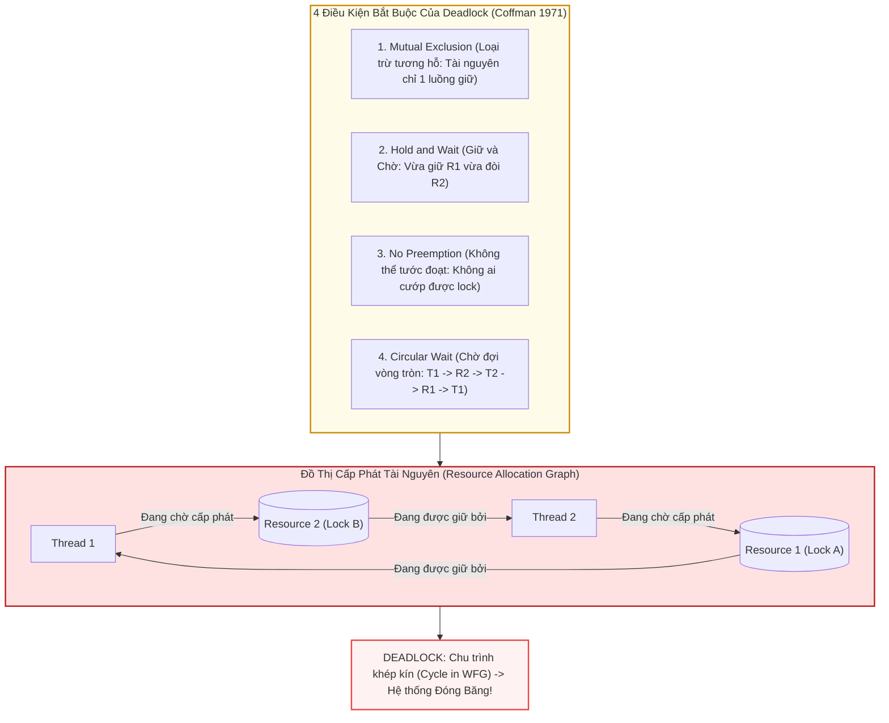
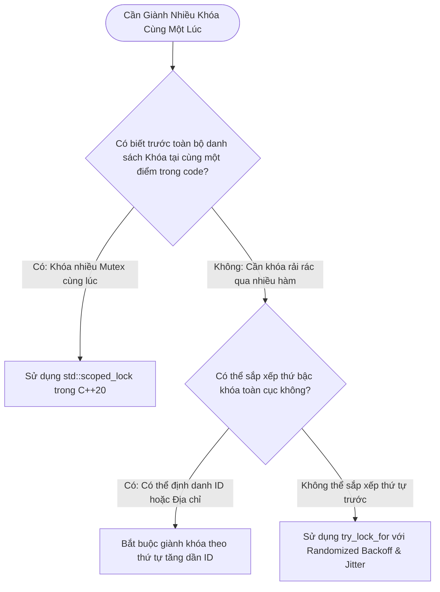

# 15.6. Deadlocks and Liveness Problems

> [!IMPORTANT]
> **Nếu bạn chỉ được nhớ một điều duy nhất:**
> **Deadlock (Bế tắc)** không phải là một hiện tượng ngẫu nhiên bí hiểm mà xảy ra khi và chỉ khi hội tụ đủ **4 Điều kiện Coffman (Mutual Exclusion, Hold and Wait, No Preemption, Circular Wait)**. Giải pháp triệt để và thanh lịch nhất để tiêu diệt Deadlock trong kiến trúc phần mềm không phải là các thuật toán né tránh phức tạp thời gian chạy (như Banker's Algorithm) mà là áp dụng kỷ luật **Thứ bậc Khóa Toàn cục (Global Lock Ordering / Lock Hierarchy)** hoặc sử dụng các cấu trúc đa khóa an toàn (**`std::scoped_lock` trong C++20**) để phá vỡ vĩnh viễn điều kiện Chờ đợi Vòng tròn (Circular Wait)!

---

## 1. Kiến trúc Tổng quan & Mô hình Tư duy (Mental Model)

### 1.1. Ẩn dụ Đời sống: Ngã Tư Kẹt Xe, Hai Người Lịch Sự Trong Hẻm và Bữa Ăn Triết Gia

Để phân biệt rõ nét các vấn đề về Tính Sống (Liveness Problems) trong hệ thống đa luồng:
1. **Deadlock (Ngã Tư Kẹt Xe Khóa Cứng 4 Chiều - Circular Wait)**:
   - 4 chiếc xe ô tô cùng lao vào ngã tư từ 4 hướng. Xe A chặn đầu Xe B, Xe B chặn đầu Xe C, Xe C chặn đầu Xe D, và Xe D lại chặn đầu Xe A. Không một chiếc xe nào có thể tiến lên, và cũng không xe nào chịu lùi lại. Toàn bộ ngã tư đóng băng vĩnh viễn, tiêu tốn $0\%$ xăng (CPU ở mức $0\%$) nhưng hệ thống tê liệt hoàn toàn!
2. **Livelock (Hai Người Lịch Sự Nhường Đường Trong Con Hẻm Hẹp)**:
   - Hai người đi bộ đối đầu nhau trong một ngõ hẹp. Cả hai cùng bước sang phải để nhường đường, nhận ra vẫn bị chặn. Cả hai cùng lập tức bước sang trái để nhường đường, lại tiếp tục đối đầu. Cả hai liên tục thay đổi trạng thái và nhường nhịn nhau hàng trăm lần/phút: Chân tay vận động điên cuồng (CPU chạm $100\%$), năng lượng tiêu hao cực lớn, nhưng **không ai tiến thêm được một bước nào**!
3. **Starvation (Cậu Bé Nhút Nhát Trong Quầy Căn Tin)**:
   - Quầy phục vụ đồ ăn áp dụng cơ chế không công bằng (Unfair Lock). Mỗi khi có thức ăn mới, những thanh niên to khỏe, nhanh chân hơn (High Priority Threads) liên tục chen ngang vào lấy đồ. Cậu bé nhút nhát đứng ở cuối hàng mãi mãi không bao giờ được phục vụ cho tới khi kiệt sức vì đói.
4. **Priority Inversion (Chiếc Xe Cứu Thương Bị Kẹt Đằng Sau Chiếc Xe Đạp Vì Xe Tải Chặn Đầu)**:
   - Luồng ưu tiên cao (Xe cứu thương) bị chặn bởi Luồng ưu tiên thấp (Xe đạp đang giữ tài nguyên). Một luồng ưu tiên trung bình (Xe tải) nhảy vào chiếm CPU của xe đạp, vô tình khiến xe cứu thương bị tắc đường vô thời hạn! (Sự cố nổi tiếng từng làm tê liệt robot tự hành Mars Pathfinder của NASA năm 1997).

### 1.2. Đồ Thị Cấp Phát Tài Nguyên (RAG) và 4 Điều Kiện Coffman



---

## 2. Chi tiết từng Keyword (Under-the-Hood Deep Dive)

### 2.1. Deadlock, Livelock & Starvation

| Thuộc tính | Deadlock (Bế Tắc) | Livelock (Bế Tắc Động) | Starvation (Đói Tài Nguyên) |
| :--- | :--- | :--- | :--- |
| **Trạng Thái Luồng** | Bị khóa cứng (Blocked / Waiting) | Đang chạy (Active / Runnable) | Bị trì hoãn vô thời hạn (Ready) |
| **Mức Sử Dụng CPU** | $0\%$ CPU (Ngủ đông) | **$100\%$ CPU (Vòng xoay vô nghĩa)** | Biến thiên tùy luồng khác |
| **Khả Năng Tự Phục Hồi**| Không bao giờ (Phải can thiệp)| Rất khó (Trừ khi có ngẫu nhiên) | Có thể (Khi luồng khác nhả tải) |
| **Nguyên Nhân Cốt Lõi** | Chu trình chờ đợi vòng tròn | Thuật toán né tránh quá lịch sự | Lập lịch không công bằng (Unfair) |

---

### 2.2. Priority Inversion, Priority Inheritance & Priority Ceiling Protocol

#### A. Nghịch Đảo Mức Ưu Tiên (Priority Inversion)
- Giả sử có 3 luồng: Luồng Cao ($H$), Luồng Trung Bình ($M$), và Luồng Thấp ($L$).
- $L$ giành được Mutex $M_1$.
- $H$ thức dậy, cần $M_1$ nên bị đưa vào hàng đợi chờ $L$ nhả khóa.
- Đột nhiên $M$ thức dậy. Vì $M$ có độ ưu tiên cao hơn $L$, CPU lập tức preempt $L$ để chạy $M$.
- **Hậu quả thảm khốc**: Luồng $H$ (ưu tiên cao nhất) gián tiếp bị bắt phải chờ Luồng $M$ (ưu tiên trung bình) chạy xong!

#### B. Giải Pháp Kỹ Thuật
1. **Priority Inheritance Protocol (Thừa kế Mức ưu tiên)**: Khi Luồng Cao $H$ bị chặn bởi Mutex do Luồng Thấp $L$ đang nắm giữ, hệ điều hành tự động **tạm thời nâng độ ưu tiên của Luồng $L$ lên bằng mức của Luồng $H$**. Nhờ đó, Luồng Trung Bình $M$ không thể chen ngang; $L$ chạy xong và nhả khóa ngay lập tức, trả lại quyền thực thi cho $H$.
2. **Priority Ceiling Protocol (Trần Mức ưu tiên)**: Mỗi Mutex được gán một "mức trần" bằng độ ưu tiên cao nhất của bất kỳ luồng nào có khả năng cần nó. Bất kỳ luồng nào giành được Mutex này đều được nâng ngay lập tức lên mức trần đó.

---

### 2.3. Resource Contention, Lock Contention & Lock Convoy

- **Lock Contention (Tranh Chấp Khóa)**: Tình trạng nhiều luồng cùng cố gắng giành giật một Mutex duy nhất tại cùng một thời điểm. Làm tăng đột biến chi phí chuyển đổi ngữ cảnh (Context Switches) và làm sập hiệu năng hệ thống.
- **Lock Convoy (Đoàn Tàu Bị Khóa)**: Xảy ra khi nhiều luồng có độ ưu tiên ngang nhau cùng cần một khóa. Khi luồng đang giữ khóa bị hết thời gian quantum CPU hoặc nhả khóa, các luồng khác xếp hàng dài như đoàn tàu hỏa, liên tục thức dậy rồi lại bị ru ngủ, làm tốc độ xử lý sụt giảm nghiêm trọng.

---

### 2.4. Phân Tích 4 Điều Kiện Coffman & Chiến Lược Phá Vỡ

Để Deadlock xảy ra, bắt buộc phải thỏa mãn đồng thời 4 điều kiện:

```text
1. Mutual Exclusion  ---> Phá vỡ: Chuyển sang cấu trúc không khóa Lock-Free Atomics.
2. Hold and Wait     ---> Phá vỡ: Yêu cầu luồng phải xin toàn bộ tài nguyên cùng 1 lúc (All-or-Nothing).
3. No Preemption     ---> Phá vỡ: Sử dụng Try-Lock kèm Timeout để tự nguyện nhả khóa cũ khi thất bại.
4. Circular Wait     ---> Phá vỡ: Thiết lập THỨ TỰ KHÓA TOÀN CỤC (Lock Ordering by Address/ID).
```

---

### 2.5. Lock Ordering & Lock Hierarchy

Nguyên tắc vàng để triệt tiêu vĩnh viễn Circular Wait:
Nếu hệ thống có $N$ tài nguyên khóa ($L_1, L_2, \dots, L_N$), **mọi luồng trong toàn bộ hệ thống bắt buộc phải giành khóa theo đúng thứ tự tăng dần của địa chỉ con trỏ hoặc mã định danh duy nhất (ID)**:

$$\text{Quy tắc: Luôn giành Khóa } A \text{ trước Khóa } B \iff \text{Address}(A) < \text{Address}(B)$$

Dù Luồng 1 thực hiện chuyển tiền từ Tài khoản 10 sang 20, và Luồng 2 chuyển tiền từ Tài khoản 20 sang 10, cả hai luồng đều **bắt buộc phải khóa Tài khoản 10 trước rồi mới khóa Tài khoản 20**. Điều này triệt tiêu hoàn toàn khả năng hình thành chu trình vòng tròn trong Wait-For Graph!

---

### 2.6. Timeout-Based Locking, Try-Lock & Fair vs Unfair Locks

1. **Try-Lock với Timeout**: Thay vì gọi lệnh chờ vô tận `lock()`, ứng dụng gọi `try_lock_for(100ms)`. Nếu sau 100ms không lấy được khóa, luồng tự động hủy bỏ, nhả toàn bộ các khóa đã giành được trước đó, và thử lại sau một khoảng thời gian ngẫu nhiên (Jitter).
2. **Fair Lock (Khóa Công Bằng - FIFO)**: Cấp phát khóa theo đúng thứ tự thời gian xếp hàng (First-In, First-Out). Triệt tiêu hoàn toàn Starvation nhưng thông lượng (Throughput) thấp hơn do chi phí đánh thức luồng tuần tự.
3. **Unfair Lock (Khóa Không Công Bằng - Mặc định trong C++/Java)**: Cho phép luồng mới đến có cơ hội "cướp cờ" (Barging) giành khóa ngay nếu khóa vừa được nhả, bỏ qua hàng đợi. Mang lại thông lượng cực cao nhờ tận dụng luồng đang còn ấm trên CPU Cache, nhưng có thể gây ra Starvation đối với một số luồng không may mắn.

---

## 3. Thực thi Mã nguồn & Mô phỏng Chuyên sâu (Dual-Engine Implementation)

### 3.1. Implementation C++20: Deadlock Simulation & Modern `std::scoped_lock` Deadlock-Free Engine

Đoạn mã C++20 dưới đây mô phỏng bài toán kinh điển Chuyển tiền giữa hai tài khoản: gây ra Deadlock khi hai luồng giành khóa ngược thứ tự, và giải quyết triệt để bằng `std::scoped_lock` (áp dụng giải thuật Deadlock-Avoidance của chuẩn C++17/C++20).

```cpp
#include <iostream>
#include <thread>
#include <mutex>
#include <chrono>
#include <format>
#include <vector>

struct BankAccount {
    int id;
    int balance;
    std::mutex mtx;

    BankAccount(int id_, int bal) : id(id_), balance(bal) {}
};

// HÀM CHUYỂN TIỀN DỄ GÂY DEADLOCK (KHÓA LỖI THỨ TỰ)
void vulnerable_transfer(BankAccount& from, BankAccount& to, int amount) {
    std::cout << std::format("[Worker Thread] Locking Account #{} first...\n", from.id);
    from.mtx.lock();
    
    // Giả lập độ trễ chuyển ngữ cảnh giữa 2 lần lock để kích hoạt Deadlock 100%
    std::this_thread::sleep_for(std::chrono::milliseconds(50));

    std::cout << std::format("[Worker Thread] Trying to lock Account #{} next...\n", to.id);
    to.mtx.lock(); // NẾU LUỒNG KHÁC ĐANG GIỮ TO VÀ ĐÒI FROM -> DEADLOCK VĨNH VIỄN!

    from.balance -= amount;
    to.balance += amount;

    to.mtx.unlock();
    from.mtx.unlock();
    std::cout << std::format("[SUCCESS] Transferred ${} from #{} to #{}\n", amount, from.id, to.id);
}

// HÀM CHUYỂN TIỀN AN TOÀN TUYỆT ĐỐI VỚI C++20 std::scoped_lock
void modern_safe_transfer(BankAccount& from, BankAccount& to, int amount) {
    // std::scoped_lock sử dụng thuật toán deadlock avoidance (tương đương std::lock)
    // để khóa đồng thời nhiều Mutex mà không bao giờ gây Deadlock bất kể thứ tự truyền vào!
    std::scoped_lock lock(from.mtx, to.mtx);

    if (from.balance >= amount) {
        from.balance -= amount;
        to.balance += amount;
        std::cout << std::format("[SAFE SUCCESS] Transferred ${} from Account #{} to Account #{}\n", 
                                 amount, from.id, to.id);
    } else {
        std::cout << std::format("[REJECTED] Insufficient funds in Account #{}\n", from.id);
    }
}

int main() {
    std::cout << "========================================================\n";
    std::cout << "  C++20 DEADLOCK ELIMINATION WITH std::scoped_lock      \n";
    std::cout << "========================================================\n\n";

    BankAccount acc1(101, 1000);
    BankAccount acc2(202, 1000);

    std::cout << "--- TEST CASE 1: Deadlock-Free Concurrent Transfers with scoped_lock ---\n";
    
    // Luồng A: Chuyển tiền từ 101 sang 202
    // Luồng B: Chuyển tiền từ 202 sang 101 (Thứ tự ngược lại hoàn toàn!)
    std::thread t1(modern_safe_transfer, std::ref(acc1), std::ref(acc2), 200);
    std::thread t2(modern_safe_transfer, std::ref(acc2), std::ref(acc1), 150);

    t1.join();
    t2.join();

    std::cout << std::format("\n>>> Final Balances: Account #101 = ${} | Account #202 = ${}\n", 
                             acc1.balance, acc2.balance);
    std::cout << ">>> Total System Balance: $" << (acc1.balance + acc2.balance) << " (100% Intact!)\n";

    return 0;
}
```

---

### 3.2. Implementation Python 3.11+: Livelock vs Try-Lock with Randomized Exponential Backoff Simulator

Đoạn mã Python 3.11+ mô phỏng hiện tượng Livelock khi hai tác vụ liên tục nhường khóa cho nhau trong vòng lặp vô tận, và giải pháp triệt tiêu Livelock bằng kỹ thuật **Thử lại với Độ trễ Ngẫu nhiên (Randomized Jitter & Backoff)**.

```python
#!/usr/bin/env python3
"""
Python 3.11+ Livelock Simulation & Randomized Backoff Defense
Demonstrates how overly polite threads cause 100% CPU starvation and how jitter fixes it.
"""

import threading
import time
import random

class Resource:
    def __init__(self, name: str):
        self.name = name
        self.lock = threading.Lock()

def livelock_worker(worker_id: str, res_a: Resource, res_b: Resource, results: dict):
    """Mô phỏng 2 công nhân liên tục nhường khóa cho nhau -> LIVELOCK!"""
    attempts = 0
    while attempts < 5:
        attempts += 1
        # Cố gắng lấy khóa A
        if res_a.lock.acquire(blocking=False):
            print(f"[{worker_id}] Acquired {res_a.name}. Trying to acquire {res_b.name}...")
            time.sleep(0.01) # Giả lập độ trễ

            # Thử lấy tiếp khóa B
            if res_b.lock.acquire(blocking=False):
                print(f">>> [{worker_id}] SUCCESS! Acquired both resources.")
                res_b.lock.release()
                res_a.lock.release()
                results[worker_id] = "COMPLETED"
                return
            else:
                # Quá lịch sự: Nhả ngay khóa A để nhường cho người khác -> RƠI VÀO LIVELOCK!
                print(f"[{worker_id}] {res_b.name} is busy! Politely releasing {res_a.name} to yield...")
                res_a.lock.release()
                # Cả 2 cùng ngủ một khoảng thời gian GIỐNG HỆT NHAU -> Lặp lại mãi mãi!
                time.sleep(0.02)
        else:
            time.sleep(0.01)

    results[worker_id] = "LIVELOCKED"

def safe_backoff_worker(worker_id: str, res_a: Resource, res_b: Resource, results: dict):
    """Khắc phục Livelock bằng Randomized Exponential Backoff & Jitter"""
    backoff = 0.01
    while True:
        if res_a.lock.acquire(blocking=False):
            if res_b.lock.acquire(blocking=False):
                print(f">>> [{worker_id}] (SAFE) Acquired both locks and finished work!")
                res_b.lock.release()
                res_a.lock.release()
                results[worker_id] = "COMPLETED"
                return
            else:
                res_a.lock.release()
        
        # BÍ QUYẾT: Ngủ một khoảng thời gian NGẪU NHIÊN (Random Jitter) để phá vỡ sự đồng bộ nhịp!
        sleep_time = random.uniform(backoff, backoff * 2)
        time.sleep(sleep_time)
        backoff = min(backoff * 1.5, 0.2)

def main():
    print("=" * 60)
    print("  PYTHON 3.11+ LIVELOCK SIMULATION & JITTER DEFENSE       ")
    print("=" * 60 + "\n")

    res_1 = Resource("Resource-1 (Printer)")
    res_2 = Resource("Resource-2 (Scanner)")

    # KỊCH BẢN 1: Hai luồng rơi vào Livelock
    print("--- SCENARIO 1: Symmetrical Yielding causing LIVELOCK ---")
    results_bad = {}
    t1 = threading.Thread(target=livelock_worker, args=("Worker-Alpha", res_1, res_2, results_bad))
    t2 = threading.Thread(target=livelock_worker, args=("Worker-Beta", res_2, res_1, results_bad))
    
    t1.start(); t2.start()
    t1.join(); t2.join()

    print(f"\n>>> Scenario 1 Outcome: {results_bad} (Both threads starved despite 100% CPU activity!)\n")

    # KỊCH BẢN 2: Khắc phục triệt để bằng Randomized Jitter
    print("--- SCENARIO 2: Randomized Exponential Backoff Resolving Livelock ---")
    results_good = {}
    t3 = threading.Thread(target=safe_backoff_worker, args=("Worker-Safe-1", res_1, res_2, results_good))
    t4 = threading.Thread(target=safe_backoff_worker, args=("Worker-Safe-2", res_2, res_1, results_good))

    t3.start(); t4.start()
    t3.join(); t4.join()

    print(f"\n>>> Scenario 2 Outcome: {results_good} (Both successfully finished!)")

if __name__ == "__main__":
    main()
```

---

### 3.3. Kết quả Thực thi Mẫu (Terminal Output)

```bash
$ g++ -std=c++20 -O3 -pthread deadlock_prevention.cpp -o deadlock_prevention && ./deadlock_prevention
========================================================
  C++20 DEADLOCK ELIMINATION WITH std::scoped_lock      
========================================================

--- TEST CASE 1: Deadlock-Free Concurrent Transfers with scoped_lock ---
[SAFE SUCCESS] Transferred $200 from Account #101 to Account #202
[SAFE SUCCESS] Transferred $150 from Account #202 to Account #101

>>> Final Balances: Account #101 = $950 | Account #202 = $1050
>>> Total System Balance: $2000 (100% Intact!)

$ python3 livelock_sim.py
============================================================
  PYTHON 3.11+ LIVELOCK SIMULATION & JITTER DEFENSE       
============================================================

--- SCENARIO 1: Symmetrical Yielding causing LIVELOCK ---
[Worker-Alpha] Acquired Resource-1 (Printer). Trying to acquire Resource-2 (Scanner)...
[Worker-Beta] Acquired Resource-2 (Scanner). Trying to acquire Resource-1 (Printer)...
[Worker-Alpha] Resource-2 (Scanner) is busy! Politely releasing Resource-1 (Printer) to yield...
[Worker-Beta] Resource-1 (Printer) is busy! Politely releasing Resource-2 (Scanner) to yield...
[Worker-Alpha] Acquired Resource-1 (Printer). Trying to acquire Resource-2 (Scanner)...
[Worker-Beta] Acquired Resource-2 (Scanner). Trying to acquire Resource-1 (Printer)...
[Worker-Alpha] Resource-2 (Scanner) is busy! Politely releasing Resource-1 (Printer) to yield...
[Worker-Beta] Resource-1 (Printer) is busy! Politely releasing Resource-2 (Scanner) to yield...

>>> Scenario 1 Outcome: {'Worker-Alpha': 'LIVELOCKED', 'Worker-Beta': 'LIVELOCKED'} (Both threads starved despite 100% CPU activity!)

--- SCENARIO 2: Randomized Exponential Backoff Resolving Livelock ---
>>> [Worker-Safe-1] (SAFE) Acquired both locks and finished work!
>>> [Worker-Safe-2] (SAFE) Acquired both locks and finished work!

>>> Scenario 2 Outcome: {'Worker-Safe-1': 'COMPLETED', 'Worker-Safe-2': 'COMPLETED'} (Both successfully finished!)
```

---

## 4. Systems Engineering & Production Pitfalls

### 4.1. Sự Cố Nghịch Đảo Mức Ưu Tiên Robot Mars Pathfinder (NASA 1997)
- **Bối cảnh**: Robot tự hành thám hiểm Sao Hỏa liên tục bị khởi động lại (Watchdog Timer Reset) giữa chừng.
- **Nguyên nhân**: Luồng thu thập dữ liệu khí tượng (Độ ưu tiên thấp) giữ một Mutex chia sẻ dữ liệu. Luồng điều khiển liên lạc Trái Đất (Độ ưu tiên cao) bị chặn bởi Mutex đó. Một luồng xử lý ảnh trung bình nhảy vào chiếm quyền CPU khiến luồng thấp không thể nhả khóa. Watchdog phát hiện luồng cao bị treo quá lâu và tự động restart toàn bộ hệ thống!
- **Khắc phục**: Bật tính năng **Priority Inheritance** trên hệ điều hành thời gian thực (RTOS VxWorks).

### 4.2. Khủng Hoảng Deadlock Phân Tán trong Microservices (Distributed Circular Deadlock)
- **Vấn đề**: Service A gọi HTTP Service B, Service B gọi gRPC Service C, và Service C lại gửi request đồng bộ ngược lại Service A. Nếu tất cả các thread pool của Service A đều đang bận chờ response từ B, Service A không còn luồng nào để xử lý request từ C $\implies$ Toàn bộ hệ sinh thái Microservices bị tê liệt!
- **Khắc phục**:
  - Không bao giờ thiết kế chu trình gọi API tuần tự đồng bộ vòng tròn.
  - Sử dụng giao tiếp hướng sự kiện bất đồng bộ qua Kafka hoặc thiết lập **Deadline / Timeout ngắn** cho mọi lời gọi mạng gRPC/HTTP.

### 4.3. Công cụ Chẩn đoán Deadlock CLI
```bash
# 1. Phát hiện Deadlock thời gian thực trong Java JVM bằng jcmd
jcmd <PID> Thread.print | grep -i "deadlock" -A 10

# 2. Dùng GDB gắn vào tiến trình C++ bị treo và kiểm tra Call Stack tất cả các luồng
gdb -p <PID> -ex "thread apply all bt" -ex "quit"

# 3. Phân tích xung đột khóa và thời gian chờ Mutex với perf lock
perf lock record ./my_high_concurrency_app
perf lock report
```

---

## 5. Bảng So sánh & Decision Matrix

### 5.1. So sánh Toàn diện Các Kỹ thuật Phòng Chống Bế Tắc

| Chiến Lược | Nguyên Lý Hoạt Động | Ưu Điểm | Nhược Điểm |
| :--- | :--- | :--- | :--- |
| **Lock Ordering** | Buộc toàn bộ luồng khóa theo thứ tự ID/Địa chỉ | **Triệt tiêu 100% Deadlock, chi phí $0$**| Yêu cầu kỷ luật nghiêm ngặt toàn bộ codebase|
| **`std::scoped_lock`** | Thuật toán deadlock avoidance tự động của C++ | **Đơn giản, an toàn, chuẩn ngữ nghĩa RAII**| Chỉ áp dụng khi biết trước mọi locks cùng lúc |
| **Try-Lock + Timeout** | Tự nguyện từ bỏ và nhả khóa nếu quá thời gian | Không bao giờ bị treo vô tận | Có nguy cơ chuyển thành Livelock nếu thiếu jitter|
| **Banker's Algorithm** | Kiểm tra trạng thái an toàn trước mỗi lần cấp phát | Đảm bảo mặt lý thuyết toán học | Chi phí tính toán ma trận $\mathcal{O}(M \times N^2)$ quá đắt |

### 5.2. Cây Quyết định Xử Lý Tài Nguyên Đa Khóa (Decision Flowchart)


