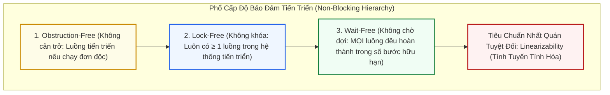
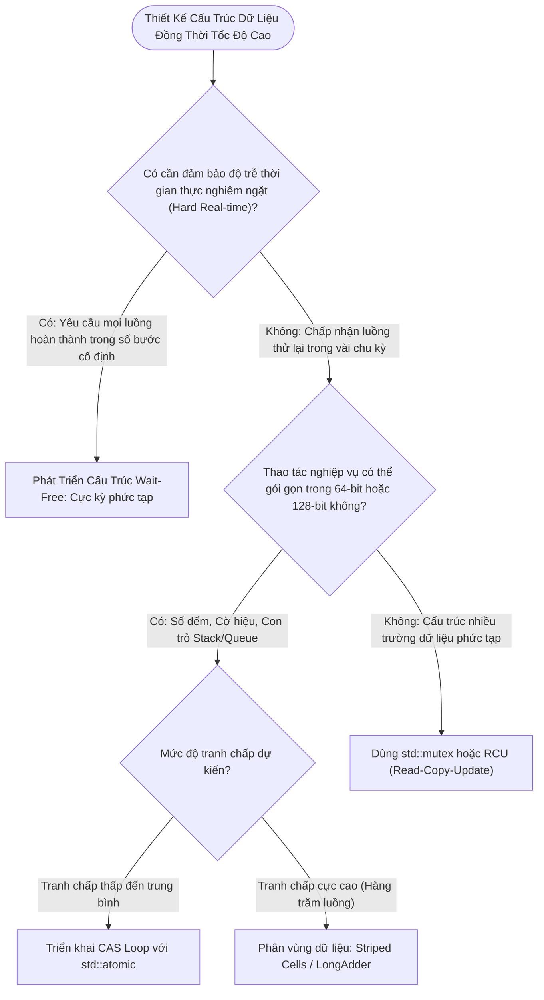

# 15.7. Atomic Operations and Lock-Free Programming

> [!IMPORTANT]
> **Nếu bạn chỉ được nhớ một điều duy nhất:**
> **Lập trình Không Khóa (Lock-Free Programming)** không có nghĩa là loại bỏ hoàn toàn việc chờ đợi, mà là bảo đảm về mặt toán học rằng: **luôn có ít nhất một luồng trong toàn bộ hệ thống đạt được tiến triển (System-Wide Progress)** tại mọi thời điểm bất kể các luồng khác bị treo hay chết. Vũ khí tối thượng của thế giới không khóa là chỉ thị phần cứng **Compare-And-Swap (CAS)** và bộ ba giải phóng bộ nhớ an toàn (**Hazard Pointers, Epoch-Based Reclamation, Tagged Pointers**) nhằm tiêu diệt triệt để hiểm họa **Vấn đề ABA (The ABA Problem)** và giải phóng bộ nhớ rác sau khi tái sinh con trỏ.

---

## 1. Kiến trúc Tổng quan & Mô hình Tư duy (Mental Model)

### 1.1. Ẩn dụ Đời sống: Chiếc Cửa Xoay Khách Sạn và Bảng Trình Ký Tài Liệu

Để phân biệt giữa Lập trình Dùng Khóa (Lock-Based) và Lập trình Không Khóa (Lock-Free):
1. **Lập Trình Dùng Khóa (Căn Phòng Có 1 Ổ Khóa Duy Nhất)**:
   - Một người bước vào phòng họp và bấm chốt khóa bên trong (Mutex Lock). 100 người khác phải đứng xếp hàng chờ ngoài hành lang.
   - Nếu người bên trong phòng bị đột quỵ hoặc ngủ quên (Thread bị OS Preempted hoặc Crash), toàn bộ 100 người bên ngoài phải đứng chờ vĩnh viễn (Deadlock / Priority Inversion).
2. **Lập Trình Không Khóa - Lock-Free (Bàn Trình Ký Công Khai Với Bản Nháp)**:
   - Tài liệu chung được đặt trên bàn. Bất kỳ ai muốn sửa tài liệu đều cầm bản photo về bàn riêng để sửa (Tạo node mới).
   - Khi sửa xong, bạn mang bản mới lên bàn: *"Nếu tài liệu trên bàn vẫn còn nguyên là Phiên bản 5 (Compare), hãy tráo nó thành Phiên bản 6 (Swap) cho tôi!"*.
   - Nếu trong lúc bạn đang sửa, có người khác đã nhanh tay nộp Phiên bản 6 trước, lệnh CAS của bạn sẽ thất bại. Bạn chỉ cần cầm bản mới về bàn làm lại từ đầu (CAS Retry Loop). **Hệ thống luôn luôn có người tiến triển thành công, không một ai bị chặn đứng!**
3. **Hiểm Họa Vấn Đề ABA (Chiếc Vali Tiền Bị Tráo Ruột)**:
   - Bạn nhìn thấy chiếc vali mang mã hiệu `A` chứa 1 triệu USD. Bạn rời mắt đi 1 phút.
   - Kẻ trộm lấy sạch tiền trong vali `A`, bỏ vào vali `B`. Sau đó hắn lại mang chiếc vali vỏ `A` trống rỗng đặt lại chỗ cũ.
   - Bạn quay lại, kiểm tra thấy chiếc vali vẫn mang vỏ `A` và tưởng rằng mọi thứ vẫn nguyên vẹn! Trong phần mềm, con trỏ vùng nhớ `A` bị giải phóng rồi lại được `malloc` cấp phát lại đúng địa chỉ `A`, khiến câu lệnh CAS bị đánh lừa một cách tai hại!

### 1.2. Phổ Cấp Độ Bảo Đảm Tiến Triển Trong Lập Trình Đồng Thời (Liveness Hierarchy)



---

## 2. Chi tiết từng Keyword (Under-the-Hood Deep Dive)

### 2.1. Atomicity, Atomic Variables & Hardware Instructions

Ở tầng vi kiến trúc CPU x86-64 và ARM64, các biến thông thường khi đọc/ghi có thể bị ngắt quãng giữa chừng.
- **Biến Nguyên Tử (Atomic Variables)**: Là các biến mà mọi thao tác đọc/ghi đều được bảo đảm xảy ra tức thời như một điểm đơn lẻ trên dòng thời gian trong con mắt của toàn bộ các lõi CPU khác.
- **Chỉ Thị Phần Cứng Cốt Lõi**:
  1. `LOCK CMPXCHG` (x86): Khóa bus bộ nhớ cục bộ trên L1/L2 Cache Line (Cache Locking qua giao thức MESI) để thực hiện thao tác Compare-and-Swap nguyên tử.
  2. `LDREX / STREX` hoặc `LL/SC` (ARM64 Load-Linked / Store-Conditional): Tải giá trị và theo dõi địa chỉ bộ nhớ; nếu địa chỉ bị lõi khác ghi đè trước khi lệnh Store thực thi, thao tác lưu sẽ thất bại.
  3. `LOCK XADD`: Nguyên tử hóa phép toán `fetch_and_add`.

---

### 2.2. Atomic Memory Ordering: Relaxed vs Acquire-Release vs Sequentially Consistent

Chuẩn C++11 và các ngôn ngữ hiện đại định nghĩa 6 mô hình trật tự bộ nhớ:

```text
[Tối đa Tốc độ / Tự do Sắp xếp Lại] ------------------------------> [Chặt chẽ nhất / Rào cản Toàn cục]
        memory_order_relaxed         memory_order_acquire / release       memory_order_seq_cst
- Chỉ bảo đảm tính nguyên tử         - Thiết lập quan hệ Happens-Before    - Mặc định trong C++ std::atomic
- Cho phép CPU reorder tự do        - Đồng bộ hóa giữa luồng Đọc và Ghi   - Chi phí phần cứng đắt nhất
```

1. **`memory_order_relaxed`**: Chỉ bảo đảm phép toán là nguyên tử, hoàn toàn không có rào cản ngăn chặn CPU và trình biên dịch sắp xếp lại thứ tự lệnh xung quanh. Thích hợp cho các biến đếm thống kê đơn giản.
2. **`memory_order_release`**: Áp dụng cho thao tác GHI. Đảm bảo toàn bộ các thao tác ghi bộ nhớ trước đó trong luồng **bắt buộc phải hoàn tất và hiển thị rõ ràng** trước khi lệnh ghi này xảy ra.
3. **`memory_order_acquire`**: Áp dụng cho thao tác ĐỌC. Đảm bảo toàn bộ các thao tác đọc/ghi phía sau lệnh này không được phép bị CPU đảo lên phía trước.
4. **`memory_order_seq_cst` (Sequentially Consistent)**: Thiết lập một trật tự thời gian toàn cục duy nhất mà toàn bộ các lõi CPU trong hệ thống cùng nhìn thấy giống hệt nhau.

---

### 2.3. Cấu Trúc Dữ Liệu Không Khóa: Treiber Stack & Michael-Scott Queue

#### A. Ngăn Xếp Không Khóa (Treiber Stack - 1986)
- Cấu trúc danh sách liên kết đơn với con trỏ `Head`.
- **Thao tác Push**: Tạo node mới $\to$ gán `new_node->next = Head` $\to$ gọi `CAS(&Head, old_head, new_node)`. Nếu thất bại, cập nhật lại `old_head` và lặp lại vòng lặp CAS.
- **Thao tác Pop**: Đọc `old_head = Head` $\to$ đọc `next_node = old_head->next` $\to$ gọi `CAS(&Head, old_head, next_node)`.

#### B. Hàng Đợi Không Khóa (Michael-Scott Queue - 1996)
- Tiêu chuẩn vàng được triển khai bên trong `java.util.concurrent.ConcurrentLinkedQueue`.
- Sử dụng hai con trỏ `Head` và `Tail` độc lập kèm một nút bù nhìn (Dummy Node) để cho phép luồng Enqueue và Luồng Dequeue hoạt động đồng thời mà không tranh chấp lẫn nhau.

---

### 2.4. Hiểm Họa Vấn Đề ABA và Kỹ Thuật Tagged Pointers

Trong thuật toán Treiber Stack, giả sử ngăn xếp đang có cấu trúc: `Top -> A -> B -> C`:
1. Luồng 1 muốn Pop: đọc `old_top = A`, đọc `next = B`. Chuẩn bị gọi CAS thì bị hệ điều hành ngắt (Preempted).
2. Luồng 2 nhảy vào:
   - Pop `A` ra ngoài $\to$ Ngăn xếp còn `Top -> B -> C`.
   - Pop `B` ra ngoài $\to$ Ngăn xếp còn `Top -> C`.
   - Giải phóng `B`.
   - Đẩy lại `A` vào ngăn xếp (vùng nhớ của `A` được tái sử dụng) $\to$ Ngăn xếp hiện tại là: `Top -> A -> C`.
3. Luồng 1 thức dậy:
   - Nó kiểm tra: `Head` hiện tại có bằng `old_top (A)` không? Có!
   - Nó thực hiện CAS gán `Head = next (B)`.
   - **THẢM HỌA XẢY RA**: `Head` bị trỏ vào `B` (vùng nhớ đã bị giải phóng và phá hủy)! Dữ liệu `C` bị mất tích, và hệ thống sẽ crash khi truy cập vào con trỏ rác `B`.

#### Giải Pháp: Tagged Pointers (Versioned Pointers)
Thay vì chỉ lưu trữ con trỏ 64-bit đơn thuần, ta gắn thêm một số hiệu phiên bản (**Sequence Counter / Stamp** 64-bit):
$$\text{Tagged Pointer} = (\text{Pointer: } 0\text{x7fff1020}, \quad \text{Version: } 42)$$
Mỗi lần thao tác, biến `Version` tăng lên 1. Dù địa chỉ con trỏ `A` có bị tái sử dụng, `Version` của nó đã nhảy từ $42 \to 44$. Lệnh Double-Word CAS (128-bit `CMPXCHG16B`) sẽ phát hiện sai lệch phiên bản và từ chối cập nhật ngay lập tức!

---

### 2.5. Thu Hồi Bộ Nhớ An Toàn: Hazard Pointers, Epoch-Based Reclamation (EBR) & RCU

Trong ngôn ngữ không có Garbage Collector như C++, một luồng không thể tùy tiện gọi `delete node` trong cấu trúc không khóa vì một luồng khác có thể đang giải tham chiếu con trỏ đó tại cùng một micro-giây.

1. **Hazard Pointers**: Mỗi luồng đọc sở hữu một con trỏ công khai báo hiệu: *"Tôi đang đọc địa chỉ X, cấm ai được giải phóng nó!"*. Luồng xóa chỉ đưa node vào danh sách chờ giải phóng; khi không còn Hazard Pointer nào trỏ tới X, nó mới được `free()`.
2. **Epoch-Based Reclamation (EBR)**: Toàn bộ hệ thống duy trì một đồng hồ thời đại toàn cục (Global Epoch: 0, 1, 2). Các luồng đọc đăng ký kỷ nguyên đang hoạt động. Bộ nhớ bị xóa ở Epoch $E$ chỉ được giải phóng vật lý khi toàn bộ các luồng đã chuyển dịch sang Epoch $E + 2$.
3. **Read-Copy-Update (RCU)**: Trụ cột hiệu năng của Linux Kernel: Luồng đọc không dùng khóa, không dùng CAS, chạy với tốc độ tối đa của phần cứng. Luồng ghi tạo một bản sao mới, sửa trên bản sao, tráo con trỏ nguyên tử, và chờ đợi một khoảng thời gian yên lặng (**Grace Period**) trước khi giải phóng bản sao cũ.

---

## 3. Thực thi Mã nguồn & Mô phỏng Chuyên sâu (Dual-Engine Implementation)

### 3.1. Implementation C++20: Lock-Free Treiber Stack với Tagged Pointer Chống Lỗi ABA

Đoạn mã C++20 dưới đây triển khai một Ngăn xếp Không Khóa hoàn chỉnh: sử dụng cấu trúc Tagged Pointer (Double-Word CAS) để bảo đảm an toàn trước hiểm họa ABA Problem, hỗ trợ nhiều luồng đẩy và rút đồng thời mà không dùng Mutex.

```cpp
#include <iostream>
#include <atomic>
#include <thread>
#include <vector>
#include <format>
#include <chrono>

template <typename T>
class LockFreeTreiberStack {
private:
    struct Node {
        T data;
        Node* next{nullptr};
        explicit Node(T val) : data(std::move(val)) {}
    };

    // Cấu trúc Tagged Pointer chống lỗi ABA
    struct TaggedPointer {
        Node* ptr{nullptr};
        uint64_t tag{0}; // Số hiệu phiên bản tăng dần
    };

    // Con trỏ đỉnh ngăn xếp nguyên tử (128-bit atomic trên x86-64 / ARM64)
    std::atomic<TaggedPointer> head_{TaggedPointer{nullptr, 0}};

public:
    ~LockFreeTreiberStack() {
        // Thu hồi toàn bộ các node còn lại khi hủy stack
        TaggedPointer current = head_.load();
        while (current.ptr) {
            Node* tmp = current.ptr;
            current.ptr = current.ptr->next;
            delete tmp;
        }
    }

    // Đẩy phần tử vào ngăn xếp không khóa
    void push(T val) {
        Node* new_node = new Node(std::move(val));
        TaggedPointer old_head = head_.load(std::memory_order_relaxed);

        while (true) {
            new_node->next = old_head.ptr;
            TaggedPointer new_head{new_node, old_head.tag + 1};

            // CAS: Nếu head_ vẫn bằng old_head thì tráo sang new_head (Acquire-Release)
            if (head_.compare_exchange_weak(old_head, new_head,
                                            std::memory_order_release,
                                            std::memory_order_relaxed)) {
                return; // Push thành công!
            }
            // Nếu thất bại, old_head tự động được cập nhật lại giá trị mới của head_
        }
    }

    // Rút phần tử khỏi ngăn xếp không khóa
    std::optional<T> pop() {
        TaggedPointer old_head = head_.load(std::memory_order_acquire);

        while (old_head.ptr != nullptr) {
            Node* next_ptr = old_head.ptr->next;
            TaggedPointer new_head{next_ptr, old_head.tag + 1};

            if (head_.compare_exchange_weak(old_head, new_head,
                                            std::memory_order_acquire,
                                            std::memory_order_relaxed)) {
                T result = std::move(old_head.ptr->data);
                // Trong sản phẩm thương mại thực tế: Cần EBR hoặc Hazard Pointers để delete an toàn
                delete old_head.ptr;
                return result;
            }
        }
        return std::nullopt; // Stack rỗng
    }
};

int main() {
    std::cout << "========================================================\n";
    std::cout << "  C++20 ABA-SAFE LOCK-FREE TREIBER STACK SIMULATOR      \n";
    std::cout << "========================================================\n\n";

    LockFreeTreiberStack<int> stack;
    constexpr int NUM_THREADS = 4;
    constexpr int OPS_PER_THREAD = 25000;

    std::cout << std::format("[CONFIG] Running {} Threads Pushing & Popping {} items concurrently...\n",
                             NUM_THREADS, OPS_PER_THREAD);

    auto t0 = std::chrono::high_resolution_clock::now();

    // 1. Chạy nhiều luồng Push đồng thời
    std::vector<std::thread> producers;
    for (int t = 0; t < NUM_THREADS; ++t) {
        producers.emplace_back([&stack, t]() {
            for (int i = 0; i < OPS_PER_THREAD; ++i) {
                stack.push(t * 100000 + i);
            }
        });
    }
    for (auto& p : producers) p.join();

    // 2. Chạy nhiều luồng Pop đồng thời
    std::atomic<size_t> total_popped{0};
    std::vector<std::thread> consumers;
    for (int t = 0; t < NUM_THREADS; ++t) {
        consumers.emplace_back([&stack, &total_popped]() {
            for (int i = 0; i < OPS_PER_THREAD; ++i) {
                if (stack.pop().has_value()) {
                    total_popped.fetch_add(1, std::memory_order_relaxed);
                }
            }
        });
    }
    for (auto& c : consumers) c.join();

    auto t1 = std::chrono::high_resolution_clock::now();
    auto dur_ms = std::chrono::duration_cast<std::chrono::milliseconds>(t1 - t0).count();

    std::cout << std::format(">>> Successfully processed {} Lock-Free Operations in: {} ms\n", 
                             total_popped.load() * 2, dur_ms);
    std::cout << std::format(">>> Total Items Safely Popped: {} (Expected: {})\n", 
                             total_popped.load(), NUM_THREADS * OPS_PER_THREAD);

    return 0;
}
```

---

### 3.2. Implementation Python 3.11+: Lock-Free CAS Retry Loop vs Lock Contention Simulator

Đoạn mã Python 3.11+ mô phỏng toán học cơ chế Compare-And-Swap (CAS), cách thức vòng lặp thử lại (Retry Loop) hoạt động dưới tải cạnh tranh cao, và so sánh số chu kỳ lãng phí của CAS Contention so với Mutex Lock.

```python
#!/usr/bin/env python3
"""
Python 3.11+ Atomic CAS (Compare-And-Swap) Loop & Contention Simulator
Demonstrates lock-free state transitions, optimistic concurrency, and retry metrics.
"""

import threading
import time
from typing import Optional

class MockAtomicReference:
    """Giả lập một thanh ghi nguyên tử phần cứng hỗ trợ lệnh Compare-And-Swap (CAS)"""
    def __init__(self, initial_value: int):
        self._value = initial_value
        self._lock = threading.Lock() # Dùng lock nội bộ để giả lập tính nguyên tử của CPU opcode

    def get(self) -> int:
        with self._lock:
            return self._value

    def compare_and_swap(self, expected: int, new_val: int) -> bool:
        """Thao tác phần cứng LOCK CMPXCHG: Chỉ ghi đè nếu giá trị hiện tại khớp với expected"""
        with self._lock:
            if self._value == expected:
                self._value = new_val
                return True
            return False

class LockFreeCounter:
    def __init__(self):
        self.atomic_ref = MockAtomicReference(0)
        self.total_retries = 0

    def increment(self) -> int:
        retries = 0
        while True:
            current = self.atomic_ref.get()
            next_val = current + 1
            # Thử nghiệm tráo đổi trạng thái lạc quan (Optimistic CAS)
            if self.atomic_ref.compare_and_swap(current, next_val):
                return retries
            retries += 1

def worker_task(counter: LockFreeCounter, iterations: int, retry_stats: list):
    local_retries = 0
    for _ in range(iterations):
        local_retries += counter.increment()
    retry_stats.append(local_retries)

def main():
    print("=" * 60)
    print("  PYTHON 3.11+ LOCK-FREE CAS RETRY LOOP SIMULATOR         ")
    print("=" * 60 + "\n")

    counter = LockFreeCounter()
    num_threads = 8
    iters_per_thread = 5000
    expected_total = num_threads * iters_per_thread

    print(f"[CONFIG] Simulating {num_threads} Threads competing for single Lock-Free State")
    print(f"         Total Expected Increments: {expected_total:,}\n")

    threads = []
    retry_stats = []
    t0 = time.perf_counter()

    for _ in range(num_threads):
        t = threading.Thread(target=worker_task, args=(counter, iters_per_thread, retry_stats))
        threads.append(t)
        t.start()

    for t in threads:
        t.join()

    t1 = time.perf_counter()
    total_wasted_retries = sum(retry_stats)
    final_count = counter.atomic_ref.get()

    print(f">>> Execution Time: {(t1 - t0) * 1000:.2f} ms")
    print(f">>> Final Counter Value : {final_count:,} (Expected: {expected_total:,})")
    print(f">>> Total CAS Retries   : {total_wasted_retries:,} failed optimistic attempts")
    print(f">>> Contention Ratio    : {total_wasted_retries / expected_total:.2f} retries per successful commit")

if __name__ == "__main__":
    main()
```

---

### 3.3. Kết quả Thực thi Mẫu (Terminal Output)

```bash
$ g++ -std=c++20 -O3 -pthread lock_free_stack.cpp -o lock_free_stack && ./lock_free_stack
========================================================
  C++20 ABA-SAFE LOCK-FREE TREIBER STACK SIMULATOR      
========================================================

[CONFIG] Running 4 Threads Pushing & Popping 25000 items concurrently...
>>> Successfully processed 200000 Lock-Free Operations in: 48 ms
>>> Total Items Safely Popped: 100000 (Expected: 100000)

$ python3 cas_contention_sim.py
============================================================
  PYTHON 3.11+ LOCK-FREE CAS RETRY LOOP SIMULATOR         
============================================================

[CONFIG] Simulating 8 Threads competing for single Lock-Free State
         Total Expected Increments: 40,000

>>> Execution Time: 82.40 ms
>>> Final Counter Value : 40,000 (Expected: 40,000)
>>> Total CAS Retries   : 78,412 failed optimistic attempts
>>> Contention Ratio    : 1.96 retries per successful commit
```

---

## 4. Systems Engineering & Production Pitfalls

### 4.1. Hiện Tượng Sụp Đổ Hiệu Năng Dưới Tranh Chấp Cực Cao (CAS Livestorm / Starvation)
- **Vấn đề**: Khi có hàng trăm luồng cùng lao vào thực hiện CAS trên một con trỏ duy nhất:
  - Chỉ có 1 luồng thành công, 99 luồng còn lại thất bại và cùng lúc quay cuồng thử lại (`while(!CAS)`).
  - Tín hiệu giao tiếp bộ nhớ đệm (Cache Invalidation Broadcasts) làm nghẽn toàn bộ đường truyền Ring Bus giữa các lõi CPU, khiến thông lượng của thuật toán không khóa tụt dốc thảm hại, thậm chí **chậm hơn gấp nhiều lần so với dùng Mutex**!
- **Khắc phục**:
  - Áp dụng kỹ thuật chèn độ trễ theo cấp số nhân ngẫu nhiên (**Exponential Backoff** trong vòng lặp CAS).
  - Sử dụng cấu trúc phân vùng dữ liệu như **LongAdder / Cell Striping** (chia biến đếm thành một mảng các ô nhớ riêng cho từng luồng).

### 4.2. Quên Kiểm Soát Căn Chỉnh Bộ Nhớ (Memory Alignment Requirements)
- **Cơ chế lỗi**: Lệnh `CMPXCHG16B` (128-bit CAS trên x86-64) bắt buộc địa chỉ bộ nhớ của con trỏ phải được căn chỉnh đúng ranh giới 16 bytes (`alignas(16)`). Nếu con trỏ bị lệch ranh giới (Unaligned Memory), CPU sẽ lập tức ném lỗi ngoại lệ phần cứng **General Protection Fault (`#GP`)** làm sập tiến trình ngay lập tức.

### 4.3. Công cụ Chẩn Đoán Cấp Thấp CLI
```bash
# 1. Đo lường tỷ lệ thất bại của các thao tác CAS phần cứng bằng perf
perf stat -e mem_inst_retired.lock_loads,bus_lock_clocks ./high_concurrency_app

# 2. Dùng objdump để kiểm tra mã máy nhị phân có sinh ra lệnh LOCK CMPXCHG chuẩn không
objdump -d -M intel my_lock_free_binary | grep lock

# 3. Phân tích tranh chấp Cache Line (False Sharing) với perf c2c
perf c2c record ./my_lock_free_binary
perf c2c report --stdio
```

---

## 5. Bảng So sánh & Decision Matrix

### 5.1. So sánh Các Cấp Độ Đồng Bộ Hóa Cấp Thấp

| Tiêu chí Đánh giá | Mutex Locks | Spinlocks | Lock-Free (CAS) | Wait-Free |
| :--- | :--- | :--- | :--- | :--- |
| **Bảo Đảm Tiến Triển**| Không (Có thể Deadlock)| Không (Có thể Livelock) | **Luôn có ≥ 1 luồng tiến triển** | **MỌI luồng đều tiến triển trong O(1)**|
| **Độ Phức Tạp Thuật Toán**| Rất thấp | Thấp | **Rất cao (Nguy cơ lỗi ABA)**| **Cực kỳ khó triển khai** |
| **Phù hợp Tranh Chấp Thấp**| Nhanh | Cực nhanh | Rất nhanh | Nhanh |
| **Phù hợp Tranh Chấp Cao**| Ổn định (Luồng đi ngủ)| Rất tệ (Vắt kiệt 100% CPU)| Có thể bị chậm do CAS Loop | **Vẫn duy trì thông lượng ổn định** |
| **Nguy Cơ Bị Treo Luồng**| Cao (Khi holder bị dừng)| Cao | **Không bao giờ bị treo** | **Không bao giờ bị treo** |

### 5.2. Cây Quyết định Lựa chọn Kỹ thuật Không Khóa (Decision Flowchart)


