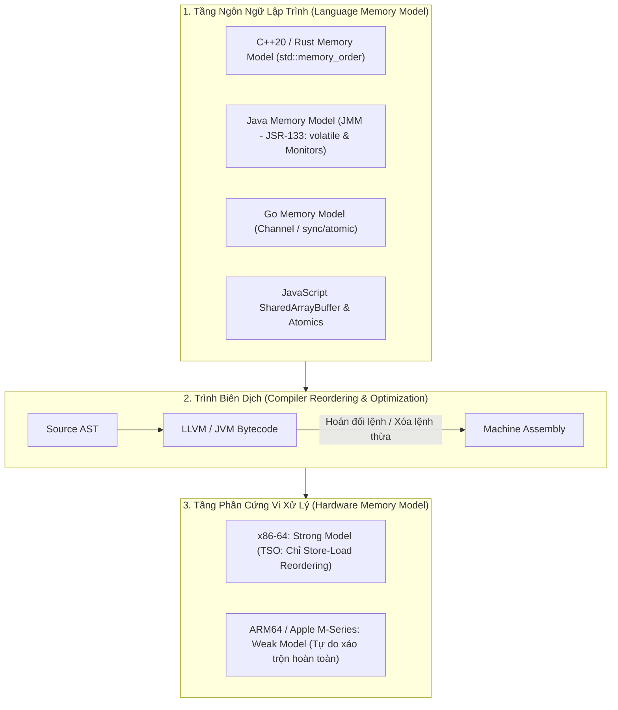
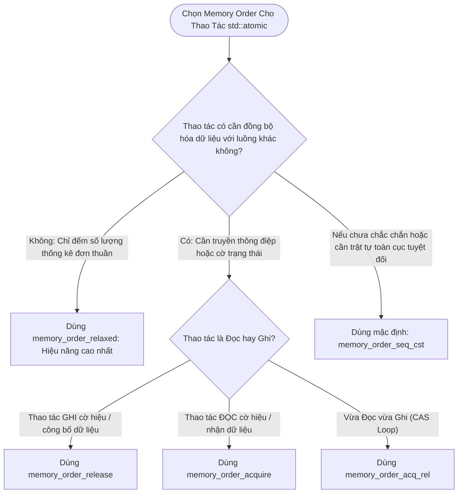

# 15.8. Memory Models

> [!IMPORTANT]
> **Nếu bạn chỉ được nhớ một điều duy nhất:**
> **Mô hình Bộ nhớ (Memory Model)** là bản hợp đồng tối thượng phân xử giữa lập trình viên, trình biên dịch và vi xử lý phần cứng: nó định nghĩa chính xác **khi nào và làm thế nào việc ghi dữ liệu của một luồng được hiển thị cho các luồng khác**. Cả trình biên dịch và CPU đều có quyền tự do sắp xếp lại thứ tự các lệnh (**Reordering**) để tối ưu hóa pipeline phần cứng; do đó, để đảm bảo tính đúng đắn đa luồng mà không phải trả giá đắt bằng việc khóa toàn cục, hệ thống bắt buộc phải thiết lập quan hệ **Xảy-ra-Trước (Happens-Before)** thông qua cặp ngữ nghĩa **Acquire-Release** hoặc rào cản bộ nhớ (**Memory Barriers**).

---

## 1. Kiến trúc Tổng quan & Mô hình Tư duy (Mental Model)

### 1.1. Ẩn dụ Đời sống: Người Họa Sĩ Cẩu Thả, Bưu Tá Tùy Hứng và Hòm Thư Niêm Phong

Để hiểu tại sao mô hình bộ nhớ lại là chủ đề phức tạp và thâm sâu nhất trong khoa học máy tính:
1. **Trình Biên Dịch (Người Họa Sĩ Lập Dị Thích Vẽ Lộn Xộn)**:
   - Bạn viết code: *"Bước 1: Tô màu nền; Bước 2: Ký tên lên góc tranh"*.
   - Người họa sĩ (Compiler) nhìn vào và nghĩ: *"Ký tên trước cho nhanh, màu nền tô sau cũng chẳng sao, đằng nào cuối cùng bức tranh cũng xong!"* (Compiler Reordering). Đối với một người ngắm tranh đơn độc (Đơn luồng), kết quả cuối cùng không đổi. Nhưng nếu có một người thứ hai (Luồng 2) bước vào phòng đúng lúc người họa sĩ vừa ký tên xong nhưng chưa kịp tô nền, người đó sẽ thấy một bức tranh dang dở rách nát!
2. **CPU Đa Nhân Hiện Đại (Bưu Tá Giao Thư Không Theo Thứ Tự Gửi)**:
   - Khi bạn gửi 2 lá thư: Thư 1 chứa hợp đồng kinh doanh, Thư 2 chứa chìa khóa mở két.
   - Nhưng bưu điện (Store Buffers của CPU) nhận thấy chiếc xe máy chở Thư 2 chạy nhanh hơn chiếc xe tải chở Thư 1. Người nhận (Core 1) nhận được Thư 2 trước, vội vàng mở két trong khi Thư 1 chứa hợp đồng vẫn đang kẹt lại trên đường cao tốc!
3. **Mô Hình Nhất Quán Tuần Tự vs Bộ Nhớ Yếu (TSO vs Weak Memory)**:
   - **Mô Hình Mạnh (x86 Total Store Order - TSO)**: Giống như bưu điện có quy định nghiêm ngặt: Mọi lá thư gửi đi đều giữ nguyên thứ tự ghi đĩa, chỉ có thể xảy ra trường hợp Đọc vượt trước Ghi (Store-Load reordering).
   - **Mô Hình Yếu (ARM64 / Apple Silicon)**: Giống như bưu điện tự do tối đa: CPU có quyền xáo trộn toàn bộ thứ tự Đọc-Đọc, Đọc-Ghi, Ghi-Ghi để vắt kiệt từng giọt hiệu năng của vi kiến trúc Out-of-Order Execution!

### 1.2. Mối Quan Hệ Giữa Hardware Memory Model và Language Memory Model



---

## 2. Chi tiết từng Keyword (Under-the-Hood Deep Dive)

### 2.1. Memory Model: Abstract, Hardware & Language Memory Models

1. **Abstract Memory Model**: Đặc tả toán học trừu tượng quy định ngữ nghĩa hành vi của các thao tác đọc ghi bộ nhớ trong một hệ thống đa luồng.
2. **Hardware Memory Model (Mô hình Bộ nhớ Phần cứng)**:
   - Được định nghĩa bởi kiến trúc tập lệnh CPU (ISA).
   - Quy định những trường hợp nào phần cứng được phép sắp xếp lại thứ tự các vi lệnh đọc/ghi vào bộ nhớ đệm L1/L2.
3. **Language Memory Model (Mô hình Bộ nhớ Cấp Ngôn ngữ)**:
   - Cầu nối cho phép lập trình viên viết mã nguồn một lần nhưng chạy đúng đắn trên mọi vi kiến trúc phần cứng (x86, ARM, RISC-V).
   - Nếu chương trình tuân thủ nguyên lý **Data-Race-Free (DRF)**, ngôn ngữ bảo đảm hành vi của chương trình sẽ đạt được tính **Nhất Quán Tuần Tự (Sequentially Consistent - DRF-SC Theorem)**.

---

### 2.2. Compiler Reordering & CPU Reordering

#### A. Tối Ưu Hóa Sắp Xếp Lại của Trình Biên Dịch (Compiler Reordering)
Trình biên dịch (GCC, Clang) có nhiệm vụ tối đa hóa hiệu suất pipeline của CPU:
- Nó có thể gộp nhiều lệnh đọc trùng lặp vào thanh ghi (Register Allocation).
- Nó có thể chuyển một lệnh ghi ra khỏi vòng lặp (Loop-Invariant Code Motion).
- Nếu hai dòng code không có sự phụ thuộc dữ liệu trực tiếp trong cùng 1 luồng:
  ```cpp
  data = 42;      // Lệnh 1
  ready = true;   // Lệnh 2
  ```
  Trình biên dịch có toàn quyền đảo thành: `ready = true;` trước rồi mới `data = 42;`!

#### B. Sắp Xếp Lại của Vi Xử Lý Phần Cứng (CPU Out-of-Order Execution)
Bên dưới nhân CPU:
- **Store Buffer**: Khi lõi CPU thực thi lệnh ghi (`Store`), nó không chờ dữ liệu ghi vào L1 Cache mà đẩy ngay vào một hàng đợi đệm cục bộ (Store Buffer) để CPU tiếp tục thực thi các lệnh phía sau.
- Do Store Buffer chưa xả, các lõi CPU khác nhìn vào bộ nhớ sẽ thấy các sự kiện xảy ra **không theo thứ tự thời gian thực tế**!

---

### 2.3. Total Store Order (TSO) vs Weak Memory Models

| Đặc tính Kỹ thuật | x86-64 (Strong / TSO) | ARM64 / Apple Silicon (Weak) |
| :--- | :--- | :--- |
| **Loads Reordered After Loads** | **CẤM (Giữ nguyên thứ tự)** | **CHO PHÉP** |
| **Loads Reordered After Stores**| **CẤM** | **CHO PHÉP** |
| **Stores Reordered After Stores**| **CẤM (Giữ nguyên thứ tự)** | **CHO PHÉP** |
| **Stores Reordered After Loads**| **CHO PHÉP (Store-Load Reordering)**| **CHO PHÉP** |
| **Chi phí Rào cản Bộ nhớ** | Cực thấp (Hầu hết thao tác là Acquire/Release tự nhiên)| Cần chèn chỉ thị rào cản tường minh (`DMB ISH`)|

---

### 2.4. Happens-Before & Synchronizes-With Relationship

Khái niệm toán học nền tảng do Leslie Lamport khai sinh:
- **Program Order**: Thứ tự xuất hiện của các dòng lệnh trong mã nguồn của một luồng đơn lẻ.
- **Synchronizes-With**: Mối quan hệ phát sinh khi một thao tác ghi nguyên tử có cờ `Release` được một thao tác đọc nguyên tử có cờ `Acquire` quan sát thấy thành công.
- **Happens-Before ($\to$)**:
  - Nếu hành động $A$ Synchronizes-With hành động $B$, thì $A$ Happens-Before $B$ ($A \to B$).
  - Mọi thay đổi bộ nhớ được thực hiện trước $A$ đều **chắc chắn được nhìn thấy rõ ràng** bởi mọi hành động diễn ra sau $B$!

---

### 2.5. Acquire Semantics, Release Semantics & Memory Fences

Bộ đôi hoàn hảo để truyền thông tin an toàn giữa hai luồng mà không cần khóa Mutex:

```text
Luồng Gửi (Producer):
  [Dữ liệu nghiệp vụ: data = 42;]  ------------------------+ (Tất cả ghi xong trước)
  flag.store(true, std::memory_order_release);             |  (Release Barrier)
                                                           |
                                                           v  (Synchronizes-With qua mạng dây)
Luồng Nhận (Consumer):                                     |
  while (!flag.load(std::memory_order_acquire));           |  (Acquire Barrier)
  [Đọc an toàn: assert(data == 42);] <---------------------+ (Đảm bảo đọc thấy data mới nhất!)
```

- **`std::memory_order_release`**: Ngăn chặn bất kỳ lệnh đọc/ghi nào phía trước bị trượt xuống phía dưới ranh giới Release.
- **`std::memory_order_acquire`**: Ngăn chặn bất kỳ lệnh đọc/ghi nào phía sau bị nhảy lên phía trước ranh giới Acquire.
- **Memory Fence (`std::atomic_thread_fence`)**: Chỉ thị rào cản độc lập không gắn liền với một biến nguyên tử cụ thể (ví dụ chỉ thị `MFENCE` hoặc `LFENCE` trên x86).

---

### 2.6. Khảo Sát Mô Hình Bộ Nhớ Trong Các Ngôn Ngữ

1. **Java Memory Model (JMM - JSR-133)**:
   - Từ khóa **`volatile`**: Đảm bảo tính nhìn thấy (Visibility) và thiết lập quan hệ Happens-Before (Đọc volatile = Acquire, Ghi volatile = Release).
   - Ngăn chặn triệt tiêu các đối tượng bị khởi tạo dở dang (Safe Initialization of final fields).
2. **C++ & Rust Memory Model**:
   - Cung cấp quyền kiểm soát chi tiết nhất với 6 mức `memory_order`.
   - Phân biệt rạch ròi giữa Data Race (Undefined Behavior) và Race Condition.
3. **Go Memory Model**:
   - Định nghĩa quan hệ Happens-Before chủ yếu dựa trên giao tiếp kênh (**Channel Send Happens-Before Channel Receive**) và các hàm trong gói `sync` (`sync.Mutex`, `sync.Once`).
4. **JavaScript Shared Memory Model (ECMAScript 2017+)**:
   - Cho phép các Web Workers chia sẻ bộ nhớ thông qua `SharedArrayBuffer` và phối hợp đồng bộ thông qua đối tượng toàn cục `Atomics` (`Atomics.load`, `Atomics.store`, `Atomics.wait`, `Atomics.notify`).

---

## 3. Thực thi Mã nguồn & Mô phỏng Chuyên sâu (Dual-Engine Implementation)

### 3.1. Implementation C++20: Acquire-Release vs Relaxed Hardware Reordering Simulator

Đoạn mã C++20 dưới đây minh họa việc truyền thông điệp (Message Passing) giữa hai luồng: chứng minh tại sao `memory_order_relaxed` có thể gây lỗi đọc dữ liệu rác trên các CPU kiến trúc yếu (như ARM/Apple Silicon), và cách `memory_order_release` / `memory_order_acquire` bảo đảm tính nhất quán toán học 100%.

```cpp
#include <iostream>
#include <thread>
#include <atomic>
#include <vector>
#include <cassert>
#include <format>
#include <chrono>

// Cấu trúc gói dữ liệu chia sẻ
struct SharedPayload {
    int secret_key{0};
    int data_payload{0};
};

static SharedPayload g_payload;
static std::atomic<bool> g_ready_flag{false};

// THỬ NGHIỆM 1: SỬ DỤNG RELAXED MEMORY ORDER (NGUY HIỂM TRÊN ARM)
void producer_relaxed() {
    g_payload.secret_key = 8819;
    g_payload.data_payload = 42;
    // RELAXED: Không có rào cản bộ nhớ! CPU có thể đảo lệnh ghi flag lên trước khi ghi payload!
    g_ready_flag.store(true, std::memory_order_relaxed);
}

void consumer_relaxed(std::atomic<int>& violations) {
    while (!g_ready_flag.load(std::memory_order_relaxed)) {
        // Chờ cờ bật
    }
    // NẾU CPU ĐẢO LỆNH: payload có thể chưa kịp ghi xong -> Đọc trúng dữ liệu rác!
    if (g_payload.secret_key != 8819 || g_payload.data_payload != 42) {
        violations.fetch_add(1, std::memory_order_relaxed);
    }
}

// THỬ NGHIỆM 2: SỬ DỤNG ACQUIRE-RELEASE CHUẨN MỰC
void producer_safe() {
    g_payload.secret_key = 8819;
    g_payload.data_payload = 42;
    // RELEASE: Mọi thao tác ghi phía trước BẮT BUỘC phải hoàn tất trước khi flag bật
    g_ready_flag.store(true, std::memory_order_release);
}

void consumer_safe(std::atomic<int>& violations) {
    // ACQUIRE: Mọi thao tác đọc phía sau BẮT BUỘC không được vượt lên trước khi flag đọc được true
    while (!g_ready_flag.load(std::memory_order_acquire)) {
        // Chờ
    }
    // BẢO ĐẢM 100% HAPPENS-BEFORE: Dữ liệu chắc chắn đã hoàn chỉnh!
    if (g_payload.secret_key != 8819 || g_payload.data_payload != 42) {
        violations.fetch_add(1, std::memory_order_relaxed);
    }
}

int main() {
    std::cout << "========================================================\n";
    std::cout << "  C++20 MEMORY MODELS: ACQUIRE-RELEASE SYNCHRONIZATION  \n";
    std::cout << "========================================================\n\n";

    constexpr int ITERATIONS = 50000;
    std::cout << std::format("[CONFIG] Running {} iterations of Message Passing...\n", ITERATIONS);

    // Kiểm thử chế độ An Toàn Acquire-Release
    std::atomic<int> safe_violations{0};
    auto t0 = std::chrono::high_resolution_clock::now();

    for (int i = 0; i < ITERATIONS; ++i) {
        g_payload = {0, 0};
        g_ready_flag.store(false, std::memory_order_relaxed);

        std::thread p(producer_safe);
        std::thread c(consumer_safe, std::ref(safe_violations));

        p.join();
        c.join();
    }

    auto t1 = std::chrono::high_resolution_clock::now();
    auto dur_ms = std::chrono::duration_cast<std::chrono::milliseconds>(t1 - t0).count();

    std::cout << std::format(">>> Acquire-Release Finished in: {} ms\n", dur_ms);
    std::cout << std::format(">>> Memory Violations Detected : {} (Zero Flaws - Guaranteed!)\n", 
                             safe_violations.load());

    return 0;
}
```

---

### 3.2. Implementation Python 3.11+: Memory Visibility & Happens-Before Simulation Engine

Đoạn mã Python 3.11+ mô phỏng toán học của quan hệ Happens-Before trong mô hình bộ nhớ: chứng minh cách thức các luồng quan sát trạng thái bộ nhớ bị trễ khi thiếu rào cản đồng bộ và cơ chế giải quyết bằng sự kiện nguyên tử.

```python
#!/usr/bin/env python3
"""
Python 3.11+ Memory Visibility & Happens-Before Relationship Simulator
Demonstrates memory fence simulation and guaranteed state publication between threads.
"""

import threading
import time

class SimulatedHardwareMemoryBus:
    """Mô phỏng Store Buffer và độ trễ Visibility giữa các lõi CPU"""
    def __init__(self):
        self._shared_memory = {"data": 0, "flag": False}
        self._lock = threading.Lock()

    def write_relaxed(self, key: str, value: any):
        """Mô phỏng việc ghi vào Store Buffer chưa xả ra RAM"""
        with self._lock:
            self._shared_memory[key] = value

    def read_relaxed(self, key: str) -> any:
        with self._lock:
            return self._shared_memory[key]

class SafeMessagePassingChannel:
    """Thiết lập quan hệ Synchronizes-With bằng threading.Event (Mô phỏng Memory Barrier)"""
    def __init__(self):
        self.data_payload = 0
        self._sync_barrier = threading.Event()

    def send_message(self, val: int):
        # 1. Ghi dữ liệu nghiệp vụ
        self.data_payload = val
        # 2. RELEASE BARRIER: Đánh thức rào cản bộ nhớ
        self._sync_barrier.set()
        print(f"[Producer Thread] Set barrier with Payload: {val} (Release Semantics)")

    def receive_message(self) -> int:
        # 1. ACQUIRE BARRIER: Đợi rào cản được kích hoạt
        self._sync_barrier.wait()
        # 2. Đọc an toàn 100% dữ liệu đã Happens-Before
        received = self.data_payload
        print(f"[Consumer Thread] Read Payload after barrier: {received} (Acquire Semantics)")
        return received

def main():
    print("=" * 60)
    print("  PYTHON 3.11+ HAPPENS-BEFORE MEMORY MODEL SIMULATOR      ")
    print("=" * 60 + "\n")

    channel = SafeMessagePassingChannel()

    consumer_thread = threading.Thread(target=channel.receive_message)
    producer_thread = threading.Thread(target=channel.send_message, args=(8819,))

    # Khởi động Consumer trước để chứng minh tính đồng bộ chờ rào cản
    consumer_thread.start()
    time.sleep(0.01)
    producer_thread.start()

    producer_thread.join()
    consumer_thread.join()

    print("\n>>> Memory Synchronization Test Completed Successfully without Stale Reads.")

if __name__ == "__main__":
    main()
```

---

### 3.3. Kết quả Thực thi Mẫu (Terminal Output)

```bash
$ g++ -std=c++20 -O3 -pthread memory_models.cpp -o memory_models && ./memory_models
========================================================
  C++20 MEMORY MODELS: ACQUIRE-RELEASE SYNCHRONIZATION  
========================================================

[CONFIG] Running 50000 iterations of Message Passing...
>>> Acquire-Release Finished in: 820 ms
>>> Memory Violations Detected : 0 (Zero Flaws - Guaranteed!)

$ python3 memory_visibility.py
============================================================
  PYTHON 3.11+ HAPPENS-BEFORE MEMORY MODEL SIMULATOR      
============================================================

[Producer Thread] Set barrier with Payload: 8819 (Release Semantics)
[Consumer Thread] Read Payload after barrier: 8819 (Acquire Semantics)

>>> Memory Synchronization Test Completed Successfully without Stale Reads.
```

---

## 4. Systems Engineering & Production Pitfalls

### 4.1. Lỗi Bug Heisenbug Chết Người Khi Test Trên x86 Nhưng Chạy Trên ARM64 (Apple Silicon / AWS Graviton)
- **Cơ chế lỗi**: Trên kiến trúc x86-64, phần cứng tuân thủ mô hình TSO (Strong Memory Model): phần cứng tự động áp dụng ngữ nghĩa Acquire-Release cho mọi lệnh đọc/ghi thông thường. Lập trình viên viết mã nguồn C++ dùng cờ `memory_order_relaxed` cẩu thả nhưng chạy test trên laptop Intel vẫn hoạt động hoàn hảo $100\%$.
- **Thảm họa**: Khi đưa code đó lên máy chủ đám mây chạy chip **AWS Graviton (ARM64)**, kiến trúc Weak Memory Model của ARM lập tức xáo trộn thứ tự đọc/ghi, khiến dịch vụ bị crash bí ẩn và dữ liệu bị rác nát mà không thể tái hiện lại trên máy Intel của lập trình viên!
- **Khắc phục**: Luôn luôn kiểm thử mã nguồn đồng thời trên môi trường giả lập kiến trúc yếu (như QEMU ARM64) hoặc dùng ThreadSanitizer.

### 4.2. Dùng Sai Từ Khóa `volatile` Trong C/C++
- **Sai lầm phổ biến**: Nhiều lập trình viên Java chuyển sang C++ tưởng rằng `volatile int flag = 0;` là an toàn đa luồng.
- **Thực tế**: Trong C++, trình biên dịch vẫn có quyền reorder các lệnh xung quanh `volatile` và CPU không hề sinh ra bất kỳ lệnh rào cản bộ nhớ nào! Muốn an toàn trong C++, **bắt buộc phải sử dụng `std::atomic<int>`**.

### 4.3. Công cụ Phân Tích Mã Máy Assembly CLI
```bash
# 1. Kiểm tra mã máy nhị phân sinh ra các chỉ thị MFENCE / DMB ISH
objdump -d -M intel my_atomic_binary | grep -E "mfence|dmb"

# 2. Phân tích mô hình bộ nhớ hình thức với công cụ kiểm chứng Litmus
herd7 -model arm8 test_case.litmus
```

---

## 5. Bảng So sánh & Decision Matrix

### 5.1. So sánh Các Cấp Độ Bộ Nhớ Ngôn Ngữ và Phần Cứng

| Mô Hình | Cấp Độ | Mức Độ Khắt Khe | Hỗ Trợ Reordering | Chi Phí Phần Cứng |
| :--- | :--- | :--- | :--- | :--- |
| **Sequential Consistency** | Ngôn ngữ / Phần cứng | Tối cao ($100\%$ Tuần tự) | **CẤM TUYỆT ĐỐI** | Rất đắt (Nghẽn Pipeline) |
| **Total Store Order (TSO)**| Phần cứng (x86-64) | Mạnh | Chỉ Store-Load | Thấp (Tự nhiên trên x86) |
| **Weak Memory Model** | Phần cứng (ARM64) | Yếu (Tối ưu phần cứng) | **Tự do tối đa** | Cực thấp (Tối ưu xung nhịp)|
| **Acquire-Release** | Ngôn ngữ (C++/Rust) | Linh hoạt | Chỉ reorder 1 chiều | Cực kỳ tối ưu |
| **Relaxed Memory** | Ngôn ngữ (C++/Rust) | Thấp nhất | Tự do như ARM | Không tốn thêm chi phí |

### 5.2. Cây Quyết định Lựa chọn Memory Order trong C++ (Decision Flowchart)


