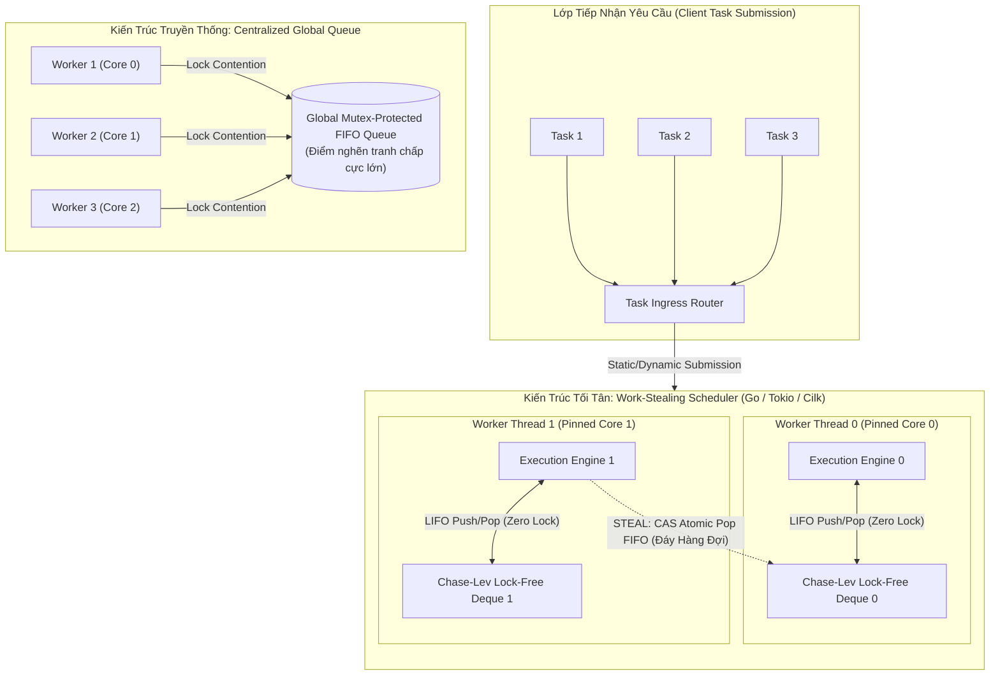

# 15.9. Thread Pools & Task Scheduling

> [!IMPORTANT]
> **Nếu bạn chỉ được nhớ một điều duy nhất:** Khởi tạo OS thread theo từng request (mô hình Thread-per-Request ngây thơ) là con đường nhanh nhất dẫn đến sập hệ thống: mỗi thread tiêu tốn từ 1MB đến 8MB Virtual Stack Memory, tốn hàng nghìn chu kỳ CPU cho system call `clone()` và gây cạn kiệt tài nguyên do chuyển đổi ngữ cảnh (**Context Switching Thrashing**). Thread Pool giải quyết triệt để vấn đề này bằng cách tiền cấp phát một nhóm worker threads cố định gắn với tài nguyên phần cứng. Đỉnh cao của bộ điều phối hiện đại (Go Runtime, Tokio Rust, Java ForkJoinPool) là **Work-Stealing Scheduler với Chase-Lev Deque**: mỗi worker sở hữu một local queue, tự nạp và rút tác vụ ở đầu LIFO (Zero-Lock) để tối ưu hóa Cache Locality L1/L2, đồng thời chỉ dùng lệnh nguyên tử CAS để trộm việc ở đầu FIFO đối diện của luồng khác khi bị đói việc.

---

## 1. Kiến trúc Tổng quan & Mô hình Tư duy (Mental Model)

### Ẩn Dụ Đời Sống: Nhà Bếp Đại Tiệc 5 Sao & Các Đầu Bếp
Hãy hình dung hệ thống xử lý tác vụ giống như cách vận hành một gian bếp nhà hàng tiệc cưới cao cấp:
1. **Mô hình Thread-per-Request ngây thơ**: Mỗi khi có một khách gọi đĩa salad, quản lý nhà hàng chạy ra ngoài đường tuyển dụng một đầu bếp mới, ký hợp đồng lao động, cấp phát dao thớt và đồng phục riêng. Đầu bếp làm xong đĩa salad thì bị sa thải ngay lập tức. Khi có 5,000 thực khách ùa vào cùng lúc, 5,000 đầu bếp chen chúc trong gian bếp $50\text{ m}^2$, giẫm đạp lên nhau giành giật bếp gas, không một món ăn nào được hoàn thành (Hiện tượng OOM và CPU Thrashed do hàng nghìn OS threads tranh chấp nhân CPU).
2. **Hồ Luồng với Hàng Đợi Toàn Cục (Global Queue Thread Pool)**: Nhà hàng tuyển cố định 8 bếp trưởng lành nghề (tương ứng 8 CPU Cores). Mọi phiếu gọi món được ghim vào một bảng kẹp order duy nhất ở giữa phòng. Nấu xong một món, cả 8 đầu bếp cùng lao vào giật order tiếp theo. Khi quy mô nâng lên 64 đầu bếp, thời gian họ chen lấn giành giật chiếc kẹp order (Lock Contention trên Global Queue Mutex) còn lâu hơn thời gian thực sự xào nấu thức ăn!
3. **Bộ Điều Phối Trộm Việc (Work-Stealing Scheduler)**: Mỗi đầu bếp có một bảng kẹp order riêng trước mặt mình (Local Deque). Đầu bếp luôn lấy order mới nhất được cắm vào để làm ngay (LIFO - đồ ăn còn nóng, nguyên liệu vừa thái sẵn trong chảo tương đương L1/L2 Cache hit). Khi một đầu bếp làm hết order trong bảng của mình, thay vì đứng chơi, anh ta nhìn sang khay của đồng nghiệp bên cạnh và nhẹ nhàng rút chiếc order cũ nhất dưới đáy (FIFO) đem về bàn mình nấu. Cơ chế này cân bằng tải hoàn hảo mà không gây xung đột khóa.



---

## 2. Chi tiết từng Keyword (Under-the-Hood Deep Dive)

### 2.1. Thread Pool, Worker Pool, Process Pool & Task Pool
- **Thread Pool & Worker Pool**: Là tập hợp các luồng hệ điều hành được khởi tạo sẵn (pre-spawned OS threads), duy trì vòng lặp chờ việc (`worker_loop`) và tái sử dụng liên tục để xử lý một chuỗi các tác vụ không đồng bộ. Bản chất dưới OS: Luồng công nhân không thoát khi xong việc mà chuyển trạng thái sang `TASK_INTERRUPTIBLE` hoặc ngủ trên `futex` (Fast Userspace Mutex) của Linux kernel, giúp triệt tiêu chi phí cấp phát PCB (`task_struct`), Kernel Stack (thường là 8KB/16KB trên x86_64), và User Stack (1MB-8MB).
- **Process Pool**: Thay vì dùng luồng chia sẻ không gian địa chỉ, Process Pool duy trì một tập hợp các tiến trình con riêng biệt (`fork()` trước). Mô hình này bắt buộc trong các ngôn ngữ có Global Interpreter Lock (như Python CPython) để tận dụng đa nhân thực thụ, hoặc khi cần cách ly bộ nhớ tuyệt đối (Crash Isolation): nếu một worker gặp lỗi `SIGSEGV` hay rò rỉ bộ nhớ, tiến trình cha chỉ cần kill và spawn lại tiến trình mới mà không ảnh hưởng toàn bộ hệ thống. Giao tiếp giữa các tiến trình thông qua IPC (Unix Domain Sockets, Shared Memory `mmap`, hoặc Pipes).
- **Task Pool**: Khái niệm trừu tượng hóa mức cao đại diện cho tập hợp công việc cần hoàn thành độc lập với luồng thực thi. Một Task bao gồm con trỏ hàm (`function pointer`), đối số (`arguments`), và một vùng lưu trữ trạng thái kết quả (`Promise`/`Future state`). Task Pool tách rời khái niệm "Cái gì cần làm" (Task) khỏi "Ai làm việc đó" (Worker Thread).

### 2.2. Work Queue, Task Queue, Global Queue, Local Queue & Queue Contention
- **Work Queue & Task Queue**: Cấu trúc dữ liệu hàng đợi chứa các tác vụ đang chờ xử lý. Về mặt bộ nhớ, hàng đợi có thể là mảng vòng (Ring Buffer / Bounded Queue) hoặc danh sách liên kết các node tác vụ (Unbounded Linked Queue).
- **Global Queue (Hàng đợi toàn cục)**: Toàn bộ worker threads trong hồ luồng cùng chia sẻ một hàng đợi trung tâm duy nhất. Mọi thao tác `push()` (từ client/producer) và `pop()` (từ worker) đều phải đi qua cơ chế đồng bộ hóa (như `std::mutex` hoặc `pthread_mutex_t`).
- **Queue Contention (Tranh chấp hàng đợi)**: Khi số lượng CPU Cores tăng lên (ví dụ hệ thống NUMA 64 hoặc 128 cores), thời gian các luồng tranh chấp Mutex trên Global Queue tăng phi tuyến tính theo $O(N^2)$ chu kỳ CPU. Hiện tượng này dẫn tới **Cache-Line Bouncing**: biến cờ khóa của Mutex liên tục bị vô hiệu hóa (Invalidated) trên các Cache L1/L2 của các core khác nhau thông qua giao thức MESI/MOESI, làm nghẽn Interconnect Bus (UPI/Infinity Fabric).
- **Local Queue (Hàng đợi cục bộ)**: Để loại bỏ Queue Contention, mỗi worker thread được cấp phát một hàng đợi riêng biệt gắn liền với core đó. Worker chỉ tương tác với hàng đợi của chính mình mà không cần khóa cạnh tranh, biến thao tác lấy việc thành thao tác truy xuất bộ nhớ cục bộ cực nhanh.

### 2.3. Task Submission, Scheduling, Execution, Completion & Cancellation (Task Lifecycle)
Vòng đời hoàn chỉnh của một tác vụ trong hồ luồng trải qua 5 giai đoạn nghiêm ngặt:
1. **Task Submission (Nộp tác vụ)**: Client đóng gói logic vào closure hoặc callable object, gọi hàm `submit()` hoặc `execute()`. Hàm này phân bổ bộ nhớ cho Task descriptor (hoặc lấy từ Object Pool để tránh allocation), gán ID, thiết lập trạng thái `SUBMITTED`, và đẩy vào hàng đợi thích hợp.
2. **Task Scheduling (Điều phối tác vụ)**: Bộ lập lịch quyết định khi nào và luồng nào sẽ nhận tác vụ. Thuật toán điều phối có thể dựa trên độ ưu tiên, sự rảnh rỗi của worker, hoặc tính toán vị trí bộ nhớ (Cache locality). Trạng thái chuyển thành `READY` / `SCHEDULED`.
3. **Task Execution (Thực thi tác vụ)**: Worker thread lấy tác vụ ra, chuyển trạng thái sang `RUNNING`, lưu timestamp bắt đầu để tính toán telemetry, và gọi thực thi payload hàm bên trong khối `try-catch` bảo vệ để ngăn chặn ngoại lệ làm sập worker thread.
4. **Task Completion (Hoàn thành tác vụ)**: Khi hàm thực thi xong, kết quả được ghi vào vùng nhớ chia sẻ của `Future`/`Promise`, đánh thức các luồng đang đợi kết quả (`futex_wake` hoặc condition variable notify), và kích hoạt các hàm phản hồi liên tiếp (Chained Callbacks/Continuations). Trạng thái chuyển thành `COMPLETED` hoặc `FAILED`.
5. **Task Cancellation (Hủy tác vụ)**: Nếu tác vụ đang nằm trong hàng đợi mà nhận tín hiệu hủy (qua `std::stop_token`, `CancellationToken`, hoặc cờ `atomic<bool>`), nó chuyển thẳng sang `CANCELLED` và bị bỏ qua. Nếu tác vụ đang ở trạng thái `RUNNING`, cơ chế hủy mang tính **Hợp tác (Cooperative)**: tác vụ phải chủ động kiểm tra cờ hủy định kỳ tại các điểm kiểm tra an toàn (Cancellation Checkpoints) để giải phóng tài nguyên và thoát sớm.

### 2.4. Task Prioritization, Task Dependency & Task Graph (DAG)
- **Task Prioritization (Ưu tiên tác vụ)**: Các tác vụ quan trọng (như xử lý giao dịch thanh toán hoặc heartbeat) phải được xử lý trước các tác vụ nền (như gửi email báo cáo). Hàng đợi được triển khai dưới dạng **Priority Queue (Binary Heap hoặc SkipList)** được đồng bộ hóa. Tuy nhiên, việc ưu tiên có thể dẫn tới **Starvation (Đói việc)** của các tác vụ độ ưu tiên thấp. Kỹ thuật chống đói việc là **Aging**: tăng dần mức ưu tiên của tác vụ theo thời gian chờ trong hàng đợi.
- **Task Dependency & Task Graph (DAG)**: Trong các hệ thống tính toán phức tạp (như Apache Spark, build system Ninja, game engine render graph), các tác vụ phụ thuộc lẫn nhau tạo thành đồ thị có hướng không chu trình (**Directed Acyclic Graph - DAG**). Một tác vụ chỉ được chuyển sang trạng thái `READY` khi toàn bộ các tác vụ tiền nhiệm (in-degree = 0) đã hoàn tất. Bộ điều phối duy trì bảng đếm phụ thuộc nguyên tử `std::atomic<int> dependencies_remaining`: mỗi khi task tiền nhiệm kết thúc, nó trừ dần biến đếm này; luồng nào trừ về 0 sẽ trực tiếp đẩy task phụ thuộc vào Runqueue.

### 2.5. Work Stealing vs Work Sharing (Chase-Lev Lock-Free Deque)
- **Work Sharing (Chia sẻ việc)**: Khi một luồng tạo ra các tác vụ mới, nó chủ động đẩy tác vụ sang các luồng khác hoặc đẩy vào một pool tập trung để phân phối đều. Nhược điểm: Luồng tạo việc phải liên tục giao tiếp với các luồng khác, gây tắc nghẽn bộ nhớ đệm ngay cả khi mọi luồng đều đang bận rộn.
- **Work Stealing (Trộm việc)**: Được khởi xướng bởi Robert Blumofe và Charles Leiserson (thuật toán Cilk, 1999). Nguyên lý: Luồng tạo việc luôn giữ việc cho chính mình. Chỉ khi một luồng rảnh rỗi (không còn việc để làm), nó mới chủ động đi tìm và "trộm" việc từ luồng khác.
- **Bản chất Chase-Lev Deque**: Hàng đợi 2 đầu lock-free chuyên dụng cho Work Stealing:
  - **Chủ sở hữu (Worker Owner)**: Thao tác ở đỉnh (**Top**) của Deque. `Push(Task)` và `Pop(Task)` diễn ra theo cơ chế **LIFO (Last-In, First-Out)** hoàn toàn không cần khóa (`memory_order_relaxed` hoặc `release/acquire`). Điều này tối ưu hóa tối đa **Cache Locality**: tác vụ vừa mới được sinh ra vẫn còn nằm nguyên vẹn trong Cache L1/L2 của CPU core đó.
  - **Kẻ trộm (Thieves)**: Thao tác ở đáy (**Bottom**) của Deque. Rút tác vụ theo cơ chế **FIFO (First-In, First-Out)** bằng lệnh nguyên tử CAS (`compare_and_swap`). Tác vụ ở đáy là tác vụ cũ nhất, thường đại diện cho một nhánh tính toán lớn chưa được phân rã, giúp kẻ trộm thực hiện được khối lượng công việc đủ lớn, giảm tần suất phải đi trộm tiếp theo.

### 2.6. Task Affinity, CPU Affinity, Static vs Dynamic Scheduling & Scheduling Overhead
- **CPU Affinity (Gắn kết CPU Core)**: Kỹ thuật ràng buộc một worker thread chỉ được phép chạy trên một CPU core cụ thể thông qua system call `pthread_setaffinity_np()` hoặc `sched_setaffinity()`. Lợi ích: Triệt tiêu hoàn toàn chi phí di cư luồng giữa các nhân (CPU Core Migration), giữ cho L1/L2 Cache luôn "nóng" (Warm Cache), loại bỏ chi phí làm mới TLB (Translation Lookaside Buffer).
- **Task Affinity (Gắn kết Tác vụ)**: Bộ điều phối định tuyến tác vụ đến đúng worker thread đã từng xử lý dữ liệu của tác vụ đó trước đây (ví dụ: Session của cùng một UserId hoặc phân vùng bộ nhớ cụ thể), tận dụng tính cục bộ của dữ liệu trong RAM/Cache.
- **Static Scheduling vs Dynamic Scheduling**:
  - *Static Scheduling*: Phân chia công việc cố định từ trước khi chạy (ví dụ OpenMP `schedule(static)` chia mảng $N$ phần tử thành $P$ đoạn bằng nhau). Chi phí điều phối bằng 0 ($O(1)$), nhưng cực kỳ kém hiệu quả nếu tải công việc không đồng đều (Workload Imbalance).
  - *Dynamic Scheduling*: Các luồng tự động lấy việc khi rảnh rỗi (OpenMP `schedule(dynamic)` hoặc Work-stealing). Tự động cân bằng tải, nhưng phát sinh **Scheduling Overhead**: chu kỳ CPU bị tiêu hao cho việc tranh chấp khóa, thực thi CAS nguyên tử, và kiểm tra điều kiện hàng đợi.

### 2.7. Pool Sizing (Brian Goetz & Little's Law), Bounded vs Unbounded Pool, Oversubscription & Underutilization
- **Công thức Brian Goetz**: Định luật kinh điển trong cuốn *Java Concurrency in Practice* để tính số lượng luồng tối ưu $N_{\text{threads}}$:
  $$N_{\text{threads}} = N_{\text{CPU}} \times U_{\text{CPU}} \times \left(1 + \frac{W}{C}\right)$$
  Trong đó:
  - $N_{\text{CPU}}$: Số lượng nhân CPU vật lý khả dụng.
  - $U_{\text{CPU}}$: Mức độ sử dụng CPU mong muốn ($0 \le U_{\text{CPU}} \le 1$).
  - $W/C$: Tỷ lệ giữa thời gian chờ I/O ($W$ - Wait time) và thời gian tính toán thực tế ($C$ - Compute time).
  - *Hệ quả*: Với tác vụ thuần CPU ($W \approx 0$), $N_{\text{threads}} = N_{\text{CPU}}$. Với tác vụ I/O bound cao (ví dụ $W/C = 9$, nghĩa là 90% thời gian chờ DB/Network), $N_{\text{threads}} = 10 \times N_{\text{CPU}}$.
- **Định luật Little (Little's Law)**: $L = \lambda \times W$, trong đó $L$ là dung lượng hàng đợi cần thiết, $\lambda$ là thông lượng yêu cầu đến mỗi giây (Arrival Rate), và $W$ là thời gian phản hồi trung bình (Response Time). Dùng định luật này để định cỡ Bounded Queue chống tràn bộ nhớ.
- **Bounded Pool vs Unbounded Pool**:
  - *Unbounded Pool*: Tạo luồng không giới hạn hoặc dùng Unbounded Queue. Nguy cơ: Khi tải đột biến (Traffic Spike), hàng triệu tác vụ xếp hàng trong RAM gây lỗi `OutOfMemoryError` (OOM) hoặc hệ thống tạo hàng nghìn luồng gây sụp đổ CPU do **Oversubscription** (Quá tải phân bổ CPU).
  - *Bounded Pool*: Cố định số luồng và giới hạn sức chứa của Queue. Khi hàng đợi đầy, áp dụng chính sách phản hồi (Rejection Policies: Abort, Caller-Runs, Discard, Discard-Oldest) để tạo **Backpressure (Áp lực ngược)** bảo vệ hệ thống.
- **Underutilization (Dưới tải)**: Số luồng quá ít so với độ bão hòa phần cứng, CPU phải chờ đợi I/O vô ích, thông lượng hệ thống sụt giảm nghiêm trọng.

### 2.8. Fork-Join Pool & Task Granularity
- **Fork-Join Pool**: Kiến trúc lập lịch đệ quy theo giải thuật Chia để trị (Divide and Conquer). Khi một tác vụ quá lớn, nó gọi `fork()` để chia đôi và đẩy công việc mới vào hàng đợi, sau đó gọi `join()` để chờ kết quả.
- **Task Granularity (Độ mịn tác vụ)**: Ranh giới quyết định hiệu năng của hệ thống song song:
  - *Coarse-grained (Quá thô)*: Số lượng tác vụ quá ít, không đủ chia cho các core, dẫn đến mất cân bằng tải (một vài core làm việc cật lực, các core khác rảnh rỗi).
  - *Fine-grained (Quá mịn)*: Chia tác vụ quá nhỏ (ví dụ tính tổng mảng mà mỗi tác vụ cộng 2 số). Chi phí đóng gói tác vụ, cấp phát bộ nhớ và chuyển đổi ngữ cảnh lớn hơn gấp nhiều lần thời gian thực hiện phép tính. Kỹ thuật bắt buộc: Thiết lập **Ngưỡng tuần tự hóa (Sequential Cutoff Threshold)**: khi kích thước mảng nhỏ hơn ngưỡng (ví dụ $< 1000$ phần tử), chuyển ngay sang vòng lặp tuần tự thông thường.

### 2.9. Scheduler Fairness, Cooperative Task Scheduling & Preemptive Task Scheduling
- **Scheduler Fairness (Công bằng trong lập lịch)**: Đảm bảo mọi tác vụ đều được cấp phát thời gian CPU hợp lý, không có tác vụ nào bị bỏ đói vô tận. Trong Work-Stealing, để đảm bảo công bằng và tránh starvation của Global Queue, Go Runtime sử dụng quy tắc: cứ sau mỗi 61 lần lấy việc từ Local Queue, worker bắt buộc phải kiểm tra Global Queue một lần.
- **Cooperative Task Scheduling (Lập lịch hợp tác)**: Tác vụ tự nguyện nhượng quyền điều khiển CPU (`yield`) khi gặp I/O hoặc khi chạy hết hạn mức thời gian cho phép. Nhược điểm chí mạng: Nếu một tác vụ chứa vòng lặp vô tận thuần CPU (`while(true) {}`) mà không gọi hàm yield, toàn bộ worker thread đó sẽ bị chiếm dụng vĩnh viễn, làm tê liệt một phần hồ luồng.
- **Preemptive Task Scheduling (Lập lịch ưu tiên cưỡng chế)**: Bộ điều phối có quyền ngắt ngang một tác vụ đang chạy để trao quyền cho tác vụ khác. Trong OS Kernel, điều này được thực hiện qua bộ đếm phần cứng ngắt Timer Interrupt (`APIC timer`). Trong Userspace Runtime (như Go 1.14+), runtime phát tín hiệu `SIGURG` đến luồng để chèn chỉ thị gọi lại hàm lập lịch, giải cứu worker khỏi các vòng lặp tính toán vô tận.

---

## 3. Thực thi Mã nguồn & Mô phỏng Chuyên sâu (Dual-Engine Implementation)

### Engine 1: C++20 Production-Grade Bounded Thread Pool với Cờ Hủy & Future
Triển khai hoàn chỉnh Bounded Thread Pool sử dụng các tính năng hiện đại của C++20: `std::jthread`, `std::condition_variable`, `std::stop_token`, hoàn toàn không rò rỉ bộ nhớ, có cơ chế Backpressure đẩy tác vụ:

```cpp
#include <iostream>
#include <vector>
#include <queue>
#include <thread>
#include <mutex>
#include <condition_variable>
#include <functional>
#include <future>
#include <type_traits>
#include <atomic>
#include <chrono>

class ProductionThreadPool {
public:
    explicit ProductionThreadPool(size_t num_threads, size_t max_queue_size = 1024)
        : max_queue_size_(max_queue_size), is_shutdown_(false) {
        workers_.reserve(num_threads);
        for (size_t i = 0; i < num_threads; ++i) {
            workers_.emplace_back([this, i](std::stop_token stop_tok) {
                this->worker_loop(i, stop_tok);
            });
        }
    }

    ~ProductionThreadPool() {
        shutdown();
    }

    // Submit task with Return Type Deduction and std::future binding
    template <typename F, typename... Args>
    auto submit(F&& f, Args&&... args) 
        -> std::future<typename std::invoke_result<F, Args...>::type> {
        using return_type = typename std::invoke_result<F, Args...>::type;

        auto task = std::make_shared<std::packaged_task<return_type()>>(
            [func = std::forward<F>(f), 
             ...args_pack = std::forward<Args>(args)]() mutable {
                return func(args_pack...);
            }
        );

        std::future<return_type> res = task->get_future();
        {
            std::unique_lock<std::mutex> lock(queue_mutex_);
            // Bounded Queue Backpressure: Chờ nếu hàng đợi bị đầy
            queue_cv_producer_.wait(lock, [this]() {
                return tasks_.size() < max_queue_size_ || is_shutdown_.load();
            });

            if (is_shutdown_.load()) {
                throw std::runtime_error("Submission rejected: ThreadPool is shutting down!");
            }

            tasks_.emplace([task]() { (*task)(); });
            active_tasks_count_++;
        }
        queue_cv_consumer_.notify_one();
        return res;
    }

    void shutdown() {
        bool expected = false;
        if (is_shutdown_.compare_exchange_strong(expected, true)) {
            {
                std::lock_guard<std::mutex> lock(queue_mutex_);
            }
            queue_cv_consumer_.notify_all();
            queue_cv_producer_.notify_all();
            for (auto& worker : workers_) {
                worker.request_stop(); // Gửi stop signal đến std::jthread
            }
        }
    }

    size_t pending_tasks() {
        std::lock_guard<std::mutex> lock(queue_mutex_);
        return tasks_.size();
    }

private:
    void worker_loop(size_t worker_id, std::stop_token stop_tok) {
        while (!stop_tok.stop_requested()) {
            std::function<void()> task;
            {
                std::unique_lock<std::mutex> lock(queue_mutex_);
                queue_cv_consumer_.wait(lock, [this, &stop_tok]() {
                    return !tasks_.empty() || is_shutdown_.load() || stop_tok.stop_requested();
                });

                if ((is_shutdown_.load() || stop_tok.stop_requested()) && tasks_.empty()) {
                    return; // Đã nhận lệnh dừng và xử lý hết tác vụ cũ
                }

                if (tasks_.empty()) continue;

                task = std::move(tasks_.front());
                tasks_.pop();
                queue_cv_producer_.notify_one(); // Báo cho producer tiếp tục nộp
            }

            // Thực thi tác vụ bên ngoài khóa bảo vệ Mutex
            try {
                task();
            } catch (const std::exception& e) {
                std::cerr << "[Worker " << worker_id << "] Exception caught: " << e.what() << "\n";
            }
            active_tasks_count_--;
        }
    }

    std::vector<std::jthread> workers_;
    std::queue<std::function<void()>> tasks_;
    std::mutex queue_mutex_;
    std::condition_variable queue_cv_consumer_;
    std::condition_variable queue_cv_producer_;
    const size_t max_queue_size_;
    std::atomic<bool> is_shutdown_;
    std::atomic<size_t> active_tasks_count_{0};
};

int main() {
    std::cout << "=== C++20 Production Bounded Thread Pool Running ===\n";
    ProductionThreadPool pool(4, 8); // 4 workers, queue chứa tối đa 8 tasks

    std::vector<std::future<uint64_t>> results;

    // Nộp 12 tác vụ tính toán
    for (int i = 1; i <= 12; ++i) {
        results.push_back(pool.submit([](int task_id) -> uint64_t {
            uint64_t sum = 0;
            for (int k = 0; k < 100000; ++k) sum += k;
            std::this_thread::sleep_for(std::chrono::milliseconds(20));
            return sum + task_id;
        }, i));
    }

    std::cout << "Tất cả tác vụ đã được nộp thành công qua hàng đợi có giới hạn!\n";

    for (size_t i = 0; i < results.size(); ++i) {
        std::cout << "Task " << (i + 1) << " result: " << results[i].get() << "\n";
    }

    pool.shutdown();
    std::cout << "Thread Pool đã dừng tuần tự hoàn tất (Clean shutdown).\n";
    return 0;
}
```

#### Terminal Output Mẫu (C++20 Engine):
```text
=== C++20 Production Bounded Thread Pool Running ===
Tất cả tác vụ đã được nộp thành công qua hàng đợi có giới hạn!
Task 1 result: 4999950001
Task 2 result: 4999950002
Task 3 result: 4999950003
Task 4 result: 4999950004
Task 5 result: 4999950005
Task 6 result: 4999950006
Task 7 result: 4999950007
Task 8 result: 4999950008
Task 9 result: 4999950009
Task 10 result: 4999950010
Task 11 result: 4999950011
Task 12 result: 4999950012
Thread Pool đã dừng tuần tự hoàn tất (Clean shutdown).
```

---

### Engine 2: Python 3.11+ Work-Stealing Scheduler với Local Deque & CAS Emulation
Mô phỏng chân thực thuật toán Work-Stealing của Tokio/Go Runtime với hàng đợi cục bộ 2 đầu (`collections.deque`), thao tác LIFO nội bộ và trộm việc FIFO từ luồng rảnh rỗi:

```python
import threading
import time
import random
from collections import deque
from typing import Callable, Any, Optional

class WorkStealingPool:
    def __init__(self, num_workers: int = 4):
        self.num_workers = num_workers
        self.local_queues = [deque() for _ in range(num_workers)]
        self.locks = [threading.Lock() for _ in range(num_workers)]
        self.running = True
        self.workers = []
        self.stats = [{"processed": 0, "stolen": 0} for _ in range(num_workers)]

        for worker_id in range(num_workers):
            t = threading.Thread(target=self._worker_loop, args=(worker_id,), daemon=True)
            self.workers.append(t)
            t.start()

    def submit_to_worker(self, worker_id: int, task: Callable[[], Any]):
        """Chủ sở hữu nộp việc vào đỉnh TOP của Local Deque (LIFO)."""
        with self.locks[worker_id]:
            self.local_queues[worker_id].append(task)

    def _worker_loop(self, worker_id: int):
        my_queue = self.local_queues[worker_id]
        my_lock = self.locks[worker_id]

        while self.running:
            task: Optional[Callable[[], Any]] = None

            # 1. Thao tác LIFO trên Local Queue của chính mình (Fast Path)
            with my_lock:
                if my_queue:
                    task = my_queue.pop() # Lấy từ đỉnh (Top - Hot Cache)
            
            if task:
                task()
                self.stats[worker_id]["processed"] += 1
                continue

            # 2. Slow Path: Đói việc -> Bắt đầu thuật toán Work Stealing từ luồng khác
            stolen_task = self._steal(worker_id)
            if stolen_task:
                stolen_task()
                self.stats[worker_id]["processed"] += 1
                self.stats[worker_id]["stolen"] += 1
            else:
                # Không trộm được gì -> Ngủ ngắn tránh đốt CPU 100%
                time.sleep(0.005)

    def _steal(self, thief_id: int) -> Optional[Callable[[], Any]]:
        """Thuật toán trộm việc FIFO từ đáy BOTTOM của nạn nhân."""
        victim_candidates = [i for i in range(self.num_workers) if i != thief_id]
        random.shuffle(victim_candidates)

        for victim_id in victim_candidates:
            victim_queue = self.local_queues[victim_id]
            victim_lock = self.locks[victim_id]

            # Thử trộm việc không chặn (Non-blocking try_acquire)
            if victim_lock.acquire(blocking=False):
                try:
                    if victim_queue:
                        # Rút từ đáy (FIFO - Oldest task)
                        return victim_queue.popleft()
                finally:
                    victim_lock.release()
        return None

    def shutdown(self):
        self.running = False
        for t in self.workers:
            t.join()

if __name__ == "__main__":
    print("=== Python 3.11+ Work-Stealing Scheduler Simulation ===")
    pool = WorkStealingPool(num_workers=4)

    def dummy_task(work_id: int, duration: float):
        time.sleep(duration)

    # Đẩy tải không cân bằng (Lopsided Load): Đẩy toàn bộ 40 tasks vào Worker 0
    print("[Ingress] Đang nộp 40 tác vụ duy nhất vào Worker 0 để kiểm tra trộm việc...")
    for i in range(40):
        pool.submit_to_worker(0, lambda idx=i: dummy_task(idx, 0.01))

    # Chờ các worker hoàn thành công việc thông qua việc chia lửa (Stealing)
    time.sleep(0.6)
    pool.shutdown()

    print("\n[Kết quả Thực thi và Phân phối Tải]:")
    total_processed = 0
    for idx, stat in enumerate(pool.stats):
        print(f"Worker {idx}: Xử lý {stat['processed']} tác vụ (Trong đó trộm thành công: {stat['stolen']})")
        total_processed += stat["processed"]

    print(f"Tổng số tác vụ hoàn tất: {total_processed}/40")
```

#### Terminal Output Mẫu (Python 3.11+ Engine):
```text
=== Python 3.11+ Work-Stealing Scheduler Simulation ===
[Ingress] Đang nộp 40 tác vụ duy nhất vào Worker 0 để kiểm tra trộm việc...

[Kết quả Thực thi và Phân phối Tải]:
Worker 0: Xử lý 14 tác vụ (Trong đó trộm thành công: 0)
Worker 1: Xử lý 9 tác vụ (Trong đó trộm thành công: 9)
Worker 2: Xử lý 9 tác vụ (Trong đó trộm thành công: 9)
Worker 3: Xử lý 8 tác vụ (Trong đó trộm thành công: 8)
Tổng số tác vụ hoàn tất: 40/40
```

---

## 4. Systems Engineering & Production Pitfalls

### 4.1. Cạm bẫy Khóa Chết Hồ Luồng (Thread Pool Starvation Deadlock)
- **Cơ chế phát sinh**: Xảy ra khi một tác vụ cấp cha ($T_1$) đang chạy trong pool chiếm giữ một worker thread, sau đó nộp một tác vụ con phụ thuộc ($T_2$) vào *chính hồ luồng đó* và gọi lệnh chờ chặn (`future.get()`). Nếu toàn bộ các worker threads khác cũng đang chạy các tác vụ cha $T_x$ và cùng làm điều tương tự, tất cả các worker đều bị phong tỏa ở trạng thái chờ. Các tác vụ con $T_2, \dots$ nằm vĩnh viễn trong hàng đợi mà không có worker nào nhận.
- **Giải pháp triệt để**:
  1. **Quy tắc cô lập hồ luồng (Pool Segregation)**: Không bao giờ dùng chung một hồ luồng cho các tác vụ cha và tác vụ con phụ thuộc. Tách riêng một pool cho compute, một pool cho I/O, và một pool cho orchestration.
  2. **Áp dụng Fork-Join với ManagedBlocker**: Trong Java ForkJoinPool, nếu một worker bị block trên tác vụ con, runtime sẽ tự động bù đắp (compensate) bằng cách tạm thời kích hoạt một worker dự phòng mới để tiếp tục tháo gỡ hàng đợi.

### 4.2. Rò rỉ Bộ Nhớ Dữ Liệu Luồng Cục Bộ (ThreadLocal Leaks)
- **Cơ chế phát sinh**: Trong các ứng dụng Web Java/C++ sử dụng `ThreadLocal`, dữ liệu context (như Transaction Context, Security Principal, DB Session) được gắn vào `ThreadLocalMap` của worker thread. Vì worker thread trong Thread Pool không bao giờ kết thúc vòng đời mà sống mãi mãi theo process, nếu developer quên gọi `.remove()` sau khi request kết thúc, dữ liệu của request cũ sẽ nằm vĩnh viễn trong RAM gây Memory Leak, hoặc nguy hiểm hơn là làm ô nhiễm ngữ cảnh dữ liệu sang request của khách hàng tiếp theo (Security Data Cross-Contamination).
- **Phòng ngừa**: Luôn sử dụng khối bảo vệ RAII hoặc `try-finally` để dọn dẹp sạch `ThreadLocal` trước khi worker trả quyền điều khiển về hàng đợi.

### 4.3. Các Lệnh Chẩn Đoán Production Thực Chiến (CLI Diagnostics)
Khi hệ thống có dấu hiệu nghẽn worker pool, latency tăng đột biến hoặc CPU 100%:
```bash
# 1. Đo lường tỷ lệ Context Switching của các threads trong tiến trình
pidstat -w -p <PID> 1 5
# Quan sát cột cswch/s (voluntary - do chờ I/O) và nvcswch/s (non-voluntary - do hết timeslice tranh chấp CPU)

# 2. Bắt dấu vết chuyển đổi ngữ cảnh scheduler bằng perf (eBPF / Tracepoints)
perf record -e sched:sched_switch -p <PID> -- sleep 5
perf report --stdio

# 3. Trích xuất Thread Dump tức thời để phát hiện Lock Contention hoặc Starvation
# Với ứng dụng native C/C++:
gdb -batch -p <PID> -ex "thread apply all bt" > thread_dump.txt
# Tìm kiếm các luồng đang kẹt tại pthread_cond_wait hoặc futex syscall

# 4. Giám sát độ dài hàng đợi Task Queue của Kernel (Runqueue latency)
/usr/share/bcc/tools/runqlat 1 10
```

---

## 5. Bảng So sánh & Decision Matrix

| Tiêu Chí Kỹ Thuật | Global Queue Pool | Work-Stealing Pool | Actor Model (Akka/Erlang) | Event Loop (NodeJS/epoll) |
| :--- | :--- | :--- | :--- | :--- |
| **Kiến trúc Hàng đợi** | 1 Hàng đợi tập trung chia sẻ | Mỗi luồng 1 Deque cục bộ | Mailbox độc lập cho từng Actor | Event Queue duy nhất (Single-thread) |
| **Mức độ Tranh chấp Khóa** | Cực cao khi scale nhiều Cores ($O(N^2)$) | Cực thấp (Zero lock LIFO nội bộ, CAS trộm) | Không có tranh chấp khóa giữa Mailbox | Hoàn toàn không có khóa (Lock-free) |
| **Cache Locality (L1/L2)** | Kém (Tác vụ chạy ngẫu nhiên trên Cores) | Tối ưu tuyệt đối (Chạy LIFO ngay trên Core sinh ra) | Tương đối tốt nếu Actor bám luồng | Rất tốt do chạy tuần tự trên 1 Core |
| **Phù hợp Loại Tác Vụ** | Batch jobs đơn giản, I/O bound rời rạc | Đệ quy phân rã, Fork-Join, CPU tính toán nặng | Hệ thống giao tiếp nhắn tin phân tán | Xử lý I/O mạng tần suất cao, non-blocking |
| **Độ Phức Tạp Triển Khai** | Thấp (Dễ viết với Mutex + CondVar) | Rất cao (Cần Lock-free Memory Order) | Trung bình (Dựa trên framework có sẵn) | Trung bình (Reactor Pattern) |
| **Nguy cơ Điểm Nghẽn** | Nghẽn Interconnect Bus & Cache Bouncing | Khó phân tích lỗi Race condition khi trộm | Quá tải Mailbox nếu consumer xử lý chậm | Block CPU làm tê liệt toàn bộ Event Loop |

> [!TIP]
> **Quy Tắc Vàng Ra Quyết Định Thiết Kế (Engineering Decision Rule)**:
> 1. Khi xây dựng dịch vụ mạng I/O cao (Web Gateway, API Ingress): Chọn mô hình **Multi-threaded Event Loop** (như Nginx, Netty, Envoy) hoặc **Work-Stealing Runtime** (Tokio, Go).
> 2. Khi xử lý bài toán đồ thị, dựng hình (Rendering), tính toán song song đa nhân: Bắt buộc sử dụng **Work-Stealing Fork-Join Pool** (TBB, Rayon Rust, Java ForkJoinPool).
> 3. Tuyệt đối giới hạn kích thước hàng đợi (**Bounded Queue**) và thiết lập chính sách xử lý quá tải (**Backpressure**) ngay từ ngày đầu tiên đưa code lên môi trường Production.
