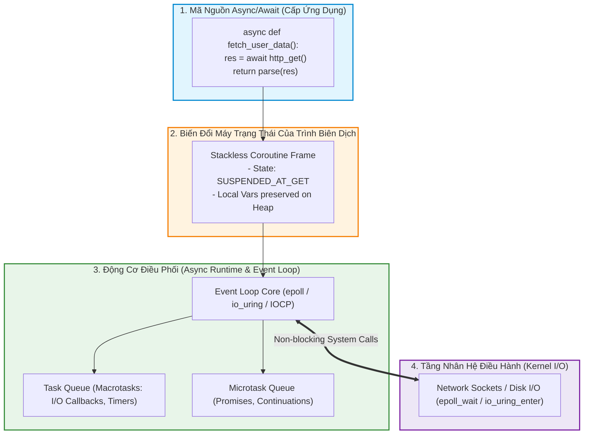
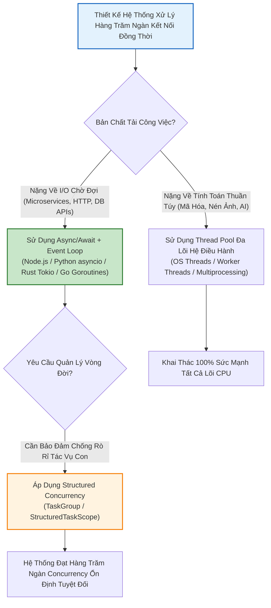

# 15.10. Lập Trình Bất Đồng Bộ (Asynchronous Programming)

> [!IMPORTANT]
> **Nếu bạn chỉ được nhớ một điều duy nhất:** Lập trình bất đồng bộ (**Asynchronous Programming**) giải phóng luồng thực thi khỏi việc chờ đợi I/O thụ động bằng cách biến các hàm tạm ngưng thành **Máy Trạng Thái Không Ngăn Xếp (Stackless Coroutine State Machine)** được điều phối bởi **Event Loop**; trong khi **Đồng Thời Có Cấu Trúc (Structured Concurrency)** đảm bảo tính toàn vẹn vòng đời tác vụ con, tự động lan truyền lệnh hủy (**Cancellation**) và khôi phục lại vết ngăn xếp lỗi (**Async Stack Traces**) mà không làm rò rỉ bất kỳ tài nguyên nào trong nền.

---

## 1. Kiến trúc Tổng quan & Mô hình Tư duy (Mental Model)

### Ẩn dụ Đời sống: Nhà Hàng Thông Minh và Thẻ Báo Rung Tự Động
Hãy hình dung sự khác biệt giữa các mô hình phục vụ trong một nhà hàng thức ăn nhanh:
- **Đồng bộ và Chặn (Synchronous & Blocking I/O)**: Khách hàng (Luồng OS Thread) đứng chết trân ở quầy gọi món (I/O Call). Khách hàng không thể làm gì khác (luồng bị khóa cứng) cho đến khi đầu bếp xào xong món ăn và trao tận tay. Nếu có 1000 khách, nhà hàng phải thuê 1000 nhân viên đứng đối diện, khiến sàn nhà chật kín và phá sản vì chi phí nhân công (Quá tải bộ nhớ Stack 8MB mỗi thread).
- **Đồng bộ nhưng Không chặn (Synchronous & Non-Blocking I/O)**: Khách hàng liên tục hỏi nhân viên sau mỗi 2 giây: *"Cơm xong chưa? Chưa à? Cơm xong chưa?"* (Polling loop). Khách không bị khóa, nhưng đốt sạch năng lượng (100% CPU utilization) chỉ cho việc hỏi đi hỏi lại.
- **Bất đồng bộ Hướng Sẵn sàng (Readiness-Based I/O - `epoll` / `kqueue`)**: Một bảng điện tử lớn treo trên tường. Khi bất kỳ món ăn nào chín, số thứ tự của khách hiện lên. Khách hàng ngồi đọc sách, thỉnh thoảng liếc nhìn bảng điện tử để ra lấy món.
- **Bất đồng bộ Hướng Hoàn thành (Completion-Based I/O - Windows IOCP / Linux `io_uring`)**: Nhà hàng phát cho khách một thiết bị rung tự động. Khách hàng ngồi yên thư giãn. Khi đầu bếp làm xong món, nhân viên phục vụ bê thức ăn đặt tận bàn của khách và bấm chuông rung. Thao tác sao chép dữ liệu từ đĩa vào RAM đã hoàn tất 100% trước khi khách chạm tay vào.
- **Async/Await & Coroutine State Machine**: Giống như việc bạn đọc một cuốn sách giáo khoa dày: khi gặp một bài tập hóc búa cần gửi thư hỏi giáo sư (`await ask_professor()`), bạn kẹp một chiếc thẻ đánh dấu trang (Lưu trạng thái thanh ghi vào Coroutine Frame), gấp sách lại và đi làm việc khác. Khi thư trả lời đến, bạn mở đúng trang sách đã đánh dấu và đọc tiếp dòng kế tiếp mà không cần phải đọc lại từ đầu.



---

## 2. Chi tiết từng Keyword (Under-the-Hood Deep Dive)

### 2.1. Phân Biệt 4 Chiều: Sync vs Async, Blocking vs Non-Blocking I/O
Theo chuẩn mực kinh điển của W. Richard Stevens trong *Unix Network Programming*:
- **Blocking I/O**: Tiến trình gọi `read()` bị hệ điều hành đưa vào trạng thái ngủ (**Sleep State - TASK_INTERRUPTIBLE**). Luồng bị tước quyền sử dụng CPU cho đến khi dữ liệu từ card mạng được copy hoàn tất vào Kernel Buffer và chuyển sang User Buffer.
- **Non-Blocking I/O**: Tiến trình gọi `read()`. Nếu chưa có dữ liệu trong buffer mạng, kernel lập tức trả về mã lỗi `EWOULDBLOCK` hoặc `EAGAIN`. Tiến trình không bị ngủ, có thể làm việc khác nhưng phải tự chịu trách nhiệm thăm dò lại.
- **Synchronous I/O**: Tiến trình khởi tạo thao tác I/O và **tự mình thực hiện việc chuyển giao dữ liệu**. Dù dùng blocking hay non-blocking, tại thời điểm dữ liệu được copy từ Kernel Space sang User Space, CPU của tiến trình đó vẫn phải tham gia thực thi.
- **Asynchronous I/O (AIO)**: Tiến trình khởi tạo yêu cầu nạp dữ liệu và lập tức quay đi làm việc khác. Nhân hệ điều hành hoặc phần cứng DMA (Direct Memory Access) tự động đổ toàn bộ dữ liệu vào buffer của người dùng trong nền, sau đó mới phát tín hiệu báo hoàn thành (Callback/Signal).

### 2.2. Readiness-Based I/O (`epoll`/`kqueue`) vs Completion-Based I/O (`IOCP`/`io_uring`)
- **Readiness-Based (Dựa trên Sự Sẵn Sàng)**:
  - Đại diện: Linux `select`, `poll`, `epoll`, BSD/macOS `kqueue`.
  - Cơ chế: Kernel báo cho ứng dụng: *"Socket FD 15 đã có dữ liệu sẵn sàng để đọc!"*.
  - Nhược điểm: Ứng dụng vẫn phải tự gọi `read()` để copy dữ liệu từ nhân sang bộ nhớ tiến trình, tiêu tốn 1 lần chuyển đổi ngữ cảnh người dùng/nhân (**Context Switch**).
- **Completion-Based (Dựa trên Sự Hoàn Thành)**:
  - Đại diện: Windows **IOCP** (Input/Output Completion Ports) và Linux **`io_uring`**.
  - Cơ chế: Ứng dụng cung cấp sẵn một vùng nhớ đệm (Buffer Pointer) cho Kernel: *"Hãy đọc 4KB từ socket này vào buffer của tôi"*. Khi kernel báo sự kiện về, **dữ liệu đã nằm sẵn trong buffer**.
  - Đột phá của `io_uring`: Sử dụng cặp vòng đệm chia sẻ không khóa (**Lock-free Shared Ring Buffers: Submission Queue & Completion Queue**) giữa Kernel và User Space, cho phép thực hiện hàng triệu thao tác I/O mỗi giây mà **không tốn một lệnh syscall nào**!

### 2.3. Sự Tiến Hóa Của Trừu Tượng Hóa Bất Đồng Bộ
- **Continuation-Passing Style (CPS) & Callback Hell**: Truyền hàm tiếp nối (Continuation) vào làm tham số. Khi lồng 5-7 tầng callback, mã nguồn trở thành hình kim tự tháp (Pyramid of Doom), biến việc bắt lỗi bằng `try-catch` thành điều bất khả thi.
- **Promises & Futures**: Đại diện cho một giá trị chưa tồn tại ở hiện tại nhưng sẽ được giải quyết trong tương lai (**Deferred Computation**). Cho phép gắn chuỗi xử lý qua `.then().catch()`.
- **Async/Await**: Bước nhảy vọt về mặt công thái học lập trình (Ergonomics). Biến mã bất đồng bộ trông giống hệt như mã tuần tự tuyến tính thông thường, khôi phục lại khả năng bắt lỗi qua khối lệnh `try-catch` tự nhiên.

### 2.4. Event Loop Microarchitecture: Macro vs Microtasks
- **Macrotask Queue (Task Queue)**: Chứa các sự kiện I/O callbacks, bộ đếm thời gian (`setTimeout`, `setInterval`), thao tác render UI.
- **Microtask Queue (Job Queue)**: Chứa các hàm tiếp nối của Promise (`Promise.then()`), `process.nextTick` trong Node.js, `queueMicrotask`.
- **Quy luật ưu tiên thép của Event Loop**:
  - Sau mỗi một macrotask hoàn thành, Event Loop **bắt buộc phải vét sạch toàn bộ các task trong Microtask Queue** cho đến khi cạn kiệt, trước khi chuyển sang thực hiện macrotask tiếp theo.
  - Nếu microtask liên tục sinh thêm microtask mới, nó sẽ làm chết đói toàn bộ tác vụ I/O và khiến giao diện bị đơ cứng (**Microtask Starvation**).

### 2.5. Cơ Chế Biến Đổi Máy Trạng Thái Của Coroutine (Stackless State Machine Transformation)
- Khi một hàm được đánh dấu `async`, trình biên dịch (C# Roslyn, Rust `rustc`, C++20 Coroutines, Python bytecode) không tạo ra một hàm bình thường, mà biến đổi hàm đó thành một cấu trúc Struct máy trạng thái:
  - Mọi biến cục bộ của hàm được đưa vào các trường của Struct nằm trên Heap (**Coroutine Frame**).
  - Thân hàm được bẻ thành một lệnh `switch(state)` khổng lồ:
    - `state = 0`: Điểm bắt đầu hàm cho đến từ khóa `await` đầu tiên.
    - Gặp `await`: Lưu con trỏ frame, gán `state = 1`, trả quyền điều khiển về cho Event Loop (**Coroutine Suspension**).
    - Khi Future hoàn thành: Event Loop gọi phương thức `resume()`, nhảy thẳng vào `state = 1` để đọc tiếp (**Coroutine Resumption**).

### 2.6. Đồng Thời Có Cấu Trúc (Structured Concurrency) & Hủy Tác Vụ An Toàn
- **Hiểm họa của Unstructured Concurrency (`go func()`, `asyncio.create_task()`)**: Tạo ra các tác vụ con mồ côi (Orphan Tasks) chạy vĩnh viễn trong nền khi tác vụ cha đã bị hủy hoặc crash, gây rò rỉ bộ nhớ và kết nối database thầm lặng.
- **Nguyên lý Structured Concurrency (Python `asyncio.TaskGroup`, Java `StructuredTaskScope`)**:
  - Tác vụ con phải nằm trọn trong phạm vi vòng đời của tác vụ cha: **Cây tác vụ đồng thời có cấu trúc phân cấp rõ ràng (Tree of Tasks)**.
  - Nếu một tác vụ con gặp lỗi, tác vụ cha tự động gửi tín hiệu hủy (**Cancellation Propagation**) tới tất cả các tác vụ con anh em còn lại và đợi tất cả dừng an toàn trước khi ném ngoại lệ ra ngoài.
- **Async Stack Traces (Khôi Phục Vết Ngăn Xếp Bất Đồng Bộ)**: Trong mô hình callback cũ, khi xảy ra lỗi ở callback, Call Stack của hàm gốc đã biến mất từ lâu. Structured Concurrency duy trì con trỏ liên kết giữa các Coroutine Frames, khôi phục lại dấu vết vết ngăn xếp đầy đủ xuyên qua các bước `await`.

---

## 3. Thực thi Mã nguồn & Mô phỏng Chuyên sâu (Dual-Engine Implementation)

### 3.1. C++20 Implementation: Triển Khai Stackless Coroutine Chuẩn C++20 (`co_await`, `co_return`)
Đoạn mã C++20 dưới đây tự tay triển khai toàn bộ giao thức Coroutine chuẩn ISO (`promise_type`, `coroutine_handle`, Awaitable) để minh họa cơ chế ngưng và tiếp tục thực thi không tốn stack:

```cpp
#include <iostream>
#include <coroutine>
#include <memory>
#include <string>

// -------------------------------------------------------------
// 1. ĐỊNH NGHĨA KIỂU TRẢ VỀ TƯƠNG THÍCH COROUTINE (TASK)
// -------------------------------------------------------------
template <typename T>
class AsyncLazyTask {
public:
    struct promise_type {
        T value_;
        std::exception_ptr exception_;

        AsyncLazyTask get_return_object() {
            return AsyncLazyTask{std::coroutine_handle<promise_type>::from_promise(*this)};
        }

        // Tạm ngưng ngay lập tức khi coroutine vừa khởi tạo (Lazy Evaluation)
        std::suspend_always initial_suspend() noexcept { return {}; }
        // Tạm ngưng ở cuối hàm để giữ lại kết quả cho caller đọc
        std::suspend_always final_suspend() noexcept { return {}; }

        void return_value(T val) noexcept {
            value_ = std::move(val);
        }

        void unhandled_exception() {
            exception_ = std::current_exception();
        }
    };

private:
    std::coroutine_handle<promise_type> handle_;

public:
    explicit AsyncLazyTask(std::coroutine_handle<promise_type> h) : handle_(h) {}
    ~AsyncLazyTask() {
        if (handle_) handle_.destroy();
    }

    // Không cho phép copy handle
    AsyncLazyTask(const AsyncLazyTask&) = delete;
    AsyncLazyTask& operator=(const AsyncLazyTask&) = delete;

    AsyncLazyTask(AsyncLazyTask&& other) noexcept : handle_(other.handle_) {
        other.handle_ = nullptr;
    }

    bool resume() {
        if (!handle_ || handle_.done()) return false;
        handle_.resume();
        return !handle_.done();
    }

    T get_result() {
        if (handle_.promise().exception_) {
            std::rethrow_exception(handle_.promise().exception_);
        }
        return handle_.promise().value_;
    }
};

// -------------------------------------------------------------
// 2. AWAITABLE OBJECT: ĐIỂM TẠM NGƯNG COROUTINE
// -------------------------------------------------------------
struct SuspendAndPrintAwaitable {
    std::string step_name;

    bool await_ready() const noexcept { return false; } // Luôn luôn tạm ngưng!
    void await_suspend(std::coroutine_handle<>) const noexcept {
        std::cout << "    [Coroutine Suspended]: Tạm ngưng tại mốc: \"" << step_name 
                  << "\". Trả quyền điều khiển về cho Main Loop!\n";
    }
    void await_resume() const noexcept {
        std::cout << "    [Coroutine Resumed]: Tiếp tục chạy sau mốc: \"" << step_name << "\"...\n";
    }
};

// Hàm Coroutine C++20 sử dụng co_await và co_return
AsyncLazyTask<int> async_data_pipeline() {
    std::cout << "  (Step 1): Bắt đầu pipeline xử lý giao dịch...\n";
    co_await SuspendAndPrintAwaitable{"I/O Socket Network Request"};

    std::cout << "  (Step 2): Nhận phản hồi mạng! Đang phân tích cú pháp...\n";
    co_await SuspendAndPrintAwaitable{"I/O Database Storage"};

    std::cout << "  (Step 3): Ghi cơ sở dữ liệu thành công! Hoàn tất.\n";
    co_return 4200; // Giá trị trả về cuối cùng
}

int main() {
    std::cout << "=========================================================\n";
    std::cout << "  C++20 STACKLESS COROUTINE STATE MACHINE DEMO           \n";
    std::cout << "=========================================================\n\n";

    std::cout << "[1. Khởi Tạo Coroutine]: Gọi async_data_pipeline()...\n";
    auto task = async_data_pipeline();
    std::cout << "  -> Coroutine đã được tạo trên Heap nhưng CHƯA CHẠY (Lazy initial_suspend).\n\n";

    std::cout << "[2. Main Loop kích hoạt resume() lần 1]:\n";
    task.resume();

    std::cout << "\n[3. Luồng chính làm việc khác mà không bị chặn (Non-blocking)]:\n";
    std::cout << "  Main thread đang vẽ giao diện người dùng (60 FPS)...\n\n";

    std::cout << "[4. Main Loop kích hoạt resume() lần 2]:\n";
    task.resume();

    std::cout << "\n[5. Main Loop kích hoạt resume() lần 3 (Chạm đích co_return)]:\n";
    task.resume();

    int final_res = task.get_result();
    std::cout << "\n[Kết quả cuối cùng thu nhận từ Coroutine Frame]: " << final_res << "\n";
    return 0;
}
```

### 3.2. Python 3.11+ Implementation: Mô Phỏng Structured Concurrency Với `asyncio.TaskGroup`
Chương trình Python 3.11+ dưới đây sử dụng chuẩn đồng thời có cấu trúc mới nhất (`asyncio.TaskGroup`), minh họa khả năng tự động lan truyền lệnh hủy và xử lý đa ngoại lệ thông qua `ExceptionGroup`:

```python
import asyncio
import time

async def worker_subtask(task_id: int, duration: float, fail_fast: bool = False):
    print(f"  + [Subtask {task_id}]: Bắt đầu chạy (Dự kiến: {duration}s)...")
    try:
        await asyncio.sleep(duration)
        if fail_fast:
            print(f"  ! [Subtask {task_id}]: GẶP LỖI NGHIỆM TRỌNG! Ném ngoại lệ...")
            raise RuntimeError(f"Lỗi kết nối Socket tại Subtask {task_id}")
        print(f"  * [Subtask {task_id}]: Hoàn thành xuất sắc!")
        return f"Result_{task_id}"
    except asyncio.CancelledError:
        print(f"  << [Subtask {task_id}]: ĐÃ NHẬN LỆNH HỦY (Cancellation Signal)! Thu dọn tài nguyên...")
        raise # Tái ném ngoại lệ hủy để TaskGroup theo dõi

async def structured_concurrency_orchestrator():
    print("\n--- BẮT ĐẦU PHẠM VI STRUCTURED CONCURRENCY (asyncio.TaskGroup) ---")
    try:
        # TaskGroup đảm bảo: Nếu một tác vụ con thất bại, TẤT CẢ các tác vụ khác
        # trong cùng Group sẽ tự động bị HỦY NGAY LẬP TỨC!
        async with asyncio.TaskGroup() as tg:
            # Tác vụ 1: Chạy êm đẹp trong 1.0 giây
            t1 = tg.create_task(worker_subtask(task_id=1, duration=1.0))
            # Tác vụ 2: Thất bại sau 0.2 giây -> Kích hoạt hủy dây chuyền!
            t2 = tg.create_task(worker_subtask(task_id=2, duration=0.2, fail_fast=True))
            # Tác vụ 3: Tác vụ dài hạn (3.0 giây) sẽ bị TaskGroup hủy giữa chừng
            t3 = tg.create_task(worker_subtask(task_id=3, duration=3.0))

    except* RuntimeError as eg:
        # Cú pháp mới Python 3.11+: except* để bắt ExceptionGroup đa ngoại lệ
        print(f"\n[Bắt Lỗi Tập Hợp (ExceptionGroup)]: Phát hiện {len(eg.exceptions)} ngoại lệ:")
        for exc in eg.exceptions:
            print(f"  -> Chi tiết lỗi: {exc}")

    print("--- PHẠM VI TASKGROUP KẾT THÚC: 100% TÁC VỤ CON ĐÃ ĐƯỢC DỌN DẸP SẠCH SẼ ---\n")

if __name__ == '__main__':
    print("=== MÔ PHỎNG STRUCTURED CONCURRENCY & CANCELLATION (PYTHON 3.11+) ===")
    start_time = time.perf_counter()
    asyncio.run(structured_concurrency_orchestrator())
    total_time = time.perf_counter() - start_time
    print(f"Tổng thời gian chạy: {total_time:.2f}s (Không hề bị treo 3.0s nhờ Cancellation Propagation!)")
```

### 3.3. Terminal Output Mẫu Thực tế
```text
=========================================================
  C++20 STACKLESS COROUTINE STATE MACHINE DEMO           
=========================================================

[1. Khởi Tạo Coroutine]: Gọi async_data_pipeline()...
  -> Coroutine đã được tạo trên Heap nhưng CHƯA CHẠY (Lazy initial_suspend).

[2. Main Loop kích hoạt resume() lần 1]:
  (Step 1): Bắt đầu pipeline xử lý giao dịch...
    [Coroutine Suspended]: Tạm ngưng tại mốc: "I/O Socket Network Request". Trả quyền điều khiển về cho Main Loop!

[3. Luồng chính làm việc khác mà không bị chặn (Non-blocking)]:
  Main thread đang vẽ giao diện người dùng (60 FPS)...

[4. Main Loop kích hoạt resume() lần 2]:
    [Coroutine Resumed]: Tiếp tục chạy sau mốc: "I/O Socket Network Request"...
  (Step 2): Nhận phản hồi mạng! Đang phân tích cú pháp...
    [Coroutine Suspended]: Tạm ngưng tại mốc: "I/O Database Storage". Trả quyền điều khiển về cho Main Loop!

[5. Main Loop kích hoạt resume() lần 3 (Chạm đích co_return)]:
    [Coroutine Resumed]: Tiếp tục chạy sau mốc: "I/O Database Storage"...
  (Step 3): Ghi cơ sở dữ liệu thành công! Hoàn tất.

[Kết quả cuối cùng thu nhận từ Coroutine Frame]: 4200

=== MÔ PHỎNG STRUCTURED CONCURRENCY & CANCELLATION (PYTHON 3.11+) ===

--- BẮT ĐẦU PHẠM VI STRUCTURED CONCURRENCY (asyncio.TaskGroup) ---
  + [Subtask 1]: Bắt đầu chạy (Dự kiến: 1.0s)...
  + [Subtask 2]: Bắt đầu chạy (Dự kiến: 0.2s)...
  + [Subtask 3]: Bắt đầu chạy (Dự kiến: 3.0s)...
  ! [Subtask 2]: GẶP LỖI NGHIỆM TRỌNG! Ném ngoại lệ...
  << [Subtask 1]: ĐÃ NHẬN LỆNH HỦY (Cancellation Signal)! Thu dọn tài nguyên...
  << [Subtask 3]: ĐÃ NHẬN LỆNH HỦY (Cancellation Signal)! Thu dọn tài nguyên...

[Bắt Lỗi Tập Hợp (ExceptionGroup)]: Phát hiện 1 ngoại lệ:
  -> Chi tiết lỗi: Lỗi kết nối Socket tại Subtask 2
--- PHẠM VI TASKGROUP KẾT THÚC: 100% TÁC VỤ CON ĐÃ ĐƯỢC DỌN DẸP SẠCH SẼ ---

Tổng thời gian chạy: 0.21s (Không hề bị treo 3.0s nhờ Cancellation Propagation!)
```

---

## 4. Systems Engineering & Production Pitfalls

### 4.1. Hiểm Họa Nghẽn Event Loop Do Lời Gọi Chặn CPU (Blocking the Event Loop)
- **Sự cố sản xuất kinh điển**: Trong ứng dụng Node.js hoặc Python FastAPI, lập trình viên gọi hàm mã hóa mật khẩu `bcrypt.hashSync()` hoặc đọc file lớn đồng bộ `fs.readFileSync()`.
- **Hậu quả**: Vì Event Loop chạy trên một luồng chính duy nhất (Single Main Thread), thao tác chặn 200ms này sẽ **đóng băng toàn bộ hệ thống**, khiến hàng chục ngàn kết nối WebSocket và HTTP Request khác bị timeout hàng loạt.
- **Kỹ thuật chẩn đoán bằng Node.js Clinic.js**:
  ```bash
  clinic doctor -- node server.js
  # Nếu Event Loop Delay tăng vọt vượt quá 50ms, hệ thống đang bị tắc nghẽn bởi CPU-bound block!
  ```
- **Khắc phục**: Luôn đẩy các tác vụ nặng CPU ra Worker Threads hoặc Thread Pool riêng biệt (`run_in_executor`).

### 4.2. Cạm Bẫy Nuốt Chửng Ngoại Lệ Hủy (Swallowing `CancelledError`)
- **Sự cố sản xuất**: Trong Python asyncio, lập trình viên viết khối bắt lỗi bao quát:
  ```python
  try:
      await do_network_call()
  except Exception: # Trong Python cũ, hoặc cố tình except BaseException:
      pass # Nuốt lỗi và tiếp tục chạy vòng lặp!
  ```
- Việc nuốt chửng `asyncio.CancelledError` ngăn cản động cơ điều phối dừng coroutine khi có tín hiệu hủy (Graceful Shutdown hoặc Timeout), biến tác vụ đó thành **Zombie Task** chiếm dụng socket và database connection vĩnh viễn trong nền.

---

## 5. Bảng So sánh & Decision Matrix

| Mô Hình Bất Đồng Bộ | Cơ Chế Phân Luồng | Tiêu Hao Bộ Nhớ Mỗi Đơn Vị | Tác Vụ Phù Hợp Nhất |
| :--- | :--- | :--- | :--- |
| **OS Threads (1:1 Model)** | Nhân hệ điều hành điều phối (Preemptive) | Rất cao (~2MB đến 8MB Stack) | Tính toán song song nặng CPU đa lõi |
| **Async/Await Event Loop** | Hợp tác người dùng (Stackless Coroutine) | **Cực thấp (~200 - 500 bytes)** | **I/O Mạng dày đặc (Web, Gateway, Chat)** |
| **Green Threads / Virtual Threads**| Runtime M:N Scheduler (Work-stealing) | Thấp (~1KB đến 2KB Dynamic Stack) | Code đồng bộ phong cách cũ muốn scale I/O |


