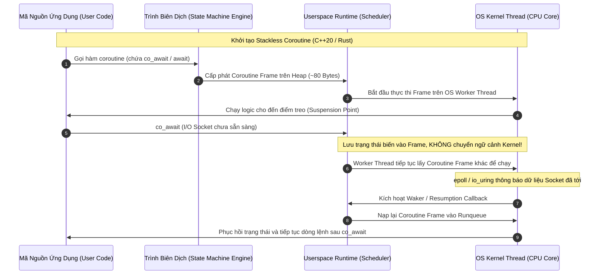

# 15.11. Coroutines, Fibers & Green Threads

> [!IMPORTANT]
> **Nếu bạn chỉ được nhớ một điều duy nhất:** OS Thread được quản lý bởi Kernel Scheduler với chi phí chuyển đổi ngữ cảnh vô cùng đắt đỏ (hàng nghìn chu kỳ CPU để lưu registers, trap từ Ring 3 vào Ring 0, thay đổi bảng trang `CR3`, TLB shootdown và tiêu tốn cố định từ 1MB đến 8MB Stack), trong khi Coroutine, Fiber và Green Thread là các **Luồng Không Gian Người Dùng (User-space Concurrency)** do chính Runtime của ứng dụng điều phối với chi phí chuyển đổi chỉ tốn vài chục nano-giây. Thế giới chia thành 2 trường phái kiến trúc cốt lõi: **Stackless Coroutine** (C++20, Rust, Python, C#) bản chất là cỗ máy trạng thái (Compiler-generated State Machine) lưu biến cục bộ trong một Frame nhỏ vài chục bytes trên Heap; và **Stackful Coroutine / Fiber / Green Thread** (Go Goroutines, Java 21 Virtual Threads, Lua) sở hữu Call Stack riêng (khởi đầu chỉ 2KB) có thể tạm dừng tại bất kỳ độ sâu hàm nào bằng cách tráo đổi con trỏ thanh ghi `RSP/EBP` bằng một đoạn mã Hợp ngữ (Assembly) siêu ngắn.

---

## 1. Kiến trúc Tổng quan & Mô hình Tư duy (Mental Model)

### Ẩn Dụ Đời Sống: Đoàn Tàu Hỏa Liên Tỉnh vs Mạng Lưới Taxi Cá Nhân
- **OS Threads (Đoàn tàu hỏa)**: Mỗi lần muốn vận chuyển một hành khách (Task), hệ thống phải huy động một đoàn tàu hỏa khổng lồ nặng hàng trăm tấn, tiêu tốn đường ray riêng (Kernel Stack), cần trưởng tàu của bộ giao thông cấp phép (OS Kernel Scheduler). Nếu có 10,000 khách đồng thời, nhà ga sập vì không đủ đường ray và nhiên liệu.
- **Fibers / Green Threads (Xe buýt mini luân chuyển)**: Đoàn tàu hỏa chỉ chạy trên các tuyến chính cố định (vài OS Worker Threads tương ứng với số CPU Cores). Bên trong nhà ga, hàng triệu hành khách được chở bằng các xe buýt mini siêu nhẹ. Khi xe gặp đèn đỏ (I/O chờ mạng hoặc ổ đĩa), tài xế tự nguyện tấp vào lề nhường đường cho xe khác chạy tiếp (Cooperative Scheduling).
- **Stackless Coroutines (Băng chuyền hành lý với thẻ ghi chú)**: Không cần bất kỳ chiếc xe nào. Người công nhân làm một phần việc, ghi lại trạng thái dở dang vào một chiếc thẻ kẹp nhỏ (Coroutine Frame), cất lên giá sách rồi quay sang làm việc khác. Khi nguyên liệu tới, người công nhân mở thẻ ra xem tiếp bước trước đó để làm tiếp.



---

## 2. Chi tiết từng Keyword (Under-the-Hood Deep Dive)

### 2.1. Coroutine, Symmetric Coroutine vs Asymmetric Coroutine
- **Coroutine (Melvin Conway, 1963)**: Là một chương trình con (Subroutine) có khả năng tổng quát hóa vượt bậc: thay vì chỉ có một điểm vào duy nhất (`call`) và một điểm thoát duy nhất (`return`), Coroutine cho phép **tạm dừng (Suspend)** việc thực thi tại các vị trí bất kỳ để nhượng quyền điều khiển cho môi trường khác, và sau đó có thể được **phục hồi (Resume)** tại đúng điểm đã tạm dừng với toàn bộ ngữ cảnh dữ liệu nguyên vẹn.
- **Symmetric Coroutine (Đồng điều đối xứng)**: Mọi coroutine đều bình đẳng với nhau. Không có mối quan hệ cha - con hay caller - callee. Một coroutine khi tạm dừng bắt buộc phải chỉ định danh tính của một coroutine mục tiêu cụ thể để chuyển giao quyền điều khiển (`yield_to(other_coro)`). Mô hình này giống như việc chuyển giao quyền thực thi giữa các tiến trình, nhưng rất khó quản lý cấu trúc luồng dữ liệu trong các phần mềm phức tạp.
- **Asymmetric Coroutine (Đồng điều bất đối xứng)**: Coroutine duy trì quan hệ Caller - Callee rõ ràng. Khi coroutine được kích hoạt (`resume`), quyền điều khiển chuyển từ Caller sang Coroutine. Khi nó tạm dừng (`yield`), quyền điều khiển **bắt buộc quay trở lại chính Caller** (hoặc Scheduler) đã đánh thức nó. Hầu hết các ngôn ngữ lập trình hiện đại (C++20, Python `async/await`, C#, Lua) đều chọn mô hình Asymmetric vì nó hòa hợp tự nhiên với cấu trúc ngăn xếp lệnh và dễ suy luận logic chương trình.

### 2.2. Stackful Coroutine vs Stackless Coroutine
Sự khác biệt kỹ thuật sâu sắc nhất quyết định cách mã máy được sinh ra và tổ chức bộ nhớ:
- **Stackless Coroutine (Đồng điều không ngăn xếp)**:
  - *Cơ chế*: Coroutine **không có Stack riêng**. Khi được gọi, nó mượn Stack của luồng đang chạy nó. Khi gặp lệnh `co_await` hoặc `yield`, toàn bộ các biến cục bộ (Local Variables) sống sót qua điểm treo sẽ được Compiler gom lại và lưu trữ vào một cấu trúc dữ liệu trên Heap gọi là **Coroutine Frame**.
  - *Giới hạn*: Chỉ có hàm cấp cao nhất được khai báo là coroutine mới có thể gọi lệnh tạm dừng. Một hàm bình thường được gọi lồng bên trong coroutine **không thể** tự ý gọi lệnh tạm dừng cho cả chuỗi gọi hàm (bắt buộc toàn bộ các hàm trung gian cũng phải là coroutine - vấn đề *Colored Functions*).
  - *Ưu điểm*: Cực kỳ tiết kiệm bộ nhớ (mỗi frame chỉ từ vài chục đến vài trăm bytes).
- **Stackful Coroutine (Đồng điều có ngăn xếp)**:
  - *Cơ chế*: Mỗi coroutine được cấp phát một vùng nhớ Call Stack độc lập thực thụ (thường từ 2KB đến vài chục KB).
  - *Khả năng*: Coroutine có thể tạm dừng tại **bất kỳ độ sâu nào của chuỗi gọi hàm** (Nested Function Calls). Dù hàm lồng nhau 10 cấp sâu bên trong một thư viện bên thứ ba hoàn toàn không biết gì về coroutine, nó vẫn có thể gọi `yield()` để tạm dừng toàn bộ stack execution.
  - *Đại diện*: Lua Coroutines, Boost.Coroutine, Java Project Loom Virtual Threads, Go Goroutines.

### 2.3. Fiber, Green Thread, User-Level Thread & Lightweight Thread
Bốn thuật ngữ này phản ánh sự tiến hóa của cùng một tư tưởng: **Phân luồng siêu nhẹ trong Userspace**:
- **User-Level Thread (Luồng mức người dùng - Mô hình M:N hoặc M:1)**: Khái niệm cổ điển đối nghịch với Kernel-Level Thread (1:1). Được quản lý hoàn toàn bởi thư viện userspace mà Kernel không hề hay biết sự tồn tại của chúng.
- **Green Thread**: Thuật ngữ bắt nguồn từ nhóm kỹ sư *Green Team* phát triển Java Runtime ban đầu (Sun Microsystems). Green Threads được chạy trên một luồng OS duy nhất (mô hình N:1). Nhược điểm lịch sử: Khi một Green Thread thực hiện một system call chặn (Blocking I/O), toàn bộ tiến trình Java bị đóng băng.
- **Fiber**: Thường dùng để chỉ Stackful User-Level Thread được điều phối theo cơ chế **Hợp tác (Cooperative)**. Trong Windows API, Microsoft cung cấp trực tiếp các hàm `CreateFiber()`, `SwitchToFiber()` cho phép lập trình viên tự quản lý việc hoán đổi ngăn xếp trong cùng một thread.
- **Lightweight Thread (Go Goroutines, Erlang Processes)**: Là sự hoàn thiện đỉnh cao của Green Thread kết hợp mô hình **M:N Scheduler**: Hàng triệu lightweight threads được ánh xạ linh hoạt lên $M$ nhân OS threads thông qua Work-Stealing, tự động phân giải các system call chặn sang non-blocking I/O (qua `epoll/kqueue`) hoặc chuyển sang luồng OS phụ (`runtime.entersyscall`).

### 2.4. Coroutine Scheduler, Coroutine Runtime & Coroutine Context
- **Coroutine Context**: Cấu trúc dữ liệu đại diện cho trạng thái đóng băng của một thực thể coroutine. Đối với Stackful Coroutine, Context bao gồm con trỏ ngăn xếp (`RSP/ESP`), con trỏ khung stack (`RBP/EBP`), con trỏ lệnh (`RIP/EIP`) và các con trỏ thanh ghi Callee-saved (`RBX, R12, R13, R14, R15` theo System V AMD64 ABI). Đối với Stackless Coroutine, Context là con trỏ tới Coroutine Frame chứa chỉ số trạng thái (`suspend_point_index`).
- **Coroutine Runtime**: Hệ thống hỗ trợ phía sau (Runtime Support System) chịu trách nhiệm: quản lý vòng đời bộ nhớ, tích hợp với bộ xử lý sự kiện I/O hướng sự kiện (Reactor/Proactor như epoll, io_uring, kqueue), và quản lý Timers.
- **Coroutine Scheduler**: Thuật toán trung tâm nhận các coroutine sẵn sàng (`Ready`), nạp chúng vào hàng đợi thực thi của các worker threads, và quyết định thứ tự thực thi theo thuật toán FIFO, Priority, hoặc Work-Stealing.

### 2.5. Coroutine Suspension, Resumption, Context Switching, Coroutine Stack, Stackful Context Switching & Stackless State Machine
- **Cơ chế Stackful Context Switching bằng Hợp ngữ (Assembly Internals)**:
  Khi một Fiber nhượng quyền (`fiber_switch(old_fiber, new_fiber)`), lệnh không qua Kernel mà thực hiện trực tiếp trên CPU:
  ```nasm
  # Chuyển đổi ngữ cảnh Fiber trên x86_64 System V ABI:
  push rbp
  push rbx
  push r12
  push r13
  push r14
  push r15
  mov [rdi], rsp       # Lưu đỉnh stack hiện tại vào old_fiber->rsp
  mov rsp, [rsi]       # Tráo đỉnh stack sang new_fiber->rsp
  pop r15
  pop r14
  pop r13
  pop r12
  pop rbx
  pop rbp
  ret                  # Nhảy tới địa chỉ lệnh tiếp theo của new_fiber!
  ```
  Toàn bộ quá trình chỉ tốn khoảng 10-15 chỉ thị hợp ngữ (khoảng 3-5 nano-giây), nhanh gấp hàng trăm lần một cú Context Switch của Linux Kernel (tốn từ 1,000 đến 3,000 nano-giây).
- **Cơ chế Stackless State Machine của Trình Biên Dịch (C++20 / Rust)**:
  Trình biên dịch biến đổi thân hàm coroutine thành một cấu trúc `struct` ẩn và một hàm chứa lệnh rẽ nhánh `switch-case`:
  ```text
  State 0: Khởi tạo -> Chạy logic đến co_await đầu tiên -> Lưu state=1 -> return
  State 1: Nhận resume() -> Phục hồi biến -> Chạy đến co_await thứ hai -> Lưu state=2 -> return
  State 2: Nhận resume() -> Hoàn tất -> Trả kết quả cuối cùng -> state=DESTROYED
  ```

### 2.6. Continuation, Cooperative Scheduling, Coroutine Cancellation, Synchronization & Interoperability
- **Continuation (Tiếp diễn)**: Đại diện cho "phần còn lại của chương trình" sau một điểm tạm dừng. Trong mô hình CPS (Continuation-Passing Style), thay vì trả kết quả về caller, hàm nhận một hàm callback (continuation) và truyền kết quả trực tiếp cho nó.
- **Cooperative Scheduling (Lập lịch hợp tác)**: Các coroutine tự chủ động gọi `yield()` hoặc `await`. Nếu một coroutine gặp lỗi vòng lặp tuần tự (`for(;;);`) hoặc gọi hàm chặn thuần túy (`sleep()` của OS), toàn bộ OS worker thread đang thực thi nó sẽ bị phong tỏa, kéo theo việc đình trệ hàng nghìn coroutine khác đang xếp hàng trên thread đó.
- **Coroutine Cancellation (Hủy coroutine)**: Khó khăn hơn hủy thread vì trạng thái phân mảnh. Để hủy an toàn, hệ thống áp dụng **Structured Concurrency**: khi coroutine cha bị hủy hoặc gặp exception, nó phải truyền tín hiệu hủy xuống toàn bộ cây coroutine con và chờ tất cả các nhánh con hoàn tất dọn dẹp tài nguyên RAII trước khi thoát.
- **Coroutine Synchronization**: Tuyệt đối không được dùng khóa chặn của OS (`std::mutex`) bên trong coroutine! Nếu luồng bị khóa, toàn bộ scheduler bị nghẽn. Thay vào đó, phải dùng **Async Mutex** (như `tokio::sync::Mutex` hoặc `folly::coro::Mutex`): khi không lấy được khóa, nó tạm dừng coroutine (`suspend`) và đẩy coroutine vào hàng đợi chờ khóa mà không hề phong tỏa OS Thread.
- **Coroutine Interoperability (Tương thích giao thoa)**: Cơ chế chuyển đổi và bọc các API hướng callback cổ điển hoặc synchronous code thành coroutine thông qua các Promise/Future bridge adapters.

---

## 3. Thực thi Mã nguồn & Mô phỏng Chuyên sâu (Dual-Engine Implementation)

### Engine 1: C++20 Stackless Coroutine Task & Generator Engine
Chương trình triển khai từ gốc giao thức Coroutine của C++20 bằng cách tự cài đặt `promise_type`, `std::coroutine_handle`, mô phỏng tính toán không đồng bộ:

```cpp
#include <iostream>
#include <coroutine>
#include <exception>
#include <utility>
#include <chrono>

// 1. Tự xây dựng Task<T> tương thích C++20 Coroutine
template <typename T>
class AsyncTask {
public:
    struct promise_type {
        T result_;
        std::exception_ptr exception_;

        AsyncTask get_return_object() {
            return AsyncTask(std::coroutine_handle<promise_type>::from_promise(*this));
        }

        std::suspend_always initial_suspend() noexcept { return {}; } // Lazy evaluation
        std::suspend_always final_suspend() noexcept { return {}; }

        void return_value(T value) noexcept {
            result_ = std::move(value);
        }

        void unhandled_exception() noexcept {
            exception_ = std::current_exception();
        }
    };

    explicit AsyncTask(std::coroutine_handle<promise_type> handle) : coro_(handle) {}

    ~AsyncTask() {
        if (coro_) coro_.destroy();
    }

    // Không cho phép copy, chỉ cho move
    AsyncTask(const AsyncTask&) = delete;
    AsyncTask& operator=(const AsyncTask&) = delete;
    AsyncTask(AsyncTask&& other) noexcept : coro_(std::exchange(other.coro_, nullptr)) {}

    bool resume() {
        if (!coro_.done()) {
            coro_.resume();
        }
        return !coro_.done();
    }

    T get() {
        if (coro_.promise().exception_) {
            std::rethrow_exception(coro_.promise().exception_);
        }
        return coro_.promise().result_;
    }

private:
    std::coroutine_handle<promise_type> coro_;
};

// 2. Custom Awaiter mô phỏng tạm dừng I/O
struct AsyncSleepAwaiter {
    int duration_ms;

    bool await_ready() const noexcept { return false; } // Luôn luôn suspend
    void await_suspend(std::coroutine_handle<> handle) const noexcept {
        // Trong hệ thống thực tế: đăng ký handle vào epoll / timer wheel
        // Ở đây ta mô phỏng trạng thái sẵn sàng để resume sau
    }
    void await_resume() const noexcept {}
};

// Hàm Coroutine mô phỏng xử lý dữ liệu mạng
AsyncTask<uint64_t> calculate_network_metrics(int node_id) {
    std::cout << "  [Coroutine " << node_id << "] Bắt đầu pha 1: Đọc gói tin...\n";
    co_await AsyncSleepAwaiter{50}; // Điểm treo (Suspension Point 1)

    std::cout << "  [Coroutine " << node_id << "] Pha 2: Giải mã gói tin và tính toán checksum...\n";
    uint64_t checksum = 0xABCDEF00 + node_id;
    co_await AsyncSleepAwaiter{50}; // Điểm treo (Suspension Point 2)

    std::cout << "  [Coroutine " << node_id << "] Hoàn tất: Ghi kết quả.\n";
    co_return checksum;
}

int main() {
    std::cout << "=== C++20 Stackless Coroutine Engine Demo ===\n";

    auto task1 = calculate_network_metrics(101);
    auto task2 = calculate_network_metrics(102);

    std::cout << "[Scheduler] Đang điều phối luân phiên thực thi các Coroutines:\n";

    // Vòng lặp điều phối Userspace (Mini Cooperative Event Loop)
    std::cout << "Bước 1: Khởi động Task 1 & Task 2...\n";
    task1.resume();
    task2.resume();

    std::cout << "Bước 2: Phục hồi (Resume) Task 1 & Task 2 sang pha kế tiếp...\n";
    task1.resume();
    task2.resume();

    std::cout << "Bước 3: Hoàn thành toàn bộ các tasks...\n";
    task1.resume();
    task2.resume();

    std::cout << "[Scheduler] Kết quả Task 1: 0x" << std::hex << task1.get() << "\n";
    std::cout << "[Scheduler] Kết quả Task 2: 0x" << std::hex << task2.get() << std::dec << "\n";
    std::cout << "C++20 Coroutine hoàn tất trơn tru, không rò rỉ Frame!\n";
    return 0;
}
```

#### Terminal Output Mẫu (C++20 Engine):
```text
=== C++20 Stackless Coroutine Engine Demo ===
[Scheduler] Đang điều phối luân phiên thực thi các Coroutines:
Bước 1: Khởi động Task 1 & Task 2...
  [Coroutine 101] Bắt đầu pha 1: Đọc gói tin...
  [Coroutine 102] Bắt đầu pha 1: Đọc gói tin...
Bước 2: Phục hồi (Resume) Task 1 & Task 2 sang pha kế tiếp...
  [Coroutine 101] Pha 2: Giải mã gói tin và tính toán checksum...
  [Coroutine 102] Pha 2: Giải mã gói tin và tính toán checksum...
Bước 3: Hoàn thành toàn bộ các tasks...
  [Coroutine 101] Hoàn tất: Ghi kết quả.
  [Coroutine 102] Hoàn tất: Ghi kết quả.
[Scheduler] Kết quả Task 1: 0xabcdef65
[Scheduler] Kết quả Task 2: 0xabcdef66
C++20 Coroutine hoàn tất trơn tru, không rò rỉ Frame!
```

---

### Engine 2: Python 3.11+ Userspace Fiber Runtime & Event Loop từ Gốc
Tự xây dựng một Event Loop hoàn chỉnh bằng Python generators, quản lý các tác vụ đồng thời và cơ chế tráo đổi ngữ cảnh người dùng:

```python
import collections
from typing import Generator, Any, Deque

class Fiber:
    def __init__(self, fiber_id: int, target: Generator[Any, None, None]):
        self.fiber_id = fiber_id
        self.generator = target
        self.completed = False

class MiniFiberScheduler:
    """Bộ điều phối Fiber mức Userspace (Cooperative M:1 Runtime)."""
    def __init__(self):
        self.ready_queue: Deque[Fiber] = collections.deque()
        self.fiber_counter = 0

    def spawn(self, generator_func: Generator[Any, None, None]) -> int:
        self.fiber_counter += 1
        fiber = Fiber(self.fiber_counter, generator_func)
        self.ready_queue.append(fiber)
        return fiber.fiber_id

    def run(self):
        print(f"[Scheduler] Bắt đầu thực thi vòng lặp sự kiện với {len(self.ready_queue)} Fibers...")
        while self.ready_queue:
            current_fiber = self.ready_queue.popleft()
            try:
                # Chuyển quyền điều khiển cho Fiber (Context Switch sang Userspace Generator)
                signal = next(current_fiber.generator)
                # Fiber tự nguyện nhượng quyền (Yielded control)
                # Đưa lại vào cuối hàng đợi để chờ lượt tiếp theo
                self.ready_queue.append(current_fiber)
            except StopIteration:
                current_fiber.completed = True
                print(f"  [Fiber {current_fiber.fiber_id}] Hoàn thành toàn bộ vòng đời.")
            except Exception as e:
                print(f"  [Fiber {current_fiber.fiber_id}] Gặp lỗi nghiêm trọng: {e}")

        print("[Scheduler] Toàn bộ Fibers đã hoàn tất. Event Loop kết thúc.")

def payment_verification_fiber(order_id: str) -> Generator[str, None, None]:
    print(f"    -> [Payment {order_id}] Bước 1: Kiểm tra số dư tài khoản...")
    yield "PAUSE_BALANCE_CHECK"
    print(f"    -> [Payment {order_id}] Bước 2: Gọi cổng thanh toán Visa/Mastercard...")
    yield "PAUSE_GATEWAY_AUTH"
    print(f"    -> [Payment {order_id}] Bước 3: Ghi nhận giao dịch vào cơ sở dữ liệu...")
    yield "PAUSE_DB_COMMIT"
    print(f"    -> [Payment {order_id}] Giao dịch thành công hoàn tất.")

if __name__ == "__main__":
    print("=== Python 3.11+ Fiber Runtime Simulator ===")
    scheduler = MiniFiberScheduler()

    # Kích hoạt 3 fibers chạy xen kẽ trên 1 Thread duy nhất
    scheduler.spawn(payment_verification_fiber("ORD-901"))
    scheduler.spawn(payment_verification_fiber("ORD-902"))
    scheduler.spawn(payment_verification_fiber("ORD-903"))

    scheduler.run()
```

#### Terminal Output Mẫu (Python 3.11+ Engine):
```text
=== Python 3.11+ Fiber Runtime Simulator ===
[Scheduler] Bắt đầu thực thi vòng lặp sự kiện với 3 Fibers...
    -> [Payment ORD-901] Bước 1: Kiểm tra số dư tài khoản...
    -> [Payment ORD-902] Bước 1: Kiểm tra số dư tài khoản...
    -> [Payment ORD-903] Bước 1: Kiểm tra số dư tài khoản...
    -> [Payment ORD-901] Bước 2: Gọi cổng thanh toán Visa/Mastercard...
    -> [Payment ORD-902] Bước 2: Gọi cổng thanh toán Visa/Mastercard...
    -> [Payment ORD-903] Bước 2: Gọi cổng thanh toán Visa/Mastercard...
    -> [Payment ORD-901] Bước 3: Ghi nhận giao dịch vào cơ sở dữ liệu...
    -> [Payment ORD-902] Bước 3: Ghi nhận giao dịch vào cơ sở dữ liệu...
    -> [Payment ORD-903] Bước 3: Ghi nhận giao dịch vào cơ sở dữ liệu...
    -> [Payment ORD-901] Giao dịch thành công hoàn tất.
  [Fiber 1] Hoàn thành toàn bộ vòng đời.
    -> [Payment ORD-902] Giao dịch thành công hoàn tất.
  [Fiber 2] Hoàn thành toàn bộ vòng đời.
    -> [Payment ORD-903] Giao dịch thành công hoàn tất.
  [Fiber 3] Hoàn thành toàn bộ vòng đời.
[Scheduler] Toàn bộ Fibers đã hoàn tất. Event Loop kết thúc.
```

---

## 4. Systems Engineering & Production Pitfalls

### 4.1. Vấn Nạn "Màu Sắc Của Hàm" (The Colored Functions Problem)
- **Bản chất**: Được mô tả sâu sắc bởi Bob Nystrom (2015). Trong các ngôn ngữ có Stackless Coroutine (như JavaScript, Python, C#), các hàm bị chia thành 2 màu: "Hàm màu đỏ" (Asynchronous function) và "Hàm màu xanh" (Synchronous function).
- **Hệ quả độc hại**: Bạn không thể gọi một hàm màu đỏ từ bên trong một hàm màu xanh mà không biến luôn hàm màu xanh thành màu đỏ! Sự lây lan này (Viral propagation) phá vỡ tính module, buộc lập trình viên phải sửa đổi toàn bộ chuỗi chữ ký hàm từ dưới lên trên.
- **Giải pháp**: Các ngôn ngữ sử dụng Stackful Green Threads (Go, Java 21) không có sự phân biệt màu sắc: mọi hàm đều có chung một màu, việc tạm dừng diễn ra trong suốt dưới tầng runtime mà không làm thay đổi API giao diện.

### 4.2. Hiện Tượng Đói CPU Do Vòng Lặp Tuần Tự (CPU-Bound Starvation)
- **Bản chất**: Trong mô hình lập lịch hợp tác (Cooperative Scheduling), nếu một lập trình viên vô tình viết mã tính toán nặng (như băm mật khẩu `bcrypt` hoặc nén ảnh JPEG) mà không chèn điểm `yield`, coroutine đó sẽ độc chiếm OS worker thread mãi mãi.
- **Phòng chống**:
  1. Tuyệt đối offload các tác vụ CPU-bound sang một Thread Pool chuyên dụng riêng biệt (`tokio::task::spawn_blocking` trong Rust hoặc `asyncio.to_thread()` trong Python).
  2. Bổ sung cơ chế Preemption ở tầng Compiler/Runtime (như Go chèn chỉ thị kiểm tra stack split ở đầu mỗi hàm).

### 4.3. Các Lệnh Chẩn Đoán Production Thực Chiến (CLI Diagnostics)
Khi runtime gặp hiện tượng nghẽn Event Loop hoặc rò rỉ Fiber:
```bash
# 1. Đo lường tỷ lệ các syscall I/O của ứng dụng async
strace -c -p <PID>
# Nếu thấy epoll_wait hoặc io_uring_enter chiếm đa số thời gian -> Bình thường
# Nếu thấy nanosleep hoặc futex liên tục -> Nghi vấn busy-waiting

# 2. Với ứng dụng Golang: Kích hoạt Execution Tracer để phân tích chi tiết Goroutine
curl -s http://localhost:6060/debug/pprof/trace?seconds=5 > trace.out
go tool trace trace.out
# Quan sát biểu đồ Goroutine Analysis để tìm các Goroutine bị Blocked trên Channel/Mutex

# 3. Với ứng dụng Node.js/Python: Phát hiện Event Loop Lag
# Sử dụng clinic doctor để phân tích độ trễ I/O
clinic doctor -- node server.js
```

---

## 5. Bảng So sánh & Decision Matrix

| Tiêu Chí Kỹ Thuật | OS Kernel Threads | Stackless Coroutines (C++/Rust) | Stackful Fibers (Go Goroutines) | Actor Processes (Erlang/Elixir) |
| :--- | :--- | :--- | :--- | :--- |
| **Không Gian Bộ Nhớ** | $1 - 8\text{ MB}$ Stack cố định | Vài chục Bytes Frame trên Heap | Khởi đầu $2\text{ KB}$, co giãn tự động | ~300 Bytes per Process |
| **Chi Phí Chuyển Ngữ Cảnh** | Rất cao (~$1000 - 3000\text{ ns}$) | Siêu rẻ (~$1 - 5\text{ ns}$, chỉ đổi state) | Rất rẻ (~$10 - 20\text{ ns}$, tráo RSP) | Rất rẻ (~$20 - 30\text{ ns}$) |
| **Cơ Chế Lập Lịch** | Preemptive (Kernel CFS/EEVDF) | Cooperative (Compiler State Machine) | Preemptive Hợp tác (Runtime Signals) | Preemptive (Reduction Counter) |
| **Tạm Dừng Hàm Lồng Nhau** | Có (Bất kỳ đâu) | **KHÔNG** (Chỉ ở hàm có keyword) | Có (Bất kỳ độ sâu nào) | Có (Tại các lệnh nhận tin nhắn) |
| **Vấn Nạn Colored Function** | Hoàn toàn không | Có (Lan truyền async/await) | Hoàn toàn không | Hoàn toàn không |
| **Khả Năng Scale Số Lượng** | Hàng nghìn ($10^3$) | Hàng triệu ($10^6$) | Hàng triệu ($10^6$) | Hàng triệu ($10^6$) |
| **Cô Lập Lỗi (Fault Isolation)** | Toàn bộ process sập nếu segfault | Toàn bộ process sập nếu panic | Toàn bộ process sập nếu panic | **Tuyệt đối** (Mô hình Let It Crash) |

> [!TIP]
> **Quy Tắc Vàng Ra Quyết Định Thiết Kế (Engineering Decision Rule)**:
> 1. Chọn **Stackless Coroutines (C++20 / Rust Tokio)** khi xây dựng các dịch vụ hạ tầng mạng cốt lõi (Core Gateway, High-Frequency Trading, Reverse Proxy) đòi hỏi Zero-Cost Abstraction và kiểm soát bộ nhớ đến từng byte.
> 2. Chọn **Stackful Green Threads (Go / Java Virtual Threads)** khi phát triển các dịch vụ Microservices kinh doanh (Business Logic Services) quy mô lớn cần code đồng bộ dễ đọc, dễ debug mà vẫn scale được hàng trăm nghìn kết nối đồng thời.
> 3. Tuyệt đối không bao giờ chèn logic chặn I/O hoặc tính toán CPU nặng vào bên trong ngữ cảnh của một Cooperative Coroutine mà không chuyển sang Background Worker Thread.
