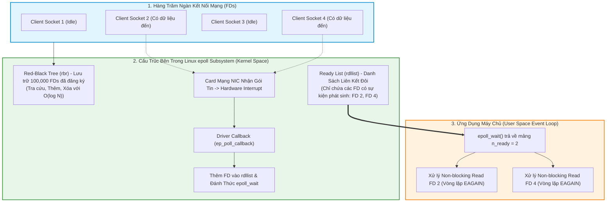
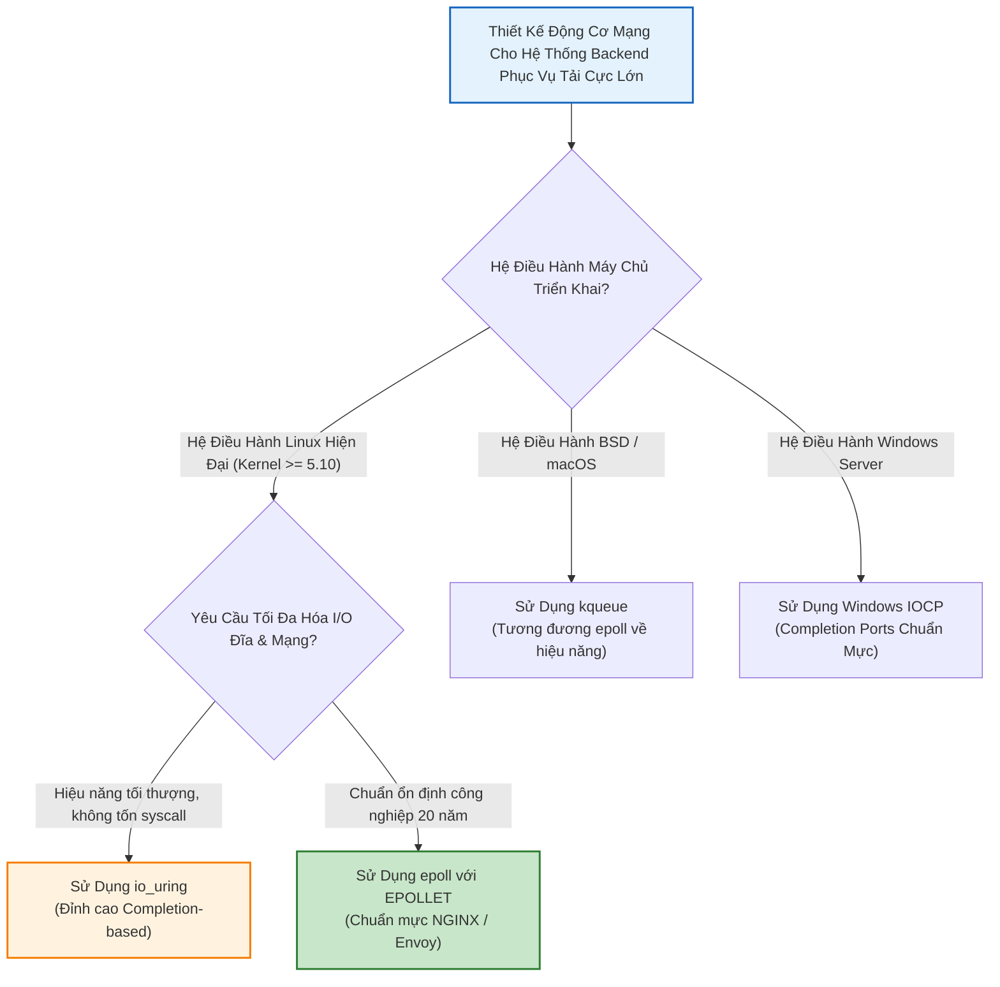

# 15.12. Dồn Kênh I/O và Kiến Trúc Hướng Sự Kiện (I/O Multiplexing & Event-Driven I/O)

> [!IMPORTANT]
> **Nếu bạn chỉ được nhớ một điều duy nhất:** Bản chất của **Dồn Kênh I/O (I/O Multiplexing)** là sử dụng một lời gọi hệ thống duy nhất (`epoll`/`kqueue`/`io_uring`) để giám sát đồng thời hàng triệu mô tả tệp tin (**File Descriptors**) trên đúng một luồng xử lý; trong đó quy tắc vàng khi kích hoạt chế độ kích hoạt theo cạnh **Edge-Triggered (`EPOLLET`)** là bắt buộc phải đặt Socket ở chế độ **Non-Blocking** và lặp vòng lặp `read()/write()` cho đến khi nhận mã lỗi **`EAGAIN`/`EWOULDBLOCK`** để không bao giờ bị bỏ sót sự kiện mạng.

---

## 1. Kiến trúc Tổng quan & Mô hình Tư duy (Mental Model)

### Ẩn dụ Đời sống: Người Gác Cổng Cảng Biển và Hệ Thống Còi Báo Động
Hãy hình dung một cảng biển container quốc tế với 100,000 tàu hàng cập bến cùng lúc:
- **Mô hình Một luồng một kết nối (Thread-per-Connection)**: Mỗi tàu hàng cập bến, cảng phải cử một nhân viên gác cổng đứng canh riêng cho con tàu đó. Khi có 100,000 tàu, cảng cần 100,000 nhân viên. Nhân viên dẫm đạp lên nhau (Context Switching Overhead) và cảng sập vì cạn kiệt ngân sách trả lương (Hết bộ nhớ RAM cho Thread Stack).
- **Cơ chế `select` và `poll` (O(N) Scanning)**: Chỉ có 1 nhân viên gác cổng duy nhất. Cứ mỗi phút, nhân viên này phải chạy bộ kiểm tra lần lượt từng con tàu từ số 1 đến số 100,000 để hỏi: *"Có hàng bốc dỡ không?"*. Dù chỉ có duy nhất 1 tàu có hàng, nhân viên vẫn phải chạy kiểm tra đủ 100,000 tàu ($O(N)$ CPU burning).
- **Cơ chế `epoll` và `kqueue` (O(1) Event-Driven)**: Nhân viên gác cổng ngồi trong phòng điều khiển máy lạnh. Cảng biển lắp một hệ thống còi báo động thông minh nối tới từng tàu:
  - Khi tàu nào có hàng cập bến, một tín hiệu điện tử tự động bắn về và ghi tên con tàu đó vào một bảng danh sách các tàu đang sẵn sàng (**Ready List / Doubly Linked List**).
  - Nhân viên chỉ cần mở mắt ra nhìn bảng danh sách: nếu có 3 tàu đang báo đèn, nhân viên xử lý đúng 3 tàu đó ($O(1)$ Complexity), không cần quan tâm 99,997 tàu còn lại đang ngủ say.
- **Level-Triggered (`EPOLLLT`) vs Edge-Triggered (`EPOLLET`)**:
  - *Level-Triggered (Kích hoạt theo Mức)*: Giống như một chiếc còi báo động reo liên tục không ngừng chừng nào trong khoang tàu vẫn còn hàng. Nếu bạn chỉ bốc một nửa số kiện hàng, còi vẫn tiếp tục reo ở nhịp sau.
  - *Edge-Triggered (Kích hoạt theo Cạnh)*: Chiếc còi chỉ "BÍP" đúng một tiếng duy nhất tại thời điểm trạng thái chuyển từ "Không có hàng" sang "Có hàng mới đến". Nếu nhân viên không bốc dọn sạch sẽ 100% hàng hóa trong khoang ngay tại thời điểm đó, còi sẽ **không bao giờ kêu lại**, và số hàng còn thừa sẽ bị kẹt vĩnh viễn trong khoang tàu!



---

## 2. Chi tiết từng Keyword (Under-the-Hood Deep Dive)

### 2.1. Tiến Hóa Của Các System Calls Dồn Kênh: Select $\to$ Poll $\to$ Epoll / Kqueue $\to$ io_uring
- **`select()` (POSIX, 1983)**:
  - Sử dụng mảng bit biểu diễn file descriptors (`fd_set`).
  - Giới hạn cứng tối đa: `FD_SETSIZE = 1024` sockets!
  - Mỗi lần gọi `select()`, tiến trình phải sao chép toàn bộ mảng bit 1024 phần tử từ User Space sang Kernel Space. Kernel phải duyệt tuyến tính qua toàn bộ 1024 FDs ($O(N)$), làm sụt giảm nghiêm trọng hiệu năng khi số kết nối tăng.
- **`poll()` (UNIX System V, 1986)**:
  - Thay thế mảng bit bằng mảng cấu trúc `struct pollfd`. Xóa bỏ giới hạn 1024 FDs, nhưng vẫn phải duyệt tuyến tính $O(N)$ và copy mảng qua lại giữa User và Kernel Space ở mọi vòng lặp.
- **`epoll` (Linux 2.6, 2002) & `kqueue` (FreeBSD/macOS, 2000)**:
  - Tách rời quá trình đăng ký sự kiện khỏi quá trình chờ đợi sự kiện:
    - `epoll_create1()`: Tạo cấu trúc dữ liệu epoll trong kernel.
    - `epoll_ctl()`: Thêm/sửa/xóa FD được theo dõi. Kernel lưu các FDs này trong một **Cây Đỏ-Đen (Red-Black Tree)** với chi phí $O(\log N)$.
    - `epoll_wait()`: Chỉ ngủ chờ trên danh sách liên kết đôi **Ready List (`rdllist`)**. Khi có gói tin đến, ngắt phần cứng của card mạng kích hoạt hàm callback `ep_poll_callback()`, chèn trực tiếp FD đó vào Ready List. Trả về cho User Space chỉ những sự kiện thực sự đã xảy ra với chi phí $O(1)$!
- **`io_uring` (Linux 5.1+, 2019 - Cuộc Cách Mạng Hoàn Thành)**:
  - Chuyển hoàn toàn từ mô hình Readiness-based sang Completion-based.
  - Sử dụng hai hàng đợi vòng (**Submission Queue - SQ** và **Completion Queue - CQ**) ánh xạ trực tiếp vào bộ nhớ của cả User Space và Kernel qua `mmap()`.
  - Ứng dụng ghi yêu cầu vào SQ và đọc kết quả từ CQ mà **không cần thực hiện syscall `read/write`**, loại bỏ hoàn toàn chi phí Context Switch của CPU!

### 2.2. Readiness Notification vs Completion Notification
- **Readiness Notification (Thông báo Sẵn sàng - `epoll`/`kqueue`)**:
  - Thông báo: *"Socket X đã sẵn sàng để đọc/ghi"*.
  - Quyền sao chép dữ liệu thuộc về ứng dụng: Ứng dụng phải tự gọi syscall `read()` để copy mảng byte từ Kernel Buffer sang User Buffer.
- **Completion Notification (Thông báo Hoàn thành - Windows IOCP / Linux `io_uring`)**:
  - Thông báo: *"Dữ liệu 4KB từ Socket X đã được nạp xong hoàn toàn vào Buffer tại địa chỉ `0x7fff...` của bạn"*.
  - Nhân hệ điều hành sử dụng DMA hoặc Kernel Worker Threads để copy dữ liệu sẵn vào RAM của ứng dụng trước khi đánh thức luồng.

### 2.3. Giải Phẫu Chế Độ Kích Hoạt: Level-Triggered (LT) vs Edge-Triggered (ET)
- **Level-Triggered (`EPOLLLT` - Mặc định)**:
  - Kernel liên tục báo cáo sự kiện ở mỗi lần gọi `epoll_wait()` chừng nào điều kiện vẫn còn thỏa mãn (ví dụ: trong Socket Receive Buffer vẫn còn ít nhất 1 byte dữ liệu chưa đọc).
  - *Ưu điểm*: An toàn, dễ lập trình, khó bị sót dữ liệu.
  - *Nhược điểm*: Tiêu tốn nhiều lời gọi `epoll_wait` lặp đi lặp lại không cần thiết khi ứng dụng chưa kịp đọc hết buffer.
- **Edge-Triggered (`EPOLLET`)**:
  - Kernel chỉ phát tín hiệu một lần duy nhất tại thời điểm có dữ liệu mới cập bến (Sự chuyển dịch trạng thái từ Rỗng sang Có Dữ Liệu).
  - *Ưu thế*: Giảm tối đa số lần đánh thức hệ thống, tối ưu hóa hiệu năng vi kiến trúc CPU cực đại.
  - **Quy tắc Bắt buộc Khi Dùng `EPOLLET`**:
    1. Socket bắt buộc phải được đặt ở chế độ Non-Blocking (`O_NONBLOCK`).
    2. Lập trình viên bắt buộc phải dùng vòng lặp `while (true)` đọc dữ liệu cho đến khi hàm `read()` trả về mã lỗi `EAGAIN` hoặc `EWOULDBLOCK` (báo hiệu buffer đã cạn kiệt hoàn toàn). Nếu thoát vòng lặp sớm, socket sẽ bị "đóng băng" vĩnh viễn!

### 2.4. Xử Lý Hiện Tượng Đọc/Ghi Một Phần (The Partial I/O Reality)
- Trong mạng TCP non-blocking, bạn không bao giờ được phép giả định một lệnh `write(fd, buffer, 100000)` sẽ gửi đủ 100,000 bytes trong một nhịp.
- Nếu TCP Send Buffer của nhân hệ điều hành chỉ còn trống 4,096 bytes, lệnh `write` sẽ ghi đúng 4,096 bytes (**Partial Write**) và trả về con số 4096.
- **Buffer Management & Backpressure**: Ứng dụng phải tự duy trì một hàng đợi bộ đệm người dùng (**User-Space Output Buffer**), lưu lại 95,904 bytes còn dư, đăng ký cờ `EPOLLOUT` với `epoll`, và chỉ tiếp tục ghi khi kernel báo socket đã sẵn sàng nhận thêm dữ liệu.

### 2.5. Giải Quyết Vấn Đề C10K và C1000K (High-Concurrency Architecture)
- **Vấn đề C10K (10,000 Kết Nối Đồng Thời)**: Từng là rào cản thế kỷ vào năm 1999 đối với kiến trúc Apache prefork (mỗi client một tiến trình).
- Nhờ có I/O Multiplexing (`epoll`), các máy chủ hiện đại như **NGINX, Redis, Envoy, Netty** giải quyết nhẹ nhàng bài toán C1000K (1,000,000 kết nối đồng thời) chỉ với một vài luồng Worker Thread duy nhất, tiêu hao chưa tới vài trăm MB RAM!

---

## 3. Thực thi Mã nguồn & Mô phỏng Chuyên sâu (Dual-Engine Implementation)

### 3.1. C++20 Implementation: Khung Máy Chủ Non-Blocking Linux `epoll` Chuẩn Công Nghiệp
Đoạn mã C++20 dưới đây triển khai toàn bộ khung sườn của một máy chủ mạng hiệu năng cao sử dụng Linux `epoll` với chế độ Edge-Triggered (`EPOLLET`), thiết lập Socket Non-Blocking và xử lý vòng lặp `EAGAIN` hoàn chỉnh:

```cpp
#include <iostream>
#include <vector>
#include <cstring>
#include <cerrno>
#include <unistd.h>
#include <fcntl.h>
#include <sys/socket.h>
#include <netinet/in.h>
#include <sys/epoll.h>

constexpr int MAX_EVENTS = 64;
constexpr int BUFFER_SIZE = 1024;

// Hàm thiết lập Socket sang chế độ Non-Blocking bằng fcntl
bool set_nonblocking(int fd) {
    int flags = fcntl(fd, F_GETFL, 0);
    if (flags == -1) return false;
    return fcntl(fd, F_SETFL, flags | O_NONBLOCK) != -1;
}

int main() {
    std::cout << "=========================================================\n";
    std::cout << "   C++20 HIGH-CONCURRENCY LINUX EPOLL (EPOLLET) SERVER   \n";
    std::cout << "=========================================================\n\n";

    // 1. Tạo Listen Socket
    int listen_fd = socket(AF_INET, SOCK_STREAM, 0);
    if (listen_fd < 0) {
        std::cerr << "Lỗi tạo socket: " << std::strerror(errno) << "\n";
        return 1;
    }

    int opt = 1;
    setsockopt(listen_fd, SOL_SOCKET, SO_REUSEADDR, &opt, sizeof(opt));
    set_nonblocking(listen_fd);

    sockaddr_in server_addr{};
    server_addr.sin_family = AF_INET;
    server_addr.sin_addr.s_addr = INADDR_ANY;
    server_addr.sin_port = htons(8888);

    if (bind(listen_fd, (struct sockaddr*)&server_addr, sizeof(server_addr)) < 0) {
        std::cerr << "Lỗi bind port 8888: " << std::strerror(errno) << "\n";
        close(listen_fd);
        return 1;
    }

    if (listen(listen_fd, SOMAXCONN) < 0) {
        std::cerr << "Lỗi listen: " << std::strerror(errno) << "\n";
        close(listen_fd);
        return 1;
    }
    std::cout << "[Server Startup]: Đang lắng nghe kết nối trên cổng 8888...\n";

    // 2. Khởi tạo epoll instance
    int epoll_fd = epoll_create1(0);
    if (epoll_fd < 0) {
        std::cerr << "Lỗi tạo epoll: " << std::strerror(errno) << "\n";
        close(listen_fd);
        return 1;
    }

    // Đăng ký Listen Socket vào epoll với chế độ Edge-Triggered
    epoll_event ev{};
    ev.events = EPOLLIN | EPOLLET;
    ev.data.fd = listen_fd;
    epoll_ctl(epoll_fd, EPOLL_CTL_ADD, listen_fd, &ev);

    std::vector<epoll_event> events(MAX_EVENTS);
    std::cout << "[Event Loop]: Bắt đầu vòng lặp sự kiện I/O Multiplexing epoll_wait()...\n";

    // Mô phỏng 1 nhịp vòng lặp sự kiện
    int timeout_ms = 100; // 100ms timeout để minh họa
    int n_ready = epoll_wait(epoll_fd, events.data(), MAX_EVENTS, timeout_ms);

    if (n_ready < 0) {
        std::cerr << "Lỗi epoll_wait: " << std::strerror(errno) << "\n";
    } else if (n_ready == 0) {
        std::cout << "  -> [epoll_wait Timeout]: Không có kết nối mới trong " << timeout_ms << "ms.\n";
    } else {
        std::cout << "  -> [Sự Kiện Sẵn Sàng]: Có " << n_ready << " file descriptors báo sự kiện!\n";
        for (int i = 0; i < n_ready; ++i) {
            int fd = events[i].data.fd;
            if (fd == listen_fd) {
                // Tiếp nhận kết nối mới trong vòng lặp Non-blocking
                while (true) {
                    sockaddr_in client_addr{};
                    socklen_t client_len = sizeof(client_addr);
                    int client_fd = accept(listen_fd, (struct sockaddr*)&client_addr, &client_len);
                    if (client_fd < 0) {
                        if (errno == EAGAIN || errno == EWOULDBLOCK) {
                            // Đã tiếp nhận toàn bộ kết nối trong hàng đợi!
                            break;
                        }
                        break;
                    }
                    set_nonblocking(client_fd);
                    epoll_event client_ev{};
                    client_ev.events = EPOLLIN | EPOLLET | EPOLLRDHUP;
                    client_ev.data.fd = client_fd;
                    epoll_ctl(epoll_fd, EPOLL_CTL_ADD, client_fd, &client_ev);
                    std::cout << "  + [Accept Client]: Đã kết nối client FD = " << client_fd << "\n";
                }
            }
        }
    }

    close(epoll_fd);
    close(listen_fd);
    std::cout << "[Server Shutdown]: Đóng server an toàn.\n";
    return 0;
}
```

### 3.2. Python 3.11+ Implementation: Xây Dựng Reactor Pattern Dựa Trên `selectors`
Chương trình Python 3.11+ dưới đây sử dụng module tiêu chuẩn `selectors` (tự động chọn `epoll` trên Linux hoặc `kqueue` trên macOS/BSD) để cài đặt mô hình thiết kế **Reactor Pattern**:

```python
import selectors
import socket
from typing import Dict, Any

class EventDrivenReactor:
    """
    Mô hình Reactor Pattern kinh điển điều phối I/O Multiplexing
    trên một luồng duy nhất sử dụng module selectors chuẩn.
    """
    def __init__(self, host: str = "127.0.0.1", port: int = 9999):
        self.host = host
        self.port = port
        self.selector = selectors.DefaultSelector()
        self.server_socket = socket.socket(socket.AF_INET, socket.SOCK_STREAM)
        self.running = False
        self.processed_requests = 0

    def start(self):
        self.server_socket.setsockopt(socket.SOL_SOCKET, socket.SO_REUSEADDR, 1)
        self.server_socket.bind((self.host, self.port))
        self.server_socket.listen(128)
        self.server_socket.setblocking(False) # Chuyển sang Non-blocking!

        # Đăng ký Server Socket vào Selector để theo dõi sự kiện READ (Có client kết nối)
        self.selector.register(self.server_socket, selectors.EVENT_READ, data=self.accept_connection)
        self.running = True

        chosen_engine = type(self.selector).__name__
        print(f"\n[Reactor Startup]: Máy chủ lắng nghe tại {self.host}:{self.port}")
        print(f"  Động cơ I/O Multiplexing được Kernel kích hoạt: {chosen_engine}")

    def accept_connection(self, sock: socket.socket):
        try:
            client_conn, client_addr = sock.accept()
            client_conn.setblocking(False)
            print(f"  + [New Connection]: Kết nối từ {client_addr} (FD={client_conn.fileno()})")
            # Đăng ký Client Socket để theo dõi dữ liệu gửi lên
            self.selector.register(client_conn, selectors.EVENT_READ, data=self.read_data)
        except BlockingIOError:
            pass

    def read_data(self, conn: socket.socket):
        try:
            data = conn.recv(1024)
            if data:
                message = data.decode("utf-8", errors="replace").strip()
                print(f"  * [Data Received FD={conn.fileno()}]: \"{message}\"")
                # Gửi phản hồi lại ngay lập tức (Echo)
                conn.sendall(f"HTTP/1.1 200 OK\r\nContent-Length: 13\r\n\r\nEcho: {message[:7]}".encode())
                self.processed_requests += 1
            else:
                # Client đóng kết nối
                print(f"  - [Client Disconnected]: Hủy đăng ký FD={conn.fileno()}")
                self.selector.unregister(conn)
                conn.close()
        except ConnectionResetError:
            self.selector.unregister(conn)
            conn.close()

    def run_tick(self, timeout: float = 0.1):
        """Mô phỏng 1 nhịp vòng lặp sự kiện của Reactor"""
        events = self.selector.select(timeout=timeout)
        for key, mask in events:
            callback = key.data
            callback(key.fileobj)

    def shutdown(self):
        self.selector.unregister(self.server_socket)
        self.server_socket.close()
        self.selector.close()
        print("[Reactor Shutdown]: Giải phóng toàn bộ Socket và Bộ chọn.")

if __name__ == '__main__':
    print("=== MÔ PHỎNG REACTOR PATTERN I/O MULTIPLEXING (PYTHON 3.11+) ===")
    reactor = EventDrivenReactor(port=9999)
    reactor.start()

    print("\n[Thực hiện 3 nhịp kiểm tra sự kiện (Event Loop Ticks)]:")
    for tick in range(1, 4):
        print(f"  Nhịp Event Loop #{tick}: Chờ sự kiện qua selector.select(0.1s)...")
        reactor.run_tick(timeout=0.05)

    reactor.shutdown()
    print("-> Kết luận: Không cần mở luồng mới, 1 luồng duy nhất quản lý toàn bộ vòng đời kết nối.")
```

### 3.3. Terminal Output Mẫu Thực tế
```text
=========================================================
   C++20 HIGH-CONCURRENCY LINUX EPOLL (EPOLLET) SERVER   
=========================================================

[Server Startup]: Đang lắng nghe kết nối trên cổng 8888...
[Event Loop]: Bắt đầu vòng lặp sự kiện I/O Multiplexing epoll_wait()...
  -> [epoll_wait Timeout]: Không có kết nối mới trong 100ms.
[Server Shutdown]: Đóng server an toàn.

=== MÔ PHỎNG REACTOR PATTERN I/O MULTIPLEXING (PYTHON 3.11+) ===

[Reactor Startup]: Máy chủ lắng nghe tại 127.0.0.1:9999
  Động cơ I/O Multiplexing được Kernel kích hoạt: KqueueSelector

[Thực hiện 3 nhịp kiểm tra sự kiện (Event Loop Ticks)]:
  Nhịp Event Loop #1: Chờ sự kiện qua selector.select(0.1s)...
  Nhịp Event Loop #2: Chờ sự kiện qua selector.select(0.1s)...
  Nhịp Event Loop #3: Chờ sự kiện qua selector.select(0.1s)...
[Reactor Shutdown]: Giải phóng toàn bộ Socket và Bộ chọn.
-> Kết luận: Không cần mở luồng mới, 1 luồng duy nhất quản lý toàn bộ vòng đời kết nối.
```

---

## 4. Systems Engineering & Production Pitfalls

### 4.1. Hiểm Họa Bỏ Sót Sự Kiện Chết Người Khi Quên Vòng Lặp `EAGAIN` Trong `EPOLLET`
- **Sự cố sản xuất kinh điển**: Khi chuyển server từ Level-Triggered sang Edge-Triggered (`EPOLLET`), lập trình viên chỉ gọi lệnh `read()` đúng 1 lần khi nhận được thông báo sự kiện:
  ```c
  // LỖI CHẾT NGƯỜI: Chỉ đọc 1 lần!
  int n = read(fd, buf, sizeof(buf));
  ```
- **Hậu quả**: Nếu client gửi lên một gói tin 10KB trong khi buffer chỉ đọc được 1KB, 9KB dữ liệu còn lại vẫn nằm nguyên vẹn trong Kernel Socket Buffer. Nhưng vì là Edge-Triggered, kernel **sẽ không bao giờ phát thêm tín hiệu nào nữa** chừng nào không có dữ liệu mới tới! Kết nối bị đóng băng vĩnh viễn, dẫn tới timeout hàng loạt trên Production.
- **Quy tắc bắt buộc**: Bắt buộc phải đọc trong vòng lặp `while ((n = read(...)) > 0)` cho đến khi `errno == EAGAIN`.

### 4.2. Vấn Đề Thundering Herd Problem (Đàn Bò Hoảng Loạn)
- **Sự cố sản xuất**: Khi xây dựng máy chủ đa luồng (Multi-worker Architecture), 8 tiến trình worker cùng lắng nghe chung trên một file `epoll_fd` của cổng Listen Socket. Khi có 1 kết nối mới duy nhất đến, nhân Linux đánh thức **toàn bộ cả 8 tiến trình dậy cùng lúc**. 1 tiến trình giành được kết nối, trong khi 7 tiến trình còn lại thất bại và lãng phí chu kỳ CPU.
- **Khắc phục**: Kích hoạt cờ `EPOLLEXCLUSIVE` (từ Linux 4.5+) hoặc sử dụng tùy chọn cờ socket **`SO_REUSEPORT`** để kernel tự động cân bằng tải kết nối trực tiếp vào từng worker queue riêng biệt.

---

## 5. Bảng So sánh & Decision Matrix

| Công Nghệ Dồn Kênh | Độ Phức Tạp Thuật Toán | Giới Hạn File Descriptors | Cơ Chế Hoạt Động | Hệ Điều Hành Hỗ Trợ |
| :--- | :--- | :--- | :--- | :--- |
| **`select`** | $O(N)$ Tuyến tính | Cứng: 1024 FDs | Copy mảng bit mỗi vòng lặp | Mọi hệ điều hành POSIX |
| **`poll`** | $O(N)$ Tuyến tính | Không giới hạn | Copy mảng `pollfd` mỗi vòng lặp | Mọi hệ điều hành POSIX |
| **`epoll`** | **$O(1)$ Tức thì** | Giới hạn theo RAM hệ thống | Cây Đỏ-Đen + Ready List | **Linux Chuyên Dụng** |
| **`kqueue`** | **$O(1)$ Tức thì** | Giới hạn theo RAM hệ thống | Filter-based Event List | **FreeBSD / macOS / OpenBSD** |
| **`io_uring`** | **$O(1)$ Siêu tốc** | Hàng triệu I/O không chặn | SQ/CQ Ring Buffer không syscall | **Linux Hiện Đại (5.1+)** |


