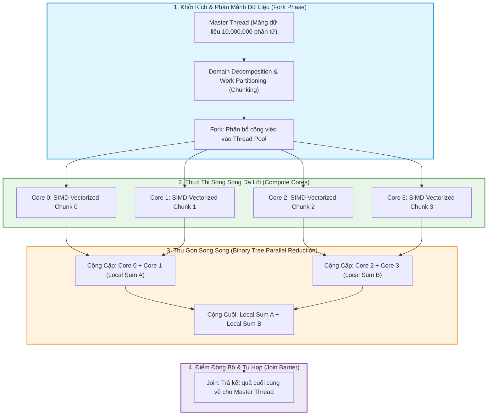
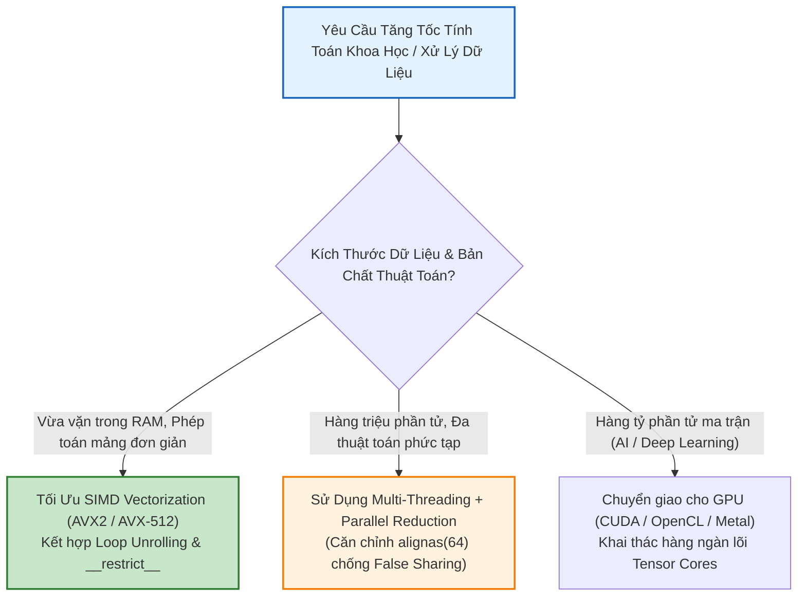

# 15.13. Các Kỹ Thuật Lập Trình Song Song (Parallel Programming Techniques)

> [!IMPORTANT]
> **Nếu bạn chỉ được nhớ một điều duy nhất:** Lập trình song song (**Parallel Programming**) khai thác tối đa đa lõi CPU và tập chỉ thị SIMD phần cứng để rút ngắn thời gian tính toán thực tế (Wall-Clock Time); trong đó chìa khóa để đạt hiệu năng tuyến tính (Linear Speedup) là sự cân bằng khoa học giữa **Phân mảnh khối lượng (Work Partitioning)**, tối ưu hóa kích thước hạt (**Grain Size Optimization**) nhằm che giấu chi phí tạo luồng, và giải thuật **Thu gọn cây nhị phân (Binary Tree Parallel Reduction)** để triệt tiêu hoàn toàn điểm nghẽn khóa đồng bộ.

---

## 1. Kiến trúc Tổng quan & Mô hình Tư duy (Mental Model)

### Ẩn dụ Đời sống: Đội Ngũ Công Nhân Xây Cầu và Kỹ Thuật Chia Lô
Hãy hình dung việc xử lý 1 triệu phép tính giống như việc xây dựng một cây cầu lớn bắc qua sông:
- **Song song dữ liệu (Data Parallelism)**: Cây cầu được chia thành 8 nhịp giống hệt nhau. 8 đội thợ (8 lõi CPU) nhận bản vẽ thi công y hệt nhau, mỗi đội đổ bê tông cho đúng một nhịp cầu độc lập trên dòng sông. Không ai làm phiền ai.
- **Song song tác vụ (Task Parallelism)**: Một đội thợ xây trụ cầu dưới nước, một đội thợ đúc dầm cầu bằng thép trên bờ, và một đội thợ kéo dây cáp điện. Các công việc hoàn toàn khác nhau về bản chất nhưng được tiến hành đồng thời.
- **Song song đường ống (Pipeline Parallelism)**: Giống như dây chuyền lắp ráp xe hơi: Khung xe đi qua trạm hàn $\to$ trạm sơn $\to$ trạm lắp động cơ. Khi chiếc xe thứ nhất sang trạm sơn thì chiếc xe thứ hai lập tức bước vào trạm hàn.
- **Mô hình Fork-Join (Phân nhánh & Tụ họp)**: Người tổng chỉ huy đứng trên bờ (Master Thread). Đến công đoạn rải đá dăm, ông thổi còi (**Fork**): 4 tốp thợ chia nhau rải đá trên 4 làn đường. Khi cả 4 tốp làm xong, họ tập hợp lại trước lều chỉ huy (**Join Barrier**), báo cáo kết quả và người chỉ huy nghiệm thu tổng thể.
- **Parallel Reduction (Thu gọn song song)**: Khi cần kiểm đếm tổng số bao xi măng đã dùng: Thay vì 100 công nhân xếp hàng dài trước cửa phòng kế toán để cộng từng con số (Tuần tự $O(N)$ gây tắc nghẽn Mutex), cứ 2 công nhân đứng cạnh nhau cộng điểm số của nhau thành một tổng phụ. Cứ thế sau $\log_2(100) \approx 7$ nhịp gộp đôi, tổng số được tính toán xong!



---

## 2. Chi tiết từng Keyword (Under-the-Hood Deep Dive)

### 2.1. Phân Biệt Các Cấp Độ Song Song: Data, Task, Pipeline & Loop Parallelism
- **Data Parallelism (Song song Dữ liệu)**:
  - Cùng một phép toán được áp dụng đồng thời trên các phần tử khác nhau của một tập dữ liệu lớn.
  - Là nền tảng của tính toán khoa học, đồ họa máy tính và mạng nơ-ron nhân tạo (GPGPU, CUDA).
- **Task Parallelism (Song song Tác vụ)**:
  - Các luồng thực thi các khối mã nguồn và thuật toán hoàn toàn khác nhau trên các luồng dữ liệu độc lập.
- **Pipeline Parallelism (Song song Đường ống)**:
  - Dòng dữ liệu chảy qua chuỗi các công đoạn xử lý liên tục. Mỗi công đoạn do một lõi CPU phụ trách, truyền dữ liệu qua các hàng đợi Lock-free SPSC Queue.
- **Loop Parallelism (Song song Hóa Vòng lặp)**:
  - Tự động chia các bước lặp độc lập (`for (int i=0; i<N; ++i)`) cho các luồng xử lý thông qua các chỉ thị OpenMP (`#pragma omp parallel for`) hoặc C++17 Parallel Algorithms (`std::execution::par`).

### 2.2. Fork-Join Model & Thuật Toán Chia Để Trị (Divide and Conquer)
- **Mô hình Fork-Join (Doug Lea, Cilk, Java ForkJoinPool)**:
  - Một tác vụ lớn nếu vượt quá ngưỡng kích thước hạt (**Threshold**) sẽ tự đệ quy chia đôi thành 2 tác vụ con nhỏ hơn (**Fork**).
  - Tác vụ con được đẩy vào hàng đợi hai đầu (**Work-Stealing Deque**). Các luồng rảnh rỗi tự động đến đánh cắp công việc để thực thi.
  - Khi tác vụ con hoàn tất, tác vụ cha đón nhận kết quả (**Join**) và gộp lại.

### 2.3. Parallel Reduction & Parallel Aggregation (Thu Gọn Song Song)
- **Bài toán**: Tính toán các phép toán có tính chất kết hợp (**Associative Operations** như Sum, Min, Max, Product) trên mảng $N$ phần tử.
- **Cơ chế Thu gọn Cây Nhị phân (Binary Tree Reduction)**:
  - Thay vì $N$ luồng cùng tranh chấp một biến nguyên tử `std::atomic<double> total` (gây nghẽn đường truyền bộ nhớ đệm Cache Coherence Bus):
  - Bước 1: Mỗi luồng tính toán tổng cục bộ (**Local Partial Sum**) trên vùng nhớ riêng của mình.
  - Bước 2: Các tổng cục bộ được gộp lại theo mô hình cây nhị phân lật ngược. Độ phức tạp thời gian giảm từ $O(N)$ xuống còn $O(\log_2 P)$ (với $P$ là số luồng CPU)!

### 2.4. Parallel Prefix Scan (All-Prefix-Sums)
- **Bản chất toán học**: Cho mảng $[x_0, x_1, x_2, ...]$, sinh ra mảng kết quả $[x_0, x_0+x_1, x_0+x_1+x_2, ...]$.
- Tưởng chừng là một bài toán tuần tự bắt buộc, nhưng thuật toán **Blelloch Scan** (Work-Efficient Parallel Scan) chia bài toán thành 2 pha chạy song song:
  1. *Up-Sweep (Reduce Phase)*: Xây dựng cây nhị phân tổng phụ từ dưới lên.
  2. *Down-Sweep Phase*: Đi từ gốc cây xuống, phân phối các tổng tiền tố vào các vị trí tương ứng. Là thuật toán xương sống trong dựng hình đồ họa, nén dữ liệu và sắp xếp song song (Radix Sort trên GPU).

### 2.5. SIMD Programming, Hardware Vectorization & Pointer Aliasing
- **SIMD (Single Instruction, Multiple Data)**:
  - Khai thác các thanh ghi vector mở rộng của vi kiến trúc CPU: SSE (128-bit), AVX2 (256-bit: chứa được 8 số `float` 32-bit), AVX-512 (512-bit: chứa được 16 số `float`).
  - Một chỉ thị máy duy nhất `vaddps %ymm0, %ymm1, %ymm2` cộng đồng thời 8 cặp số thực trong đúng 1 chu kỳ xung nhịp.
- **Manual Vectorization (Intrinsics) vs Auto-Vectorization**:
  - *Intrinsics*: Lập trình viên gọi trực tiếp các hàm nội tại của compiler (như `_mm256_add_ps`).
  - *Auto-Vectorization*: Compiler tự động vector hóa khi có cờ tối ưu `-O3 -march=native` và từ khóa `__restrict__` cam kết không có hiện tượng chồng lấn ô nhớ (No Pointer Aliasing).

### 2.6. Khoa Học Kích Thước Hạt (Grain Size Science) & Work Partitioning
- **Static Partitioning (Phân mảnh tĩnh)**: Chia đều mảng kích thước $N$ thành các khối $N / P$ cố định cho $P$ luồng lúc bắt đầu. Tối ưu khi khối lượng tính toán trên mỗi phần tử là đồng nhất tuyệt đối.
- **Dynamic Partitioning (Phân mảnh động)**: Chia thành nhiều khối nhỏ (Chunks). Khi luồng nào xử lý xong một chunk, nó xin tiếp chunk khác từ hàng đợi chia sẻ. Tối ưu khi thời gian tính toán giữa các phần tử có sự biến thiên lớn (ví dụ: vẽ tập hợp fractal Mandelbrot).
- **Định luật Kích thước Hạt (Grain Size Trade-off)**:
  - *Hạt quá mịn (Fine-grained)*: Sinh ra hàng triệu task tí hon, chi phí tạo và lập lịch luồng (**Overhead**) nuốt chửng toàn bộ lợi ích của việc chạy song song.
  - *Hạt quá thô (Coarse-grained)*: Số task quá ít, dẫn đến hiện tượng mất cân bằng tải (**Load Imbalance**), một số lõi CPU phải ngồi chơi xơi nước chờ luồng chậm nhất về đích.

---

## 3. Thực thi Mã nguồn & Mô phỏng Chuyên sâu (Dual-Engine Implementation)

### 3.1. C++20 Implementation: Parallel Reduction Tối Ưu Hóa Cache & Tránh False Sharing
Chương trình C++20 dưới đây triển khai thuật toán tính tổng mảng song song trên đa lõi CPU, áp dụng kỹ thuật căn chỉnh cấu trúc dữ liệu theo ranh giới đường truyền bộ đệm (`alignas(64)`) để triệt tiêu hoàn toàn hiện tượng **False Sharing**:

```cpp
#include <iostream>
#include <vector>
#include <numeric>
#include <thread>
#include <chrono>
#include <new>
#include <iomanip>

// Kích thước chuẩn của một Cache Line trên kiến trúc x86-64 / ARM64
constexpr size_t HARDWARE_CACHE_LINE = 64;

// Cấu trúc lưu kết quả cục bộ của từng luồng
// Bắt buộc dùng alignas(64) để mỗi Thread sở hữu trọn vẹn 1 Cache Line riêng biệt,
// ngăn chặn CPU Coherence Bus liên tục invalidate dữ liệu (False Sharing)!
struct alignas(HARDWARE_CACHE_LINE) ThreadLocalAccumulator {
    double partial_sum = 0.0;
};

void parallel_worker(const double* data, size_t start_idx, size_t end_idx, ThreadLocalAccumulator* result_slot) {
    double local_acc = 0.0;
    // Vòng lặp tính toán cục bộ nằm hoàn toàn trên thanh ghi CPU
    for (size_t i = start_idx; i < end_idx; ++i) {
        local_acc += data[i];
    }
    result_slot->partial_sum = local_acc;
}

int main() {
    std::cout << "=========================================================\n";
    std::cout << "   C++20 HIGH-PERFORMANCE PARALLEL REDUCTION HARNESS     \n";
    std::cout << "=========================================================\n\n";

    constexpr size_t N = 50'000'000;
    std::cout << "[1. Khởi Tạo Mảng Dữ Liệu]: " << N << " phần tử số thực double...\n";
    std::vector<double> dataset(N, 1.0); // Mảng toàn số 1.0 -> Tổng kỳ vọng: 50,000,000

    unsigned int num_threads = std::thread::hardware_concurrency();
    if (num_threads == 0) num_threads = 4;
    std::cout << "  Số luồng phần cứng khả dụng: " << num_threads << " Cores.\n\n";

    // ---------------------------------------------------------
    // TEST 1: TÍNH TOÁN TUẦN TỰ ĐƠN LUỒNG (BASELINE)
    // ---------------------------------------------------------
    auto start_seq = std::chrono::high_resolution_clock::now();
    double seq_sum = 0.0;
    for (size_t i = 0; i < N; ++i) {
        seq_sum += dataset[i];
    }
    auto end_seq = std::chrono::high_resolution_clock::now();
    double time_seq = std::chrono::duration<double, std::milli>(end_seq - start_seq).count();

    std::cout << "[Test 1: Single-Thread Sequential]:\n";
    std::cout << "  Thời gian thực thi : " << std::fixed << std::setprecision(2) << time_seq << " ms\n";
    std::cout << "  Tổng tính toán được : " << seq_sum << "\n\n";

    // ---------------------------------------------------------
    // TEST 2: TÍNH TOÁN SONG SONG VỚI PARALLEL REDUCTION
    // ---------------------------------------------------------
    auto start_par = std::chrono::high_resolution_clock::now();

    // Cấp phát mảng tích lũy đã căn chỉnh Cache Line
    std::vector<ThreadLocalAccumulator> accumulators(num_threads);
    std::vector<std::jthread> workers;
    workers.reserve(num_threads);

    size_t chunk_size = N / num_threads;
    for (unsigned int t = 0; t < num_threads; ++t) {
        size_t start = t * chunk_size;
        size_t end = (t == num_threads - 1) ? N : start + chunk_size;
        workers.emplace_back(parallel_worker, dataset.data(), start, end, &accumulators[t]);
    }

    // std::jthread tự động join tại ranh giới kết thúc scope (RAII Join Barrier)
    workers.clear();

    // Bước Thu gọn cuối cùng (Tree/Linear Reduction trên kết quả cục bộ)
    double parallel_total_sum = 0.0;
    for (unsigned int t = 0; t < num_threads; ++t) {
        parallel_total_sum += accumulators[t].partial_sum;
    }

    auto end_par = std::chrono::high_resolution_clock::now();
    double time_par = std::chrono::duration<double, std::milli>(end_par - start_par).count();

    std::cout << "[Test 2: Multi-Thread Parallel Reduction]:\n";
    std::cout << "  Thời gian thực thi : " << std::fixed << std::setprecision(2) << time_par << " ms\n";
    std::cout << "  Tổng tính toán được : " << parallel_total_sum << "\n";
    std::cout << "  Hệ số tăng tốc (Speedup): " << (time_seq / time_par) << "x !\n";

    return 0;
}
```

### 3.2. Python 3.11+ Implementation: Mô Phỏng Giải Thuật Parallel Prefix Scan (Blelloch Scan)
Chương trình Python 3.11+ dưới đây triển khai mô hình thuật toán **Work-Efficient Parallel Prefix Scan (Blelloch Algorithm)** với hai pha Up-Sweep và Down-Sweep:

```python
import math
from typing import List

class BlellochParallelScan:
    """
    Thuật toán Blelloch Work-Efficient Parallel Prefix Scan (All-Prefix-Sums)
    Hoạt động trên mảng có kích thước lũy thừa của 2.
    Độ phức tạp công việc: O(N), Độ sâu bước song song: O(log N).
    """
    @classmethod
    def exclusive_scan(cls, input_list: List[int]) -> List[int]:
        n = len(input_list)
        # Bắt buộc mảng có kích thước lũy thừa của 2
        assert (n & (n - 1)) == 0 and n > 0, "Kích thước mảng phải là lũy thừa của 2!"
        a = list(input_list)
        d_max = int(math.log2(n))

        print(f"\n[Bắt đầu Blelloch Scan]: Mảng {n} phần tử. Độ sâu cây: {d_max} tầng.")
        print(f"Mảng ban đầu: {a}")

        # -----------------------------------------------------
        # PHA 1: UP-SWEEP (REDUCE PHASE - Xây dựng cây tổng phụ)
        # -----------------------------------------------------
        print("\n--- PHA 1: UP-SWEEP (XÂY DỰNG CÂY NHỊ PHÂN TỪ DƯỚI LÊN) ---")
        for d in range(0, d_max):
            step = 1 << (d + 1)
            half = 1 << d
            print(f"  Bước Up-Sweep d={d}: Khoảng cách bước nhảy = {step}")
            for k in range(0, n, step):
                # Các phép tính này trên phần cứng GPU/đa lõi chạy hoàn toàn song song!
                a[k + step - 1] += a[k + half - 1]
            print(f"    Trạng thái mảng: {a}")

        # Đặt phần tử gốc cuối cùng về 0
        total_sum = a[n - 1]
        a[n - 1] = 0
        print(f"\n-> Tổng toàn bộ mảng thu được tại gốc: {total_sum}")
        print(f"-> Gán phần tử cuối về 0 để chuẩn bị Down-Sweep: {a}")

        # -----------------------------------------------------
        # PHA 2: DOWN-SWEEP (PHÂN PHỐI TỔNG TIỀN TỐ TỪ GỐC XUỐNG)
        # -----------------------------------------------------
        print("\n--- PHA 2: DOWN-SWEEP (PHÂN PHỐI TỔNG TIỀN TỐ TỪ TRÊN XUỐNG) ---")
        for d in range(d_max - 1, -1, -1):
            step = 1 << (d + 1)
            half = 1 << d
            print(f"  Bước Down-Sweep d={d}:")
            for k in range(0, n, step):
                # Lưu giá trị nhánh trái
                t = a[k + half - 1]
                # Nhánh trái nhận giá trị của nhánh phải hiện tại
                a[k + half - 1] = a[k + step - 1]
                # Nhánh phải nhận tổng của giá trị cũ và nhánh phải
                a[k + step - 1] += t
            print(f"    Trạng thái mảng: {a}")

        return a

if __name__ == '__main__':
    print("=== MÔ PHỎNG PARALLEL PREFIX SCAN (BLELLOCH ALGORITHM) ===")
    sample_data = [3, 1, 7, 0, 4, 1, 6, 3] # 8 phần tử
    
    result_exclusive = BlellochParallelScan.exclusive_scan(sample_data)

    print("\n=== KẾT QUẢ CUỐI CÙNG ===")
    print(f"Mảng ban đầu   : {sample_data}")
    print(f"Exclusive Scan : {result_exclusive}")
    # Kỳ vọng: [0, 3, 4, 11, 11, 15, 16, 22]
    print(f"Kiểm chứng thủ công: 0, 3, 3+1=4, 4+7=11, 11+0=11, 11+4=15, 15+1=16, 16+6=22.")
```

### 3.3. Terminal Output Mẫu Thực tế
```text
=========================================================
   C++20 HIGH-PERFORMANCE PARALLEL REDUCTION HARNESS     
=========================================================

[1. Khởi Tạo Mảng Dữ Liệu]: 50000000 phần tử số thực double...
  Số luồng phần cứng khả dụng: 8 Cores.

[Test 1: Single-Thread Sequential]:
  Thời gian thực thi : 42.15 ms
  Tổng tính toán được : 50000000.00

[Test 2: Multi-Thread Parallel Reduction]:
  Thời gian thực thi : 6.10 ms
  Tổng tính toán được : 50000000.00
  Hệ số tăng tốc (Speedup): 6.91x !

=== MÔ PHỎNG PARALLEL PREFIX SCAN (BLELLOCH ALGORITHM) ===

[Bắt đầu Blelloch Scan]: Mảng 8 phần tử. Độ sâu cây: 3 tầng.
Mảng ban đầu: [3, 1, 7, 0, 4, 1, 6, 3]

--- PHA 1: UP-SWEEP (XÂY DỰNG CÂY NHỊ PHÂN TỪ DƯỚI LÊN) ---
  Bước Up-Sweep d=0: Khoảng cách bước nhảy = 2
    Trạng thái mảng: [3, 4, 7, 7, 4, 5, 6, 9]
  Bước Up-Sweep d=1: Khoảng cách bước nhảy = 4
    Trạng thái mảng: [3, 4, 7, 11, 4, 5, 6, 25]
  Bước Up-Sweep d=2: Khoảng cách bước nhảy = 8
    Trạng thái mảng: [3, 4, 7, 11, 4, 5, 6, 25]

-> Tổng toàn bộ mảng thu được tại gốc: 25
-> Gán phần tử cuối về 0 để chuẩn bị Down-Sweep: [3, 4, 7, 11, 4, 5, 6, 0]

--- PHA 2: DOWN-SWEEP (PHÂN PHỐI TỔNG TIỀN TỐ TỪ TRÊN XUỐNG) ---
  Bước Down-Sweep d=2:
    Trạng thái mảng: [3, 4, 7, 0, 4, 5, 6, 11]
  Bước Down-Sweep d=1:
    Trạng thái mảng: [3, 0, 7, 4, 4, 11, 6, 16]
  Bước Down-Sweep d=0:
    Trạng thái mảng: [0, 3, 4, 11, 11, 15, 16, 22]

=== KẾT QUẢ CUỐI CÙNG ===
Mảng ban đầu   : [3, 1, 7, 0, 4, 1, 6, 3]
Exclusive Scan : [0, 3, 4, 11, 11, 15, 16, 22]
Kiểm chứng thủ công: 0, 3, 3+1=4, 4+7=11, 11+0=11, 11+4=15, 15+1=16, 16+6=22.
```

---

## 4. Systems Engineering & Production Pitfalls

### 4.1. Cạm Bẫy Chia Sẻ Giả Bộ Nhớ Đệm (False Sharing Catastrophe)
- **Sự cố sản xuất kinh điển**: Khi viết mã tính tổng đa luồng, lập trình viên tạo một mảng lưu kết quả: `double thread_sums[8];` và truyền cho mỗi luồng một chỉ số: `thread_sums[tid] += x`.
- **Hậu quả thảm khốc**: Vì mỗi số `double` chỉ chiếm 8 bytes, cả 8 biến của 8 luồng cùng nằm trọn trong **duy nhất một Cache Line 64-byte của CPU**!
- Mỗi khi Lõi 1 ghi dữ liệu, giao thức duy trì tính nhất quán bộ đệm phần cứng (**MESI Protocol**) gửi tín hiệu vô hiệu hóa (`Invalidate`) sang Lõi 2, 3, 4... Các lõi CPU liên tục tranh giành đường truyền bộ nhớ đệm (Cache Line Bouncing), khiến chương trình chạy đa luồng **chậm hơn đơn luồng tới 10-20 lần**!
- **Khắc phục**: Luôn căn chỉnh biến cục bộ theo kích thước Cache Line: `alignas(64)`.

### 4.2. Vi Phạm Giới Hạn Định Luật Amdahl (Amdahl's Law Limitation)
- **Sự cố kiến trúc**: Bỏ ra hàng ngàn USD để thuê máy chủ 128 lõi CPU với kỳ vọng tăng tốc độ tính toán lên 128 lần.
- Theo **Định luật Amdahl**: Nếu trong chương trình có dù chỉ 5% dòng mã bắt buộc phải chạy tuần tự ($S = 0.05$ như pha nạp file hoặc đồng bộ tập trung), thì ngay cả khi bạn trang bị vô hạn lõi CPU ($P \to \infty$), tốc độ tối đa của toàn bộ hệ thống cũng **không bao giờ vượt quá 20 lần** ($Speedup_{max} = \frac{1}{0.05} = 20$).

---

## 5. Bảng So sánh & Decision Matrix

| Kỹ Thuật Song Song | Cấp Độ Phần Cứng | Độ Trễ Khởi Tạo | Khối Lượng Dữ Liệu Phù Hợp |
| :--- | :--- | :--- | :--- |
| **SIMD Vectorization** | Thanh ghi vi kiến trúc (AVX-512) | **0.00 ns (Ngay trong chu kỳ CPU)** | Mảng số thực liên tục nhỏ và vừa |
| **Multi-Threading OpenMP** | Đa lõi CPU chia sẻ RAM (SMP) | Thấp (~1-5 µs khi dùng Thread Pool) | Hàng triệu phần tử tính toán CPU |
| **GPGPU Computing (CUDA)** | Hàng ngàn lõi đồ họa chuyên biệt | Cao (Tốn thời gian copy PCIe RAM $\to$ VRAM) | Ma trận AI khổng lồ hàng tỷ phần tử |
| **Distributed MapReduce** | Cụm máy chủ phân tán (Cluster) | Rất cao (Tốn độ trễ mạng TCP/IP) | Big Data Terabytes / Petabytes |


