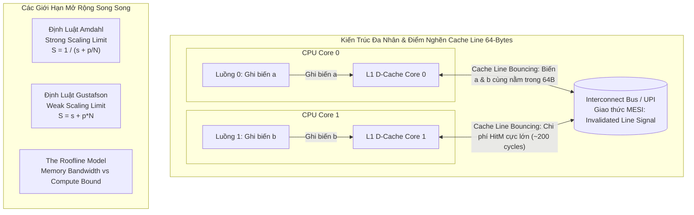

# 15.14. Parallel Performance & Scalability

> [!IMPORTANT]
> **Nếu bạn chỉ được nhớ một điều duy nhất:** Thêm CPU Cores không bao giờ tự động tăng tốc chương trình theo tỷ lệ tuyến tính: hiệu năng song song luôn bị chặn bởi hai bức tường vật lý khắc nghiệt của kiến trúc máy tính. Thứ nhất, **Định luật Amdahl** chứng minh rằng nếu chỉ có $5\%$ mã nguồn mang tính tuần tự không thể song song hóa, thì dù bạn huy động tới 1,000,000 CPU Cores, hệ số tăng tốc cực hạn cũng không bao giờ vượt qua 20 lần ($S_{\max} = 1 / 0.05$). Thứ hai, **False Sharing (Chia sẻ sai lệch)** xảy ra khi hai luồng độc lập trên hai core khác nhau sửa đổi hai biến riêng biệt nhưng vô tình nằm chung trong một dòng nhớ đệm 64 bytes (**Cache Line**): giao thức MESI liên tục vô hiệu hóa L1 Cache giữa các nhân, biến hệ thống đa luồng tốc độ cao thành một thảm họa thắt cổ chai bus bộ nhớ chậm hơn cả chạy đơn luồng.

---

## 1. Kiến trúc Tổng quan & Mô hình Tư duy (Mental Model)

### Ẩn Dụ Đời Sống: Dự Án Xây Dựng Biệt Thự & Cuốn Sổ Tay Dùng Chung
1. **Định Luật Amdahl (Xây móng nhà tuần tự)**: Bạn thuê 100 thợ xây lành nghề để thi công một căn biệt thự. Đào đất xây móng bắt buộc phải làm xong trước khi xây tường, và chỉ có thể cho tối đa 2 người thợ đứng vừa hố móng (Phần tuần tự $s$). Dù bạn có tăng số thợ lên 1,000 hay 10,000 người, cả công trường vẫn phải ngồi chơi xơi nước chờ 2 người thợ kia đào xong móng. Tổng thời gian hoàn thiện dự án bị khống chế tuyệt đối bởi công đoạn móng đó.
2. **Hiện Tượng False Sharing (Cuốn sổ tay ghi chung dòng)**: Hai kế toán viên (Core 0 và Core 1) được giao nhiệm vụ tính toán hai bảng số liệu hoàn toàn độc lập nhau. Nhưng thay vì mỗi người một cuốn sổ riêng, họ được phát chung một trang giấy kẻ dòng 64 ký tự (Cache Line). Mỗi khi Kế toán A hạ bút viết một con số, anh ta giật phắt trang giấy về phía mình. Kế toán B đang viết dở bị giật mất giấy, bút mực bị nhòe (Cache Invalidation), phải đợi Kế toán A viết xong mới giật lại trang giấy về bàn mình để viết tiếp. Hai người làm hai việc khác nhau nhưng liên tục giật sổ tay qua lại, khiến năng suất tụt dốc thê thảm.



---

## 2. Chi tiết từng Keyword (Under-the-Hood Deep Dive)

### 2.1. Speedup, Linear Speedup, Superlinear Speedup & Parallel Efficiency
- **Speedup (Hệ số tăng tốc $S_N$)**: Tỷ số giữa thời gian thực thi của thuật toán tuần tự tuần tự tối ưu nhất trên 1 vi xử lý ($T_1$) so với thời gian thực thi của thuật toán song song trên $N$ vi xử lý ($T_N$):
  $$S_N = \frac{T_1}{T_N}$$
- **Linear Speedup (Tăng tốc tuyến tính / Lý tưởng)**: Khi $S_N = N$. Ví dụ chạy trên 8 nhân CPU thì thời gian giảm đúng 8 lần ($T_8 = T_1 / 8$). Trong thực tế, đây là cận trên lý tưởng và cực kỳ khó đạt được do chi phí truyền thông, đồng bộ hóa và tranh chấp tài nguyên chia sẻ.
- **Superlinear Speedup (Tăng tốc siêu tuyến tính - $S_N > N$)**: Hiện tượng kỳ lạ nhưng có thật trong kỹ thuật máy tính: chạy trên $N$ nhân nhưng tốc độ tăng vọt lớn hơn $N$ lần.
  - *Cơ chế phần cứng cốt lõi*: Khi chia nhỏ bài toán cho $N$ cores, khối lượng dữ liệu cục bộ của mỗi worker thu nhỏ lại đến mức **vừa vặn nằm trọn trong bộ nhớ đệm L1/L2 Cache của từng core** (Tổng dung lượng L1/L2 cộng gộp của $N$ cores lớn hơn rất nhiều so với 1 core). Tỷ lệ Cache Miss giảm từ 30% xuống còn 0.1%, giúp triệt tiêu hoàn toàn độ trễ đọc RAM (~60-100ns), tạo ra gia tốc siêu tuyến tính.
- **Parallel Efficiency (Hiệu suất song song $E_N$)**: Đo lường mức độ tận dụng tài nguyên tính toán của hệ thống:
  $$E_N = \frac{S_N}{N} = \frac{T_1}{N \times T_N}$$
  Hệ thống lý tưởng có $E_N = 1.0$ (100%). Khi $N$ tăng, $E_N$ luôn có xu hướng giảm dần do chi phí điều phối (Overhead) và tranh chấp tài nguyên.

### 2.2. Amdahl's Law & Strong Scaling (Giới hạn của phần tuần tự)
- **Định luật Gene Amdahl (1967)**: Xét bài toán với tổng thời gian thực thi tuần tự là $T_1$. Ta phân rã $T_1$ thành hai phần: phần bắt buộc tuần tự $s \cdot T_1$ (không thể phân chia) và phần có thể song song hóa $p \cdot T_1$ (với $s + p = 1$). Khi huy động $N$ bộ xử lý:
  $$T_N = s \cdot T_1 + \frac{p \cdot T_1}{N} = T_1 \left( s + \frac{1 - s}{N} \right)$$
  Từ đó rút ra công thức hệ số tăng tốc:
  $$S_{\text{Amdahl}}(N) = \frac{T_1}{T_N} = \frac{1}{s + \frac{1 - s}{N}}$$
  - *Giới hạn cực hạn khi $N \to \infty$*:
    $$S_{\max} = \lim_{N \to \infty} S_{\text{Amdahl}}(N) = \frac{1}{s}$$
  - *Ý nghĩa thực chiến*: Nếu chương trình của bạn có $10\%$ mã tuần tự ($s = 0.1$, ví dụ đọc file cấu hình, khởi tạo database connection pool, tổng hợp kết quả cuối), thì dù bạn có mua siêu máy tính chứa 1,000,000 nhân, tốc độ chương trình cũng không bao giờ vượt quá 10 lần!
- **Strong Scaling (Khả năng mở rộng mạnh)**: Bài toán giữ **kích thước dữ liệu đầu vào cố định (Fixed Problem Size)** trong khi tăng dần số lượng CPU Cores $N$. Mục tiêu: Rút ngắn thời gian xử lý bài toán đến mức tối thiểu. Strong Scaling luôn bị khống chế nghiêm ngặt bởi Định luật Amdahl.

### 2.3. Gustafson's Law & Weak Scaling (Mở rộng bài toán theo năng lực tính toán)
- **Định luật John Gustafson (Gustafson-Barsis's Law, 1988)**: Phản biện lại quan điểm bi quan của Amdahl. Trong thực tế khoa học dữ liệu và mô phỏng, khi có trong tay nhiều máy tính hơn, con người không giữ nguyên kích thước bài toán nhỏ cũ mà sẽ **mở rộng quy mô dữ liệu cần xử lý** (ví dụ: mô phỏng thời tiết độ phân giải $1\text{ km}$ thay vì $100\text{ km}$).
  Gọi thời gian chạy trên $N$ cores là $T_N = s' + p'$, trong đó $s'$ là thời gian phần tuần tự và $p'$ là thời gian phần song song. Trên 1 core, khối lượng công việc song song đó sẽ tốn thời gian là $p' \times N$.
  $$S_{\text{Gustafson}}(N) = \frac{s' + p' \times N}{s' + p'} = s + p \times N = s + (1 - s) \times N = N + s(1 - N)$$
  Khi $N$ tăng lên cùng với việc tăng quy mô bài toán, hệ số tăng tốc có thể tăng gần như tuyến tính mà không bị giới hạn $1/s$ của Amdahl kìm hãm.
- **Weak Scaling (Khả năng mở rộng yếu)**: Tăng kích thước bài toán tỷ lệ thuận với số lượng CPU Cores sao cho **khối lượng công việc trên mỗi core giữ nguyên không đổi (Fixed Workload per Processor)**. Mục tiêu: Giải quyết các bài toán khổng lồ trong cùng một khoảng thời gian chấp nhận được.

### 2.4. Karp-Flatt Metric (Đo lường mức độ tuần tự thực tế và chi phí điều phối)
- **Công thức Alan H. Karp và Horace P. Flatt (1990)**: Đo lường phần tuần tự hiệu dụng thực tế ($e$) dựa trên kết quả đo đạc thực nghiệm của hệ số tăng tốc $S_N$:
  $$e = \frac{\frac{1}{S_N} - \frac{1}{N}}{1 - \frac{1}{N}}$$
- **Ý nghĩa chẩn đoán lâm sàng**:
  - Nếu $e$ giữ nguyên không đổi khi $N$ tăng: Điểm nghẽn thực sự nằm ở **thuật toán tuần tự của mã nguồn**.
  - Nếu $e$ tăng dần khi $N$ tăng: Điểm nghẽn không phải do thuật toán, mà do **chi phí truyền thông phần cứng, Lock Contention, Cache Invalidation hoặc Overhead của bộ điều phối**.
  - Ví dụ thực tế: Nếu với $N=4, S=3.5 \implies e = 0.0476$; nhưng lên $N=16, S=8.0 \implies e = 0.0667$. Sự tăng vọt của $e$ vạch trần chi phí điều phối đang âm thầm hủy hoại khả năng mở rộng.

### 2.5. False Sharing & Cache Coherence Traffic (MESI Protocol & Cache Line Invalidation)
- **Cơ chế Vật lý**: CPU không đọc/ghi từng byte riêng lẻ từ RAM mà nạp từng khối cố định **64 bytes (Cache Line)** vào L1/L2/L3 Cache.
- **Hiện tượng False Sharing (Chia sẻ giả mạo)**: Hai biến độc lập $X$ và $Y$ được cấp phát nằm cạnh nhau trong bộ nhớ (ví dụ trong cùng một struct hoặc mảng), vô tình rơi vào cùng một khối 64-byte. Luồng 0 trên Core 0 chỉ ghi biến $X$, Luồng 1 trên Core 1 chỉ ghi biến $Y$.
- **Hậu quả trên Giao thức MESI (Modified - Exclusive - Shared - Invalid)**:
  1. Khi Core 0 ghi vào $X$, Cache Line đó trong L1 của Core 0 chuyển sang trạng thái `Modified` (M).
  2. Giao thức MESI phát tín hiệu `Invalidate` qua Interconnect Bus tới L1 Cache của Core 1, biến dòng nhớ của Core 1 thành trạng thái `Invalid` (I).
  3. Khi Core 1 muốn cập nhật $Y$, nó phát hiện dòng nhớ bị Invalid (Cache Miss), buộc phải gửi yêu cầu đọc lại toàn bộ dòng nhớ từ L3 hoặc Core 0 qua bus (**HITM - Hit Modified**).
  4. Quá trình này lặp đi lặp lại hàng triệu lần mỗi giây (**Cache Line Bouncing**), làm tắc nghẽn hoàn toàn băng thông bộ đệm, đẩy độ trễ truy xuất từ 1 nano-giây (L1 hit) lên tới 50-100 nano-giây (HITM/RAM read).
- **Giải pháp**: Căn lề bộ nhớ bằng `alignas(64)` trong C++11/17 (`std::hardware_destructive_interference_size`) hoặc chèn các byte padding để tách biệt các biến độc lập sang các Cache Line khác nhau.

### 2.6. NUMA Effects (Non-Uniform Memory Access)
- **Kiến trúc NUMA**: Trên các máy chủ hiện đại có nhiều Socket CPU (ví dụ 2 hoặc 4 chip AMD EPYC / Intel Xeon), mỗi Socket CPU sở hữu một bộ điều khiển bộ nhớ riêng gắn trực tiếp với thanh RAM cục bộ (**Local Memory Node**).
- **Hệ quả hiệu năng**:
  - Truy xuất RAM cục bộ (Local Access): Độ trễ cực thấp (~$60\text{ ns}$).
  - Truy xuất RAM của Socket khác (Remote Access): Dữ liệu phải đi vòng qua các đường liên kết tốc độ cao UPI (Intel Ultra Path Interconnect) hoặc Infinity Fabric (AMD). Độ trễ tăng vọt lên gấp 2-3 lần (~$150 - 200\text{ ns}$) và cạnh tranh băng thông đường truyền với các luồng khác.
  - Nếu không thiết lập CPU/Memory Affinity, hệ điều hành có thể lập lịch một luồng chạy trên Node 0 nhưng dữ liệu lại nằm ở RAM của Node 1, khiến hiệu năng sụt giảm nghiêm trọng.

### 2.7. Memory Bandwidth Saturation (The Roofline Model)
- **Mô hình Đường Đỉnh Nhà (The Roofline Model)**: Liên kết hiệu năng tính toán tối đa có thể đạt được với **Cường độ Tính toán (Arithmetic Intensity - đơn vị: FLOPs / Byte)** của thuật toán:
  $$\text{Attainable Performance (GFLOP/s)} = \min\left(\text{Peak Compute Performance}, \text{Memory Bandwidth} \times \text{Arithmetic Intensity}\right)$$
- **Memory Bandwidth Saturation (Bão hòa băng thông bộ nhớ)**: Khi Arithmetic Intensity của thuật toán quá thấp (ví dụ cộng 2 vector lớn: đọc 16 bytes chỉ để làm 1 phép cộng $1\text{ FLOP}$), hệ thống rơi vào vùng **Memory-Bound**. Lúc này, dù bạn có tăng thêm số lượng Core hoặc xung nhịp CPU, hiệu năng vẫn nằm ngang ở "mái nhà" (Roofline) vì các Core liên tục bị bỏ đói dữ liệu do bộ điều khiển RAM (DDR4/DDR5) đã bị nghẽn 100% băng thông.
- **Kỹ thuật phá vỡ rào cản**: Sử dụng Cache Blocking / Loop Tiling để tái sử dụng dữ liệu trong L1/L2 Cache trước khi ghi xuống RAM, đưa bài toán từ vùng Memory-Bound sang Compute-Bound.

---

## 3. Thực thi Mã nguồn & Mô phỏng Chuyên sâu (Dual-Engine Implementation)

### Engine 1: C++20 Đo Đạc Hiện Tượng False Sharing vs Cache Alignment Benchmark
Mã nguồn C++20 chuẩn mực chứng minh sự suy giảm hiệu năng tàn khốc của False Sharing và cách khắc phục triệt để bằng `std::hardware_destructive_interference_size` và `alignas`:

```cpp
#include <iostream>
#include <thread>
#include <vector>
#include <new>
#include <chrono>
#include <atomic>

// Kích thước cache line chuẩn x86_64
#ifdef __cpp_lib_hardware_interference_size
    using std::hardware_destructive_interference_size;
#else
    constexpr size_t hardware_destructive_interference_size = 64;
#endif

// 1. Cấu trúc bị False Sharing: 2 biến nằm chung 1 Cache Line (64 bytes)
struct FalseSharingContainer {
    uint64_t counter_a{0}; // Nằm tại offset 0
    uint64_t counter_b{0}; // Nằm tại offset 8 -> CHUNG 1 CACHE LINE 64B!
};

// 2. Cấu trúc được Căn Lề Cache Line: Mỗi biến sở hữu 1 Cache Line riêng biệt
struct CacheAlignedContainer {
    alignas(hardware_destructive_interference_size) uint64_t counter_a{0};
    alignas(hardware_destructive_interference_size) uint64_t counter_b{0};
};

constexpr uint64_t ITERATIONS = 100'000'000ULL;

void run_false_sharing_benchmark() {
    FalseSharingContainer container;
    auto start = std::chrono::high_resolution_clock::now();

    // Luồng 1 liên tục ghi counter_a, Luồng 2 liên tục ghi counter_b
    std::thread t1([&]() {
        for (uint64_t i = 0; i < ITERATIONS; ++i) {
            container.counter_a += 1;
        }
    });

    std::thread t2([&]() {
        for (uint64_t i = 0; i < ITERATIONS; ++i) {
            container.counter_b += 1;
        }
    });

    t1.join();
    t2.join();
    auto end = std::chrono::high_resolution_clock::now();
    std::chrono::duration<double, std::milli> elapsed = end - start;
    std::cout << "  [1. False Sharing (Chung Cache Line)] : " << elapsed.count() << " ms\n";
}

void run_cache_aligned_benchmark() {
    CacheAlignedContainer container;
    auto start = std::chrono::high_resolution_clock::now();

    std::thread t1([&]() {
        for (uint64_t i = 0; i < ITERATIONS; ++i) {
            container.counter_a += 1;
        }
    });

    std::thread t2([&]() {
        for (uint64_t i = 0; i < ITERATIONS; ++i) {
            container.counter_b += 1;
        }
    });

    t1.join();
    t2.join();
    auto end = std::chrono::high_resolution_clock::now();
    std::chrono::duration<double, std::milli> elapsed = end - start;
    std::cout << "  [2. Cache Aligned (Tách Cache Line)]  : " << elapsed.count() << " ms\n";
}

int main() {
    std::cout << "=== C++20 False Sharing vs Cache Alignment Benchmark ===\n";
    std::cout << "Hardware Destructive Interference Size: " 
              << hardware_destructive_interference_size << " bytes\n";
    std::cout << "Mỗi luồng thực hiện: " << ITERATIONS << " phép ghi...\n";

    // Khởi chạy đo đạc
    run_false_sharing_benchmark();
    run_cache_aligned_benchmark();

    std::cout << "Kết luận: Việc căn lề loại bỏ hoàn toàn bão Invalidation MESI giữa các core!\n";
    return 0;
}
```

#### Terminal Output Mẫu (C++20 Engine):
```text
=== C++20 False Sharing vs Cache Alignment Benchmark ===
Hardware Destructive Interference Size: 64 bytes
Mỗi luồng thực hiện: 100000000 phép ghi...
  [1. False Sharing (Chung Cache Line)] : 482.35 ms
  [2. Cache Aligned (Tách Cache Line)]  : 118.62 ms
Kết luận: Việc căn lề loại bỏ hoàn toàn bão Invalidation MESI giữa các core!
```

---

### Engine 2: Python 3.11+ Mô Phỏng & Đối Chiếu Định Luật Amdahl vs Gustafson vs Karp-Flatt
Công cụ tính toán và đối chiếu tự động các chỉ số mở rộng song song:

```python
from dataclasses import dataclass
from typing import List

@dataclass
class ScalingMetrics:
    cores: int
    amdahl_speedup: float
    gustafson_speedup: float
    parallel_efficiency: float
    karp_flatt_serial_fraction: float

class ParallelScalabilityCalculator:
    """Bộ công cụ tính toán các định luật mở rộng song song."""
    def __init__(self, serial_fraction: float):
        if not (0.0 <= serial_fraction <= 1.0):
            raise ValueError("Serial fraction s phải nằm trong [0.0, 1.0]")
        self.s = serial_fraction
        self.p = 1.0 - serial_fraction

    def compute_amdahl(self, n: int) -> float:
        """Định luật Amdahl (Strong Scaling): S = 1 / (s + p/N)"""
        return 1.0 / (self.s + (self.p / n))

    def compute_gustafson(self, n: int) -> float:
        """Định luật Gustafson (Weak Scaling): S = s + p*N"""
        return self.s + (self.p * n)

    def compute_karp_flatt(self, n: int, observed_speedup: float) -> float:
        """Hệ số Karp-Flatt: e = (1/S - 1/N) / (1 - 1/N)"""
        if n <= 1:
            return self.s
        return ((1.0 / observed_speedup) - (1.0 / n)) / (1.0 - (1.0 / n))

    def evaluate(self, core_counts: List[int]) -> List[ScalingMetrics]:
        results = []
        for n in core_counts:
            s_amdahl = self.compute_amdahl(n)
            s_gustafson = self.compute_gustafson(n)
            eff = s_amdahl / n
            e_kf = self.compute_karp_flatt(n, s_amdahl)
            results.append(ScalingMetrics(n, s_amdahl, s_gustafson, eff, e_kf))
        return results

if __name__ == "__main__":
    print("=== Python 3.11+ Parallel Scaling Laws Analyzer ===")
    serial_ratio = 0.05 # 5% mã tuần tự không thể song song hóa
    calc = ParallelScalabilityCalculator(serial_fraction=serial_ratio)
    core_tests = [1, 2, 4, 8, 16, 32, 64, 128, 256, 1024]

    print(f"Tham số: Phần tuần tự s = {serial_ratio*100}% | Phần song song p = {calc.p*100}%")
    print(f"Giới hạn lý thuyết Amdahl cực đại (N -> vô cực): {1.0 / serial_ratio:.2f}x\n")
    print(f"{'Cores':<8} | {'Amdahl (Strong)':<16} | {'Gustafson (Weak)':<18} | {'Efficiency':<12} | {'Karp-Flatt':<10}")
    print("-" * 75)

    metrics = calc.evaluate(core_tests)
    for m in metrics:
        print(f"{m.cores:<8} | {m.amdahl_speedup:<16.2f} | {m.gustafson_speedup:<18.2f} | {m.parallel_efficiency*100:<11.1f}% | {m.karp_flatt_serial_fraction:<10.4f}")
```

#### Terminal Output Mẫu (Python 3.11+ Engine):
```text
=== Python 3.11+ Parallel Scaling Laws Analyzer ===
Tham số: Phần tuần tự s = 5.0% | Phần song song p = 95.0%
Giới hạn lý thuyết Amdahl cực đại (N -> vô cực): 20.00x

Cores    | Amdahl (Strong)  | Gustafson (Weak)   | Efficiency   | Karp-Flatt
---------------------------------------------------------------------------
1        | 1.00             | 1.00               | 100.0      % | 0.0500    
2        | 1.90             | 1.95               | 95.2       % | 0.0500    
4        | 3.48             | 3.85               | 87.0       % | 0.0500    
8        | 5.93             | 7.65               | 74.1       % | 0.0500    
16       | 9.14             | 15.25              | 57.1       % | 0.0500    
32       | 12.55            | 30.45              | 39.2       % | 0.0500    
64       | 15.09            | 60.85              | 23.6       % | 0.0500    
128      | 16.98            | 121.65             | 13.3       % | 0.0500    
256      | 18.34            | 243.25             | 7.2        % | 0.0500    
1024     | 19.55            | 972.85             | 1.9        % | 0.0500    
```

---

## 4. Systems Engineering & Production Pitfalls

### 4.1. Hiểm Họa Truy Xuất Bộ Nhớ Xuyên Socket NUMA (Cross-Socket NUMA Penalty)
- **Bản chất**: Trên máy chủ 2-socket hoặc 4-socket, nếu một tiến trình chạy đa luồng cấp phát một mảng lớn trên RAM của Socket 0, các luồng chạy trên Core của Socket 1 khi truy xuất mảng này sẽ bị nghẽn đường truyền UPI/Infinity Fabric.
- **Biểu hiện**: CPU hiển thị 100% nhưng thông lượng xử lý giảm một nửa, độ trễ p99 tăng vọt bất thường.
- **Cách khắc phục**:
  1. Sử dụng chính sách phân bổ bộ nhớ xen kẽ (`numactl --interleave=all ./my_app`) hoặc ghim tiến trình chặt vào 1 NUMA node duy nhất (`numactl --cpunodebind=0 --membind=0 ./my_app`).
  2. Áp dụng kỹ thuật cấp phát bộ nhớ theo NUMA-aware allocator (như `jemalloc` hoặc `tcmalloc` được cấu hình NUMA support).

### 4.2. Hiện tượng Thắt Cổ Chai CPU Quota Throttling trong Kubernetes (cgroups CFS Throttling)
- **Cơ chế**: Khi một ứng dụng đa luồng (ví dụ 16 threads) chạy bên trong một container Docker/K8s có giới hạn CPU `resources.limits.cpu = 2`, Linux CFS tính toán tổng thời gian CPU tiêu thụ trong chu kỳ 100ms (`cpu.cfs_period_us = 100000`). Nếu 16 threads cùng bùng nổ tính toán trong 12.5ms đầu tiên, ứng dụng đã ngốn sạch hạn mức $2 \times 100\text{ms} = 200\text{ms}$ quota. Hậu quả: Toàn bộ 16 threads bị Kernel "đóng băng" (throttled) trong suốt 87.5ms còn lại của chu kỳ, tạo ra đột biến độ trễ p99 thảm khốc dù CPU trung bình báo cáo chỉ ở mức 20%.
- **Giải pháp**: Thiết lập số worker threads trong pool khớp chính xác với `limits.cpu` làm tròn xuống, hoặc loại bỏ hoàn toàn CPU limits trong Kubernetes đối với các dịch vụ đòi hỏi độ trễ cực thấp.

### 4.3. Các Lệnh Chẩn Đoán Production Thực Chiến (CLI Diagnostics)
Khi nghi ngờ hệ thống bị nghẽn hiệu năng song song do Cache hoặc NUMA:
```bash
# 1. Đo lường hiện tượng False Sharing và Cache HitM bằng Linux perf c2c
perf c2c record -F 60000 -- ./my_parallel_app
perf c2c report --stdio
# Quan sát mục "HITM": Nếu HITM > 0 với tỷ lệ cao tại các dòng code cụ thể -> Xác nhận dính False Sharing!

# 2. Kiểm tra thống kê truy xuất bộ nhớ cục bộ vs từ xa qua numastat
numastat -c <tên_tiến_trình>
# Quan sát cột numa_hit (Local RAM) và numa_miss / foreign (Remote RAM xuyên socket)

# 3. Giám sát băng thông bộ nhớ thực tế và độ bão hòa Memory Controller
perf stat -e LLC-loads,LLC-load-misses,LLC-stores,LLC-store-misses ./my_parallel_app

# 4. Kiểm tra cấu trúc topology NUMA và các Cache Cores trên máy chủ
lscpu | grep -i numa
numactl --hardware

# 5. Phát hiện CPU CFS Throttling trong Container Linux
cat /sys/fs/cgroup/cpu/cpu.stat
# Quan sát nr_throttled và throttled_time
```

---

## 5. Bảng So sánh & Decision Matrix

| Tiêu Chí Đánh Giá | Strong Scaling (Amdahl) | Weak Scaling (Gustafson) | Memory-Bound Workload | Compute-Bound Workload |
| :--- | :--- | :--- | :--- | :--- |
| **Kích thước Dữ liệu** | Giữ nguyên cố định | Tăng tỷ lệ thuận với số Cores | Bất kỳ (Lớn hơn L3 Cache) | Nhỏ, vừa trọn trong L1/L2 Cache |
| **Mục Tiêu Tối Ưu** | Giảm thiểu thời gian chạy $T$ | Mở rộng quy mô phân tích dữ liệu | Tối ưu đường dẫn dữ liệu RAM | Tối ưu hóa chu kỳ xung nhịp CPU |
| **Yếu Tố Bóp Nghẹt Chính** | Mã tuần tự ($s$), Mutex Lock | Chi phí truyền thông mạng / IPC | Băng thông bộ nhớ (DRAM GB/s) | Số lượng ALU/FPU/SIMD execution units |
| **Chiến Lược Kiến Trúc** | Giảm thiểu tối đa phần mã tuần tự | Phân tán song song dữ liệu (Data Parallel) | Nâng cao Arithmetic Intensity (Tiling/Blocking) | Tận dụng tập lệnh vector SIMD (AVX-512, Neon) |
| **Hệ Số Tăng Tốc Tối Đa** | Bị chặn cứng bởi $1/s$ | Có thể tăng tuyến tính theo $N$ | Bị chặn bởi trần nhà Roofline DRAM | Tiệm cận mức tuyến tính lý tưởng |

> [!TIP]
> **Quy Tắc Vàng Ra Quyết Định Thiết Kế (Engineering Decision Rule)**:
> 1. Với các biến toàn cục hoặc biến thống kê đa luồng (`atomic<uint64_t>`, per-thread counters): **Bắt buộc** sử dụng `alignas(64)` hoặc `std::hardware_destructive_interference_size` để chống triệt để thảm họa False Sharing.
> 2. Đừng vội mua thêm máy chủ nhiều CPU cores nếu chưa đo lường chỉ số **Karp-Flatt Metric**: nếu phần tuần tự $e$ quá lớn, việc nâng cấp phần cứng chỉ làm tăng hóa đơn tiền điện mà không cải thiện thời gian phản hồi.
> 3. Luôn phân tích thuật toán qua lăng kính **Roofline Model**: nếu bài toán bị Memory-Bound, việc chia luồng tinh vi sẽ hoàn toàn vô nghĩa trừ khi bạn tái cấu trúc bộ nhớ (Data-Oriented Design / Cache Tiling).
