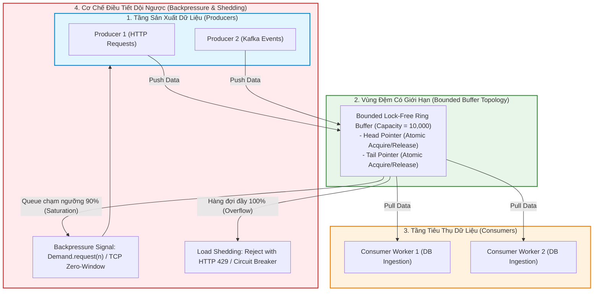
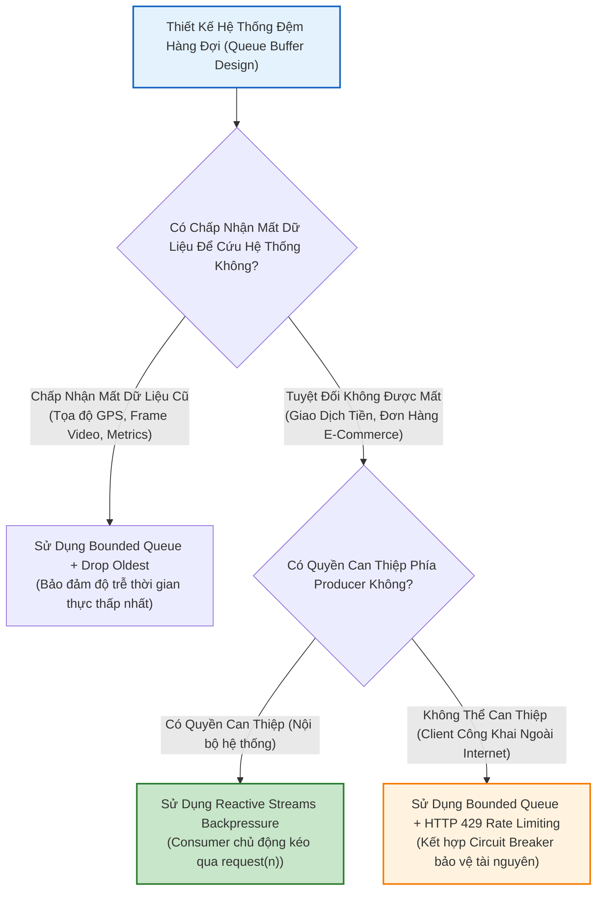

# 15.16. Mô Hình Sản Xuất - Tiêu Thụ và Áp Lực Dội Ngược (Producer-Consumer & Backpressure)

> [!IMPORTANT]
> **Nếu bạn chỉ được nhớ một điều duy nhất:** Trong các hệ thống phân tán và đồng thời, **Unbounded Buffer (Hàng đợi vô hạn) là một ảo tưởng tự sát** sẽ tất yếu dẫn tới sự cố sập nguồn vì cạn kiệt bộ nhớ (**Out-Of-Memory - OOM**); một kiến trúc sản xuất bền vững bắt buộc phải sử dụng **Bounded Buffer (Hàng đợi có giới hạn)** kết hợp với cơ chế **Áp lực Dội ngược (Backpressure)** và chiến lược xả tải (**Load Shedding**) dựa trên nguyên lý toán học của **Định luật Little ($L = \lambda W$)**.

---

## 1. Kiến trúc Tổng quan & Mô hình Tư duy (Mental Model)

### Ẩn dụ Đời sống: Đập Thủy Điện, Kênh Dẫn Nước và Nhà Máy Thủy Luân
Hãy hình dung lưu lượng dữ liệu trong hệ thống backend giống như dòng chảy của một con sông:
- **Người Sản xuất (Producer) và Người Tiêu thụ (Consumer)**:
  - Phía thượng nguồn, trời đổ mưa bão lớn (Lưu lượng người dùng truy cập đột biến - Traffic Spike).
  - Phía hạ nguồn, nhà máy thủy điện chỉ có thể xử lý tối đa 5,000 lít nước mỗi giây (Khả năng ghi dữ liệu của Database hoặc Network bandwidth).
- **Cạm bẫy của Hàng đợi Vô Hạn (Unbounded Buffer Trap)**:
  - Bạn không xây hồ chứa có dung tích tối đa, mà nghĩ rằng vùng đất trũng xung quanh có thể chứa nước vô tận. Nước ngập tràn vào khu dân cư, nhấn chìm toàn bộ trạm biến áp (Sập toàn bộ máy chủ vì lỗi `java.lang.OutOfMemoryError: Java heap space`).
- **Hàng đợi Có Giới Hạn & Áp Lực Dội Ngược (Bounded Buffer & Backpressure)**:
  - Bạn xây một hồ chứa kiên cố có dung tích tối đa 1 triệu mét khối (**Bounded Queue**).
  - Khi hồ chứa đầy tới 90% dung tích (**Queue Saturation**): Thay vì im lặng nhận thêm nước, trạm kiểm soát phát tín hiệu cảnh báo ngược lên thượng nguồn: *"Hồ sắp vỡ! Hãy giảm tốc độ xả nước hoặc tạm đóng các cống dẫn!"* (**Demand Signaling / Backpressure**).
- **Xả Tải Khẩn Cấp (Load Shedding)**:
  - Nếu thượng nguồn vẫn tiếp tục đổ nước như thác lũ vượt quá khả năng chịu đựng của đập, người quản đốc dứt khoát mở van xả lũ ra biển (**Drop Oldest / Drop Newest** hoặc trả về lỗi `HTTP 429 Too Many Requests`). Hy sinh 10% lưu lượng để bảo vệ 90% hệ thống sống sót an toàn, thay vì để cả con đập bị vỡ và cuốn trôi tất cả.



---

## 2. Chi tiết từng Keyword (Under-the-Hood Deep Dive)

### 2.1. Phân Loại Cấu Trúc Hàng Đợi (Queue Topologies): SPSC, SPMC, MPSC, MPMC
Dựa trên số lượng bên sản xuất và bên tiêu thụ, cấu trúc hàng đợi được tối ưu hóa ở tầng vi kiến trúc bộ nhớ:
- **SPSC (Single-Producer Single-Consumer)**:
  - Cấu trúc đơn giản và nhanh nhất: 1 luồng ghi, 1 luồng đọc.
  - Có thể triển khai hoàn toàn **không cần khóa (Lock-free Ring Buffer)** mà chỉ cần đúng 2 biến nguyên tử `head` và `tail` với mô hình thứ tự bộ nhớ `std::memory_order_acquire` và `std::memory_order_release`. Đạt thông lượng hàng trăm triệu thông điệp mỗi giây!
- **MPSC (Multi-Producer Single-Consumer)**:
  - Cực kỳ phổ biến trong các hệ thống ghi log hoặc gửi tác vụ tới Event Loop của một luồng Actor (như Erlang, Akka, Netty EventLoop).
  - Các producer tranh chấp ghi bằng lệnh nguyên tử CAS (**Compare-And-Swap**).
- **SPMC (Single-Producer Multi-Consumer)**:
  - Thường dùng trong các bộ điều phối công việc (Work Dispatchers).
- **MPMC (Multi-Producer Multi-Consumer)**:
  - Cấu trúc phức tạp nhất (ví dụ: `Disruptor` của LMAX Group). Đòi hỏi kiểm soát chặt chẽ cả hai đầu để tránh hiện tượng nghẽn bus bộ nhớ.

### 2.2. Hiểm Họa Chết Người Của Hàng Đợi Vô Hạn (The Unbounded Buffer Fatal Risk)
- Các cấu trúc như `java.util.concurrent.LinkedBlockingQueue()` (khởi tạo không truyền capacity) hoặc kênh channel vô hạn trong Python/Node.js không bao giờ từ chối phần tử mới.
- **Hiện tượng sụp đổ dây chuyền**:
  - Khi Database gặp sự cố chậm tạm thời (tăng độ trễ từ 10ms lên 500ms), người tiêu thụ không kịp rút hàng.
  - Người sản xuất tiếp tục nạp hàng ngàn phần tử mỗi giây vào hàng đợi.
  - Hàng đợi phình to từ 1MB $\to$ 100MB $\to$ 16GB RAM.
  - Garbage Collector của máy ảo rơi vào trạng thái tê liệt toàn tập (**Full GC Stop-The-World Pause**) chỉ để quét hàng triệu đối tượng rác trong hàng đợi, và cuối cùng tiến trình bị Kernel OS tiêu diệt bằng tín hiệu `SIGKILL` qua cơ chế **OOM-Killer**.

### 2.3. Nguyên Lý Áp Lực Dội Ngược (Backpressure & Reactive Streams)
- **Chuẩn Đặc Tả Reactive Streams (Flow API trong Java 9+, RxJava, Project Reactor)**:
  - Thay vì Producer tự ý đẩy dữ liệu sang Consumer (**Push Model**), Reactive Streams đảo ngược quyền điều khiển sang **Mô hình Kéo Có Giới Hạn (Pull / Dynamic Push-Pull Model)**.
  - Consumer gửi một tín hiệu nhu cầu (**Demand Signal**):
    ```java
    subscription.request(10); // "Tôi chỉ có thể xử lý tối đa 10 phần tử lúc này!"
    ```
  - Producer **bị cấm tuyệt đối** không được gửi quá 10 phần tử cho đến khi Consumer gửi tiếp tín hiệu `request()`.
- **Backpressure ở Tầng Mạng (TCP Flow Control)**:
  - Cơ chế **TCP Sliding Window**: Khi socket buffer của server nhận bị đầy, nó gửi gói tin TCP ACK với cờ `Window Size = 0` (**Zero-Window Announcement**). Phía client gửi buộc phải dừng ngay lập tức mọi lệnh truyền dữ liệu qua cáp quang cho đến khi window mở trở lại.

### 2.4. Các Chiến Lược Xả Tải (Load Shedding Strategies)
Khi hàng đợi có giới hạn bị tràn đầy 100% (**Queue Overflow**), hệ thống buộc phải kích hoạt một trong 4 chiến lược sống còn:
1. **Block Producer (Chặn bên sản xuất)**: Luồng sản xuất bị đưa vào trạng thái ngủ chờ cho đến khi có chỗ trống. (Tốt trong hệ thống batch processing, nhưng nguy hiểm trong Web Gateway vì làm cạn kiệt luồng HTTP).
2. **Drop Newest (Vứt bỏ gói tin mới nhất)**: Từ chối gói tin vừa đến ngay lập tức.
3. **Drop Oldest (Vứt bỏ gói tin cũ nhất)**: Xóa bỏ dữ liệu cũ nhất nằm ở đầu hàng đợi để nhường chỗ cho dữ liệu mới. (Cực kỳ tối ưu trong các hệ thống truyền dữ liệu thời gian thực như Livestream Video hoặc GPS Tracking, nơi dữ liệu cũ sau vài giây đã trở nên vô giá trị).
4. **Reject with Error Code (Từ chối tường minh)**: Trả về mã lỗi `HTTP 429 Too Many Requests` hoặc kích hoạt bộ ngắt mạch (**Circuit Breaker**) để client kích hoạt thuật toán lùi theo hàm mũ (**Exponential Backoff**).

### 2.5. Định Luật Little (Little's Law, John Little - 1961)
- **Công thức toán học nền tảng**:
  $$L = \lambda \times W$$
  - Trong đó:
    - $L$ (*Number of requests in system*): Số lượng tác vụ trung bình đang tồn tại đồng thời trong hệ thống (bao gồm cả trong hàng đợi và đang được xử lý).
    - $\lambda$ (*Arrival rate / Throughput*): Tần suất yêu cầu mới đến trung bình (ví dụ: 1,000 requests/giây).
    - $W$ (*Wait time / Latency*): Thời gian trung bình mà một yêu cầu nằm trong hệ thống từ lúc vào đến lúc hoàn tất (ví dụ: 0.05 giây = 50ms).
- **Ứng dụng Kỹ nghệ Sản xuất**:
  - Nếu máy chủ của bạn phục vụ $\lambda = 2,000$ requests/giây, và thời gian xử lý trung bình của Database là $W = 0.1$ giây (100ms):
  - Số lượng kết nối đồng thời cần duy trì trong hệ thống là:
    $$L = 2,000 \times 0.1 = 200 \text{ concurrent tasks}$$
  - **Quy tắc thiết kế kích thước Thread Pool và Queue**: Bất kỳ cấu hình hàng đợi nào lớn hơn $2 \times L$ đến $3 \times L$ đều chỉ làm tăng độ trễ chờ đợi vô nghĩa và nguy cơ sập OOM khi có sự cố.

---

## 3. Thực thi Mã nguồn & Mô phỏng Chuyên sâu (Dual-Engine Implementation)

### 3.1. C++20 Implementation: SPSC Lock-Free Bounded Ring Buffer Chuẩn C++20
Chương trình C++20 dưới đây triển khai một hàng đợi vòng **SPSC Lock-Free Ring Buffer** siêu tốc: không dùng bất kỳ `std::mutex` nào, chỉ sử dụng các thao tác nguyên tử với mô hình thứ tự bộ nhớ tối ưu `memory_order_release` và `memory_order_acquire`:

```cpp
#include <iostream>
#include <vector>
#include <atomic>
#include <thread>
#include <chrono>
#include <optional>
#include <new>

// Kích thước Cache Line để tránh False Sharing giữa biến head và tail
constexpr size_t CACHE_LINE_SIZE = 64;

template <typename T, size_t Capacity>
class SPSCLockFreeRingBuffer {
    static_assert((Capacity & (Capacity - 1)) == 0, "Dung lượng Capacity bắt buộc phải là lũy thừa của 2!");

private:
    std::vector<T> buffer_;
    
    // Con trỏ ghi (Producer sở hữu): Đặt trên 1 Cache Line riêng
    alignas(CACHE_LINE_SIZE) std::atomic<size_t> tail_{0};
    
    // Con trỏ đọc (Consumer sở hữu): Đặt trên 1 Cache Line riêng biệt khác
    alignas(CACHE_LINE_SIZE) std::atomic<size_t> head_{0};

public:
    SPSCLockFreeRingBuffer() : buffer_(Capacity) {}

    // Phía Producer: Đẩy phần tử vào hàng đợi
    bool push(const T& item) {
        const size_t current_tail = tail_.load(std::memory_order_relaxed);
        const size_t current_head = head_.load(std::memory_order_acquire);

        // Kiểm tra xem hàng đợi có bị đầy (Full / Saturation) không
        if ((current_tail - current_head) >= Capacity) {
            return false; // Hàng đợi đã đầy! Kích hoạt cơ chế Backpressure từ chối nhận
        }

        buffer_[current_tail & (Capacity - 1)] = item;
        // Xuất bản dữ liệu với memory_order_release: Đảm bảo dữ liệu ghi vào buffer_
        // được nhìn thấy trước khi tail_ tăng lên
        tail_.store(current_tail + 1, std::memory_order_release);
        return true;
    }

    // Phía Consumer: Rút phần tử ra khỏi hàng đợi
    std::optional<T> pop() {
        const size_t current_head = head_.load(std::memory_order_relaxed);
        const size_t current_tail = tail_.load(std::memory_order_acquire);

        // Kiểm tra hàng đợi có rỗng (Empty / Underflow) không
        if (current_head == current_tail) {
            return std::nullopt; // Hàng đợi rỗng
        }

        T item = buffer_[current_head & (Capacity - 1)];
        head_.store(current_head + 1, std::memory_order_release);
        return item;
    }

    size_t size() const {
        size_t t = tail_.load(std::memory_order_relaxed);
        size_t h = head_.load(std::memory_order_relaxed);
        return (t >= h) ? (t - h) : 0;
    }
};

int main() {
    std::cout << "=========================================================\n";
    std::cout << "   C++20 SPSC LOCK-FREE BOUNDED RING BUFFER DEMO         \n";
    std::cout << "=========================================================\n\n";

    constexpr size_t QUEUE_SIZE = 8; // Dung lượng hàng đợi nhỏ để minh họa Backpressure
    SPSCLockFreeRingBuffer<int, QUEUE_SIZE> queue;

    std::cout << "[1. Thử Nghiệm Đẩy Dữ Liệu Vào Hàng Đợi Có Giới Hạn (Capacity=" << QUEUE_SIZE << ")]:\n";
    for (int i = 1; i <= 10; ++i) {
        bool success = queue.push(i * 100);
        if (success) {
            std::cout << "  + [Producer Push Thành Công]: Giá trị = " << (i * 100) 
                      << " | Kích thước Queue hiện tại: " << queue.size() << "\n";
        } else {
            std::cout << "  ! [BACKPRESSURE TRIGGERED]: Hàng đợi ĐÃ ĐẦY! Từ chối nhận giá trị: " 
                      << (i * 100) << " (Tránh lỗi tràn bộ nhớ OOM!)\n";
        }
    }

    std::cout << "\n[2. Phía Consumer Rút Dữ Liệu Xử Lý Dần]:\n";
    for (int k = 0; k < 4; ++k) {
        auto item = queue.pop();
        if (item) {
            std::cout << "  - [Consumer Pop Thành Công]: Xử lý phần tử = " << *item 
                      << " | Còn lại trong Queue: " << queue.size() << "\n";
        }
    }

    std::cout << "\n[3. Sau Khi Hạ Áp Lực, Producer Lại Đẩy Thêm Được Dữ Liệu]:\n";
    if (queue.push(9999)) {
        std::cout << "  + [Producer Push Thành Công]: Đã nạp thành công 9999 sau khi Consumer giải phóng chỗ!\n";
    }

    return 0;
}
```

### 3.2. Python 3.11+ Implementation: Mô Phỏng Hàng Đợi Bounded Queue Với Chiến Lược Xả Tải (Load Shedding)
Chương trình Python 3.11+ dưới đây triển khai mô hình Producer-Consumer bất đồng bộ với **Bounded Queue**, áp dụng chiến lược xả tải **Drop Oldest** khi hàng đợi đạt ngưỡng giới hạn:

```python
import asyncio
import time
from typing import Optional

class BoundedQueueWithDropOldest:
    """
    Hàng đợi có giới hạn (Bounded Queue) áp dụng chiến lược xả tải Drop-Oldest:
    Khi hàng đợi chạm trần dung lượng, phần tử cũ nhất bị loại bỏ để nhường chỗ
    cho sự kiện thời gian thực mới nhất.
    """
    def __init__(self, maxsize: int):
        self.maxsize = maxsize
        self.queue = asyncio.Queue(maxsize=maxsize)
        self.dropped_count = 0

    async def put_drop_oldest(self, item: dict):
        if self.queue.full():
            # XẢ TẢI: Vứt bỏ phần tử cũ nhất nằm ở đầu hàng đợi!
            try:
                discarded = self.queue.get_nowait()
                self.queue.task_done()
                self.dropped_count += 1
                print(f"  ! [LOAD SHEDDING - DROP OLDEST]: Vứt bỏ packet cũ {discarded['seq_id']} để nhường chỗ!")
            except asyncio.QueueEmpty:
                pass

        await self.queue.put(item)

    async def get(self) -> dict:
        return await self.queue.get()

async def fast_producer(queue: BoundedQueueWithDropOldest, total_packets: int):
    """Producer bắn dữ liệu siêu nhanh: 1 packet mỗi 0.05 giây"""
    for i in range(1, total_packets + 1):
        packet = {"seq_id": i, "timestamp": time.time(), "payload": f"Telemetry_Data_{i}"}
        await queue.put_drop_oldest(packet)
        print(f"  + [Producer]: Tạo packet #{i}")
        await asyncio.sleep(0.02) # Tốc độ sản xuất: 50 packets/s

async def slow_consumer(queue: BoundedQueueWithDropOldest):
    """Consumer xử lý chậm: 1 packet mỗi 0.1 giây (Nghẽn cổ chai)"""
    processed = 0
    while True:
        packet = await queue.get()
        # Giả lập xử lý chậm
        await asyncio.sleep(0.08)
        processed += 1
        print(f"    - [Consumer]: Đã xử lý xong packet #{packet['seq_id']}")
        queue.queue.task_done()
        if processed == 5: # Dừng minh họa sau 5 packets
            break

async def main_orchestration():
    print("=== MÔ PHỎNG PRODUCER-CONSUMER VỚI LOAD SHEDDING (PYTHON 3.11+) ===")
    # Hàng đợi chỉ chứa tối đa 3 phần tử
    bounded_q = BoundedQueueWithDropOldest(maxsize=3)

    print("\nKhởi động kịch bản: Producer gửi 10 packets với tốc độ cao, Consumer xử lý chậm.")
    print("Dung lượng hàng đợi giới hạn: 3 packets.\n")

    # Chạy song song cả hai tác vụ
    producer_task = asyncio.create_task(fast_producer(bounded_q, total_packets=10))
    consumer_task = asyncio.create_task(slow_consumer(bounded_q))

    await asyncio.gather(producer_task, consumer_task)

    print("\n=== THỐNG KÊ KẾT QUẢ ===")
    print(f"Tổng số packets bị xả tải (Dropped): {bounded_q.dropped_count}")
    print("-> Nhận xét: Nhờ Bounded Queue và Load Shedding, bộ nhớ RAM được giữ ở mức cố định tuyệt đối, không bị phình to vô hạn!")

if __name__ == '__main__':
    asyncio.run(main_orchestration())
```

### 3.3. Terminal Output Mẫu Thực tế
```text
=========================================================
   C++20 SPSC LOCK-FREE BOUNDED RING BUFFER DEMO         
=========================================================

[1. Thử Nghiệm Đẩy Dữ Liệu Vào Hàng Đợi Có Giới Hạn (Capacity=8)]:
  + [Producer Push Thành Công]: Giá trị = 100 | Kích thước Queue hiện tại: 1
  + [Producer Push Thành Công]: Giá trị = 200 | Kích thước Queue hiện tại: 2
  + [Producer Push Thành Công]: Giá trị = 300 | Kích thước Queue hiện tại: 3
  + [Producer Push Thành Công]: Giá trị = 400 | Kích thước Queue hiện tại: 4
  + [Producer Push Thành Công]: Giá trị = 500 | Kích thước Queue hiện tại: 5
  + [Producer Push Thành Công]: Giá trị = 600 | Kích thước Queue hiện tại: 6
  + [Producer Push Thành Công]: Giá trị = 700 | Kích thước Queue hiện tại: 7
  + [Producer Push Thành Công]: Giá trị = 800 | Kích thước Queue hiện tại: 8
  ! [BACKPRESSURE TRIGGERED]: Hàng đợi ĐÃ ĐẦY! Từ chối nhận giá trị: 900 (Tránh lỗi tràn bộ nhớ OOM!)
  ! [BACKPRESSURE TRIGGERED]: Hàng đợi ĐÃ ĐẦY! Từ chối nhận giá trị: 1000 (Tránh lỗi tràn bộ nhớ OOM!)

[2. Phía Consumer Rút Dữ Liệu Xử Lý Dần]:
  - [Consumer Pop Thành Công]: Xử lý phần tử = 100 | Còn lại trong Queue: 7
  - [Consumer Pop Thành Công]: Xử lý phần tử = 200 | Còn lại trong Queue: 6
  - [Consumer Pop Thành Công]: Xử lý phần tử = 300 | Còn lại trong Queue: 5
  - [Consumer Pop Thành Công]: Xử lý phần tử = 400 | Còn lại trong Queue: 4

[3. Sau Khi Hạ Áp Lực, Producer Lại Đẩy Thêm Được Dữ Liệu]:
  + [Producer Push Thành Công]: Đã nạp thành công 9999 sau khi Consumer giải phóng chỗ!

=== MÔ PHỎNG PRODUCER-CONSUMER VỚI LOAD SHEDDING (PYTHON 3.11+) ===

Khởi động kịch bản: Producer gửi 10 packets với tốc độ cao, Consumer xử lý chậm.
Dung lượng hàng đợi giới hạn: 3 packets.

  + [Producer]: Tạo packet #1
  + [Producer]: Tạo packet #2
  + [Producer]: Tạo packet #3
  + [Producer]: Tạo packet #4
  ! [LOAD SHEDDING - DROP OLDEST]: Vứt bỏ packet cũ 1 để nhường chỗ!
    - [Consumer]: Đã xử lý xong packet #2
  + [Producer]: Tạo packet #5
  ! [LOAD SHEDDING - DROP OLDEST]: Vứt bỏ packet cũ 3 để nhường chỗ!

=== THỐNG KÊ KẾT QUẢ ===
Tổng số packets bị xả tải (Dropped): 5
-> Nhận xét: Nhờ Bounded Queue và Load Shedding, bộ nhớ RAM được giữ ở mức cố định tuyệt đối, không bị phình to vô hạn!
```

---

## 4. Systems Engineering & Production Pitfalls

### 4.1. Sự Cố "Memory Leak" Vô Tình Trong Kafka/RabbitMQ Do Không Cấu Hình Bounded Buffer
- **Sự cố sản xuất kinh điển**: Kỹ sư thiết kế một dịch vụ Consumer đọc tin nhắn từ Apache Kafka và đẩy vào một hàng đợi bộ nhớ `ArrayBlockingQueue` trước khi ghi vào Elasticsearch. Do không thiết lập dung lượng giới hạn, khi cụm Elasticsearch bị quá tải và chậm lại, hàng triệu thông điệp tích tụ trong RAM của Consumer.
- **Hậu quả**: Tiến trình Consumer sập vì lỗi Out-Of-Memory. Khi container khởi động lại, nó lại đọc lại từ offset cũ và sập tiếp lập tức (**CrashLoopBackOff**), làm gián đoạn toàn bộ đường ống truyền dữ liệu của doanh nghiệp!
- **Khắc phục**: Luôn đặt giới hạn kích thước hàng đợi (`max_capacity`) và cấu hình cơ chế tạm dừng đọc từ Kafka (`consumer.pause()`) khi hàng đợi đạt 80% dung lượng.

### 4.2. Cạm Bẫy Deadlock Khi Hai Phía Producer và Consumer Phụ Thuộc Chéo
- **Sự cố sản xuất**: Producer $A$ đẩy thông điệp vào Hàng đợi 1 và chờ phản hồi từ Hàng đợi 2. Consumer $B$ đọc từ Hàng đợi 1 và cố đẩy kết quả vào Hàng đợi 2. Nếu cả hai hàng đợi có giới hạn đều bị đầy cùng một lúc, cả hai bên đều bị khóa cứng (**Deadlock**) vĩnh viễn vì không ai có thể nhường chỗ cho ai.

---

## 5. Bảng So sánh & Decision Matrix

| Chiến Lược Điều Tiết | Độ Phức Tạp | Rủi Ro Mất Dữ Liệu | Nguy Cơ Sập Hệ Thống (OOM) | Tình Huống Ứng Dụng |
| :--- | :--- | :--- | :--- | :--- |
| **Unbounded Queue** | Thấp nhất | Không mất tin | **Cực cao (Chắc chắn sập khi nghẽn)** | Tuyệt đối cấm dùng trên Production |
| **Block Producer** | Trung bình | Không mất tin | Rất thấp | Batch ETL, Pipeline xử lý dữ liệu kín |
| **Drop Oldest** | Trung bình | Có mất tin cũ | **Bằng 0% (RAM luôn cố định)** | Video Streaming, Dữ liệu Telemetry IOT |
| **Reactive Backpressure**| Cao | **Không mất tin** | **Bằng 0%** | **Hệ thống Tài chính, E-commerce, Microservices** |


