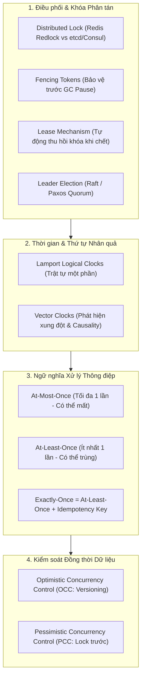
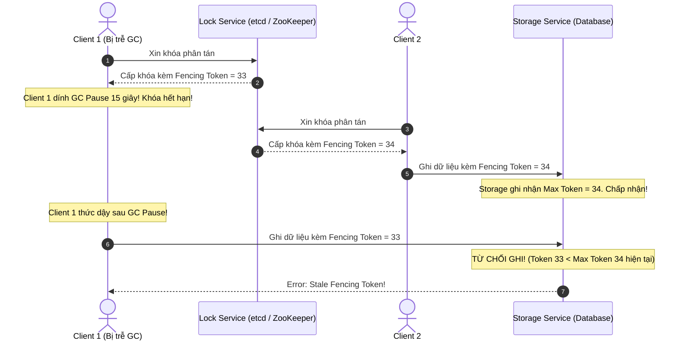
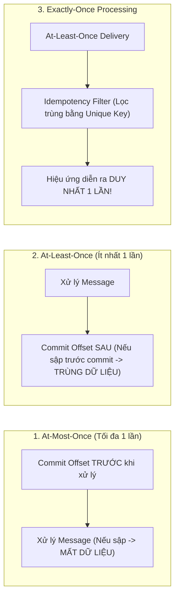

# 15.17. Distributed Concurrency (Đồng Thời Phân Tán: Fencing Tokens, Vector Clocks & Đồng Thuận Nhất Quán)

> [!IMPORTANT]
> **Mental Model & Trực giác cốt lõi**:
> Hãy tưởng tượng việc điều phối đặt phòng khách sạn trực tuyến trên quy mô toàn cầu:
> - **Khóa Phân Tán (Distributed Lock) Không Có Fencing Token** giống như một người khách thuê phòng lấy được chiếc chìa khóa phòng có hạn sử dụng 10 phút. Đang đi lên thang máy thì thang máy bị kẹt 15 phút (**Tiến trình bị đơ do JVM Garbage Collection Pause hoặc mạng lag**). Trong lúc đó, hạn khóa 10 phút đã hết, lễ tân phát chìa khóa đó cho một khách thứ hai. Khi thang máy chạy lại, vị khách thứ nhất chạy xộc vào phòng cùng lúc với khách thứ hai, dẫn tới ẩu đả (**Dữ liệu bị ghi đè phá hoại!**).
> - **Giải pháp Fencing Token của Martin Kleppmann**: Mỗi lần cấp khóa, lễ tân phát kèm một con số thứ tự tăng dần (**Token 101, Token 102**). Người gác cửa kho lưu trữ bên trong chỉ chấp nhận người nào mang con số LỚN HƠN con số của người vừa vào trước đó. Khi vị khách thứ nhất (mang Token 101) bước tới cửa sau 15 phút, người gác cửa lập tức chặn lại vì vị khách thứ hai (mang Token 102) đã vào trước!
> - **Ngữ nghĩa Vận chuyển (Delivery Semantics)**: Gửi tin nhắn qua mạng giống như gửi bưu phẩm qua bưu điện:
>   - **At-Most-Once**: Ném gói hàng qua hàng rào một lần duy nhất, nếu rơi xuống sông thì mất luôn (chấp nhận mất dữ liệu).
>   - **At-Least-Once**: Liên tục gửi lại gói hàng cho đến khi người nhận ký xác nhận, chấp nhận người nhận có thể nhận 2-3 kiện hàng trùng lặp.
>   - **Exactly-Once**: Kết hợp At-Least-Once với con dấu định danh duy nhất (**Idempotency Key**) để người nhận tự động lọc bỏ các kiện hàng trùng, đảm bảo hiệu ứng chỉ diễn ra đúng 1 lần duy nhất!
> **Nếu chỉ nhớ một điều**: *Trong hệ phân tán, đồng hồ vật lý không bao giờ đáng tin cậy và tiến trình có thể bị đứng hình bất cứ lúc nào. Luôn dùng Fencing Token cho Distributed Lock và Idempotency Key cho Message Processing.*

---

## 1. Tổng quan Chuyên đề & Sơ đồ Tư duy (Distributed Concurrency Dynamics)



---

## 2. Chi tiết từng Keyword

### 2.1. Distributed Locks, Mutex & Cuộc Tranh Luận Lịch Sử Redlock vs Martin Kleppmann

Khóa phân tán là cơ chế đảm bảo Mutual Exclusion giữa các tiến trình chạy trên các máy chủ vật lý khác nhau qua mạng:
- **Thuật toán Redlock của Salvatore Sanfilippo (tác giả Redis)**:
  - Client cố gắng chiếm khóa trên $5$ nút Redis độc lập bằng lệnh `SET resource_name my_random_value NX PX 10000`.
  - Nếu chiếm được trên đa số nút ($3/5$) trong thời gian ngắn hơn thời hạn TTL $\implies$ Coi như chiếm khóa thành công.
- **Phản biện Chấn động của Martin Kleppmann (Tác giả cuốn DDIA, 2016)**:
  - Kleppmann chứng minh Redlock **không an toàn** cho các bài toán yêu cầu tính đúng đắn dữ liệu tuyệt đối (Data Correctness):
    1. **Sự cố GC Pause bất định**: Client 1 lấy được khóa, chuẩn bị ghi dữ liệu thì dính Full GC Pause $15\text{ giây}$.
    2. Khóa trên Redis tự động hết hạn TTL và được cấp phát cho Client 2.
    3. Client 2 ghi xong dữ liệu. Đúng lúc đó Client 1 thức dậy và ghi đè dữ liệu cũ lên dữ liệu mới của Client 2!
    4. **Lệch pha đồng hồ vật lý (NTP Jump)**: Một sự cố chỉnh giờ mạng trên cụm Redis có thể làm khóa hết hạn sớm hơn dự kiến.

---

### 2.2. Fencing Tokens & Lease Mechanism (Chống Lỗi Treo GC Pause)

Để giải quyết bài toán trên, Martin Kleppmann đưa ra giải pháp **Fencing Token**:



- **Nguyên lý Hoạt động**: Mỗi khi cấp khóa thành công, Lock Service sinh ra một con số nguyên đơn điệu tăng dần (**Monotonically Increasing Token**).
- Máy chủ lưu trữ (Storage) lưu giữ chỉ số Token lớn nhất mà nó từng xử lý. Bất kỳ request nào mang Token nhỏ hơn đều bị từ chối ngay lập tức, triệt tiêu hoàn toàn nguy cơ ghi đè của các tiến trình bị lag!
- **Lease Mechanism (Hợp đồng Thuê)**: Khóa không tồn tại vĩnh viễn mà đi kèm một thời hạn thuê (ví dụ: $5\text{ giây}$). Tiến trình giữ khóa phải liên tục gửi tín hiệu tim đập (**Heartbeat / Keep-Alive**) để gia hạn. Nếu tiến trình sập, khóa tự động được giải phóng an toàn.

---

### 2.3. Leader Election & Distributed Coordination (etcd, ZooKeeper, Raft)

- Trong cụm phân tán (Kafka, Kubernetes, CockroachDB), cần có một nút đứng ra làm **Leader** để điều phối toàn bộ cụm.
- Cơ chế bầu Leader hiện đại dựa trên thuật toán đồng thuận **Raft** (`etcd`, Consul) hoặc **Zab** (ZooKeeper):
  - Tránh hiện tượng **Não phân đôi (Split-Brain)** bằng nguyên tắc Quorum quá bán: Một Leader chỉ được công nhận hợp pháp nếu nhận được sự đồng thuận của ít nhất $\lfloor N/2 \rfloor + 1$ nút.

---

### 2.4. Đồng Hồ Logic: Lamport Clocks & Vector Clocks (Truy vết Trật tự Nhân quả)

Vì đồng hồ vật lý trên các máy tính luôn bị lệch pha (Clock Skew):
1. **Lamport Logical Clocks (Leslie Lamport, 1978)**:
   - Mỗi nút duy trì một bộ đếm số nguyên đơn lẻ $C$. Mỗi khi gửi tin: $C = C + 1$.
   - Khi nhận tin nhắn mang nhãn thời gian $C_{\text{msg}}$: Nút nhận cập nhật $C = \max(C, C_{\text{msg}}) + 1$.
   - Cho phép thiết lập **Trật tự một phần (Partial Order)**: Nếu $A \to B$ thì $C(A) < C(B)$. Tuy nhiên, nếu $C(A) < C(B)$, ta **không thể kết luận** $A$ xảy ra trước $B$ (không phát hiện được hai sự kiện xảy ra đồng thời).
2. **Vector Clocks (Fidge & Mattern, 1988)**:
   - Mỗi nút lưu một mảng số nguyên biểu diễn trạng thái của toàn bộ $N$ nút trong cụm: $V[1..N]$.
   - Cho phép so sánh quan hệ nhân quả chính xác: Phát hiện được hai sự kiện $A$ và $B$ có quan hệ nhân quả hay xảy ra **đồng thời (Concurrent / Conflit)** để kích hoạt thuật toán hợp nhất dữ liệu (như trong Amazon Dynamo).

---

### 2.5. Optimistic Concurrency Control (OCC) vs Pessimistic Concurrency Control (PCC)

| Tiêu chuẩn | Pessimistic Concurrency Control (PCC - Bi quan) | Optimistic Concurrency Control (OCC - Lạc quan) |
| :--- | :--- | :--- |
| **Triết lý Cốt lõi** | Luôn giả định xung đột sẽ xảy ra $\to$ **Khóa trước khi đọc/ghi** | Giả định xung đột hiếm khi xảy ra $\to$ **Không khóa, kiểm tra lúc ghi** |
| **Cơ chế Triển khai** | `SELECT ... FOR UPDATE`, Distributed Mutex | Đính kèm số phiên bản `version` (Compare-And-Swap) |
| **Hiệu năng & Khóa** | Giảm thông lượng do các luồng phải xếp hàng chờ | **Thông lượng cực cao**, không tốn tài nguyên giữ khóa |
| **Chi phí khi Xung đột**| Luồng chỉ bị chậm lại khi chờ | **Giao dịch bị Abort và phải thử lại từ đầu (Retry Loop)** |
| **Kịch bản Khuyên dùng**| Tranh chấp cực cao (Bán vé ca nhạc, Flash Sale) | Đọc nhiều, ghi ít (Cập nhật hồ sơ, bài viết blog) |

---

### 2.6. Ngữ Nghĩa Vận Chuyển: At-Most-Once, At-Least-Once và Exactly-Once Processing

Ba cấp độ cam kết xử lý thông điệp trong kiến trúc hướng sự kiện (Kafka, RabbitMQ, SQS):



1. **At-Most-Once (Tối đa một lần)**: Tin nhắn được cam kết (ACK/Commit offset) ngay khi nhận được, trước khi thực hiện xử lý. Nếu server sập trong lúc đang xử lý, tin nhắn bị mất vĩnh viễn. Không bao giờ bị trùng lặp, nhưng chấp nhận mất mát dữ liệu (Dùng cho log chỉ số CPU, nhiệt độ cảm biến IoT).
2. **At-Least-Once (Ít nhất một lần)**: Tin nhắn chỉ được ACK sau khi đã ghi thành công vào cơ sở dữ liệu. Nếu server sập sau khi ghi nhưng trước khi gửi ACK, hệ thống sẽ gửi lại tin nhắn đó khi khởi động lại $\implies$ **Tin nhắn có thể bị xử lý 2 lần (Duplicate)**.
3. **Exactly-Once Processing (Chính xác một lần)**:
   - Trong thế giới mạng phân tán đầy rẫy lỗi, việc đảm bảo gói tin vật lý bay qua mạng đúng 1 lần duy nhất là bất khả thi.
   - Do đó, **Exactly-Once Processing thực chất là: $\text{At-Least-Once Delivery} + \text{Idempotent Consumer}$**!

---

### 2.7. Tính Bất Biến (Idempotency), Request Deduplication & Partition Ordering

#### A. Tính Bất Biến (Idempotency Pattern)
Một phép toán $f$ được gọi là Idempotent nếu việc áp dụng nó nhiều lần liên tiếp mang lại kết quả giống hệt như khi áp dụng đúng một lần:
$$f(f(x)) = f(x)$$
- *Ví dụ Không Idempotent*: `balance = balance - 50` (Chạy 2 lần bị trừ 100$).
- *Ví dụ Idempotent*: `balance = 50` hoặc `INSERT INTO payments (id, amount) VALUES ('TX_991', 50) ON CONFLICT DO NOTHING`.

#### B. Khóa Chống Trùng Lặp (Idempotency Key / Request Deduplication)
- Mọi yêu cầu nhạy cảm từ Mobile App/Frontend (như quẹt thẻ thanh toán) bắt buộc phải sinh ra một chuỗi UUID duy nhất (**Idempotency-Key**):
  - Backend lưu mã UUID này vào Redis hoặc Database trong một bảng kiểm tra.
  - Nếu mạng chập chờn khiến người dùng bấm 2 lần hoặc Gateway gửi lại: Backend phát hiện UUID đã tồn tại, lập tức trả về kết quả giao dịch cũ mà **hoàn toàn không trừ tiền lần hai**!

---

## 3. Hiện thực Thực nghiệm: Dual-Engine Code Implementation

### 3.1. C++20: Bộ Xác Thực Khóa Phân Tán với Fencing Tokens (Fencing Token Validator Engine)

Chương trình minh họa cỗ máy xác thực giao dịch phía cơ sở dữ liệu: từ chối các thao tác ghi mang Fencing Token cũ hơn Token lớn nhất đã được ghi nhận.

```cpp
// Compilation: g++ -std=c++20 -O3 -Wall -pthread fencing_token_sim.cpp -o fencing_token_sim
#include <iostream>
#include <string>
#include <atomic>
#include <vector>
#include <chrono>
#include <thread>
#include <optional>

class DistributedStorageService {
private:
    uint64_t highest_fencing_token = 0;
    std::string current_data = "DEFAULT_DATA";

public:
    // Thao tác ghi có điều kiện bảo vệ bằng Fencing Token
    bool write_data(uint64_t token, const std::string& new_val, const std::string& client_name) {
        std::cout << "[STORAGE] " << client_name << " attempting to write with Fencing Token #" << token << "...\n";
        
        if (token < highest_fencing_token) {
            std::cerr << "  -> ❌ REJECTED! Stale Token #" << token 
                      << " is older than current Highest Token #" << highest_fencing_token << "!\n";
            return false;
        }

        // Cập nhật Token và Dữ liệu
        highest_fencing_token = token;
        current_data = new_val;
        std::cout << "  -> ✅ ACCEPTED! Data updated to: '" << current_data 
                  << "' (New Max Token = " << highest_fencing_token << ")\n";
        return true;
    }

    std::string get_data() const { return current_data; }
};

int main() {
    std::cout << "================ FENCING TOKEN VALIDATION ENGINE ================\n";
    DistributedStorageService storage;

    // Giả lập Lock Manager cấp phát Token tăng dần
    uint64_t token_client1 = 101; // Cấp cho Client 1
    uint64_t token_client2 = 102; // Cấp cho Client 2 khi Client 1 bị treo

    // Kịch bản: Client 1 bị nghẽn mạng hoặc dính Stop-The-World GC Pause!
    std::cout << "Scenario: Client 1 acquired Token #101, but freezes due to a 15-second GC Pause.\n";
    std::cout << "Lock expires. Lock Service grants Token #102 to Client 2.\n\n";

    // Client 2 thực hiện ghi thành công
    storage.write_data(token_client2, "PAYLOAD_FROM_CLIENT_2", "Client-2");

    std::cout << "\nScenario: Client 1 wakes up from GC Pause and attempts to write with stale Token #101:\n";
    // Client 1 thức dậy và cố ghi đè -> BỊ TỪ CHỐI BỞI FENCING TOKEN!
    bool result = storage.write_data(token_client1, "CORRUPTED_STALE_PAYLOAD", "Client-1");

    std::cout << "\nFinal Storage State: '" << storage.get_data() << "'\n";
    std::cout << "Result: " << (result ? "FAILED" : "DATA CORRUPTION PREVENTED BY FENCING TOKEN!") << "\n";
    std::cout << "=================================================================\n";
    return 0;
}
```

```text
================ FENCING TOKEN VALIDATION ENGINE ================
Scenario: Client 1 acquired Token #101, but freezes due to a 15-second GC Pause.
Lock expires. Lock Service grants Token #102 to Client 2.

[STORAGE] Client-2 attempting to write with Fencing Token #102...
  -> ✅ ACCEPTED! Data updated to: 'PAYLOAD_FROM_CLIENT_2' (New Max Token = 102)

Scenario: Client 1 wakes up from GC Pause and attempts to write with stale Token #101:
[STORAGE] Client-1 attempting to write with Fencing Token #101...
  -> ❌ REJECTED! Stale Token #101 is older than current Highest Token #102!

Final Storage State: 'PAYLOAD_FROM_CLIENT_2'
Result: DATA CORRUPTION PREVENTED BY FENCING TOKEN!
=================================================================
```

---

### 3.2. Python 3: Cỗ Máy Đồng Hồ Vector (Vector Clocks Causality Engine)

Chương trình minh họa cách Vector Clocks phát hiện quan hệ nhân quả (Happens-Before) và nhận diện sự kiện xung đột đồng thời (Concurrent Conflict).

```python
#!/usr/bin/env python3
"""
Mô phỏng Động học Vector Clocks (Fidge & Mattern Algorithm):
- Truy vết quan hệ nhân quả giữa 3 tiến trình A, B, C.
- So sánh quan hệ thứ tự: Happens-Before vs Concurrent Conflict.
"""

from typing import List, Dict

class VectorClock:
    def __init__(self, node_id: str, all_nodes: List[str]):
        self.node_id = node_id
        self.clock: Dict[str, int] = {nid: 0 for nid in sorted(all_nodes)}

    def increment(self):
        self.clock[self.node_id] += 1

    def send_event(self) -> Dict[str, int]:
        self.increment()
        return dict(self.clock)

    def receive_event(self, incoming_clock: Dict[str, int]):
        self.increment()
        for nid in self.clock:
            self.clock[nid] = max(self.clock[nid], incoming_clock.get(nid, 0))

    def __repr__(self):
        return f"{self.node_id}: {dict(self.clock)}"

def compare_vector_clocks(vc1: Dict[str, int], vc2: Dict[str, int]) -> str:
    less_or_equal = all(vc1[k] <= vc2[k] for k in vc1)
    greater_or_equal = all(vc1[k] >= vc2[k] for k in vc1)

    if less_or_equal and not greater_or_equal:
        return "VC1 HAPPENS-BEFORE VC2 (VC1 -> VC2)"
    elif greater_or_equal and not less_or_equal:
        return "VC2 HAPPENS-BEFORE VC1 (VC2 -> VC1)"
    elif less_or_equal and greater_or_equal:
        return "VC1 IDENTICAL TO VC2"
    else:
        return "⚠️ CONCURRENT CONFLICT! (Xung đột đồng thời - Cần Merge)"

def main():
    print("================ VECTOR CLOCKS CAUSALITY ENGINE ================")
    nodes = ["NodeA", "NodeB", "NodeC"]
    vc_a = VectorClock("NodeA", nodes)
    vc_b = VectorClock("NodeB", nodes)

    # 1. Node A tự tăng sự kiện nội bộ
    vc_a.increment()
    print(f"1. Node A local event  : {vc_a}")

    # 2. Node A gửi tin nhắn sang Node B
    msg = vc_a.send_event()
    print(f"2. Node A sends to B   : {vc_a} (Msg payload clock: {msg})")
    vc_b.receive_event(msg)
    print(f"3. Node B receives msg : {vc_b}")

    # 3. Tạo tình huống Xung Đột Đồng Thời (Concurrent Conflict)
    # Node A và Node B cùng tự sinh sự kiện nội bộ mà chưa giao tiếp với nhau
    vc_a.increment()
    vc_b.increment()
    print(f"\nAfter independent local events:")
    print(f"  Current Clock A : {dict(vc_a.clock)}")
    print(f"  Current Clock B : {dict(vc_b.clock)}")

    relation = compare_vector_clocks(vc_a.clock, vc_b.clock)
    print(f"Causality Relation : {relation}")
    print("================================================================")

if __name__ == "__main__":
    main()
```

```text
================ VECTOR CLOCKS CAUSALITY ENGINE ================
1. Node A local event  : NodeA: {'NodeA': 1, 'NodeB': 0, 'NodeC': 0}
2. Node A sends to B   : NodeA: {'NodeA': 2, 'NodeB': 0, 'NodeC': 0} (Msg payload clock: {'NodeA': 2, 'NodeB': 0, 'NodeC': 0})
3. Node B receives msg : NodeB: {'NodeA': 2, 'NodeB': 1, 'NodeC': 0}

After independent local events:
  Current Clock A : {'NodeA': 3, 'NodeB': 0, 'NodeC': 0}
  Current Clock B : {'NodeA': 2, 'NodeB': 2, 'NodeC': 0}
Causality Relation : ⚠️ CONCURRENT CONFLICT! (Xung đột đồng thời - Cần Merge)
================================================================
```

---

## 4. Vận hành Hệ thống & Chẩn đoán Thực tế (NTP Skew, Lease Expiration, Distributed Deadlocks)

### 4.1. Lỗi Giây Nhuận (Leap Second Bug) Làm Phá Hủy Hệ Thống Phân Tán
- Vào ngày 30 tháng 6 năm 2012, một giây nhuận ($23:59:60$) được chèn vào đồng hồ quốc tế UTC:
  - Máy chủ Linux bị lùi đồng hồ 1 giây đột ngột.
  - Các hệ thống phân tán (Java JVM, Cassandra, Linux Futex) bị treo cứng do vòng lặp thời gian âm tính (`sleep` bị đóng băng vĩnh viễn), làm sập hàng loạt website lớn như Reddit, LinkedIn, Qantas Airlines!
- **Giải pháp Hiện đại của Big Tech**: **NTP Leap Smearing (Làm mịn giây nhuận)**: Thay vì lùi 1 giây đột ngột, Google NTP và AWS NTP kéo giãn từng giây chậm đi $11.6\ \mu\text{s}$ trong suốt 24 giờ xung quanh thời điểm giây nhuận để đồng hồ máy chủ luôn tăng tịnh tiến.

### 4.2. Các Lệnh Linux Chẩn Đoán Đồng Hồ và Khóa Phân Tán

```bash
# Kiểm tra độ lệch pha thời gian NTP Skew giữa máy chủ và nguồn chuẩn
chronyc tracking
# Quan sát trường "RMS offset" (phải < 5ms) và "Frequency drift"

# Chiếm giữ một Distributed Lock an toàn bằng etcdctl với cơ chế Lease
etcdctl lock /services/payment_worker --lease=694d5712

# Bắt gói tin kiểm tra kết nối phân tán trên cổng 2379 của etcd
sudo tcpdump -nn -i eth0 port 2379 -c 5
```

---

## 5. Bảng So Sánh & Quyết Định Kỹ Thuật (Decision Matrix)

| Thuộc tính / Giải pháp | Redlock (Redis) | etcd / Consul Distributed Lock | Optimistic Locking (OCC) |
| :--- | :--- | :--- | :--- |
| **Cơ chế An toàn** | Dựa trên thời gian TTL (Dễ dính GC lag)| **Dựa trên Lease + Raft Quorum + Revision** | **Dựa trên Version Counter (`version++`)** |
| **Khả năng Chống Split-Brain**| Kém nếu có NTP Clock Skew | **Tuyệt đối** (Dựa trên Quorum phân tán) | **Tuyệt đối** (Phụ thuộc Database ACID) |
| **Chi phí Hạ tầng** | Nhẹ (Tận dụng cụm Redis có sẵn) | Cần cụm máy chủ etcd chuyên biệt | Tận dụng cơ sở dữ liệu sẵn có |
| **Hỗ trợ Fencing Token** | Không có sẵn (Phải tự triển khai) | **Có sẵn** (Chỉ số `raft_index` / `revision`) | **Tự nhiên** (Giá trị `version` là Token) |
| **Kịch bản Khuyên dùng** | Khóa tạm thời không nhạy cảm (Gửi email) | Khóa nghiêm ngặt (Master Election, Batch Job) | Cập nhật hồ sơ người dùng, giỏ hàng E-com |
