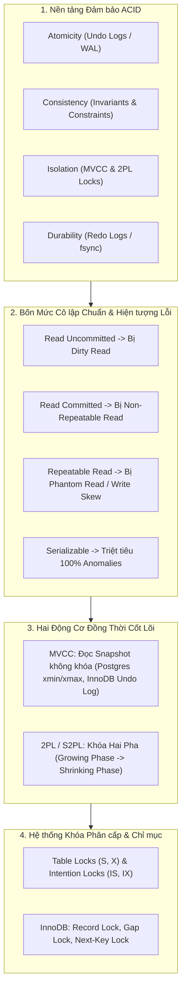
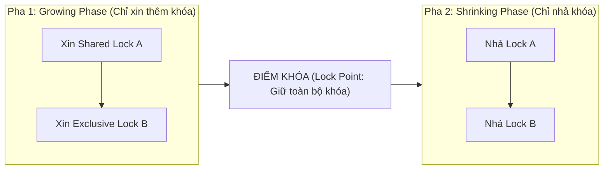

# 15.18. Database Concurrency & Transaction Processing (Đồng Thời Trong Cơ Sở Dữ Liệu: MVCC, 2PL, Isolation Levels & Write Skew)

> [!IMPORTANT]
> **Mental Model & Trực giác cốt lõi**:
> Hãy tưởng tượng cơ sở dữ liệu giống như một cuốn sổ cái kế toán công cộng được hàng ngàn người truy cập cùng lúc:
> - **Khóa Hai Pha Cổ điển (Two-Phase Locking - 2PL)** giống như việc mỗi khi có người muốn đọc hoặc sửa sổ cái, họ giật lấy cuốn sổ và khóa chặt phòng làm việc: *"Tôi đang đọc, cấm ai được sửa!"* (**Shared Lock**); *"Tôi đang sửa, cấm ai được đọc lẫn sửa!"* (**Exclusive Lock**). Cách này an toàn tuyệt đối nhưng khiến hàng ngàn người phải đứng xếp hàng chờ đợi ngoài hành lang, làm tắc nghẽn toàn bộ ngân hàng (**Readers block Writers, Writers block Readers**).
> - **Kiểm Soát Đồng Thời Đa Phiên Bản (MVCC - Multi-Version Concurrency Control)** là cuộc cách mạng vĩ đại: Mỗi khi có người muốn sửa sổ cái, hệ thống không sửa trực tiếp vào trang gốc, mà photocopy ra một bản nháp mới mang số hiệu thời gian (**Snapshot / Versioning**). Người đọc luôn nhìn vào bản chụp cũ hoàn toàn hợp lệ, trong khi người ghi thỏa sức viết vào bản nháp mới.
> - **Triết lý Vàng của MVCC**: **"Người Đọc không bao giờ chặn Người Ghi, và Người Ghi không bao giờ chặn Người Đọc!"** (Readers never block Writers, and Writers never block Readers).
> **Nếu chỉ nhớ một điều**: *Hiệu năng cơ sở dữ liệu hiện đại dựa trên sự kết hợp giữa MVCC (cho các tác vụ đọc không khóa) và hệ thống khóa phân cấp (Intention Locks, Next-Key Locks) để triệt tiêu bóng ma dữ liệu và bảo toàn tính toàn vẹn ACID.*

---

## 1. Tổng quan Chuyên đề & Sơ đồ Tư duy (Database Concurrency Architecture)



---

## 2. Chi tiết từng Keyword

### 2.1. Bản chất ACID & Quản lý Giao dịch Đồng thời (Transaction Concurrency)

Bốn trụ cột đảm bảo tính đúng đắn của cơ sở dữ liệu quan hệ (RDBMS):
1. **Atomicity (Tính Nguyên tử)**: Một giao dịch gồm 10 câu lệnh SQL hoặc là thành công $100\%$, hoặc là thất bại hoàn toàn và được hoàn nguyên (**Rollback**) về trạng thái ban đầu qua Undo Log.
2. **Consistency (Tính Nhất quán)**: Dữ liệu chuyển dịch từ một trạng thái hợp lệ này sang trạng thái hợp lệ khác, không bao giờ vi phạm các ràng buộc toàn vẹn (Foreign Keys, Unique, Check Constraints).
3. **Isolation (Tính Cô lập)**: Các giao dịch chạy đồng thời độc lập với nhau, không làm rò rỉ dữ liệu dở dang cho nhau quan sát thấy.
4. **Durability (Tính Bền vững)**: Khi giao dịch đã Commit, dữ liệu được ghi xuống đĩa cứng (qua Write-Ahead Logging - WAL và lệnh `fsync`), đảm bảo không bị mất kể cả khi máy chủ bị mất điện đột ngột.

---

### 2.2. Bốn Mức độ Cô lập Chuẩn (Isolation Levels) & Các Hiện tượng Dị thường (Anomalies & Write Skew)

Tiêu chuẩn ANSI/ISO SQL định nghĩa 4 mức cô lập dựa trên khả năng ngăn chặn các hiện tượng dị thường:

| Mức độ Cô lập (Isolation Level) | Dirty Read | Non-Repeatable Read | Phantom Read | Serialization Anomaly (Write Skew) |
| :--- | :---: | :---: | :---: | :---: |
| **Read Uncommitted** | ❌ Bị dính | ❌ Bị dính | ❌ Bị dính | ❌ Bị dính |
| **Read Committed** | ✅ Ngăn chặn | ❌ Bị dính | ❌ Bị dính | ❌ Bị dính |
| **Repeatable Read** (Default MySQL)| ✅ Ngăn chặn | ✅ Ngăn chặn | ⚠️ Ngăn một phần | ❌ Bị dính (Write Skew) |
| **Serializable** | ✅ Ngăn chặn | ✅ Ngăn chặn | ✅ Ngăn chặn | ✅ **Ngăn chặn 100%** |

#### Giải phẫu Các Hiện tượng Dị thường:
1. **Dirty Read (Đọc rác)**: Giao dịch A sửa dữ liệu nhưng **chưa Commit**. Giao dịch B đọc được dữ liệu sửa đổi đó. Sau đó Giao dịch A bị lỗi và Rollback $\implies$ Giao dịch B đã tính toán trên một dữ liệu rác không hề tồn tại!
2. **Non-Repeatable Read (Đọc không lặp lại được)**: Giao dịch A đọc dòng $X = 10$. Giao dịch B sửa $X = 20$ và Commit. Giao dịch A đọc lại dòng $X$ lần 2 và thấy $X = 20$ $\implies$ Cùng một giao dịch nhưng 2 lần đọc cho ra 2 giá trị khác nhau!
3. **Phantom Read (Bóng ma dữ liệu)**: Giao dịch A chạy `SELECT count(*) FROM users WHERE age > 30` (ra 10 dòng). Giao dịch B chèn thêm 1 user mới tuổi 35 và Commit. Giao dịch A chạy lại câu lệnh cũ và thấy xuất hiện 11 dòng ("bóng ma" mới xuất hiện).
4. **Write Skew (Lệch Ghi - Dị thường nguy hiểm nhất của Repeatable Read)**:
   - *Ví dụ kinh điển về Lịch trực Bác sĩ*: Bệnh viện yêu cầu luôn có **ít nhất 1 bác sĩ trực**. Bác sĩ Alice và Bác sĩ Bob cùng xem lịch trực: Thấy có 2 người đang trực. Cả hai cùng bấm nút xin nghỉ trực cùng một giây!
   - Dưới mức Repeatable Read: Cả hai lệnh UPDATE đều thành công $\implies$ **Bệnh viện không còn bác sĩ nào trực!**

---

### 2.3. Multi-Version Concurrency Control (MVCC) & Snapshot Isolation

Thay vì dùng khóa đọc để chặn người ghi, cơ sở dữ liệu hiện đại áp dụng MVCC:
1. **Cơ chế trong PostgreSQL (Tuple Header Hidden Fields)**:
   - Mỗi dòng dữ liệu (Tuple) trong bảng chứa 2 trường ẩn $32\text{-bit}$: **`xmin`** (Transaction ID đã chèn dòng này) và **`xmax`** (Transaction ID đã xóa/cập nhật dòng này).
   - Khi chạy lệnh `UPDATE`: PostgreSQL **không ghi đè**, mà đánh dấu `xmax` của dòng cũ bằng TxID hiện tại, đồng thời chèn một dòng mới toanh có `xmin` bằng TxID hiện tại!
   - Một câu truy vấn chỉ nhìn thấy các dòng mà: `xmin <= My_TxID` và `xmax` chưa commit hoặc `xmax > My_TxID`.
2. **Cơ chế trong MySQL InnoDB (Undo Log & Rollback Pointer)**:
   - InnoDB sửa trực tiếp trên trang dữ liệu trong Buffer Pool, nhưng ghi lại phiên bản cũ của dữ liệu vào một phân vùng riêng gọi là **Undo Log Segment**.
   - Dòng dữ liệu mang một con trỏ **Rollback Pointer (`roll_ptr`)** trỏ ngược về Undo Log để tái tạo lại hình ảnh dữ liệu quá khứ cho các giao dịch chạy trước đó.

---

### 2.4. Giao thức Khóa Hai Pha (Two-Phase Locking - 2PL & Strict 2PL)

Được phát minh bởi Jim Gray (Turing Award) năm 1976 để chứng minh tính khả tuần tự hóa (Serializability):



1. **Quy tắc 2PL Cơ bản**:
   - **Growing Phase (Pha Lớn Lên)**: Giao dịch có thể xin cấp thêm khóa (Shared Lock hoặc Exclusive Lock), nhưng **tuyệt đối không được nhả bất kỳ khóa nào**.
   - **Shrinking Phase (Pha Thu Nhỏ)**: Ngay khi giao dịch nhả chiếc khóa đầu tiên, nó bước vào pha thu nhỏ và **tuyệt đối không bao giờ được phép xin thêm bất kỳ chiếc khóa nào nữa**!
2. **Strict 2PL (S2PL - Chuẩn công nghiệp trong RDBMS)**:
   - Trong 2PL thông thường, nếu Giao dịch A nhả khóa ở pha Shrinking rồi sau đó bị lỗi và Rollback, các giao dịch khác đã đọc dữ liệu của A sẽ bị lỗi dây chuyền (**Cascading Aborts**).
   - **Strict 2PL giải quyết**: Toàn bộ các khóa Exclusive Lock **bắt buộc phải được giữ chặt cho đến tận thời điểm cuối cùng khi giao dịch COMMIT hoặc ROLLBACK hoàn tất** mới được đồng loạt nhả ra.

---

### 2.5. Hệ Thống Khóa Phân Cấp: Intention Locks (IS, IX), Row-Level & Table-Level Locks

Khi một cơ sở dữ liệu hỗ trợ đồng thời cả khóa cấp độ dòng (Row-Level Locks) và khóa cấp độ bảng (Table-Level Locks):
- **Vấn đề**: Giả sử Transaction A muốn khóa toàn bộ Bảng `orders` bằng lệnh `LOCK TABLE orders IN EXCLUSIVE MODE`. Làm thế nào để Transaction A biết được có dòng nào bên trong bảng đang bị một giao dịch khác khóa dòng hay không mà không cần phải quét qua 10 triệu dòng?
- **Giải pháp: Khóa Ý Định (Intention Locks - Hierarchical Locking)**:
  - Trước khi một giao dịch muốn chiếm Shared Lock trên 1 dòng, nó bắt buộc phải xin một khóa **Intention Shared (IS)** trên Bảng cha trước!
  - Trước khi chiếm Exclusive Lock trên 1 dòng, nó bắt buộc phải xin một khóa **Intention Exclusive (IX)** trên Bảng cha!
  - Nhờ đó, khi Transaction A muốn khóa toàn bộ Bảng, nó chỉ cần liếc nhìn bảng khóa cấp Bảng: Thấy có cờ **`IX`** đang được giữ $\implies$ Lập tức biết ngay có ai đó đang sửa dòng bên trong và dừng lại chờ, không tốn $1\text{ ms}$ nào để quét dòng!

```
Ma Trận Tương Thích Khóa (Lock Compatibility Matrix):
┌──────┬────────┬────────┬────────┬────────┐
│      │   IS   │   IX   │   S    │   X    │
├──────┼────────┼────────┼────────┼────────┤
│  IS  │   ✅   │   ✅   │   ✅   │   ❌   │
│  IX  │   ✅   │   ✅   │   ❌   │   ❌   │
│  S   │   ✅   │   ❌   │   ✅   │   ❌   │
│  X   │   ❌   │   ❌   │   ❌   │   ❌   │
└──────┴────────┴────────┴────────┴────────┘
```

---

### 2.6. Khóa Chỉ Mục trong MySQL InnoDB: Record Lock, Gap Lock & Next-Key Lock

Để triệt tiêu hiện tượng Phantom Read tại mức cô lập `Repeatable Read`, động cơ InnoDB của MySQL sử dụng hệ thống khóa chỉ mục tinh vi:
1. **Record Lock (Khóa Bản ghi)**: Khóa trực tiếp trên chỉ mục của dòng dữ liệu cụ thể (`WHERE id = 5`).
2. **Gap Lock (Khóa Khoảng trống)**: Khóa khoảng trống nằm giữa hai giá trị chỉ mục, ngăn chặn các giao dịch khác chèn dữ liệu mới vào giữa khoảng đó:
   - Ví dụ: Bảng có các ID là $10$ và $20$. Một Gap Lock trên $(10, 20)$ sẽ **ngăn chặn bất kỳ ai `INSERT` dòng có ID từ 11 đến 19**!
3. **Next-Key Lock**: Là sự kết hợp giữa **Record Lock + Gap Lock**: Khóa bản ghi chỉ mục đó kèm theo toàn bộ khoảng trống nằm ngay trước nó: $(10, 20]$. Đây là cơ chế mặc định giúp MySQL Repeatable Read chặn được Phantom Read.

---

### 2.7. Chiến Lược Thực Chiến: Optimistic Locking (Version Counter) vs SELECT FOR UPDATE

#### A. Pessimistic Locking (`SELECT ... FOR UPDATE`)
```sql
BEGIN TRANSACTION;
-- Khóa cứng dòng sản phẩm, mọi giao dịch khác cố đọc FOR UPDATE hoặc ghi đều bị chặn
SELECT stock_quantity FROM products WHERE id = 101 FOR UPDATE;

UPDATE products SET stock_quantity = stock_quantity - 1 WHERE id = 101;
COMMIT;
```
- *Ưu điểm*: An toàn $100\%$, không bao giờ bị bán âm hàng trong các sự kiện Flash Sale bán vé máy bay, vé ca nhạc.
- *Nhược điểm*: Làm giảm thông lượng, dễ dính Deadlock nếu các giao dịch khóa nhiều dòng theo thứ tự lộn xộn.

#### B. Optimistic Locking (Khóa Lạc quan với Versioning)
```sql
-- Bước 1: Đọc dữ liệu kèm số phiên bản hiện tại (Không cần khóa)
SELECT stock_quantity, version FROM products WHERE id = 101; -- Giả sử ra version = 5

-- Bước 2: Cập nhật có điều kiện kiểm tra phiên bản
UPDATE products 
SET stock_quantity = stock_quantity - 1, version = version + 1 
WHERE id = 101 AND version = 5;

-- Bước 3: Kiểm tra số dòng bị ảnh hưởng (Rows Affected):
-- Nếu Rows Affected == 1 -> Thành công!
-- Nếu Rows Affected == 0 -> Có ai đó đã sửa trước -> Rollback & Retry!
```
- *Ưu điểm*: Không tốn khóa, thông lượng cực cao cho hệ thống đọc nhiều.

---

## 3. Hiện thực Thực nghiệm: Dual-Engine Code Implementation

### 3.1. C++20: Mô Phỏng Cơ Chế MVCC Visibility Engine (Đánh Giá Tầm Nhìn Dòng Dữ Liệu)

Chương trình minh họa cỗ máy đánh giá tầm nhìn MVCC tương tự PostgreSQL: quyết định xem một Transaction có được phép nhìn thấy một dòng dữ liệu hay không dựa trên `xmin`, `xmax` và Snapshot Active TxID List.

```cpp
// Compilation: g++ -std=c++20 -O3 -Wall mvcc_engine_sim.cpp -o mvcc_engine_sim
#include <iostream>
#include <vector>
#include <string>
#include <set>
#include <iomanip>

struct TupleHeader {
    uint32_t xmin;       // TxID chèn dòng
    uint32_t xmax;       // TxID xóa dòng (0 nếu còn sống)
    std::string data;
};

struct Snapshot {
    uint32_t current_txid;
    std::set<uint32_t> active_txids; // Danh sách các giao dịch chưa commit lúc chụp snapshot
};

class MVCCEngine {
public:
    static bool is_tuple_visible(const TupleHeader& tuple, const Snapshot& snap) {
        // 1. Kiểm tra xmin (Ai đã tạo ra dòng này?)
        if (tuple.xmin == snap.current_txid) {
            // Do chính giao dịch này tạo ra -> Luôn nhìn thấy (trừ khi chính nó đã xóa)
            return (tuple.xmax != snap.current_txid);
        }
        
        // Nếu xmin lớn hơn Transaction hiện tại -> Được tạo ra trong tương lai -> Ẩn!
        if (tuple.xmin > snap.current_txid) return false;

        // Nếu xmin nằm trong danh sách các giao dịch đang chạy lúc chụp snapshot -> Chưa commit -> Ẩn!
        if (snap.active_txids.count(tuple.xmin)) return false;

        // 2. Kiểm tra xmax (Dòng này đã bị xóa bởi ai?)
        if (tuple.xmax == 0) return true; // Chưa bị ai xóa -> Còn sống!
        if (tuple.xmax == snap.current_txid) return false; // Chính mình đã xóa -> Ẩn!
        if (tuple.xmax > snap.current_txid) return true;  // Bị xóa bởi tương lai -> Vẫn nhìn thấy!
        if (snap.active_txids.count(tuple.xmax)) return true; // Người xóa chưa commit -> Vẫn nhìn thấy!

        return false; // Đã bị xóa và commit trước snapshot -> Ẩn!
    }
};

int main() {
    std::cout << "================ DATABASE MVCC VISIBILITY ENGINE SIMULATOR ================\n";
    
    // Bảng dữ liệu có 3 phiên bản của tài khoản người dùng
    std::vector<TupleHeader> table = {
        {100, 105, "User Alice Balance: $500"},  // Tạo bởi Tx 100, bị xóa bởi Tx 105
        {105, 0,   "User Alice Balance: $800"},  // Tạo bởi Tx 105, chưa bị xóa
        {108, 0,   "User Bob Balance: $1000"}    // Tạo bởi Tx 108 (Giao dịch đang chạy chưa commit)
    };

    // Snapshot của Giao dịch số 106 (Tx 108 đang chạy chưa commit)
    Snapshot snap106{106, {108}};

    std::cout << "Evaluating visibility for Transaction ID #106 (Active uncommitted Tx: {108}):\n\n";
    for (size_t i = 0; i < table.size(); ++i) {
        bool visible = MVCCEngine::is_tuple_visible(table[i], snap106);
        std::cout << "Tuple #" << i << " [xmin: " << std::setw(3) << table[i].xmin 
                  << ", xmax: " << std::setw(3) << table[i].xmax << "] '" << table[i].data << "'\n"
                  << "  -> Visible: " << (visible ? "✅ YES (In Snapshot)" : "❌ NO (Hidden by MVCC)") << "\n";
    }

    std::cout << "\n[RESULT] Snapshot Isolation guarantees completely lock-free read consistency!\n";
    std::cout << "===========================================================================\n";
    return 0;
}
```

```text
================ DATABASE MVCC VISIBILITY ENGINE SIMULATOR ================
Evaluating visibility for Transaction ID #106 (Active uncommitted Tx: {108}):

Tuple #0 [xmin: 100, xmax: 105] 'User Alice Balance: $500'
  -> Visible: ❌ NO (Hidden by MVCC)
Tuple #1 [xmin: 105, xmax:   0] 'User Alice Balance: $800'
  -> Visible: ✅ YES (In Snapshot)
Tuple #2 [xmin: 108, xmax:   0] 'User Bob Balance: $1000'
  -> Visible: ❌ NO (Hidden by MVCC)

[RESULT] Snapshot Isolation guarantees completely lock-free read consistency!
===========================================================================
```

---

### 3.2. Python 3: Tái Hiện Dị Thường "Write Skew" & Khắc Phục Bằng Khóa Bi Quan

Mô phỏng bài toán lịch trực bác sĩ bệnh viện dưới mức cô lập Repeatable Read (dẫn tới thảm họa không còn bác sĩ trực) và cách khắc phục bằng khóa bi quan `FOR UPDATE`.

```python
#!/usr/bin/env python3
"""
Tái hiện Hiện tượng Dị thường Write Skew (Lệch Ghi):
- Hai bác sĩ cùng xin nghỉ trực đồng thời.
- Snapshot Isolation kiểm tra thấy đủ 2 bác sĩ, cho phép cả hai cùng nghỉ -> 0 bác sĩ trực!
- Minh họa cách giải quyết bằng SELECT ... FOR UPDATE.
"""

import threading
import time

class HospitalDatabase:
    def __init__(self):
        # Bảng danh sách bác sĩ đang trực (True: Đang trực, False: Đã nghỉ)
        self.on_call = {"Doctor_Alice": True, "Doctor_Bob": True}
        self.lock = threading.Lock()

    def request_leave_repeatable_read(self, doctor_name: str):
        print(f"[{doctor_name}] Submitting leave request under Repeatable Read (Snapshot)...")
        # 1. Đọc Snapshot (Cả hai cùng thấy 2 người đang trực)
        active_count = sum(1 for v in self.on_call.values() if v)
        time.sleep(0.02) # Giả lập độ trễ giao dịch phân tán

        if active_count >= 2:
            self.on_call[doctor_name] = False
            print(f"  -> ✅ [{doctor_name}] Leave approved! Active count was {active_count}.")
        else:
            print(f"  -> ❌ [{doctor_name}] Leave rejected! Must maintain at least 1 doctor on call.")

    def request_leave_serializable(self, doctor_name: str):
        # Mô phỏng SELECT ... FOR UPDATE (Khóa bi quan độc quyền)
        with self.lock:
            active_count = sum(1 for v in self.on_call.values() if v)
            if active_count >= 2:
                time.sleep(0.01)
                self.on_call[doctor_name] = False
                print(f"  -> ✅ [{doctor_name}] Leave approved! (Serialized)")
            else:
                print(f"  -> ❌ [{doctor_name}] Leave rejected! (Prevented Write Skew)")

def main():
    print("================ DATABASE WRITE SKEW SIMULATION ================")
    db1 = HospitalDatabase()
    t1 = threading.Thread(target=db1.request_leave_repeatable_read, args=("Doctor_Alice",))
    t2 = threading.Thread(target=db1.request_leave_repeatable_read, args=("Doctor_Bob",))
    t1.start(); t2.start()
    t1.join(); t2.join()

    remaining_doctors = sum(1 for v in db1.on_call.values() if v)
    print(f"\nFinal Doctors on Call: {remaining_doctors}")
    print(f"Status: {'⚠️ DISASTER! ZERO DOCTORS ON CALL (WRITE SKEW OCCURRED)!' if remaining_doctors == 0 else 'SAFE'}\n")

    print("--- Fixing with Pessimistic Locking (SELECT FOR UPDATE) ---")
    db2 = HospitalDatabase()
    t3 = threading.Thread(target=db2.request_leave_serializable, args=("Doctor_Alice",))
    t4 = threading.Thread(target=db2.request_leave_serializable, args=("Doctor_Bob",))
    t3.start(); t4.start()
    t3.join(); t4.join()

    remaining_safe = sum(1 for v in db2.on_call.values() if v)
    print(f"Final Doctors on Call: {remaining_safe} (Safe and compliant!)")
    print("================================================================")

if __name__ == "__main__":
    main()
```

```text
================ DATABASE WRITE SKEW SIMULATION ================
[Doctor_Alice] Submitting leave request under Repeatable Read (Snapshot)...
[Doctor_Bob] Submitting leave request under Repeatable Read (Snapshot)...
  -> ✅ [Doctor_Alice] Leave approved! Active count was 2.
  -> ✅ [Doctor_Bob] Leave approved! Active count was 2.

Final Doctors on Call: 0
Status: ⚠️ DISASTER! ZERO DOCTORS ON CALL (WRITE SKEW OCCURRED)!

--- Fixing with Pessimistic Locking (SELECT FOR UPDATE) ---
  -> ✅ [Doctor_Alice] Leave approved! (Serialized)
  -> ❌ [Doctor_Bob] Leave rejected! (Prevented Write Skew)
Final Doctors on Call: 1 (Safe and compliant!)
================================================================
```

---

## 4. Vận hành Hệ thống & Chẩn đoán Thực tế (TxID Wraparound, Deadlock Detection, SHOW ENGINE INNODB STATUS)

### 4.1. Thảm Họa Tràn Bộ Đếm Transaction ID trong PostgreSQL (TxID Wraparound)
- Trường `xmin` và `xmax` trong PostgreSQL là số nguyên $32\text{-bit}$ ($2^{32} \approx 4.29$ tỷ giao dịch).
- Nếu hệ thống chạy liên tục vượt qua $2$ tỷ giao dịch mà không được dọn dẹp, số TxID sẽ bị quay vòng về $0$:
  - Dữ liệu quá khứ bỗng nhiên bị hiểu nhầm là "được tạo ra trong tương lai"!
  - Toàn bộ hàng tỷ bản ghi trong cơ sở dữ liệu sẽ biến mất khỏi tầm mắt của mọi câu truy vấn!
- **Cơ chế Cứu rỗi**: **`VACUUM FREEZE`**: PostgreSQL định kỳ đóng băng các dòng dữ liệu cũ bằng cờ `FrozenTransactionId` đặc biệt để bảo vệ dữ liệu vĩnh cửu.

### 4.2. Chẩn đoán Khóa và Deadlock trong MySQL InnoDB

```sql
-- Xem báo cáo chẩn đoán khóa chi tiết nhất của động cơ InnoDB
SHOW ENGINE INNODB STATUS\G

-- Trong phần LATEST DETECTED DEADLOCK:
-- Ta sẽ nhìn thấy chính xác 2 giao dịch nào đang giữ Record Lock nào,
-- đang chờ Gap Lock nào, và câu lệnh SQL cụ thể nào làm nổ ra Deadlock!

-- Kiểm tra danh sách các giao dịch đang bị khóa treo hiện tại
SELECT * FROM performance_schema.data_locks;
SELECT * FROM performance_schema.data_lock_waits;
```

---

## 5. Bảng So Sánh & Quyết Định Kỹ Thuật (Decision Matrix)

| Cơ chế Kiểm soát Đồng thời | Băng thông Đọc (Read Throughput) | Băng thông Ghi (Write Throughput) | Khả năng Gây Deadlock | Ngăn chặn Write Skew | Công nghệ Triển khai |
| :--- | :--- | :--- | :--- | :--- | :--- |
| **MVCC (Snapshot Isolation)** | **Cực cao (Zero-Lock)** | Cao | Thấp | ❌ Không thể | PostgreSQL, MySQL InnoDB, Oracle |
| **Strict 2PL** | Rất thấp (Khóa đọc chặn ghi) | Thấp (Khóa ghi chặn đọc) | **Rất cao** | ✅ **Tuyệt đối** | SQLite, CSDL cổ điển, 2PC Distributed DB |
| **Pessimistic Locking (`FOR UPDATE`)**| Trung bình | Trung bình (Tuần tự hóa) | Cao | ✅ **Ngăn chặn an toàn** | Bán vé sự kiện, Đặt bàn, Quản lý kho hàng |
| **Optimistic Locking (`version++`)**| **Cực cao** | Cao (nếu ít xung đột) | **Không bao giờ** | ✅ **Ngăn chặn tốt** | Cập nhật hồ sơ tài khoản, E-commerce Cart |
