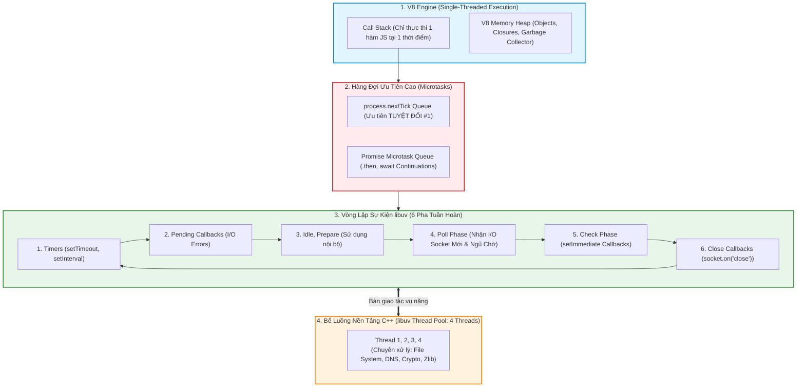
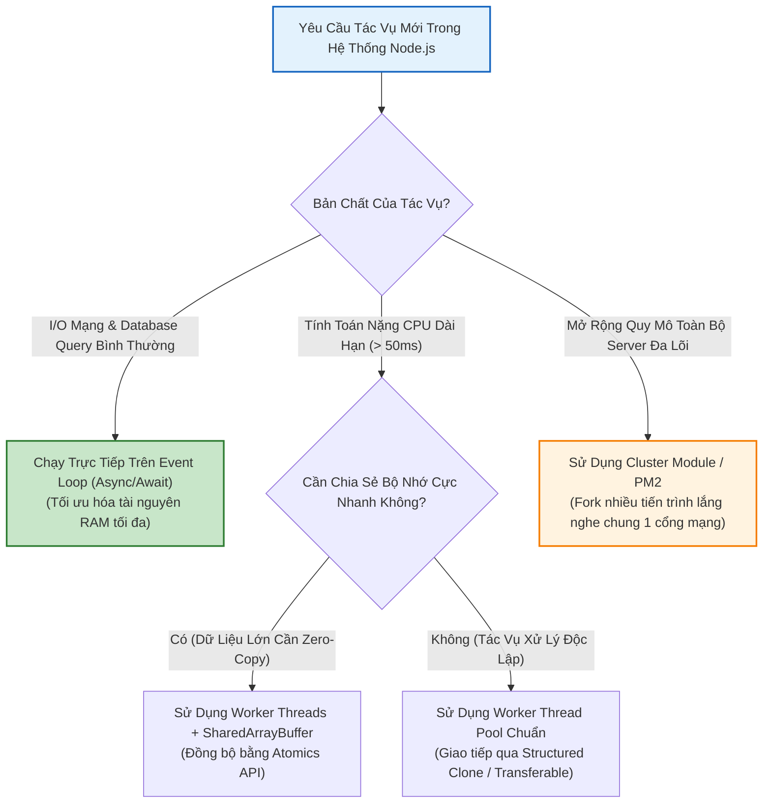

# 15.19.1. Mô Hình Đồng Thời Trong JavaScript và Node.js (JavaScript & Node.js Concurrency Model)

> [!IMPORTANT]
> **Nếu bạn chỉ được nhớ một điều duy nhất:** Bản chất của mô hình đồng thời trong Node.js là sự kết hợp giữa **Luồng Đơn Thực Thi Mã JavaScript (Single-Threaded JS Execution)** chạy trên V8 và **Bể Luồng Đa Luồng Nền Tảng (Multi-Threaded C++ `libuv` Thread Pool)**; trong đó sự hiểu biết thấu đáo về **6 Pha Của Vòng Lặp Sự Kiện libuv**, thứ tự ưu tiên tuyệt đối của **Microtask Queue (`process.nextTick` > Promises)**, cùng các kỹ thuật chia sẻ bộ nhớ **`SharedArrayBuffer` & `Atomics`** là ranh giới phân định giữa một lập trình viên thông thường và một kỹ sư hệ thống phân tán đỉnh cao.

---

## 1. Kiến trúc Tổng quan & Mô hình Tư duy (Mental Model)

### Ẩn dụ Đời sống: Người Tiếp Tân Khách Sạn và Đội Ngũ Nhân Viên Hậu Cần
Hãy hình dung cơ chế vận hành của một khách sạn 5 sao quốc tế:
- **Luồng chính JavaScript (Single-Threaded Main Thread)**: Chỉ có duy nhất một người tiếp tân đứng ở quầy lễ tân. Người tiếp tân này chào đón khách, nhận chìa khóa, kiểm tra thông tin hộ chiếu (thực thi mã JS đồng bộ). Người tiếp tân làm việc siêu nhanh, nhưng nếu một vị khách nhờ người tiếp tân tự mình leo lên tầng 20 dọn phòng (thao tác tính toán CPU nặng hoặc đọc file lớn đồng bộ `readFileSync`), toàn bộ hàng dài khách hàng đứng phía sau sẽ bị kẹt cứng (**Event Loop Blocking**).
- **Thư viện hậu cần `libuv` & Thread Pool**:
  - Khi khách yêu cầu giặt đồ hoặc gửi hành lý (Tác vụ File I/O, DNS Lookup `getaddrinfo`, hoặc mã hóa mật khẩu `crypto`), người tiếp tân không tự làm!
  - Người tiếp tân ghi một tấm phiếu yêu cầu và ném qua ô cửa sổ phía sau cho Đội hậu cần gồm 4 nhân viên khỏe mạnh (**`UV_THREADPOOL_SIZE = 4`**).
  - Đội hậu cần âm thầm làm việc dưới tầng hầm (đa luồng OS C++). Khi giặt xong đồ, họ dán một mẩu giấy thông báo vào bảng tin của lễ tân (**Event Queue**).
- **Vòng lặp Sự kiện (Event Loop Phases)**: Người tiếp tân liên tục đảo mắt kiểm tra bảng tin theo một trật tự vòng tròn khép kín: kiểm tra đồng hồ báo thức (**Timers**), kiểm tra điện thoại bàn (**Poll phase**), và kiểm tra danh sách việc gấp (**Check phase** với `setImmediate`).
- **Microtask Queue (Khách VIP)**: Bất cứ khi nào người tiếp tân vừa làm xong một việc nhỏ, trước khi quay sang người khách tiếp theo, người tiếp tân luôn liếc nhìn sang chiếc ghế ưu tiên dành riêng cho khách VIP (**`process.nextTick` và Promises**). Nếu có khách VIP, người tiếp tân bắt buộc phải phục vụ hết khách VIP mới quay lại hàng đợi thông thường.



---

## 2. Chi tiết từng Keyword (Under-the-Hood Deep Dive)

### 2.1. Phân Công Lao Động: Single-Threaded Event Loop vs `libuv` Thread Pool
- **Sai lầm phổ biến**: "Node.js là đơn luồng hoàn toàn".
- **Thực tế kỹ thuật**:
  - Chỉ có **luồng thực thi mã JavaScript là đơn luồng** (Main V8 Thread).
  - Tầng bên dưới là thư viện C/C++ **`libuv`** đa luồng.
  - Các thao tác I/O mạng (Network Sockets: TCP/UDP, HTTP) **hoàn toàn không dùng Thread Pool**, mà được cắm thẳng vào cơ chế I/O Multiplexing phi luồng của nhân hệ điều hành (`epoll` trên Linux, `kqueue` trên macOS).
  - **4 loại tác vụ duy nhất sử dụng libuv Thread Pool**:
    1. Các thao tác tập tin (**File System** - `fs.*` vì nhân Linux không có AIO thực sự hoàn chỉnh cho đĩa).
    2. Phân giải tên miền DNS chặn (**`dns.lookup()`** sử dụng hàm C `getaddrinfo`).
    3. Các hàm mã hóa băm nặng CPU (**`crypto`** - `pbkdf2`, `scrypt`, `randomBytes`).
    4. Nén và giải nén dữ liệu (**`zlib`**).
- Biến môi trường **`UV_THREADPOOL_SIZE`**: Mặc định là 4 luồng, có thể tăng tối đa lên 128 luồng bằng lệnh `process.env.UV_THREADPOOL_SIZE = 64`.

### 2.2. Giải Phẫu 6 Pha Của Vòng Lặp Sự Kiện libuv (Event Loop Phases)
Mỗi vòng quay (Tick) của Event Loop đi qua 6 pha tuần tự nghiêm ngặt:
1. **Timers Phase**: Thực thi các callback đã quá hạn thời gian được lên lịch bởi `setTimeout()` và `setInterval()`.
2. **Pending Callbacks Phase**: Thực thi các callback I/O bị trì hoãn từ vòng lặp trước (ví dụ: một số lỗi socket TCP như `ECONNREFUSED`).
3. **Idle, Prepare Phase**: Dùng riêng cho các tác vụ chuẩn bị nội bộ của `libuv`.
4. **Poll Phase (Trọng Tâm)**:
   - Tính toán khoảng thời gian cần ngủ chặn để đợi I/O.
   - Xử lý các sự kiện trong hàng đợi Poll Queue.
   - Nếu hàng đợi Poll rỗng:
     - Nếu có hàm `setImmediate()` đang chờ, Event Loop kết thúc Poll phase ngay lập tức để nhảy sang Check phase.
     - Nếu không có `setImmediate()`, nó sẽ **ngủ chặn tại Poll phase** để đợi sự kiện I/O mới đến từ card mạng.
5. **Check Phase**: Thực thi trực tiếp các callback được lên lịch bởi `setImmediate()`.
6. **Close Callbacks Phase**: Thực thi các sự kiện đóng tài nguyên dọn dẹp, ví dụ `socket.on('close', ...)`.

### 2.3. Cuộc Chiến Hàng Đợi Vi Mô: `process.nextTick` vs Promise Microtasks
- Cả hai hàng đợi vi mô này **không nằm trong 6 pha của libuv**, mà được V8 và Node.js kiểm tra ngay tại điểm giao nhau giữa các chỉ thị mã máy:
- **`process.nextTick Queue`**:
  - Có quyền ưu tiên tối thượng tuyệt đối.
  - Sau bất kỳ thao tác nào trên Call Stack, Node.js vét sạch toàn bộ `process.nextTick` trước.
- **Promise Microtask Queue**:
  - Được thực thi ngay sau khi hàng đợi `process.nextTick` đã cạn kiệt.
- **Cạm bẫy Starvation**: Nếu một hàm đệ quy liên tục gọi `process.nextTick()`, Event Loop sẽ **bị kẹt vĩnh viễn** và không bao giờ bước sang Timers hay Poll phase!

### 2.4. Đa Luồng Thực Sự Trong Node.js: Worker Threads & `SharedArrayBuffer`
- **Worker Threads (`worker_threads` module - Node 10.5+)**:
  - Cho phép chạy nhiều luồng hệ điều hành độc lập, mỗi luồng có một **V8 Isolate** riêng, một Event Loop riêng và bộ nhớ riêng.
- **Truyền Dữ Liệu Qua Ranh Giới Workers**:
  - *Structured Clone*: Sao chép sâu đối tượng (Tốn CPU và RAM).
  - *Transferable Objects*: Chuyển giao quyền sở hữu con trỏ bộ nhớ `ArrayBuffer` sang luồng khác trong 0.001ms (luồng cũ mất quyền truy cập).
  - *`SharedArrayBuffer` & `Atomics`*:
    - Cho phép nhiều Worker Threads cùng đọc và ghi trên **cùng một vùng nhớ RAM vật lý chia sẻ**.
    - Sử dụng các thao tác nguyên tử `Atomics.add()`, `Atomics.wait()`, `Atomics.notify()` để đồng bộ hóa mà không gây ra xung đột dữ liệu (Data Race).

### 2.5. Truy Vết Ngữ Cảnh Bất Đồng Bộ Với `AsyncLocalStorage`
- Trong môi trường đơn luồng xử lý đồng thời hàng ngàn HTTP Requests, làm thế nào để truyền một mã định danh theo dõi (`trace_id` hoặc `user_session`) xuyên suốt các hàm `async/await` mà không phải truyền thủ công tham số vào từng hàm?
- **`AsyncLocalStorage` (Xây dựng trên nền tảng `async_hooks`)**:
  - Hoạt động tương đương như `ThreadLocal` của Java nhưng dành riêng cho các chuỗi Coroutine bất đồng bộ.
  - Tự động liên kết ngữ cảnh khi các Promise chuyển đổi qua lại giữa các pha của Event Loop.

---

## 3. Thực thi Mã nguồn & Mô phỏng Chuyên sâu (Dual-Engine Implementation)

### 3.1. C++20 Implementation: Mô Phỏng Cơ Chế Hoạt Động Của Event Loop & Microtask Drain
Chương trình C++20 dưới đây tái hiện cấu trúc cốt lõi của một Event Loop: hàng đợi Macrotasks (Timers/I/O) kết hợp với cơ chế "vét cạn" hàng đợi Microtasks giữa mỗi chu kỳ:

```cpp
#include <iostream>
#include <queue>
#include <functional>
#include <string>
#include <chrono>

using TaskCallback = std::function<void()>;

class SimulatedNodeEventLoop {
private:
    std::queue<std::pair<std::string, TaskCallback>> macrotask_queue_;
    std::queue<std::pair<std::string, TaskCallback>> microtask_queue_;
    bool is_running_ = false;

public:
    void post_macrotask(std::string name, TaskCallback cb) {
        macrotask_queue_.push({std::move(name), std::move(cb)});
    }

    void post_microtask(std::string name, TaskCallback cb) {
        microtask_queue_.push({std::move(name), std::move(cb)});
    }

    // Cơ chế Vét Cạn Microtasks (Microtask Draining)
    void drain_microtasks() {
        while (!microtask_queue_.empty()) {
            auto [name, task] = microtask_queue_.front();
            microtask_queue_.pop();
            std::cout << "    [Microtask Exec]: " << name << "\n";
            task();
        }
    }

    void run() {
        std::cout << "\n[Event Loop Engine]: Bắt đầu chu trình điều phối...\n";
        is_running_ = true;

        while (is_running_ && (!macrotask_queue_.empty() || !microtask_queue_.empty())) {
            // Bước 1: Luôn vét cạn Microtasks trước khi sang Macrotask kế tiếp
            drain_microtasks();

            // Bước 2: Thực thi đúng 1 Macrotask
            if (!macrotask_queue_.empty()) {
                auto [name, task] = macrotask_queue_.front();
                macrotask_queue_.pop();
                std::cout << "  [Macrotask Exec]: " << name << "\n";
                task();
            }

            // Bước 3: Sau mỗi Macrotask, lập tức vét cạn lại Microtask Queue!
            drain_microtasks();

            if (macrotask_queue_.empty() && microtask_queue_.empty()) {
                is_running_ = false;
            }
        }
        std::cout << "[Event Loop Engine]: Vòng lặp sự kiện kết thúc sạch sẽ.\n";
    }
};

int main() {
    std::cout << "=========================================================\n";
    std::cout << "   C++20 SIMULATED NODE.JS EVENT LOOP & MICROTASKS DEMO  \n";
    std::cout << "=========================================================\n";

    SimulatedNodeEventLoop loop;

    // Giả lập kịch bản đăng ký các sự kiện tương đương Node.js:
    loop.post_macrotask("setTimeout(Callback_1, 0)", [&loop]() {
        std::cout << "      -> Inside setTimeout 1: Lên lịch một Microtask mới!\n";
        loop.post_microtask("Promise.then(Inside setTimeout 1)", []() {
            std::cout << "         -> Microtask sinh ra từ setTimeout 1 được giải quyết tức thì!\n";
        });
    });

    loop.post_macrotask("setImmediate(Callback_2)", []() {
        std::cout << "      -> Inside setImmediate 2\n";
    });

    loop.post_microtask("process.nextTick(Initial_Tick)", []() {
        std::cout << "      -> nextTick khởi tạo được ưu tiên chạy trước mọi Macrotask!\n";
    });

    loop.post_microtask("Promise.resolve(Initial_Promise)", []() {
        std::cout << "      -> Promise Microtask ban đầu được giải quyết.\n";
    });

    loop.run();
    return 0;
}
```

### 3.2. Python 3.11+ Implementation: Minh Chứng Thứ Tự Thực Thi Của Node.js Bằng Trình Giả Lập
Chương trình Python 3.11+ dưới đây mô phỏng chính xác sự khác biệt về độ ưu tiên giữa `process.nextTick`, `Promise.then` (Microtasks), và `setTimeout` / `setImmediate` (Macrotasks):

```python
import collections
from typing import Callable, Deque, Tuple

class NodeJSOrderSimulator:
    """
    Trình mô phỏng trật tự thực thi phân cấp của Node.js:
    1. Synchronous Code (Call Stack)
    2. process.nextTick Queue
    3. Promise Microtask Queue
    4. Macrotask Queue (Timers / Check)
    """
    def __init__(self):
        self.next_tick_q: Deque[Tuple[str, Callable]] = collections.deque()
        self.promise_q: Deque[Tuple[str, Callable]] = collections.deque()
        self.timer_q: Deque[Tuple[str, Callable]] = collections.deque()
        self.check_q: Deque[Tuple[str, Callable]] = collections.deque()

    def process_next_tick(self, name: str, cb: Callable):
        self.next_tick_q.append((name, cb))

    def promise_then(self, name: str, cb: Callable):
        self.promise_q.append((name, cb))

    def set_timeout(self, name: str, cb: Callable):
        self.timer_q.append((name, cb))

    def set_immediate(self, name: str, cb: Callable):
        self.check_q.append((name, cb))

    def drain_all_microtasks(self):
        # Ưu tiên #1: Vét sạch 100% process.nextTick
        while self.next_tick_q:
            name, cb = self.next_tick_q.popleft()
            print(f"  [1. NEXT_TICK]: {name}")
            cb()

        # Ưu tiên #2: Vét sạch Promise Microtasks
        while self.promise_q:
            name, cb = self.promise_q.popleft()
            print(f"  [2. PROMISE_MICROTASK]: {name}")
            cb()
            # Nếu trong lúc chạy Promise lại sinh thêm nextTick, quay lại vét tiếp!
            if self.next_tick_q:
                self.drain_all_microtasks()

    def run_event_loop(self):
        print("\n--- BẮT ĐẦU VÒNG LẶP SỰ KIỆN SIMULATOR ---")
        
        # Bước đầu tiên: Vét Microtasks sau khi khối mã đồng bộ chạy xong
        self.drain_all_microtasks()

        # Pha Timers (setTimeout)
        print("\n>> VÀO PHA TIMERS (setTimeout):")
        while self.timer_q:
            name, cb = self.timer_q.popleft()
            print(f"  [MACROTASK TIMERS]: {name}")
            cb()
            self.drain_all_microtasks()

        # Pha Check (setImmediate)
        print("\n>> VÀO PHA CHECK (setImmediate):")
        while self.check_q:
            name, cb = self.check_q.popleft()
            print(f"  [MACROTASK CHECK]: {name}")
            cb()
            self.drain_all_microtasks()

        print("\n--- KẾT THÚC VÒNG LẶP SỰ KIỆN ---")

if __name__ == '__main__':
    print("=== MÔ PHỎNG THỨ TỰ ƯU TIÊN SỰ KIỆN NODE.JS ===")
    sim = NodeJSOrderSimulator()

    # Kịch bản mã nguồn JavaScript tương đương:
    print("Đang nạp các hàm bất đồng bộ vào hàng đợi...")
    sim.set_timeout("setTimeout(() => {}, 0)", lambda: None)
    sim.set_immediate("setImmediate(() => {})", lambda: None)
    sim.promise_then("Promise.resolve().then(() => {})", lambda: None)
    sim.process_next_tick("process.nextTick(() => {})", lambda: None)

    sim.run_event_loop()
```

### 3.3. Terminal Output Mẫu Thực tế
```text
=========================================================
   C++20 SIMULATED NODE.JS EVENT LOOP & MICROTASKS DEMO  
=========================================================

[Event Loop Engine]: Bắt đầu chu trình điều phối...
    [Microtask Exec]: process.nextTick(Initial_Tick)
      -> nextTick khởi tạo được ưu tiên chạy trước mọi Macrotask!
    [Microtask Exec]: Promise.resolve(Initial_Promise)
      -> Promise Microtask ban đầu được giải quyết.
  [Macrotask Exec]: setTimeout(Callback_1, 0)
      -> Inside setTimeout 1: Lên lịch một Microtask mới!
    [Microtask Exec]: Promise.then(Inside setTimeout 1)
         -> Microtask sinh ra từ setTimeout 1 được giải quyết tức thì!
  [Macrotask Exec]: setImmediate(Callback_2)
      -> Inside setImmediate 2
[Event Loop Engine]: Vòng lặp sự kiện kết thúc sạch sẽ.

=== MÔ PHỎNG THỨ TỰ ƯU TIÊN SỰ KIỆN NODE.JS ===
Đang nạp các hàm bất đồng bộ vào hàng đợi...

--- BẮT ĐẦU VÒNG LẶP SỰ KIỆN SIMULATOR ---
  [1. NEXT_TICK]: process.nextTick(() => {})
  [2. PROMISE_MICROTASK]: Promise.resolve().then(() => {})

>> VÀO PHA TIMERS (setTimeout):
  [MACROTASK TIMERS]: setTimeout(() => {}, 0)

>> VÀO PHA CHECK (setImmediate):
  [MACROTASK CHECK]: setImmediate(() => {})

--- KẾT THÚC VÒNG LẶP SỰ KIỆN ---
```

---

## 4. Systems Engineering & Production Pitfalls

### 4.1. Sự Cố Rò Rỉ Bộ Nhớ Cực Đại Do `AsyncLocalStorage` (Context Memory Leak)
- **Sự cố sản xuất**: Sử dụng `AsyncLocalStorage` để lưu trữ đối tượng Request Context trong các ứng dụng NestJS/Express. Lập trình viên vô tình lưu trữ cả tham chiếu của đối tượng Socket lớn hoặc mảng dữ liệu upload vào store.
- **Hậu quả**: Do vòng đời bất đồng bộ của một số timer dài hạn hoặc kết nối cơ sở dữ liệu giữ tham chiếu tới Async Context, V8 Garbage Collector **không bao giờ có thể giải phóng được vùng nhớ này**, biến máy chủ thành một quả bom nổ chậm về bộ nhớ RAM (**Progressive Memory Leak**).

### 4.2. Cạm Bẫy Cạn Kiệt Bể Luồng `libuv` Do Phân Giải Tên Miền DNS Hàng Loạt
- **Sự cố sản xuất**: Ứng dụng Node.js gửi hàng ngàn HTTP requests ra bên ngoài bằng `axios` hoặc `fetch` tới các domain khác nhau. Mặc định `UV_THREADPOOL_SIZE = 4`, và mỗi lần gọi DNS `dns.lookup()` chiếm trọn 1 luồng trong thread pool.
- Cả 4 luồng của pool bị nghẽn cứng bởi DNS lookups, khiến **toàn bộ các thao tác đọc ghi file đĩa `fs.readFile()` bị đóng băng hoàn toàn**, đẩy độ trễ của toàn bộ backend lên hàng chục giây!
- **Khắc phục**: Nâng `UV_THREADPOOL_SIZE = 64` hoặc cấu hình `http.Agent` sử dụng IP trực tiếp hoặc DNS cache qua `dnscache`.

---

## 5. Bảng So sánh & Decision Matrix

| Kỹ Thuật Đồng Thời | Cơ Chế Cách Ly Bộ Nhớ | Giao Tiếp Giữa Các Đơn Vị | Tác Vụ Phù Hợp |
| :--- | :--- | :--- | :--- |
| **Event Loop (Mặc định)** | Chung 1 V8 Heap | Gọi hàm trực tiếp trong Call Stack | I/O Mạng, API Gateway, CRUD Services |
| **Worker Threads** | V8 Isolate riêng | `postMessage` hoặc `SharedArrayBuffer` | Xử lý ảnh, mã hóa Crypto, nén dữ liệu |
| **Cluster Module** | Đa tiến trình OS riêng | IPC Message Channel (`SO_REUSEPORT`) | Khai thác 100% tất cả các lõi CPU máy chủ |
| **Child Processes** | Độc lập hoàn toàn | Standard Streams (`stdin`/`stdout`) | Gọi các binary bên ngoài (FFmpeg, Python CLI) |


