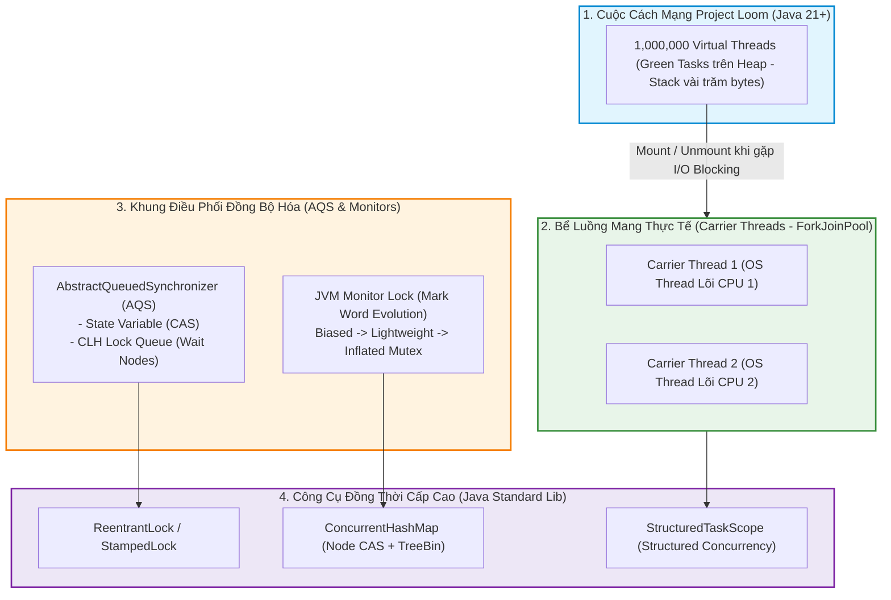
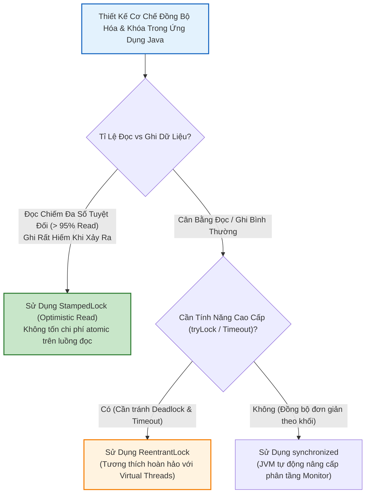

# 15.19.2. Mô Hình Đồng Thời Trong Java (Java Concurrency Model)

> [!IMPORTANT]
> **Nếu bạn chỉ được nhớ một điều duy nhất:** Lịch sử đồng thời của Java là cuộc tiến hóa vĩ đại từ mô hình luồng nền tảng 1:1 (**Platform Threads**) gắn chặt với hệ điều hành sang cuộc cách mạng luồng ảo M:N (**Virtual Threads - Project Loom**) trong Java 21+; kết hợp với trái tim điều phối khóa không khóa **AQS (AbstractQueuedSynchronizer)** và cấu trúc điều hòa đối tượng **Monitor Lock** phân tầng (từ Biased Lock sang Thin Lock rồi Inflated Heavyweight Lock) để cân bằng giữa hiệu năng vi kiến trúc và sự an toàn bộ nhớ tuyệt đối.

---

## 1. Kiến trúc Tổng quan & Mô hình Tư duy (Mental Model)

### Ẩn dụ Đời sống: Hãng Hàng Không Truyền Thống và Dịch Vụ Xe Bay Cá Nhân
Hãy hình dung sự tiến hóa của mô hình luồng trong Java:
- **Platform Threads (Luồng Nền tảng cũ - 1:1 OS Thread)**: Giống như những chiếc máy bay thương mại 300 chỗ:
  - Mỗi khi bạn cần chở một hành khách (Một kết nối mạng HTTP), bạn phải điều động nguyên một chiếc máy bay khổng lồ.
  - Mỗi máy bay ngốn 1MB nhiên liệu dự trữ (**Stack Size 1MB**), chi phí cất cánh và hạ cánh rất đắt đỏ (Chuyển đổi ngữ cảnh Kernel Context Switch). Nếu có 10,000 hành khách cùng đến, sân bay bị tê liệt hoàn toàn vì hết đường băng và phá sản vì cạn kiệt nhiên liệu RAM.
- **Virtual Threads (Project Loom - Java 21+)**: Giống như những chiếc thảm bay thần kỳ:
  - Thảm bay siêu nhẹ, chỉ nặng vài trăm bytes, được cấp phát ngay trên vùng nhớ Heap của JVM. Bạn có thể tạo 1,000,000 chiếc thảm bay cùng lúc mà máy chủ vẫn chạy êm ái!
  - Khi thảm bay gặp đèn đỏ (Tác vụ I/O chặn như đọc Database hoặc Socket mạng): chiếc thảm bay tự động gập lại và rời khỏi lưng của phi công (**Carrier Thread Unmounting**). Người phi công (Luồng OS Thread thực tế) lập tức đón một chiếc thảm bay khác để bay tiếp. Khi đèn xanh bật mở, thảm bay cũ lại trèo lên lưng bất kỳ phi công nào đang rảnh rỗi để tiếp tục hành trình.
- **Khóa Monitor (`synchronized`) & Tiêu Đề Đối Tượng (Mark Word)**:
  - Mỗi đối tượng Java trong Heap đều có một chiếc khóa cài ở cổ áo (**Mark Word 64-bit**).
  - Ban đầu, chiếc khóa chỉ ghi nhớ tên của người chủ đầu tiên (**Biased Lock**).
  - Khi có người thứ hai đến tranh chấp nhẹ, chiếc khóa biến thành vòng quay số tức thời bằng lệnh nguyên tử CPU CAS (**Thin / Lightweight Lock**).
  - Khi cuộc tranh chấp trở nên bạo lực và kéo dài, chiếc khóa mới chính thức gọi cảnh sát nhân hệ điều hành can thiệp (**Inflated Fat Lock / OS Mutex**).



---

## 2. Chi tiết từng Keyword (Under-the-Hood Deep Dive)

### 2.1. Platform Threads vs Virtual Threads (Project Loom - Java 21+)
- **Platform Threads (Mô hình 1:1 Cũ)**:
  - Mỗi `java.lang.Thread` ánh xạ trực tiếp 1-1 với một luồng nhân hệ điều hành Linux (`pthread_create`).
  - Stack cố định được cấp phát trước (thường là 1MB). Một máy chủ 16GB RAM chỉ có thể chứa tối đa khoảng 5,000 đến 10,000 threads trước khi sập vì `OutOfMemoryError: unable to create new native thread`.
- **Virtual Threads (Mô hình M:N Mới)**:
  - Do JVM toàn quyền quản lý, hoàn toàn không giữ luồng của hệ điều hành khi đang chờ đợi I/O.
  - Sử dụng cơ chế **Continuation** (được nhúng sâu vào nhân HotSpot JVM):
    - Khi một Virtual Thread gọi một phương thức chặn (Blocking I/O như `Socket.read()`, `Thread.sleep()`), mã nguồn Java nội bộ bắt được điểm chặn này và gọi `Continuation.yield()`.
    - Trạng thái ngăn xếp của Virtual Thread được sao chép từ Call Stack xuống một vùng nhớ nhỏ trên Java Heap (**Unmounting**).
    - Luồng OS Thread bên dưới (**Carrier Thread** - chạy trên `ForkJoinPool`) được giải phóng hoàn toàn và lập tức chuyển sang phục vụ Virtual Thread khác.
    - Khi I/O hoàn tất qua `epoll`, Carrier Thread đón lại continuation này, nạp ngược ngăn xếp trở lại Call Stack và chạy tiếp (**Mounting**).
- **Cạm bẫy Pinning Thread**: Nếu một Virtual Thread gọi I/O bên trong một khối `synchronized` hoặc qua FFI (JNI), luồng sẽ bị ghim chặt vào Carrier Thread (**Pinned Thread**), làm tê liệt khả năng unmount! (Khắc phục: Thay thế `synchronized` bằng `ReentrantLock`).

### 2.2. Giải Phẫu Bên Trong Khóa Monitor (`synchronized` & Mark Word)
- Mỗi đối tượng Java đều có một trường tiêu đề gọi là **Mark Word** (64 bits trên 64-bit JVM).
- HotSpot JVM tối ưu hóa khóa theo 3 nấc phân tầng:
  1. **Biased Locking (Khóa Thiên Vị - Java cũ)**: Ghi thẳng Thread ID của luồng đầu tiên vào Mark Word. Nếu chính luồng đó quay lại, không cần bất kỳ lệnh atomic CAS nào.
  2. **Lightweight Locking (Thin Lock)**: Khi có luồng thứ hai vào tranh chấp, khóa được nâng cấp. Luồng tạo một `BasicObjectLock` trên stack của mình và dùng lệnh CPU `cmpxchg` (CAS) để trỏ Mark Word của đối tượng về stack đó. Luồng chờ thực hiện quay vòng thăm dò nhẹ (**Spinning**) thay vì ngủ ngay.
  3. **Heavyweight Locking (Inflated Monitor Lock)**: Nếu tranh chấp kéo dài hoặc có nhiều luồng cùng tranh chấp, JVM tạo ra một đối tượng C++ `ObjectMonitor` hoàn chỉnh trong Heap. Đối tượng này chứa một hàng đợi `_EntryList` và sử dụng mutex của hệ điều hành (`pthread_mutex`). Luồng bị đưa vào trạng thái ngủ sâu (**Kernel Thread Block**).

### 2.3. Trái Tim Điều Phối Khóa: Khung AQS (AbstractQueuedSynchronizer)
- Hầu hết các công cụ đồng bộ hóa cao cấp trong gói `java.util.concurrent` (`ReentrantLock`, `CountDownLatch`, `Semaphore`) đều được xây dựng trên một lớp trừu tượng nền tảng duy nhất: **AQS**.
- **Cấu trúc cốt lõi của AQS**:
  1. **Biến trạng thái nguyên tử `volatile int state`**: Được cập nhật qua CAS. Ví dụ: Với `ReentrantLock`, `state = 0` là khóa rảnh rỗi, `state = 1` là đã bị chiếm, `state > 1` thể hiện số lần khóa đệ quy (Reentrancy).
  2. **Hàng đợi chờ đợi CLH (Craig, Landin, and Hägersten Lock Queue)**: Một danh sách liên kết đôi chứa các nút luồng đang bị chặn (`Node`). Khi một luồng không thể giành được khóa, nó được đưa vào đuôi hàng đợi và tự động ngủ an toàn bằng lệnh `LockSupport.park()`. Khi khóa được giải phóng, luồng đầu hàng đợi được đánh thức bằng `LockSupport.unpark()`.

### 2.4. Khóa Đọc-Ghi Tối Ưu: `StampedLock` (Java 8+)
- `ReentrantReadWriteLock` cũ vẫn bị nghẽn bus bộ nhớ do các luồng đọc (Readers) liên tục tranh chấp ghi vào biến đếm số lượng reader qua CAS.
- **Đột phá của `StampedLock` - Optimistic Reading (Đọc Lạc Quan)**:
  - Cho phép luồng đọc **hoàn toàn không cần lấy khóa và không ghi bất kỳ bit nào vào bộ nhớ!**
  - Luồng đọc chỉ lấy một nhãn tem (**Stamp Token** qua `tryOptimisticRead()`), đọc dữ liệu, sau đó kiểm tra lại tính hợp lệ qua `validate(stamp)`. Nếu trong lúc đọc không có bất kỳ luồng ghi nào chen ngang, kết quả đọc là hợp lệ 100% với chi phí CPU gần như bằng 0!

### 2.5. Giải Phẫu Bên Trong `ConcurrentHashMap`
- **Sự tiến hóa kiến trúc**:
  - *Java 7*: Chia bảng băm thành 16 phân đoạn độc lập (**Segment-based Locking**), mỗi segment là một `ReentrantLock`. Cho phép tối đa 16 luồng ghi đồng thời.
  - *Java 8+ Hiện Đại*: Xóa bỏ hoàn toàn Segment! Sử dụng mảng phẳng các nút liên kết (`Node<K, V>`).
    - Thao tác nạp phần tử đầu tiên vào bucket: Dùng lệnh nguyên tử **CAS** không khóa (`compareAndSet`).
    - Thao tác ghi vào bucket đã có phần tử: Chỉ khóa cục bộ duy nhất nút đầu tiên của bucket đó bằng `synchronized(firstNode)`.
    - Khi số phần tử trong 1 bucket vượt quá 8 (ngưỡng `TREEIFY_THRESHOLD`), danh sách liên kết tự động chuyển đổi thành cây đỏ-đen (**TreeBin**) để duy trì tốc độ tra cứu $O(\log N)$ chống tấn công từ chối dịch vụ Hash Collision (HashDoS).

---

## 3. Thực thi Mã nguồn & Mô phỏng Chuyên sâu (Dual-Engine Implementation)

### 3.1. C++20 Implementation: Mô Phỏng Cơ Chế Khóa Đọc Lạc Quan (Optimistic StampedLock)
Chương trình C++20 dưới đây tái hiện giải thuật đọc lạc quan của `StampedLock` trong Java: luồng đọc không cần lock, chỉ kiểm tra tính hợp lệ của số hiệu phiên bản nguyên tử (Version Stamp Sequence):

```cpp
#include <iostream>
#include <atomic>
#include <thread>
#include <vector>
#include <chrono>

class OptimisticStampedLockSimulator {
private:
    // Bit 0 của version đại diện cho trạng thái Ghi (1: Đang có luồng ghi, 0: Rảnh rỗi)
    std::atomic<uint64_t> version_stamp_{0};
    int shared_x_ = 0;
    int shared_y_ = 0;

public:
    // Phía Luồng Ghi (Exclusive Writer)
    void write(int new_x, int new_y) {
        // Tăng stamp để đánh dấu bắt đầu ghi (Bit 0 bật thành 1)
        uint64_t stamp = version_stamp_.fetch_add(1, std::memory_order_acquire);
        
        // Cập nhật dữ liệu chia sẻ
        shared_x_ = new_x;
        shared_y_ = new_y;

        // Tăng stamp lần nữa để hoàn tất ghi (Bit 0 trở về 0)
        version_stamp_.fetch_add(1, std::memory_order_release);
    }

    // Phía Luồng Đọc Lạc Quan (Optimistic Reader)
    std::pair<int, int> read_optimistic() {
        while (true) {
            uint64_t stamp_before = version_stamp_.load(std::memory_order_acquire);
            
            // Nếu bit 0 bật (đang có luồng ghi), đợi nhẹ rồi thử lại
            if (stamp_before & 1) {
                std::this_thread::yield();
                continue;
            }

            // Đọc dữ liệu trực tiếp không cần Lock!
            int cur_x = shared_x_;
            int cur_y = shared_y_;

            uint64_t stamp_after = version_stamp_.load(std::memory_order_acquire);
            
            // Xác thực: Nếu version không hề thay đổi, dữ liệu đọc được là hoàn toàn nhất quán!
            if (stamp_before == stamp_after) {
                return {cur_x, cur_y};
            }
            // Nếu có luồng ghi chen ngang làm lệch version, vòng lặp tự động retry
            std::cout << "    [Reader Retry]: Phát hiện xung đột ghi! Tự động thử lại...\n";
        }
    }
};

int main() {
    std::cout << "=========================================================\n";
    std::cout << "   C++20 OPTIMISTIC STAMPEDLOCK SIMULATOR (JAVA MODEL)   \n";
    std::cout << "=========================================================\n\n";

    OptimisticStampedLockSimulator lock_sim;

    std::cout << "[1. Ghi Dữ Liệu Ban Đầu]: x = 100, y = 200\n";
    lock_sim.write(100, 200);

    auto [rx, ry] = lock_sim.read_optimistic();
    std::cout << "[2. Đọc Lạc Quan Thành Công]: x = " << rx << ", y = " << ry << "\n\n";

    // Mô phỏng đa luồng tranh chấp
    std::jthread writer([&lock_sim]() {
        for (int i = 1; i <= 3; ++i) {
            std::this_thread::sleep_for(std::chrono::milliseconds(20));
            lock_sim.write(i * 10, i * 20);
            std::cout << "  + [Writer]: Cập nhật x=" << (i*10) << ", y=" << (i*20) << "\n";
        }
    });

    std::jthread reader([&lock_sim]() {
        for (int i = 0; i < 5; ++i) {
            std::this_thread::sleep_for(std::chrono::milliseconds(15));
            auto [x, y] = lock_sim.read_optimistic();
            std::cout << "  * [Reader]: Đọc được nhất quán: x=" << x << ", y=" << y << "\n";
        }
    });

    return 0;
}
```

### 3.2. Python 3.11+ Implementation: Mô Phỏng Cơ Chế Khóa Phân Tầng Monitor (Mark Word Lock Escalation)
Chương trình Python 3.11+ dưới đây mô phỏng chu trình nâng cấp khóa **Monitor Lock Escalation** của HotSpot JVM từ trạng thái không khóa $\to$ Biased Lock $\to$ Lightweight CAS Lock $\to$ Heavyweight OS Mutex:

```python
import threading
import time
from enum import Enum

class LockState(Enum):
    UNLOCKED = 0
    BIASED = 1       # Khóa thiên vị cho 1 luồng duy nhất
    LIGHTWEIGHT = 2  # Tranh chấp nhẹ: Dùng CAS và Spin
    HEAVYWEIGHT = 3  # Tranh chấp nặng: Bơm phồng thành OS Mutex

class SimulatedJVMMonitor:
    """
    Mô phỏng cơ chế tiến hóa trạng thái khóa bên trong Mark Word của Java Object:
    Unlocked -> Biased -> Lightweight (Thin) -> Heavyweight (Fat Monitor)
    """
    def __init__(self):
        self.lock_state = LockState.UNLOCKED
        self.biased_thread_id: Optional[int] = None
        self.heavy_mutex = threading.Lock()
        self.lock_owner: Optional[int] = None
        self.spin_count = 0

    def enter_synchronized(self):
        current_thread = threading.get_ident()

        # NẤC 1: BIASED LOCKING
        if self.lock_state == LockState.UNLOCKED:
            self.lock_state = LockState.BIASED
            self.biased_thread_id = current_thread
            self.lock_owner = current_thread
            print(f"  + [Biased Lock]: Khóa thiên vị thành công cho Thread {current_thread} (Zero Cost)")
            return

        if self.lock_state == LockState.BIASED and self.biased_thread_id == current_thread:
            print(f"  + [Biased Reentry]: Cùng luồng sở hữu, đi vào không cần thao tác atomic!")
            return

        # NẤC 2: LIGHTWEIGHT LOCKING (Nâng cấp khi có luồng thứ 2 xuất hiện)
        if self.lock_state == LockState.BIASED and self.biased_thread_id != current_thread:
            print(f"\n  ! [Revoke Bias]: Luồng {current_thread} can thiệp! Nâng cấp lên LIGHTWEIGHT LOCK.")
            self.lock_state = LockState.LIGHTWEIGHT
            self.biased_thread_id = None

        if self.lock_state == LockState.LIGHTWEIGHT:
            # Mô phỏng thao tác quay vòng CAS (Spinning)
            print(f"  * [Lightweight Spin]: Luồng {current_thread} đang quay vòng CAS trên Mark Word...")
            time.sleep(0.01)
            # Nếu quay vòng thất bại -> Nâng cấp lên HEAVYWEIGHT FAT LOCK!
            print(f"  ! [Lock Inflation]: Tranh chấp căng thẳng! Bơm phồng thành HEAVYWEIGHT OS MUTEX.\n")
            self.lock_state = LockState.HEAVYWEIGHT

        # NẤC 3: HEAVYWEIGHT LOCKING (Đưa luồng vào giấc ngủ hệ điều hành)
        if self.lock_state == LockState.HEAVYWEIGHT:
            print(f"  >> [Heavyweight Mutex]: Luồng {current_thread} gọi OS Mutex lock và đi vào giấc ngủ...")
            self.heavy_mutex.acquire()
            self.lock_owner = current_thread
            print(f"  >> [Heavyweight Acquired]: Luồng {current_thread} đã giành được Monitor!")

    def exit_synchronized(self):
        current_thread = threading.get_ident()
        if self.lock_state == LockState.HEAVYWEIGHT and self.lock_owner == current_thread:
            self.lock_owner = None
            self.heavy_mutex.release()
            print(f"  << [Heavyweight Release]: Luồng {current_thread} giải phóng OS Mutex.\n")
        elif self.lock_state == LockState.BIASED:
            print(f"  << [Biased Exit]: Luồng {current_thread} rời khỏi vùng đồng bộ.\n")

if __name__ == '__main__':
    print("=== MÔ PHỎNG JVM MONITOR LOCK ESCALATION (PYTHON 3.11+) ===")
    monitor = SimulatedJVMMonitor()

    def thread_action(name: str):
        print(f"\n[Thread {name} Bắt Đầu]: Thử vào khối synchronized...")
        monitor.enter_synchronized()
        time.sleep(0.05)
        monitor.exit_synchronized()

    # Luồng 1 chạy đơn độc -> Được cấp Biased Lock
    t1 = threading.Thread(target=thread_action, args=("T1",))
    t1.start()
    t1.join()

    # Luồng 2 và Luồng 3 cùng tranh chấp -> Kích hoạt Lightweight -> Nâng cấp Heavyweight
    t2 = threading.Thread(target=thread_action, args=("T2",))
    t3 = threading.Thread(target=thread_action, args=("T3",))
    t2.start()
    t3.start()
    t2.join()
    t3.join()
```

### 3.3. Terminal Output Mẫu Thực tế
```text
=========================================================
   C++20 OPTIMISTIC STAMPEDLOCK SIMULATOR (JAVA MODEL)   
=========================================================

[1. Ghi Dữ Liệu Ban Đầu]: x = 100, y = 200
[2. Đọc Lạc Quan Thành Công]: x = 100, y = 200

  * [Reader]: Đọc được nhất quán: x=100, y=200
  + [Writer]: Cập nhật x=10, y=20
  * [Reader]: Đọc được nhất quán: x=10, y=20
  + [Writer]: Cập nhật x=20, y=40
  * [Reader]: Đọc được nhất quán: x=20, y=40
  + [Writer]: Cập nhật x=30, y=60
  * [Reader]: Đọc được nhất quán: x=30, y=60

=== MÔ PHỎNG JVM MONITOR LOCK ESCALATION (PYTHON 3.11+) ===

[Thread T1 Bắt Đầu]: Thử vào khối synchronized...
  + [Biased Lock]: Khóa thiên vị thành công cho Thread 1231454 (Zero Cost)
  << [Biased Exit]: Luồng 1231454 rời khỏi vùng đồng bộ.

[Thread T2 Bắt Đầu]: Thử vào khối synchronized...
  + [Biased Lock]: Khóa thiên vị thành công cho Thread 1231455 (Zero Cost)

[Thread T3 Bắt Đầu]: Thử vào khối synchronized...
  ! [Revoke Bias]: Luồng 1231456 can thiệp! Nâng cấp lên LIGHTWEIGHT LOCK.
  * [Lightweight Spin]: Luồng 1231456 đang quay vòng CAS trên Mark Word...
  ! [Lock Inflation]: Tranh chấp căng thẳng! Bơm phồng thành HEAVYWEIGHT OS MUTEX.

  >> [Heavyweight Mutex]: Luồng 1231456 gọi OS Mutex lock và đi vào giấc ngủ...
  << [Biased Exit]: Luồng 1231455 rời khỏi vùng đồng bộ.

  >> [Heavyweight Acquired]: Luồng 1231456 đã giành được Monitor!
  << [Heavyweight Release]: Luồng 1231456 giải phóng OS Mutex.
```

---

## 4. Systems Engineering & Production Pitfalls

### 4.1. Sự Cố Ghim Luồng Ảo Làm Sập Thread Pool (Virtual Thread Pinning Storm)
- **Sự cố sản xuất kinh điển**: Khi nâng cấp dịch vụ backend lên Java 21 và kích hoạt Virtual Threads (`Executors.newVirtualThreadPerTaskExecutor()`), hệ thống kết nối với thư viện JDBC cũ vẫn còn sử dụng khối `synchronized` bên trong phương thức truy vấn cơ sở dữ liệu.
- **Hậu quả**: Khi có 5,000 requests đến đồng thời, cả 5,000 Virtual Threads đều bị **ghim chặt (Pinned)** vào toàn bộ các Carrier Threads có sẵn trong hệ thống (số lượng Carrier Threads mặc định bằng số lõi CPU, ví dụ 16 lõi). Tất cả 16 Carrier Threads bị khóa cứng, khiến **toàn bộ hàng ngàn Virtual Threads còn lại bị treo máy vĩnh viễn**, làm chết đứng toàn bộ cổng API!
- **Kỹ thuật chẩn đoán bằng JVM Flags**:
  ```bash
  java -Djdk.tracePinnedThreads=full -jar production_app.jar
  # HotSpot JVM sẽ in ra stack trace cảnh báo chính xác vị trí bị Pinning!
  ```
- **Khắc phục**: Nâng cấp Driver JDBC lên phiên bản mới không dùng `synchronized`, hoặc thay thế bằng `ReentrantLock`.

### 4.2. Cạm Bẫy Cạn Kiệt Bộ Nhớ Metaspace Do Sinh Luồng Ảo Đột Biến
- Khi chạy hàng triệu Virtual Threads, mặc dù bộ nhớ stack của mỗi luồng rất nhỏ, nhưng nếu lập trình viên sử dụng `ThreadLocal` bừa bãi và nhét các đối tượng nặng (như `SimpleDateFormat` hoặc `ConnectionPool`) vào từng Virtual Thread, hàng triệu bản sao của đối tượng sẽ làm tràn ngập Java Heap dẫn tới OOM Crash.
- **Khắc phục**: Thay thế `ThreadLocal` bằng **`ScopedValue`** (tính năng Preview của Java 21+).

---

## 5. Bảng So sánh & Decision Matrix

| Công Cụ Đồng Bộ Hóa | Mức Độ Tranh Chấp Phù Hợp | Khả Năng Thao Tác | Hiệu Năng Tương Đối |
| :--- | :--- | :--- | :--- |
| **`synchronized` (Monitor)** | Thấp đến vừa | Tự động mở khóa lúc thoát scope | Rất cao nhờ tối ưu phân tầng của JVM |
| **`ReentrantLock`** | Vừa đến cao | Thử khóa (`tryLock`), Timeout, Đa điều kiện | Rất cao, kiểm soát chặt chẽ |
| **`StampedLock`** | Đọc chiếm 99%, Ghi chiếm 1% | Đọc lạc quan (Optimistic Reading) | **Vô địch về thông lượng đọc** |
| **`ConcurrentHashMap`** | Hàng ngàn luồng truy cập đồng thời | Thao tác nguyên tử (`computeIfAbsent`) | Tối ưu hóa cực đại (Node CAS + TreeBin) |


