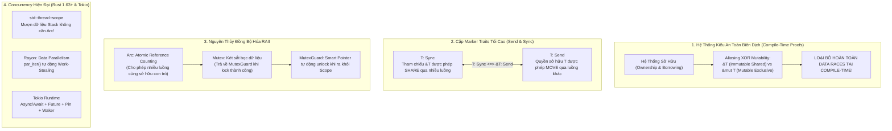

# 15.19.4. Rust Concurrency

> [!IMPORTANT]
> **Nếu bạn chỉ được nhớ một điều duy nhất:** Triết lý cốt lõi của Rust là **"Fearless Concurrency" (Đồng thời không sợ hãi)**: biến toàn bộ các lỗi chạy đua dữ liệu (Data Races) thành **Lỗi biên dịch (Compile-time Errors)** mà không phải trả bất kỳ chi phí Runtime hay Garbage Collection nào! Nền tảng toán học của cơ chế này là **Định lý Aliasing XOR Mutability** (Hoặc nhiều người cùng đọc bất biến `&T`, hoặc duy nhất một người ghi khả biến `&mut T`) kết hợp với hai Marker Traits tối cao: **`Send`** (cho phép chuyển giao quyền sở hữu đối tượng qua luồng khác) và **`Sync`** (cho phép chia sẻ tham chiếu qua nhiều luồng: $T: \text{Sync} \iff \&T: \text{Send}$). Trong C++, Mutex chỉ bảo vệ một vùng mã; trong Rust, **`Mutex<T>` bọc kín dữ liệu bên trong**, buộc lập trình viên không thể chạm vào dữ liệu nếu chưa khóa thành công.

---

## 1. Kiến trúc Tổng quan & Mô hình Tư duy (Mental Model)

### Ẩn Dụ Đời Sống: Phòng Trưng Bày Nghệ Thuật & Két Sắt Khóa Tự Động
Hãy hình dung tài nguyên bộ nhớ giống như một bức tranh nghệ thuật vô giá trong bảo tàng:
- **Nguyên tắc Aliasing XOR Mutability**: 
  - Hoặc bảo tàng mở cửa cho $1,000$ du khách cùng đứng xem bức tranh từ xa (`&T` - Tham chiếu bất biến chia sẻ). Mọi người cùng đọc, không ai được cầm bút vẽ.
  - Hoặc duy nhất $1$ họa sĩ phục chế được phép đóng cửa phòng, bước vào cầm cọ vẽ trực tiếp lên bức tranh (`&mut T` - Tham chiếu khả biến độc quyền). Trong lúc họa sĩ vẽ, tuyệt đối không một ai được bước vào nhìn.
  - Quy tắc này loại bỏ tận gốc điều kiện phát sinh Data Race: Không bao giờ có chuyện vừa có người đọc vừa có người ghi đồng thời!
- **Sự khác biệt giữa C++ Mutex và Rust Mutex**:
  - Trong C++, Mutex giống như chiếc biển cảnh báo treo ngoài cửa: Bạn phải tự nhớ khóa Mutex trước khi thao tác trên biến dùng chung. Nếu lơ đễnh quên khóa, chương trình vẫn biên dịch trơn tru và phát nổ tại môi trường Production.
  - Trong Rust, **`Mutex<T>` là một chiếc két sắt bọc kín bức tranh bên trong**! Muốn chạm vào `T`, bạn bắt buộc phải cắm chìa khóa mở két (`lock()`), két sắt nhả ra một chiếc găng tay bảo hộ (**`MutexGuard`**). Khi bạn tháo găng tay vứt đi (hết Scope), chiếc két tự động sập nắp khóa lại thông qua cơ chế giải phóng tài nguyên tự động (`Drop` / RAII).



---

## 2. Chi tiết từng Keyword (Under-the-Hood Deep Dive)

### 2.1. Ownership, Borrowing, Lifetimes & Định Lý Aliasing XOR Mutability
- **Ownership (Hệ thống sở hữu)**: Mỗi giá trị trong bộ nhớ tại một thời điểm chỉ có duy nhất một biến làm chủ sở hữu (Owner). Khi chủ sở hữu ra khỏi phạm vi (Scope), hàm hủy `drop()` được chèn tự động tại thời điểm biên dịch để giải phóng bộ nhớ. Trong concurrency, khi truyền một biến vào luồng mới qua `move`, quyền sở hữu biến đó được chuyển giao hoàn toàn sang luồng mới, triệt tiêu nguy cơ Use-After-Free.
- **Borrowing (Mượn dữ liệu)**: Thay vì chuyển quyền sở hữu, ta có thể tạo tham chiếu:
  - Tham chiếu bất biến: `&T` (có thể có vô số tham chiếu đồng thời).
  - Tham chiếu khả biến: `&mut T` (chỉ duy nhất 1 tham chiếu tại một thời điểm).
- **Lifetimes (Vòng đời tham chiếu `'a`)**: Trình biên dịch theo dõi phạm vi sống của dữ liệu để đảm bảo không có tham chiếu nào sống lâu hơn dữ liệu gốc mà nó trỏ tới (loại bỏ triệt để Dangling Pointers).
- **Định lý Aliasing XOR Mutability**: Trong lý thuyết ngôn ngữ lập trình, Data Race chỉ xảy ra khi thỏa mãn đồng thời 3 điều kiện: (1) Hai hoặc nhiều con trỏ cùng truy cập một vùng nhớ (Aliasing), (2) Có ít nhất một con trỏ thực hiện thao tác ghi (Mutability), và (3) Không có cơ chế đồng bộ hóa. Hệ thống kiểu của Rust áp dụng mệnh đề logic $A \oplus M$ (Aliasing XOR Mutability): Nếu có nhiều con trỏ thì không được ghi; nếu ghi thì chỉ được phép có duy nhất 1 con trỏ. Do đó, Data Race bị loại bỏ ở cấp độ toán học!

### 2.2. `Send` Trait & `Sync` Trait (Cặp Marker Traits Tối Cao)
Trong thư viện chuẩn `std::marker`, `Send` và `Sync` là hai **Unsafe Auto Traits** không chứa bất kỳ phương thức nào, đóng vai trò là "chứng chỉ kiểm định an toàn" cho hệ thống kiểu:
- **`T: Send`**: Chứng chỉ xác nhận rằng quyền sở hữu của kiểu dữ liệu `T` có thể được chuyển giao an toàn xuyên qua ranh giới giữa hai luồng khác nhau.
- **`T: Sync`**: Chứng chỉ xác nhận rằng tham chiếu bất biến `&T` có thể được chia sẻ an toàn cho nhiều luồng truy cập đồng thời.
- **Mối quan hệ định lý cốt lõi**:
  $$T: \text{Sync} \iff \&T: \text{Send}$$
  *(Chia sẻ tham chiếu `&T` cho luồng khác tương đương với việc gửi quyền sở hữu của `&T` qua luồng đó).*
- **Các kiểu dữ liệu bị cấm (Non-Send / Non-Sync)**:
  - `Rc<T>`: Bộ đếm tham chiếu thông thường không nguyên tử. Nếu chuyển qua luồng khác, hai luồng cùng gọi `clone()` sẽ gây race condition trên biến đếm nội bộ $\implies$ `Rc<T>` là **`!Send`** và **`!Sync`**. Trình biên dịch Rust từ chối biên dịch ngay lập tức nếu bạn cố tình gửi `Rc` sang luồng khác!
  - `RefCell<T>`: Kiểm tra mượn dữ liệu tại runtime mà không có khóa bảo vệ đa luồng $\implies$ `RefCell<T>` là **`!Sync`**.
  - Muốn dùng đa luồng, lập trình viên bắt buộc phải dùng phiên bản nguyên tử: `Arc<T>` (Atomic Reference Counting) và `Mutex<T>` / `RwLock<T>`.

### 2.3. `Arc<Mutex<T>>` Idiom & `MutexGuard` (RAII Safety)
- **`Arc<Mutex<T>>`**: Thành ngữ kinh điển nhất trong lập trình chia sẻ trạng thái của Rust:
  - `Arc` (Atomic Reference Counted pointer): Quản lý vòng đời bộ nhớ của đối tượng trên Heap, cho phép nhiều luồng cùng giữ bản sao con trỏ thông qua lệnh nguyên tử `fetch_add` / `fetch_sub`.
  - `Mutex`: Bọc kín dữ liệu `T`. Dữ liệu `T` không thể truy cập trực tiếp từ bên ngoài.
- **`MutexGuard<'a, T>`**: Khi gọi `.lock().unwrap()`, hàm trả về một đối tượng guard thực thi `Deref` và `DerefMut` trỏ tới `T`. Điểm thiên tài: Lập trình viên **không bao giờ phải gọi hàm `unlock()`**! Khi guard ra khỏi scope, Rust tự động gọi `Drop::drop()`, giải phóng khóa ngay lập tức. Điều này loại bỏ hoàn toàn lỗi quên unlock dẫn đến deadlock kinh điển trong C/C++.

### 2.4. Scoped Threads (`std::thread::scope` - Rust 1.63+)
- **Nỗi đau lịch sử**: Trước Rust 1.63, khi gọi `std::thread::spawn()`, luồng mới có thể sống lâu hơn hàm tạo ra nó (thậm chí sống đến hết vòng đời chương trình). Vì vậy, Rust compiler bắt buộc closure truyền vào phải thỏa mãn ràng buộc **`'static` lifetime**, nghĩa là không được phép mượn bất kỳ biến nào trên Stack của luồng cha, buộc lập trình viên phải bọc mọi thứ trong `Arc<Mutex<T>>`.
- **Đột phá của Scoped Threads**: `std::thread::scope(|s| { ... })` bảo đảm rằng **toàn bộ các luồng con sinh ra bên trong scope bắt buộc phải hoàn thành (`join`) trước khi scope kết thúc**.
- **Lợi ích kiến trúc**: Trình biên dịch có thể chứng minh tĩnh rằng dữ liệu trên Stack của luồng cha sẽ không bao giờ bị giải phóng khi luồng con đang chạy. Nhờ đó, luồng con có thể **mượn trực tiếp dữ liệu trên Stack (`&T` hoặc `&mut T`)** mà không cần tốn một byte cấp phát Heap hay chi phí đếm nguyên tử của `Arc`!

### 2.5. Rayon (Data Parallelism Cực hạn)
- **Bản chất**: Thư viện song song hóa dữ liệu hàng đầu của hệ sinh thái Rust. Chuyển đổi một vòng lặp tuần tự thông thường thành song song chỉ bằng cách đổi `.iter()` thành `.par_iter()`.
- **Cơ chế bên dưới**: Rayon tích hợp một **Work-Stealing Thread Pool** cực kỳ tinh vi. Khi duyệt qua một mảng dữ liệu, Rayon sử dụng chiến lược Chia để trị (Divide and Conquer): phân rã mảng thành các phân đoạn nhỏ (Splitting Iterator), nạp vào hàng đợi cục bộ của các worker thread, và tự động cân bằng tải thông qua cơ chế trộm việc mà không gây ô nhiễm Cache.

### 2.6. Async/Await, `Future` Trait, `Pin`, `Waker` & Tokio Runtime
- **Triết lý Zero-Cost Future (Pull-Based vs Push-Based)**: Trong JavaScript hay C#, Promise/Task là Push-based (ngay khi tạo ra nó đã bắt đầu chạy ngầm trong background). Trong Rust, `Future` là **Pull-based (Lazy)**: Một `Future` không làm gì cả cho đến khi nó được thăm dò bằng phương thức `.poll()`.
- **Định nghĩa chuẩn của `Future` Trait**:
  ```rust
  pub trait Future {
      type Output;
      fn poll(self: Pin<&mut Self>, cx: &mut Context<'_>) -> Poll<Self::Output>;
  }
  ```
- **Vai trò của `Pin`**: Trong Rust, một hàm async chứa các điểm `await` sẽ được biên dịch thành một State Machine tự tham chiếu (Self-Referential Struct - con trỏ nội bộ trỏ vào biến cục bộ trong frame). Nếu struct này bị di chuyển vị trí bộ nhớ (Move semantics của Rust), các con trỏ nội bộ sẽ trỏ vào vùng nhớ rác! `Pin` là một kiểu bọc bảo đảm rằng đối tượng được ghim chặt tại một địa chỉ bộ nhớ cố định, không thể bị di chuyển.
- **`Waker` & Tokio Runtime**:
  - Khi `Future` chưa sẵn sàng (ví dụ đang chờ đọc Socket), hàm `poll()` đăng ký một bản sao của `Waker` vào Reactor (epoll/kqueue) và trả về `Poll::Pending`.
  - Khi dữ liệu trên Socket thực sự sẵn sàng, OS báo cho Reactor, Reactor kích hoạt `Waker.wake()`.
  - `Waker` đẩy lại task vào hàng đợi của Tokio Scheduler để gọi lại `poll()` lần thứ hai. Đây là cơ chế hướng sự kiện không phong tỏa hoàn hảo.

---

## 3. Thực thi Mã nguồn & Mô phỏng Chuyên sâu (Dual-Engine Implementation)

### Engine 1: C++20 Mô Phỏng Cơ Chế Scoped Thread & RAII Safe Data Encapsulation
Chương trình C++20 tái tạo lại tư tưởng an toàn của Rust: bọc dữ liệu bên trong một `SafeContainer` và sử dụng `std::jthread` để xây dựng Scoped Threading không rò rỉ:

```cpp
#include <iostream>
#include <vector>
#include <thread>
#include <mutex>
#include <string>
#include <numeric>
#include <chrono>

// 1. Mô phỏng Mutex<T> của Rust: Két sắt bọc dữ liệu
template <typename T>
class RustLikeMutex {
public:
    explicit RustLikeMutex(T initial_val) : data_(std::move(initial_val)) {}

    // RAII Guard tương đương MutexGuard của Rust
    class Guard {
    public:
        Guard(RustLikeMutex& parent) : parent_(parent), lock_(parent.mtx_) {}
        ~Guard() = default; // Tự động unlock khi ra khỏi scope!

        T& operator*() { return parent_.data_; }
        T* operator->() { return &parent_.data_; }

        // Cấm copy, chỉ cho move
        Guard(const Guard&) = delete;
        Guard& operator=(const Guard&) = delete;

    private:
        RustLikeMutex& parent_;
        std::unique_lock<std::mutex> lock_;
    };

    Guard lock() {
        return Guard(*this);
    }

private:
    T data_;
    std::mutex mtx_;
};

// 2. Mô phỏng std::thread::scope của Rust 1.63+
template <typename F>
void scoped_threads(F&& func) {
    std::vector<std::jthread> scope_workers;
    auto scope_spawner = [&scope_workers](auto&& task) {
        scope_workers.emplace_back(std::forward<decltype(task)>(task));
    };

    // Thực thi thân hàm scope
    func(scope_spawner);

    // jthread tự động join() toàn bộ khi ra khỏi hàm!
    // Bảo đảm tuyệt đối an toàn cho biến cục bộ trên stack cha
}

int main() {
    std::cout << "=== C++20 Simulation of Rust Concurrency Patterns ===\n";

    RustLikeMutex<int64_t> shared_bank_account(1000); // Khởi tạo tài khoản 1000$

    std::cout << "[Scope] Bắt đầu Scoped Threads mượn dữ liệu Stack an toàn...\n";

    scoped_threads([&](auto& spawn) {
        // Luồng 1: Nạp 500$
        spawn([&shared_bank_account]() {
            for (int i = 0; i < 5; ++i) {
                {
                    auto guard = shared_bank_account.lock();
                    *guard += 100;
                    std::cout << "  [Luồng A] Nạp 100$, Số dư hiện tại: " << *guard << "$\n";
                } // guard tự giải phóng khóa tại đây
                std::this_thread::sleep_for(std::chrono::milliseconds(10));
            }
        });

        // Luồng 2: Rút 200$
        spawn([&shared_bank_account]() {
            for (int i = 0; i < 2; ++i) {
                {
                    auto guard = shared_bank_account.lock();
                    *guard -= 100;
                    std::cout << "  [Luồng B] Rút 100$, Số dư hiện tại: " << *guard << "$\n";
                }
                std::this_thread::sleep_for(std::chrono::milliseconds(25));
            }
        });
    });

    // Khi thoát khỏi scoped_threads, mọi luồng đã join hoàn tất
    auto final_guard = shared_bank_account.lock();
    std::cout << "[Scope] Toàn bộ Scoped Threads kết thúc an toàn. Số dư cuối: " 
              << *final_guard << "$\n";
    return 0;
}
```

#### Terminal Output Mẫu (C++20 Engine):
```text
=== C++20 Simulation of Rust Concurrency Patterns ===
[Scope] Bắt đầu Scoped Threads mượn dữ liệu Stack an toàn...
  [Luồng A] Nạp 100$, Số dư hiện tại: 1100$
  [Luồng B] Rút 100$, Số dư hiện tại: 1000$
  [Luồng A] Nạp 100$, Số dư hiện tại: 1100$
  [Luồng A] Nạp 100$, Số dư hiện tại: 1200$
  [Luồng B] Rút 100$, Số dư hiện tại: 1100$
  [Luồng A] Nạp 100$, Số dư hiện tại: 1200$
  [Luồng A] Nạp 100$, Số dư hiện tại: 1300$
[Scope] Toàn bộ Scoped Threads kết thúc an toàn. Số dư cuối: 1300$
```

---

### Engine 2: Python 3.11+ Mô Phỏng Hệ Thống Kiểm Soát Aliasing XOR Mutability
Mô phỏng cơ chế Borrow Checker kiểm soát tham chiếu độc quyền tại thời gian thực thi:

```python
import threading
import time

class BorrowCheckerException(RuntimeError):
    pass

class SafeResource:
    """Mô phỏng quy tắc Aliasing XOR Mutability của Rust trong Python."""
    def __init__(self, value: str):
        self._value = value
        self._lock = threading.Lock()
        self._readers_count = 0
        self._has_writer = False

    def borrow_immutable(self):
        """Tương đương tạo tham chiếu &T."""
        with self._lock:
            if self._has_writer:
                raise BorrowCheckerException("LỖI BIÊN DỊCH RUST: Không thể mượn &T khi đang có &mut T đang ghi!")
            self._readers_count += 1
        return self._value

    def release_immutable(self):
        with self._lock:
            self._readers_count -= 1

    def borrow_mutable(self):
        """Tương đương tạo tham chiếu &mut T độc quyền."""
        with self._lock:
            if self._has_writer or self._readers_count > 0:
                raise BorrowCheckerException(
                    f"LỖI BIÊN DỊCH RUST: Không thể mượn &mut T độc quyền! Đang có {self._readers_count} người đọc!"
                )
            self._has_writer = True

    def release_mutable(self):
        with self._lock:
            self._has_writer = False

    def write(self, new_val: str):
        if not self._has_writer:
            raise BorrowCheckerException("Chưa xin quyền mượn khả biến độc quyền!")
        self._value = new_val

if __name__ == "__main__":
    print("=== Python 3.11+ Rust Borrow Checker Emulation ===")
    res = SafeResource("Dữ liệu gốc v1.0")

    print("[Step 1] Nhiều luồng cùng mượn đọc bất biến &T:")
    val1 = res.borrow_immutable()
    val2 = res.borrow_immutable()
    print(f"  Reader 1 đọc được: {val1}")
    print(f"  Reader 2 đọc được: {val2}")

    print("\n[Step 2] Thử tạo tham chiếu khả biến &mut T khi vẫn còn người đọc:")
    try:
        res.borrow_mutable()
    except BorrowCheckerException as e:
        print(f"  [BỊ CHẶN BỞI BORROW CHECKER] -> {e}")

    print("\n[Step 3] Các readers giải phóng tham chiếu, writer xin quyền độc quyền:")
    res.release_immutable()
    res.release_immutable()
    res.borrow_mutable()
    res.write("Dữ liệu cập nhật v2.0 bởi Writer độc quyền")
    print(f"  Ghi thành công: {res._value}")
    res.release_mutable()
```

#### Terminal Output Mẫu (Python 3.11+ Engine):
```text
=== Python 3.11+ Rust Borrow Checker Emulation ===
[Step 1] Nhiều luồng cùng mượn đọc bất biến &T:
  Reader 1 đọc được: Dữ liệu gốc v1.0
  Reader 2 đọc được: Dữ liệu gốc v1.0

[Step 2] Thử tạo tham chiếu khả biến &mut T khi vẫn còn người đọc:
  [BỊ CHẶN BỞI BORROW CHECKER] -> LỖI BIÊN DỊCH RUST: Không thể mượn &mut T độc quyền! Đang có 2 người đọc!

[Step 3] Các readers giải phóng tham chiếu, writer xin quyền độc quyền:
  Ghi thành công: Dữ liệu cập nhật v2.0 bởi Writer độc quyền
```

---

## 4. Systems Engineering & Production Pitfalls

### 4.1. Hiểm Họa Nghẽn Tokio Worker Threads Do Gọi Blocking Code
- **Cơ chế**: Tokio Runtime mặc định sử dụng Work-Stealing với số worker threads đúng bằng số CPU Cores. Nếu bạn gọi một hàm đồng bộ chặn (như `std::thread::sleep`, đọc ghi file tuần tự với `std::fs`, hoặc gọi DB driver cũ) bên trong một hàm `async fn`, luồng worker thread đó sẽ bị phong tỏa hoàn toàn.
- **Hậu quả**: Khi một vài luồng bị block, toàn bộ các tác vụ async khác đang xếp hàng trên core đó bị tê liệt, latency tăng vọt từ 2ms lên 10,000ms.
- **Quy tắc vàng**: Bắt buộc bọc các tác vụ chặn vào `tokio::task::spawn_blocking(move || { ... })`. Tokio sẽ chuyển tác vụ này sang một thread pool phụ riêng biệt chuyên dụng cho I/O chặn (Blocking Pool).

### 4.2. Giữ `MutexGuard` Xuyên Qua Điểm `await` Gây Lỗi Biên Dịch Hoặc Deadlock
- **Cơ chế**: Nếu bạn giữ một `std::sync::MutexGuard` xuyên qua một lệnh `await`:
  ```rust
  let guard = mtx.lock().unwrap();
  some_async_fn().await; // LỖI BIÊN DỊCH! MutexGuard không implement Send!
  ```
- **Lý do phần cứng**: Khi `await`, task có thể bị suspend và sau đó được resume trên một *OS worker thread khác*! Vì `std::sync::Mutex` yêu cầu unlock trên đúng luồng đã lock, việc tráo luồng sẽ gây undefined behavior hoặc deadlock.
- **Giải pháp**: Thu hẹp scope của guard trước khi `await`, hoặc sử dụng `tokio::sync::Mutex` (Async Mutex an toàn qua các điểm suspend).

### 4.3. Các Lệnh Chẩn Đoán Production Thực Chiến (CLI Diagnostics)
```bash
# 1. Kiểm tra tĩnh lỗi Concurrency và Undefined Behavior bằng Miri
cargo +nightly miri test
# Miri giả lập CPU ở mức độ Stacked Borrows để tìm triệt để UB đa luồng!

# 2. Giám sát trạng thái thời gian thực của Tokio Tasks và Schedulers bằng tokio-console
# Thêm console-subscriber vào dự án, sau đó chạy:
tokio-console http://127.0.0.1:6669

# 3. Quét lỗi tiềm ẩn về Concurrency bằng Cargo Clippy
cargo clippy -- -D clippy::await_holding_lock
```

---

## 5. Bảng So sánh & Decision Matrix

| Tiêu Chí Kỹ Thuật | Rust Concurrency | Go Goroutines | C++20 Concurrency | Java 21 Virtual Threads |
| :--- | :--- | :--- | :--- | :--- |
| **Phát Hiện Data Race** | **Thời điểm biên dịch (100% Compile-time)** | Runtime (Cần flag `-race`) | Thủ công (Cần TSan tại runtime) | Runtime (Cần synchronized/locks) |
| **Chi Phí Trừu Tượng** | Zero-Cost (Không GC, Không Overhead) | Garbage Collector tạm dừng thế giới | Zero-Cost | Garbage Collector quản lý heap |
| **Cơ Chế Threading** | 1:1 OS Threads + Scoped + M:N Tokio | M:N Green Threads tích hợp runtime | 1:1 OS Threads + Coroutines rời rạc | M:N Virtual Threads tích hợp JVM |
| **Bảo Vệ Dữ Liệu Dùng Chung** | Bắt buộc kiểu `Mutex<T>` bọc dữ liệu | Giao tiếp qua Channels (CSP) | Lập trình viên tự nhớ lock Mutex | Khóa mức đối tượng (`synchronized`) |
| **Độ Khó Khi Lập Trình** | Rất cao (Đấu tranh với Borrow Checker) | Rất thấp (Dễ học, cú pháp đơn giản) | Rất cao (Dễ gặp Undefined Behavior) | Trung bình (Kế thừa hệ sinh thái Java) |

> [!TIP]
> **Quy Tắc Vàng Ra Quyết Định Thiết Kế (Engineering Decision Rule)**:
> 1. Khi cần tính toán hiệu năng cực hạn và an toàn tuyệt đối (Hệ thống nhúng, Engine trình duyệt, Blockchain core, Database storage engine): Chọn **Rust**.
> 2. Luôn ưu tiên **`std::thread::scope`** thay vì `Arc<Mutex<T>>` bất cứ khi nào vòng đời tác vụ có thể gom gọn bên trong một hàm, giúp giảm chi phí cấp phát Heap và Atomic contention.
> 3. Trong ứng dụng mạng Tokio: Tuyệt đối không giữ Lock đồng bộ qua lệnh `await` và không thực thi mã CPU nặng trên worker threads.
