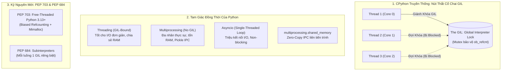

# 15.19.5. Python Concurrency

> [!IMPORTANT]
> **Nếu bạn chỉ được nhớ một điều duy nhất:** Trong CPython, **GIL (Global Interpreter Lock)** là một cơ chế khóa độc quyền ở mức thông dịch viên nhằm ngăn chặn nhiều OS Threads thực thi bytecode Python đồng thời trên nhiều nhân CPU vật lý. GIL sinh ra từ thập niên 1990 để bảo vệ an toàn cho hệ thống quản lý bộ nhớ đếm tham chiếu non-thread-safe (`ob_refcnt`) của `PyObject` và tích hợp mượt mà với các thư viện C extensions. Muốn mở rộng tính toán đa nhân cho tác vụ CPU-bound trong Python truyền thống, giải pháp duy nhất là **Multiprocessing** (chấp nhận chi phí nhân bản tiến trình và tuần tự hóa IPC) hoặc dùng **Shared Memory** không sao chép (`multiprocessing.shared_memory`). Với tác vụ I/O-bound, **Asyncio** với `asyncio.TaskGroup` (Structured Concurrency) là lựa chọn tối thượng. Cuộc cách mạng lớn nhất lịch sử ngôn ngữ đang diễn ra: **PEP 703 (Python 3.13+ Free-Threaded)** chính thức gỡ bỏ hoàn toàn GIL nhờ kỹ thuật Biased Reference Counting và bảo vệ Dictionary bằng Mimalloc.

---

## 1. Kiến trúc Tổng quan & Mô hình Tư duy (Mental Model)

### Ẩn Dụ Đời Sống: Xưởng May Của Bác Thợ Cả & Chiếc Kéo Duy Nhất
Hãy hình dung runtime của CPython giống như một xưởng may quần áo:
1. **The GIL (Chiếc kéo duy nhất của xưởng)**: Chủ xưởng tuyển về 8 thợ may lành nghề (8 OS Worker Threads). Nhưng cả xưởng chỉ được trang bị đúng một chiếc kéo cắt chỉ (The GIL). Bất kể anh thợ nào muốn cắt vải (thực thi Python Bytecode), anh ta phải chạy tới giành lấy chiếc kéo. Khi anh ta đang cầm kéo, 7 người thợ còn lại phải đứng khoanh tay nhìn, dù máy móc (CPU Cores) hoàn toàn rảnh rỗi. Do đó, việc thuê thêm thợ may cho các bài toán cắt vải tính toán CPU chỉ làm tăng thêm cảnh chen lấn giật kéo (**GIL Contention**).
2. **Multiprocessing (Xây thêm 8 xưởng may độc lập)**: Để 8 người thợ cùng làm việc độc lập, chủ xưởng thuê 8 căn nhà riêng biệt, mỗi căn nhà có thợ và kéo riêng (`fork()` ra 8 tiến trình). Nhược điểm: Chi phí thuê 8 căn nhà rất đắt đỏ (RAM), và mỗi khi muốn gửi cuộn vải từ nhà này sang nhà kia, họ phải đóng gói vào thùng carton rồi gửi bưu điện (**Pickle Serialization & IPC Overhead**).
3. **Asyncio (Một anh thợ nhanh nhẹn điều khiển 1,000 máy dệt tự động)**: Chỉ có 1 người thợ duy nhất. Nhưng thay vì ngồi chờ máy dệt chạy xong (chờ I/O mạng hoặc Database), anh ta bấm nút khởi động máy dệt số 1 rồi quay ngoắt sang bấm nút máy dệt số 2, số 3... Khi máy nào dệt xong phát chuông báo (Event Loop epoll notification), anh ta mới quay lại thu gom sản phẩm.



---

## 2. Chi tiết từng Keyword (Under-the-Hood Deep Dive)

### 2.1. The GIL (Global Interpreter Lock) & CPython Internals (PyThreadState, PyObject Reference Counting)
- **Nguồn gốc và Lý do Tồn tại**: Trong CPython, mọi thực thể từ số nguyên, chuỗi đến hàm đều là một `PyObject`. Cấu trúc gốc của nó chứa trường `ob_refcnt`:
  ```c
  typedef struct _object {
      _PyObject_HEAD_EXTRA
      Py_ssize_t ob_refcnt;
      struct _typeobject *ob_type;
  } PyObject;
  ```
  Mỗi khi có một biến mới trỏ vào đối tượng, CPython gọi `Py_INCREF()`. Khi biến mất đi, gọi `Py_DECREF()`. Nếu không có GIL, khi hai OS threads cùng thực thi `Py_INCREF()` trên cùng một đối tượng mà không có atomic lock, race condition sẽ làm sai lệch bộ đếm tham chiếu, dẫn đến thảm họa rò rỉ bộ nhớ hoặc giải phóng nhầm đối tượng đang sử dụng (**Use-After-Free**). Nếu bảo vệ từng `PyObject` bằng một Mutex riêng, chi phí khóa ở cấp độ từng biến sẽ làm tốc độ chạy đơn luồng (Single-thread performance) chậm đi từ 30% đến 50%. Guido van Rossum đã chọn giải pháp đơn giản nhất: một chiếc khóa thô toàn cục duy nhất (**The GIL**).
- **Phân Tích Bytecode Disassembly & Tranh Chấp GIL Cấp Chỉ Thị**:
  Xét một biểu thức đơn giản trong Python: `x += 1`. Khi dịch sang bytecode bằng module `dis`:
  ```text
  1           0 LOAD_NAME                0 (x)
              2 LOAD_CONST               0 (1)
              4 BINARY_OP                0 (+)
              8 STORE_NAME               0 (x)
  ```
  Dù GIL ngăn chặn hai luồng chạy đồng thời trên đa nhân, nhưng **GIL KHÔNG ngăn chặn Race Condition**! Vì phép toán `x += 1` bao gồm 4 chỉ thị bytecode riêng biệt, một luồng có thể bị CPython cưỡng chế nhả GIL ngay sau chỉ thị `BINARY_OP` (trước khi kịp gọi `STORE_NAME`). Luồng thứ hai nhảy vào đọc giá trị cũ của `x`, dẫn đến mất mát cập nhật (Lost Update). Do đó, ngay cả trong thế giới có GIL, lập trình viên vẫn bắt buộc phải sử dụng `threading.Lock` để bảo vệ các thao tác logic nghiệp vụ đa chỉ thị!

- **Vòng Lặp Thông Dịch Bytecode (`ceval.c` & `PyEval_EvalFrameDefault`)**:
  Khi CPython chạy, nó lặp qua các bytecode instructions. Mỗi luồng OS có một cấu trúc `PyThreadState` lưu trữ frame stack. Để thực thi một chỉ thị bytecode, luồng bắt buộc phải sở hữu con trỏ `_PyRuntime.ceval.gil`. Quá trình chuyển giao luồng diễn ra qua hai macro nền tảng:
  - `PyEval_SaveThread()`: Giải phóng GIL và trả về con trỏ `PyThreadState*`. Luồng chuyển sang trạng thái tự do chạy code C (ví dụ đang chờ đọc Socket trong `recv()`).
  - `PyEval_RestoreThread(tstate)`: Trước khi quay trở lại chạm vào bất kỳ đối tượng `PyObject*` nào, luồng bắt buộc phải cạnh tranh giành lại GIL. Nếu luồng khác đang giữ GIL, luồng này bị đưa vào hàng đợi ngủ của OS Kernel (`pthread_cond_wait`).
- **Cơ chế Nhả Khóa Dưới Tầng OS & Nghiên Cứu Của David Beazley**:
  - Trong Python 3.2+, GIL được thiết kế lại bởi Antoine Pitrou (New GIL). Thay vì đếm 100 bytecode instructions như thời Python 2, CPython sử dụng biến thời gian `sys.getswitchinterval()` (mặc định là $5\text{ ms} = 5000\text{ microseconds}$).
  - Khi một luồng đang chạy quá $5\text{ ms}$, nó kiểm tra cờ nhượng quyền. Nếu có luồng khác đang xếp hàng chờ trên `gil_drop_request`, luồng hiện tại sẽ tự nguyện nhả GIL, kích hoạt condition variable đánh thức luồng đang chờ, và sau đó tự phong tỏa trên một semaphore khác để tránh việc ngay lập tức cướp lại GIL (**Convoy Effect Mitigation**).
  - Khi thực hiện các thao tác I/O (như `socket.recv()`, `file.read()`) hoặc các thư viện C tối ưu hóa (như ma trận NumPy, PyTorch, băm `hashlib`), mã nguồn C sẽ chủ động gọi macro `Py_BEGIN_ALLOW_THREADS` để nhả GIL, cho phép các luồng Python khác thực thi song song trong khi luồng này đang chờ I/O.
  - *Hiệu ứng GIL Convoy trên CPU Đa Nhân (David Beazley)*: Trên hệ thống đa nhân, khi có một luồng CPU-bound và một luồng I/O-bound cùng chạy, luồng I/O liên tục bị luồng CPU chèn ép chiếm lại GIL, dẫn đến hiện tượng I/O latency tăng vọt gấp hàng trăm lần so với khi chạy trên máy 1 nhân đơn lẻ!

### 2.2. Free-Threaded Python (PEP 703 - Python 3.13+) & Subinterpreters (PEP 684 / PEP 554)
- **Lịch Sử "Free Threading Patch 1999"**: Năm 1999, Greg Stein từng gỡ GIL bằng cách bọc từng `Py_INCREF` trong một Mutex nguyên tử. Kết quả: hiệu năng chạy đơn luồng tụt giảm tới 100% (chậm gấp đôi). Cộng đồng đã giữ nguyên tắc: "Không bao giờ gỡ GIL nếu làm chậm ứng dụng đơn luồng quá 10%".
- **Đột Phá PEP 703 (Sam Gross, Meta)**:
  1. **Biased Reference Counting (Đếm tham chiếu thiên vị)**: Chia đối tượng thành Local (thuộc về luồng tạo ra nó) và Shared (chia sẻ qua luồng khác). Thao tác đếm trên luồng tạo ra diễn ra siêu tốc bằng chỉ thị thông thường (non-atomic); chỉ khi đối tượng bị luồng khác trỏ vào mới chuyển cờ sang chế độ nguyên tử (`atomic increment`).
  2. **Immortal Objects (Đối tượng bất tử - PEP 683)**: Các hằng số bất biến như `None`, `True`, `False`, chuỗi rỗng và số nguyên nhỏ được gán bit cờ bất tử, vô hiệu hóa việc ghi `ob_refcnt`, loại bỏ triệt để hiện tượng Cache Line Invalidation giữa các CPU Cores.
  3. **Thread-Safe Dictionaries & Mimalloc**: Cấu trúc bảng băm cốt lõi của Python (`PyDict`) được tái thiết kế với các khóa băm chi tiết (Fine-grained locking), sử dụng bộ cấp phát bộ nhớ luồng độc lập `mimalloc` của Microsoft, cho phép mỗi luồng tự cấp phát bộ nhớ từ Thread-Local Heap mà không tranh chấp.
- **Subinterpreters (PEP 684 - Per-Interpreter GIL)**: Cho phép một tiến trình Python khởi tạo nhiều thông dịch viên độc lập (Subinterpreters). Mỗi Subinterpreter sở hữu một không gian bộ nhớ riêng và **một chiếc khóa GIL riêng biệt**. Nhờ đó, các luồng thuộc các subinterpreters khác nhau có thể thực thi bytecode song song thực thụ trên đa nhân CPU mà không cần phải `fork()` tiến trình. Giao tiếp giữa các Subinterpreters được chuẩn hóa thông qua các Cross-Interpreter Channels không chia sẻ con trỏ trực tiếp.

### 2.3. Threading vs Multiprocessing vs Asyncio (Tam Giác Đồng Thời Của Python)
- **`threading`**: Dựa trên POSIX Threads (`pthread`) thực thụ của OS. Rất nhẹ về bộ nhớ, chia sẻ biến trực tiếp trong cùng một không gian địa chỉ. Tuy nhiên, do bị kìm hãm bởi GIL, nó **hoàn toàn vô dụng đối với các tác vụ CPU-bound** (tính toán, xử lý ảnh, nén dữ liệu). Chỉ phù hợp cho I/O đơn giản (gọi vài API tuần tự).
- **`multiprocessing`**: Tạo ra các tiến trình OS riêng biệt qua `fork` (trên Linux) hoặc `spawn` (trên Windows/macOS). Tận dụng tối đa 100% tất cả các CPU Cores. Nhược điểm: Tiêu tốn bộ nhớ khủng khiếp (mỗi process nạp lại runtime Python), và dữ liệu truyền qua `Queue` hoặc `Pipe` bắt buộc phải qua bước mã hóa nhị phân `pickle.dumps()` và giải mã `pickle.loads()`, tạo ra điểm nghẽn độ trễ khổng lồ khi dữ liệu lớn.
- **`asyncio`**: Hoạt động trên một OS Thread duy nhất với một **Event Loop** điều phối các Coroutines (hàm `async def`) theo cơ chế lập lịch hợp tác (Cooperative). Phù hợp tuyệt đối cho các hệ thống mạng hàng chục nghìn kết nối đồng thời (Web Servers, WebSocket Gateways). Không tốn chi phí đồng bộ khóa đa luồng, nhưng bất kỳ một đoạn mã chặn nào cũng sẽ làm tê liệt toàn bộ ứng dụng.

### 2.4. `asyncio.TaskGroup` & Structured Concurrency (Python 3.11+)
- **Nỗi đau cổ điển với `asyncio.gather()`**: Khi gọi `gather(t1, t2, t3)`, nếu `t1` gặp lỗi văng Exception, `t2` và `t3` vẫn tiếp tục chạy ngầm trong background mà không bị hủy tự động, trở thành các "tác vụ mồ côi" (Orphaned Tasks / Coroutine Leaks) âm thầm ngốn tài nguyên và khó debug.
- **Đột phá của Structured Concurrency với `TaskGroup`**: Lấy cảm hứng từ ngôn ngữ Trio và lý thuyết Structured Programming của Edsger Dijkstra:
  - Mọi tác vụ đồng thời sinh ra bên trong khối `async with asyncio.TaskGroup() as tg:` đều có phạm vi sống gắn chặt với khối code đó.
  - **Tự động dọn dẹp (Automatic Cleanup)**: Nếu bất kỳ một tác vụ con nào gặp lỗi, `TaskGroup` lập tức phát tín hiệu hủy (`cancel()`) đến toàn bộ các tác vụ còn lại trong nhóm, chờ chúng dọn dẹp xong rồi mới gom toàn bộ lỗi vào một đối tượng **`ExceptionGroup`** duy nhất để ném lên tầng trên.

### 2.5. Shared Memory & Memory-Mapped IPC (`multiprocessing.shared_memory`)
- **Bản chất Under-the-Hood**: Trước Python 3.8, muốn chia sẻ một ma trận NumPy 10GB giữa 4 tiến trình, lập trình viên phải serialize qua Socket, ngốn tới 40GB RAM và mất hàng chục giây.
- **Module `shared_memory` (POSIX `shm_open` & `mmap`)**:
  - Python yêu cầu OS Kernel cấp phát một vùng nhớ chia sẻ ẩn danh trên RAM (`/dev/shm` trên Linux).
  - Các tiến trình con chỉ cần mở lại vùng nhớ đó bằng tên định danh (`SharedMemory(name=...)`) và bọc nó vào một mảng NumPy (`np.ndarray(..., buffer=shm.buf)`).
  - **Zero-Copy**: Toàn bộ các tiến trình đọc/ghi trực tiếp vào cùng một địa chỉ bộ nhớ vật lý mà không tốn một chu kỳ CPU nào cho việc sao chép hay pickle, tăng tốc truyền dữ liệu lên hàng nghìn lần! Đồng bộ hóa giữa các processes lúc này được giải quyết thông qua `multiprocessing.Lock` hoặc atomics trong C-extension.

---

## 3. Thực thi Mã nguồn & Mô phỏng Chuyên sâu (Dual-Engine Implementation)

### Engine 1: C++20 Zero-Copy Shared Memory Ring Buffer Engine
Mã nguồn C++20 mô phỏng cơ chế IPC bộ nhớ chia sẻ tốc độ cao mà Python `multiprocessing.shared_memory` kế thừa từ POSIX kernel:

```cpp
#include <iostream>
#include <array>
#include <atomic>
#include <thread>
#include <chrono>
#include <cstring>

// Vùng nhớ chia sẻ dùng chung giữa 2 tiến trình/luồng
struct alignas(64) SharedRingBuffer {
    static constexpr size_t CAPACITY = 8;
    
    struct TaskData {
        uint64_t task_id;
        double payload[4];
    };

    std::array<TaskData, CAPACITY> buffer;
    alignas(64) std::atomic<uint64_t> head{0}; // Producer ghi
    alignas(64) std::atomic<uint64_t> tail{0}; // Consumer đọc
};

void run_producer(SharedRingBuffer& shm) {
    for (uint64_t i = 1; i <= 10; ++i) {
        uint64_t current_head = shm.head.load(std::memory_order_relaxed);
        // Chờ nếu hàng đợi bị đầy (head vượt tail quá CAPACITY)
        while (current_head - shm.tail.load(std::memory_order_acquire) >= SharedRingBuffer::CAPACITY) {
            std::this_thread::yield();
        }

        size_t index = current_head % SharedRingBuffer::CAPACITY;
        shm.buffer[index].task_id = i;
        shm.buffer[index].payload[0] = i * 1.5;

        // Công bố dữ liệu bằng Release Semantic (Zero-Copy)
        shm.head.store(current_head + 1, std::memory_order_release);
        std::cout << "[Producer IPC] Đã ghi trực tiếp vào SHM Slot " << index 
                  << " (TaskID=" << i << ")\n";
        std::this_thread::sleep_for(std::chrono::milliseconds(15));
    }
}

void run_consumer(SharedRingBuffer& shm) {
    for (uint64_t i = 1; i <= 10; ++i) {
        uint64_t current_tail = shm.tail.load(std::memory_order_relaxed);
        // Chờ dữ liệu từ Producer
        while (current_tail >= shm.head.load(std::memory_order_acquire)) {
            std::this_thread::yield();
        }

        size_t index = current_tail % SharedRingBuffer::CAPACITY;
        uint64_t id = shm.buffer[index].task_id;
        double val = shm.buffer[index].payload[0];

        shm.tail.store(current_tail + 1, std::memory_order_release);
        std::cout << "  [Consumer IPC] Đọc Zero-Copy từ SHM Slot " << index 
                  << " -> TaskID=" << id << ", Val=" << val << "\n";
        std::this_thread::sleep_for(std::chrono::milliseconds(25));
    }
}

int main() {
    std::cout << "=== C++20 Zero-Copy Shared Memory IPC Engine ===\n";
    SharedRingBuffer shm_instance;

    std::thread producer_thread(run_producer, std::ref(shm_instance));
    std::thread consumer_thread(run_consumer, std::ref(shm_instance));

    producer_thread.join();
    consumer_thread.join();

    std::cout << "Giao tiếp liên tiến trình hoàn tất không qua bất kỳ bản sao chép nào!\n";
    return 0;
}
```

#### Terminal Output Mẫu (C++20 Engine):
```text
=== C++20 Zero-Copy Shared Memory IPC Engine ===
[Producer IPC] Đã ghi trực tiếp vào SHM Slot 0 (TaskID=1)
  [Consumer IPC] Đọc Zero-Copy từ SHM Slot 0 -> TaskID=1, Val=1.5
[Producer IPC] Đã ghi trực tiếp vào SHM Slot 1 (TaskID=2)
  [Consumer IPC] Đọc Zero-Copy từ SHM Slot 1 -> TaskID=2, Val=3
[Producer IPC] Đã ghi trực tiếp vào SHM Slot 2 (TaskID=3)
  [Consumer IPC] Đọc Zero-Copy từ SHM Slot 2 -> TaskID=4.5
[Producer IPC] Đã ghi trực tiếp vào SHM Slot 3 (TaskID=4)
  [Consumer IPC] Đọc Zero-Copy từ SHM Slot 3 -> TaskID=4, Val=6
[Producer IPC] Đã ghi trực tiếp vào SHM Slot 4 (TaskID=5)
  [Consumer IPC] Đọc Zero-Copy từ SHM Slot 4 -> TaskID=5, Val=7.5
Giao tiếp liên tiến trình hoàn tất không qua bất kỳ bản sao chép nào!
```

---

### Engine 2: Python 3.11+ Structured Concurrency với `TaskGroup` & Shared Memory Demo
Triển khai đồng thời cả `asyncio.TaskGroup` và `multiprocessing.shared_memory` minh họa Zero-Copy IPC và Cascading Error Cancellation:

```python
import asyncio
import time
from multiprocessing import shared_memory

async def successful_io_worker(worker_id: int, delay: float):
    print(f"  [Worker {worker_id}] Bắt đầu đọc dữ liệu mạng (chờ {delay}s)...")
    await asyncio.sleep(delay)
    print(f"  [Worker {worker_id}] Hoàn tất đọc dữ liệu thành công!")
    return f"Result-{worker_id}"

async def faulty_io_worker(worker_id: int, fail_after: float):
    print(f"  [Faulty Worker {worker_id}] Bắt đầu chạy...")
    await asyncio.sleep(fail_after)
    print(f"  [Faulty Worker {worker_id}] PHÁT NỔ: Mất kết nối Database!")
    raise ConnectionResetError(f"Database Node {worker_id} bị sập đột ngột!")

async def main_structured_pipeline():
    print("=== Python 3.11+ Structured Concurrency (asyncio.TaskGroup) ===")
    
    # 1. Kịch bản bình thường: Tất cả worker hoàn tất
    print("\n--- Kịch bản 1: Mọi tác vụ chạy trơn tru ---")
    async with asyncio.TaskGroup() as tg:
        task_a = tg.create_task(successful_io_worker(1, 0.05))
        task_b = tg.create_task(successful_io_worker(2, 0.08))
    print(f"Kết quả gom được: {task_a.result()} & {task_b.result()}")

    # 2. Kịch bản lỗi: 1 worker chết -> Tự động cancel toàn bộ nhóm
    print("\n--- Kịch bản 2: Lỗi xảy ra -> Kích hoạt Automatic Cascading Cancellation ---")
    start_time = time.perf_counter()
    try:
        async with asyncio.TaskGroup() as tg:
            long_task = tg.create_task(successful_io_worker(3, 1.0))
            bomb_task = tg.create_task(faulty_io_worker(4, 0.04))
    except* ConnectionResetError as eg:
        elapsed = time.perf_counter() - start_time
        print(f"\n[BẮT ĐƯỢC EXCEPTIONGROUP SAU {elapsed:.3f}s]:")
        for idx, exc in enumerate(eg.exceptions):
            print(f"  -> Chi tiết lỗi {idx+1}: {type(exc).__name__} - {exc}")
        print(f"[Kiểm tra Long Task 3]: Đã bị hủy tự động? {long_task.cancelled()}")

def demo_shared_memory_zero_copy():
    print("\n=== Demo multiprocessing.shared_memory (Zero-Copy IPC) ===")
    # Cấp phát 16 bytes trong /dev/shm
    shm_parent = shared_memory.SharedMemory(create=True, size=16)
    try:
        # Ghi dữ liệu trực tiếp vào memory buffer
        shm_parent.buf[:13] = b"HELLO_SHM_IPC"
        print(f"[Parent] Đã ghi vào /dev/shm/{shm_parent.name}: {bytes(shm_parent.buf[:13]).decode()}")

        # Tiến trình con kết nối qua name và đọc trực tiếp không qua IPC socket
        shm_child = shared_memory.SharedMemory(name=shm_parent.name)
        data = bytes(shm_child.buf[:13]).decode()
        print(f"[Child Zero-Copy Read] Đọc thành công trực tiếp từ RAM: {data}")
        shm_child.close()
    finally:
        shm_parent.close()
        shm_parent.unlink() # Giải phóng vùng nhớ chia sẻ trên OS
        print("[OS] Đã unlink vùng nhớ chia sẻ an toàn.")

if __name__ == "__main__":
    asyncio.run(main_structured_pipeline())
    demo_shared_memory_zero_copy()
```

#### Terminal Output Mẫu (Python 3.11+ Engine):
```text
=== Python 3.11+ Structured Concurrency (asyncio.TaskGroup) ===

--- Kịch bản 1: Mọi tác vụ chạy trơn tru ---
  [Worker 1] Bắt đầu đọc dữ liệu mạng (chờ 0.05s)...
  [Worker 2] Bắt đầu đọc dữ liệu mạng (chờ 0.08s)...
  [Worker 1] Hoàn tất đọc dữ liệu thành công!
  [Worker 2] Hoàn tất đọc dữ liệu thành công!
Kết quả gom được: Result-1 & Result-2

--- Kịch bản 2: Lỗi xảy ra -> Kích hoạt Automatic Cascading Cancellation ---
  [Worker 3] Bắt đầu đọc dữ liệu mạng (chờ 1.0s)...
  [Faulty Worker 4] Bắt đầu chạy...
  [Faulty Worker 4] PHÁT NỔ: Mất kết nối Database!

[BẮT ĐƯỢC EXCEPTIONGROUP SAU 0.045s]:
  -> Chi tiết lỗi 1: ConnectionResetError - Database Node 4 bị sập đột ngột!
[Kiểm tra Long Task 3]: Đã bị hủy tự động? True

=== Demo multiprocessing.shared_memory (Zero-Copy IPC) ===
[Parent] Đã ghi vào /dev/shm/psm_1234abcd: HELLO_SHM_IPC
[Child Zero-Copy Read] Đọc thành công trực tiếp từ RAM: HELLO_SHM_IPC
[OS] Đã unlink vùng nhớ chia sẻ an toàn.
```

---

## 4. Systems Engineering & Production Pitfalls

### 4.1. Cạm Bẫy Deadlock Khi Sử Dụng `fork()` Trong Ứng Dụng Đa Luồng (Fork-Safety Trap)
- **Cơ chế**: Tiêu chuẩn POSIX quy định khi một tiến trình có nhiều luồng gọi `fork()`, tiến trình con mới sinh ra **chỉ sao chép duy nhất một luồng đang thực hiện lệnh `fork()`**, toàn bộ các luồng khác đều biến mất!
- **Hậu quả chết người**: Nếu tại thời điểm gọi `fork()`, một luồng khác trong tiến trình cha đang giữ một Mutex (ví dụ bộ cấp phát bộ nhớ của C library `malloc_mutex` hoặc lock ghi log), trong tiến trình con, Mutex đó vẫn ở trạng thái **Đang Bị Khóa**. Nhưng luồng giải phóng nó đã không còn tồn tại! Bất kỳ lệnh `malloc()` hay `print()` nào tiếp theo trong tiến trình con sẽ bị treo cứng vĩnh viễn (Deadlock).
- **Phòng chống**: Trong Python 3.8+, chế độ khởi tạo multiprocessing mặc định trên macOS chuyển sang `'spawn'`, và trên Linux luôn khuyến nghị sử dụng:
  ```python
  multiprocessing.set_start_method('spawn', force=True)
  ```

### 4.2. Hiện Tượng Zombie Processes & Rò Rỉ Shared Memory
- Khi tiến trình con của `multiprocessing` hoàn tất, nếu tiến trình cha không gọi `p.join()` để đọc mã thoát thông qua `waitpid()`, tiến trình con sẽ trở thành **Zombie Process (`[python] <defunct>`)** chiếm giữ bảng tiến trình của Kernel.
- Với `shared_memory`, vùng nhớ chia sẻ nằm dưới quyền quản lý của Linux OS (`/dev/shm`). Nếu tiến trình bị `kill -9` mà không gọi `.unlink()`, vùng nhớ RAM này sẽ tồn tại vĩnh viễn cho đến khi khởi động lại máy chủ!

### 4.3. Sự Cố Nghẽn Event Loop Do Gọi Thư Viện Đồng Bộ (Sync Blocking in Asyncio)
- **Cơ chế**: Trong các web framework bất đồng bộ (FastAPI, Sanic), nếu lập trình viên gọi một thư viện I/O đồng bộ như `requests.get()`, `boto3` (AWS SDK mặc định), hoặc driver DB cũ (`psycopg2` thay vì `asyncpg`), lệnh gọi hàm này sẽ giữ chặt luồng duy nhất của Event Loop cho đến khi nhận được phản hồi mạng.
- **Hậu quả**: Hàng nghìn kết nối WebSocket hoặc API endpoints khác đang xếp hàng trên Event Loop bị đóng băng hoàn toàn. Độ trễ (latency) của toàn bộ hệ thống tăng từ 5ms lên 30,000ms (Gateway Timeout 504).
- **Phòng chống**:
  1. Luôn sử dụng các thư viện async thuần túy (`httpx`, `aiohttp`, `aiobotocore`, `asyncpg`).
  2. Nếu bắt buộc phải dùng thư viện đồng bộ cũ, phải cô lập lệnh gọi sang Thread Pool thông qua `await asyncio.to_thread(sync_func, *args)`.

### 4.4. Các Lệnh Chẩn Đoán Production Thực Chiến (CLI Diagnostics)
```bash
# 1. Soi dấu vết thực thi của tiến trình Python đang chạy mà không cần khởi động lại (Zero-overhead profiler)
py-spy top --pid <PID>
# Quan sát tỷ lệ % GIL Contention và dòng mã Python đang độc chiếm CPU

# 2. Tạo biểu đồ ngọn lửa (Flame Graph) thời gian thực của các luồng Python
py-spy record -o profile.svg --pid <PID>

# 3. Trích xuất Stack Trace của tất cả Python threads khi ứng dụng bị treo
gdb -p <PID> -ex "py-bt" -ex "detach" -ex "quit"

# 4. Kiểm tra các khối bộ nhớ chia sẻ đang bị rò rỉ trên Linux
ls -lh /dev/shm/
```

---

## 5. Bảng So sánh & Decision Matrix

| Tiêu Chí Kỹ Thuật | Python `threading` | Python `multiprocessing` | Python `asyncio` | Python 3.13+ Free-Threaded |
| :--- | :--- | :--- | :--- | :--- |
| **Ảnh Hưởng Của GIL** | Bị chặn hoàn toàn bởi GIL | Bỏ qua GIL (Mỗi process 1 GIL) | Không liên quan (Đơn luồng) | **Loại bỏ hoàn toàn GIL** |
| **Tận Dụng Đa Nhân CPU** | Không (Chỉ 1 core tại 1 thời điểm) | Có (100% tất cả các nhân) | Không (Chỉ 1 core duy nhất) | Có (Đa nhân thực thụ trên 1 process) |
| **Tiêu Thụ Bộ Nhớ RAM** | Thấp (~vài chục MB) | Rất cao (Nhân bản toàn bộ runtime) | Rất thấp (~vài MB) | Thấp (Chia sẻ RAM trực tiếp) |
| **Chi Phí Giao Tiếp Dữ Liệu** | Bằng 0 (Truy cập biến trực tiếp) | Rất đắt (Pickle serialization IPC) | Bằng 0 (Chạy trên cùng 1 luồng) | Bằng 0 (Truy cập biến trực tiếp) |
| **Kịch Bản Ứng Dụng Chuẩn** | Gọi API bên ngoài, I/O đơn giản | Xử lý ảnh, Machine Learning, Data | Web APIs, Chat Gateway, WebSockets | Tính toán đa luồng hiệu năng cao |

> [!TIP]
> **Quy Tắc Vàng Ra Quyết Định Thiết Kế (Engineering Decision Rule)**:
> 1. Xây dựng dịch vụ mạng có hàng nghìn I/O concurrent: Chọn **`asyncio` kết hợp `asyncio.TaskGroup`**.
> 2. Xử lý dữ liệu lớn, tính toán CPU nặng trên Python hiện hành: Sử dụng **`multiprocessing` kết hợp `shared_memory`** để loại bỏ chi phí sao chép dữ liệu.
> 3. Tuyệt đối không sử dụng `threading` với kỳ vọng tăng tốc các hàm tính toán toán học thuần túy trên Python, trừ khi hàm đó gọi thẳng xuống các thư viện C/Fortran đã nhả GIL (NumPy, SciPy, OpenCV).

> [!NOTE]
> **Tương Lai Của Hệ Sinh Thái C-Extension Hậu PEP 703**:
> Thách thức lớn nhất khi loại bỏ hoàn toàn GIL không nằm ở bản thân CPython mà nằm ở hàng triệu dòng mã C/C++ của các thư viện bên thứ ba (NumPy, SciPy, Pandas, PyTorch). Các thư viện này từ trước tới nay đều mặc định dựa vào sự bảo vệ ngầm của GIL khi thao tác trên con trỏ bộ nhớ nội bộ. Quá trình di chuyển (migration) sang ABI không GIL (`Py_mod_gil`) đòi hỏi các thư viện mở rộng phải audit lại toàn bộ việc truy cập dữ liệu đa luồng và sử dụng các chỉ thị atomic chính thống.
