# 15.20. Concurrency Testing & Debugging

> [!IMPORTANT]
> **Nếu bạn chỉ được nhớ một điều duy nhất:** Các lỗi đồng thời (Concurrency Bugs: Data Races, Race Conditions, Deadlocks, Starvation, Heisenbugs) là loại lỗi nguy hiểm và tốn kém nhất trong kỹ thuật phần mềm: chúng gần như không thể phát hiện hay tái hiện bằng Unit Test truyền thống do tính bất định (Non-deterministic) của bộ lập lịch OS Kernel. Phương pháp duy nhất để tiêu diệt triệt để lỗi đồng thời là kết hợp ba lớp phòng thủ: (1) **Sanitizers lúc biên dịch** (`-fsanitize=thread` với kiến trúc Shadow Memory theo dõi quan hệ Happens-Before ở cấp độ từng byte), (2) **Kiểm thử tất định (Deterministic Concurrency Testing)** chủ động kiểm soát việc tráo đổi thứ tự luồng (Interleaving Exploration), và (3) **Kiểm định tính tuyến tính hóa (Linearizability Testing với Jepsen/Knossos)** dựa trên đồ thị lịch sử sự kiện đồng thời.

---

## 1. Kiến trúc Tổng quan & Mô hình Tư tư (Mental Model)

### Ẩn Dụ Đời Sống: Bắt Ma Heisenbug & Thám Tử Pháp Y Hiện Trường
- **Heisenbug (Bóng ma biến mất khi bị quan sát)**: Giống như một vụ trộm trong đêm. Khi chủ nhà lắp thêm đèn pin hay camera an ninh (thêm lệnh `printf` hoặc gắn `gdb`), thời gian luân chuyển luồng thay đổi (Timing Skew), tên trộm phát hiện và bỏ đi, lỗi đồng thời biến mất không để lại dấu vết. Khi rút debugger ra và đưa code lên Production, tên trộm quay lại phá hủy cơ sở dữ liệu.
- **ThreadSanitizer (TSan - Hệ thống Camera hồng ngoại Shadow Memory)**: Thay vì làm thay đổi tốc độ chương trình, TSan âm thầm gắn một tấm gương phản chiếu vào bộ nhớ: cứ mỗi $8\text{ bytes}$ dữ liệu ứng dụng trong RAM, TSan cấp phát một khối **$32\text{ bytes}$ Shadow Memory**. Tấm gương này ghi lại chính xác: luồng nào vừa chạm vào byte này, vào thời điểm nào (Vector Clock), và có đang cầm khóa gì không. Ngay khi có 2 luồng cùng ghi đè mà không qua khóa, TSan bắt quả tang và in ra toàn bộ Stack Trace của cả hai luồng.
- **Linearizability Checker (Trọng tài VAR bóng đá)**: Thay vì tin vào lời khai của cầu thủ, trọng tài VAR lưu lại mọi video quay chậm các pha vào bóng theo dòng thời gian thực, sau đó dựng lại một kịch bản tuần tự duy nhất giải thích được toàn bộ diễn biến trận đấu. Nếu không thể tìm ra một trình tự tuần tự hợp lệ nào thỏa mãn kết quả quan sát được, hệ thống đã vi phạm tính nhất quán tuyến tính!

```mermaid
flowchart TD
    subgraph SanitizerTech ["1. Công Nghệ Shadow Memory Của ThreadSanitizer (TSan)"]
        AppMem["Application Memory\n(8 Bytes Dữ Liệu Ứng Dụng)"]
        TSanMapping["Địa Chỉ Bộ Nhớ: AppAddr >> 3 + Offset"]
        ShadowMem["Shadow Memory (32 - 64 Bytes)\n- Thread ID\n- Epoch / Vector Clock\n- Is_Write flag\n- Lock Set"]
        AppMem -->|Mọi Lệnh Đọc / Ghi Nạp Qua Hook| TSanMapping --> ShadowMem
    end

    subgraph TestingSpectrum ["2. Phổ Kiểm Thử Đồng Thời (Concurrency Testing Spectrum)"]
        UT["Unit Tests Truyền Thống\n(Gần như vô dụng với Race Condition)"]
        TSAN_RUN["Dynamic Sanitizers\n(TSan / ASan / UBSan: Độ trễ 2x - 5x)"]
        DET_TEST["Deterministic Testing (Loom / Shuttle)\n(Kiểm soát thứ tự Scheduler 100% lặp lại)"]
        JEPSEN["Linearizability Testing (Jepsen)\n(Bơm lỗi mạng, phân tích lịch sử Knossos)"]
        UT --> TSAN_RUN --> DET_TEST --> JEPSEN
    end

    subgraph ProfilingDiagnostic ["3. Chẩn Đoán & Dò Vết Thực Chiến"]
        Flame["Brendan Gregg Flame Graphs\n(On-CPU vs Off-CPU Blocked Time)"]
        CoreDump["Core Dump + GDB / LLDB Post-Mortem"]
    end
```



---

## 2. Chi tiết từng Keyword (Under-the-Hood Deep Dive)

### 2.1. ThreadSanitizer (TSan), AddressSanitizer (ASan) & UndefinedBehaviorSanitizer (UBSan)
- **ThreadSanitizer (TSan - `-fsanitize=thread`)**:
  - *Nguyên lý*: Được phát triển bởi Google, TSan chèn thêm mã kiểm tra (Instrumentation) vào mọi lệnh nạp và lưu trữ bộ nhớ của CPU (`read`/`write`) và các hàm gọi đồng bộ hóa (`pthread_mutex_lock`, atomic operations).
  - *Kiến trúc Shadow Memory*: Với mỗi khối 8 bytes của vùng nhớ ứng dụng, TSan ánh xạ trực tiếp sang 4 khe Shadow Cell (tổng 32 bytes). Mỗi Shadow Cell lưu trữ một tuple 64-bit:
    $$\text{ShadowCell} = \langle \text{ThreadID (8b)}, \text{Epoch/VectorClock (32b)}, \text{WriteFlag (1b)}, \text{AccessSize (3b)}, \text{Offset (8b)} \rangle$$
  - *Thuật toán phát hiện*: Sử dụng mô hình toán học **Quan hệ Xảy Ra Trước (Happens-Before Relationship)** và Vector Clocks. Khi một luồng ghi vào địa chỉ $X$, TSan so sánh với các Shadow Cells đã có. Nếu có một truy cập trước đó không có quan hệ Happens-Before nối kết (nghĩa là không qua Mutex hoặc Atomic Barrier) và có ít nhất một thao tác ghi, TSan phát hiện chính xác **Data Race**.
- **Cơ Chế Chi Tiết Của AddressSanitizer (ASan - Shadow Memory & Redzones)**:
  - *Bộ nhớ Shadow*: ASan ánh xạ toàn bộ không gian địa chỉ ảo theo tỷ lệ 8:1: `Shadow_Address = (App_Address >> 3) + 0x7fff8000`. Mỗi byte shadow đại diện cho trạng thái của 8 bytes ứng dụng:
    - Giá trị `0`: Toàn bộ 8 bytes ứng dụng đều an toàn để đọc/ghi.
    - Giá trị từ `1` đến `7`: Chỉ $k$ bytes đầu tiên an toàn, $8-k$ bytes sau không hợp lệ.
    - Giá trị âm (như `0xFD`, `0xFA`): Toàn bộ 8 bytes thuộc về vùng bị cấm.
  - *Redzones & Poisoning*: Khi cấp phát bộ nhớ qua `malloc(size)`, ASan âm thầm cấp phát thêm hai dải "vùng đất chết" (**Redzones**) kẹp hai đầu vùng nhớ và đầu độc (**Poison**) các byte shadow tương ứng. Nếu con trỏ đọc/ghi lấn sang Redzone dù chỉ 1 byte, chỉ thị kiểm tra của ASan sẽ lập tức kích hoạt lỗi `heap-buffer-overflow`.
  - *Quarantine Ring Buffer*: Khi gọi `free(ptr)`, ASan không trả vùng nhớ về OS ngay mà chuyển nó vào danh sách cách ly (**Quarantine**), đánh dấu byte shadow là `0xFD` (Freed memory). Nhờ đó, nếu một luồng khác tiếp tục truy cập vào con trỏ cũ, ASan bắt ngay lỗi `use-after-free` với đầy đủ lịch sử cấp phát và giải phóng.

- **AddressSanitizer (ASan - `-fsanitize=address`)**: Chuyên trị các lỗi bộ nhớ vật lý: Use-After-Free, Heap/Stack Buffer Overflow, Global Buffer Overflow, Use-After-Return. ASan sử dụng Shadow Memory với tỷ lệ 8:1 (1 byte shadow đại diện cho 8 bytes ứng dụng) và kỹ thuật "vùng đất chết" (**Redzones**) bao bọc quanh các biến.
- **UndefinedBehaviorSanitizer (UBSan - `-fsanitize=undefined`)**: Phát hiện các hành vi không xác định theo tiêu chuẩn ngôn ngữ: tràn số nguyên có dấu (Signed Integer Overflow), dịch bit quá độ rộng kiểu dữ liệu (Bit Shift Out of Bounds), ép kiểu con trỏ không hợp lệ, truy cập con trỏ Null hoặc Misaligned.

### 2.2. Thread Dump Analysis, Core Dump Analysis & Deadlock Detection (Wait-For Graph)
- **Thread Dump Analysis**: Bức ảnh chụp nhanh tức thời (Snapshot) trạng thái ngăn xếp của toàn bộ các luồng trong tiến trình tại một thời điểm. Dấu hiệu nhận biết sự cố:
  - Nếu tất cả các luồng đều ở trạng thái `WAITING` hoặc `TIMED_WAITING` trên cùng một địa chỉ Mutex: Hệ thống đang bị **Lock Contention** hoặc **Deadlock**.
  - Nếu các luồng worker của Thread Pool đều kẹt ở `SocketInputStream.read()`: Rò rỉ kết nối do thiếu Socket Timeout.
- **Core Dump Analysis (Phân tích tử thi tiến trình)**: Khi tiến trình bị Kernel gửi tín hiệu kết liễu (`SIGSEGV`, `SIGABRT`), Kernel kết xuất toàn bộ không gian địa chỉ bộ nhớ RAM của tiến trình xuống đĩa thành file `core`. Sử dụng GDB kết hợp với debug symbols (`-g`) cho phép "sống lại hiện trường" tại đúng chỉ thị máy bị sập: trích xuất giá trị các thanh ghi, con trỏ và xem toàn bộ biến cục bộ trên stack của từng luồng.
- **Sổ Tay Lệnh GDB Thực Chiến Điều Tra Core Dump & Deadlock**:
  ```text
  (gdb) thread apply all bt full          # In toàn bộ Call Stack kèm giá trị biến cục bộ của tất cả các luồng
  (gdb) info threads                     # Liệt kê danh sách luồng và hàm hiện tại luồng đang dừng
  (gdb) thread 3                         # Chuyển ngữ cảnh sang luồng số 3
  (gdb) frame 2                          # Nhảy tới frame ngăn xếp số 2
  (gdb) print *mutex_ptr                 # Soi giá trị cấu trúc pthread_mutex_t nội bộ:
                                         # __owner: PID của luồng đang giữ khóa!
                                         # __count: Số lần reentrant lock
  (gdb) x/16xg $rsp                      # Soi 16 quadwords (64-bit) trên đỉnh ngăn xếp Stack
  ```

- **Deadlock Detection (Phát hiện khóa chết qua Wait-For Graph)**:
  - *Mô hình toán học*: Hệ thống tài nguyên và luồng được biểu diễn thành đồ thị có hướng $G = (V, E)$, trong đó đỉnh $V$ là các luồng, và cạnh có hướng $T_1 \to T_2$ xuất hiện khi luồng $T_1$ đang chờ một khóa tài nguyên mà luồng $T_2$ đang nắm giữ.
  - *Định lý*: **Deadlock xảy ra khi và chỉ khi đồ thị Wait-For Graph tồn tại chu trình (Cycle)**. Thuật toán Tarjan hoặc Depth-First Search (DFS) được chạy định kỳ để tìm kiếm chu trình; khi phát hiện, hệ thống chọn một "nạn nhân" (Victim Transaction) để hủy bỏ (`abort`) nhằm phá vỡ chu trình bế tắc.

### 2.3. Deterministic Testing, Schedule Exploration & Systematic Concurrency Testing (Loom, Shuttle, Coyote)
- **Nỗi đau của Flaky Tests**: Chạy vòng lặp 10,000 lần một test case đa luồng để hy vọng bắt được race condition là phương pháp ngây thơ, tiêu tốn thời gian và phụ thuộc 100% vào sự ngẫu nhiên của CPU.
- **Kiểm thử tất định (Deterministic Concurrency Testing)**: Thay thế hoàn toàn bộ lập lịch OS bằng một **Bộ Lập Lịch Giả Lập Mức Ứng Dụng (Controlled Userspace Scheduler)**. Mọi lệnh đồng bộ, sleep, I/O và chuyển đổi luồng đều bị chặn lại và giao cho một cỗ máy điều phối trung tâm.
- **Các Framework Hàng Đầu**:
  - **Microsoft Coyote** (.NET / C++): Sử dụng kiểm thử thám hiểm không gian trạng thái (State Space Exploration), áp dụng thuật toán PCT (Probabilistic Concurrency Testing) với bằng chứng toán học chứng minh khả năng tìm ra lỗi đồng thời trong $O(N)$ bước chạy.
  - **Tokio Loom & Shuttle** (Rust): Chạy thử nghiệm toàn bộ các hoán vị xen kẽ luồng (Thread Interleavings) khả dĩ, kiểm tra xem có bất kỳ hoán vị nào vi phạm tính bất biến (Invariant) hay không.
  - *Đặc tính tối cao*: Nếu phát hiện lỗi, hệ thống cung cấp một **Hạt giống ngẫu nhiên (Random Seed)** duy nhất. Lập trình viên chỉ cần truyền seed đó vào là 100% tái hiện lại chính xác từng bước luồng xen kẽ mà không bao giờ bị Heisenbug!

### 2.4. Linearizability Testing & History-Based Testing (Jepsen & Knossos)
- **Tính Tuyến Tính Hóa (Linearizability - Maurice Herlihy & Jeannette Wing, 1990)**: Tiêu chuẩn nhất quán mạnh nhất (Strong Consistency) cho các hệ thống phân tán và cấu trúc dữ liệu đồng thời.
  - Một hệ thống được coi là Tuyến tính hóa nếu: Mọi thao tác đều có vẻ như **có hiệu lực tức thì tại một thời điểm duy nhất (Linearization Point)** nằm giữa thời điểm bắt đầu gọi hàm ($T_{\text{invoke}}$) và thời điểm hàm trả về kết quả ($T_{\text{return}}$), đồng thời giá trị đọc được phải luôn phản ánh thao tác ghi mới nhất theo thứ tự thời gian thực đó.
- **Kiểm định Jepsen & Knossos Checker**:
  - *Cơ chế của Kyle Kingsbury (Aphyr)*: Triển khai cụm phân tán (Kafka, Cassandra, etcd, MongoDB...), sau đó dùng tiến trình độc hại (Nemesis) để liên tục bơm lỗi: chia cắt mạng (Network Partitions), ngắt điện node, tráo đổi xung nhịp đồng hồ NTP.
  - Trong lúc đó, các client liên tục gửi hàng triệu yêu cầu đọc/ghi và ghi lại toàn bộ lịch sử sự kiện ($\text{History}$).
  - *Knossos Engine*: Xây dựng đồ thị phụ thuộc từ lịch sử, sử dụng thuật toán tìm kiếm WGL (Wing & Lowe) để kiểm tra xem có tồn tại một chuỗi tuần tự hóa (Sequential History) hợp lệ giải thích được kết quả quan sát hay không. Nếu phát hiện một lệnh Read đọc được dữ liệu cũ sau khi lệnh Write mới hơn đã hoàn tất thành công, Knossos vạch trần vi phạm tính tuyến tính hóa của hệ thống!

### 2.5. Profiling: Lock, Contention, CPU & Brendan Gregg Flame Graphs
- **Profiling Tranh Chấp Khóa (Lock Contention Profiling)**: Đo lường thời gian các luồng bị phong tỏa khi chờ nhận khóa (`futex_wait` trên Linux). Hai chỉ số quan trọng: Tần suất tranh chấp (Acquisition Rate) và Thời gian giữ khóa trung bình (Hold Time).
- **Brendan Gregg Flame Graphs (Biểu đồ ngọn lửa)**:
  - *On-CPU Flame Graph*: Phân tích các hàm đang trực tiếp đốt cháy chu kỳ CPU. Dùng để tối ưu hóa thuật toán tính toán.
  - *Off-CPU Flame Graph*: Bức tranh tối quan trọng trong lập trình đồng thời! Phân tích thời gian và vị trí mã nguồn mà các luồng **bị chặn không thể chạy (Blocked / Asleep)** do: tranh chấp khóa Mutex, chờ I/O mạng, chờ I/O đĩa, hoặc bị trễ bộ điều phối CFS. Off-CPU cho thấy nguyên nhân chính xác tại sao CPU báo 5% nhưng hệ thống phản hồi cực kỳ chậm chạp.

---

## 3. Thực thi Mã nguồn & Mô phỏng Chuyên sâu (Dual-Engine Implementation)

### Engine 1: C++20 Deadlock Detection Engine Sử Dụng Wait-For Graph Cycle Detection
Thuật toán phát hiện bế tắc động thời gian thực bằng cách xây dựng Wait-For Graph và tìm chu trình chu kỳ (Cycle Detection) bằng thuật toán DFS:

```cpp
#include <iostream>
#include <vector>
#include <unordered_map>
#include <unordered_set>
#include <string>
#include <mutex>

class DeadlockDetector {
public:
    void add_resource_lock(const std::string& thread_id, const std::string& resource_id) {
        std::lock_guard<std::mutex> lock(detector_mtx_);
        resource_holders_[resource_id] = thread_id;
        std::cout << "[Resource Tracker] Thread " << thread_id 
                  << " đã sở hữu Resource " << resource_id << "\n";
    }

    void request_resource(const std::string& thread_id, const std::string& resource_id) {
        std::lock_guard<std::mutex> lock(detector_mtx_);
        if (resource_holders_.count(resource_id)) {
            std::string holder = resource_holders_[resource_id];
            if (holder != thread_id) {
                // Thêm cạnh có hướng trong Wait-For Graph: thread_id -> holder
                wait_for_graph_[thread_id].insert(holder);
                std::cout << "[Wait-For Graph] Thêm cạnh: Thread " << thread_id 
                          << " đang chờ Resource " << resource_id 
                          << " từ Thread " << holder << "\n";
                
                // Kiểm tra chu trình Deadlock ngay lập tức!
                std::string cycle_path;
                if (detect_cycle(thread_id, cycle_path)) {
                    std::cerr << "\n[CẢNH BÁO NGUY CƠ DEADLOCK!]: Phát hiện chu trình bế tắc: " 
                              << cycle_path << "\n";
                }
            }
        }
    }

    void release_resource(const std::string& thread_id, const std::string& resource_id) {
        std::lock_guard<std::mutex> lock(detector_mtx_);
        if (resource_holders_[resource_id] == thread_id) {
            resource_holders_.erase(resource_id);
            // Xóa toàn bộ các cạnh phụ thuộc vào thread này
            for (auto& [waiter, holders] : wait_for_graph_) {
                holders.erase(thread_id);
            }
            std::cout << "[Resource Tracker] Thread " << thread_id 
                      << " đã giải phóng Resource " << resource_id << "\n";
        }
    }

private:
    bool dfs(const std::string& current, 
             std::unordered_set<std::string>& visited, 
             std::unordered_set<std::string>& rec_stack, 
             std::string& path) {
        visited.insert(current);
        rec_stack.insert(current);
        path += current + " -> ";

        for (const auto& neighbor : wait_for_graph_[current]) {
            if (!visited.count(neighbor)) {
                if (dfs(neighbor, visited, rec_stack, path)) return true;
            } else if (rec_stack.count(neighbor)) {
                path += neighbor; // Đóng chu trình!
                return true;
            }
        }

        rec_stack.erase(current);
        return false;
    }

    bool detect_cycle(const std::string& start_node, std::string& path) {
        std::unordered_set<std::string> visited;
        std::unordered_set<std::string> rec_stack;
        return dfs(start_node, visited, rec_stack, path);
    }

    std::mutex detector_mtx_;
    std::unordered_map<std::string, std::string> resource_holders_; // Resource -> Thread
    std::unordered_map<std::string, std::unordered_set<std::string>> wait_for_graph_; // Waiter -> Holders
};

int main() {
    std::cout << "=== C++20 Dynamic Wait-For Graph Deadlock Detector ===\n";
    DeadlockDetector detector;

    // Kịch bản bế tắc kinh điển giữa 2 luồng:
    // Luồng A giữ Res1, chờ Res2
    // Luồng B giữ Res2, chờ Res1
    detector.add_resource_lock("Thread-A", "Res-1");
    detector.add_resource_lock("Thread-B", "Res-2");

    detector.request_resource("Thread-A", "Res-2");
    detector.request_resource("Thread-B", "Res-1"); // Điểm phát nổ Deadlock!

    return 0;
}
```

#### Terminal Output Mẫu (C++20 Engine):
```text
=== C++20 Dynamic Wait-For Graph Deadlock Detector ===
[Resource Tracker] Thread Thread-A đã sở hữu Resource Res-1
[Resource Tracker] Thread Thread-B đã sở hữu Resource Res-2
[Wait-For Graph] Thêm cạnh: Thread Thread-A đang chờ Resource Res-2 từ Thread Thread-B
[Wait-For Graph] Thêm cạnh: Thread Thread-B đang chờ Resource Res-1 từ Thread Thread-A

[CẢNH BÁO NGUY CƠ DEADLOCK!]: Phát hiện chu trình bế tắc: Thread-B -> Thread-A -> Thread-B
```

---

### Engine 2: Python 3.11+ Mini Linearizability Checker (Mô Phỏng Jepsen/Knossos)
Mô phỏng thuật toán kiểm tra tính tuyến tính hóa của lịch sử thao tác đọc/ghi thanh ghi phân tán:

```python
from dataclasses import dataclass
from typing import List, Optional

@dataclass
class Event:
    thread: str
    op_type: str  # "WRITE" hoặc "READ"
    val: int
    invoke_time: int
    return_time: int

class MiniLinearizabilityVerifier:
    """Bộ kiểm định tính tuyến tính hóa lịch sử thao tác đồng thời."""
    def verify(self, history: List[Event]) -> bool:
        # Sắp xếp các sự kiện để tìm xem có tồn tại một trình tự tuyến tính hợp lệ
        print(f"[Verifier] Đang phân tích lịch sử {len(history)} thao tác...")
        
        # Kiểm tra tính chất: Nếu Op1 kết thúc TRƯỚC khi Op2 bắt đầu (Op1.return < Op2.invoke),
        # thì Op1 BẮT BUỘC phải được tuyến tính hóa trước Op2 theo thời gian thực.
        for i in range(len(history)):
            for j in range(len(history)):
                if i != j:
                    e1, e2 = history[i], history[j]
                    if e1.return_time < e2.invoke_time:
                        # e1 xảy ra trước e2 theo thời gian thực (Real-time Precedence)
                        if e1.op_type == "WRITE" and e2.op_type == "READ":
                            if e2.val != e1.val and e2.return_time >= e1.return_time:
                                # Vi phạm: Ghi đã xong trước khi Đọc bắt đầu, nhưng Đọc ra giá trị cũ!
                                print(f"  [LỖI TUYẾN TÍNH HÓA]: Phép ghi {e1.val} của {e1.thread} "
                                      f"kết thúc lúc t={e1.return_time}, nhưng phép đọc của {e2.thread} "
                                      f"bắt đầu lúc t={e2.invoke_time} lại trả về giá trị cũ {e2.val}!")
                                return False
        return True

if __name__ == "__main__":
    print("=== Python 3.11+ Mini Linearizability Checker Demo ===")
    verifier = MiniLinearizabilityVerifier()

    # Kịch bản 1: Lịch sử nhất quán tuyến tính
    valid_history = [
        Event(thread="T1", op_type="WRITE", val=100, invoke_time=1, return_time=4),
        Event(thread="T2", op_type="READ",  val=100, invoke_time=5, return_time=8)
    ]
    print("Kiểm tra Kịch bản 1 (Lịch sử Hợp lệ):")
    print(f"  Kết quả: Linearizable = {verifier.verify(valid_history)}")

    # Kịch bản 2: Lịch sử bất thường (Stale Read / Causal Inversion)
    anomalous_history = [
        Event(thread="T1", op_type="WRITE", val=200, invoke_time=1, return_time=3),
        Event(thread="T2", op_type="READ",  val=0,   invoke_time=4, return_time=6) # Đọc ra 0 dù Write 200 đã xong!
    ]
    print("\nKiểm tra Kịch bản 2 (Lịch sử Bất Thường / Vi Phạm Nhất Quán):")
    print(f"  Kết quả: Linearizable = {verifier.verify(anomalous_history)}")
```

#### Terminal Output Mẫu (Python 3.11+ Engine):
```text
=== Python 3.11+ Mini Linearizability Checker Demo ===
Kiểm tra Kịch bản 1 (Lịch sử Hợp lệ):
[Verifier] Đang phân tích lịch sử 2 thao tác...
  Kết quả: Linearizable = True

Kiểm tra Kịch bản 2 (Lịch sử Bất Thường / Vi Phạm Nhất Quán):
[Verifier] Đang phân tích lịch sử 2 thao tác...
  [LỖI TUYẾN TÍNH HÓA]: Phép ghi 200 của T1 kết thúc lúc t=3, nhưng phép đọc của T2 bắt đầu lúc t=4 lại trả về giá trị cũ 0!
  Kết quả: Linearizable = False
```

---

## 4. Systems Engineering & Production Pitfalls

### 4.1. Hiểm Họa Ảo Tưởng An Toàn Khi TSan Chạy Không Bao Quát Toàn Bộ Codebase
- **Bản chất**: ThreadSanitizer chỉ có thể phát hiện Data Race nếu đoạn mã xung đột **thực sự được thực thi trong quá trình chạy test** (Dynamic Analysis). TSan không thể phát hiện lỗi trong các nhánh code không được kích hoạt (Uncovered branches).
- **Cạm bẫy thư viện bên thứ ba không instrumented**: Nếu ứng dụng của bạn gọi qua một thư viện C (`.so`) không được biên dịch cùng cờ `-fsanitize=thread`, TSan sẽ không nhìn thấy các thao tác đọc ghi bên trong thư viện đó, dẫn đến hiện tượng **Báo động giả (False Positives)** hoặc **Bỏ lọt lỗi (False Negatives)**.

### 4.2. Quá Tải Bộ Nhớ và CPU Khi Bật TSan Trên Production
- TSan làm ứng dụng chạy chậm hơn từ **2x đến 5x** và tiêu tốn bộ nhớ RAM gấp **5x đến 10x** do cấu trúc Shadow Memory.
- Tuyệt đối không bật `-fsanitize=thread` trên môi trường Production trực tiếp! Chỉ kích hoạt TSan trong pipeline CI/CD hoặc môi trường Canary/Staging kiểm thử chuyên sâu.

### 4.3. Các Lệnh Chẩn Đoán Production Thực Chiến (CLI Diagnostics)
```bash
# 1. Biên dịch ứng dụng C++ với ThreadSanitizer và bật cờ debug
g++ -std=c++20 -O1 -g -fsanitize=thread -fno-omit-frame-pointer my_app.cpp -o my_app_tsan
./my_app_tsan

# 2. Điều tra Deadlock thời gian thực trên Linux bằng bpftrace / eBPF
# Bắt các lệnh futex bị nghẽn quá 100ms:
bpftrace -e 'tracepoint:syscalls:sys_enter_futex { @start[tid] = nsecs; } 
             tracepoint:syscalls:sys_exit_futex /@start[tid]/ { 
                 $dur = (nsecs - @start[tid]) / 1000000; 
                 if ($dur > 100) { printf("TID %d kẹt futex %d ms\n", tid, $dur); } 
                 delete(@start[tid]); 
             }'

# 3. Tạo Off-CPU Flame Graph để tìm điểm nghẽn khóa và I/O
git clone https://github.com/brendangregg/FlameGraph
offcputime-bpfcc -df -p <PID> 30 > out.stacks
./FlameGraph/flamegraph.pl --color=io --title="Off-CPU Time Flame Graph" out.stacks > offcpu.svg

# 4. Trích xuất Thread Dump từ Java JVM đang chạy mà không làm gián đoạn
jcmd <PID> Thread.print > threads.tdump
```

---

## 5. Bảng So sánh & Decision Matrix

| Phương Pháp Kiểm Thử | ThreadSanitizer (TSan) | Deterministic Testing (Loom) | Jepsen / Knossos | Formal Verification (TLA+) |
| :--- | :--- | :--- | :--- | :--- |
| **Giai Đoạn Áp Dụng** | Integration Testing / CI | Unit Testing / Khung Scheduler | End-to-End Cluster Testing | Thiết kế Kiến trúc (Design Phase) |
| **Loại Lỗi Phát Hiện** | Data Races, Lock Inversion | Race conditions, Heisenbugs | Mất dữ liệu phân tán, Vi phạm CAP | Lỗi logic thuật toán, Livelock |
| **Khả Năng Tái Hiện** | Khó (Phụ thuộc lịch OS) | **Tuyệt đối (100% qua Seed)** | Tương đối (Dựa vào replay log) | Tuyệt đối (Mô hình toán học) |
| **Chi Phí Tài Nguyên** | 2x-5x CPU, 5x-10x RAM | Rất nhẹ (Chạy trên 1 core) | Rất tốn kém (Cần cụm máy ảo) | Không tốn tài nguyên máy tính |
| **Độ Phức Tạp Áp Dụng** | Cực thấp (Chỉ cần cờ compiler) | Trung bình (Tái cấu trúc async code) | Rất cao (Viết Clojure scripts) | Cực cao (Học ngôn ngữ toán TLA+) |

> [!TIP]
> **Quy Tắc Vàng Ra Quyết Định Thiết Kế (Engineering Decision Rule)**:
> 1. Trong mọi pipeline CI/CD của C++/Rust/Go: **Bắt buộc** tích hợp một job chạy toàn bộ test suite dưới cờ `-fsanitize=thread` (hoặc `go test -race`).
> 2. Với các cấu trúc dữ liệu Lock-free phức tạp hoặc bộ điều phối Actor/Coroutine: Hãy đầu tư viết test bằng **Deterministic Concurrency Framework** (Loom/Shuttle) để biến các bài toán bắt ma thành các unit test lặp lại tất định 100%.
> 3. Tuyệt đối không tin tưởng vào báo cáo "Pass 1,000 lần liên tiếp" của các Unit Test đa luồng thông thường nếu không sử dụng Sanitizers hoặc Scheduler Injection.

> [!TIP]
> **Kinh Nghiệm Debug Lỗi Heisenbug Trên Môi Trường Production**:
> Khi một lỗi chỉ xảy ra 1 lần mỗi tuần trên cụm máy chủ chịu tải cao, tuyệt đối không chèn log dạng `printf` hay `std::cout` vì I/O chậm chạp sẽ thay đổi hoàn toàn trật tự luồng và làm biến mất Heisenbug. Hãy sử dụng **eBPF USDT (User Statically-Defined Tracing)** hoặc ghi log vào một vùng nhớ **Lock-free Ring Buffer trong RAM**, chỉ trích xuất dữ liệu ra file khi có điều kiện kích hoạt bất thường.
