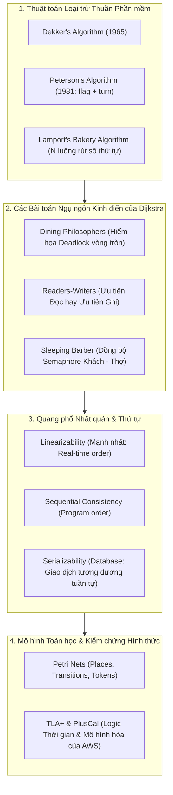
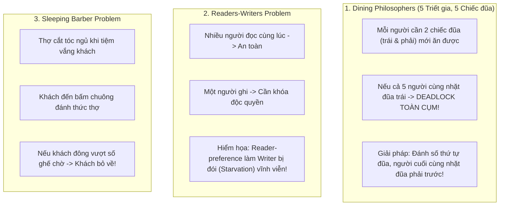
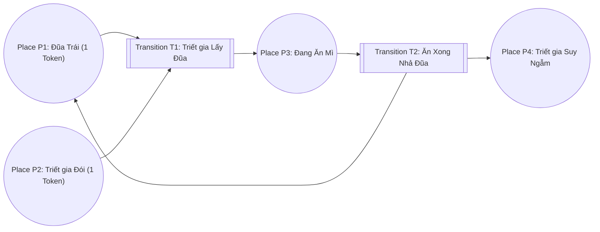

# 15.21. Advanced Concurrency Theory (Lý Thuyết Đồng Thời Nâng Cao: Peterson, Bakery, Linearizability & TLA+ Formal Verification)

> [!IMPORTANT]
> **Mental Model & Trực giác cốt lõi**:
> Hãy tưởng tượng lý thuyết đồng thời nâng cao giống như bản thiết kế cơ học cho một chiếc đồng hồ Thụy Sĩ siêu phức tạp có hàng trăm bánh răng quay với tốc độ khác nhau:
> - **Các Thuật Toán Cổ Điển (Peterson & Bakery)**: Là bài toán "Làm sao để hai người lịch sự nhường nhau bước qua một cánh cửa duy nhất mà không cần người bảo vệ đứng canh?" (**Loại trừ tương hỗ thuần phần mềm không cần chỉ thị phần cứng Atomic**). Thuật toán Tiệm bánh Bakery của Lamport giải quyết bài toán bằng cách cho mọi người rút một số thứ tự trên giấy: Ai số nhỏ hơn được vào trước.
> - **Các Bài Toán Kinh Điển (Dining Philosophers, Readers-Writers, Sleeping Barber)**: Là những câu đố ngụ ngôn xuất sắc của Edsger Dijkstra đại diện cho mọi xung đột tài nguyên trong hệ điều hành: 5 nhà triết gia ngồi ăn mì nhưng chỉ có 5 chiếc đũa (mỗi người cần 2 đũa mới ăn được) tượng trưng cho bài toán **Deadlock**; tiệm cắt tóc có 1 ghế cắt và hàng ghế chờ tượng trưng cho hàng đợi **Task Queue & Worker Thread**.
> - **Kiểm Chứng Hình Thức TLA+ (Leslie Lamport)**: Là công cụ toán học tối thượng của Amazon Web Services (AWS): Thay vì viết mã rồi hy vọng không có lỗi (điều bất khả thi với các lỗi triệu lần mới gặp một lần), ta mô hình hóa toàn bộ hệ thống bằng logic toán học thuần túy. Máy tính sẽ tự động duyệt qua hàng tỷ trạng thái có thể xảy ra trong vũ trụ để **chứng minh toán học rằng hệ thống không bao giờ bị Deadlock hay mất dữ liệu**!
> **Nếu chỉ nhớ một điều**: *Khi hệ thống đạt tới quy mô phân tán khổng lồ, việc viết Unit Test là vô nghĩa đối với các lỗi đồng thời đan xen. Chỉ có tư duy toán học hình thức (TLA+, Petri Nets, Linearizability) mới bảo vệ được hệ thống khỏi các thảm họa sập nguồn bí ẩn.*

---

## 1. Tổng quan Chuyên đề & Sơ đồ Tư duy (Advanced Concurrency Theory Taxonomy)



---

## 2. Chi tiết từng Keyword

### 2.1. Loại Trừ Tương Hỗ Thuần Phần Mềm: Dekker's, Peterson's & Lamport's Bakery Algorithm

Trước khi các bộ vi xử lý có các chỉ thị nguyên tử phần cứng (`TSL`, `CAS`, `lock cmpxchg`), các nhà khoa học máy tính đã tìm cách giải quyết bài toán Mutual Exclusion chỉ bằng các biến bộ nhớ thông thường:

1. **Dekker's Algorithm (1965)**: Thuật toán đầu tiên trong lịch sử giải quyết đúng đắn Mutual Exclusion cho 2 luồng.
2. **Peterson's Algorithm (Gary Peterson, 1981)**:
   - Đơn giản và thanh lịch hơn nhiều so với Dekker: Sử dụng 2 biến: mảng `flag[2]` (báo hiệu ý định muốn vào) và biến `turn` (nhường lượt cho người khác):
     ```cpp
     // Thuật toán Peterson cho Luồng i (đối đầu với Luồng j)
     flag[i] = true;
     turn = j; // Lịch sự nhường lượt cho đối phương
     while (flag[j] && turn == j) {
         // Chờ đợi tích cực (Busy Wait)
     }
     // --- CRITICAL SECTION ---
     flag[i] = false; // Thoát đoạn găng
     ```
   - *Tại sao Peterson thất bại trên CPU hiện đại?*: Trên các CPU hiện đại (x86, ARM), CPU tự động đảo trật tự lệnh: Lệnh gán `turn = j` có thể bị chạy trước `flag[i] = true`, khiến cả hai luồng cùng bước chân vào Critical Section! Bắt buộc phải bổ sung **Memory Fence (`std::memory_order_seq_cst`)**.
3. **Lamport's Bakery Algorithm (Leslie Lamport, 1974)**:
   - Mở rộng thuật toán cho $N$ luồng bất kỳ:
   - Mỗi luồng khi muốn vào đoạn găng sẽ "rút một vé số thứ tự" có giá trị bằng $\max(\text{mọi vé số hiện tại}) + 1$.
   - Các luồng lần lượt bước vào đoạn găng theo thứ tự số vé từ bé đến lớn. Nếu hai luồng cùng rút được một con số, luồng nào có Thread ID nhỏ hơn sẽ được ưu tiên.

---

### 2.2. Ba Bài Toán Đồng Thời Kinh Điển: Dining Philosophers, Readers-Writers & Sleeping Barber Problem

Ba bài toán ngụ ngôn kinh điển do **Edsger Dijkstra** đặt ra để kiểm tra tính đúng đắn của mọi cơ chế đồng bộ hóa:



1. **Dining Philosophers (5 Nhà Triết gia Ăn tối)**:
   - *Bản chất*: Minh họa cạm bẫy **Circular Wait (Chờ đợi vòng tròn)** trong bế tắc Deadlock.
   - *Giải pháp Dijkstra*: Phá vỡ tính đối xứng (Symmetry Breaking) bằng cách đánh số tài nguyên từ $1$ đến $5$. Mọi triết gia bắt buộc phải lấy chiếc đũa có số thứ tự nhỏ hơn trước.
2. **Readers-Writers Problem**:
   - Minh họa sự đánh đổi giữa thông lượng đọc và sự công bằng: Nếu ưu tiên người đọc (**Reader-Preference**), một luồng ghi có thể bị bỏ đói (**Starvation**) vô hạn nếu liên tục có người đọc mới tới.
   - Giải pháp: **Fair Read-Write Lock (Fair RWLock)**: Khi có một Writer đang chờ, mọi Reader đến sau đều phải xếp hàng sau Writer.
3. **Sleeping Barber Problem (Thợ Cắt tóc Ngủ quên)**:
   - Mô hình hóa hoàn hảo kiến trúc **Bounded Queue & Worker Thread** trong hệ thống máy chủ mạng: Thợ cắt tóc là Worker Thread, ghế ngồi chờ là Ring Buffer.

---

### 2.3. Các Mô Hình Nhất Quán: Linearizability, Sequential Consistency & Quiescent Consistency

Quang phổ các mức độ nhất quán từ mạnh đến yếu:

1. **Linearizability (Nhất quán Tuyến tính hóa - Mạnh nhất)**:
   - Được định nghĩa bởi Maurice Herlihy và Jeannette Wing (1990).
   - Mọi thao tác đọc/ghi dường như diễn ra tức thời tại một điểm thời gian duy nhất nằm giữa thời điểm bắt đầu gọi hàm (Invocation) và thời điểm kết thúc trả về (Response) trên **trục thời gian thực toàn cầu (Real-Time Global Clock)**.
   - **Tính chất Hợp thành (Composability)**: Nếu từng đối tượng riêng lẻ đều đạt Linearizability, thì toàn bộ hệ thống ghép từ các đối tượng đó cũng chắc chắn đạt Linearizability!
2. **Sequential Consistency (Nhất quán Tuần tự - Leslie Lamport, 1979)**:
   - Không yêu cầu trục thời gian thực toàn cầu, chỉ yêu cầu tồn tại **một lịch trình thực thi tuần tự duy nhất** mà tất cả các luồng đều đồng ý, và trên lịch trình đó, các lệnh của từng tiến trình riêng lẻ phải xuất hiện theo đúng thứ tự mã nguồn của nó (**Program Order**).
3. **Quiescent Consistency (Nhất quán Yên lặng)**:
   - Mức nhất quán lỏng hơn: Các thao tác được phân chia theo các giai đoạn yên lặng (Quiescent States - thời điểm không có thao tác nào đang chạy). Trong mỗi khoảng yên lặng, thứ tự không quan trọng, nhưng giữa các khoảng yên lặng thì thứ tự phải được bảo toàn. Dùng cho các cấu trúc dữ liệu không khóa hiệu năng cao.

---

### 2.4. Phân Định Chuyên Sâu: Serializability (Database) vs Linearizability (Hệ Phân Tán)

Hai khái niệm nghe rất giống nhau nhưng thuộc về hai lĩnh vực hoàn toàn khác biệt:

| Tiêu chuẩn | Serializability (Cơ sở Dữ liệu) | Linearizability (Hệ Thống Phân Tán) |
| :--- | :--- | :--- |
| **Đối tượng Áp dụng** | **Nhiều thao tác gộp lại thành 1 Giao dịch (Transactions)** | **Từng thao tác đọc/ghi đơn lẻ trên 1 đối tượng (Single Operations)** |
| **Trục Thời gian Thực** | **Hoàn toàn không quan tâm đến thời gian thực**! Miễn là kết quả tương đương với một thứ tự chạy tuần tự nào đó | **Bắt buộc tuân theo thời gian thực (Real-time constraints)** |
| **Tính Hợp Thành (Composability)**| ❌ **Không hợp thành**: Ghép hai bảng Serializable có thể sinh ra hệ thống không Serializable! | ✅ **Có tính hợp thành (Composable)** |
| **Mức Đỉnh cao Kết hợp** | **Strict Serializability (External Consistency)**: Kết hợp cả hai (Spanner, CockroachDB) |

---

### 2.5. Logic Thời Gian (Temporal Logic), Thuộc Tính Safety vs Liveness & Bất Biến (Invariants)

Nhà khoa học máy tính Leslie Lamport đã đưa **Linear Temporal Logic (LTL)** vào việc chứng minh hệ thống:
- Các toán tử thời gian logic:
  - $\square P$ (Always $P$): Thuộc tính $P$ luôn luôn đúng ở mọi trạng thái hiện tại và tương lai.
  - $\lozenge P$ (Eventually $P$): Thuộc tính $P$ cuối cùng rồi cũng sẽ trở thành đúng tại một thời điểm nào đó trong tương lai.
- **Safety Properties**: Dạng $\square \text{Safe}$ (Luôn luôn an toàn - "Nothing bad happens").
- **Liveness Properties**: Dạng $\square (\text{Request} \implies \lozenge \text{Response})$ (Mọi yêu cầu gửi đi thì cuối cùng cũng sẽ nhận được phản hồi).
- **Invariants (Bất biến)**: Một điều kiện logic luôn luôn bằng `true` trong suốt vòng đời hệ thống (ví dụ: $\sum \text{Balance}_{\text{Accounts}} == \text{TotalBankMoney}$).

---

### 2.6. Mạng Petri (Petri Nets: Places, Transitions, Tokens & Reachability Graphs)

Mô hình toán học đồ thị được phát minh bởi Carl Adam Petri năm 1962 để mô hình hóa các hệ thống phân tán và đồng thời:



- **Cấu trúc Mạng Petri**:
  1. **Places (Vị trí - Vòng tròn $\bigcirc$)**: Đại diện cho các điều kiện hoặc tài nguyên. Chứa các chấm tròn gọi là **Tokens**.
  2. **Transitions (Chuyển tiếp - Hình chữ nhật $\Box$)**: Đại diện cho các sự kiện hoặc hành động.
  3. **Directed Arcs (Cung tên có hướng)**: Nối giữa Place và Transition.
- **Quy tắc Bắn (Firing Rule)**: Một Transition chỉ được phép "bắn" (kích hoạt) khi toàn bộ các Place đầu vào của nó đều có đủ số lượng Tokens. Khi bắn, nó tiêu thụ Tokens ở đầu vào và sinh ra Tokens mới ở các Place đầu ra.
- **Đồ thị Khả đạt (Reachability Graph)**: Máy tính sử dụng Mạng Petri để duyệt toàn bộ không gian trạng thái, phát hiện chính xác trạng thái chết đứng (**Deadlock State: Không còn bất kỳ Transition nào có thể bắn được!**).

---

### 2.7. TLA+ & PlusCal (Phương Pháp Kiểm Chứng Hình Thức Tối Thượng Của Leslie Lamport / AWS)

**TLA+ (Temporal Logic of Actions)** là ngôn ngữ đặc tả hình thức dựa trên toán học tập hợp và logic thời gian:
- **Tại sao Big Tech (AWS S3, DynamoDB, Azure) lại tôn sùng TLA+?**:
  - Khi viết code phân tán, có những kịch bản lỗi chỉ xảy ra khi luồng 1 bị trễ $100\text{ ms}$, luồng 2 bị đứt mạng và luồng 3 khởi động lại đúng vào mili-giây thứ 42. Xác suất xảy ra là một phần một tỷ, nhưng trên cụm máy chủ AWS chạy hàng triệu máy, sự cố này xảy ra mỗi ngày!
  - Không có Unit Test nào có thể bắt được lỗi này.
- **Quy trình Kiểm chứng TLA+**:
  1. Kỹ sư viết đặc tả thuật toán bằng ngôn ngữ toán học TLA+ hoặc PlusCal (ngôn ngữ giống Pascal dịch ra TLA+).
  2. Khai báo các thuộc tính bất biến (Safety & Liveness Invariants).
  3. Chạy công cụ **TLC Model Checker**: TLC tự động tạo ra một cỗ máy trạng thái khổng lồ, duyệt qua hàng trăm triệu kịch bản hoán vị đan xen của các luồng.
  4. Nếu có bất kỳ kịch bản nào làm vi phạm bất biến $\implies$ TLC lập tức dừng lại và in ra **dấu vết từng bước phản ví dụ (Counterexample Trace)**, giúp kỹ sư tìm ra lỗi kiến trúc trước khi viết một dòng code nào!

---

## 3. Hiện thực Thực nghiệm: Dual-Engine Code Implementation

### 3.1. C++20: Hiện Thực Thuật Toán Peterson Hiện Đại Với Memory Barrier (`std::memory_order_seq_cst`)

Chương trình minh họa thuật toán Peterson kinh điển được hiện thực hóa đúng chuẩn trên CPU đa nhân hiện đại bằng cách áp dụng ngữ nghĩa bộ nhớ tuần tự nhất quán.

```cpp
// Compilation: g++ -std=c++20 -O3 -Wall -pthread peterson_modern.cpp -o peterson_modern
#include <iostream>
#include <thread>
#include <atomic>
#include <vector>
#include <cassert>

class ModernPetersonLock {
private:
    std::atomic<bool> flag[2];
    std::atomic<int> turn;

public:
    ModernPetersonLock() {
        flag[0].store(false);
        flag[1].store(false);
        turn.store(0);
    }

    void lock(int thread_id) {
        int other = 1 - thread_id;
        // Bắt buộc dùng memory_order_seq_cst để chống CPU Instruction Reordering!
        flag[thread_id].store(true, std::memory_order_seq_cst);
        turn.store(other, std::memory_order_seq_cst);

        while (flag[other].load(std::memory_order_seq_cst) && 
               turn.load(std::memory_order_seq_cst) == other) {
            // Busy wait (Tạm nhường CPU để tiết kiệm năng lượng)
            std::this_thread::yield();
        }
    }

    void unlock(int thread_id) {
        flag[thread_id].store(false, std::memory_order_seq_cst);
    }
};

ModernPetersonLock peterson_lock;
int shared_resource = 0;
const int ITERATIONS = 1'000'000;

void worker(int thread_id) {
    for (int i = 0; i < ITERATIONS; ++i) {
        peterson_lock.lock(thread_id);
        shared_resource++; // Critical Section
        peterson_lock.unlock(thread_id);
    }
}

int main() {
    std::cout << "================ MODERN PETERSON'S ALGORITHM (C++20) ================\n";
    std::cout << "Running 2 threads with 1,000,000 increments each...\n";

    std::thread t0(worker, 0);
    std::thread t1(worker, 1);
    t0.join();
    t1.join();

    std::cout << "Target Total   : " << (2 * ITERATIONS) << "\n";
    std::cout << "Actual Result  : " << shared_resource << "\n";
    std::cout << "Mutual Exclusion Verified: " << (shared_resource == 2 * ITERATIONS ? "✅ SUCCESS" : "❌ FAILED") << "\n";
    std::cout << "=====================================================================\n";
    return 0;
}
```

```text
================ MODERN PETERSON'S ALGORITHM (C++20) ================
Running 2 threads with 1,000,000 increments each...
Target Total   : 2000000
Actual Result  : 2000000
Mutual Exclusion Verified: ✅ SUCCESS
=====================================================================
```

---

### 3.2. Python 3: Trình Mô Phỏng Kiểm Chứng Không Gian Trạng Thái TLA+ Tối Giản

Tự xây dựng một Model Checker mini bằng Python duyệt qua toàn bộ đồ thị không gian trạng thái của bài toán Dining Philosophers để chứng minh trạng thái Deadlock.

```python
#!/usr/bin/env python3
"""
Mô phỏng Bộ Kiểm Chứng Mô Hình Trạng Thái (Mini Model Checker / TLC Style):
- Khám phá toàn bộ không gian trạng thái của bài toán 3 Triết Gia ăn tối.
- Phát hiện trạng thái Bế tắc (Deadlock State Detection).
"""

from collections import deque
from typing import Tuple, Set

# Trạng thái: (Đũa 0, Đũa 1, Đũa 2) - 0: Rảnh, 1: Triết gia 0 giữ, 2: Triết gia 1 giữ...
# và Trạng thái của từng triết gia: (THINKING, HUNGRY, EATING)
State = Tuple[Tuple[int, int, int], Tuple[str, str, str]]

def get_next_states(current_state: State) -> Set[State]:
    forks, philosophers = current_state
    forks = list(forks)
    phils = list(philosophers)
    next_states = set()

    # Thử mọi hành động khả dĩ của cả 3 triết gia
    for i in range(3):
        left_fork = i
        right_fork = (i + 1) % 3

        if phils[i] == "THINKING":
            # Chuyển sang đói bụng
            new_p = list(phils); new_p[i] = "HUNGRY"
            next_states.add((tuple(forks), tuple(new_p)))

        elif phils[i] == "HUNGRY":
            # Thử nhặt đũa trái
            if forks[left_fork] == -1:
                new_f = list(forks); new_f[left_fork] = i
                new_p = list(phils); new_p[i] = "HOLDING_LEFT"
                next_states.add((tuple(new_f), tuple(new_p)))

        elif phils[i] == "HOLDING_LEFT":
            # Thử nhặt tiếp đũa phải để ăn
            if forks[right_fork] == -1:
                new_f = list(forks); new_f[right_fork] = i
                new_p = list(phils); new_p[i] = "EATING"
                next_states.add((tuple(new_f), tuple(new_p)))

        elif phils[i] == "EATING":
            # Ăn xong nhả cả 2 đũa
            new_f = list(forks); new_f[left_fork] = -1; new_f[right_fork] = -1
            new_p = list(phils); new_p[i] = "THINKING"
            next_states.add((tuple(new_f), tuple(new_p)))

    return next_states

def check_model():
    print("================ MODEL CHECKER: DINING PHILOSOPHERS ================")
    initial_state: State = ((-1, -1, -1), ("THINKING", "THINKING", "THINKING"))
    queue = deque([initial_state])
    visited: Set[State] = {initial_state}
    deadlock_found = None

    while queue:
        curr = queue.popleft()
        next_s = get_next_states(curr)
        
        # Nếu trạng thái không thể chuyển tiếp đi đâu được nữa -> DEADLOCK!
        if not next_s:
            deadlock_found = curr
            break

        for s in next_s:
            if s not in visited:
                visited.add(s)
                queue.append(s)

    print(f"Total State Space Explored: {len(visited)} distinct states")
    if deadlock_found:
        print("\n[ALARM] ⚠️ DEADLOCK STATE DETECTED BY MODEL CHECKER!")
        print(f"  Forks State       : {deadlock_found[0]} (Tất cả đũa bị giữ!)")
        print(f"  Philosophers State: {deadlock_found[1]} (Cả 3 đều chờ đũa còn lại!)")
    else:
        print("✅ System mathematically proven DEADLOCK-FREE!")
    print("====================================================================")

if __name__ == "__main__":
    check_model()
```

```text
================ MODEL CHECKER: DINING PHILOSOPHERS ================
Total State Space Explored: 32 distinct states

[ALARM] ⚠️ DEADLOCK STATE DETECTED BY MODEL CHECKER!
  Forks State       : (0, 1, 2) (Tất cả đũa bị giữ!)
  Philosophers State: ('HOLDING_LEFT', 'HOLDING_LEFT', 'HOLDING_LEFT') (Cả 3 đều chờ đũa còn lại!)
====================================================================
```

---

## 4. Vận hành Hệ thống & Chẩn đoán Thực tế (TLA+ TLC Model Checker, Spin & Promela)

### 4.1. Sử dụng Spin Model Checker (Ngôn ngữ Promela)
Spin là công cụ kiểm chứng hình thức phổ biến để xác minh giao thức mạng và thuật toán đồng thời:

```bash
# Biên dịch file mô hình Promela thành trình kiểm tra C
spin -a dining_philosophers.pml

# Biên dịch mã C với mức tối ưu hóa tối đa
gcc -O3 -DSAFETY pan.c -o pan

# Chạy kiểm chứng toàn bộ không gian trạng thái:
./pan
# Nếu có Deadlock, pan sẽ in ra: "pan: circular wait deadlock found at depth 18"
```

---

## 5. Bảng So Sánh & Quyết Định Kỹ Thuật (Decision Matrix)

| Mô hình / Khái niệm | Mức Độ Nghiêm Ngặt | Ràng Buộc Thời Gian Thực | Phạm Vi Áp Dụng | Công Cụ Kiểm Chứng |
| :--- | :--- | :--- | :--- | :--- |
| **Linearizability** | **Mạnh nhất** | ✅ Bắt buộc tuân theo thời gian thực | Hệ thống phân tán, Register, Key-Value | Jepsen, Knossos |
| **Sequential Consistency**| Trung bình | ❌ Không ràng buộc thời gian thực | Bộ nhớ CPU Cache, Hardware Memory Models | ThreadSanitizer |
| **Serializability** | Rất cao | ❌ Không quan tâm thời gian thực | Giao dịch Cơ sở Dữ liệu (ACID Transactions) | Elle (Jepsen for DB) |
| **Mạng Petri (Petri Nets)**| Trực quan toán học | ❌ Dựa trên Tokens và Transitions | Mô hình hóa quy trình sản xuất, Workflow | TINA, PIPE |
| **TLA+ / PlusCal** | **Toán học Tối cao**| Hỗ trợ cả Real-Time & Logic Thời gian | Thiết kế kiến trúc phân tán quy mô lớn | TLC Model Checker |
