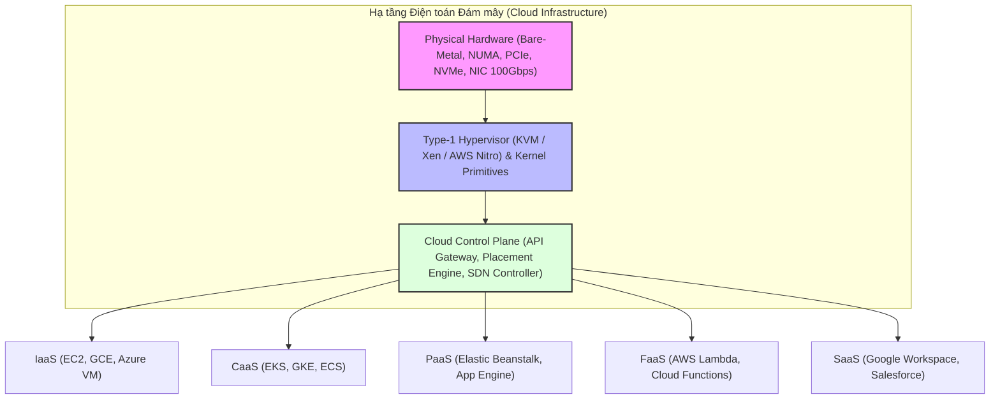
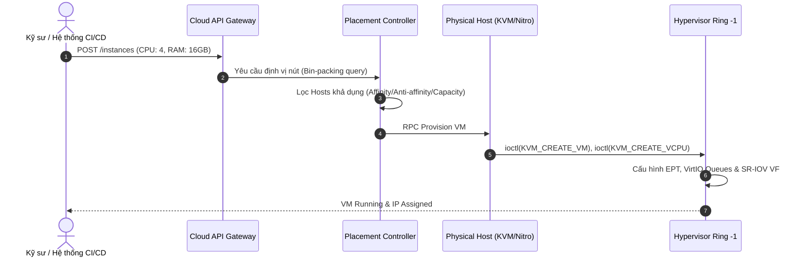
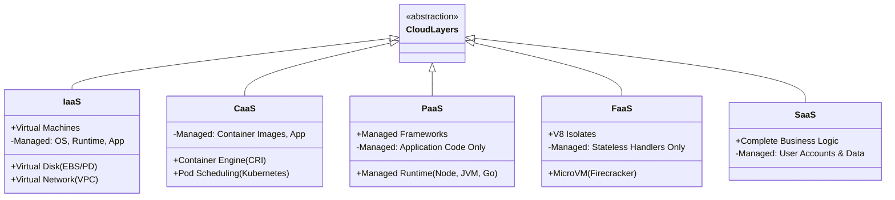
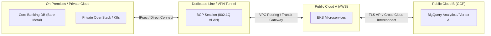
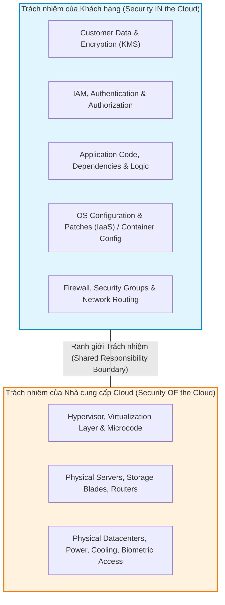

# 1.1. Cloud Models and Architecture (Các Mô hình và Kiến trúc Điện toán Đám mây)

## Tổng quan về Điện toán Đám mây và Kiến trúc Cloud-Native
Điện toán đám mây (Cloud Computing) là mô hình cung cấp tài nguyên điện toán theo nhu cầu (On-demand computing resources) — bao gồm năng lực tính toán (Compute), lưu trữ (Storage), mạng (Networking) và ứng dụng — qua môi trường mạng Internet với mô hình thanh toán theo mức độ sử dụng (Pay-as-you-go). 

Về mặt bản chất toán học và kỹ thuật hệ thống, Cloud Computing là sự trừu tượng hóa tài nguyên vật lý (Resource Virtualization & Abstraction) kết hợp với thuật toán điều độ phân tán (Distributed Scheduling) và mô hình hóa bài toán đóng gói tài nguyên đa người dùng (Multi-tenant Bin Packing Problem):
$$\min \sum_{j=1}^{M} y_j \quad \text{sao cho} \quad \sum_{i=1}^{N} w_{i, k} \cdot x_{i, j} \le C_{j, k} \cdot y_j, \quad \forall k \in \{\text{CPU, RAM, IOPS, Bandwidth}\}$$
Trong đó:
- $y_j \in \{0, 1\}$: Trạng thái kích hoạt của máy chủ vật lý (Host) $j$.
- $x_{i, j} \in \{0, 1\}$: Quyết định cấp phát workload $i$ vào Host $j$.
- $w_{i, k}$: Nhu cầu tài nguyên loại $k$ của workload $i$.
- $C_{j, k}$: Dung lượng tối đa của tài nguyên loại $k$ trên Host $j$.



---

## 2. Chi tiết từng Keyword (Under-the-Hood Deep Dive)

---

### 1. Cloud Computing Fundamentals & Models (Nguyên lý Cốt lõi & Mô hình Cloud)

#### 1. Khái niệm bản chất (What & Why)
- **Cloud Computing Fundamentals**: Dựa trên 5 đặc tính thiết yếu của NIST (National Institute of Standards and Technology):
  1. *On-demand self-service*: Cấp phát tài nguyên tự động không cần can thiệp thủ công từ nhà cung cấp.
  2. *Broad network access*: Truy cập tài nguyên qua mạng chuẩn thông qua các cơ chế client tiêu chuẩn.
  3. *Resource pooling*: Gom cụm tài nguyên phục vụ đa người dùng (Multi-tenancy) với tính trừu tượng vị trí.
  4. *Rapid elasticity*: Co giãn linh hoạt tức thì theo nhu cầu thực tế.
  5. *Measured service*: Định lượng tài nguyên chi tiết phục vụ tính phí minh bạch.
- **Tại sao cần Cloud**: Loại bỏ chi phí vốn đầu tư ban đầu (CapEx - Capital Expenditure), chuyển dịch sang chi phí vận hành biến đổi (OpEx - Operational Expenditure), loại bỏ rủi ro thiếu hụt dung lượng (Under-provisioning) hoặc lãng phí tài nguyên nhàn rỗi (Over-provisioning).

#### 2. Cơ chế hoạt động sâu (Under the hood / Hardcore Internals)
- **Bản chất ảo hóa (Virtualization & Hypervisor)**:
  - Máy chủ vật lý sử dụng kiến trúc CPU Intel VT-x hoặc AMD-V với các vòng bảo vệ phần cứng (Hardware Rings): Ring -1 (Root mode cho Hypervisor), Ring 0 (Kernel space của Guest OS), Ring 3 (User space của Guest application).
  - Hypervisor (như KVM - Kernel-based Virtual Machine) tận dụng `/dev/kvm` ioctl calls để khởi tạo vCPU threads, phân bổ EPT (Extended Page Tables) để ánh xạ GPA (Guest Physical Address) sang HPA (Host Physical Address).
  - Tầng I/O được tăng tốc bởi các driver ảo hóa bán phần (Para-virtualized drivers) như `virtio-net`, `virtio-blk`, bypassing overhead mô phỏng phần cứng thông qua vòng bộ nhớ chia sẻ (Shared Memory Ring Buffers - vring).

#### 3. Sơ đồ minh họa


#### 4. Code ví dụ thực chiến (C++ Low-level KVM Interaction Stub)
Đoạn mã C++ minh họa cơ chế một Cloud Control Plane giao tiếp với Linux KVM subsystem (`/dev/kvm`) để khởi tạo VM core:

```cpp
#include <iostream>
#include <fcntl.h>
#include <unistd.h>
#include <sys/ioctl.h>
#include <linux/kvm.h>
#include <cstring>
#include <stdexcept>
#include <sys/mman.h>

class KvmVmInstance {
private:
    int kvm_fd{-1};
    int vm_fd{-1};
    int vcpu_fd{-1};
    void* guest_memory{nullptr};
    size_t memory_size{0};

public:
    explicit KvmVmInstance(size_t ram_bytes) : memory_size(ram_bytes) {
        kvm_fd = open("/dev/kvm", O_RDWR | O_CLOEXEC);
        if (kvm_fd < 0) {
            throw std::runtime_error("Lỗi: Không thể mở /dev/kvm (yêu cầu quyền root hoặc KVM module).");
        }

        // 1. Kiểm tra phiên bản KVM API
        int api_ver = ioctl(kvm_fd, KVM_GET_API_VERSION, 0);
        if (api_ver != 12) {
            throw std::runtime_error("Lỗi: KVM API version không tương thích.");
        }

        // 2. Tạo VM context
        vm_fd = ioctl(kvm_fd, KVM_CREATE_VM, 0);
        if (vm_fd < 0) {
            throw std::runtime_error("Lỗi: Không thể khởi tạo KVM_CREATE_VM.");
        }

        // 3. Phân bổ bộ nhớ RAM vật lý từ Host (Anonymous Memory Mapping)
        guest_memory = mmap(nullptr, memory_size, PROT_READ | PROT_WRITE,
                            MAP_SHARED | MAP_ANONYMOUS | MAP_NORESERVE, -1, 0);
        if (guest_memory == MAP_FAILED) {
            throw std::runtime_error("Lỗi: mmap cấp phát bộ nhớ VM thất bại.");
        }

        // 4. Ánh xạ Guest Physical Address (GPA) sang Host Virtual Address (HVA)
        struct kvm_userspace_memory_region region = {
            .slot = 0,
            .flags = 0,
            .guest_phys_addr = 0,
            .memory_size = memory_size,
            .userspace_addr = reinterpret_cast<__u64>(guest_memory)
        };
        if (ioctl(vm_fd, KVM_SET_USER_MEMORY_REGION, &region) < 0) {
            throw std::runtime_error("Lỗi: KVM_SET_USER_MEMORY_REGION thất bại.");
        }

        // 5. Khởi tạo 1 vCPU
        vcpu_fd = ioctl(vm_fd, KVM_CREATE_VCPU, 0);
        if (vcpu_fd < 0) {
            throw std::runtime_error("Lỗi: KVM_CREATE_VCPU thất bại.");
        }

        std::cout << "[KVM] Khởi tạo thành công VM context: vcpu_fd=" 
                  << vcpu_fd << ", RAM=" << (memory_size / (1024 * 1024)) << " MB\n";
    }

    ~KvmVmInstance() {
        if (vcpu_fd >= 0) close(vcpu_fd);
        if (guest_memory && guest_memory != MAP_FAILED) {
            munmap(guest_memory, memory_size);
        }
        if (vm_fd >= 0) close(vm_fd);
        if (kvm_fd >= 0) close(kvm_fd);
        std::cout << "[KVM] Giải phóng toàn bộ tài nguyên VM.\n";
    }
};

int main() {
    try {
        // Cấp phát thử nghiệm một instance với 64MB RAM ảo
        KvmVmInstance instance(64 * 1024 * 1024);
    } catch (const std::exception& ex) {
        std::cerr << "Exception caught: " << ex.what() << "\n";
    }
    return 0;
}
```

#### 5. Ưu / Nhược điểm, Pitfalls & Anti-patterns
- **Ưu điểm**: Tính linh động cực đại, khả năng mở rộng đàn hồi quy mô toàn cầu trong vài phút.
- **Nhược điểm**: Hiện tượng "Noisy Neighbor" khi chia sẻ chung phần cứng vật lý, độ trễ không đồng đều (Jitter), chi phí truyền dữ liệu ra Internet (Egress data transfer costs).
- **Pitfall**: Lift-and-shift trực tiếp các monolithic legacy systems lên Cloud mà không tái kiến trúc, dẫn đến chi phí hạ tầng tăng gấp 3-5 lần mà không tận dụng được tính co giãn.

#### 6. Ứng dụng thực tế trong Backend / Systems
- Cung cấp hạ tầng cho các hệ thống vi dịch vụ (Microservices), Data Lakehouse, nền tảng thương mại điện tử chịu tải hàng chục nghìn lượt truy cập đồng thời trong các đợt flash-sale.

---

### 2. Cloud Service Models: IaaS, PaaS, SaaS, FaaS, CaaS

#### 1. Khái niệm bản chất (What & Why)
Các mô hình dịch vụ đám mây đại diện cho mức độ trừu tượng hóa (Abstraction Layers) và ranh giới quản lý giữa khách hàng và Cloud Service Provider (CSP):
- **IaaS (Infrastructure as a Service)**: Cung cấp tài nguyên thô (Raw Compute, Storage, Virtual Network). Người dùng toàn quyền cài đặt OS, runtime, ứng dụng (Ví dụ: AWS EC2, GCP Compute Engine, Azure VM).
- **PaaS (Platform as a Service)**: Trừu tượng hóa OS, patching, hardware, cung cấp sẵn Runtime, Database, Middleware. Lập trình viên chỉ quan tâm đến Source Code và Application Config (Ví dụ: Heroku, AWS Elastic Beanstalk, Google App Engine).
- **SaaS (Software as a Service)**: Ứng dụng phần mềm hoàn chỉnh chạy trên cloud, người dùng cuối sử dụng qua Web/API, không cần quan tâm hạ tầng (Ví dụ: Microsoft 365, Salesforce, Gmail).
- **FaaS (Function as a Service / Serverless)**: Trừu tượng hóa hoàn toàn server. Đơn vị thực thi là từng đoạn hàm độc lập (Event-driven functions), tính phí theo millisecond thực thi (Ví dụ: AWS Lambda, Google Cloud Functions).
- **CaaS (Container as a Service)**: Nền tảng điều phối và chạy container (Docker, OCI), quản lý tự động lifecycle của container pods mà không cần quản lý thủ công từng VM (Ví dụ: AWS EKS, Google GKE, Azure AKS, AWS ECS).

#### 2. Cơ chế hoạt động sâu (Under the hood / Hardcore Internals)
- **Ranh giới ảo hóa theo từng tầng**:
  - *IaaS*: Cấp phát ở mức phần cứng ảo hóa thông qua Hypervisor. Khách hàng chịu trách nhiệm cấu hình `sysctl`, kernel modules, iptables và OS patching.
  - *CaaS*: Dựa vào tính năng cô lập cấp kernel của Linux Host: **Namespaces** (`pid`, `net`, `mnt`, `ipc`, `uts`, `user`) và **cgroups v2** (quản lý trần CPU/RAM). Nhiều container dùng chung 1 OS kernel của Worker Node.
  - *PaaS*: Thường dùng Container hoặc Buildpacks (ví dụ CNCF Cloud Native Buildpacks) để tự động đóng gói source code thành OCI image rồi deploy vào cụm máy chủ quản lý sẵn.
  - *FaaS*: Sử dụng MicroVM (như AWS Firecracker trên KVM, Google gVisor, hoặc Cloudflare V8 Isolates). MicroVM khởi động trong $\approx 5\text{ms} - 120\text{ms}$ với dung lượng memory footprint nhỏ ($< 5\text{MB}$), đảm bảo cô lập mức phần cứng nhưng tốc độ ngang container.

#### 3. Sơ đồ minh họa


#### 4. Code ví dụ thực chiến (TypeScript FaaS vs CaaS Abstraction Implementation)
Dưới đây là ví dụ minh họa sự khác biệt giữa mô hình FaaS Handler (phi trạng thái, kích hoạt theo sự kiện) và mô hình CaaS HTTP Server (tiến trình dài hạn, quản lý vòng đời socket):

```typescript
// ==========================================
// 1. FaaS Model: AWS Lambda / Cloud Functions Handler
// Đơn vị thực thi là Function, phi trạng thái, tự động scale to zero
// ==========================================
export interface CloudEvent<T> {
  eventId: string;
  timestamp: number;
  payload: T;
}

export interface FaaSResponse {
  statusCode: number;
  body: string;
}

export const processPaymentHandler = async (
  event: CloudEvent<{ orderId: string; amount: number }>
): Promise<FaaSResponse> => {
  // Cold start: Kết nối DB có thể được cache ở biến global ngoài scope handler
  console.log(`[FaaS] Xử lý đơn hàng: ${event.payload.orderId}, Số tiền: $${event.payload.amount}`);
  
  // Logic xử lý nhanh gọn < vài trăm ms
  return {
    statusCode: 200,
    body: JSON.stringify({ status: "SUCCESS", txnId: `TXN-${Date.now()}` }),
  };
};

// ==========================================
// 2. CaaS / PaaS Model: HTTP Web Service (Containerized Server)
// Tiến trình dài hạn (Long-running process), quản lý Socket, Graceful Shutdown
// ==========================================
import { createServer, IncomingMessage, ServerResponse } from "http";

class ContainerizedApp {
  private server = createServer(this.handleRequest.bind(this));
  private isTerminating = false;

  public start(port: number): void {
    this.server.listen(port, () => {
      console.log(`[CaaS App] Web server lắng nghe trên port ${port} (PID: ${process.pid})`);
    });

    // Bắt tín hiệu SIGTERM từ Kubernetes Kubelet khi scale-down hoặc rolling update
    process.on("SIGTERM", () => this.handleGracefulShutdown("SIGTERM"));
    process.on("SIGINT", () => this.handleGracefulShutdown("SIGINT"));
  }

  private handleRequest(req: IncomingMessage, res: ServerResponse): void {
    if (this.isTerminating) {
      // Báo 503 để Ingress / Load Balancer ngừng định tuyến traffic tới Pod này
      res.writeHead(503, { "Content-Type": "application/json" });
      res.end(JSON.stringify({ error: "Server đang trong quá trình shutdown" }));
      return;
    }

    if (req.url === "/healthz") {
      res.writeHead(200, { "Content-Type": "application/json" });
      res.end(JSON.stringify({ status: "UP" }));
      return;
    }

    res.writeHead(200, { "Content-Type": "application/json" });
    res.end(JSON.stringify({ message: "Processed by long-running container process" }));
  }

  private handleGracefulShutdown(signal: string): void {
    console.log(`[CaaS App] Nhận tín hiệu ${signal}. Khởi động Graceful Shutdown...`);
    this.isTerminating = true;

    // Đóng server, từ chối kết nối mới nhưng đợi request hiện tại hoàn tất (tối đa 10s)
    this.server.close(() => {
      console.log("[CaaS App] Tất cả kết nối đã giải phóng. Thoát tiến trình an toàn.");
      process.exit(0);
    });

    setTimeout(() => {
      console.error("[CaaS App] Quá thời gian chờ shutdown, ép buộc kill (SIGKILL)!");
      process.exit(1);
    }, 10000).unref();
  }
}

// Khởi chạy server nếu chạy độc lập
if (process.env.NODE_ENV !== "test") {
  const app = new ContainerizedApp();
  app.start(Number(process.env.PORT) || 8080);
}
```

#### 5. Ưu / Nhược điểm, Pitfalls & Anti-patterns
- **IaaS**: Tối đa khả năng kiểm soát kiến trúc nhưng tốn nhiều công sức bảo trì hệ điều hành, cấu hình security group và cập nhật bản vá.
- **PaaS/FaaS**: Tối ưu tốc độ phát triển (Time-to-market), nhưng dễ rơi vào bẫy vendor lock-in và chi phí tăng đột biến khi lượng throughput duy trì ở mức cao liên tục.
- **Anti-pattern**: Dùng FaaS để chạy các tác vụ tính toán đồ họa liên tục kéo dài nhiều giờ (Timeout 15 phút của AWS Lambda sẽ ngắt kết nối, chi phí cao gấp nhiều lần so với thuê VM Spot).

#### 6. Ứng dụng thực tế trong Backend / Systems
- Hệ thống xử lý ảnh/video bất đồng bộ: Dùng FaaS kích hoạt khi người dùng upload file lên S3.
- Hệ thống Core Banking / Fintech: Dùng CaaS (Kubernetes) để duy trì WebSocket connection liên tục và kiểm soát chặt chẽ mạng nội bộ.

---

### 3. Cloud Deployment Models (Mô hình Triển khai Cloud)

#### 1. Khái niệm bản chất (What & Why)
- **Public Cloud**: Tài nguyên phần cứng được sở hữu và vận hành bởi bên thứ ba (AWS, GCP, Azure, Oracle Cloud), chia sẻ hạ tầng cho hàng triệu khách hàng qua mạng công cộng.
- **Private Cloud**: Hạ tầng đám mây được dành riêng cho một tổ chức duy nhất, có thể đặt On-premises hoặc được lưu trữ tại trung tâm dữ liệu độc lập (sử dụng OpenStack, VMware vSphere).
- **Hybrid Cloud**: Kết hợp môi trường Private Cloud hoặc On-premises với Public Cloud, dữ liệu và ứng dụng được luân chuyển thông qua đường truyền mạng bảo mật cao (IPsec VPN hoặc Direct Connect).
- **Multi-Cloud**: Chiến lược sử dụng dịch vụ từ nhiều nhà cung cấp Public Cloud khác nhau (ví dụ: dùng GCP cho AI/BigData, AWS cho Core API, Cloudflare cho Edge Security) để tránh lệ thuộc độc quyền.
- **Community Cloud**: Hạ tầng được chia sẻ giữa các tổ chức có chung mục tiêu hoặc yêu cầu pháp lý (ví dụ: các tổ chức chính phủ, viện nghiên cứu ngân hàng quốc gia).

#### 2. Cơ chế hoạt động sâu (Under the hood / Hardcore Internals)
- **Hybrid Cloud Networking**:
  - Giao tiếp giữa On-premises và Cloud được thực hiện qua kênh mã hóa IPsec (IKEv2 protocol, AES-GCM-256) hoặc kênh cáp quang vật lý riêng biệt (802.1Q VLAN trunking).
  - Định tuyến phân tán sử dụng giao thức **BGP (Border Gateway Protocol, ASN số hiệu mạng độc lập)** để trao đổi bảng định tuyến CIDR giữa Router biên On-premises và Virtual Private Gateway (VGW) của CSP.
- **Multi-Cloud Orchestration**:
  - Sử dụng các tầng trừu tượng hoá độc lập nhà cung cấp như Kubernetes (K8s API), Terraform (HCL), Envoy Proxy hoặc Service Mesh (Istio) để đồng nhất lớp network overlay và chính sách bảo mật giữa các đám mây.

#### 3. Sơ đồ minh họa


#### 4. Code ví dụ thực chiến (C++ Network MTU & Packet Header Inspector)
Đoạn mã C++ minh họa việc kiểm tra kích thước MTU và phát hiện phân mảnh gói tin — một lỗi kinh điển khi cấu hình kết nối Hybrid Cloud / VPN Tunnel do phụ phí đóng gói ESP (Encapsulating Security Payload):

```cpp
#include <iostream>
#include <string>
#include <cstdint>

struct NetworkInterface {
    std::string name;
    uint32_t standard_mtu; // Thường là 1500 bytes cho standard Ethernet
    uint32_t ipsec_overhead; // 50-70 bytes phụ thuộc vào ESP encryption & HMAC
};

class HybridPacketRouter {
private:
    NetworkInterface iface;

public:
    explicit HybridPacketRouter(NetworkInterface ni) : iface(std::move(ni)) {}

    [[nodiscard]] uint32_t getEffectiveTunnelMtu() const noexcept {
        return iface.standard_mtu - iface.ipsec_overhead;
    }

    void simulateTransmission(uint32_t packet_size, bool df_bit_set) const {
        uint32_t max_allowed = getEffectiveTunnelMtu();
        std::cout << "[Tunnel: " << iface.name << "] Chuẩn bị gửi gói " << packet_size << " bytes. "
                  << "Max Tunnel MTU (MSS clamp): " << max_allowed << " bytes.\n";

        if (packet_size > max_allowed) {
            if (df_bit_set) {
                // DF = Don't Fragment bit trong IPv4 header
                std::cerr << "  -> [ERROR - ICMP Type 3 Code 4] Gói tin bị DROP do cờ DF=1 và kích thước vượt ngưỡng MTU! Cần Path MTU Discovery (PMTUD).\n";
            } else {
                std::cout << "  -> [WARNING] Gói tin bị phân mảnh (IP Fragmentation) ở tầng OS Kernel, gây suy giảm hiệu năng truyền dữ liệu.\n";
            }
        } else {
            std::cout << "  -> [OK] Gói tin truyền thành công không phân mảnh.\n";
        }
    }
};

int main() {
    NetworkInterface vpn_tunnel{
        .name = "ipsec0-aws-hybrid",
        .standard_mtu = 1500,
        .ipsec_overhead = 72 // IPsec header + ESP + padding
    };

    HybridPacketRouter router(vpn_tunnel);
    // Gói tin HTTP chuẩn 1460 bytes payload + 40 bytes TCP/IP = 1500 bytes
    router.simulateTransmission(1500, true);
    // Gói tin được cấu hình TCP MSS Clamping về 1428 bytes
    router.simulateTransmission(1428, true);

    return 0;
}
```

#### 5. Ưu / Nhược điểm, Pitfalls & Anti-patterns
- **Hybrid / Multi-Cloud**: Tránh phụ thuộc nhà cung cấp, đáp ứng tuân thủ chủ quyền dữ liệu (Data Sovereignty). Tuy nhiên, độ phức tạp quản trị mạng, IAM, và hóa đơn thanh toán tăng vọt.
- **Pitfall**: Đặt cơ sở dữ liệu ở On-premises nhưng đặt ứng dụng web xử lý tại Public Cloud mà không tính toán độ trễ RTT (Round Trip Time). 10 query SQL tuần tự có thể làm tăng độ trễ trang web thêm $10 \times 15\text{ms} = 150\text{ms}$.

#### 6. Ứng dụng thực tế trong Backend / Systems
- Các ngân hàng nhà nước và tổ chức tài chính bắt buộc lưu trữ dữ liệu tài khoản định danh (PII) trên Private Datacenter nhưng mở rộng phần frontend và phân tích dữ liệu ẩn danh trên Public Cloud.

---

### 4. Cloud Architecture, Cloud-Native Architecture & Shared Responsibility Model

#### 1. Khái niệm bản chất (What & Why)
- **Cloud Architecture**: Cách thức tổ chức các thành phần hệ thống (Compute, Storage, Network, Database) trên môi trường điện toán đám mây để đảm bảo tính sẵn sàng cao (High Availability), chịu lỗi (Fault Tolerance) và co giãn linh hoạt (Scalability).
- **Cloud-Native Architecture**: Triết lý thiết kế hệ thống tối ưu hóa đặc thù cho môi trường Cloud (theo định nghĩa của CNCF):
  - Hướng container (Container-packaged).
  - Điều phối linh hoạt (Dynamically orchestrated).
  - Định hướng vi dịch vụ (Microservices-oriented).
  - Tự động hóa khai báo (Declarative APIs).
  - Tuân thủ nguyên lý 12-Factor App.
- **Cloud Shared Responsibility Model (Mô hình Trách nhiệm Chung)**: Ranh giới phân chia trách nhiệm bảo mật và vận hành giữa nhà cung cấp đám mây (Security **OF** the Cloud) và khách hàng sử dụng (Security **IN** the Cloud).

#### 2. Cơ chế hoạt động sâu (Under the hood / Hardcore Internals)
- **Bản chất của Cloud-Native Resilience**:
  - Không dựa vào tính bền bỉ của phần cứng đơn lẻ (Commodity Hardware có thể hỏng bất kỳ lúc nào).
  - Sử dụng cơ chế phát hiện lỗi chủ động: Health check probes (`liveness`, `readiness`, `startup`), Circuit Breaker, Exponential Backoff with Jitter, và Chaos Engineering.
  - Trạng thái ứng dụng được tách biệt hoàn toàn (Stateless Application Layers), trạng thái bền bỉ được chuyển sang các dịch vụ lưu trữ phân tán có cơ chế đồng thuận (Raft/Paxos).
- **Shared Responsibility Matrix**:
  - *CSP quản lý*: Bảo mật vật lý trung tâm dữ liệu, phần cứng máy chủ, firmware, hypervisor, hệ thống cáp ngầm, hệ thống làm mát.
  - *Khách hàng quản lý*: Mã hóa dữ liệu (At-rest & In-transit), cấu hình Identity & Access Management (IAM), cấu hình tường lửa (Security Groups, WAF), cập nhật hệ điều hành máy ảo (đối với IaaS).

#### 3. Sơ đồ minh họa


#### 4. Code ví dụ thực chiến (TypeScript Cloud-Native Exponential Backoff with Full Jitter)
Cơ chế phục hồi cốt lõi trong kiến trúc Cloud-Native khi giao tiếp giữa các dịch vụ phân tán chịu lỗi tạm thời (Transient Faults):

```typescript
/**
 * Thuật toán Exponential Backoff kết hợp Full Jitter theo chuẩn kiến trúc AWS/Cloud Architecture
 * Giúp tránh hiện tượng Thundering Herd Problem đánh sập downstream service khi phục hồi.
 */
export interface RetryOptions {
  maxRetries: number;
  baseDelayMs: number;
  maxDelayMs: number;
}

export async function executeWithCloudRetry<T>(
  operation: () => Promise<T>,
  options: RetryOptions = { maxRetries: 4, baseDelayMs: 100, maxDelayMs: 2000 }
): Promise<T> {
  let attempt = 0;

  while (true) {
    try {
      return await operation();
    } catch (error: any) {
      attempt++;
      if (attempt > options.maxRetries) {
        console.error(`[Cloud Retry] Đã thử ${options.maxRetries} lần nhưng thất bại hoàn toàn. Throwing error.`);
        throw error;
      }

      // Công thức Full Jitter: Sleep = rand(0, min(maxDelay, baseDelay * 2^attempt))
      const exponentialDelay = Math.min(options.maxDelayMs, options.baseDelayMs * Math.pow(2, attempt));
      const jitteredSleepMs = Math.floor(Math.random() * exponentialDelay);

      console.warn(
        `[Cloud Retry] Gặp lỗi tạm thời: "${error.message}". Thử lại lần ${attempt}/${options.maxRetries} sau ${jitteredSleepMs}ms...`
      );

      await new Promise((resolve) => setTimeout(resolve, jitteredSleepMs));
    }
  }
}

// Minh họa thực thi gọi downstream cloud API
async function demoDownstreamCall() {
  let simulateNetworkDrop = 2; // Giả lập lỗi 2 lần đầu

  const mockCloudApi = async () => {
    if (simulateNetworkDrop > 0) {
      simulateNetworkDrop--;
      throw new Error("HTTP 503 Service Unavailable / Socket Timeout");
    }
    return { data: "Cloud payload retrieved successfully" };
  };

  const result = await executeWithCloudRetry(mockCloudApi);
  console.log("[Result]", result);
}

if (process.env.NODE_ENV !== "test") {
  demoDownstreamCall().catch(console.error);
}
```

#### 5. Ưu / Nhược điểm, Pitfalls & Anti-patterns
- **Ưu điểm**: Ứng dụng Cloud-Native có khả năng tự phục hồi (Self-healing), co giãn tức thời, không phụ thuộc vào độ tin cậy của phần cứng đơn lẻ.
- **Pitfall**: Hiểu sai Mô hình Trách nhiệm Chung — nhiều đội ngũ cho rằng dùng AWS/GCP thì CSP sẽ tự động mã hóa dữ liệu, backup database và ngăn chặn rò rỉ dữ liệu, dẫn đến việc để lộ AWS Access Keys hoặc cấu hình S3 bucket ở chế độ Public.

#### 6. Ứng dụng thực tế trong Backend / Systems
- Thiết kế hệ thống thanh toán quốc tế đa vùng (Multi-Region Active-Active), đảm bảo khi một Data Center hoặc cả một Availability Zone bị sập do thiên tai, hệ thống vẫn duy trì RPO = 0 và RTO < 30 giây.
