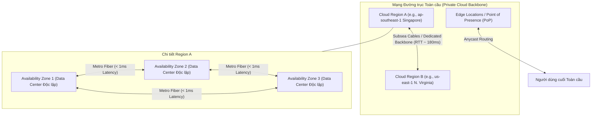
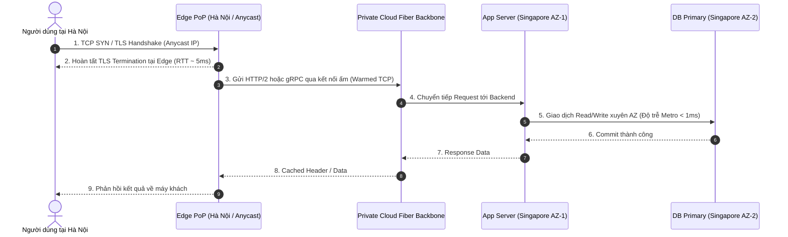
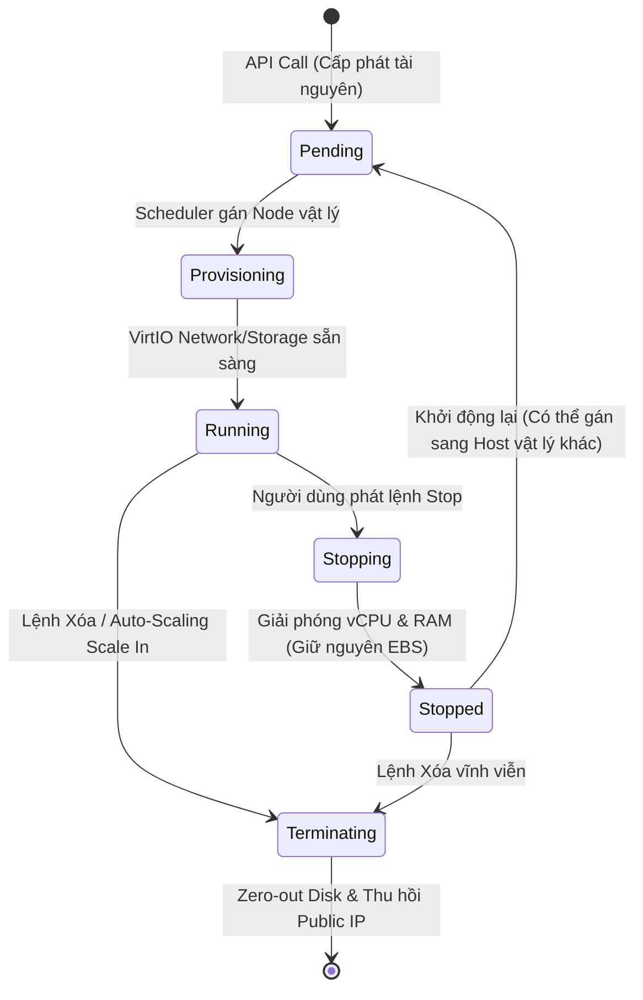
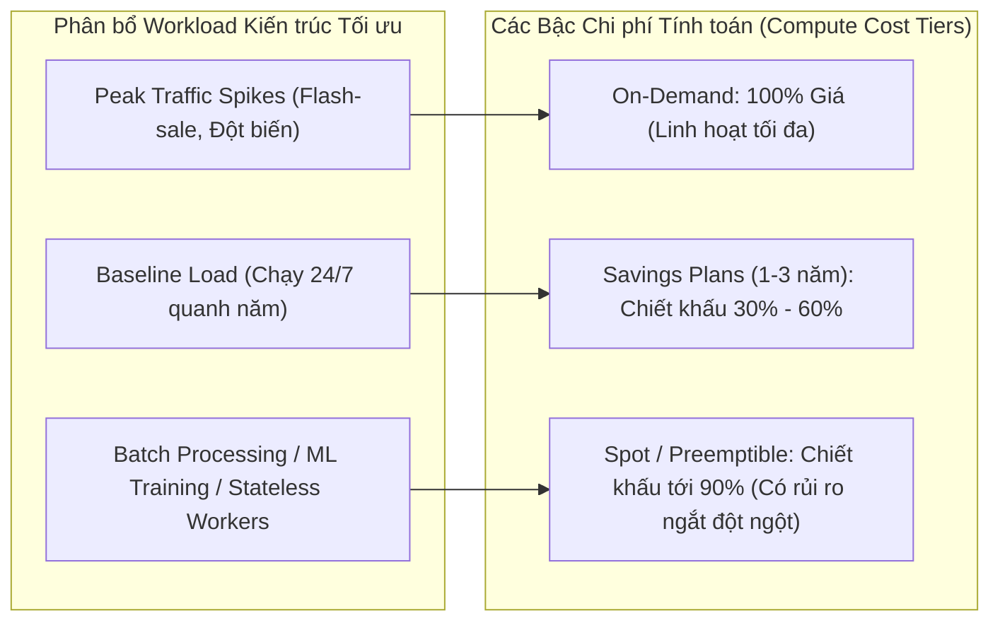
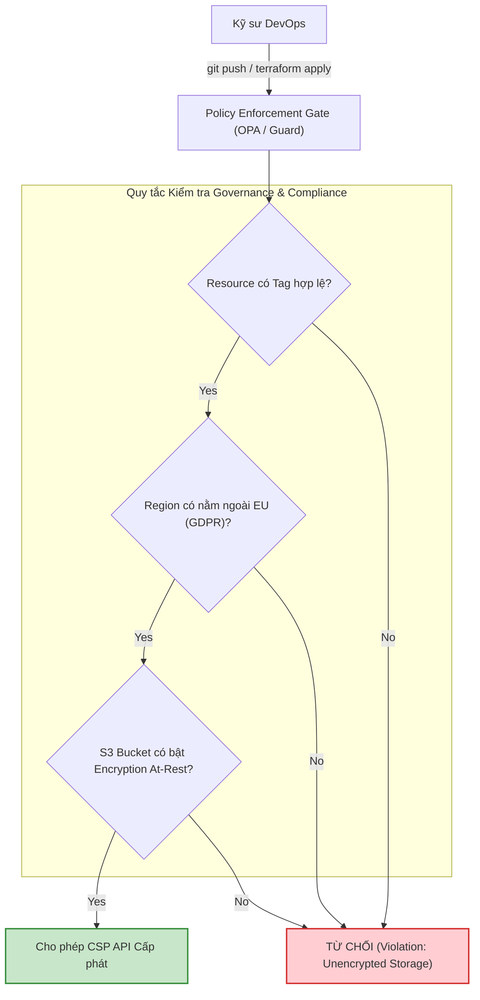

# 1.2. Global Infrastructure and Governance (Hạ tầng Toàn cầu và Quản trị Đám mây)

## Tổng quan về Hạ tầng Toàn cầu và Quản trị Đám mây
Hạ tầng toàn cầu của các nhà cung cấp đám mây (Global Infrastructure) là mạng lưới các trung tâm dữ liệu phân tán trên toàn thế giới, được kết nối với nhau bằng các tuyến cáp quang biển và mạng đường trục chuyên dụng (Dedicated Fiber Backbone). Quản trị đám mây (Cloud Governance) là hệ thống các chính sách, quy chuẩn kiểm soát và quy trình tự động hóa nhằm đảm bảo việc cung cấp và sử dụng tài nguyên tuân thủ bảo mật, pháp lý và tối ưu hóa chi phí.

Về mặt kỹ thuật mạng và độ trễ:
Độ trễ truyền gói tin tối thiểu giữa hai điểm địa lý trên toàn cầu bị giới hạn bởi vận tốc ánh sáng trong sợi quang ($v \approx \frac{2}{3}c \approx 200,000\text{ km/s}$):
$$T_{\text{propagation}} = \frac{2 \cdot d}{v} \quad (\text{Round Trip Time - RTT})$$
Do đó, việc phân bố hạ tầng thành Regions, Availability Zones và Edge Locations là giải pháp kỹ thuật bắt buộc để vừa đảm bảo độ trễ thấp ($< 10\text{ms}$ tại Edge), vừa bảo đảm tính chịu lỗi trước thảm họa tự nhiên (Disaster Recovery).



---

## 2. Chi tiết từng Keyword (Under-the-Hood Deep Dive)

---

### 1. Global Infrastructure: Regions, Availability Zones & Edge Locations

#### 1. Khái niệm bản chất (What & Why)
- **Cloud Region**: Một khu vực địa lý cụ thể trên thế giới (ví dụ: `ap-southeast-1` Singapore, `us-east-1` Bắc Virginia), chứa ít nhất hai hoặc nhiều hơn các Availability Zones biệt lập.
- **Availability Zone (AZ)**: Một hoặc nhiều trung tâm dữ liệu vật lý riêng biệt với nguồn điện dự phòng, máy phát điện diesel độc lập, hệ thống làm mát riêng và kết nối mạng cáp quang metro độ trễ cực thấp ($< 1\text{ms}$). Các AZ trong cùng một Region cách nhau từ vài km đến hàng chục km để cách ly rủi ro động đất, lụt lội hay mất điện diện rộng.
- **Edge Locations / Point of Presence (PoP)**: Các điểm hiện diện mạng biên nằm tại các thành phố lớn trên thế giới, gần người dùng cuối hơn Region. Nơi đây chạy các dịch vụ Content Delivery Network (CDN như CloudFront, Cloudflare), Web Application Firewall (WAF) và DNS phân tán (Route 53, Cloud DNS).
- **Global Infrastructure**: Mạng lưới đường trục cáp quang riêng (Dark Fiber & Subsea Cables) thuộc sở hữu của CSP, cho phép lưu lượng giữa các Region và Edge Locations không phải đi qua mạng Internet công cộng bất định.

#### 2. Cơ chế hoạt động sâu (Under the hood / Hardcore Internals)
- **Định tuyến Anycast BGP tại Edge Locations**:
  - Tại các Edge PoP, cùng một địa chỉ IP công cộng (Anycast IP) được quảng bá ra toàn thế giới thông qua giao thức BGP (Border Gateway Protocol).
  - Khi người dùng gửi gói tin SYN, router của các nhà mạng (ISP) địa phương sẽ định tuyến gói tin đến Edge PoP có số bước nhảy (AS Path Hop count) ngắn nhất.
  - Tại Edge PoP, giao thức TCP Handshake và TLS Termination được hoàn tất ngay lập tức (RTT cực ngắn), sau đó dữ liệu được chuyển tiếp về Region qua mạng đường trục tối ưu của CSP bằng kết nối TCP giữ sẵn (Pre-warmed Keep-Alive Pools).
- **Đồng bộ hóa thời gian giữa các AZ (TrueTime / PTP)**:
  - Để hỗ trợ các cơ sở dữ liệu phân tán xuyên AZ (như Spanner, CockroachDB, Aurora), các Data Center sử dụng hệ thống đồng hồ vệ tinh GPS và đồng hồ nguyên tử (Atomic Clocks) với độ lệch thời gian $\epsilon < 200\mu\text{s}$ (IEEE 1588 PTP protocol).

#### 3. Sơ đồ minh họa


#### 4. Code ví dụ thực chiến (C++ Anycast & Socket Latency Benchmarking Tool)
Đoạn mã C++ minh họa việc đo độ trễ RTT ở tầng socket TCP để kiểm tra chất lượng kết nối tới Region so với Edge PoP:

```cpp
#include <iostream>
#include <chrono>
#include <cstring>
#include <sys/socket.h>
#include <netdb.h>
#include <unistd.h>
#include <arpa/inet.h>

class LatencyProbe {
public:
    static double measureTcpRtt(const std::string& host, int port) {
        struct addrinfo hints{}, *res = nullptr;
        hints.ai_family = AF_INET;
        hints.ai_socktype = SOCK_STREAM;

        if (getaddrinfo(host.c_str(), std::to_string(port).c_str(), &hints, &res) != 0) {
            std::cerr << "Lỗi phân giải DNS cho: " << host << "\n";
            return -1.0;
        }

        int sock = socket(res->ai_family, res->ai_socktype, res->ai_protocol);
        if (sock < 0) {
            freeaddrinfo(res);
            return -1.0;
        }

        // Đặt timeout 3 giây cho socket
        struct timeval tv{ .tv_sec = 3, .tv_usec = 0 };
        setsockopt(sock, SOL_SOCKET, SO_RCVTIMEO, &tv, sizeof(tv));
        setsockopt(sock, SOL_SOCKET, SO_SNDTIMEO, &tv, sizeof(tv));

        auto start = std::chrono::high_resolution_clock::now();
        int ret = connect(sock, res->ai_addr, res->ai_addrlen);
        auto end = std::chrono::high_resolution_clock::now();

        close(sock);
        freeaddrinfo(res);

        if (ret < 0) {
            std::cerr << "Kết nối thất bại tới: " << host << "\n";
            return -1.0;
        }

        std::chrono::duration<double, std::milli> rtt = end - start;
        return rtt.count();
    }
};

int main() {
    std::cout << "--- Benchmarking Latency tới Cloud Infrastructure ---\n";
    
    // Giả lập đo đạc kết nối Edge Anycast vs Central Origin
    double edge_rtt = LatencyProbe::measureTcpRtt("1.1.1.1", 53); // Cloudflare Edge Anycast DNS
    double origin_rtt = LatencyProbe::measureTcpRtt("aws.amazon.com", 443);

    std::cout << "RTT tới Edge Location (Anycast): " << edge_rtt << " ms\n";
    std::cout << "RTT tới Central Cloud Host: " << origin_rtt << " ms\n";

    return 0;
}
```

#### 5. Ưu / Nhược điểm, Pitfalls & Anti-patterns
- **Ưu điểm**: Giúp ứng dụng đạt chuẩn High Availability (HA) 99.99% khi chạy Multi-AZ và phục hồi thảm họa (DR) toàn cầu khi chạy Multi-Region.
- **Pitfall**: Thiết kế ứng dụng chat hoặc thanh toán real-time nhưng vô tình gọi gọi đồng bộ (Synchronous Cross-Region Call). Độ trễ mạng giữa Singapore và Virginia (~$180\text{ms}$) sẽ cộng dồn theo số lượng RPC, gây tắc nghẽn thread pool.

#### 6. Ứng dụng thực tế trong Backend / Systems
- Phân phối nội dung tĩnh qua Edge CloudFront / Cloudflare; triển khai database cluster có primary tại Region chính và read-replicas tại các Region phụ.

---

### 2. Cloud Resource Management, Provisioning & Lifecycle

#### 1. Khái niệm bản chất (What & Why)
- **Cloud Resource Management**: Quá trình phân loại, gán nhãn (Tagging), cấu hình hạn mức (Quotas) và theo dõi tài nguyên trên cloud.
- **Cloud Resource Provisioning**: Cơ chế cấp phát tài nguyên theo mô hình khai báo (Declarative) hoặc mệnh lệnh (Imperative) thông qua API của nhà cung cấp.
- **Cloud Resource Lifecycle**: Vòng đời của một tài nguyên điện toán từ lúc khởi tạo (`Pending` $\to$ `Running`), tạm dừng (`Stopping` $\to$ `Stopped`), cho đến khi tiêu hủy (`Terminating` $\to$ `Terminated`).

#### 2. Cơ chế hoạt động sâu (Under the hood / Hardcore Internals)
- **Tầng Control Plane State Machine**:
  - Khi nhận API call tạo máy ảo, bộ điều phối (Reconciliation Loop) ghi nhận trạng thái mong muốn (Desired State) vào cơ sở dữ liệu phân tán có tính nhất quán cao (như etcd hoặc Spanner).
  - Worker node agent (như EC2 Hypervisor Daemon) định kỳ kiểm tra hoặc nhận push event qua gRPC để thực thi cấu hình phần cứng: gắn card mạng ảo ENI (Elastic Network Interface), gắn ổ đĩa EBS volume qua mạng iSCSI/NVMe-oF (NVMe over Fabrics), sau đó chuyển trạng thái sang `Running`.
  - Khi VM bị xóa (`Terminating`), ổ cứng gốc có cờ `DeleteOnTermination` sẽ bị giải phóng, các khối dữ liệu trên SAN/Ceph/EBS được ghi đè zero (Zeroed-out) để ngăn ngừa tấn công rò rỉ dữ liệu chéo (Data remnants attack).

#### 3. Sơ đồ minh họa


#### 4. Code ví dụ thực chiến (TypeScript Resource State Machine Validator)
Minh họa kiểm soát vòng đời tài nguyên đám mây với cơ chế State Pattern:

```typescript
export enum ResourceState {
  PENDING = "PENDING",
  RUNNING = "RUNNING",
  STOPPED = "STOPPED",
  TERMINATED = "TERMINATED",
}

export class CloudComputeResource {
  private currentState: ResourceState = ResourceState.PENDING;
  private readonly resourceId: string;

  constructor(id: string) {
    this.resourceId = id;
  }

  public getState(): ResourceState {
    return this.currentState;
  }

  public transitionTo(nextState: ResourceState): void {
    const validTransitions: Record<ResourceState, ResourceState[]> = {
      [ResourceState.PENDING]: [ResourceState.RUNNING, ResourceState.TERMINATED],
      [ResourceState.RUNNING]: [ResourceState.STOPPED, ResourceState.TERMINATED],
      [ResourceState.STOPPED]: [ResourceState.PENDING, ResourceState.RUNNING, ResourceState.TERMINATED],
      [ResourceState.TERMINATED]: [], // Trạng thái cuối cùng, không thể chuyển đổi tiếp
    };

    const allowed = validTransitions[this.currentState];
    if (!allowed.includes(nextState)) {
      throw new Error(
        `[Lifecycle Error] Không thể chuyển đổi trạng thái tài nguyên ${this.resourceId} từ ${this.currentState} sang ${nextState}!`
      );
    }

    console.log(`[Resource: ${this.resourceId}] Chuyển đổi trạng thái: ${this.currentState} -> ${nextState}`);
    this.currentState = nextState;
  }
}

// Chạy thử nghiệm
const vm = new CloudComputeResource("i-0a1b2c3d4e5f");
vm.transitionTo(ResourceState.RUNNING);
vm.transitionTo(ResourceState.STOPPED);
vm.transitionTo(ResourceState.TERMINATED);
```

#### 5. Ưu / Nhược điểm, Pitfalls & Anti-patterns
- **Pitfall**: Quên giải phóng các tài nguyên mồ côi (Orphaned Resources) như Unattached Elastic IPs (bị CSP phạt phí nếu không gắn vào VM đang chạy) hoặc Unattached EBS Volumes vẫn tiếp tục bị tính phí dung lượng hàng tháng.

#### 6. Ứng dụng thực tế trong Backend / Systems
- Viết các Cloud Custodian bots định kỳ quét tài nguyên không gắn tag môi trường (`Environment=Prod/Dev`) hoặc không sử dụng để tự động gửi thông báo dọn dẹp hạ tầng.

---

### 3. Cloud Economics & Cost Optimization

#### 1. Khái niệm bản chất (What & Why)
- **Cloud Economics**: Khoa học kinh tế đằng sau việc khai thác điện toán đám mây. Chuyển dịch từ mô hình mua sắm phần cứng truyền thống (CapEx - khấu hao 3-5 năm) sang mô hình chi trả theo lưu lượng tiêu dùng thực tế (OpEx - Pay as you go).
- **Quy mô kinh tế (Economies of Scale)**: Các CSP lớn (AWS, GCP, Azure) mua linh kiện máy chủ và đàm phán hợp đồng điện năng ở quy mô hàng triệu máy chủ, giúp giảm chi phí đơn vị tính toán rẻ hơn nhiều so với một doanh nghiệp tự đầu tư Data Center.
- **Cloud Cost Optimization**: Quá trình liên tục phân tích và tinh chỉnh tài nguyên nhằm tối thiểu hóa chi phí mà vẫn đảm bảo hiệu năng và SLAs.

#### 2. Cơ chế hoạt động sâu (Under the hood / Hardcore Internals)
- **Mô hình định giá tài nguyên (Pricing Dynamics)**:
  - *On-Demand*: Mức giá cao nhất nhưng không có bất kỳ cam kết nào, hủy tài nguyên tính tiền dừng lại ngay lập tức.
  - *Reserved Instances (RI) / Savings Plans*: Cam kết mức sử dụng cố định (tính theo giờ hoặc tiền $/giờ) trong 1 năm hoặc 3 năm để được chiết khấu từ 30% đến 72%.
  - *Spot Instances / Preemptible VMs*: Đấu giá tài nguyên nhàn rỗi (Spare Capacity) trong trung tâm dữ liệu của CSP với giá rẻ hơn tới 90%. Bản chất: CSP có quyền thu hồi máy ảo bất cứ lúc nào (sau 2 phút gửi cảnh báo ngắt tín hiệu qua Metadata API hoặc ACPI signal).
- **Cơ cấu chi phí mạng ngầm (Egress Bandwidth Trap)**:
  - Chi phí Ingress (Dữ liệu tải lên Cloud): Thường là **Miễn phí** ($0/GB).
  - Chi phí Egress (Dữ liệu truyền từ Cloud ra Internet): Rất đắt ($\approx \$0.08 - \$0.12/\text{GB}$).
  - Chi phí Cross-AZ Data Transfer: Tính phí cả 2 đầu khi truyền dữ liệu qua lại giữa hai Availability Zone trong cùng một Region ($\approx \$0.01/\text{GB}$).

#### 3. Sơ đồ minh họa


#### 4. Code ví dụ thực chiến (TypeScript Spot Instance Interruption Handler)
Cơ chế bắt tín hiệu ngắt kết nối Spot Instance thông qua việc liên tục kiểm tra AWS Instance Metadata Service (IMDSv2):

```typescript
import http from "http";

class SpotInterruptionMonitor {
  private imdsToken: string = "";

  // Bước 1: Lấy Token bảo mật IMDSv2
  private async fetchImdsV2Token(): Promise<string> {
    return new Promise((resolve, reject) => {
      const req = http.request(
        {
          host: "169.254.169.254", // Link-local address của Instance Metadata Service
          path: "/latest/api/token",
          method: "PUT",
          headers: { "X-aws-ec2-metadata-token-ttl-seconds": "60" },
          timeout: 1000,
        },
        (res) => {
          let data = "";
          res.on("data", (chunk) => (data += chunk));
          res.on("end", () => resolve(data));
        }
      );
      req.on("error", reject);
      req.end();
    });
  }

  // Bước 2: Thăm dò cảnh báo ngắt (Spot Instance Action)
  public async pollInterruptionNotice(): Promise<void> {
    try {
      if (!this.imdsToken) {
        this.imdsToken = await this.fetchImdsV2Token();
      }

      const req = http.request(
        {
          host: "169.254.169.254",
          path: "/latest/meta-data/spot/instance-action",
          method: "GET",
          headers: { "X-aws-ec2-metadata-token": this.imdsToken },
          timeout: 1000,
        },
        (res) => {
          if (res.statusCode === 200) {
            let data = "";
            res.on("data", (chunk) => (data += chunk));
            res.on("end", () => {
              console.error("[CẢNH BÁO KHẨN CẤP] Nhận thông báo thu hồi Spot Instance trong vòng 2 phút!");
              console.error("Payload:", data);
              this.drainNodeAndExit();
            });
          }
        }
      );
      req.on("error", () => {
        // 404 là bình thường khi chưa có cảnh báo thu hồi
      });
      req.end();
    } catch (err) {
      // Bỏ qua lỗi kết nối IMDS trong môi trường non-AWS
    }
  }

  private drainNodeAndExit(): void {
    console.log("[Graceful Drain] Đang đẩy dở công việc lên SQS và ngắt kết nối khỏi Target Group...");
    // Thực hiện dọn dẹp và exit
    process.exit(0);
  }
}

// Khởi chạy polling định kỳ mỗi 5 giây
const monitor = new SpotInterruptionMonitor();
setInterval(() => monitor.pollInterruptionNotice(), 5000);
```

#### 5. Ưu / Nhược điểm, Pitfalls & Anti-patterns
- **Pitfall**: Dùng Spot Instances cho các tác vụ lưu trữ trạng thái đơn lẻ (Single Stateful Database) mà không có bản sao dự phòng. Khi CSP thu hồi tài nguyên, hệ thống sẽ rơi vào tình trạng downtime hoàn toàn.

#### 6. Ứng dụng thực tế trong Backend / Systems
- Kết hợp Auto Scaling Group: 30% On-Demand làm lõi ổn định, 70% Spot Instances phục vụ việc mở rộng tải tính toán song song cho hệ thống phân tích dữ liệu lớn.

---

### 4. Cloud Governance, Compliance, Vendor Lock-in & Portability

#### 1. Khái niệm bản chất (What & Why)
- **Cloud Governance**: Khung chính sách, vai trò và công cụ kiểm soát việc sử dụng tài nguyên điện toán của tổ chức (Kiểm soát chi phí, phân quyền truy cập RBAC, thiết lập thẻ định danh tài nguyên bắt buộc).
- **Cloud Compliance**: Đảm bảo toàn bộ kiến trúc hạ tầng và dữ liệu tuân thủ các quy chuẩn và tiêu chuẩn pháp lý quốc tế như:
  - *SOC 2 Type II*: Kiểm soát an toàn và tính sẵn sàng của dữ liệu.
  - *PCI-DSS*: Chuẩn bảo mật lưu trữ và xử lý thẻ thanh toán quốc tế.
  - *HIPAA*: Bảo vệ thông tin sức khỏe và bệnh án cá nhân tại Mỹ.
  - *GDPR*: Quy định bảo vệ quyền riêng tư dữ liệu cá nhân của Liên minh Châu Âu (bao gồm quyền được lãng quên - Right to be Forgotten và Data Residency).
- **Vendor Lock-in**: Tình trạng doanh nghiệp bị phụ thuộc chặt chẽ vào hệ sinh thái của một CSP duy nhất, khiến chi phí chuyển đổi (Switching Costs) sang nhà cung cấp khác trở nên đắt đỏ không thể thực hiện được.
- **Portability & Interoperability**:
  - *Portability*: Khả năng di chuyển ứng dụng và dữ liệu từ nền tảng này sang nền tảng khác với chi phí và sự sửa đổi mã nguồn tối thiểu.
  - *Interoperability*: Khả năng hai hay nhiều hệ thống đám mây khác nhau có thể trao đổi thông tin và vận hành phối hợp hiệu quả.

#### 2. Cơ chế hoạt động sâu (Under the hood / Hardcore Internals)
- **Chiến lược Phá vỡ Vendor Lock-in ở Tầng Kỹ thuật**:
  - Sử dụng các chuẩn mở được hỗ trợ bởi CNCF (Cloud Native Computing Foundation): Kubernetes thay vì proprietary container services; OpenTelemetry thay vì proprietary CloudWatch/Stackdriver agents; Postgres/MySQL wire-compatible engines thay vì DynamoDB proprietary APIs.
  - **Policy as Code (PaC)**: Sử dụng Open Policy Agent (OPA) với ngôn ngữ Rego hoặc AWS Service Control Policies (SCPs) để chặn đứng việc khởi tạo tài nguyên vi phạm ở tầng API Gateway trước khi chúng chạm tới Hypervisor.

#### 3. Sơ đồ minh họa


#### 4. Code ví dụ thực chiến (TypeScript Policy as Code / Governance Linter)
Mô phỏng bộ kiểm tra chính sách bảo mật đám mây (Governance Policy Engine) ngăn chặn vi phạm cấu hình trước khi deploy:

```typescript
export interface CloudResourceDefinition {
  resourceType: string;
  name: string;
  region: string;
  tags: Record<string, string>;
  properties: {
    encrypted?: boolean;
    publicAccess?: boolean;
  };
}

export class CloudGovernanceEngine {
  private allowedRegions: Set<string> = new Set(["ap-southeast-1", "ap-southeast-3"]);
  private mandatoryTags: string[] = ["Environment", "Owner", "CostCenter"];

  public evaluateResource(resource: CloudResourceDefinition): { approved: boolean; violations: string[] } {
    const violations: string[] = [];

    // 1. Kiểm tra tuân thủ vị trí địa lý (Data Residency Compliance)
    if (!this.allowedRegions.has(resource.region)) {
      violations.push(`[Data Sovereignty] Region '${resource.region}' không được phép do vi phạm chính sách lưu trữ dữ liệu.`);
    }

    // 2. Kiểm tra chính sách gắn nhãn bắt buộc (Resource Tagging Policy)
    for (const tag of this.mandatoryTags) {
      if (!resource.tags[tag]) {
        violations.push(`[Cost Governance] Thiếu thẻ tag bắt buộc '${tag}' để hạch toán chi phí.`);
      }
    }

    // 3. Kiểm tra an toàn lưu trữ dữ liệu
    if (resource.resourceType === "StorageBucket") {
      if (!resource.properties.encrypted) {
        violations.push(`[Security Baseline] Bucket '${resource.name}' bắt buộc phải kích hoạt KMS Encryption At-Rest.`);
      }
      if (resource.properties.publicAccess) {
        violations.push(`[Security Baseline] Nghiêm cấm mở Public Access trên Bucket '${resource.name}'.`);
      }
    }

    return {
      approved: violations.length === 0,
      violations,
    };
  }
}

// Chạy thử kiểm toán cấu hình tài nguyên
const governance = new CloudGovernanceEngine();

const invalidBucket: CloudResourceDefinition = {
  resourceType: "StorageBucket",
  name: "company-customer-pii-data",
  region: "us-east-1", // Vi phạm region
  tags: { Environment: "Production" }, // Thiếu Owner và CostCenter
  properties: {
    encrypted: false, // Vi phạm mã hóa
    publicAccess: true, // Vi phạm bảo mật
  },
};

const result = governance.evaluateResource(invalidBucket);
console.log("Kết quả kiểm toán tài nguyên:", result);
```

#### 5. Ưu / Nhược điểm, Pitfalls & Anti-patterns
- **Ưu điểm**: Ngăn chặn rò rỉ dữ liệu phạt hàng triệu USD theo GDPR/HIPAA, kiểm soát chặt chẽ ngân sách không bị đội chi phí bất ngờ.
- **Pitfall**: Quá ám ảnh việc trừu tượng hóa chống vendor lock-in mà tự xây dựng lại toàn bộ các dịch vụ cơ bản từ đầu, làm mất đi lợi thế cạnh tranh về tốc độ ra mắt sản phẩm của điện toán đám mây.

#### 6. Ứng dụng thực tế trong Backend / Systems
- Thiết lập AWS Organizations kết hợp SCPs (Service Control Policies) để cấm tất cả các tài khoản con của lập trình viên không được tạo instance ngoài Region Singapore và cấm tắt tính năng ghi log CloudTrail.
