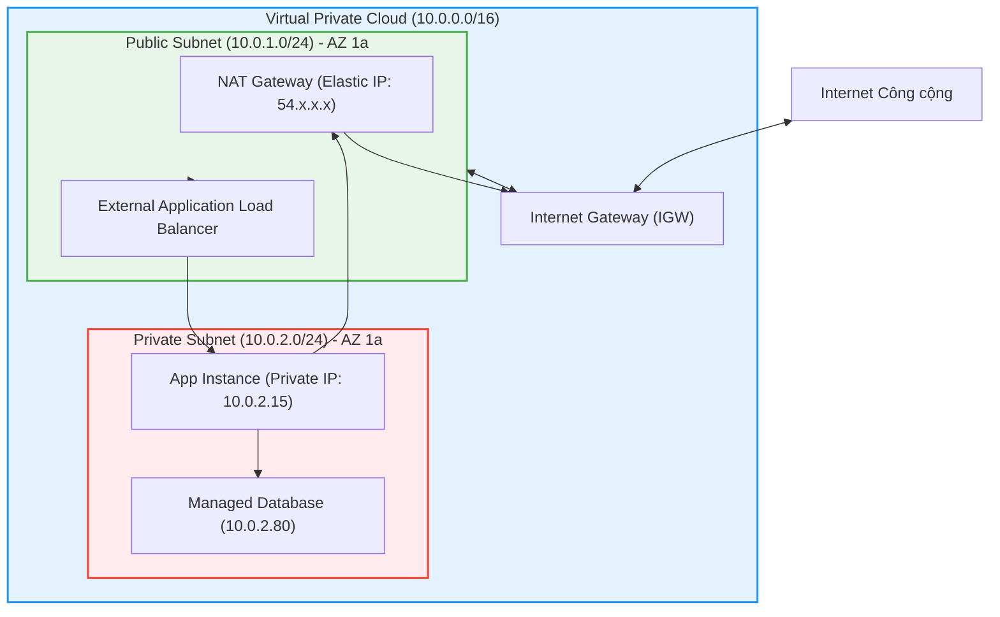
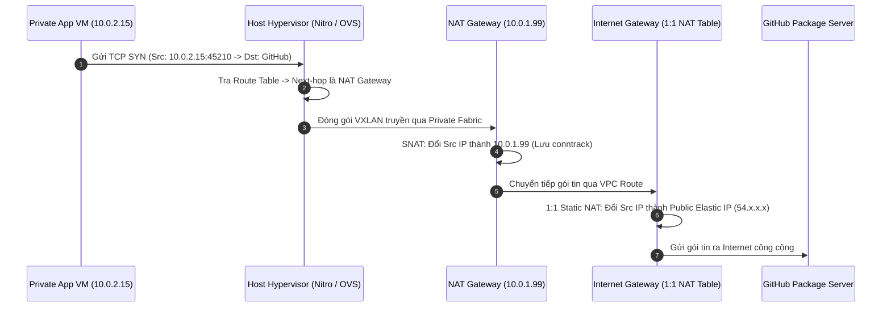
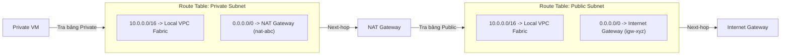

# 2.1. VPC, Subnets and Routing (Mạng Ảo Riêng, Phân mạng và Định tuyến)

## Tổng quan về Mạng Ảo Riêng và Định tuyến Đám mây
Virtual Private Cloud (VPC) hoặc Virtual Network (VNet) là nền tảng mạng ảo hóa được định nghĩa bằng phần mềm (Software-Defined Networking - SDN), cung cấp một không gian mạng cô lập hoàn toàn về mặt logic dành riêng cho một tài khoản đám mây. 

Về mặt kỹ thuật mạng phân tán, VPC hoạt động bằng cách đóng gói các gói tin Layer-2/Layer-3 của máy ảo khách (Guest Packet) vào bên trong các gói tin UDP của mạng vật lý (Underlay Network) sử dụng giao thức **VXLAN (Virtual Extensible LAN)** hoặc **GENEVE (Generic Network Virtualization Encapsulation)**:
$$\text{Outer Packet} = [\text{Physical IP Header}] + [\text{UDP Header (Port 4789)}] + [\text{VXLAN Header (VNI 24-bit)}] + [\text{Inner Guest Frame}]$$
Trường **VNI (VXLAN Network Identifier)** có độ dài 24-bit cho phép hệ thống đám mây phân chia tới $2^{24} \approx 16.77 \text{ triệu}$ mạng ảo độc lập trên cùng một hạ tầng chuyển mạch vật lý chung, vượt qua giới hạn 4096 VLAN của chuẩn 802.1Q truyền thống.



---

## 2. Chi tiết từng Keyword (Under-the-Hood Deep Dive)

---

### 1. VPC, VNet, Subnets, Public & Private Subnets

#### 1. Khái niệm bản chất (What & Why)
- **Virtual Private Cloud (VPC) / Virtual Network (VNet)**: Lớp mạng riêng ảo độc lập trên AWS, GCP, Azure, cho phép kỹ sư kiểm soát hoàn toàn dải địa chỉ IP, bảng định tuyến, cổng kết nối mạng và tường lửa.
- **Subnets (Mạng con)**: Các phân đoạn mạng nhỏ hơn được chia ra từ dải IP tổng thể của VPC, luôn thuộc về một Availability Zone (AZ) cụ thể (trên AWS).
- **Public Subnet (Mạng con Công cộng)**: Subnet có bảng định tuyến (Route Table) trỏ lưu lượng `0.0.0.0/0` trực tiếp tới **Internet Gateway (IGW)**. Các tài nguyên trong Subnet này có thể gán Public IP để truy cập trực tiếp từ Internet (thích hợp cho Load Balancers, Bastion Hosts).
- **Private Subnet (Mạng con Nội bộ)**: Subnet không có route trực tiếp ra Internet Gateway. Để truy cập Internet (ví dụ: tải bản vá OS, cập nhật dependencies), lưu lượng từ Subnet này bắt buộc phải đi qua **NAT Gateway** đặt tại Public Subnet. Bên ngoài Internet hoàn toàn không thể chủ động gửi request vào máy chủ trong Private Subnet (thích hợp cho Backend APIs, Databases, Caching).

#### 2. Cơ chế hoạt động sâu (Under the hood / Hardcore Internals)
- **Tầng SDN và Đóng gói Gói tin (Encapsulation)**:
  - Khi máy ảo A trong Subnet 1 (`10.0.1.5`) ping máy ảo B trong Subnet 2 (`10.0.2.8`), card mạng ảo `veth` của VM gửi frame ARP để tìm MAC address.
  - Hypervisor (như AWS Nitro Card hoặc Open vSwitch) bắt chặn gói tin ARP này. Nó không truyền broadcast ra toàn bộ Data Center mà tra cứu trong cơ sở dữ liệu phân tán (Mapping Service) để tìm IP vật lý của Host đang chạy máy ảo B.
  - Sau đó, Hypervisor bọc gói tin gốc vào một gói tin VXLAN với VNI tương ứng của VPC đó, rồi gửi thẳng qua mạng vật lý tới Host B. Tại Host B, card mạng giải mã (Decapsulate) gói VXLAN và đưa frame gốc vào card mạng ảo của máy ảo B.
- **Các IP bị CSP dành riêng (Reserved IP Addresses)**:
  - Trong bất kỳ Subnet nào của AWS, có 5 địa chỉ IP luôn bị hệ thống giữ lại:
    - `10.0.0.0`: Network address.
    - `10.0.0.1`: Router ảo của VPC.
    - `10.0.0.2`: DNS resolver nội bộ (Amazon Provided DNS).
    - `10.0.0.3`: Dành cho nhu cầu mở rộng tương lai của AWS.
    - `10.0.0.255`: Broadcast address (dù VPC không hỗ trợ broadcast thực sự).
  - Do đó, một Subnet `/24` có $256 - 5 = 251$ địa chỉ IP khả dụng cho máy ảo.

#### 3. Sơ đồ minh họa


#### 4. Code ví dụ thực chiến (C++ CIDR Subnet Calculator)
Đoạn mã C++ tính toán không gian địa chỉ mạng, subnet mask, số host khả dụng và kiểm tra xem một IP có thuộc subnet hay không:

```cpp
#include <iostream>
#include <string>
#include <sstream>
#include <vector>
#include <cstdint>
#include <arpa/inet.h>

class CidrCalculator {
private:
    uint32_t network_ip;
    uint32_t netmask;
    int prefix_len;

    static uint32_t parseIpv4(const std::string& ip_str) {
        struct in_addr addr;
        if (inet_pton(AF_INET, ip_str.c_str(), &addr) <= 0) {
            throw std::invalid_argument("Định dạng IP không hợp lệ: " + ip_str);
        }
        return ntohl(addr.s_addr);
    }

    static std::string ipToString(uint32_t ip) {
        struct in_addr addr;
        addr.s_addr = htonl(ip);
        char buf[INET_ADDRSTRLEN];
        inet_ntop(AF_INET, &addr, buf, sizeof(buf));
        return std::string(buf);
    }

public:
    CidrCalculator(const std::string& cidr) {
        auto slash_pos = cidr.find('/');
        if (slash_pos == std::string::npos) {
            throw std::invalid_argument("CIDR phải có dấu '/': " + cidr);
        }
        std::string ip_part = cidr.substr(0, slash_pos);
        prefix_len = std::stoi(cidr.substr(slash_pos + 1));
        if (prefix_len < 0 || prefix_len > 32) {
            throw std::out_of_range("Prefix length phải từ 0 đến 32");
        }

        netmask = (prefix_len == 0) ? 0 : (~0U << (32 - prefix_len));
        network_ip = parseIpv4(ip_part) & netmask;
    }

    [[nodiscard]] bool contains(const std::string& test_ip) const {
        uint32_t ip = parseIpv4(test_ip);
        return (ip & netmask) == network_ip;
    }

    void printDetails() const {
        uint32_t total_ips = 1ULL << (32 - prefix_len);
        uint32_t broadcast_ip = network_ip | ~netmask;
        uint32_t cloud_usable = (total_ips >= 5) ? (total_ips - 5) : 0; // Trừ 5 IP dành riêng của AWS

        std::cout << "--- Thông số Subnet CIDR ---" << "\n";
        std::cout << "Network Address : " << ipToString(network_ip) << "/" << prefix_len << "\n";
        std::cout << "Subnet Mask     : " << ipToString(netmask) << "\n";
        std::cout << "Broadcast IP    : " << ipToString(broadcast_ip) << "\n";
        std::cout << "Tổng số IP      : " << total_ips << "\n";
        std::cout << "Khả dụng trên AWS (trừ 5 IP): " << cloud_usable << "\n";
    }
};

int main() {
    try {
        CidrCalculator subnet("10.0.1.0/24");
        subnet.printDetails();

        std::string ip1 = "10.0.1.50";
        std::string ip2 = "10.0.2.1";
        std::cout << "IP " << ip1 << " thuộc subnet: " << (subnet.contains(ip1) ? "ĐÚNG" : "SAI") << "\n";
        std::cout << "IP " << ip2 << " thuộc subnet: " << (subnet.contains(ip2) ? "ĐÚNG" : "SAI") << "\n";
    } catch (const std::exception& e) {
        std::cerr << "Lỗi: " << e.what() << "\n";
    }
    return 0;
}
```

#### 5. Ưu / Nhược điểm, Pitfalls & Anti-patterns
- **Ưu điểm**: Phân vùng ranh giới bảo mật nghiêm ngặt; cô lập cơ sở dữ liệu và các hệ thống lõi khỏi Internet mở.
- **Pitfall**: Chọn CIDR block cho VPC quá nhỏ (ví dụ `/24` chỉ có 256 IPs). Khi triển khai cụm EKS (Kubernetes) với AWS VPC CNI, mỗi Pod tiêu tốn 1 địa chỉ IP thực của Subnet, dẫn đến việc cạn kiệt IP chỉ sau vài tuần và phải tạo lại toàn bộ VPC.

#### 6. Ứng dụng thực tế trong Backend / Systems
- Mô hình kiến trúc 3-Tier chuẩn: Tier 1 (Public Subnet: ALB, WAF), Tier 2 (Private Subnet: Kubernetes Pods, Microservices), Tier 3 (Isolated Database Subnet: Aurora PostgreSQL, Redis Cluster không có route ra NAT).

---

### 2. IP Allocation, CIDR, Route Tables, Gateways & NAT

#### 1. Khái niệm bản chất (What & Why)
- **IP Address Allocation (Cấp phát IP)**:
  - *Private IP*: Địa chỉ IP nội bộ không thể định tuyến ngoài Internet (theo chuẩn RFC 1918: `10.0.0.0/8`, `172.16.0.0/12`, `192.168.0.0/16`), dùng để liên lạc nội bộ trong VPC.
  - *Public IP*: Địa chỉ IP định tuyến được trên Internet, được gán động từ pool của CSP và bị thu hồi khi VM tắt (Stop).
  - *Elastic IP (EIP) / Static Public IP*: Địa chỉ IPv4 tĩnh cố định gắn liền với tài khoản, có thể gán linh hoạt giữa các instance khác nhau khi có sự cố.
- **CIDR (Classless Inter-Domain Routing)**: Phương pháp phân bổ địa chỉ IP linh hoạt dựa trên tiền tố bit (ví dụ `/16`, `/24`), loại bỏ sự phân lớp A, B, C cứng nhắc trước đây.
- **Route Table (Bảng định tuyến)**: Tập hợp các quy tắc định tuyến (Rules), xác định lưu lượng mạng từ Subnet hoặc Gateway sẽ được chuyển tiếp đi đâu (Next-hop target).
- **Internet Gateway (IGW)**: Thành phần mạng ảo có khả năng mở rộng quy mô ngang (Horizontally scaled), có tính sẵn sàng cao, thực hiện biên dịch địa chỉ mạng 1:1 NAT giữa Private IP và Public IP.
- **NAT Gateway vs NAT Instance**:
  - *NAT Gateway*: Dịch vụ mạng được quản lý hoàn toàn (Fully Managed) bởi CSP, tự động scale băng thông lên tới 45Gbps, không cần quản lý hệ điều hành hay bảo trì bản vá.
  - *NAT Instance*: Một máy ảo EC2 thông thường được cấu hình Linux iptables forwarding (`net.ipv4.ip_forward = 1`). Kỹ sư tự quản lý, rẻ hơn cho traffic nhỏ nhưng là Single Point of Failure nếu không cấu hình Auto-recovery.

#### 2. Cơ chế hoạt động sâu (Under the hood / Hardcore Internals)
- **Bản chất SNAT trong Linux Kernel (Cơ chế của NAT)**:
  - Khi một Private VM mở kết nối outbound tới Internet qua NAT, gói tin chạm vào bảng `nat` trong Linux Kernel (`iptables` hoặc `nftables`):
    `iptables -t nat -A POSTROUTING -o eth0 -j MASQUERADE`
  - Kernel ghi một bản ghi vào bảng theo dõi kết nối (`/proc/net/ip_conntrack` hoặc `nf_conntrack`):
    Ghi nhận bộ tứ: `[Src IP: 10.0.2.15, Src Port: 45210, Dst IP: 140.82.121.4, Dst Port: 443]` chuyển đổi thành `[Src IP: 10.0.1.99, Src Port: 61002]`.
  - Giới hạn Port Exhaustion: Một địa chỉ IP công cộng của NAT Gateway chỉ có tối đa khoảng $64,000$ ephemeral ports (từ 1024 đến 65535). Nếu hàng trăm container cùng gửi hàng vạn request đồng thời tới cùng một IP đích, bảng conntrack sẽ bị tràn và gây ra lỗi `Connection timed out`.

#### 3. Sơ đồ minh họa


#### 4. Code ví dụ thực chiến (C++ Linux Kernel Conntrack & NAT Simulation)
Mô phỏng cơ chế dịch địa chỉ mạng SNAT và quản lý bảng Connection Tracking (conntrack):

```cpp
#include <iostream>
#include <unordered_map>
#include <string>
#include <cstdint>
#include <optional>

struct SocketAddress {
    std::string ip;
    uint16_t port;

    bool operator==(const SocketAddress& other) const {
        return ip == other.ip && port == other.port;
    }
};

struct SocketAddressHash {
    std::size_t operator()(const SocketAddress& sa) const {
        return std::hash<std::string>()(sa.ip) ^ (std::hash<uint16_t>()(sa.port) << 1);
    }
};

struct ConntrackEntry {
    SocketAddress original_src;
    SocketAddress original_dst;
    uint16_t translated_port;
};

class NatGatewaySimulator {
private:
    std::string public_ip;
    uint16_t next_ephemeral_port{1024};
    // Map từ original src -> conntrack entry
    std::unordered_map<SocketAddress, ConntrackEntry, SocketAddressHash> outbound_table;
    // Map từ translated_port -> original src (để xử lý inbound return traffic)
    std::unordered_map<uint16_t, SocketAddress> inbound_return_table;

public:
    explicit NatGatewaySimulator(std::string pub_ip) : public_ip(std::move(pub_ip)) {}

    std::optional<SocketAddress> translateOutbound(const SocketAddress& src, const SocketAddress& dst) {
        if (next_ephemeral_port >= 65535) {
            std::cerr << "[NAT Out of Ports] Bảng conntrack bị tràn, cạn kiệt port SNAT!\n";
            return std::nullopt;
        }

        auto it = outbound_table.find(src);
        if (it != outbound_table.end()) {
            return SocketAddress{public_ip, it->second.translated_port};
        }

        uint16_t assigned_port = next_ephemeral_port++;
        outbound_table[src] = ConntrackEntry{src, dst, assigned_port};
        inbound_return_table[assigned_port] = src;

        std::cout << "[NAT SNAT] " << src.ip << ":" << src.port << " --> Dịch thành: "
                  << public_ip << ":" << assigned_port << " (Hướng tới " << dst.ip << ":" << dst.port << ")\n";

        return SocketAddress{public_ip, assigned_port};
    }

    std::optional<SocketAddress> translateInboundReturn(uint16_t dest_port) {
        auto it = inbound_return_table.find(dest_port);
        if (it != inbound_return_table.end()) {
            std::cout << "[NAT Return] Trả gói tin về Host nguồn: " << it->second.ip << ":" << it->second.port << "\n";
            return it->second;
        }
        std::cerr << "[NAT Drop] Gói tin không có bản ghi trong bảng conntrack, DROP!\n";
        return std::nullopt;
    }
};

int main() {
    NatGatewaySimulator nat("54.251.100.99");
    SocketAddress vm1{"10.0.2.15", 41234};
    SocketAddress github{"140.82.121.4", 443};

    auto translated = nat.translateOutbound(vm1, github);
    if (translated) {
        // Mô phỏng server GitHub phản hồi lại port được dịch
        nat.translateInboundReturn(translated->port);
    }
    return 0;
}
```

#### 5. Ưu / Nhược điểm, Pitfalls & Anti-patterns
- **NAT Gateway**: Tự động phục hồi cao nhưng chi phí rất đắt (tính cả phí giờ $\approx \$0.045/\text{hour}$ cộng với phí xử lý dung lượng $\approx \$0.045/\text{GB}$).
- **Pitfall**: Đặt cả hệ thống download dữ liệu lớn (như đọc backup S3 từ Private Subnet) qua NAT Gateway thay vì dùng S3 Gateway VPC Endpoint (miễn phí), dẫn đến hóa đơn NAT Gateway tăng vọt hàng ngàn USD mỗi tháng.

#### 6. Ứng dụng thực tế trong Backend / Systems
- Sử dụng NAT Gateway kết hợp Elastic IP cố định để đăng ký IP Whitelist với các đối tác thanh toán bên ngoài (Visa, Mastercard, Ngân hàng) khi hệ thống backend gọi webhook/API đối tác.
