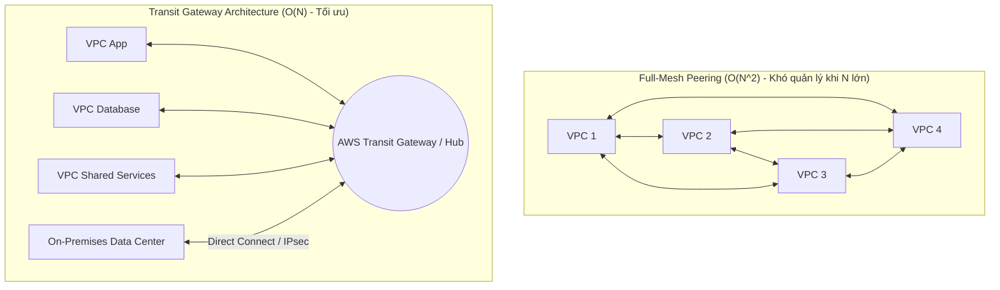
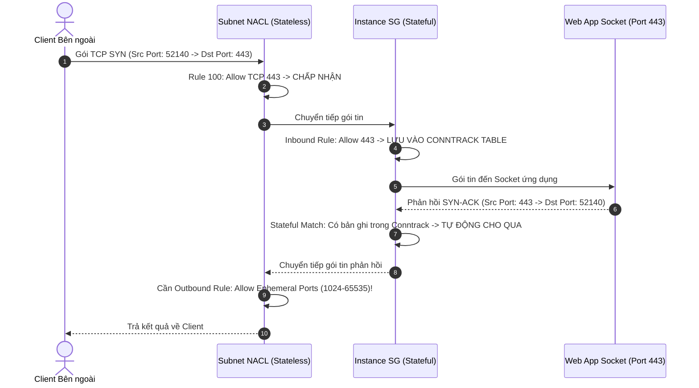
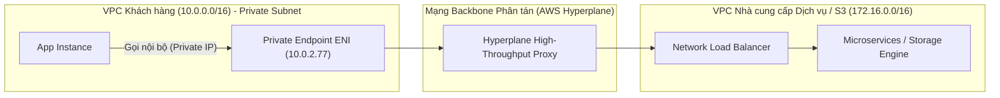
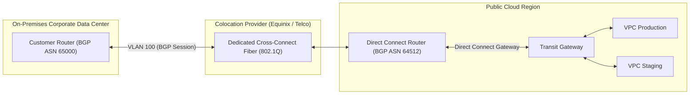
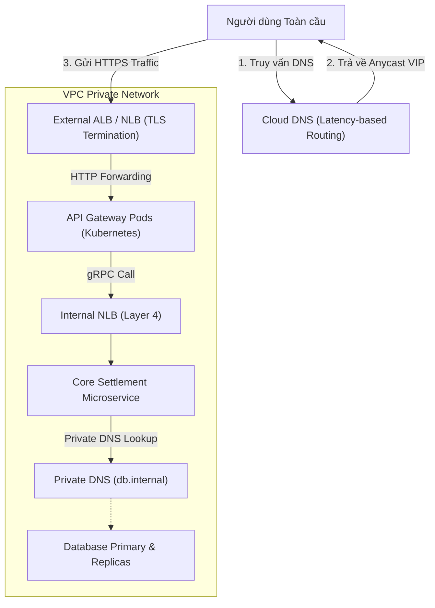

# 2.2. Security, Hybrid Connectivity and Traffic (Bảo mật Mạng, Kết nối Lai và Điều phối Lưu lượng)

## Tổng quan về Bảo mật Mạng và Điều phối Lưu lượng Đám mây
Bảo mật mạng đám mây và kết nối lai (Hybrid Connectivity) là tập hợp các kiến trúc và giao thức cho phép thiết lập vành đai phòng thủ theo chiều sâu (Defense-in-Depth), liên kết các mạng ảo riêng biệt (VPC Peering, Transit Gateway), kết nối hạ tầng On-premises với Cloud (Direct Connect, VPN), đồng thời phân phối tải (Cloud Load Balancing) nhằm đảm bảo thông lượng tối đa và độ trễ tối thiểu.

Về mặt topology và lý thuyết đồ thị mạng:
Một mạng đám mây kết nối đầy đủ (Full-mesh VPC Peering) giữa $N$ mạng VPC đòi hỏi số lượng liên kết điểm-điểm (Point-to-Point Links) tăng theo cấp số nhân:
$$E = \frac{N(N - 1)}{2} = \mathcal{O}(N^2)$$
Mô hình **Transit Gateway (TGW)** chuyển đổi cấu trúc đồ thị từ dạng Full-Mesh sang dạng hình sao (Hub-and-Spoke Topology), giảm độ phức tạp quản trị mạng xuống:
$$E = N = \mathcal{O}(N)$$
Transit Gateway hoạt động như một Router ảo phân tán cấp độ đám mây (Cloud Distributed Router), hỗ trợ giao thức BGP đa đường dẫn bình đẳng (Equal-Cost Multi-Path - ECMP) để tối ưu băng thông truyền tải.



---

## 2. Chi tiết từng Keyword (Under-the-Hood Deep Dive)

---

### 1. Network Security: Security Groups vs Network ACLs (NACL)

#### 1. Khái niệm bản chất (What & Why)
- **Security Groups (SG)**: Tường lửa ảo hoạt động ở **tầng máy ảo / ENI (Elastic Network Interface)**. Có đặc tính **Stateful (Có lưu trạng thái kết nối)**. Mặc định chặn tất cả inbound traffic và cho phép tất cả outbound traffic.
- **Network Access Control Lists (NACL)**: Tường lửa ảo hoạt động ở **tầng Subnet (Subnet Boundary)**. Có đặc tính **Stateless (Không lưu trạng thái kết nối)**. Chứa danh sách các quy tắc (Rules) được đánh số thứ tự từ thấp đến cao (1-32766) và được đánh giá theo thứ tự tuần tự.
- **So sánh cốt lõi**:
  - *Stateful (SG)*: Khi một request gửi đến cổng 80 được chấp thuận bởi Inbound Rule, luồng phản hồi (Return Traffic) của request đó sẽ tự động được phép ra ngoài ngay lập tức, bất kể Outbound Rules cấu hình thế nào.
  - *Stateless (NACL)*: Phản hồi của request hợp lệ không được tự động cho phép. Muốn trả dữ liệu về máy khách, kỹ sư bắt buộc phải mở các cổng tạm thời (Ephemeral Ports: 1024–65535) trên bảng Outbound Rules của NACL.

#### 2. Cơ chế hoạt động sâu (Under the hood / Hardcore Internals)
- **Tầng Linux Conntrack & eBPF trong Hypervisor**:
  - Security Groups không được thực thi bên trong hệ điều hành của máy ảo (Guest OS) mà được thực thi ngay tại card mạng của máy chủ vật lý (AWS Nitro System hoặc Open vSwitch của KVM). Do đó, dù hacker chiếm được quyền `root` trên Guest OS và xóa sạch `iptables`, Security Group vẫn chặn đứng các cuộc tấn công quét cổng từ bên ngoài.
  - Khả năng *Stateful* của Security Group được duy trì thông qua bảng `conntrack` phần cứng (Hardware Connection Tracking Table). Mỗi session TCP hoàn tất bắt tay 3 bước sẽ sinh ra một entry trạng thái `ESTABLISHED`. Khi gói tin ACK/DATA phản hồi quay lại, phần cứng đối chiếu với conntrack table và cho qua mà không cần duyệt lại danh sách rule.
- **Thứ tự đánh giá gói tin (Packet Processing Order)**:
  - Gói tin từ Internet vào: `Internet Gateway` $\to$ `Subnet NACL (Inbound Rules duyệt từ nhỏ đến lớn)` $\to$ `Security Group (Inbound Rules đối chiếu tập hợp)` $\to$ `OS Kernel iptables` $\to$ `Application Socket`.

#### 3. Sơ đồ minh họa


#### 4. Code ví dụ thực chiến (C++ Stateful Packet Filter Engine)
Mô phỏng cơ chế kiểm tra gói tin Stateful Security Group sử dụng bảng theo dõi kết nối (Connection Tracking Table):

```cpp
#include <iostream>
#include <unordered_set>
#include <string>
#include <cstdint>

struct FiveTuple {
    std::string src_ip;
    std::string dst_ip;
    uint16_t src_port;
    uint16_t dst_port;
    std::string protocol;

    bool operator==(const FiveTuple& o) const {
        return src_ip == o.src_ip && dst_ip == o.dst_ip &&
               src_port == o.src_port && dst_port == o.dst_port &&
               protocol == o.protocol;
    }
};

struct FiveTupleHash {
    std::size_t operator()(const FiveTuple& t) const {
        return std::hash<std::string>()(t.src_ip + t.dst_ip + t.protocol) ^
               (std::hash<uint32_t>()((static_cast<uint32_t>(t.src_port) << 16) | t.dst_port));
    }
};

class StatefulFirewall {
private:
    std::unordered_set<FiveTuple, FiveTupleHash> conntrack_table;
    uint16_t allowed_inbound_port{443};

public:
    bool processInboundPacket(const FiveTuple& pkt) {
        // Nếu port đích được phép trong Inbound Rules
        if (pkt.dst_port == allowed_inbound_port && pkt.protocol == "TCP") {
            // Lưu chiều phản hồi (Reverse Flow) vào bảng Conntrack
            FiveTuple reverse_flow{
                .src_ip = pkt.dst_ip,
                .dst_ip = pkt.src_ip,
                .src_port = pkt.dst_port,
                .dst_port = pkt.src_port,
                .protocol = pkt.protocol
            };
            conntrack_table.insert(reverse_flow);
            std::cout << "[SG Inbound] Chấp thuận kết nối mới từ " << pkt.src_ip << ":" << pkt.src_port 
                      << " tới Port " << pkt.dst_port << " -> Đã lưu Reverse Flow vào Conntrack.\n";
            return true;
        }

        std::cout << "[SG Inbound DROP] Từ chối gói tin không khớp Rule: Port " << pkt.dst_port << "\n";
        return false;
    }

    bool processOutboundPacket(const FiveTuple& pkt) {
        // Kiểm tra xem gói tin outbound này có phải là gói phản hồi của session đã thiết lập không
        if (conntrack_table.find(pkt) != conntrack_table.end()) {
            std::cout << "[SG Outbound] STATEFUL MATCH: Gói tin phản hồi thuộc kết nối hợp lệ -> TỰ ĐỘNG CHO QUA.\n";
            return true;
        }

        std::cout << "[SG Outbound DROP] Không tìm thấy session trong Conntrack table.\n";
        return false;
    }
};

int main() {
    StatefulFirewall sg;
    FiveTuple incoming_request{
        .src_ip = "203.0.113.195",
        .dst_ip = "10.0.1.15",
        .src_port = 54321,
        .dst_port = 443,
        .protocol = "TCP"
    };

    FiveTuple outgoing_response{
        .src_ip = "10.0.1.15",
        .dst_ip = "203.0.113.195",
        .src_port = 443,
        .dst_port = 54321,
        .protocol = "TCP"
    };

    // Client gửi request vào web server
    sg.processInboundPacket(incoming_request);

    // Web server trả lời lại client
    sg.processOutboundPacket(outgoing_response);

    return 0;
}
```

#### 5. Ưu / Nhược điểm, Pitfalls & Anti-patterns
- **Security Groups**: Rất an toàn và dễ dùng do tính chất stateful. Tuy nhiên không hỗ trợ quy tắc `DENY` cụ thể (chỉ có `ALLOW`).
- **NACL**: Có thể chặn nhanh một IP cụ thể (Blacklisting một IP của hacker bằng rule `DENY`).
- **Pitfall**: Cấu hình NACL cho phép Inbound 443 nhưng quên mở Outbound rule cho các cổng tạm thời (Ephemeral Ports 1024-65535), dẫn đến việc TCP Handshake không bao giờ hoàn thành vì gói tin SYN-ACK bị NACL chặn lại ở chiều ra.

#### 6. Ứng dụng thực tế trong Backend / Systems
- Thiết lập Security Group lồng nhau (Referencing Security Groups): App SG chỉ cho phép Inbound trên Port 5432 nếu nguồn kết nối là mã định danh của `sg-backend-api`, ngăn chặn hoàn toàn việc mở port DB ra toàn bộ subnet.

---

### 2. Network Interconnect: Peering, Transit Gateway & PrivateLink

#### 1. Khái niệm bản chất (What & Why)
- **VPC Peering**: Kết nối mạng 1:1 trực tiếp giữa 2 VPC (trong cùng Region hoặc xuyên Region - Inter-Region Peering). Lưu lượng đi qua hạ tầng cáp riêng của CSP, không đi qua Internet. **Không hỗ trợ Transitive Routing (Định tuyến bắc cầu)**: Nếu VPC A nối VPC B, VPC B nối VPC C thì VPC A **không thể** tự động nói chuyện với VPC C qua B.
- **Transit Gateway (TGW)**: Thiết bị định tuyến ảo trung tâm (Regional Network Hub). Hoạt động ở Layer-3, gom cụm hàng ngàn VPC và các kết nối VPN/Direct Connect vào một mối quản lý tập trung. Hỗ trợ định tuyến bắc cầu (Transitive Routing) và đa bảng định tuyến phân vùng (Route Domains).
- **PrivateLink & Private Endpoints**: Công nghệ phơi bày (expose) dịch vụ từ VPC này sang VPC khác hoặc từ các dịch vụ SaaS của CSP (như S3, DynamoDB, Snowflake) vào bên trong VPC của khách hàng thông qua một địa chỉ **Private IP nội bộ**. Giao tiếp hoàn toàn qua mạng backbone của CSP mà không cần IGW, NAT Gateway, hay mở peering toàn bộ VPC.

#### 2. Cơ chế hoạt động sâu (Under the hood / Hardcore Internals)
- **AWS Hyperplane Architecture (Kiến trúc đằng sau PrivateLink & NAT Gateway)**:
  - PrivateLink được cung cấp bởi hệ thống phân tán nội bộ có tên là **AWS Hyperplane**. Hyperplane là một cụm máy chủ chuyên dụng xử lý hàng triệu phiên kết nối mỗi giây với độ trễ microsecond.
  - Khi tạo một Interface VPC Endpoint, Hyperplane cắm một card mạng ảo (Elastic Network Interface - ENI) vào Subnet của bạn. Mọi gói tin gửi tới Private IP này sẽ được Hyperplane đóng gói và chuyển tiếp trực tiếp vào dịch vụ đích mà hai bên không cần chia sẻ dải mạng CIDR (hoàn toàn tránh được lỗi trùng lặp IP - Overlapping CIDRs).

#### 3. Sơ đồ minh họa


#### 4. Code ví dụ thực chiến (TypeScript AWS CDK PrivateLink Infrastructure as Code)
Đoạn mã TypeScript sử dụng AWS CDK để khai báo một Interface VPC Endpoint kết nối bảo mật tới AWS S3 mà không cần mở Internet:

```typescript
import * as cdk from "aws-cdk-lib";
import * as ec2 from "aws-cdk-lib/aws-ec2";
import { Construct } from "constructs";

export class SecureNetworkStack extends cdk.Stack {
  constructor(scope: Construct, id: string, props?: cdk.StackProps) {
    super(scope, id, props);

    // 1. Khởi tạo VPC với 2 Subnet: Public và Private Isolated (Không có NAT)
    const vpc = new ec2.Vpc(this, "ProductionVpc", {
      ipAddresses: ec2.IpAddresses.cidr("10.10.0.0/16"),
      maxAzs: 2,
      subnetConfiguration: [
        {
          name: "IsolatedBackend",
          subnetType: ec2.SubnetType.PRIVATE_ISOLATED,
          cidrMask: 24,
        },
      ],
    });

    // 2. Tạo Security Group cho Private Endpoint
    const endpointSecurityGroup = new ec2.SecurityGroup(this, "S3EndpointSecurityGroup", {
      vpc,
      description: "Cho phép traffic HTTPS nội bộ từ các microservices tới Interface Endpoint",
      allowAllOutbound: true,
    });
    endpointSecurityGroup.addIngressRule(
      ec2.Peer.ipv4("10.10.0.0/16"),
      ec2.Port.tcp(443),
      "Cho phép kết nối HTTPS bảo mật từ bên trong VPC"
    );

    // 3. Cấu hình Interface VPC Endpoint (AWS PrivateLink) cho S3
    vpc.addInterfaceEndpoint("S3PrivateLinkEndpoint", {
      service: ec2.InterfaceVpcEndpointAwsService.S3,
      subnets: { subnetType: ec2.SubnetType.PRIVATE_ISOLATED },
      securityGroups: [endpointSecurityGroup],
      privateDnsEnabled: true, // Tự động ghi đè DNS s3.ap-southeast-1.amazonaws.com trỏ về Private IP
    });

    console.log("[CDK] Khởi tạo thành công Secure PrivateLink kết nối nội bộ tới S3.");
  }
}
```

#### 5. Ưu / Nhược điểm, Pitfalls & Anti-patterns
- **VPC Peering**: Miễn phí duy trì liên kết hàng tháng (chỉ tính phí data transfer), nhưng không thể kết nối nếu 2 VPC bị trùng lặp dải mạng CIDR (Overlap IP addresses).
- **PrivateLink**: Giải quyết hoàn toàn vấn đề Overlapping CIDR và cung cấp mức độ bảo mật cao nhất (chỉ phơi bày đúng port của dịch vụ, không phơi bày toàn bộ mạng).
- **Pitfall**: Kết nối VPC A với VPC B qua Peering, sau đó cố gắng truy cập Internet của VPC B từ VPC A (Transitive Routing bị cấm hoàn toàn trên VPC Peering).

#### 6. Ứng dụng thực tế trong Backend / Systems
- Doanh nghiệp tài chính triển khai kiến trúc Multi-Account: Tài khoản Analytics truy cập an toàn vào Core Database đặt tại tài khoản Production thông qua AWS PrivateLink mà không để lộ dải mạng nội bộ.

---

### 3. Hybrid Connectivity: VPN vs Direct Connect / ExpressRoute

#### 1. Khái niệm bản chất (What & Why)
- **VPN Gateway / Site-to-Site VPN**: Kết nối mạng bảo mật qua kênh truyền **Internet công cộng** sử dụng giao thức **IPsec (Internet Protocol Security)**. Thiết lập nhanh (vài giờ), chi phí thấp, nhưng băng thông bị giới hạn ($\approx 1.25\text{Gbps}$ mỗi tunnel) và độ trễ phụ thuộc vào tình trạng mạng Internet công cộng.
- **Client-to-Site VPN (OpenVPN / WireGuard)**: Cho phép các kỹ sư hoặc nhân viên từ xa (Remote Workers) kết nối an toàn vào hạ tầng mạng nội bộ đám mây bằng phần mềm client trên máy tính cá nhân.
- **Dedicated Connectivity (AWS Direct Connect / Azure ExpressRoute / GCP Cloud Interconnect)**: Đường cáp quang vật lý riêng biệt kết nối trực tiếp từ Data Center của khách hàng tới trung tâm dữ liệu của CSP (thông qua nhà mạng viễn thông như VNPT, Viettel, Equinix). **Không đi qua Internet**, băng thông cực lớn ($1\text{Gbps} - 100\text{Gbps}$), độ trễ ổn định tuyệt đối và nhất quán.

#### 2. Cơ chế hoạt động sâu (Under the hood / Hardcore Internals)
- **BGP & 802.1Q VLAN Tagging trong Direct Connect**:
  - Tuyến cáp quang vật lý giữa Router On-premises (Customer Gateway) và Router của CSP được cấu hình chuẩn phân kênh **IEEE 802.1Q VLAN Trunking**.
  - Mỗi đường kết nối ảo (Virtual Interface - VIF) được gán một VLAN ID riêng:
    - *Private VIF*: Kết nối vào VPC thông qua Virtual Private Gateway hoặc Transit Gateway để truy cập các Private IP.
    - *Public VIF*: Kết nối để truy cập tất cả các Public IP endpoints của CSP (như S3, DynamoDB) mà không đi qua Internet.
  - Hai bên thiết lập phiên giao thức **eBGP (Exterior Border Gateway Protocol, ASN)** để tự động trao đổi và cập nhật các tuyến định tuyến (Routing prefixes). Nếu một đường dây vật lý bị đứt, BGP Keepalive timer hết hạn và router tự động chuyển mạch (Failover) sang đường kết nối dự phòng trong vòng vài giây.

#### 3. Sơ đồ minh họa


#### 4. Code ví dụ thực chiến (C++ BGP Keepalive & Peering State Machine Simulator)
Minh họa cơ chế kiểm tra tín hiệu sống (Keepalive) của giao thức BGP giữa On-premises Router và Cloud Direct Connect Gateway:

```cpp
#include <iostream>
#include <chrono>
#include <thread>

enum class BgpState { IDLE, CONNECT, ACTIVE, OPEN_SENT, OPEN_CONFIRM, ESTABLISHED };

class BgpSession {
private:
    BgpState state = BgpState::IDLE;
    uint32_t local_asn;
    uint32_t peer_asn;
    int missed_keepalives = 0;
    const int max_missed_keepalives = 3;

public:
    BgpSession(uint32_t local_as, uint32_t peer_as) 
        : local_asn(local_as), peer_asn(peer_as) {}

    void initiateHandshake() {
        std::cout << "[BGP] Khởi động phiên bắt tay eBGP giữa AS " << local_asn 
                  << " (On-prem) và AS " << peer_asn << " (Cloud DX Gateway)...\n";
        state = BgpState::CONNECT;
        // Bắt tay giả lập
        state = BgpState::ESTABLISHED;
        std::cout << "[BGP State] ESTABLISHED. Bắt đầu quảng bá bảng định tuyến qua Direct Connect.\n";
    }

    void receiveKeepalive() {
        missed_keepalives = 0;
        std::cout << "[BGP] Nhận gói Keepalive từ Cloud Gateway (RTT ~ 1ms). Phiên kết nối duy trì.\n";
    }

    void tick() {
        if (state == BgpState::ESTABLISHED) {
            missed_keepalives++;
            if (missed_keepalives >= max_missed_keepalives) {
                std::cerr << "[BGP ALERT] Mất liên lạc Keepalive " << missed_keepalives 
                          << " lần liên tiếp! Tuyến cáp quang Direct Connect bị đứt!\n";
                state = BgpState::IDLE;
                std::cout << "[BGP Failover] Chuyển mạch khẩn cấp (Failover) toàn bộ traffic sang đường dự phòng IPsec VPN Tunnel!\n";
            }
        }
    }

    [[nodiscard]] bool isEstablished() const noexcept {
        return state == BgpState::ESTABLISHED;
    }
};

int main() {
    BgpSession session(65000, 64512);
    session.initiateHandshake();

    // Giả lập 2 chu kỳ nhận keepalive bình thường
    session.receiveKeepalive();
    session.receiveKeepalive();

    // Giả lập sự cố đứt cáp viễn thông
    std::cout << "\n--- Mô phỏng sự cố mạng vật lý --- \n";
    session.tick(); // Lần 1
    session.tick(); // Lần 2
    session.tick(); // Lần 3 -> Kích hoạt failover
    return 0;
}
```

#### 5. Ưu / Nhược điểm, Pitfalls & Anti-patterns
- **Direct Connect**: Độ trễ cực thấp, băng thông ổn định tuyệt đối nhưng thời gian triển khai lâu (từ 2 đến 8 tuần để kéo dây quang) và chi phí cổng kết nối cao.
- **Site-to-Site VPN**: Rất tốt làm đường kết nối dự phòng (Backup link) cho Direct Connect.
- **Anti-pattern**: Chỉ kéo duy nhất một đường cáp vật lý Direct Connect vào một Router biên duy nhất mà không có đường dự phòng, gây ra sự cố mất toàn bộ liên lạc khi nhà mạng bảo trì hạ tầng cáp.

#### 6. Ứng dụng thực tế trong Backend / Systems
- Các sàn giao dịch chứng khoán hoặc hệ thống thanh toán liên ngân hàng đòi hỏi SLA truyền dữ liệu khắt khe (độ trễ ổn định $2\text{ms} \pm 0.1\text{ms}$, không chấp nhận jitter của mạng Internet).

---

### 4. Cloud Load Balancing, DNS & Traffic Management

#### 1. Khái niệm bản chất (What & Why)
- **Cloud Load Balancing**: Dịch vụ phân phối lưu lượng truy cập mạng đến nhiều máy chủ backend để tối đa hóa thông lượng, giảm độ trễ và tránh quá tải cho bất kỳ máy chủ đơn lẻ nào.
  - *Layer-4 Load Balancer (AWS NLB, GCP Network LB)*: Hoạt động ở tầng Transport (TCP/UDP). Xử lý hàng chục triệu request/giây với độ trễ microsecond, bảo toàn địa chỉ IP nguồn thực tế của client (Client IP preservation).
  - *Layer-7 Load Balancer (AWS ALB, GCP HTTP(S) LB)*: Hoạt động ở tầng Application (HTTP/HTTPS, gRPC, WebSocket). Hỗ trợ định tuyến dựa trên URL path (`/api/v1`), HTTP headers, cookie stickiness và tự động giải mã TLS Certificate (TLS Termination).
  - *External vs Internal Load Balancer*: External có Public IP tiếp nhận lưu lượng từ Internet; Internal chỉ có Private IP phân phối tải giữa các tầng dịch vụ nội bộ trong Private Subnet.
- **DNS Management & Private DNS**: Dịch vụ quản lý tên miền (như AWS Route 53, Azure DNS, Cloud DNS).
  - *Public DNS*: Phân giải tên miền công cộng ra toàn thế giới với các chính sách định tuyến thông minh (Latency-based, Geolocation, Failover routing).
  - *Private DNS*: Cung cấp hệ thống phân giải tên miền nội bộ trong phạm vi VPC (ví dụ: `database.production.internal`), đảm bảo không để lộ cấu trúc mạng nội bộ ra Internet.
- **Egress & Network Bandwidth Management**: Quản lý hạn mức băng thông card mạng ảo (Network Bandwidth Caps) và kiểm soát lưu lượng đi ra ngoài để tối ưu chi phí và tránh rò rỉ dữ liệu.

#### 2. Cơ chế hoạt động sâu (Under the hood / Hardcore Internals)
- **Maglev / IPVS / eBPF trong Cloud Load Balancing**:
  - Các Cloud Load Balancer hiện đại không dùng các máy ảo HAProxy thông thường mà sử dụng kiến trúc **Maglev (Google)** hoặc **Katran (Facebook/eBPF)** chạy trực tiếp trong Linux Kernel với công nghệ **DPDK (Data Plane Development Kit)** hoặc **eBPF XDP (eXpress Data Path)**.
  - Gói tin đến được xử lý ngay tại tầng card mạng NIC driver mà không cần đẩy lên Kernel Network Stack.
  - Sử dụng thuật toán băm nhất quán **Consistent Hashing (Maglev Hashing)** để phân bổ các luồng TCP vào các backend servers, đảm bảo khi một backend node bị chết hoặc bổ sung thêm node mới, số lượng kết nối bị xáo trộn là nhỏ nhất.

#### 3. Sơ đồ minh họa


#### 4. Code ví dụ thực chiến (C++ Consistent Hashing for Load Balancer)
Mô phỏng thuật toán Consistent Hashing (vòng tròn băm có virtual nodes) dùng trong bộ định tuyến của Cloud Load Balancer:

```cpp
#include <iostream>
#include <map>
#include <string>
#include <vector>
#include <sstream>
#include <functional>

class ConsistentHashLoadBalancer {
private:
    int virtual_replicas;
    std::map<size_t, std::string> ring; // Băm -> Tên Node backend

    size_t hashFunction(const std::string& key) const {
        return std::hash<std::string>()(key);
    }

public:
    explicit ConsistentHashLoadBalancer(int replicas = 3) : virtual_replicas(replicas) {}

    void addServer(const std::string& server_ip) {
        for (int i = 0; i < virtual_replicas; ++i) {
            std::string vnode_key = server_ip + "#" + std::to_string(i);
            size_t hash = hashFunction(vnode_key);
            ring[hash] = server_ip;
        }
        std::cout << "[Load Balancer] Đã thêm Server: " << server_ip << " (" << virtual_replicas << " virtual nodes)\n";
    }

    void removeServer(const std::string& server_ip) {
        for (int i = 0; i < virtual_replicas; ++i) {
            std::string vnode_key = server_ip + "#" + std::to_string(i);
            size_t hash = hashFunction(vnode_key);
            ring.erase(hash);
        }
        std::cout << "[Load Balancer] Đã xóa Server: " << server_ip << "\n";
    }

    std::string routeRequest(const std::string& client_ip) const {
        if (ring.empty()) return "NO_SERVERS_AVAILABLE";

        size_t client_hash = hashFunction(client_ip);
        // Tìm node đầu tiên trên vòng tròn có hash >= client_hash
        auto it = ring.lower_bound(client_hash);
        if (it == ring.end()) {
            // Quay vòng lại điểm đầu của Ring (Clockwise)
            it = ring.begin();
        }
        return it->second;
    }
};

int main() {
    ConsistentHashLoadBalancer lb(5);
    lb.addServer("10.0.1.10");
    lb.addServer("10.0.1.20");
    lb.addServer("10.0.1.30");

    std::vector<std::string> test_clients = {
        "192.168.1.100", "192.168.1.101", "203.0.113.45", "198.51.100.12"
    };

    std::cout << "\n--- Phân phối lưu lượng ban đầu ---\n";
    for (const auto& ip : test_clients) {
        std::cout << "Client " << ip << " được định tuyến tới -> " << lb.routeRequest(ip) << "\n";
    }

    // Giả lập 1 node bị chết (Node Failure)
    std::cout << "\n--- Sự cố: Node 10.0.1.20 bị lỗi ---\n";
    lb.removeServer("10.0.1.20");

    for (const auto& ip : test_clients) {
        std::cout << "Client " << ip << " được tái định tuyến tới -> " << lb.routeRequest(ip) << "\n";
    }

    return 0;
}
```

#### 5. Ưu / Nhược điểm, Pitfalls & Anti-patterns
- **NLB vs ALB**: Chọn NLB khi cần hiệu năng thô cực cao (Extreme Throughput, Gaming, Streaming, gRPC thô) và IP tĩnh cho Load Balancer; chọn ALB khi cần kiểm soát logic ứng dụng tinh tế (Path Routing, JWT Validation, Redirects).
- **Pitfall**: Kích hoạt Cross-Zone Load Balancing nhưng không chú ý đến chi phí Cross-AZ Data Transfer; hoặc cấu hình Health Check quá dày đặc với timeout ngắn, khiến các node backend chịu tải cao bị hiểu lầm là chết và bị gỡ hàng loạt (Cascading Failure).

#### 6. Ứng dụng thực tế trong Backend / Systems
- Thiết lập External Application Load Balancer tích hợp AWS WAF ở lớp rìa để chống tấn công DDoS Layer-7 (HTTP Flood), kết hợp với Internal Network Load Balancer để cân bằng tải cho các microservices nội bộ trong Kubernetes cluster.
