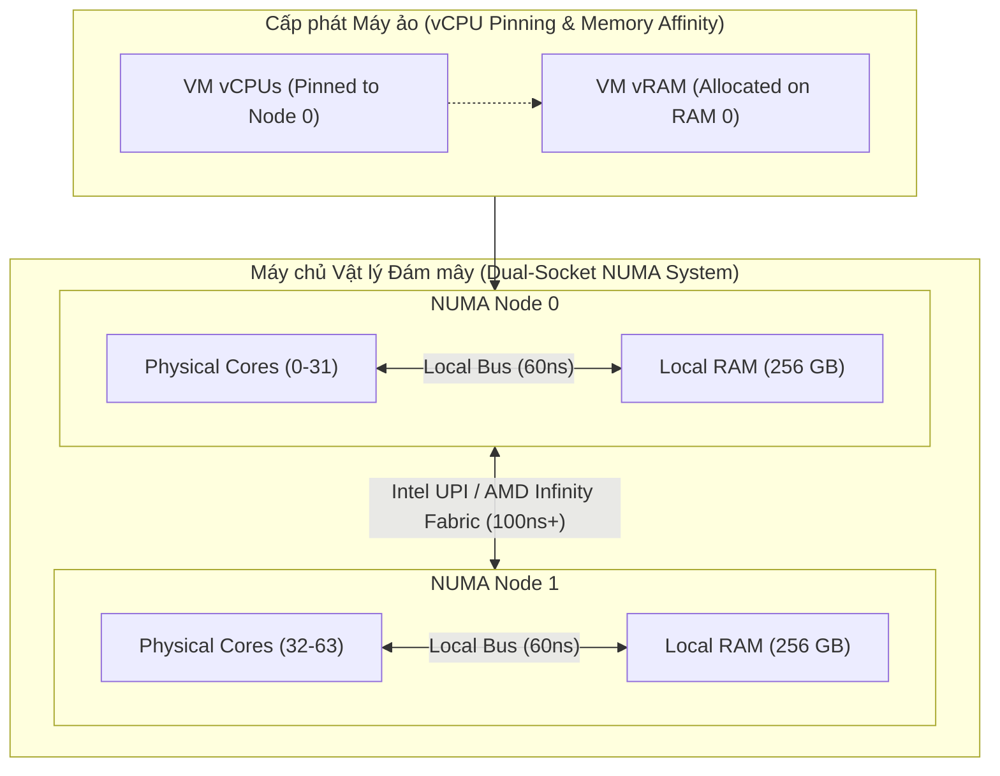
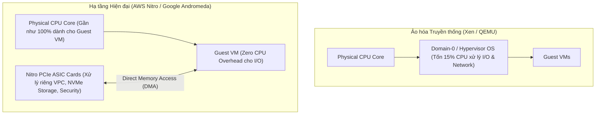
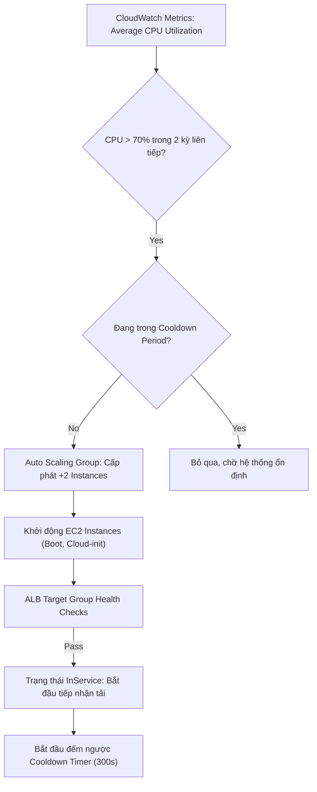
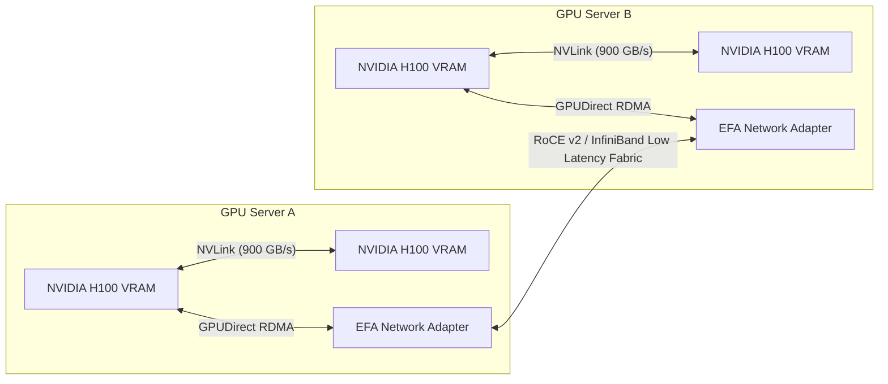

# 3.1. Virtual Machines and Compute Lifecycle (Máy ảo và Vòng đời Dịch vụ Tính toán)

## Tổng quan về Máy ảo và Vòng đời Tính toán Đám mây
Dịch vụ tính toán đám mây (Cloud Compute Services) đại diện cho năng lực xử lý số học và logic của hệ thống. Máy ảo (Virtual Machine - VM) là sự trừu tượng hóa phần cứng vật lý thông qua tầng giám sát máy ảo (Hypervisor), cung cấp môi trường độc lập hoàn chỉnh với vCPU, vRAM, virtual NIC và block storage.

Về mặt kiến trúc phần cứng và hiệu năng:
Hiệu năng tính toán của một máy ảo phụ thuộc chặt chẽ vào cấu trúc liên kết vi kiến trúc bộ vi xử lý (NUMA - Non-Uniform Memory Access Topology). Khi một vCPU của máy ảo truy cập bộ nhớ RAM thuộc cùng một NUMA Node (Local Node), độ trễ truy cập là tối thiểu ($\approx 60\text{ns}$). Nếu bộ điều độ máy chủ ảo (Hypervisor CPU Scheduler) vô tình định vị vCPU trên Socket 0 nhưng cấp phát RAM trên Socket 1, các thao tác đọc ghi phải đi qua bus liên kết (như Intel UPI hoặc AMD Infinity Fabric), làm độ trễ tăng từ $30\%$ đến $60\%$:
$$\text{Latency}_{\text{Remote}} = \text{Latency}_{\text{Local}} + \Delta_{\text{Interconnect}}$$



---

## 2. Chi tiết từng Keyword (Under-the-Hood Deep Dive)

---

### 1. Virtual Machines, Machine Images & Instance Sizing

#### 1. Khái niệm bản chất (What & Why)
- **Virtual Machines (VM)**: Máy tính ảo độc lập vận hành trên nền tảng phần cứng dùng chung (như AWS EC2, GCP Compute Engine, Azure Virtual Machines). Mỗi VM có kernel hệ điều hành riêng, driver ảo hóa và bảng phân vùng bộ nhớ riêng biệt.
- **Machine Images (AMI, GCP Image, Azure VHD)**: Bản chụp (Snapshot) đóng gói sẵn hệ điều hành, cấu hình kernel, thư viện phần mềm và các công cụ quản lý cần thiết để khởi động một VM mới trong vòng vài chục giây.
- **Instance Types & Families**: Các cấu hình máy ảo được chuẩn hóa và tối ưu cho từng loại tải công việc:
  - *General Purpose (vd: `m6i`, `t4g`)*: Cân bằng giữa CPU, bộ nhớ RAM và băng thông mạng.
  - *Compute Optimized (vd: `c6i`, `c7g`)*: Tỷ lệ vCPU/RAM cao ($1:2$), xung nhịp CPU cao, tối ưu cho batch processing, xử lý media, gaming servers.
  - *Memory Optimized (vd: `r6i`, `x2gd`)*: Tỷ lệ vCPU/RAM lớn ($1:8$ hoặc $1:16$), tối ưu cho in-memory databases (Redis, Memcached), SAP HANA, Cassandra.
  - *Storage / I/O Optimized (vd: `i3en`)*: Tích hợp ổ cứng NVMe SSD gắn cục bộ (Direct-attached NVMe), đạt hàng triệu IOPS với độ trễ microsecond.
  - *Accelerated Computing / GPU Instances (vd: `p4d`, `g5`)*: Tích hợp GPU phần cứng (NVIDIA A100, H100) qua PCIe/NVLink cho huấn luyện mô hình AI/ML và đồ họa 3D.
- **Instance Sizing**: Quá trình lựa chọn kích thước cấu hình máy ảo (nano, micro, small, medium, large, xlarge... 32xlarge) phù hợp với đường đặc tính tải (Workload Profile) để tránh lãng phí tài nguyên.

#### 2. Cơ chế hoạt động sâu (Under the hood / Hardcore Internals)
- **vCPU và Hyper-Threading (SMT)**:
  - Một vCPU trên Cloud thực chất là một luồng phần cứng (Hardware Thread / Hyper-thread) của CPU vật lý, không phải là một Core vật lý trọn vẹn (trừ khi dùng Bare-metal hoặc cấu hình disable multithreading).
  - Tỷ lệ chia sẻ execution units: Hai vCPU cùng chạy trên 1 Core vật lý sẽ phải chia sẻ chung bộ nhớ L1/L2 Cache và ALU (Arithmetic Logic Unit). Nếu một vCPU thực hiện phép tính toán ma trận nặng, vCPU thứ hai có thể bị suy giảm hiệu năng do tranh chấp cache.
- **Hiện tượng CPU Steal Time (`%st`)**:
  - Khi chạy lệnh `top` hoặc `htop` trên máy ảo Linux, trường `%st` (Steal Time) thể hiện tỷ lệ phần trăm thời gian mà vCPU của bạn sẵn sàng thực thi nhưng phải chờ đợi Hypervisor cấp phát thời gian CPU thực tế vì Host đang bận phục vụ máy ảo khác (Noisy Neighbor). Nếu `%st > 5%`, máy ảo đang bị nghẽn hiệu năng nghiêm trọng do máy chủ vật lý bị overcommit.
- **AWS Nitro System / KVM Offloading**:
  - Các thế hệ cloud trước đây dùng phần mềm ảo hóa Xen/QEMU tiêu tốn $10\% - 15\%$ CPU của Host chỉ để xử lý mạng và I/O đĩa.
  - Kiến trúc AWS Nitro chuyển toàn bộ nhiệm vụ giám sát I/O, mạng VPC và mã hóa đĩa EBS sang các card phần cứng chuyên dụng (Nitro PCIe Cards), giải phóng gần như $100\%$ CPU và RAM vật lý cho máy ảo khách (Guest VM).

#### 3. Sơ đồ minh họa


#### 4. Code ví dụ thực chiến (C++ CPU Steal Time & Affinity Detection Tool)
Đoạn mã C++ phân tích `/proc/stat` trong Linux để phát hiện hiện tượng CPU Steal Time và kiểm tra số lượng vCPU khả dụng:

```cpp
#include <iostream>
#include <fstream>
#include <string>
#include <sstream>
#include <vector>
#include <thread>
#include <chrono>

struct CpuStat {
    unsigned long long user{0};
    unsigned long long nice{0};
    unsigned long long system{0};
    unsigned long long idle{0};
    unsigned long long iowait{0};
    unsigned long long irq{0};
    unsigned long long softirq{0};
    unsigned long long steal{0}; // Thời gian bị Hypervisor chiếm đoạt
};

class CpuMonitor {
private:
    static CpuStat readStat() {
        std::ifstream file("/proc/stat");
        std::string line;
        CpuStat stat{};
        if (std::getline(file, line)) {
            std::string cpu_label;
            std::istringstream ss(line);
            ss >> cpu_label >> stat.user >> stat.nice >> stat.system >> stat.idle
               >> stat.iowait >> stat.irq >> stat.softirq >> stat.steal;
        }
        return stat;
    }

public:
    static void monitorStealTime(int interval_seconds) {
        std::cout << "[Monitor] Đang theo dõi CPU Steal Time (Phát hiện Noisy Neighbor trên Cloud VM)...\n";
        auto prev = readStat();
        std::this_thread::sleep_for(std::chrono::seconds(interval_seconds));
        auto curr = readStat();

        unsigned long long prev_total = prev.user + prev.nice + prev.system + prev.idle +
                                        prev.iowait + prev.irq + prev.softirq + prev.steal;
        unsigned long long curr_total = curr.user + curr.nice + curr.system + curr.idle +
                                        curr.iowait + curr.irq + curr.softirq + curr.steal;

        unsigned long long total_diff = curr_total - prev_total;
        unsigned long long steal_diff = curr.steal - prev.steal;

        if (total_diff > 0) {
            double steal_pct = (static_cast<double>(steal_diff) / total_diff) * 100.0;
            std::cout << "Tổng CPU ticks: " << total_diff << " | Steal ticks: " << steal_diff << "\n";
            std::cout << "Tỷ lệ CPU Steal Time: " << steal_pct << " %\n";

            if (steal_pct > 5.0) {
                std::cerr << "[CẢNH BÁO] Steal Time > 5%! Máy ảo đang bị cạnh tranh tài nguyên khốc liệt bởi các VM khác trên cùng máy chủ vật lý!\n";
            } else {
                std::cout << "[OK] Hiệu năng vCPU ổn định, không bị tranh chấp bởi Hypervisor.\n";
            }
        }
    }
};

int main() {
    std::cout << "Số vCPU logic nhận diện được: " << std::thread::hardware_concurrency() << "\n";
    // Đọc thống kê trong khoảng thời gian 2 giây
    CpuMonitor::monitorStealTime(2);
    return 0;
}
```

#### 5. Ưu / Nhược điểm, Pitfalls & Anti-patterns
- **Ưu điểm**: Khởi tạo linh hoạt, thay đổi kích thước nhanh chóng mà không cần tái cấu hình phần cứng.
- **Pitfall**: Sử dụng dòng Burstable Instances (như AWS `t3/t4g`) cho ứng dụng chịu tải cao liên tục. Khi tài nguyên CPU Credit bị cạn kiệt, xung nhịp CPU sẽ bị bóp nghẹt (Throttle) xuống mức cơ sở ($10\% - 20\%$), làm treo toàn bộ ứng dụng.

#### 6. Ứng dụng thực tế trong Backend / Systems
- Thiết lập dòng máy ảo Compute-Optimized (`c6i.4xlarge`) cho các worker giải mã video và chạy mô hình học máy inference thời gian thực với độ trễ thấp.

---

### 2. Scaling Mechanisms & Cloud Elasticity

#### 1. Khái niệm bản chất (What & Why)
- **Vertical Scaling (Scale Up / Scale Down)**: Tăng hoặc giảm năng lực phần cứng của một máy ảo đơn lẻ (ví dụ: đổi từ 4 vCPU/16GB RAM lên 32 vCPU/128GB RAM). Luôn đòi hỏi khởi động lại (Reboot) máy ảo, gây gián đoạn dịch vụ và bị chặn bởi giới hạn trần vật lý của một máy chủ đơn lẻ.
- **Horizontal Scaling (Scale Out / Scale In)**: Tăng hoặc giảm số lượng cá thể máy ảo tham gia xử lý (ví dụ: từ 3 instances tăng lên 10 instances và ngược lại). Không có giới hạn trần lý thuyết, không làm gián đoạn hệ thống.
- **Auto Scaling Strategies**:
  - *Target Tracking Scaling*: Tự động điều chỉnh số lượng instance để giữ cho một chỉ số kỹ thuật mục tiêu (như CPU trung bình đạt 60%, hoặc Request Count per Target = 1000) duy trì ổn định.
  - *Step Scaling*: Tăng hoặc giảm số lượng instance theo các nấc quy định khi ngưỡng cảnh báo bị vi phạm.
  - *Scheduled Scaling*: Mở rộng tài nguyên dựa trên lịch trình thời gian đã biết trước (ví dụ: tăng gấp đôi số instance vào 8h sáng thứ Hai).
  - *Predictive Scaling*: Sử dụng mô hình Machine Learning phân tích dữ liệu lịch sử tải để dự đoán trước nhu cầu và cấp phát tài nguyên sẵn sàng trước khi lưu lượng thực tế chạm tới hệ thống.

#### 2. Cơ chế hoạt động sâu (Under the hood / Hardcore Internals)
- **Vòng lặp điều độ và thời gian phản ứng (Scaling Reaction Time & Cooldown)**:
  - Khi tải tăng đột biến, hệ thống giám sát (như CloudWatch) mất $1 - 3$ phút để phát hiện qua các chu kỳ lấy mẫu metric.
  - Auto Scaling Group (ASG) nhận tín hiệu, kích hoạt API tạo máy ảo mới. Máy ảo mới mất $1 - 2$ phút để boot OS, tải Docker image, hoàn tất warm-up application runtime, và vượt qua Load Balancer Health Check.
  - Tổng thời gian trễ mở rộng (Scale-out Latency) có thể mất từ $3$ đến $7$ phút. Nếu không có cơ chế **Cooldown Period** hoặc làm mịn chỉ số (Moving Average), hệ thống sẽ tiếp tục nhận thấy tải cao và tiếp tục tạo thêm máy ảo không cần thiết, dẫn đến hiện tượng dao động mở rộng quá mức (Oscillation / Flapping).

#### 3. Sơ đồ minh họa


#### 4. Code ví dụ thực chiến (TypeScript Auto-Scaling PID Controller Simulator)
Bộ điều khiển PID (Proportional-Integral-Derivative) trong toán học và kỹ thuật điều khiển tự động, ứng dụng để cân bằng tải và tính toán số lượng máy ảo mượt mà:

```typescript
export interface PidControllerParams {
  kp: number; // Hệ số tỉ lệ (Proportional)
  ki: number; // Hệ số tích phân (Integral)
  kd: number; // Hệ số vi phân (Derivative)
  targetCpu: number; // Ngưỡng CPU mục tiêu (ví dụ 60%)
}

export class AutoScalingPidEngine {
  private integral: number = 0;
  private lastError: number = 0;
  private currentInstances: number = 3;
  private readonly minInstances: number = 2;
  private readonly maxInstances: number = 20;

  constructor(private params: PidControllerParams) {}

  public calculateNextCapacity(currentCpuUtilization: number, dtSeconds: number): number {
    const error = currentCpuUtilization - this.params.targetCpu;

    // 1. Thành phần Tỉ lệ (Proportional)
    const pTerm = this.params.kp * error;

    // 2. Thành phần Tích phân (Integral) - Triệt tiêu sai số xác lập
    this.integral += error * dtSeconds;
    const iTerm = this.params.ki * this.integral;

    // 3. Thành phần Vi phân (Derivative) - Dự đoán tốc độ biến thiên tải
    const derivative = (error - this.lastError) / dtSeconds;
    const dTerm = this.params.kd * derivative;

    this.lastError = error;

    // Tính toán lượng instance cần bổ sung hoặc giảm bớt
    const adjustment = pTerm + iTerm + dTerm;
    const desiredInstances = Math.round(this.currentInstances + adjustment);

    // Kẹp trong giới hạn Min / Max
    this.currentInstances = Math.max(this.minInstances, Math.min(this.maxInstances, desiredInstances));

    console.log(
      `[PID Scaling] CPU Hiện tại: ${currentCpuUtilization.toFixed(1)}% | Error: ${error.toFixed(1)} | ` +
      `P: ${pTerm.toFixed(2)}, I: ${iTerm.toFixed(2)}, D: ${dTerm.toFixed(2)} -> Target Instances: ${this.currentInstances}`
    );

    return this.currentInstances;
  }
}

// Chạy thử nghiệm thuật toán điều khiển co giãn
const pid = new AutoScalingPidEngine({ kp: 0.1, ki: 0.02, kd: 0.05, targetCpu: 60.0 });
console.log("--- Bắt đầu mô phỏng tải tăng đột biến ---");
pid.calculateNextCapacity(65.0, 10);
pid.calculateNextCapacity(85.0, 10);
pid.calculateNextCapacity(90.0, 10);
pid.calculateNextCapacity(60.0, 10); // Tải đã hạ nhiệt về mức mục tiêu
```

#### 5. Ưu / Nhược điểm, Pitfalls & Anti-patterns
- **Ưu điểm**: Tối ưu hóa chi phí triệt để, hệ thống tự động co giãn theo đường cong nhu cầu người dùng.
- **Pitfall**: Đặt ngưỡng Scale-in quá nhạy. Ngay khi tải giảm nhẹ trong 1 phút, hệ thống vội vã tắt bớt VM; ngay sau đó tải vọt lên lại phải bật máy mới, gây lãng phí chi phí khởi động và làm suy giảm trải nghiệm người dùng.

#### 6. Ứng dụng thực tế trong Backend / Systems
- Kết hợp Auto Scaling Group với Target Tracking Metric dựa trên số lượng request HTTP trong hàng đợi của Load Balancer thay vì CPU thông thường, giúp tăng tốc phản ứng trước các đợt flash-sale.

---

### 3. Compute Purchasing Models & Specialized Instances

#### 1. Khái niệm bản chất (What & Why)
- **Spot Instances / Preemptible VMs**: Mô hình mua năng lực tính toán nhàn rỗi với mức giảm giá cực sâu (lên tới $90\%$). Đi kèm điều kiện tiên quyết: CSP có quyền thu hồi tài nguyên bất cứ lúc nào với thời gian báo trước rất ngắn (2 phút trên AWS, 30 giây trên GCP).
- **Reserved Instances (RI) & Savings Plans**: Cam kết tài chính dài hạn (1 năm hoặc 3 năm) để đổi lấy mức chiết khấu từ $30\%$ đến $72\%$. Savings Plans linh hoạt hơn RI truyền thống do có thể áp dụng xuyên suốt nhiều dòng instance, region hoặc thậm chí dịch vụ FaaS (AWS Lambda).
- **Dedicated Hosts**: Máy chủ vật lý trọn vẹn được dành riêng hoàn toàn cho một khách hàng. Cần thiết khi ứng dụng có giấy phép phần mềm tính theo Core vật lý (BYOL - Bring Your Own License như Oracle, Windows Server) hoặc các yêu cầu bảo mật cách ly vật lý tuyệt đối.
- **Bare Metal Instances**: Máy ảo không có Hypervisor can thiệp. Ứng dụng chạy trực tiếp trên phần cứng vật lý, cho phép truy cập trực tiếp vào bộ đếm hiệu năng CPU (Hardware Performance Counters), các công nghệ ảo hóa lồng nhau (Nested Virtualization), hoặc hypervisor tùy biến.
- **GPU Instances**: Máy chủ gắn kèm các bộ tăng tốc tính toán đồ họa và ma trận (NVIDIA Tensor Core GPUs). Phục vụ huấn luyện mô hình học sâu (Deep Learning), suy luận ngôn ngữ lớn (LLM Inference), kết nối qua mạng băng thông cực cao (EFA - Elastic Fabric Adapter lên tới 3200Gbps).

#### 2. Cơ chế hoạt động sâu (Under the hood / Hardcore Internals)
- **Cơ chế truyền dữ liệu trong GPU Instances (Direct P2P & NVLink)**:
  - Khi huấn luyện các mô hình phân tán lớn (Distributed Training), các GPU trao đổi trọng số gradient thông qua các liên kết **NVLink** (băng thông lên tới $900\text{GB/s}$ hai chiều), bỏ qua hoàn toàn CPU và bus PCIe của máy chủ.
  - Giao tiếp giữa các máy chủ GPU khác nhau được tăng tốc bởi giao thức **GPUDirect RDMA (Remote Direct Memory Access)** thông qua card mạng EFA/InfiniBand, cho phép card mạng của máy chủ A đọc ghi trực tiếp vào VRAM của GPU trên máy chủ B mà không cần sao chép dữ liệu qua bộ nhớ RAM của OS Kernel.

#### 3. Sơ đồ minh họa


#### 4. Code ví dụ thực chiến (C++ GPU Availability & CUDA Query Stub)
Đoạn mã C++ minh họa việc truy vấn và kiểm tra thông số thiết bị tăng tốc GPU trên hệ thống:

```cpp
#include <iostream>
#include <cstdlib>

// Mô phỏng cấu trúc trả về tương đương CUDA API (cudaGetDeviceProperties)
struct CudaDeviceProps {
    char name[256];
    size_t total_global_mem;
    int multi_processor_count;
    int major_compute_capability;
    int minor_compute_capability;
};

class CloudGpuInspector {
public:
    static void inspectAvailableGpu() {
        std::cout << "[GPU Inspector] Kiểm tra cấu hình GPU Instance trên Cloud...\n";
        
        // Mô phỏng thông số phần cứng NVIDIA A100 Tensor Core
        CudaDeviceProps prop = {
            .name = "NVIDIA A100-SXM4-80GB",
            .total_global_mem = 80ULL * 1024 * 1024 * 1024, // 80 GB
            .multi_processor_count = 108,
            .major_compute_capability = 8,
            .minor_compute_capability = 0
        };

        std::cout << "Device Name       : " << prop.name << "\n";
        std::cout << "Compute Capability: " << prop.major_compute_capability << "." << prop.minor_compute_capability << "\n";
        std::cout << "Total VRAM        : " << (prop.total_global_mem / (1024 * 1024 * 1024)) << " GB High-Bandwidth Memory (HBM2e)\n";
        std::cout << "Streaming Multiprocessors (SM): " << prop.multi_processor_count << "\n";
        std::cout << "Hỗ trợ GPUDirect RDMA: BẬT (Bypassing Host CPU Kernel Buffer)\n";
    }
};

int main() {
    CloudGpuInspector::inspectAvailableGpu();
    return 0;
}
```

#### 5. Ưu / Nhược điểm, Pitfalls & Anti-patterns
- **Spot Instances**: Tiết kiệm kinh phí khổng lồ nhưng không được dùng cho cơ sở dữ liệu hoặc tiến trình chạy đơn không thể ngắt quãng.
- **Bare Metal**: Hiệu năng thô tối đa và không có độ trễ ảo hóa, nhưng chi phí đắt đỏ và thời gian khởi động lâu hơn nhiều so với VM thông thường.
- **Pitfall**: Mua Reserved Instances cam kết 3 năm cho một thế hệ máy ảo cũ (ví dụ `m4`), trong khi nhà cung cấp ra mắt dòng máy mới (`m6i`, `m7g`) có hiệu năng cao hơn $40\%$ với giá rẻ hơn, dẫn đến việc bị kẹt với công nghệ cũ.

#### 6. Ứng dụng thực tế trong Backend / Systems
- Sử dụng mô hình hạ tầng hỗn hợp (Mixed Instances): Cụm Kubernetes chạy 20% On-Demand cho Ingress Controllers và Stateful Services, 80% Spot Instances cho các Pod xử lý Worker giải mã background jobs.
