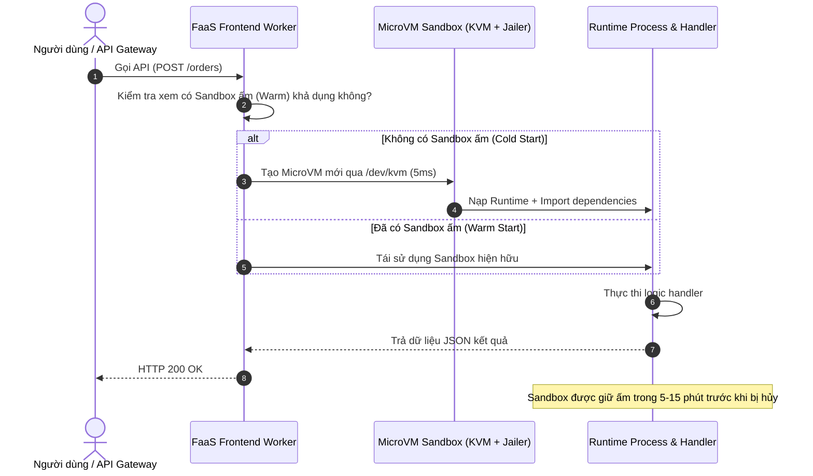
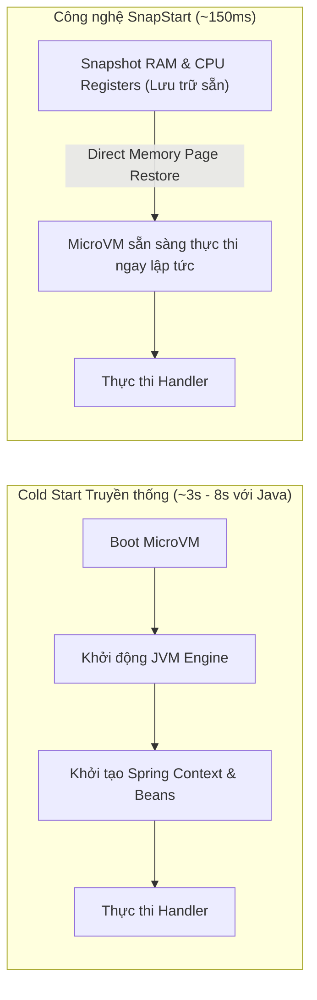
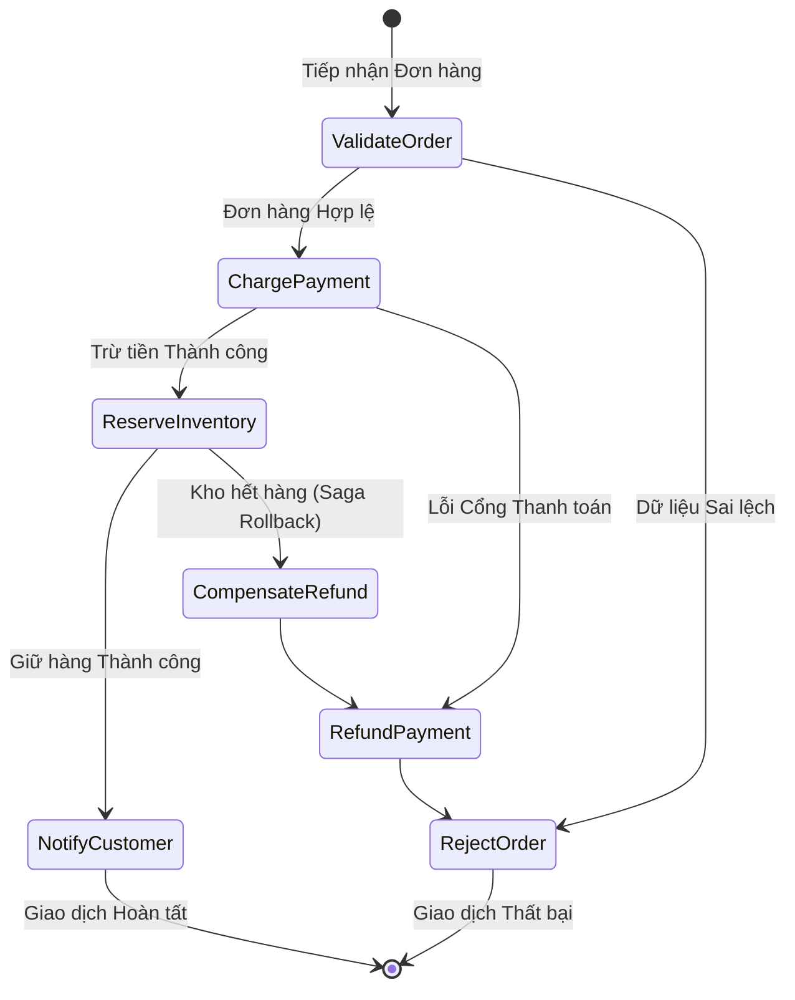

# 3.2. Serverless Computing and FaaS (Điện toán Không máy chủ và Hàm như một Dịch vụ)

## Tổng quan về Điện toán Không máy chủ và FaaS
Điện toán không máy chủ (Serverless Computing) là mô hình thực thi ứng dụng đám mây mà trong đó nhà cung cấp dịch vụ (CSP) chịu trách nhiệm hoàn toàn về việc quản lý máy chủ, phân bổ tài nguyên, vá lỗi hệ điều hành và tự động co giãn. Function as a Service (FaaS) là hình thái cốt lõi của Serverless, nơi đơn vị triển khai và mở rộng là các hàm độc lập (Stateless Functions) được kích hoạt bởi các sự kiện (Event-Driven).

Về mặt toán học và lý thuyết độ trễ:
Thời gian phản hồi tổng thể của một hàm FaaS ($T_{\text{response}}$) trong trường hợp khởi động nguội (Cold Start) được mô hình hóa như sau:
$$T_{\text{response}} = T_{\text{route}} + T_{\text{sandbox\_init}} + T_{\text{runtime\_init}} + T_{\text{code\_init}} + T_{\text{exec}}$$
Trong đó:
- $T_{\text{sandbox\_init}}$: Thời gian Hypervisor/MicroVM (như Firecracker) khởi tạo nhân Linux tối giản và nạp cgroups/namespaces ($\approx 5\text{ms} - 50\text{ms}$).
- $T_{\text{runtime\_init}}$: Thời gian nạp trình thực thi (JVM, Node.js V8, Python interpreter).
- $T_{\text{code\_init}}$: Thời gian nạp mã nguồn, phân tích cú pháp AST, import modules và khởi tạo các biến toàn cục (Global scope).
- Trong trường hợp khởi động ấm (Warm Start), $T_{\text{sandbox\_init}} + T_{\text{runtime\_init}} + T_{\text{code\_init}} \approx 0$, chỉ còn $T_{\text{exec}}$.

```mermaid
graph TD
    subgraph ColdStartCycle["Vòng tuần hoàn Khởi động Nguội (Cold Start)"]
        Req["Event / HTTP Request"] --> Sched["FaaS Placement Scheduler"]
        Sched --> MicroVM["Cấp phát MicroVM (Firecracker Sandbox ~5ms)"]
        MicroVM --> Runtime["Khởi tạo Runtime (Node.js / JVM / Python)"]
        Runtime --> InitApp["Thực thi Mã Toàn cục & Kết nối DB"]
        InitApp --> Handler["Chạy Handler Function"]
        Handler --> Response["Trả kết quả"]
    end

    subgraph WarmStartCycle["Khởi động Ấm (Warm Start)"]
        ReqWarm["Yêu cầu tiếp theo (Worker còn sống)"] --> DirectHandler["Chạy thẳng Handler (Độ trễ tối thiểu)"]
        DirectHandler --> ResWarm["Trả kết quả"]
    end
```



---

## 2. Chi tiết từng Keyword (Under-the-Hood Deep Dive)

---

### 1. Serverless Fundamentals, FaaS & Invocations

#### 1. Khái niệm bản chất (What & Why)
- **Serverless Computing**: Triết lý phát triển phần mềm loại bỏ gánh nặng quản trị cơ sở hạ tầng. Đặc trưng bởi 4 yếu tố cốt lõi:
  1. Không cần quản lý server vật lý hay máy ảo.
  2. Tự động co giãn theo lưu lượng từ $0$ lên hàng chục ngàn instances và ngược lại (Scale-to-Zero).
  3. Chỉ tính phí theo thời gian tài nguyên thực sự được sử dụng (tính theo millisecond).
  4. Tính sẵn sàng cao và khả năng tự phục hồi được tích hợp sẵn.
- **Function as a Service (FaaS)**: Dịch vụ cho phép khách hàng thực thi các đoạn mã độc lập (như AWS Lambda, Google Cloud Functions, Azure Functions) mà không cần cấu hình cụm máy chủ hay container engine.
- **Function Invocation Models**:
  - *Synchronous (Đồng bộ)*: Khách hàng gửi request và duy trì kết nối HTTP mở, chờ hàm xử lý xong và trả về kết quả (ví dụ: API Gateway gọi Lambda). Nếu hàm lỗi, caller phải tự xử lý retry.
  - *Asynchronous (Bất đồng bộ)*: Khách hàng gửi sự kiện, dịch vụ FaaS đẩy vào hàng đợi nội bộ bền vững, phản hồi ngay HTTP 202 Accepted, sau đó tự động gọi hàm xử lý ngầm (ví dụ: S3 Event gửi sang Lambda). Tự động retry tối đa 2 lần nếu xảy ra lỗi.
  - *Event Source Mapping / Polling*: Dịch vụ FaaS chủ động đọc dữ liệu theo lô (Batching) từ các luồng phân tán (Kinesis, Kafka, SQS) rồi chuyển vào hàm.

#### 2. Cơ chế hoạt động sâu (Under the hood / Hardcore Internals)
- **Công nghệ MicroVM (AWS Firecracker)**:
  - Để đảm bảo an toàn tuyệt đối giữa các hàm của nhiều khách hàng khác nhau chạy trên cùng một máy chủ vật lý (Multi-tenant isolation) mà vẫn đạt tốc độ khởi động nhanh như container, các CSP không dùng Docker thông thường mà sử dụng **MicroVMs**.
  - AWS Firecracker là một Virtual Machine Monitor (VMM) mã nguồn mở viết bằng Rust dựa trên Linux KVM:
    - Loại bỏ toàn bộ các thiết bị ngoại vi không cần thiết (chỉ hỗ trợ 1 card mạng virtio-net, 1 ổ đĩa virtio-block, 1 serial console tối giản).
    - Khởi động một máy ảo Linux hoàn chỉnh chỉ trong $\approx 5\text{ms}$.
    - Bộ nhớ chiếm dụng cực nhỏ ($< 5\text{MB}$ cho mỗi MicroVM).
    - Được bao bọc thêm bởi công cụ **Jailer** áp dụng nghiêm ngặt các cơ chế bảo mật của Linux Kernel: `chroot`, `seccomp-bpf` (chặn hơn $80\%$ system calls nguy hiểm), `cgroups` và `namespaces`.

#### 3. Sơ đồ minh họa


#### 4. Code ví dụ thực chiến (TypeScript Cloud FaaS Handler với Connection Pooling)
Minh họa kỹ thuật tối ưu mã nguồn FaaS: Tận dụng biến ngoài phạm vi Handler (Global Scope) để tái sử dụng kết nối cơ sở dữ liệu xuyên suốt các lần gọi ấm (Warm Invocations):

```typescript
// ============================================================
// File: lambdaHandler.ts
// Kỹ thuật tối ưu Warm Start trong FaaS Architecture
// ============================================================

interface OrderPayload {
  orderId: string;
  amount: number;
}

interface LambdaContext {
  awsRequestId: string;
  getRemainingTimeInMillis(): number;
}

// KHỞI TẠO TOÀN CỤC (GLOBAL SCOPE)
// Chỉ chạy 1 lần duy nhất trong quá trình Cold Start của MicroVM
console.log("[Cold Start Initialization] Nạp cấu hình và thiết lập Database Connection Pool...");
class DatabaseConnectionPool {
  private isConnected: boolean = false;

  public async connect(): Promise<void> {
    if (!this.isConnected) {
      // Giả lập chi phí thiết lập TCP + TLS Handshake tới Aurora/PostgreSQL (150ms)
      await new Promise((res) => setTimeout(res, 150));
      this.isConnected = true;
      console.log("[DB Pool] Kết nối cơ sở dữ liệu đã sẵn sàng!");
    }
  }

  public async query(sql: string, params: any[]): Promise<any> {
    return { status: "SUCCESS", sql, params, timestamp: Date.now() };
  }
}

// Khởi tạo đối tượng connection duy nhất cho toàn bộ vòng đời của MicroVM
const dbPool = new DatabaseConnectionPool();

// HANDLER THỰC THI (Được gọi mỗi khi có Request tới)
export const handler = async (event: OrderPayload, context: LambdaContext) => {
  console.log(`[Invocation] Bắt đầu xử lý Request ID: ${context.awsRequestId}`);
  console.log(`[Invocation] Thời gian thực thi còn lại: ${context.getRemainingTimeInMillis()} ms`);

  // Nếu là Warm Start, connect() sẽ bỏ qua ngay lập tức mà không tốn 150ms
  await dbPool.connect();

  const result = await dbPool.query("INSERT INTO orders (id, amount) VALUES ($1, $2)", [
    event.orderId,
    event.amount,
  ]);

  return {
    statusCode: 200,
    headers: { "Content-Type": "application/json" },
    body: JSON.stringify({ message: "Order processed successfully", data: result }),
  };
};
```

#### 5. Ưu / Nhược điểm, Pitfalls & Anti-patterns
- **Ưu điểm**: Zero-maintenance, chi phí bằng $0$ khi không có người dùng truy cập, khả năng co giãn lên hàng chục ngàn concurrency tức thời.
- **Pitfall**: Mở kết nối trực tiếp từ FaaS vào cơ sở dữ liệu quan hệ truyền thống (MySQL, PostgreSQL) mà không qua RDS Proxy / PgBouncer. Khi FaaS co giãn lên 2000 instances đồng thời, 2000 kết nối TCP sẽ đánh sập hoàn toàn database vì cạn kiệt connection pool.

#### 6. Ứng dụng thực tế trong Backend / Systems
- Hệ thống webhook tiếp nhận thông báo từ Stripe/PayPal; hệ thống xử lý nén ảnh ngay khi người dùng hoàn tất tải file lên S3.

---

### 2. Cold Start, Concurrency Limits & Scaling Mechanics

#### 1. Khái niệm bản chất (What & Why)
- **Cold Start (Khởi động nguội)**: Độ trễ phụ phát sinh khi một request mới đến nhưng hệ thống FaaS chưa có sẵn container/microVM nào đang ở trạng thái ấm để phục vụ. Hệ thống bắt buộc phải tải mã nguồn, khởi động sandbox và nạp runtime từ đầu.
- **Warm Start (Khởi động ấm)**: Khi một request gửi đến một sandbox đã chạy xong request trước đó và vẫn được hệ thống giữ lại trong bộ nhớ (thường giữ ấm từ 5 đến 15 phút). Thời gian thực thi nhanh gấp 10-100 lần so với cold start.
- **Execution Timeout**: Giới hạn thời gian tối đa mà một hàm được phép chạy (trên AWS Lambda tối đa là 15 phút, trên Google Cloud Functions là 60 phút). Nếu vượt quá, runtime sẽ bị ép buộc chấm dứt (SIGKILL).
- **Concurrency Limits (Hạn mức Thực thi Đồng thời)**: Số lượng instances của hàm được phép thực thi cùng một thời điểm:
  - *Unreserved Concurrency*: Dùng chung từ pool tổng của toàn bộ Cloud Account.
  - *Reserved Concurrency*: Cố định một số lượng nhất định cho một hàm cụ thể, đồng thời đóng vai trò trần bảo vệ (Rate limiter) ngăn hàm làm quá tải downstream services.
  - *Provisioned Concurrency*: Cơ chế trả phí để giữ ấm sẵn một số lượng container nhất định, triệt tiêu hoàn toàn hiện tượng Cold Start cho các API yêu cầu độ trễ khắt khe.

#### 2. Cơ chế hoạt động sâu (Under the hood / Hardcore Internals)
- **Cơ chế SnapStart / MicroVM Snapshotting**:
  - Để giải quyết vấn đề Cold Start nặng nề của các runtime như Java/JVM (thường mất từ $3\text{s} - 10\text{s}$), AWS phát triển công nghệ **SnapStart**:
  - Trong quá trình triển khai code (Deployment time), hàm được khởi động một lần, nạp toàn bộ framework (Spring Boot, Micronaut) và chạy qua giai đoạn `Init`.
  - Sau đó, Hypervisor đóng băng trạng thái của toàn bộ bộ nhớ RAM và thanh ghi CPU của MicroVM, lưu thành một bản snapshot được mã hóa lên bộ nhớ đệm phân tán cấp thấp.
  - Khi có cold start thực tế, thay vì boot lại VM và JVM, Hypervisor chỉ cần khôi phục trực tiếp bản snapshot vào RAM qua cơ chế nạp trang theo yêu cầu (Demand Paging), giảm thời gian cold start từ 10 giây xuống dưới $200\text{ms}$.

#### 3. Sơ đồ minh họa


#### 4. Code ví dụ thực chiến (C++ Concurrency Throttling & Token Bucket Simulator)
Mô phỏng cơ chế kiểm soát đồng thời (Concurrency Throttling) của FaaS Control Plane để từ chối yêu cầu vượt hạn mức:

```cpp
#include <iostream>
#include <atomic>
#include <chrono>
#include <thread>

class FaaSConcurrencyLimiter {
private:
    const int reserved_concurrency;
    std::atomic<int> current_active_invocations{0};

public:
    explicit FaaSConcurrencyLimiter(int max_concurrent) : reserved_concurrency(max_concurrent) {}

    bool tryAcquireExecutionSlot() {
        int active = current_active_invocations.load(std::memory_order_relaxed);
        while (active < reserved_concurrency) {
            if (current_active_invocations.compare_exchange_weak(
                    active, active + 1, std::memory_order_acquire, std::memory_order_relaxed)) {
                return true; // Cấp phát thành công slot thực thi
            }
        }
        return false; // Đã đạt hạn mức trần Concurrency Limit
    }

    void releaseExecutionSlot() {
        current_active_invocations.fetch_sub(1, std::memory_order_release);
    }

    [[nodiscard]] int getActiveCount() const noexcept {
        return current_active_invocations.load(std::memory_order_relaxed);
    }
};

int main() {
    FaaSConcurrencyLimiter limiter(3); // Giới hạn chỉ cho phép tối đa 3 hàm chạy đồng thời

    for (int req = 1; req <= 5; ++req) {
        if (limiter.tryAcquireExecutionSlot()) {
            std::cout << "[Request " << req << "] Cấp phát slot thành công. Đang chạy hàm... (Active: " 
                      << limiter.getActiveCount() << ")\n";
        } else {
            std::cerr << "[Request " << req << "] HTTP 429 Too Many Requests (FaaS ThrottlingException - Vượt quá hạn mức Concurrency)!\n";
        }
    }

    // Giả lập 1 hàm hoàn thành và trả slot
    limiter.releaseExecutionSlot();
    std::cout << "\n[Hàm hoàn tất] Đã giải phóng 1 slot. Active: " << limiter.getActiveCount() << "\n";

    // Thử lại request bị từ chối
    if (limiter.tryAcquireExecutionSlot()) {
        std::cout << "[Retry Request] Cấp phát slot thành công sau khi có hàm hoàn tất.\n";
    }

    return 0;
}
```

#### 5. Ưu / Nhược điểm, Pitfalls & Anti-patterns
- **Pitfall**: Không thiết lập Reserved Concurrency cho các hàm phi đồng bộ kết nối tới cơ sở dữ liệu quan hệ, khiến việc tăng tải đột biến làm cạn kiệt tài nguyên toàn bộ tài khoản cloud.

#### 6. Ứng dụng thực tế trong Backend / Systems
- Sử dụng Provisioned Concurrency cho các endpoint đăng nhập hoặc thanh toán của ứng dụng di động để đảm bảo P99 Latency luôn ổn định dưới $100\text{ms}$.

---

### 3. Serverless Containers, Orchestration & Workflows

#### 1. Khái niệm bản chất (What & Why)
- **Serverless Containers (AWS Fargate, Google Cloud Run, Azure Container Apps)**: Mô hình kết hợp tính linh hoạt của Docker container với tính chất không máy chủ của FaaS. Người dùng không cần quan tâm đến máy chủ EC2 hay Kubernetes Worker Nodes nhưng vẫn có thể chạy bất kỳ Docker image nào mà không bị giới hạn ngôn ngữ hay dung lượng package như FaaS truyền thống.
- **Serverless Workflows / Orchestration (AWS Step Functions, GCP Workflows, Azure Logic Apps)**: Dịch vụ điều phối luồng công việc phức tạp theo mô hình State Machine (Máy trạng thái hữu hạn). Tự động quản lý trình tự thực thi, điều kiện rẽ nhánh (Choice), thực thi song song (Parallel), xử lý lỗi và cơ chế bù trừ giao dịch (Saga Pattern) giữa nhiều Serverless Functions độc lập.

#### 2. Cơ chế hoạt động sâu (Under the hood / Hardcore Internals)
- **Kiến trúc Serverless Container Data Plane (AWS Fargate)**:
  - Khi triển khai một Pod hoặc Task trên AWS Fargate, một MicroVM hoặc máy ảo chuyên dụng cực nhẹ được cấp phát ngầm trong cụm máy chủ khổng lồ của CSP.
  - Card mạng ảo ENI được cắm trực tiếp vào VPC của bạn thông qua kỹ thuật nối mạng hai đầu (Cross-account ENI attachment).
  - Không có quyền truy cập vào Docker Daemon hay Host OS bên dưới, loại bỏ hoàn toàn bề mặt tấn công leo thang đặc quyền (Privilege escalation).
- **Trạng thái bền bỉ trong Step Functions (Event Sourcing Engine)**:
  - Mọi bước chuyển trạng thái (State Transition) trong Step Functions đều được ghi nhận vĩnh viễn vào cơ sở dữ liệu phân tán bền bỉ cao (như DynamoDB). Nếu một hàm FaaS bên dưới bị timeout hoặc sập, State Machine vẫn lưu giữ chính xác điểm ngắt quãng để tiến hành thử lại (Retry with Exponential Backoff) mà không làm mất trạng thái của chu trình nghiệp vụ.

#### 3. Sơ đồ minh họa


#### 4. Code ví dụ thực chiến (TypeScript Step Functions / Saga Pattern Definition)
Minh họa mô hình điều phối Serverless Workflow thực thi chu trình thanh toán phân tán chịu lỗi (Saga Pattern):

```typescript
export interface StepContext {
  orderId: string;
  amount: number;
  paymentProcessed: boolean;
  inventoryReserved: boolean;
}

export class OrderProcessingSagaWorkflow {
  public async executeSaga(context: StepContext): Promise<boolean> {
    console.log(`[Saga Workflow] Bắt đầu xử lý đơn hàng: ${context.orderId}`);

    try {
      // BƯỚC 1: Thực thi thanh toán
      await this.processPayment(context);

      // BƯỚC 2: Giữ hàng trong kho
      await this.reserveInventory(context);

      console.log(`[Saga Workflow] Hoàn tất giao dịch thành công cho đơn: ${context.orderId}`);
      return true;
    } catch (error: any) {
      console.error(`[Saga Lỗi] Phát hiện sự cố: ${error.message}. Kích hoạt cơ chế bù trừ giao dịch (Compensating Actions)...`);
      await this.compensate(context);
      return false;
    }
  }

  private async processPayment(ctx: StepContext): Promise<void> {
    console.log(`  -> [Action] Trừ $${ctx.amount} từ thẻ khách hàng...`);
    ctx.paymentProcessed = true;
  }

  private async reserveInventory(ctx: StepContext): Promise<void> {
    console.log(`  -> [Action] Kiểm tra kho hàng...`);
    // Giả lập sự cố hết hàng trong kho
    throw new Error("Sản phẩm đã hết hàng trong kho!");
  }

  // CƠ CHẾ BÙ TRỪ GIAO DỊCH (ROLLBACK SAGA)
  private async compensate(ctx: StepContext): Promise<void> {
    if (ctx.paymentProcessed) {
      console.log(`  <- [Compensate Action] Hoàn lại $${ctx.amount} về tài khoản khách hàng.`);
      ctx.paymentProcessed = false;
    }
    if (ctx.inventoryReserved) {
      console.log(`  <- [Compensate Action] Giải phóng sản phẩm giữ trong kho.`);
      ctx.inventoryReserved = false;
    }
  }
}

// Chạy thử nghiệm Saga Workflow
const saga = new OrderProcessingSagaWorkflow();
saga.executeSaga({ orderId: "ORD-9988", amount: 150, paymentProcessed: false, inventoryReserved: false });
```

#### 5. Ưu / Nhược điểm, Pitfalls & Anti-patterns
- **Fargate / Cloud Run**: Tuyệt vời cho các tác vụ cần chạy từ vài phút đến vài giờ, linh hoạt trong việc cấu hình thư viện C++/Rust/Go tùy chỉnh.
- **Anti-pattern**: Sử dụng FaaS để gọi chuỗi FaaS khác theo kiểu lồng nhau đồng bộ ($F_1 \to F_2 \to F_3$). Bạn sẽ phải trả tiền cho thời gian $F_1$ và $F_2$ ngồi chờ rảnh rỗi (Double Billing Latency). Giải pháp đúng là dùng Step Functions hoặc hàng đợi SQS/EventBridge bất đồng bộ.

#### 6. Ứng dụng thực tế trong Backend / Systems
- Hệ thống xử lý đơn hàng E-commerce phức tạp: Tích hợp AWS Step Functions điều phối giữa Cloud Run (xử lý hóa đơn PDF), AWS Lambda (trừ tiền) và DynamoDB (lưu trữ giao dịch).
