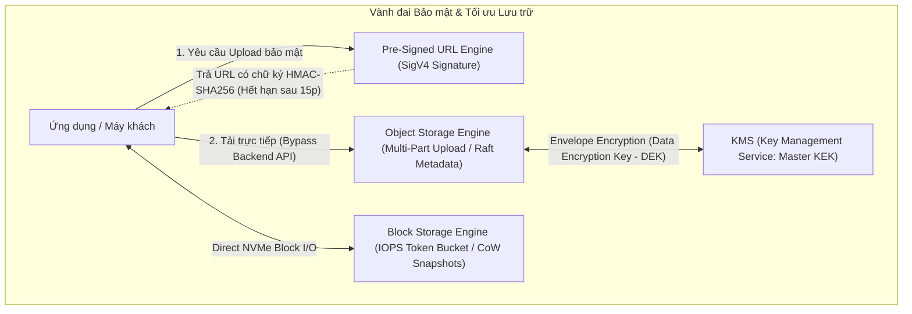
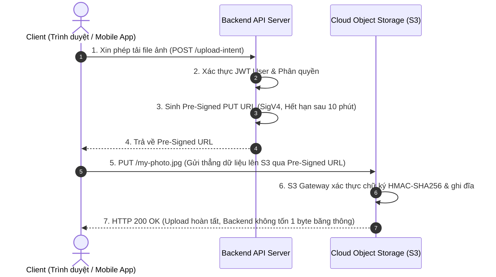
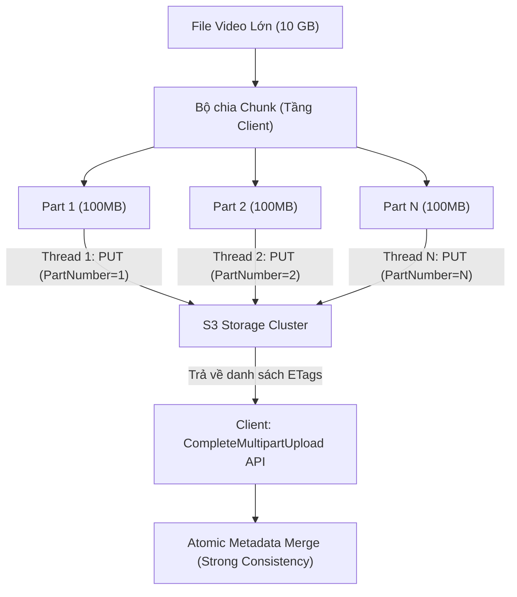
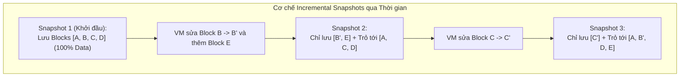

# 4.2. Security, Performance and Durability (Bảo mật, Hiệu năng và Độ Bền bỉ Lưu trữ)

## Tổng quan về An toàn, Hiệu năng và Độ Bền bỉ Lưu trữ
An toàn thông tin và tính toàn vẹn dữ liệu là yếu tố sống còn của hệ thống lưu trữ đám mây. Các hệ thống hiện đại phải giải quyết đồng thời bài toán bảo mật dữ liệu ở trạng thái nghỉ (Encryption at Rest) và trạng thái truyền tải (Encryption in Transit), cung cấp cơ chế phân quyền chi tiết (Pre-Signed URLs, IAM/Bucket Policies), đồng thời duy trì thông lượng I/O cao (IOPS, Throughput) với cam kết độ bền bỉ lên tới $99.999999999\%$ (11 số 9).

Về mặt xác suất và độ bền bỉ (Durability):
Nếu một hệ thống lưu trữ cam kết độ bền $99.999999999\%$ mỗi năm, xác suất một đối tượng bị mất vĩnh viễn trong một năm là:
$$P(\text{Data Loss}) = 1 - 0.99999999999 = 10^{-11}$$
Điều này có nghĩa là nếu một tổ chức lưu trữ $10,000,000$ (10 triệu) đối tượng trên cloud, theo lý thuyết xác suất trung bình phải mất $10,000$ năm mới có nguy cơ mất mát duy nhất 1 đối tượng.



---

## 2. Chi tiết từng Keyword (Under-the-Hood Deep Dive)

---

### 1. Storage Security: Encryption, Access Control & Pre-Signed URLs

#### 1. Khái niệm bản chất (What & Why)
- **Storage Encryption (Mã hóa Lưu trữ)**:
  - *Encryption in Transit*: Dữ liệu di chuyển qua mạng được bảo vệ bằng TLS 1.3 với thuật toán mã hóa khóa công khai RSA/ECDSA và mã hóa đối xứng AES-256-GCM.
  - *Encryption at Rest*: Dữ liệu ghi trên phiến đĩa vật lý được mã hóa hoàn toàn. Có 3 mô hình quản lý khóa:
    1. *SSE-S3*: Nhà cung cấp tự quản lý khóa mã hóa hoàn toàn.
    2. *SSE-KMS*: Quản lý khóa tập trung thông qua Cloud KMS, có audit log qua CloudTrail.
    3. *SSE-C*: Khách hàng tự cung cấp khóa đối xứng trong HTTP header của mỗi request.
- **Storage Access Control**: Cơ chế bảo vệ hai lớp kết hợp giữa **Bucket Policies** (Resource-based policy gắn trực tiếp vào Bucket) và **IAM Policies** (Identity-based policy gắn vào người dùng/vai trò).
- **Pre-Signed URLs (Đường dẫn Ký trước)**: Cơ chế cấp quyền truy cập tạm thời cho người dùng cuối (tải xuống hoặc tải lên một file cụ thể) thông qua một URL có chứa chữ ký bảo mật và thời gian hết hạn (Time-to-Live). Giúp máy chủ backend không phải làm trạm trung chuyển dữ liệu (Bypass Backend Proxy), tiết kiệm tối đa băng thông và CPU của ứng dụng.

#### 2. Cơ chế hoạt động sâu (Under the hood / Hardcore Internals)
- **Mã hóa Phong bì (Envelope Encryption)**:
  - Để mã hóa một file 10GB, hệ thống không dùng trực tiếp khóa chính KMS Master Key (Key Encryption Key - KEK) vì sẽ gây quá tải KMS API và chậm chạp.
  - Thay vào đó, KMS sinh ra một khóa mã hóa dữ liệu ngẫu nhiên (Data Encryption Key - DEK).
  - DEK dạng plaintext được dùng để mã hóa file 10GB bằng thuật toán AES-256-GCM trong RAM.
  - Sau đó, bản thân DEK được mã hóa bằng KEK của KMS và lưu đính kèm ngay trong metadata của file (`Encrypted DEK`). DEK dạng plaintext bị xóa sạch khỏi RAM ngay lập tức.
- **Thuật toán Ký Pre-Signed URL (AWS SigV4 HMAC-SHA256)**:
  - Chuỗi URL bao gồm: Endpoint, HTTP Method, Canonical Request (Headers, Query Params), Timestamp, và chữ ký băm mật mã:
    $$\text{Signature} = \text{HMAC-SHA256}(\text{SigningKey}, \text{StringToSign})$$
  - Khi người dùng gửi request lên S3, cụm máy chủ S3 tính toán lại chữ ký HMAC độc lập. Nếu request bị sửa đổi dù chỉ 1 ký tự hoặc gửi sau thời gian hết hạn, chữ ký sẽ không khớp và S3 trả về mã lỗi `403 Forbidden`.

#### 3. Sơ đồ minh họa


#### 4. Code ví dụ thực chiến (TypeScript Pre-Signed URL Generator)
Minh họa triển khai tạo Pre-Signed URL an toàn bằng AWS SDK v3:

```typescript
import { S3Client, PutObjectCommand } from "@aws-sdk/client-s3";
import { getSignedUrl } from "@aws-sdk/s3-request-presigner";

export class CloudStorageSigner {
  private s3Client: S3Client;
  private readonly bucketName: string;

  constructor(region: string, bucket: string) {
    this.bucketName = bucket;
    this.s3Client = new S3Client({ region });
  }

  /**
   * Tạo đường dẫn cấp quyền Upload file trực tiếp lên S3
   * @param objectKey Tên file trên S3 (vd: "avatars/user-123.png")
   * @param contentType MIME type của file
   * @param expirationSeconds Thời gian hiệu lực (mặc định 900s = 15 phút)
   */
  public async generateUploadUrl(
    objectKey: string,
    contentType: string,
    expirationSeconds: number = 900
  ): Promise<string> {
    const command = new PutObjectCommand({
      Bucket: this.bucketName,
      Key: objectKey,
      ContentType: contentType,
      ServerSideEncryption: "aws:kms", // Ép buộc mã hóa SSE-KMS
    });

    const presignedUrl = await getSignedUrl(this.s3Client, command, {
      expiresIn: expirationSeconds,
    });

    console.log(`[Storage Security] Tạo Pre-Signed URL thành công cho key: ${objectKey}`);
    return presignedUrl;
  }
}

// Chạy thử nghiệm
async function run() {
  const signer = new CloudStorageSigner("ap-southeast-1", "production-user-media-bucket");
  const uploadUrl = await signer.generateUploadUrl("documents/contract-001.pdf", "application/pdf", 600);
  console.log("Presigned Upload URL:", uploadUrl);
}

if (process.env.NODE_ENV !== "test") {
  run().catch(console.error);
}
```

#### 5. Ưu / Nhược điểm, Pitfalls & Anti-patterns
- **Ưu điểm**: Giải phóng tài nguyên CPU và Network I/O cho máy chủ backend; dữ liệu được mã hóa an toàn ở mức tiêu chuẩn quân sự.
- **Pitfall**: Cấu hình thời gian sống (Expiration) của Pre-Signed URL quá dài (ví dụ 24 giờ hoặc 7 ngày). Nếu URL bị rò rỉ qua log hoặc máy khách, bất kỳ ai có link đều có thể tải xuống tài liệu mật.

#### 6. Ứng dụng thực tế trong Backend / Systems
- Hệ thống chia sẻ video hoặc mạng xã hội: Người dùng tải video 4K (hàng Gigabytes) trực tiếp từ điện thoại lên S3 thông qua Pre-Signed URL, sau đó S3 kích hoạt Lambda để xử lý nén video.

---

### 2. High-Performance Uploads & Consistency Models

#### 1. Khái niệm bản chất (What & Why)
- **Multipart Upload**: Cơ chế phân chia một đối tượng lớn thành nhiều phần nhỏ (Parts, từ 5MB đến 5GB mỗi part) và tải lên song song qua nhiều kết nối mạng độc lập. Khuyến nghị bắt buộc cho các tệp tin có kích thước $> 100\text{MB}$.
- **Resumable Upload**: Khả năng tiếp tục tải lên từ byte bị đứt gãy mà không cần bắt đầu lại từ đầu khi gặp sự cố ngắt kết nối mạng.
- **Storage Consistency Models (Mô hình Nhất quán)**:
  - *Strong Read-After-Write Consistency (Nhất quán Mạnh)*: Kể từ cuối năm 2020, AWS S3 và GCP Storage đã hỗ trợ tính nhất quán mạnh mẽ cho tất cả các thao tác `PUT`, `POST`, `DELETE` và cập nhật metadata. Ngay khi lệnh ghi thành công (HTTP 200 OK), bất kỳ thao tác đọc (`GET`, `LIST`) nào tiếp theo ngay lập tức sẽ thấy dữ liệu mới nhất, loại bỏ hoàn toàn hiện tượng Eventual Consistency trước đây.

#### 2. Cơ chế hoạt động sâu (Under the hood / Hardcore Internals)
- **Quy trình 3 bước của Multipart Upload**:
  1. `InitiateMultipartUpload`: S3 tạo một `UploadId` duy nhất trong cơ sở dữ liệu metadata phân tán.
  2. `UploadPart`: Client chia file thành $N$ chunks, gửi đồng thời lên S3 qua nhiều thread kèm theo số thứ tự `PartNumber` (1 đến 10,000) và `UploadId`. Mỗi khi upload xong một part, S3 lưu part đó vào các ổ đĩa tạm thời và trả về một mã băm định danh `ETag`.
  3. `CompleteMultipartUpload`: Client gửi danh sách toàn bộ các cặp `(PartNumber, ETag)` lên S3. S3 thực hiện thao tác ghép nối nguyên tử (Atomic Pointer Concatenation) trong hệ thống metadata để tạo thành đối tượng hoàn chỉnh duy nhất mà không cần di chuyển vật lý dữ liệu trên đĩa.
- **Raft / Paxos Metadata Commit**:
  - Để đảm bảo Strong Consistency, metadata của object được xác nhận thông qua thuật toán đồng thuận phân tán (Distributed Consensus). Request ghi chỉ được phản hồi thành công sau khi đa số nút (Quorum) của cụm metadata ghi nhận bản ghi giao dịch (Transaction Log).

#### 3. Sơ đồ minh họa


#### 4. Code ví dụ thực chiến (C++ Parallel Chunk Splitter & Hash Calculator)
Mô phỏng bộ chia tệp tin thành các phần song song và tính toán checksum để chuẩn bị cho Multipart Upload:

```cpp
#include <iostream>
#include <vector>
#include <string>
#include <cstdint>
#include <iomanip>
#include <sstream>

struct FilePart {
    int part_number;
    size_t byte_offset;
    size_t part_size;
    std::string simulated_etag;
};

class MultipartUploadPlanner {
public:
    static std::vector<FilePart> planUpload(size_t total_file_bytes, size_t chunk_size_bytes) {
        std::vector<FilePart> parts;
        size_t offset = 0;
        int part_num = 1;

        while (offset < total_file_bytes) {
            size_t current_chunk = std::min(chunk_size_bytes, total_file_bytes - offset);
            
            // Giả lập ETag băm cho từng part
            std::stringstream ss;
            ss << "\"etag-part-" << part_num << "-offset-" << offset << "\"";

            parts.push_back({
                .part_number = part_num,
                .byte_offset = offset,
                .part_size = current_chunk,
                .simulated_etag = ss.str()
            });

            offset += current_chunk;
            part_num++;
        }
        return parts;
    }
};

int main() {
    size_t file_size = 350ULL * 1024 * 1024; // File 350 MB
    size_t chunk_size = 100ULL * 1024 * 1024; // Mỗi part 100 MB

    auto parts = MultipartUploadPlanner::planUpload(file_size, chunk_size);
    std::cout << "--- Kế hoạch Multipart Upload cho File 350 MB ---\n";
    std::cout << "Tổng số parts cần upload song song: " << parts.size() << "\n";

    for (const auto& p : parts) {
        std::cout << "Part #" << p.part_number << " | Kích thước: " 
                  << (p.part_size / (1024 * 1024)) << " MB | Offset: " 
                  << (p.byte_offset / (1024 * 1024)) << " MB | ETag: " << p.simulated_etag << "\n";
    }

    return 0;
}
```

#### 5. Ưu / Nhược điểm, Pitfalls & Anti-patterns
- **Ưu điểm**: Khả năng phục hồi sự cố cực cao (nếu rớt mạng part nào chỉ cần upload lại part đó), tận dụng tối đa băng thông đa luồng của card mạng.
- **Pitfall**: Quên cấu hình vòng đời tự động hủy Multipart Upload dở dang (`AbortIncompleteMultipartUpload`). Các parts đã tải lên nhưng chưa được `Complete` vẫn bị CSP tính phí lưu trữ hàng tháng dù file không bao giờ xuất hiện trên console!

#### 6. Ứng dụng thực tế trong Backend / Systems
- Ứng dụng Desktop hoặc CLI (như AWS CLI, rclone) sử dụng Multipart Upload 16 luồng song song để sao lưu các file nén Database Dump 500GB lên Cloud Storage với tốc độ bão hòa đường truyền 10Gbps.

---

### 3. Block Storage Performance & Backup: IOPS, Throughput & Snapshots

#### 1. Khái niệm bản chất (What & Why)
- **IOPS (Input/Output Operations Per Second)**: Số lượng thao tác đọc/ghi vào ổ cứng thực hiện được trong một giây (đo bằng kích thước khối chuẩn 4KB hoặc 16KB hoặc 256KB). Quyết định độ mượt của các ứng dụng truy cập ngẫu nhiên (Random Access) như Cơ sở dữ liệu giao dịch OLTP (MySQL, PostgreSQL).
- **Throughput (Thông lượng)**: Lượng dữ liệu đọc/ghi được tính theo Megabytes trên giây (MB/s). Quyết định hiệu năng của các tác vụ truy cập tuần tự (Sequential Access) như quét bảng dữ liệu lớn (Table Scan trong Data Warehouse), streaming video, chạy backup logs.
- **Storage Latency**: Thời gian hoàn thành một thao tác I/O đơn lẻ (thường tính bằng millisecond hoặc microsecond).
- **Snapshot Management & Incremental Snapshots**:
  - Bản chụp tức thời của Block Storage (EBS Snapshot) được lưu trữ bền vững trên tầng Object Storage (S3).
  - Hoạt động theo nguyên lý **Incremental (Gia tăng)**: Bản snapshot đầu tiên lưu toàn bộ dữ liệu của ổ đĩa. Các bản snapshot tiếp theo chỉ lưu các khối dữ liệu (Blocks) đã bị thay đổi (Changed Blocks) kể từ bản snapshot trước đó, giúp tiết kiệm dung lượng lưu trữ tối đa.
- **Point-in-Time Recovery (PITR)**: Khả năng khôi phục toàn bộ trạng thái dữ liệu của hệ thống về đúng một giây cụ thể trong quá khứ nhờ kết hợp giữa bản Snapshot định kỳ và Transaction Logs (WAL / Binlog).

#### 2. Cơ chế hoạt động sâu (Under the hood / Hardcore Internals)
- **Cơ chế Token Bucket trong EBS GP2/GP3**:
  - Các dòng ổ cứng thông thường sử dụng thuật toán **Token Bucket** để kiểm soát IOPS:
  - Ổ đĩa liên tục tích lũy credit tokens trong bình chứa (Bucket) khi ở trạng thái rảnh rỗi.
  - Khi có đợt tải I/O đột biến (Bursting), ổ đĩa được phép tiêu thụ credit để đạt mức tối đa 3,000 IOPS.
  - Khi bình credit cạn kiệt, hiệu năng đĩa sẽ bị sụt giảm thê thảm về mức cơ sở (Baseline IOPS = 3 IOPS trên mỗi GB dung lượng), khiến database bị treo cứng (I/O Wait tăng vọt 100%).
  - Dòng ổ cứng hiện đại (như AWS GP3, io2) tách biệt hoàn toàn giữa dung lượng đĩa và IOPS/Throughput, cho phép người dùng tùy chỉnh độc lập mà không lo hết credit.
- **Bản chất Copy-on-Write (CoW) trong Incremental Snapshots**:
  - Khi kích hoạt Snapshot, hệ thống đánh dấu trạng thái các block bằng con trỏ thế hệ (Generation Pointer).
  - Quá trình snapshot diễn ra ngay lập tức mà không cần dừng ứng dụng. Nếu sau đó VM ghi đè lên block A, block A cũ được bảo toàn trong snapshot, và block mới $A'$ được ghi vào vị trí mới.

#### 3. Sơ đồ minh họa


#### 4. Code ví dụ thực chiến (C++ EBS Token Bucket Burst Rate Simulator)
Mô phỏng thuật toán Token Bucket quản lý IOPS Burst Capacity trên đĩa cứng đám mây:

```cpp
#include <iostream>
#include <chrono>
#include <thread>
#include <algorithm>

class EbsTokenBucketIo {
private:
    double max_burst_tokens;
    double current_tokens;
    double refill_rate_per_sec; // Số IOPS cơ sở được nạp lại mỗi giây
    std::chrono::steady_clock::time_point last_refill;

    void refill() {
        auto now = std::chrono::steady_clock::now();
        std::chrono::duration<double> elapsed = now - last_refill;
        double added_tokens = elapsed.count() * refill_rate_per_sec;
        current_tokens = std::min(max_burst_tokens, current_tokens + added_tokens);
        last_refill = now;
    }

public:
    EbsTokenBucketIo(double max_burst, double baseline_rate)
        : max_burst_tokens(max_burst), current_tokens(max_burst),
          refill_rate_per_sec(baseline_rate), last_refill(std::chrono::steady_clock::now()) {}

    bool consumeIo(int requested_iops) {
        refill();
        if (current_tokens >= requested_iops) {
            current_tokens -= requested_iops;
            std::cout << "[I/O OK] Thực hiện " << requested_iops << " IOPS. Burst Credit còn lại: " 
                      << static_cast<int>(current_tokens) << " tokens.\n";
            return true;
        } else {
            std::cerr << "[I/O THROTTLED] Cạn kiệt Burst Credit! Yêu cầu: " << requested_iops 
                      << " IOPS, nhưng chỉ còn " << static_cast<int>(current_tokens) 
                      << " tokens. Bị giới hạn về tốc độ cơ sở: " << refill_rate_per_sec << " IOPS!\n";
            return false;
        }
    }
};

int main() {
    // Ổ đĩa tích lũy tối đa 5000 burst tokens, tốc độ nạp cơ sở 300 tokens/giây
    EbsTokenBucketIo disk(5000, 300);

    std::cout << "--- Bắt đầu mô phỏng tải I/O Database Nặng ---\n";
    disk.consumeIo(2000); // Đợt 1
    disk.consumeIo(2500); // Đợt 2
    disk.consumeIo(1500); // Đợt 3 -> Vượt quá dung lượng còn lại, bị bóp băng thông!

    std::cout << "\nChờ 2 giây để hồi phục tokens...\n";
    std::this_thread::sleep_for(std::chrono::seconds(2));
    disk.consumeIo(500);

    return 0;
}
```

#### 5. Ưu / Nhược điểm, Pitfalls & Anti-patterns
- **Ưu điểm**: Snapshot gia tăng giúp tiết kiệm $80\%$ chi phí lưu trữ bản sao lưu đĩa; IOPS cao của đĩa Provisioned IOPS (io2) đảm bảo độ trễ sub-millisecond cho các hệ thống Core Banking.
- **Pitfall**: Xóa bản snapshot đầu tiên vì nghĩ rằng các snapshot sau sẽ bị hỏng. Trên thực tế, Cloud Storage tự động di chuyển các block liên kết sang bản snapshot kế tiếp, đảm bảo toàn vẹn dữ liệu nhưng khiến bản snapshot sau phình to dung lượng.

#### 6. Ứng dụng thực tế trong Backend / Systems
- Thiết lập hệ thống Backup tự động bằng AWS Backup: Chụp snapshot EBS đĩa database mỗi ngày một lần, đồng thời đẩy WAL logs liên tục lên S3 mỗi 5 phút để đảm bảo RPO (Recovery Point Objective) $< 5$ phút.
