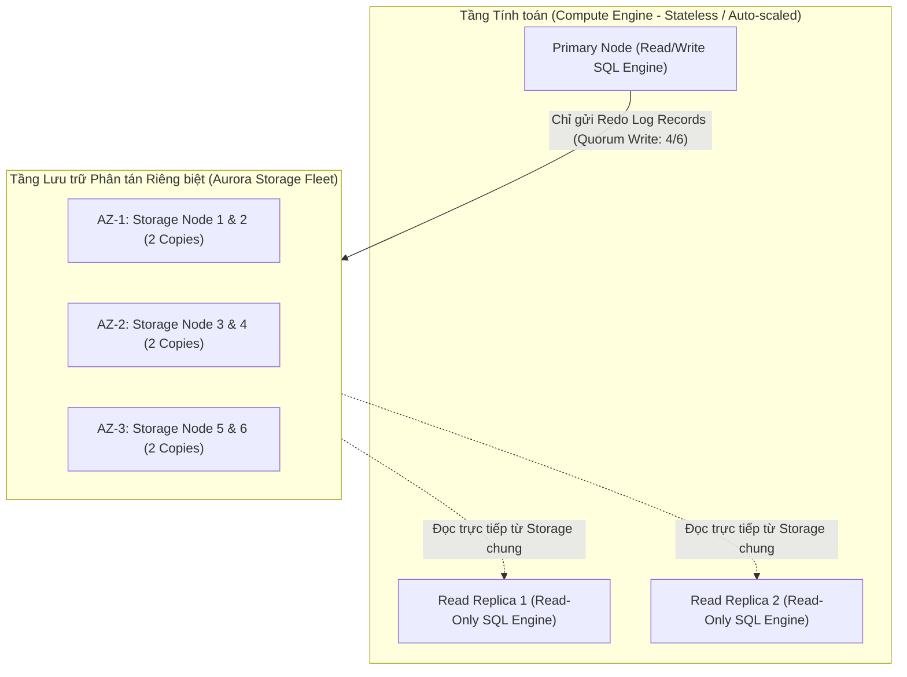
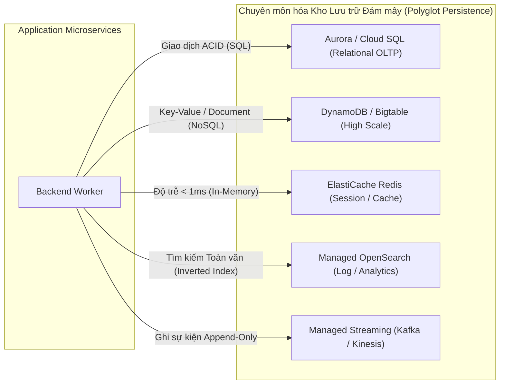
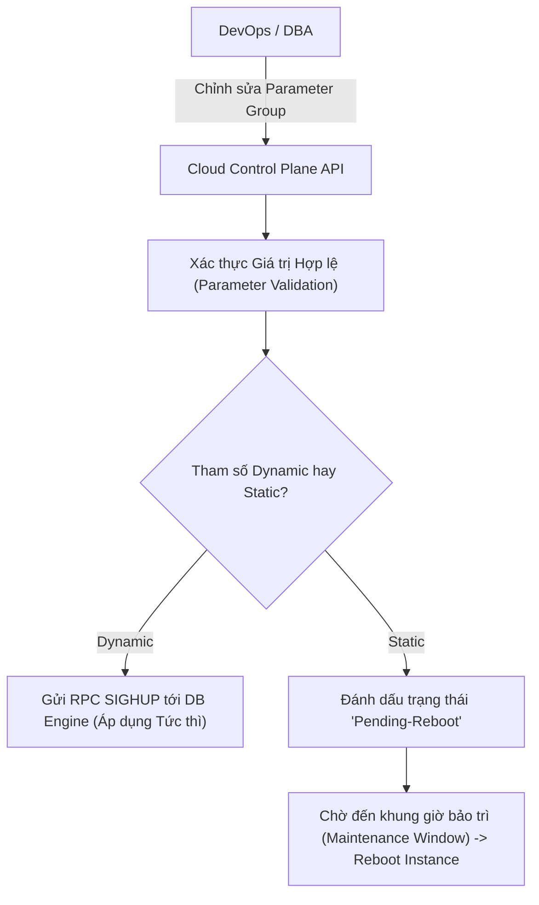

# 5.1. Managed Databases and Data Stores (Cơ sở Dữ liệu Được Quản lý và Kho Lưu trữ Dữ liệu)

## Tổng quan về Cơ sở Dữ liệu Quản lý Đám mây (DBaaS)
Cơ sở dữ liệu như một Dịch vụ (Database as a Service - DBaaS) là mô hình điện toán đám mây trong đó nhà cung cấp dịch vụ (CSP) chịu trách nhiệm vận hành, tự động vá lỗi phần mềm (Patching), sao lưu dự phòng (Automated Backups), giám sát phần cứng và đảm bảo tính sẵn sàng cao (High Availability), trong khi kỹ sư ứng dụng chỉ cần tập trung vào thiết kế lược đồ (Schema Design), tối ưu hóa câu truy vấn (Query Optimization) và nghiệp vụ hệ thống.

Về mặt kiến trúc lưu trữ phân tán thế hệ mới (ví dụ: Amazon Aurora, Google Cloud Spanner):
Mô hình DBaaS hiện đại tách rời hoàn toàn tầng tính toán (Compute Layer - SQL Engine) khỏi tầng lưu trữ (Storage Layer - Distributed Storage Fleet). Triết lý cốt lõi:
$$\textbf{"The Log is the Database"}$$
Thay vì phải xả toàn bộ các trang dữ liệu bộ nhớ đệm (Dirty Buffer Pool Pages) qua mạng xuống đĩa, tầng Compute chỉ cần gửi chuỗi nhật ký giao dịch (Redo Log Records) qua mạng. Tầng lưu trữ phân tán tự động tái tạo trạng thái trang đĩa ngầm ở chế độ nền (Background Log Application), giúp giảm $80\%$ lưu lượng I/O qua mạng và loại bỏ hoàn toàn hiện tượng nghẽn cổ chai Write Amplification.



---

## 2. Chi tiết từng Keyword (Under-the-Hood Deep Dive)

---

### 1. DBaaS Paradigms: Relational, NoSQL, Cache, Search & Streaming

#### 1. Khái niệm bản chất (What & Why)
- **Database as a Service (DBaaS)**: Dịch vụ giải phóng kỹ sư khỏi các tác vụ sysadmin nặng nhọc như provisioning server, cấu hình RAID đĩa, cấu hình replication, failover thủ công hay lập lịch backup qua cronjob.
- **Managed Relational Databases (AWS RDS / Aurora, GCP Cloud SQL / Spanner, Azure SQL)**: Cơ sở dữ liệu quan hệ hỗ trợ SQL chuẩn, đảm bảo tính chất ACID (Atomicity, Consistency, Isolation, Durability). Tối ưu cho dữ liệu có cấu trúc chặt chẽ và các giao dịch tài chính (OLTP).
- **Managed NoSQL Databases (AWS DynamoDB, GCP Firestore / Bigtable, Azure Cosmos DB)**: Cơ sở dữ liệu phi quan hệ, phi máy chủ (Serverless), tự động phân mảnh (Auto-sharding) dữ liệu theo khóa phân vùng (Partition Key). Cam kết độ trễ đọc/ghi tính bằng millisecond ở bất kỳ quy mô dữ liệu nào (từ Gigabytes đến Petabytes).
- **Managed Cache Services (AWS ElastiCache Redis/Memcached, GCP Cloud Memorystore)**: Bộ đệm trong bộ nhớ RAM tốc độ cao (độ trễ microsecond), hỗ trợ các cấu trúc dữ liệu phong phú (Strings, Hashes, Sorted Sets, HyperLogLog, Pub/Sub). Tối ưu cho session store, caching kết quả truy vấn và leaderboard.
- **Managed Search Services (AWS OpenSearch, GCP Cloud Search)**: Hệ thống tìm kiếm toàn văn (Full-Text Search) và phân tích log phân tán dựa trên cấu trúc chỉ mục đảo (Inverted Index). Hỗ trợ tìm kiếm mờ (Fuzzy matching), tổng hợp dữ liệu (Aggregations) và lọc đa chiều.
- **Managed Message Brokers & Streaming (AWS SQS, SNS, Amazon MQ, Kinesis Data Streams, Managed Kafka - MSK)**:
  - *Brokers (RabbitMQ, SQS)*: Định hướng phân phối thông điệp dạng hàng đợi (Message Queue / Task Queue), mỗi thông điệp thường được tiêu thụ bởi một worker duy nhất rồi xóa bỏ.
  - *Streaming (Kafka, Kinesis)*: Định hướng luồng sự kiện theo thời gian thực (Event Streaming), nhật ký nối tiếp bất biến (Append-only Partitioned Log), cho phép nhiều nhóm consumer độc lập đọc lại dữ liệu theo offset.

#### 2. Cơ chế hoạt động sâu (Under the hood / Hardcore Internals)
- **Quorum I/O Model trong Cloud-Native Relational Engine (Aurora)**:
  - Khi một transaction commit, Primary Node gửi Redo Log tới 6 Storage Nodes trải rộng trên 3 Availability Zones (mỗi AZ 2 bản sao).
  - Áp dụng thuật toán Quorum phân tán:
    - *Write Quorum ($V_w = 4/6$)*: Giao dịch được xác nhận commit thành công ngay khi có ít nhất 4 trên 6 node lưu trữ xác nhận đã nhận Redo Log, loại bỏ sự phụ thuộc vào node chậm nhất (Straggler Node).
    - *Read Quorum ($V_r = 3/6$)*: Đảm bảo tập hợp đọc luôn giao cắt với tập hợp ghi ($V_w + V_r > 6$), bảo đảm dữ liệu đọc luôn là mới nhất.
- **Cơ chế Hash Ring trong Managed Redis Cluster**:
  - Redis Cluster phân chia toàn bộ không gian khóa thành cố định **16,384 Hash Slots**.
  - Khi ứng dụng gửi key `user:1001`, Redis Client tính toán slot bằng thuật toán CRC16:
    $$\text{Slot} = \text{CRC16}(\text{"user:1001"}) \pmod{16384}$$
  - Client trực tiếp chuyển hướng gói tin TCP tới đúng Master Node sở hữu slot đó mà không cần thông qua tầng Proxy trung gian.

#### 3. Sơ đồ minh họa


#### 4. Code ví dụ thực chiến (C++ Redis CRC16 Hash Slot Calculation)
Mô phỏng thuật toán tính toán Hash Slot của Redis Cluster chuẩn xác theo đặc tả của Redis internals:

```cpp
#include <iostream>
#include <string>
#include <vector>
#include <cstdint>

// Bảng tra cứu CRC16 chuẩn XMODEM dùng trong Redis Core
static const uint16_t crc16tab[256] = {
    0x0000,0x1021,0x2042,0x3063,0x4084,0x50a5,0x60c6,0x70e7,
    0x8108,0x9129,0xa14a,0xb16b,0xc18c,0xd1ad,0xe1ce,0xf1ef,
    0x1231,0x0210,0x3273,0x2252,0x52b5,0x4294,0x72f7,0x62d6,
    0x9339,0x8318,0xb37b,0xa35a,0xd3bd,0xc39c,0xf3ff,0xe3de,
    0x2462,0x3443,0x0420,0x1401,0x64e6,0x74c7,0x44a4,0x5485,
    0xa56a,0xb54b,0x8528,0x9509,0xe5ee,0xf5cf,0xc5ac,0xd58d,
    0x3653,0x2672,0x1611,0x0630,0x76d7,0x66f6,0x5695,0x46b4,
    0xb75b,0xa77a,0x9719,0x8738,0xf7df,0xe7fe,0xd79d,0xc7bc,
    0x48c4,0x58e5,0x6886,0x78a7,0x0840,0x1861,0x2802,0x3823,
    0xc9cc,0xd9ed,0xe98e,0xf9af,0x8948,0x9969,0xa90a,0xb92b,
    0x5af5,0x4ad4,0x7ab7,0x6a96,0x1a71,0x0a50,0x3a33,0x2a12,
    0xdbfd,0xcbdc,0xfbbf,0xeb9e,0x9b79,0x8b58,0xbb3b,0xab1a,
    0x6ca6,0x7c87,0x4ce4,0x5cc5,0x2c22,0x3c03,0x0c60,0x1c41,
    0xedae,0xfd8f,0xcdec,0xddcd,0xad2a,0xbd0b,0x8d68,0x9d49,
    0x7e97,0x6eb6,0x5ed5,0x4ef4,0x3e13,0x2e32,0x1e51,0x0e70,
    0xff9f,0xefbe,0xdfdd,0xcffc,0xbf1b,0xaf3a,0x9f59,0x8f78,
    0x9188,0x81a9,0xb1ca,0xa1eb,0xd10c,0xc12d,0xf14e,0xe16f,
    0x1080,0x00a1,0x30c2,0x20e3,0x5004,0x4025,0x7046,0x6067,
    0x83b9,0x9398,0xa3fb,0xb3da,0xc33d,0xd31c,0xe37f,0xf35e,
    0x02b1,0x1290,0x22f3,0x32d2,0x4235,0x5214,0x6277,0x7256,
    0xb5ea,0xa5cb,0x95a8,0x8589,0xf56e,0xe54f,0xd52c,0xc50d,
    0x34e2,0x24c3,0x14a0,0x0481,0x7466,0x6447,0x5424,0x4405,
    0xa7db,0xb7fa,0x8799,0x97b8,0xe75f,0xf77e,0xc71d,0xd73c,
    0x26d3,0x36f2,0x0691,0x16b0,0x6657,0x7676,0x4615,0x5634,
    0xd94c,0xc96d,0xf90e,0xe92f,0x99c8,0x89e9,0xb98a,0xa9ab,
    0x5844,0x4865,0x7806,0x6827,0x18c0,0x08e1,0x3882,0x28a3,
    0xcb7d,0xdb5c,0xeb3f,0xfb1e,0x8bf9,0x9bd8,0xabbb,0xbb9a,
    0x4a75,0x5a54,0x6a37,0x7a16,0x0af1,0x1ad0,0x2ab3,0x3a92,
    0xfd2e,0xed0f,0xdd6c,0xcd4d,0xbdaa,0xad8b,0x9de8,0x8dc9,
    0x7c26,0x6c07,0x5c64,0x4c45,0x3ca2,0x2c83,0x1ce0,0x0cc1,
    0xef1f,0xff3e,0xcf5d,0xdf7c,0xaf9b,0xbfba,0x8fd9,0x9ff8,
    0x6e17,0x7e36,0x4e55,0x5e74,0x2e93,0x3eb2,0x0ed1,0x1ef0
};

uint16_t redisCrc16(const char *buf, int len) {
    uint16_t counter = 0;
    for (int i = 0; i < len; ++i) {
        counter = (counter << 8) ^ crc16tab[((counter >> 8) ^ buf[i]) & 0x00FF];
    }
    return counter;
}

uint16_t calculateKeyHashSlot(const std::string& key) {
    // Xử lý Hash Tag {} trong Redis: nếu có {tag}, chỉ băm chuỗi bên trong {}
    auto start = key.find('{');
    auto end = key.find('}');
    if (start != std::string::npos && end != std::string::npos && end > start + 1) {
        std::string tag = key.substr(start + 1, end - start - 1);
        return redisCrc16(tag.c_str(), tag.length()) % 16384;
    }
    return redisCrc16(key.c_str(), key.length()) % 16384;
}

int main() {
    std::vector<std::string> keys = {
        "user:1001", "user:1002", "order:{user:1001}", "profile:{user:1001}"
    };

    std::cout << "--- Phân bổ Key vào Redis Cluster Hash Slots (0 - 16383) ---\n";
    for (const auto& k : keys) {
        uint16_t slot = calculateKeyHashSlot(k);
        std::cout << "Key: " << k << " -> Gán vào Hash Slot: " << slot << "\n";
    }

    std::cout << "\n[Nhận xét] Nhờ Hash Tag {user:1001}, các key 'order' và 'profile' của cùng user "
              << "được đảm bảo 100% rơi vào CÙNG 1 SLOT, cho phép thực thi Multi-key Transactions!\n";

    return 0;
}
```

#### 5. Ưu / Nhược điểm, Pitfalls & Anti-patterns
- **Ưu điểm**: Tính sẵn sàng cao, bảo mật và khả năng phục hồi được tự động hóa; mở rộng quy mô lưu trữ và tính toán độc lập.
- **Pitfall**: Đưa toàn bộ các loại dữ liệu vào một cơ sở dữ liệu quan hệ duy nhất (Anti-pattern: "One Size Fits All"). Việc lưu logs hoặc dữ liệu streaming vào PostgreSQL sẽ nhanh chóng làm phình to bảng, gây tắc nghẽn vacuum và cạn kiệt IOPS.

#### 6. Ứng dụng thực tế trong Backend / Systems
- Kiến trúc Polyglot Persistence: Dùng PostgreSQL lưu trữ thông tin giao dịch tài chính cốt lõi; dùng Redis lưu giỏ hàng và token đăng nhập; dùng Elasticsearch để tìm kiếm sản phẩm; dùng Kafka để truyền tải sự kiện thanh toán.

---

### 2. Database Provisioning & Parameter Groups

#### 1. Khái niệm bản chất (What & Why)
- **Database Provisioning**: Quy trình tự động khởi tạo cơ sở dữ liệu trên cloud: cấp phát máy ảo backend, gắn kết lưu lượng đĩa SSD, thiết lập tài khoản root/admin, khởi tạo cấu trúc dữ liệu ban đầu và cấu hình mạng VPC bảo mật.
- **Database Parameter Groups (Nhóm Tham số Cơ sở Dữ liệu)**: Bộ sưu tập các thiết lập cấu hình của Database Engine (tương đương với các file cấu hình truyền thống như `my.cnf` trong MySQL hoặc `postgresql.conf` trong PostgreSQL). Cho phép quản trị viên áp dụng cùng một bộ cấu hình chuẩn cho hàng loạt database instances trong cùng một tổ chức.

#### 2. Cơ chế hoạt động sâu (Under the hood / Hardcore Internals)
- **Các tham số Kernel & Memory Engine Sống còn**:
  - *`shared_buffers` (PostgreSQL)*: Quy định dung lượng RAM dành riêng cho database engine để cache các data pages. Trên Cloud RDS, giá trị này thường được tính tự động theo công thức:
    $$\text{shared\_buffers} = 0.25 \times \text{Total Instance RAM}$$
    (Phần RAM còn lại được nhường cho Linux OS Page Cache để tối ưu việc đọc ghi qua VFS).
  - *`innodb_buffer_pool_size` (MySQL)*: Thường được đặt ở mức $70\% - 80\%$ tổng lượng RAM của instance để giảm thiểu tối đa các thao tác đọc đĩa vật lý.
  - *`max_connections`*: Giới hạn số lượng phiên kết nối đồng thời từ ứng dụng vào DB. Nếu đặt quá cao (ví dụ $> 5000$), bộ nhớ dành cho mỗi session (`work_mem`, `sort_buffer_size`) sẽ khiến máy ảo bị sập do Linux Kernel kích hoạt tiến trình **OOM Killer (Out Of Memory)**.
- **Phân loại Tham số (Dynamic vs Static Parameters)**:
  - *Dynamic Parameters*: Có hiệu lực ngay lập tức sau khi thay đổi (thông qua lệnh `SET GLOBAL` hoặc gửi tín hiệu `SIGHUP` tới database process).
  - *Static Parameters*: Yêu cầu phải khởi động lại (Reboot) database instance để engine nạp lại bộ nhớ từ đầu (ví dụ: thay đổi `shared_buffers` trong PostgreSQL hoặc `innodb_page_size` trong MySQL).

#### 3. Sơ đồ minh họa


#### 4. Code ví dụ thực chiến (TypeScript Parameter Group Calculator)
Tự động tính toán các tham số cấu hình PostgreSQL tối ưu dựa trên dung lượng RAM của instance:

```typescript
export interface InstanceSpecs {
  instanceClass: string;
  totalRamGb: number;
  cpuCores: number;
}

export class PostgresParameterOptimizer {
  public static calculateOptimalParameters(specs: InstanceSpecs): Record<string, string> {
    const totalRamMb = specs.totalRamGb * 1024;

    // 1. shared_buffers: 25% RAM cho dedicated DB cache
    const sharedBuffersMb = Math.floor(totalRamMb * 0.25);

    // 2. effective_cache_size: 75% RAM (shared_buffers + OS page cache dự kiến)
    const effectiveCacheSizeMb = Math.floor(totalRamMb * 0.75);

    // 3. maintenance_work_mem: Bộ nhớ cho tác vụ bảo trì (VACUUM, CREATE INDEX)
    const maintenanceWorkMemMb = Math.min(2048, Math.floor(totalRamMb * 0.05));

    // 4. max_connections: Tối ưu theo số core CPU để tránh tranh chấp Context Switch
    const maxConnections = Math.min(500, specs.cpuCores * 25 + 50);

    // 5. work_mem: RAM cho mỗi thao tác SORT/HASH phức tạp
    // Công thức an toàn: (Total RAM - shared_buffers) / (max_connections * 3)
    const workMemMb = Math.max(4, Math.floor((totalRamMb - sharedBuffersMb) / (maxConnections * 3)));

    return {
      shared_buffers: `${sharedBuffersMb}MB`,
      effective_cache_size: `${effectiveCacheSizeMb}MB`,
      maintenance_work_mem: `${maintenanceWorkMemMb}MB`,
      work_mem: `${workMemMb}MB`,
      max_connections: `${maxConnections}`,
      checkpoint_completion_target: "0.9", // Tránh I/O Spike khi xả WAL checkpoint
      wal_buffers: "16MB",
    };
  }
}

// Chạy thử nghiệm với cấu hình máy ảo db.r6i.2xlarge (8 vCPU, 64 GB RAM)
const r6iSpecs: InstanceSpecs = {
  instanceClass: "db.r6i.2xlarge",
  totalRamGb: 64,
  cpuCores: 8,
};

console.log("Cấu hình Database Parameter Group tối ưu:");
console.table(PostgresParameterOptimizer.calculateOptimalParameters(r6iSpecs));
```

#### 5. Ưu / Nhược điểm, Pitfalls & Anti-patterns
- **Ưu điểm**: Quản lý tập trung các thông số cấu hình của hàng chục database clusters thông qua giao diện hoặc mã nguồn IaC duy nhất.
- **Pitfall**: Sửa đổi một tham số Static trong Parameter Group trong giờ làm việc cao điểm, sau đó vô tình chọn "Apply Immediately", khiến toàn bộ production database cluster bị tự động khởi động lại ngay lập tức và làm gián đoạn hệ thống.

#### 6. Ứng dụng thực tế trong Backend / Systems
- Thiết lập Parameter Group tùy biến cho RDS PostgreSQL: Bật tiện ích mở rộng `pg_stat_statements` để liên tục giám sát và bắt vết các câu truy vấn chậm (Slow Queries) tốn nhiều CPU nhất trong ứng dụng.
