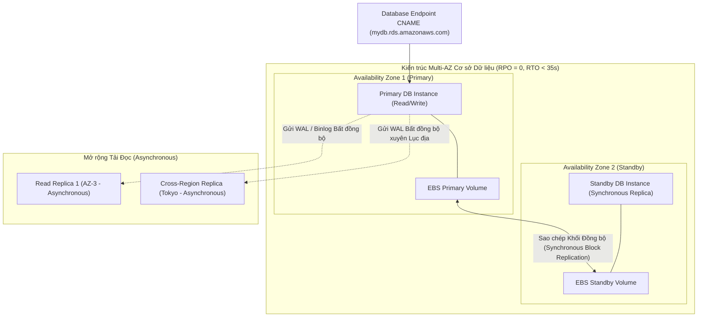
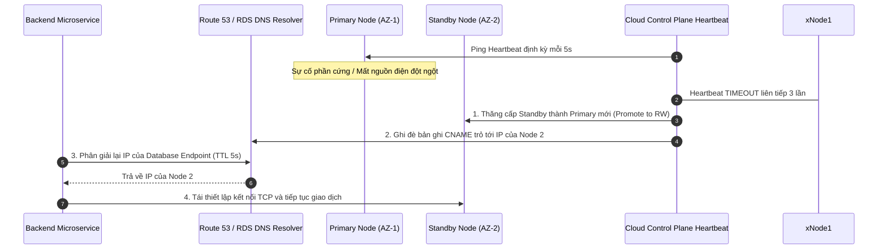
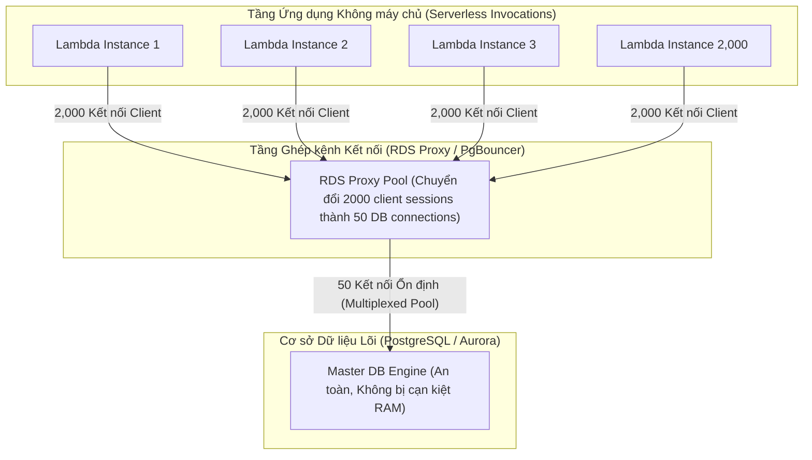

# 5.2. High Availability, Replication and Operations (Tính Sẵn sàng Cao, Sao chép và Vận hành Cơ sở Dữ liệu)

## Tổng quan về Tính Sẵn sàng Cao và Vận hành Cơ sở Dữ liệu Đám mây
Tính sẵn sàng cao (High Availability - HA) và tính chịu lỗi (Fault Tolerance) của cơ sở dữ liệu trên cloud đảm bảo hệ thống duy trì hoạt động liên tục ngay cả khi phần cứng máy chủ, đĩa lưu trữ hoặc toàn bộ một Availability Zone (AZ) gặp sự cố thảm họa. Vận hành cơ sở dữ liệu trên cloud tích hợp tự động cơ chế sao chép dữ liệu (Replication), chuyển mạch dự phòng tức thì (Automated Failover), quản lý vùng kết nối (Connection Pooling) và di chuyển dữ liệu không gián đoạn (Zero-downtime Migration).

Về mặt độ trễ và mất mát dữ liệu trong phục hồi thảm họa:
Hai chỉ số đo lường cốt lõi trong kỹ thuật vận hành hệ thống là:
1. **RPO (Recovery Point Objective - Mục tiêu Điểm Phục hồi)**: Khoảng thời gian tối đa mà dữ liệu có thể bị mất mát khi sự cố xảy ra. Trong kiến trúc Multi-AZ sao chép đồng bộ, $\text{RPO} = 0$.
2. **RTO (Recovery Time Objective - Mục tiêu Thời gian Phục hồi)**: Thời gian hệ thống cần để chuyển mạch hoàn toàn sang nút dự phòng và khôi phục khả năng phục vụ. Trong kiến trúc Automated Failover hiện đại, $\text{RTO} \le 35\text{s}$.



---

## 2. Chi tiết từng Keyword (Under-the-Hood Deep Dive)

---

### 1. Multi-AZ Deployments, Read Replicas & Automated Failover

#### 1. Khái niệm bản chất (What & Why)
- **Multi-AZ Deployment**: Mô hình triển khai cơ sở dữ liệu trên ít nhất hai Availability Zone khác nhau. Một node đóng vai trò **Primary (Read/Write)** và node còn lại đóng vai trò **Standby (Dự phòng đồng bộ)**. Ứng dụng không thể đọc hoặc ghi trực tiếp vào Standby node trong điều kiện hoạt động bình thường (trừ khi dùng Multi-AZ Cluster with 2 Read Replicas).
- **Read Replicas (Bản sao chỉ đọc)**: Các node cơ sở dữ liệu được tạo ra nhằm mục đích phân tải truy vấn đọc (Read-heavy Workload). Sử dụng cơ chế **Sao chép Bất đồng bộ (Asynchronous Replication)**. Có thể triển khai tối đa 15 bản sao trong cùng Region hoặc khác Region.
- **Cross-Region Replicas**: Bản sao chỉ đọc đặt tại một khu vực địa lý khác hoàn toàn. Phục vụ hai mục đích chính:
  1. Giảm độ trễ đọc dữ liệu cho người dùng quốc tế gần khu vực đó.
  2. Nâng cấp thành Primary Database độc lập khi Region chính gặp sự cố thảm họa (Disaster Recovery).
- **Automated Failover (Chuyển mạch Dự phòng Tự động)**: Quy trình tự động phát hiện Primary node bị chết (do mất điện, hỏng phần cứng, kernel panic) và thăng cấp (Promote) Standby node lên làm Primary mới mà không cần con người can thiệp.

#### 2. Cơ chế hoạt động sâu (Under the hood / Hardcore Internals)
- **Bản chất của Chuyển mạch Tự động (DNS CNAME Flip vs IP Takeover)**:
  - Khi Primary gặp sự cố, hệ thống giám sát của CSP mất khoảng $30\text{s}$ để xác nhận nút chết thông qua các lần kiểm tra Heartbeat không phản hồi.
  - Sau khi xác nhận nút chết, hệ thống thực hiện tráo đổi bản ghi DNS (DNS CNAME record flip) của Database Endpoint (ví dụ: trỏ `mydb.rds.amazonaws.com` từ IP của Node AZ-1 sang IP của Node AZ-2).
  - Bản ghi DNS này có TTL cực ngắn (Time-to-Live = 5 giây). Tuy nhiên, nếu phía ứng dụng (như Java JVM) bị cấu hình mặc định cache DNS vĩnh viễn (`networkaddress.cache.ttl = -1`), ứng dụng sẽ tiếp tục cố gắng kết nối vào IP cũ đã chết và không thể tự phục hồi.
- **Độ trễ Sao chép (Replication Lag)**:
  - Trong Read Replicas, Primary node sau khi ghi vào đĩa cục bộ sẽ gửi Redo/WAL/Binlog qua mạng cho Replica.
  - Replica sử dụng tiến trình nền (SQL Thread hoặc Applier Thread) để đọc và thực thi lại các lệnh này.
  - Nếu Replica chịu tải đọc quá nặng hoặc chạy trên cấu hình CPU/RAM thấp hơn Primary, Replica sẽ không theo kịp tốc độ ghi của Primary, dẫn đến **Replication Lag** tăng cao. Lúc này, người dùng vừa viết một bài đăng mới sẽ không thấy bài đăng của mình ngay lập tức khi đọc từ Replica (Hiện tượng Vi phạm Read-Your-Own-Writes Consistency).

#### 3. Sơ đồ minh họa


#### 4. Code ví dụ thực chiến (C++ Asynchronous Replication Lag Detector)
Mô phỏng bộ kiểm tra độ trễ sao chép (Replication Lag) dựa trên Log Sequence Number (LSN) trong cơ sở dữ liệu phân tán:

```cpp
#include <iostream>
#include <cstdint>
#include <thread>
#include <chrono>

struct LsnPointer {
    uint64_t file_id;
    uint64_t offset;

    // Chuyển đổi thành địa chỉ byte 64-bit tuyến tính
    [[nodiscard]] uint64_t toLinearBytes() const noexcept {
        return (file_id << 32) | offset;
    }
};

class ReplicationMonitor {
public:
    static void checkLag(const LsnPointer& primary_lsn, const LsnPointer& replica_lsn, uint64_t warning_threshold_bytes) {
        uint64_t primary_bytes = primary_lsn.toLinearBytes();
        uint64_t replica_bytes = replica_lsn.toLinearBytes();

        if (primary_bytes < replica_bytes) {
            std::cerr << "[Lỗi LSN] Replica LSN vượt trước Primary LSN (Xung đột trạng thái)!\n";
            return;
        }

        uint64_t lag_bytes = primary_bytes - replica_bytes;
        double lag_mb = static_cast<double>(lag_bytes) / (1024 * 1024);

        std::cout << "[Replication Status] Primary LSN: " << primary_bytes 
                  << " | Replica LSN: " << replica_bytes 
                  << " | Lag: " << lag_mb << " MB\n";

        if (lag_bytes > warning_threshold_bytes) {
            std::cerr << "  -> [CẢNH BÁO REPLICATION LAG] Độ trễ vượt ngưỡng an toàn (" 
                      << (warning_threshold_bytes / (1024 * 1024)) << " MB)! "
                      << "Tạm thời ngắt định tuyến Read Traffic tới Replica này để tránh đọc dữ liệu cũ!\n";
        } else {
            std::cout << "  -> [OK] Độ trễ sao chép nằm trong giới hạn an toàn.\n";
        }
    }
};

int main() {
    LsnPointer primary = { .file_id = 12, .offset = 50000000 };
    
    // Tình huống 1: Replica bám đuổi sát nút (Lag ~ 50KB)
    LsnPointer replica_healthy = { .file_id = 12, .offset = 49950000 };
    ReplicationMonitor::checkLag(primary, replica_healthy, 10 * 1024 * 1024);

    // Tình huống 2: Replica bị nghẽn (Lag > 20MB)
    LsnPointer replica_lagging = { .file_id = 12, .offset = 25000000 };
    ReplicationMonitor::checkLag(primary, replica_lagging, 10 * 1024 * 1024);

    return 0;
}
```

#### 5. Ưu / Nhược điểm, Pitfalls & Anti-patterns
- **Multi-AZ**: Đảm bảo an toàn dữ liệu và phục hồi sự cố tự động tuyệt đối, nhưng làm tăng độ trễ ghi (Write Latency) thêm một chút do phải đồng bộ dữ liệu qua 2 Availability Zone.
- **Pitfall**: Đọc dữ liệu từ Read Replica ngay sau khi ghi vào Primary trong luồng tạo tài khoản người dùng. Do độ trễ bất đồng bộ vài trăm millisecond, truy vấn đọc có thể trả về lỗi "User Not Found", khiến ứng dụng frontend bị sập.

#### 6. Ứng dụng thực tế trong Backend / Systems
- Thiết lập kiến trúc Multi-AZ cho MySQL RDS của cổng thanh toán, đồng thời mở 3 Read Replicas nằm sau một Read Endpoint (Load Balanced) để phục vụ riêng cho các báo cáo phân tích kinh doanh mà không làm ảnh hưởng đến hiệu năng giao dịch trực tiếp.

---

### 2. Database Connection Management: The Serverless Connection Problem & RDS Proxy

#### 1. Khái niệm bản chất (What & Why)
- **Database Connection Overhead**: Mỗi kết nối TCP tới cơ sở dữ liệu quan hệ (PostgreSQL/MySQL) là một tiến trình (Process) hoặc luồng (Thread) nặng trên máy chủ database. Mỗi kết nối tiêu tốn từ $3\text{MB}$ đến $10\text{MB}$ bộ nhớ RAM cho buffer và ngăn xếp (Stack).
- **Vấn đề Kết nối trong Kiến trúc Serverless / FaaS**:
  - Khi hàng ngàn hàm Lambda hoặc Serverless Containers khởi động đồng thời để xử lý tải đột biến, chúng sẽ mở hàng ngàn kết nối trực tiếp vào Database.
  - Cơ sở dữ liệu sẽ nhanh chóng bị quá tải, cạn kiệt RAM và từ chối kết nối (`FATAL: too many connections for role`).
- **Database Proxy (AWS RDS Proxy, PgBouncer)**: Tầng trung gian quản lý bộ kết nối (Connection Pooling Proxy) đặt giữa ứng dụng và cơ sở dữ liệu. Proxy duy trì một số lượng nhỏ kết nối ổn định tới DB thật, trong khi tiếp nhận và tái sử dụng (Multiplexing) hàng ngàn kết nối ngắn hạn từ ứng dụng Serverless.

#### 2. Cơ chế hoạt động sâu (Under the hood / Hardcore Internals)
- **Kỹ thuật Ghép kênh Kết nối (Connection Multiplexing)**:
  - Khi một request từ Lambda gửi câu truy vấn SQL tới RDS Proxy, Proxy mượn tạm một kết nối thực tế trong pool để gửi câu lệnh xuống DB.
  - Ngay khi câu lệnh hoàn thành, kết nối thực tế được trả lại cho pool ngay lập tức để phục vụ cho một Lambda khác, thay vì bị khóa giữ bởi Lambda đó trong suốt toàn bộ thời gian sống của hàm.
- **Hiện tượng Ghim Kết nối (Connection Pinning)**:
  - Ghim kết nối xảy ra khi Proxy bị ép buộc phải giữ chặt một kết nối vật lý duy nhất cho một client cụ thể, làm mất đi khả năng ghép kênh (Multiplexing).
  - Nguyên nhân kinh điển:
    1. Sử dụng các câu lệnh chuẩn bị mở rộng (Prepared Statements mà không hỗ trợ transaction-level pooling).
    2. Sử dụng bảng tạm thời (Temporary Tables).
    3. Đặt các biến session-level (ví dụ: `SET search_path = 'custom_schema'`).

#### 3. Sơ đồ minh họa


#### 4. Code ví dụ thực chiến (TypeScript Managed Database Connection Pool Pattern)
Mô phỏng bộ quản lý Connection Pool có kiểm soát timeout và giới hạn kết nối nghiêm ngặt:

```typescript
export interface PooledConnection {
  id: number;
  isBusy: boolean;
  query(sql: string): Promise<any>;
}

export class DatabaseProxyPool {
  private pool: PooledConnection[] = [];
  private readonly maxConnections: number;

  constructor(maxSize: number = 10) {
    this.maxConnections = maxSize;
    for (let i = 1; i <= maxSize; ++i) {
      this.pool.push({
        id: i,
        isBusy: false,
        query: async (sql: string) => {
          // Giả lập thực thi SQL 50ms
          await new Promise((res) => setTimeout(res, 50));
          return { sql, status: "OK", connId: i };
        },
      });
    }
  }

  public async acquireConnection(timeoutMs: number = 2000): Promise<PooledConnection> {
    const startTime = Date.now();

    while (Date.now() - startTime < timeoutMs) {
      const available = this.pool.find((c) => !c.isBusy);
      if (available) {
        available.isBusy = true;
        return available;
      }
      // Chờ 20ms trước khi kiểm tra lại
      await new Promise((res) => setTimeout(res, 20));
    }

    throw new Error(`[Pool Exhaustion] Quá thời gian chờ ${timeoutMs}ms: Toàn bộ ${this.maxConnections} kết nối đều đang bận!`);
  }

  public releaseConnection(conn: PooledConnection): void {
    conn.isBusy = false;
  }
}

// Chạy thử nghiệm
async function runDemo() {
  const proxy = new DatabaseProxyPool(3); // Giới hạn pool tối đa 3 kết nối

  const executeTask = async (taskId: number) => {
    try {
      const conn = await proxy.acquireConnection();
      console.log(`[Task ${taskId}] Mượn kết nối #${conn.id}`);
      await conn.query(`SELECT * FROM users WHERE id = ${taskId}`);
      proxy.releaseConnection(conn);
      console.log(`[Task ${taskId}] Trả kết nối #${conn.id}`);
    } catch (err: any) {
      console.error(`[Task ${taskId}] Thất bại: ${err.message}`);
    }
  };

  // Kích hoạt đồng thời 5 tác vụ (vượt quá kích thước pool 3)
  await Promise.all([executeTask(1), executeTask(2), executeTask(3), executeTask(4), executeTask(5)]);
}

if (process.env.NODE_ENV !== "test") {
  runDemo().catch(console.error);
}
```

#### 5. Ưu / Nhược điểm, Pitfalls & Anti-patterns
- **Ưu điểm**: Giúp cơ sở dữ liệu sống sót qua các đợt tăng tải đột biến của FaaS/Containers; giảm thời gian chuyển mạch failover xuống thêm $30\% - 50\%$ do RDS Proxy tự duy trì kết nối tới node mới mà client không cần reconnect.
- **Pitfall**: Vô tình kích hoạt Connection Pinning (như cấu hình các ORM frameworks liên tục sinh ra `SET SESSION` variables), biến RDS Proxy thành một tầng trung chuyển vô tác dụng và làm tăng chi phí quản lý.

#### 6. Ứng dụng thực tế trong Backend / Systems
- Đặt RDS Proxy ở vị trí trung gian giữa cụm dịch vụ AWS Lambda API Gateway và cụm cơ sở dữ liệu Aurora PostgreSQL để bảo vệ database trong các sự kiện bán vé trực tuyến quy mô hàng trăm nghìn người dùng.
