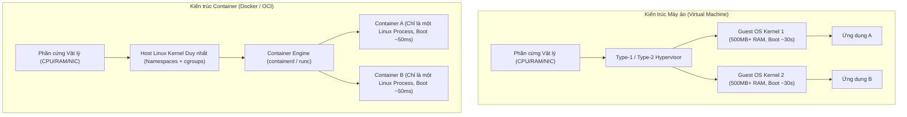
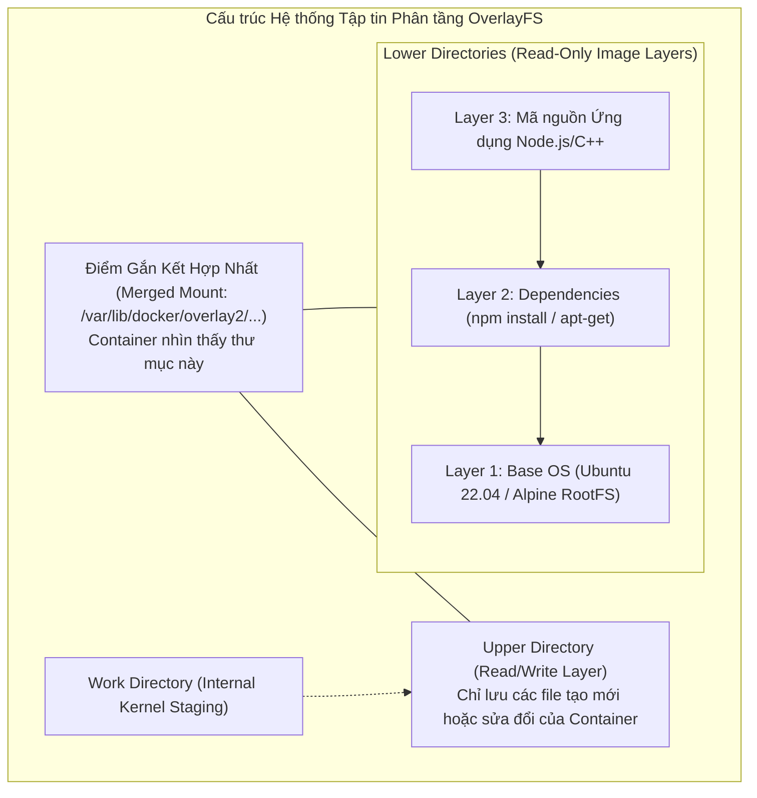
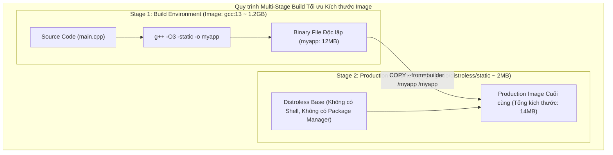

# 6.1. Linux Primitives and Docker Architecture (Nền tảng Nhân Linux và Kiến trúc Docker)

## Tổng quan về Công nghệ Container và Nhân Linux
Containerization (Công nghệ đóng gói container) là phương thức ảo hóa ở cấp độ hệ điều hành (OS-level Virtualization), cho phép nhiều môi trường người dùng (User Space) hoạt động hoàn toàn cô lập với nhau nhưng dùng chung một nhân hệ điều hành duy nhất (Shared Linux Kernel). 

Về mặt khoa học máy tính và kỹ thuật hệ thống, **Container không phải là một thực thể ảo hóa phần cứng (Hardware Virtualization)** như máy ảo (Virtual Machine). Container thực chất chỉ là **một tiến trình Linux tiêu chuẩn (Standard Linux Process)** nhưng được áp dụng 3 cơ chế kiểm soát và cách ly cốt lõi của Linux Kernel:
1. **Linux Namespaces (Không gian tên)**: Trả lời câu hỏi: *"Tiến trình được nhìn thấy những gì?"* (Cô lập tài nguyên hệ thống: PID, Mạng, Tệp tin, IPC, User).
2. **Control Groups - cgroups (Nhóm kiểm soát)**: Trả lời câu hỏi: *"Tiến trình được sử dụng bao nhiêu tài nguyên?"* (Giới hạn và phân bổ trần CPU, RAM, Disk I/O, Network Bandwidth).
3. **Chroot & Union Filesystem / OverlayFS**: Cung cấp một hệ thống tập tin gốc độc lập (Root Filesystem - `rootfs`), biến cây thư mục của container trở thành không gian khép kín thông qua lệnh gọi hệ thống `pivot_root`.



---

## 2. Chi tiết từng Keyword (Under-the-Hood Deep Dive)

---

### 1. Linux Kernel Primitives: Namespaces, cgroups & OverlayFS

#### 1. Khái niệm bản chất (What & Why)
- **Linux Namespaces**: Cơ chế trừu tượng hóa tài nguyên toàn cục của hệ thống thành các không gian độc lập. Một tiến trình bên trong một namespace chỉ có thể nhìn thấy các tài nguyên thuộc về namespace đó.
  - *PID Namespace (`CLONE_NEWPID`)*: Cung cấp cây tiến trình độc lập. Tiến trình chính của container nhận `PID = 1` bên trong container, nhưng trên Host OS nó vẫn là một PID bình thường (ví dụ: `PID = 45210`).
  - *NET Namespace (`CLONE_NEWNET`)*: Cung cấp stack mạng riêng biệt gồm: card mạng ảo (`eth0`), bảng định tuyến riêng, bảng iptables riêng và các cổng socket độc lập.
  - *MNT Namespace (`CLONE_NEWNS`)*: Cô lập toàn bộ các điểm gắn kết hệ thống tập tin (Mount Points).
  - *IPC Namespace (`CLONE_NEWIPC`)*: Cô lập bộ nhớ chia sẻ (Shared Memory) và hàng đợi thông điệp POSIX IPC.
  - *UTS Namespace (`CLONE_NEWUTS`)*: Cho phép container sở hữu Hostname và Domain Name độc lập.
  - *USER Namespace (`CLONE_NEWUSER`)*: Ánh xạ UID/GID. Người dùng `root` (UID 0) bên trong container được ánh xạ thành một UID thông thường (ví dụ: UID 10001) trên Host, triệt tiêu nguy cơ leo thang đặc quyền.
- **Control Groups (cgroups)**: Cơ chế kiểm soát, kế toán và phân bổ tài nguyên phần cứng (CPU, Memory, Block I/O, Network pids) cho một tập hợp các tiến trình:
  - *cgroups v1*: Phân cấp nhiều cây thư mục riêng lẻ cho từng bộ điều khiển (`/sys/fs/cgroup/cpu`, `/sys/fs/cgroup/memory`).
  - *cgroups v2*: Hợp nhất thành một cây phân cấp duy nhất (Unified Hierarchy), khắc phục lỗi tranh chấp tài nguyên và kiểm soát bộ nhớ trang (Page Cache) chính xác hơn.
- **Union Filesystem (OverlayFS)**: Công nghệ hệ thống tập tin xếp lớp (Layered Filesystem), cho phép gộp nhiều thư mục khác nhau thành một điểm nhìn duy nhất (Unified View).

#### 2. Cơ chế hoạt động sâu (Under the hood / Hardcore Internals)
- **Tầng CFS Scheduler trong cgroups CPU Limits**:
  - Giới hạn CPU không hoạt động bằng cách "chia cắt" CPU vật lý, mà sử dụng bộ điều độ **Completely Fair Scheduler (CFS)** thông qua hai tham số trong cgroups:
    - `cpu.cfs_period_us`: Khoảng chu kỳ thời gian (mặc định $100,000\mu\text{s} = 100\text{ms}$).
    - `cpu.cfs_quota_us`: Thời gian CPU tối đa mà nhóm tiến trình được phép chạy trong một chu kỳ.
  - Nếu ta cấu hình container `--cpus="1.5"`, Docker sẽ ghi:
    $$\text{cpu.cfs\_quota\_us} = 1.5 \times 100,000 = 150,000\mu\text{s}$$
  - Khi nhóm tiến trình tiêu thụ hết $150\text{ms}$ thời gian chạy CPU trong vòng chu kỳ $100\text{ms}$, nhân Linux sẽ lập tức đình chỉ (Throttle) các luồng của container cho đến khi chu kỳ tiếp theo bắt đầu.
- **Cấu trúc 4 Thư mục của OverlayFS (`lowerdir`, `upperdir`, `workdir`, `merged`)**:
  - `lowerdir`: Chứa các lớp Image chỉ đọc (Read-Only Image Layers). Nhiều container có thể dùng chung lớp này mà không tốn thêm byte đĩa nào.
  - `upperdir`: Lớp đọc/ghi của riêng container (Read-Write Container Layer). Mọi file mới hoặc sửa đổi sẽ được ghi vào đây.
  - `workdir`: Thư mục đệm nội bộ của Linux Kernel để chuẩn bị file trước khi đưa lên `upperdir`.
  - `merged`: Điểm gắn kết thống nhất (Mount point) mà ứng dụng bên trong container thực sự nhìn thấy.
  - *Nguyên lý Copy-on-Write (CoW)*: Khi ứng dụng đọc file, Kernel đọc từ `lowerdir`. Khi ứng dụng mở file để chỉnh sửa (`O_WRONLY`), Kernel sao chép toàn bộ file đó từ `lowerdir` lên `upperdir` trước khi ghi, bảo toàn tính bất biến của image gốc.

#### 3. Sơ đồ minh họa


#### 4. Code ví dụ thực chiến (C++ Low-level Linux Container Creator using System Calls)
Chương trình C++ thuần túy sử dụng trực tiếp các syscall của Linux Kernel (`clone`, `sethostname`, `chroot`, `mount`) để tự tạo một "Mini Docker Container" từ đầu:

```cpp
#define _GNU_SOURCE
#include <iostream>
#include <sched.h>
#include <unistd.h>
#include <sys/wait.h>
#include <sys/mount.h>
#include <sys/stat.h>
#include <cstring>

// Hàm thực thi bên trong môi trường Container độc lập
int container_entrypoint(void* arg) {
    std::cout << "[Inside Container] Bắt đầu khởi tạo tiến trình con bên trong Namespaces mới...\n";

    // 1. Cô lập Hostname (UTS Namespace)
    const char* new_hostname = "isolated-container-box";
    if (sethostname(new_hostname, strlen(new_hostname)) < 0) {
        std::cerr << "Lỗi: sethostname thất bại: " << std::strerror(errno) << "\n";
        return 1;
    }
    std::cout << "[Inside Container] Đã thiết lập Hostname độc lập: " << new_hostname << "\n";

    // 2. Cô lập PID: Bên trong này, tiến trình con nhìn thấy nó là PID 1
    std::cout << "[Inside Container] Tiến trình con nhận diện PID nội bộ: " << getpid() << "\n";

    // 3. Cô lập File System Mount: Gắn cờ MS_PRIVATE để ngăn mount event rò rỉ ra ngoài Host
    mount(nullptr, "/", nullptr, MS_REC | MS_PRIVATE, nullptr);

    // Thông báo hoàn thành khởi tạo
    std::cout << "[Inside Container] Container Namespaces (PID, UTS, MNT, IPC, NET) đã hoạt động!\n";
    std::cout << "[Inside Container] Thoát tiến trình an toàn.\n";
    return 0;
}

int main() {
    std::cout << "[Host OS] Chuẩn bị khởi tạo Container bằng Linux Kernel 'clone' syscall...\n";

    // Cấp phát ngăn xếp (Stack) cho tiến trình mới (64KB)
    const size_t STACK_SIZE = 65536;
    char* stack = new char[STACK_SIZE];
    char* stack_top = stack + STACK_SIZE;

    // Các cờ tạo không gian tên mới của Linux Kernel:
    // CLONE_NEWPID: Tạo cây tiến trình mới
    // CLONE_NEWUTS: Tạo không gian hostname riêng
    // CLONE_NEWNS : Tạo không gian mount points riêng
    // CLONE_NEWIPC: Tạo không gian bộ nhớ chia sẻ riêng
    // CLONE_NEWNET: Tạo card mạng và loopback riêng
    int clone_flags = CLONE_NEWPID | CLONE_NEWUTS | CLONE_NEWNS | CLONE_NEWIPC | CLONE_NEWNET | SIGCHLD;

    pid_t container_pid = clone(container_entrypoint, stack_top, clone_flags, nullptr);

    if (container_pid < 0) {
        std::cerr << "[Host OS Lỗi] Gọi clone() thất bại: " << std::strerror(errno) 
                  << " (Yêu cầu quyền root / sudo trên Linux)!\n";
        delete[] stack;
        return 1;
    }

    std::cout << "[Host OS] Tiến trình Container được cấp phát PID thực tế trên Host: " << container_pid << "\n";

    // Chờ container thực thi xong
    waitpid(container_pid, nullptr, 0);
    std::cout << "[Host OS] Tiến trình Container đã kết thúc. Giải phóng tài nguyên Host.\n";

    delete[] stack;
    return 0;
}
```

#### 5. Ưu / Nhược điểm, Pitfalls & Anti-patterns
- **Ưu điểm**: Khởi động tức thì trong vài chục millisecond, mật độ đóng gói (Density) cao gấp 5-10 lần máy ảo thông thường do không tốn RAM chạy nhiều OS Kernel.
- **Nhược điểm**: Kém an toàn hơn máy ảo phần cứng nếu không cấu hình kỹ. Vì dùng chung 1 OS Kernel, một lỗ hổng bảo mật cấp Kernel (Kernel Vulnerability như Dirty COW) có thể cho phép container độc hại phá vỡ ranh giới và kiểm soát toàn bộ máy chủ vật lý.
- **Pitfall**: Đặt giới hạn `memory.max` (Memory Limit) quá sát với mức tiêu thụ trung bình. Khi ứng dụng có đột biến cấp phát bộ nhớ, Linux Kernel lập tức kích hoạt cơ chế `OOMKilled` (Exit code 137) và tiêu diệt tiến trình mà không có bất kỳ thông báo lỗi nào trong file log của ứng dụng.

#### 6. Ứng dụng thực tế trong Backend / Systems
- Đóng gói toàn bộ các dịch vụ Backend thành chuẩn OCI Images; thiết lập hạn mức `cgroups` để đảm bảo một microservice bị rò rỉ bộ nhớ (Memory Leak) không thể nuốt trọn RAM của toàn bộ máy chủ.

---

### 2. Docker Architecture, Images & Build Optimization (BuildKit)

#### 1. Khái niệm bản chất (What & Why)
- **Docker Architecture (Kiến trúc Docker)**:
  - *Docker CLI*: Giao diện dòng lệnh giao tiếp với Docker Daemon qua UNIX Domain Socket (`/var/run/docker.sock`) hoặc TCP socket REST API.
  - *Docker Daemon (`dockerd`)*: Tiến trình nền quản lý image, container, network, storage volumes.
  - *containerd & runc*: Tầng thực thi cấp thấp tuân thủ tiêu chuẩn OCI (Open Container Initiative). `containerd` quản lý vòng đời container và phân phối image; `runc` là công cụ CLI trực tiếp tương tác với Linux Kernel syscalls (`clone`, `unshare`) để tạo container.
- **Image Layers & Content Addressability**:
  - Image bao gồm nhiều lớp chỉ đọc xếp chồng lên nhau. Mỗi dòng lệnh trong `Dockerfile` (`RUN`, `COPY`, `ADD`) sinh ra một lớp mới.
  - Mỗi lớp được định danh bằng mã băm **Image Digest** (SHA256 của nội dung lưu trữ). Nếu nội dung file không đổi, mã băm không đổi, Docker sẽ tái sử dụng lại lớp đó từ bộ nhớ đệm (Build Cache).
- **Multi-Stage Builds**: Kỹ thuật phân tách Dockerfile thành nhiều giai đoạn (Stages): giai đoạn 1 dùng image lớn chứa compiler, SDK nặng (như `golang`, `maven`, `gcc`) để biên dịch; giai đoạn 2 dùng image tối giản (như `alpine` hoặc `distroless`) chỉ copy file binary đã biên dịch, giúp giảm kích thước image từ $1.5\text{GB}$ xuống dưới $25\text{MB}$.
- **BuildKit**: Bộ máy biên dịch Docker thế hệ mới của Moby/Docker. Hỗ trợ thực thi song song các bước độc lập (DAG - Directed Acyclic Graph execution), mount cache thư mục dependencies (`RUN --mount=type=cache`), và bảo mật secret khi build (`RUN --mount=type=secret`).

#### 2. Cơ chế hoạt động sâu (Under the hood / Hardcore Internals)
- **Giao thức UNIX Domain Socket (`/var/run/docker.sock`)**:
  - Khi bạn gõ `docker run`, Docker CLI không tự chạy container mà mã hóa lệnh thành một HTTP REST payload qua UNIX socket `/var/run/docker.sock`.
  - Nếu bạn mount file `/var/run/docker.sock` vào bên trong một container của lập trình viên, container đó sẽ có toàn quyền ra lệnh cho Host Docker Daemon, tương đương với việc cấp quyền `root` không hạn chế trên toàn bộ máy chủ máy chủ vật lý (Lỗ hổng bảo mật Docker-in-Docker nghiêm trọng).
- **Cơ chế Cache Invalidation của Docker Build**:
  - Docker duyệt Dockerfile từ trên xuống dưới.
  - Đối với các lệnh `COPY` và `ADD`, Docker tính toán checksum của các file nguồn trên máy tính (Build Context).
  - Ngay khi một lớp bị thay đổi (Cache Miss), **toàn bộ các lớp phía sau lớp đó đều bị vô hiệu hóa bộ nhớ đệm** và bắt buộc phải build lại từ đầu. Do đó, quy tắc vàng là: đặt các file ít thay đổi (như `package.json`, `pom.xml`, `go.mod`) lên trước, và chỉ `COPY . .` mã nguồn ở các bước cuối cùng.

#### 3. Sơ đồ minh họa


#### 4. Code ví dụ thực chiến (Production-Ready Hardened Dockerfile with BuildKit)
Dockerfile mẫu chuẩn hóa cấp độ Enterprise: Áp dụng Multi-Stage Build, BuildKit Cache Mount, chạy bằng Non-root user và sử dụng Distroless Image:

```dockerfile
# syntax=docker/dockerfile:1.4
# Kích hoạt BuildKit Syntax nâng cao

# ==========================================================
# GIAI ĐOẠN 1: BUILD STAGE (Môi trường Biên dịch C++)
# ==========================================================
FROM gcc:13-bookworm AS builder

WORKDIR /app

# Tận dụng cache của BuildKit cho package manager
RUN rm -f /etc/apt/apt.conf.d/docker-clean; echo 'Binary::apt::apt::Preferences::always-clean "false";' > /etc/apt/apt.conf.d/docker-clean
RUN --mount=type=cache,target=/var/cache/apt,sharing=locked \
    --mount=type=cache,target=/var/lib/apt,sharing=locked \
    apt-get update && apt-get install -y --no-install-recommends cmake make

# Copy mã nguồn
COPY . .

# Biên dịch binary ở chế độ tối ưu và liên kết tĩnh (Statically Linked)
RUN g++ -O3 -Wall -Wextra -std=c++20 -static -o cloud_service main.cpp

# ==========================================================
# GIAI ĐOẠN 2: RUNTIME STAGE (Môi trường Thực thi Tối giản)
# ==========================================================
# Sử dụng Distroless Image tĩnh (Chỉ chứa tzdata, ca-certificates, glibc tối thiểu)
FROM gcr.io/distroless/static-debian12:nonroot

WORKDIR /app

# Copy duy nhất file binary từ Stage 1 sang
COPY --from=builder --chown=nonroot:nonroot /app/cloud_service /app/cloud_service

# Thiết lập người dùng nonroot (UID 65532) để chống leo thang đặc quyền
USER nonroot:nonroot

# Phơi bày port ứng dụng
EXPOSE 8080

# Chạy trực tiếp binary mà không qua Shell (Exec Form)
ENTRYPOINT ["/app/cloud_service"]
```

#### 5. Ưu / Nhược điểm, Pitfalls & Anti-patterns
- **Multi-Stage & Distroless**: Giảm kích thước image tới $95\%$, rút ngắn thời gian deploy qua mạng, và loại bỏ hoàn toàn các công cụ tấn công của hacker như `bash`, `curl`, `netcat` hay `wget` bên trong container.
- **Pitfall**: Đưa file `.env` hoặc credentials bí mật vào lệnh `ARG` hoặc `ENV` trong Dockerfile. Mặc dù các stage sau không copy, nhưng chuỗi bí mật này vẫn nằm lại vĩnh viễn trong lịch sử metadata (`docker history`) của image.

#### 6. Ứng dụng thực tế trong Backend / Systems
- Tối ưu hóa CI/CD Pipeline: Rút ngắn thời gian build Docker image từ 15 phút xuống dưới 45 giây bằng cách tận dụng BuildKit Remote Cache (`--cache-to`, `--cache-from`) kết hợp với Amazon ECR.
