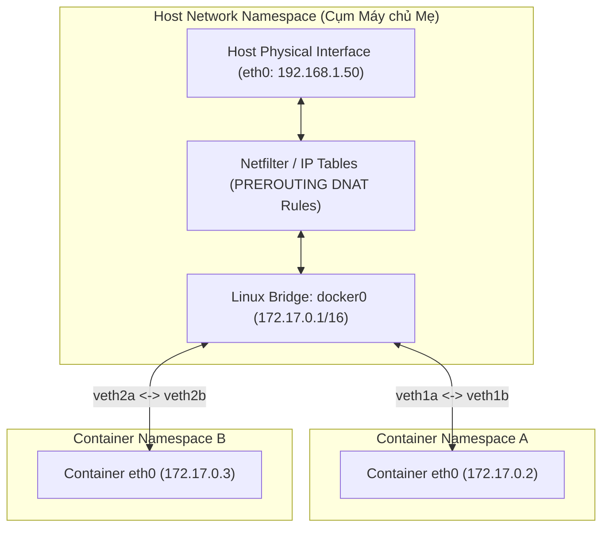
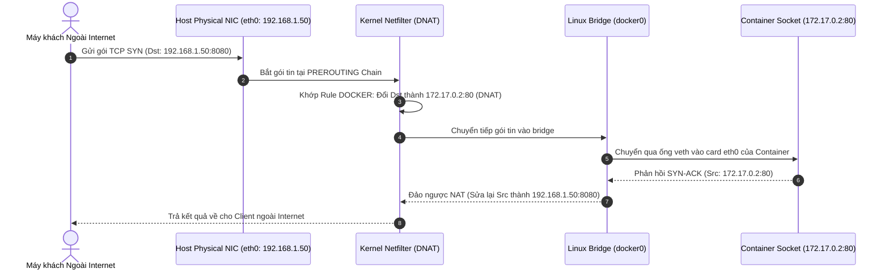
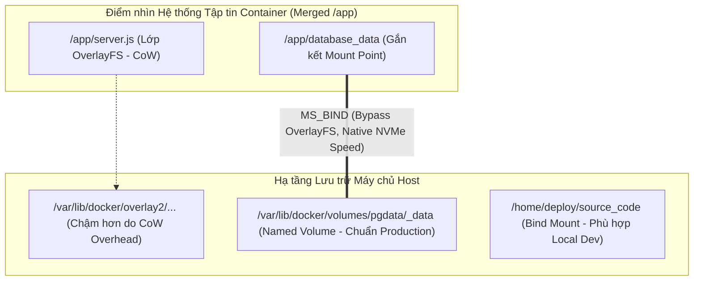
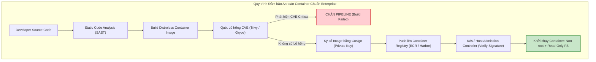

# 6.2. Networking, Storage, Security and Compose (Mạng, Lưu trữ, Bảo mật Container và Docker Compose)

## Tổng quan về Mạng, Lưu trữ và Bảo mật Container
Vận hành container trong môi trường sản xuất (Production) đòi hỏi sự kết hợp chặt chẽ giữa các giải pháp mạng ảo hóa (Container Networking), lưu trữ dữ liệu bền bỉ (Container Storage Volumes), cơ chế kiểm tra tính sẵn sàng (Health Checks) và các tầng bảo mật phòng thủ chiều sâu (Rootless Containers, Image Signing, Least Privilege). 

Về mặt kỹ thuật mạng Linux Kernel:
Mạng Bridge trong Docker hoạt động bằng cách tạo ra một cặp card mạng ảo đối xứng (**Virtual Ethernet Pair - `veth`**):
Một đầu của cặp `veth` được cắm vào Linux Bridge (`docker0`) trong Network Namespace của máy chủ mẹ (Host OS), đầu còn lại được đưa vào Network Namespace độc lập của container và đổi tên thành `eth0`:
$$\text{Host Bridge } (docker0) \longleftrightarrow [vethA] \xleftrightarrow{\quad\text{Kernel Pipe}\quad} [vethB] \longleftrightarrow \text{Container Namespace } (eth0)$$
Mọi lưu lượng ra vào giữa container và mạng Internet bên ngoài đều được xử lý thông qua cơ chế chuyển đổi địa chỉ mạng (DNAT / SNAT) do Linux Kernel Netfilter (`iptables` hoặc `nftables`) điều phối.



---

## 2. Chi tiết từng Keyword (Under-the-Hood Deep Dive)

---

### 1. Container Networking Modes & Port Mapping

#### 1. Khái niệm bản chất (What & Why)
- **Bridge Networking (Mặc định)**: Tạo một switch mạng ảo bằng phần mềm (`docker0` có dải IP riêng, thường là `172.17.0.0/16`). Các container trên cùng một máy chủ giao tiếp với nhau qua bridge này, hoàn toàn cách ly với mạng LAN bên ngoài.
- **Host Networking (`--net=host`)**: Container không sở hữu Network Namespace riêng mà chia sẻ trực tiếp stack mạng của Host OS. Không có độ trễ dịch địa chỉ NAT, hiệu năng mạng thô đạt $100\%$ tốc độ phần cứng, nhưng gây nguy cơ xung đột cổng (Port Conflict) và giảm tính an toàn.
- **Overlay Networking**: Mạng ảo hóa phân tán trải rộng trên nhiều máy chủ vật lý khác nhau (Multi-host networking trong Docker Swarm hoặc Kubernetes). Sử dụng giao thức đóng gói VXLAN (UDP Port 4789) để tạo cảm giác các container trên các máy khác nhau như đang cắm chung một switch mạng cục bộ.
- **Port Mapping (Ánh xạ Cổng: `-p 8080:80`)**: Mở cổng từ bên ngoài vào container. Bất kỳ request nào gửi tới cổng `8080` của Host OS sẽ được chuyển tiếp vào cổng `80` của Container.

#### 2. Cơ chế hoạt động sâu (Under the hood / Hardcore Internals)
- **Bản chất chuỗi iptables trong Port Mapping (DNAT & SNAT)**:
  - Khi gõ `docker run -p 8080:80 myapp`, Docker Daemon tự động chèn một quy tắc vào bảng `nat` của Linux Kernel:
    `iptables -t nat -A PREROUTING -m addrtype --dst-type LOCAL -p tcp --dport 8080 -j DOCKER`
    `iptables -t nat -A DOCKER ! -i docker0 -p tcp --dport 8080 -j DNAT --to-destination 172.17.0.2:80`
  - Khi gói tin từ bên ngoài chạm vào card mạng vật lý của Host ở port 8080, Netfilter thực hiện **Destination NAT (DNAT)**: sửa IP đích từ IP máy chủ mẹ thành `172.17.0.2` và sửa Port đích thành `80`, sau đó đẩy gói tin qua `docker0` bridge vào `veth` của container.
  - Khi container gửi request ra Internet (ví dụ: gọi API bên ngoài), iptables thực hiện **Source NAT (MASQUERADE)**: sửa IP nguồn `172.17.0.2` thành IP thực tế của máy chủ Host để có thể định tuyến được ngoài Internet.

#### 3. Sơ đồ minh họa


#### 4. Code ví dụ thực chiến (C++ Network Namespace & Socket Inspector)
Đoạn mã C++ kiểm tra xem tiến trình hiện tại đang chạy trong Network Namespace của Host hay bên trong một Container cô lập bằng cách phân tích inode của namespace:

```cpp
#include <iostream>
#include <unistd.h>
#include <sys/stat.h>
#include <string>

class NamespaceInspector {
public:
    static ino_t getNetworkNamespaceInode(pid_t pid) {
        std::string path = "/proc/" + std::to_string(pid) + "/ns/net";
        struct stat st{};
        if (stat(path.c_str(), &st) != 0) {
            std::cerr << "Không thể đọc namespace cho PID: " << pid << "\n";
            return 0;
        }
        return st.st_ino;
    }

    static void compareWithHost() {
        ino_t my_netns = getNetworkNamespaceInode(getpid());
        ino_t init_netns = getNetworkNamespaceInode(1); // PID 1 luôn đại diện cho Host OS (hoặc Container Init)

        std::cout << "[Process PID: " << getpid() << "] Network Namespace Inode: " << my_netns << "\n";
        std::cout << "[System PID: 1   ] Network Namespace Inode: " << init_netns << "\n";

        if (my_netns == init_netns) {
            std::cout << "-> Kết luận: Tiến trình đang dùng chung Network Namespace với PID 1 (Host Network Mode).\n";
        } else {
            std::cout << "-> Kết luận: Tiến trình đang chạy trong một Network Namespace HOÀN TOÀN CÔ LẬP (Bridge/Overlay Mode).\n";
        }
    }
};

int main() {
    std::cout << "--- Kiểm tra Không gian Mạng Container Linux ---\n";
    NamespaceInspector::compareWithHost();
    return 0;
}
```

#### 5. Ưu / Nhược điểm, Pitfalls & Anti-patterns
- **Bridge Network**: Rất an toàn và cô lập tốt, nhưng chịu phụ phí xử lý gói tin qua iptables conntrack (khoảng $5\% - 10\%$ CPU overhead khi chịu tải hàng trăm nghìn gói tin/giây).
- **Pitfall**: Mặc định Docker Bridge không cung cấp tính năng phân giải DNS tự động theo tên container (DNS Resolution by Name). Muốn các container gọi nhau bằng tên (`curl http://auth-service:8080`), kỹ sư bắt buộc phải tạo một Custom Bridge Network (`docker network create my-net`) thay vì dùng bridge mặc định.

#### 6. Ứng dụng thực tế trong Backend / Systems
- Thiết lập cụm microservices trên máy chủ cục bộ: Frontend container, Backend container và Database container kết nối chung vào một User-Defined Bridge Network, chỉ phơi bày duy nhất cổng 443 của Frontend ra ngoài Host.

---

### 2. Container Storage: Bind Mounts, Volumes & Lifecycle Management

#### 1. Khái niệm bản chất (What & Why)
- **Container Lifecycle (Vòng đời Container)**: Các trạng thái chuyển dịch của container: `Created` $\to$ `Running` $\to$ `Paused` $\to$ `Stopped` $\to$ `Dead`.
  - Khi dừng container (`docker stop`), Docker Daemon gửi tín hiệu **`SIGTERM` (Signal 15)** yêu cầu ứng dụng thực hiện dọn dẹp kết nối an toàn (Graceful Shutdown). Sau thời gian chờ mặc định (10 giây), nếu ứng dụng chưa thoát, Docker sẽ gửi tín hiệu **`SIGKILL` (Signal 9)** ép buộc nhân Linux ngắt tiến trình ngay lập tức.
- **Vấn đề PID 1 và Signal Forwarding**:
  - Nếu ứng dụng được khởi chạy qua Shell script (dạng `ENTRYPOINT ./start.sh` hoặc Shell Form `CMD npm start`), Shell sẽ chiếm giữ `PID = 1`.
  - Mặc định, Linux Shell không tự động chuyển tiếp tín hiệu `SIGTERM` cho các tiến trình con (Node.js/C++). Khi Docker Stop gửi `SIGTERM`, ứng dụng không hề nhận được tín hiệu, dẫn đến việc luôn bị `SIGKILL` sau 10 giây và làm hỏng các giao dịch dở dang (Corrupted Transactions).
- **Bind Mounts vs Named Volumes**:
  - *Bind Mounts*: Gắn kết trực tiếp một đường dẫn thư mục tùy ý từ Host OS vào container (`-v /home/user/app:/app`). Phụ thuộc hoàn toàn vào cấu trúc thư mục của máy chủ vật lý, phù hợp cho môi trường phát triển (Hot Reloading).
  - *Named Volumes*: Vùng lưu trữ dữ liệu được quản lý hoàn toàn bởi Docker Daemon trong `/var/lib/docker/volumes/<vol-name>/_data`. Độc lập với hệ điều hành mẹ, hiệu năng I/O cao hơn, hỗ trợ Volume Drivers để mount trực tiếp từ Cloud Storage (NFS, AWS EBS).

#### 2. Cơ chế hoạt động sâu (Under the hood / Hardcore Internals)
- **Cơ chế `mount --bind` trong Linux Kernel**:
  - Khi một Bind Mount hoặc Named Volume được kích hoạt, Docker không sao chép dữ liệu. Thay vào đó, nó gọi trực tiếp system call `mount(host_src, container_target, "", MS_BIND, NULL)`.
  - Kernel tạo một điểm nhìn ảo (VFS Inode Alias). Bất kỳ thao tác đọc ghi nào từ bên trong container tại thư mục này đều **bỏ qua hoàn toàn lớp OverlayFS**, dữ liệu được ghi trực tiếp vào đĩa cứng vật lý của Host với tốc độ I/O nguyên bản ($100\%$ Native Disk Performance).

#### 3. Sơ đồ minh họa


#### 4. Code ví dụ thực chiến (C++ POSIX Signal Handling for Graceful Shutdown)
Đoạn mã C++ minh họa việc bắt và xử lý chuẩn xác tín hiệu `SIGTERM` từ Docker Engine để đảm bảo Container dừng an toàn:

```cpp
#include <iostream>
#include <csignal>
#include <atomic>
#include <thread>
#include <chrono>

std::atomic<bool> is_running{true};

// Hàm xử lý tín hiệu OS
void signalHandler(int signum) {
    if (signum == SIGTERM || signum == SIGINT) {
        std::cout << "\n[Signal Received] Nhận tín hiệu " 
                  << (signum == SIGTERM ? "SIGTERM (từ Docker Stop)" : "SIGINT (Ctrl+C)") 
                  << "! Bắt đầu chu trình Graceful Shutdown...\n";
        is_running.store(false, std::memory_order_release);
    }
}

int main() {
    // Đăng ký bắt tín hiệu từ Linux Kernel
    std::signal(SIGTERM, signalHandler);
    std::signal(SIGINT, signalHandler);

    std::cout << "[Container PID: " << getpid() << "] Ứng dụng Backend đang chạy và lắng nghe kết nối...\n";

    // Vòng lặp sự kiện chính của ứng dụng
    while (is_running.load(std::memory_order_acquire)) {
        std::this_thread::sleep_for(std::chrono::milliseconds(500));
        // Xử lý logic nghiệp vụ...
    }

    // Giai đoạn dọn dẹp trước khi thoát
    std::cout << "[Shutdown Phase 1] Đóng kết nối TCP Socket, từ chối nhận request mới...\n";
    std::cout << "[Shutdown Phase 2] Chờ các giao dịch cơ sở dữ liệu dở dang hoàn tất...\n";
    std::this_thread::sleep_for(std::chrono::milliseconds(800)); // Giả lập dọn dẹp
    std::cout << "[Shutdown Complete] Toàn bộ tài nguyên đã giải phóng. Thoát tiến trình an toàn với Exit Code 0.\n";

    return 0;
}
```

#### 5. Ưu / Nhược điểm, Pitfalls & Anti-patterns
- **Named Volumes**: Dữ liệu được bảo toàn vĩnh viễn khi xóa container (`docker rm`), hiệu năng ghi đĩa thô tối đa.
- **Pitfall**: Lưu trữ dữ liệu cơ sở dữ liệu (MySQL/PostgreSQL) trực tiếp bên trong lớp lưu trữ mặc định của container (Writable Layer của OverlayFS) mà không dùng Volume. Khi container bị xóa, toàn bộ dữ liệu sẽ biến mất vĩnh viễn không thể khôi phục.

#### 6. Ứng dụng thực tế trong Backend / Systems
- Sử dụng Docker Named Volume kết hợp các tham số tối ưu cờ mount (`noatime,nodiratime`) cho thư mục dữ liệu của PostgreSQL nhằm đạt thông lượng ghi nhật ký WAL tối đa.

---

### 3. Container Security, Hardening & Docker Compose

#### 1. Khái niệm bản chất (What & Why)
- **Container Security (Bảo mật Container)**: Nguyên tắc cốt lõi: *"Không bao giờ chạy ứng dụng bằng quyền Root bên trong container"*. Nếu hacker khai thác được lỗ hổng Remote Code Execution (RCE) trong ứng dụng chạy quyền root, chúng có thể tận dụng các lỗ hổng nhân hệ điều hành để thoát khỏi container (Container Escape) và chiếm quyền điều khiển máy chủ mẹ.
- **Rootless Containers**: Chạy Docker Daemon và các container hoàn toàn dưới quyền của một tài khoản người dùng bình thường không có đặc quyền (Unprivileged User) trên Host OS. Tận dụng User Namespaces để ánh xạ root ảo.
- **Distroless Images**: Các image chỉ chứa mã nguồn ứng dụng và các thư viện runtime phụ thuộc tối thiểu. Hoàn toàn loại bỏ Shell (`/bin/sh`, `/bin/bash`), trình quản lý gói (`apt`, `apk`), và các công cụ hệ thống (`curl`, `nc`), thu hẹp tối đa bề mặt tấn công của mã độc.
- **Image Scanning & Signing**:
  - *Image Scanning (Trivy, Grype, Snyk)*: Quét phân tích các lớp image để tìm kiếm các lỗ hổng bảo mật đã biết (CVEs).
  - *Image Signing (Cosign / Sigstore, Notary)*: Ký số mật mã lên image trước khi đẩy lên Container Registry, đảm bảo rằng hệ thống chỉ cho phép chạy các image chính chủ và chưa bị giả mạo mã độc.
- **Docker Compose**: Công cụ khai báo và quản lý cấu hình nhiều container phụ thuộc lẫn nhau (Multi-container applications) trong một file YAML duy nhất (`docker-compose.yml`), tự động thiết lập mạng nội bộ chung, chia sẻ volumes và quản lý thứ tự khởi động (`depends_on`).

#### 2. Cơ chế hoạt động sâu (Under the hood / Hardcore Internals)
- **Linux Capabilities & Seccomp Dropping**:
  - Mặc định, một container dù chạy quyền root cũng đã bị Docker tước bỏ hơn $20$ đặc quyền nguy hiểm của Linux Kernel (Linux Capabilities).
  - Để tăng cường bảo mật cực hạn, kỹ sư sử dụng cờ:
    `--cap-drop=ALL --cap-add=NET_BIND_SERVICE --read-only`
  - Cấu hình này:
    1. Tước bỏ toàn bộ Capabilities của Kernel (không thể load kernel modules, không thể can thiệp network interface).
    2. Chỉ cấp lại đúng quyền lắng nghe port dưới 1024 (`NET_BIND_SERVICE`).
    3. Ép buộc toàn bộ hệ thống tập tin gốc của container trở thành chỉ đọc (`--read-only`), vô hiệu hóa hoàn toàn khả năng hacker tải file mã độc (Malware drop) vào `/tmp` hoặc `/var`.

#### 3. Sơ đồ minh họa


#### 4. Code ví dụ thực chiến (Production-Ready Docker Compose Stack)
File `docker-compose.yml` chuẩn mực: Bao gồm Network cô lập, Named Volume, kiểm tra Health Check chuẩn xác, giới hạn tài nguyên cgroups, và chạy non-root user:

```yaml
version: "3.8"

services:
  # -------------------------------------------------------------
  # Dịch vụ Cơ sở dữ liệu: PostgreSQL
  # -------------------------------------------------------------
  database:
    image: postgres:16-alpine
    container_name: production_db
    restart: unless-stopped
    environment:
      POSTGRES_DB: app_db
      POSTGRES_USER: db_user
      POSTGRES_PASSWORD_FILE: /run/secrets/db_password
    secrets:
      - db_password
    volumes:
      - db_data:/var/lib/postgresql/data
    networks:
      - backend_network
    # Giới hạn tài nguyên cgroups
    deploy:
      resources:
        limits:
          cpus: "1.5"
          memory: 1024M
    # Kiểm tra trạng thái sống của DB
    healthcheck:
      test: ["CMD-SHELL", "pg_isready -U db_user -d app_db"]
      interval: 10s
      timeout: 5s
      retries: 5

  # -------------------------------------------------------------
  # Dịch vụ Backend API: Node.js / TypeScript App
  # -------------------------------------------------------------
  api_service:
    build:
      context: .
      dockerfile: Dockerfile
    container_name: production_api
    restart: on-failure
    environment:
      NODE_ENV: production
      PORT: 8080
      DATABASE_HOST: database
    ports:
      - "8080:8080"
    networks:
      - backend_network
    depends_on:
      database:
        condition: service_healthy # Chỉ khởi động API khi Database đã sẵn sàng nhận kết nối
    # Bảo mật: Hệ thống tập tin chỉ đọc, chỉ cho phép ghi thư mục tạm trong RAM
    read_only: true
    tmpfs:
      - /tmp:rw,noexec,nosuid,size=64m
    deploy:
      resources:
        limits:
          cpus: "2.0"
          memory: 2048M

secrets:
  db_password:
    file: ./secrets/db_password.txt

volumes:
  db_data:
    driver: local

networks:
  backend_network:
    driver: bridge
```

#### 5. Ưu / Nhược điểm, Pitfalls & Anti-patterns
- **Docker Compose**: Rất trực quan và mạnh mẽ để khởi động toàn bộ môi trường microservices chỉ bằng 1 lệnh (`docker compose up -d`).
- **Pitfall**: Sử dụng Docker Compose cho các cụm sản xuất lớn phân tán trên nhiều máy chủ mà không có cơ chế tự phục hồi nút vật lý. Khi máy chủ chết, Docker Compose không thể tự động di dời container sang máy khác (Nhiệm vụ này thuộc về Kubernetes Orchestration).

#### 6. Ứng dụng thực tế trong Backend / Systems
- Thiết lập môi trường kiểm thử tích hợp tự động (Integration Testing) trong CI/CD: Docker Compose tự động bật Database, Redis và Mock APIs, chạy bộ testsuite kiểm thử và tự động dọn dẹp sạch sẽ tài nguyên sau khi test hoàn tất.
