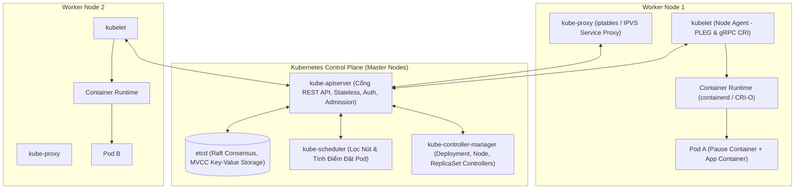
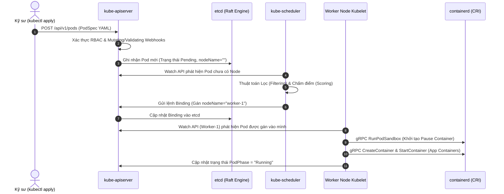
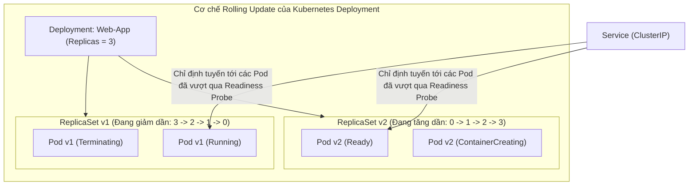

# 7.1. Kubernetes Core Architecture and Workloads (Kiến trúc Lõi và Khối Công việc Kubernetes)

## Tổng quan về Điều phối Container và Kiến trúc Kubernetes
Kubernetes (K8s) là hệ thống điều phối container phân tán mã nguồn mở (Container Orchestration Engine), được thiết kế để tự động hóa việc triển khai (Deployment), mở rộng quy mô (Scaling) và quản lý vận hành các ứng dụng đóng gói dưới dạng container. 

Về mặt lý thuyết điều khiển tự động và hệ thống phân tán, Kubernetes vận hành dựa trên nguyên lý **Vòng lặp Hòa giải Khai báo (Declarative Reconciliation Loop)**:
$$\text{Reconciliation Loop: } \lim_{t \to \infty} \left| \text{Actual State}(t) - \text{Desired State} \right| = 0$$
Thay vì thực hiện các mệnh lệnh rời rạc, người dùng chỉ cần khai báo "Trạng thái mong muốn" (Desired State) vào hệ thống (ví dụ: "Duy trì 5 bản sao của Web Pod"). Các bộ điều khiển của Kubernetes sẽ liên tục so sánh trạng thái thực tế của cụm máy chủ với trạng thái mong muốn trong cơ sở dữ liệu phân tán và tự động phát lệnh bổ sung hoặc tiêu hủy tài nguyên để đưa hệ thống hội tụ về trạng thái mong muốn.



---

## 2. Chi tiết từng Keyword (Under-the-Hood Deep Dive)

---

### 1. Control Plane & Worker Node Internals

#### 1. Khái niệm bản chất (What & Why)
- **Control Plane (Mặt phẳng Điều khiển)**: Bộ não của cụm Kubernetes, chịu trách nhiệm đưa ra các quyết định toàn cục (như lập lịch chạy Pod), phát hiện và phản hồi các sự cố phần cứng.
  - *kube-apiserver*: Thành phần duy nhất trong Control Plane giao tiếp trực tiếp với cơ sở dữ liệu `etcd`. Hoạt động như một stateless HTTP REST API Server, xử lý xác thực (Authentication), phân quyền (Authorization - RBAC), và kiểm soát hợp thức hóa (Admission Controllers).
  - *etcd*: Cơ sở dữ liệu phân tán kiểu Key-Value nhất quán cao (Strong Consistency), sử dụng thuật toán đồng thuận **Raft**. Nơi lưu trữ trạng thái duy nhất và toàn diện của toàn bộ cụm Kubernetes.
  - *kube-scheduler*: Quan sát các Pod mới được tạo nhưng chưa được gán Node (`nodeName == ""`), sau đó lựa chọn Worker Node tối ưu nhất cho Pod dựa trên tài nguyên khả dụng, Affinity/Anti-affinity, Taints và Tolerations.
  - *kube-controller-manager (KCM)*: Tiến trình đóng gói hàng chục vòng lặp hòa giải cốt lõi: Node Controller, Deployment Controller, StatefulSet Controller, EndpointSlice Controller, ServiceAccount Controller.
- **Worker Nodes (Mặt phẳng Dữ liệu - Data Plane)**: Các máy chủ trực tiếp chạy các khối lượng công việc (Workloads / Pods).
  - *kubelet*: Agent quản lý nút chạy trực tiếp trên hệ điều hành của Worker Node. Giao tiếp với `kube-apiserver` để nhận thông số PodSpecs và ra lệnh cho Container Runtime khởi động hoặc dừng container.
  - *kube-proxy*: Tiến trình mạng chạy trên mỗi Node, chịu trách nhiệm lập trình các quy tắc chuyển tiếp gói tin trong Linux Kernel (`iptables` hoặc `IPVS`) để hiện thực hóa tính trừu tượng của Kubernetes Service.
- **Chuẩn giao tiếp mở (Container Interfaces)**:
  - *CRI (Container Runtime Interface)*: Chuẩn giao tiếp gRPC giữa Kubelet và Container Runtime (như containerd, CRI-O).
  - *CNI (Container Network Interface)*: Chuẩn cấu hình mạng cho Pods (Flannel, Calico, Cilium).
  - *CSI (Container Storage Interface)*: Chuẩn gắn kết ổ đĩa lưu trữ phân tán vào Pods.

#### 2. Cơ chế hoạt động sâu (Under the hood / Hardcore Internals)
- **Kiểm soát Truy cập Đồng thời Lạc quan (Optimistic Concurrency Control) trong etcd & API Server**:
  - `kube-apiserver` không khóa bảng dữ liệu khi cập nhật. Thay vào đó, mọi đối tượng Kubernetes đều có một trường số hiệu phiên bản duy nhất: **`metadata.resourceVersion`**.
  - Khi hai Controller cùng gửi lệnh cập nhật một Pod, API Server so sánh `resourceVersion` gửi lên với giá trị hiện tại trong `etcd`:
    - Nếu khớp: Cập nhật thành công, `resourceVersion` tự tăng lên 1 đơn vị.
    - Nếu không khớp (đã có bên khác sửa trước): API Server lập tức từ chối với mã lỗi `HTTP 409 Conflict`. Bên gửi lệnh bắt buộc phải đọc lại dữ liệu mới nhất và thử lại từ đầu (Re-read and Retry).
- **Cơ chế PLEG (Pod Lifecycle Event Generator) trong Kubelet**:
  - Kubelet không thăm dò (poll) Container Runtime liên tục vì sẽ làm nghẽn CPU. Thay vào đó, module PLEG định kỳ (mặc định mỗi $1\text{s}$) lấy danh sách trạng thái của toàn bộ container trên nút, so sánh với bộ nhớ đệm nội bộ để phát hiện sự thay đổi, chuyển đổi thành các sự kiện `PodLifecycleEvent` và đẩy vào kênh xử lý của Kubelet.
- **Bản chất của Pause Container (`k8s.gcr.io/pause`)**:
  - Trong mỗi Pod, container đầu tiên được khởi động luôn là một tiến trình tối giản viết bằng C có tên là **Pause Container**.
  - Pause Container gọi các syscall `clone` để khởi tạo các Namespaces mạng (`NET`), IPC và UTS.
  - Tất cả các container ứng dụng khác trong cùng một Pod sau đó được khởi chạy với cờ tham chiếu vào Namespaces của Pause Container (`--net=container:pause_id`). Nhờ đó, các container trong cùng một Pod có thể gọi nhau qua `localhost` và dùng chung 1 địa chỉ IP duy nhất.

#### 3. Sơ đồ minh họa


#### 4. Code ví dụ thực chiến (C++ Pause Container Implementation)
Mô phỏng bản chất của Kubernetes Pause Container: Xử lý `PID 1`, dọn dẹp các tiến trình ma (Reaping Zombie Processes) và chuyển sang trạng thái ngủ đông vô hạn bằng `pause()` system call:

```cpp
#include <iostream>
#include <csignal>
#include <unistd.h>
#include <sys/wait.h>

// Hàm xử lý việc dọn dẹp tiến trình con bị mồ côi (Zombie Process Reaping)
void sigchld_handler(int) {
    // Thu hoạch tất cả các tiến trình con đã chết để giải phóng mục trong Process Table của Kernel
    while (waitpid(-1, nullptr, WNOHANG) > 0) {
        std::cout << "[Pause Container PID 1] Đã dọn dẹp (Reaped) một tiến trình con mồ côi (Zombie).\n";
    }
}

int main() {
    std::cout << "[Pause Container] Khởi động với vai trò PID 1 của Pod...\n";

    // 1. Đăng ký bắt tín hiệu SIGCHLD khi tiến trình con kết thúc
    struct sigaction sa{};
    sa.sa_handler = sigchld_handler;
    sa.sa_flags = SA_RESTART | SA_NOCLDSTOP;
    sigaction(SIGCHLD, &sa, nullptr);

    // 2. Chặn các tín hiệu ngắt thông thường để duy trì Pod Namespaces
    signal(SIGINT, SIG_IGN);

    std::cout << "[Pause Container] Đã giữ vững Network & IPC Namespaces cho Pod. Chuyển sang trạng thái pause()...\n";

    // Vòng lặp ngủ đông vĩnh viễn, chỉ thức giấc khi nhận tín hiệu từ Kernel
    while (true) {
        pause(); // Tạm dừng luồng thực thi, tiêu tốn 0% CPU
    }

    return 0;
}
```

#### 5. Ưu / Nhược điểm, Pitfalls & Anti-patterns
- **Ưu điểm**: Khả năng phục hồi sự cố tự động (Self-healing), điều phối hàng vạn container trên hàng ngàn máy chủ chỉ bằng các API khai báo chuẩn mực.
- **Pitfall**: Đặt `etcd` trên ổ cứng có IOPS thấp. Do `etcd` đòi hỏi độ trễ ghi fsync tuần tự cực nhỏ ($< 10\text{ms}$), nếu đĩa bị nghẽn, etcd sẽ bị mất đồng thuận Raft (Leader election timeout), khiến toàn bộ Control Plane bị đóng băng.

#### 6. Ứng dụng thực tế trong Backend / Systems
- Cung cấp hạ tầng phân tán cho các nền tảng đám mây lớn (Google GKE, AWS EKS, Azure AKS), nơi hàng triệu container vi dịch vụ được khởi tạo và điều phối mỗi ngày.

---

### 2. Workload Controllers: Pods, Deployments, StatefulSets & DaemonSets

#### 1. Khái niệm bản chất (What & Why)
- **Pod**: Đơn vị tính toán nguyên tử nhỏ nhất trong Kubernetes. Một Pod đại diện cho một hoặc nhiều container cùng chia sẻ tài nguyên lưu trữ, mạng và cấu hình thực thi.
  - *Multi-Container Pod Patterns*:
    - *Init Containers*: Chạy tuần tự và phải hoàn tất thành công trước khi các container chính được khởi động (ví dụ: chờ database sẵn sàng, chạy migrate database).
    - *Sidecar Containers*: Chạy song song và đồng hành cùng container chính suốt vòng đời (ví dụ: Envoy Proxy trong Service Mesh, FluentBit gom log).
- **Deployments & ReplicaSets**: Quản lý các ứng dụng **Phi trạng thái (Stateless Workloads)**. Deployment điều phối ReplicaSet bên dưới để thực hiện cập nhật phiên bản không gián đoạn (Rolling Updates) và hỗ trợ hoàn tác tức thì (Rollbacks).
- **StatefulSets**: Quản lý các ứng dụng **Có lưu giữ trạng thái (Stateful Workloads)** như database, Kafka cluster, Elasticsearch:
  - Cung cấp định danh mạng duy nhất và cố định cho từng Pod theo số thứ tự (ví dụ: `postgres-0`, `postgres-1`).
  - Gắn kết với các ổ cứng lưu trữ độc lập thông qua `volumeClaimTemplates` (khi Pod bị xóa và tạo lại, nó sẽ gắn lại đúng ổ cứng cũ).
  - Khởi tạo và tắt tuần tự có thứ tự nghiêm ngặt (Ordered Graceful Deployment & Scaling).
- **DaemonSets**: Đảm bảo rằng **mọi Worker Node** (hoặc một nhóm node cụ thể) luôn chạy chính xác một bản sao của Pod (thích hợp cho các daemon giám sát node như Prometheus Node Exporter, Fluentd, CNI Daemon Calico/Cilium).
- **Jobs & CronJobs**:
  - *Job*: Chạy một hoặc nhiều Pod đến khi hoàn tất nhiệm vụ (Exit code 0) rồi dừng lại (xử lý dữ liệu hàng loạt - Batch Processing).
  - *CronJob*: Tự động khởi chạy Job theo lịch biểu thời gian định kỳ (Cron format: `0 2 * * *`).

#### 2. Cơ chế hoạt động sâu (Under the hood / Hardcore Internals)
- **Cơ chế Cập nhật Cuộn (Rolling Update) của Deployment Controller**:
  - Khi bạn cập nhật image của Deployment từ `v1` lên `v2`:
    1. Deployment Controller tạo ra một **ReplicaSet mới ($RS_{v2}$)** với `replicas = 0`.
    2. Dựa trên tham số `maxSurge` (số lượng Pod vượt quá mức cấu hình cho phép) và `maxUnavailable` (số lượng Pod tối đa được phép chết trong quá trình update), Deployment tăng dần số lượng Pod trên $RS_{v2}$ và giảm dần Pod trên $RS_{v1}$.
    3. Một Pod $v2$ mới chỉ được tính là sẵn sàng khi vượt qua các bài kiểm tra **Readiness Probe**. Ngay khi Pod $v2$ sẵn sàng, traffic của Service sẽ được chuyển hướng sang nó, và một Pod $v1$ cũ sẽ bị gửi tín hiệu `SIGTERM` để giải phóng.
    4. ReplicaSet cũ ($RS_{v1}$) không bị xóa mà được giữ lại với `replicas = 0` nhằm mục đích hỗ trợ lệnh `kubectl rollout undo` khôi phục phiên bản tức thời trong 1 giây.

#### 3. Sơ đồ minh họa


#### 4. Code ví dụ thực chiến (Kubernetes Production StatefulSet Manifest)
Manifest YAML chuẩn hóa cho một cụm cơ sở dữ liệu phân tán có trạng thái (StatefulSet) với `volumeClaimTemplates` và Headless Service:

```yaml
apiVersion: v1
kind: Service
metadata:
  name: cassandra-headless
  labels:
    app: cassandra
spec:
  clusterIP: None # Headless Service: Phân giải trực tiếp IP của từng Pod
  ports:
    - port: 9042
      name: cql
  selector:
    app: cassandra
---
apiVersion: apps/v1
kind: StatefulSet
metadata:
  name: cassandra
spec:
  serviceName: "cassandra-headless"
  replicas: 3
  podManagementPolicy: OrderedReady # Khởi tạo tuần tự từng Pod một
  selector:
    matchLabels:
      app: cassandra
  template:
    metadata:
      labels:
        app: cassandra
    spec:
      terminationGracePeriodSeconds: 60 # Cho phép 60 giây dọn dẹp trước khi bị SIGKILL
      containers:
        - name: cassandra-node
          image: cassandra:4.1
          resources:
            requests:
              cpu: "2"
              memory: "4Gi"
            limits:
              cpu: "4"
              memory: "8Gi"
          ports:
            - containerPort: 9042
              name: cql
          volumeMounts:
            - name: cassandra-data
              mountPath: /var/lib/cassandra
  # Cấp phát động ổ cứng đĩa độc lập cho từng bản sao Pod
  volumeClaimTemplates:
    - metadata:
        name: cassandra-data
      spec:
        accessModes: ["ReadWriteOnce"]
        storageClassName: "gp3-sc" # StorageClass Cloud Block Storage
        resources:
          requests:
            storage: 100Gi
```

#### 5. Ưu / Nhược điểm, Pitfalls & Anti-patterns
- **Deployments**: Cực kỳ mượt mà cho ứng dụng stateless; tuy nhiên không được dùng cho cơ sở dữ liệu vì các bản sao chia sẻ cùng volume sẽ gây xung đột hỏng dữ liệu (Data Corruption).
- **Pitfall**: Đặt `maxUnavailable: 100%` trong Deployment Rolling Update. Khi update phiên bản mới, toàn bộ các Pod cũ sẽ bị tiêu diệt đồng loạt trước khi Pod mới kịp khởi động, dẫn đến việc sập hệ thống trong vài phút.

#### 6. Ứng dụng thực tế trong Backend / Systems
- Sử dụng StatefulSet để triển khai cụm Kafka Brokers và MongoDB Replica Sets trên Kubernetes, kết hợp với Deployments cho toàn bộ tầng xử lý API nghiệp vụ.
