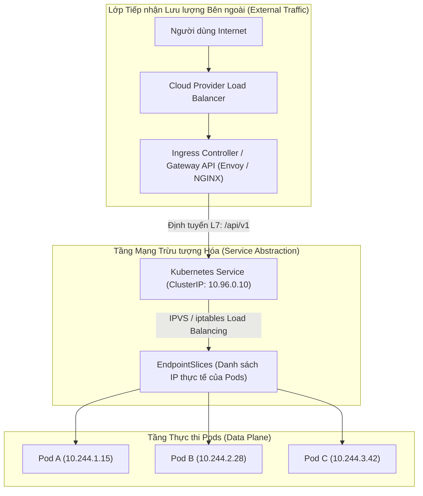
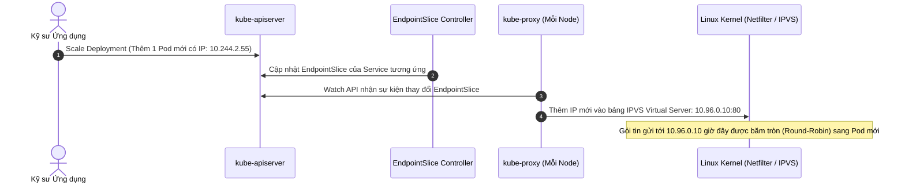
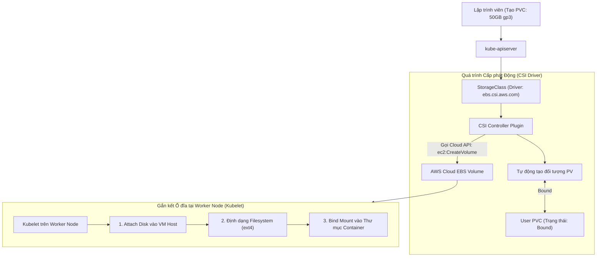
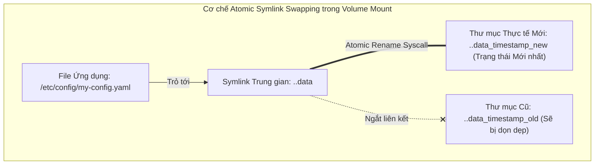

# 7.2. Kubernetes Networking, Storage and Configuration (Mạng, Lưu trữ và Cấu hình Kubernetes)

## Tổng quan về Mạng Dịch vụ, Lưu trữ và Cấu hình Kubernetes
Hạ tầng Kubernetes tách biệt hoàn toàn giữa vòng đời tạm thời của các Pods (Ephemeral Pod Lifecycle) và các thành phần trừu tượng hóa mạng bền vững (Services, Ingress, Gateway API), lưu trữ dữ liệu lâu dài (Persistent Volumes, CSI) và quản lý cấu hình tập trung (ConfigMaps, Secrets).

Về mặt độ phức tạp thuật toán và định tuyến mạng:
Trong các cụm Kubernetes quy mô lớn ($> 5000$ Services), `kube-proxy` ở chế độ **iptables mode** gặp phải vấn đề nghiêm trọng về hiệu năng do thuật toán duyệt tuần tự:
$$\text{Độ phức tạp tra cứu iptables: } \mathcal{O}(N)$$
Mỗi khi có một Service hoặc Pod mới được tạo hay xóa, Linux Kernel phải tải lại toàn bộ danh sách hàng chục ngàn rules trong iptables. Việc chuyển đổi sang **IPVS mode (IP Virtual Server)** sử dụng cấu trúc bảng băm (Hash Tables) giúp đưa độ phức tạp định tuyến và cập nhật về:
$$\text{Độ phức tạp tra cứu IPVS: } \mathcal{O}(1)$$
IPVS tối ưu hóa đáng kể việc chuyển tiếp gói tin, giảm tải CPU của Worker Nodes xuống mức tối thiểu.



---

## 2. Chi tiết từng Keyword (Under-the-Hood Deep Dive)

---

### 1. Kubernetes Services, kube-proxy & Gateway API

#### 1. Khái niệm bản chất (What & Why)
- **Kubernetes Service**: Một đối tượng trừu tượng định nghĩa một tập hợp logic các Pods và chính sách truy cập vào chúng thông qua một địa chỉ IP ảo cố định (**Virtual IP - VIP**) và tên miền DNS nội bộ.
  - *ClusterIP (Mặc định)*: Chỉ cấp phát một VIP nội bộ bên trong cụm. Các dịch vụ khác trong cụm gọi tới VIP này, không thể truy cập từ bên ngoài Internet.
  - *NodePort*: Mở một cổng cố định trên toàn bộ các Worker Nodes (mặc định trong dải `30000-32767`). Bất kỳ ai gửi request tới `<Node-IP>:<NodePort>` đều được chuyển tiếp vào Service.
  - *LoadBalancer*: Tự động kích hoạt Cloud Controller Manager để cấp phát một bộ cân bằng tải thực tế của Cloud Provider (như AWS NLB, GCP Network LB) trỏ trực tiếp vào các NodePort của cụm.
  - *Headless Service (`clusterIP: None`)*: Không cấp phát VIP. Khi truy vấn CoreDNS, DNS trả về trực tiếp danh sách địa chỉ IP thực tế của toàn bộ các Pods đang sẵn sàng (dùng cho StatefulSets và giao tiếp ngang hàng P2P).
- **Ingress & Ingress Controllers**: Bộ điều phối định tuyến ở tầng ứng dụng Layer-7 (HTTP/HTTPS). Cho phép định tuyến dựa trên Hostname (`api.example.com`) và URL Path (`/users`), đồng thời xử lý TLS Termination. Đòi hỏi phải cài đặt một Ingress Controller thực tế (như NGINX Ingress, Traefik, HAProxy).
- **Gateway API (Chuẩn thế hệ mới thay thế Ingress)**: Bộ API mã nguồn mở của CNCF, khắc phục các hạn chế của Ingress cũ:
  - Phân quyền theo vai trò (Role-oriented Design): `GatewayClass` (dành cho Infrastructure Provider), `Gateway` (dành cho Cluster Operator), `HTTPRoute` / `GRPCRoute` (dành cho Application Developer).
  - Hỗ trợ giao thức phong phú (gRPC, TCP, UDP), can thiệp Header, Weight-based Traffic Splitting (Canary) chuẩn hóa mà không cần annotations độc quyền.

#### 2. Cơ chế hoạt động sâu (Under the hood / Hardcore Internals)
- **VIP thực chất không tồn tại trên bất kỳ Card mạng nào**:
  - Địa chỉ IP của Service (ClusterIP) là một địa chỉ IP ảo hoàn toàn không có thực (không gắn vào bất kỳ card mạng ảo `eth0` hay `veth` nào).
  - Khi một Pod gửi gói tin tới IP của Service, gói tin đi qua kernel stack của Host Node.
  - Tại đây, `kube-proxy` đã cài đặt sẵn các quy tắc Netfilter (`iptables` hoặc `ipvs`). Kernel bắt chặn gói tin, nhận diện IP đích là Service VIP, và thực hiện thuật toán bốc thăm ngẫu nhiên (Statistic Mode trong iptables) để thay thế IP đích bằng một trong các IP thực tế của Pod (DNAT) từ danh sách **EndpointSlices**.
- **EndpointSlices**:
  - Trước bản Kubernetes 1.19, đối tượng `Endpoints` gom toàn bộ danh sách IP của hàng ngàn Pod vào một object duy nhất. Mỗi khi 1 Pod chết đi và tái sinh, toàn bộ object lớn đó bị ghi đè, làm quá tải `etcd` và API Server.
  - `EndpointSlices` chia nhỏ danh sách IP của các Pods thành nhiều mảnh nhỏ (mỗi mảnh tối đa 100 endpoints), giúp giảm $90\%$ lưu lượng mạng nội bộ của Control Plane khi quy mô cụm mở rộng.

#### 3. Sơ đồ minh họa


#### 4. Code ví dụ thực chiến (Kubernetes Gateway API & HTTPRoute Manifest)
Khai báo định tuyến lưu lượng thông minh sử dụng Gateway API chuẩn hóa thế hệ mới:

```yaml
apiVersion: gateway.networking.k8s.io/v1
kind: Gateway
metadata:
  name: production-gateway
  namespace: infrastructure
spec:
  gatewayClassName: envoy-gateway # Do Cluster Admin quản lý
  listeners:
    - name: https-listener
      protocol: HTTPS
      port: 443
      tls:
        mode: Terminate
        certificateRefs:
          - name: wildcard-example-com-tls
---
apiVersion: gateway.networking.k8s.io/v1
kind: HTTPRoute
metadata:
  name: order-service-route
  namespace: backend
spec:
  parentRefs:
    - name: production-gateway
      namespace: infrastructure
  hostnames:
    - "api.company.com"
  rules:
    - matches:
        - path:
            type: PathPrefix
            value: /orders
      backendRefs:
        # Hỗ trợ Canary Splitting trực tiếp trong chuẩn Gateway API
        - name: order-service-v1
          port: 8080
          weight: 90 # 90% Lưu lượng
        - name: order-service-v2
          port: 8080
          weight: 10 # 10% Lưu lượng (Canary Testing)
```

#### 5. Ưu / Nhược điểm, Pitfalls & Anti-patterns
- **NodePort**: Tiện lợi khi kiểm thử nhưng tiêu tốn cổng trên toàn bộ máy chủ, có nguy cơ lộ dịch vụ nếu firewall không được cấu hình chặn bên ngoài.
- **Gateway API**: Linh hoạt và chuẩn hóa tuyệt đối, nhưng đòi hỏi cụm phải cài đặt các Controller hiện đại hỗ trợ Gateway API specs.
- **Pitfall**: Pod gửi request gọi chính Service VIP của nó (Hairpin NAT). Nếu không bật cờ `hairpin-mode` trên Kubelet, gói tin phản hồi sẽ bị kernel drop do nhận thấy IP nguồn và đích trùng lặp.

#### 6. Ứng dụng thực tế trong Backend / Systems
- Sử dụng Gateway API kết hợp Envoy Proxy để thực hiện kỹ thuật phân chia lưu lượng Canary Release 90/10 cho các bản cập nhật API Backend nhạy cảm.

---

### 2. Persistent Storage: PV, PVC, StorageClasses & CSI

#### 1. Khái niệm bản chất (What & Why)
- **Persistent Volume (PV)**: Một tài nguyên lưu trữ thực tế trong cụm (được cung cấp thủ công bởi Administrator hoặc cấp phát tự động bởi StorageClass). Độc lập với vòng đời của bất kỳ Pod nào.
- **Persistent Volume Claim (PVC)**: Yêu cầu xin cấp phát lưu trữ từ phía người dùng (tương tự như cách một Pod "xin" cấp CPU và RAM). Người dùng chỉ định: dung lượng (Storage Size), chế độ truy cập (Access Modes), và StorageClass mong muốn.
- **Access Modes của PVC**:
  - *ReadWriteOnce (RWO)*: Ổ đĩa chỉ có thể được gắn kết đọc/ghi bởi một Pod duy nhất trên một Node duy nhất (chuẩn của Cloud Block Storage như AWS EBS, GCP Persistent Disk).
  - *ReadOnlyMany (ROX)*: Ổ đĩa có thể được gắn kết chỉ đọc bởi nhiều Pods trên nhiều Nodes khác nhau.
  - *ReadWriteMany (RWX)*: Ổ đĩa có thể được gắn kết đọc/ghi đồng thời bởi nhiều Pods trên nhiều Nodes khác nhau (đòi hỏi Network File Storage như AWS EFS, NFS, CephFS).
- **StorageClass (Cấp phát Động - Dynamic Provisioning)**: Trừu tượng hóa việc tạo ổ đĩa. Khi một PVC được áp dụng, StorageClass kích hoạt CSI Driver tương ứng để tự động tạo một ổ đĩa thực tế trên Cloud Provider (ví dụ tạo ổ EBS gp3) và tạo một PV tương ứng gắn liền vào PVC mà không cần Admin can thiệp.

#### 2. Cơ chế hoạt động sâu (Under the hood / Hardcore Internals)
- **Vòng tuần hoàn 3 bước của Container Storage Interface (CSI)**:
  - Khi một Pod có gắn PVC được gán vào Worker Node 1:
    1. *`ControllerPublishVolume` (Attach)*: Bộ điều khiển CSI Controller chạy trên Master Node gọi API của Cloud Provider (như `ec2:AttachVolume`) để gắn ổ đĩa vật lý vào máy ảo Worker Node 1.
    2. *`NodeStageVolume` (Format & Mount Device)*: Kubelet trên Worker Node 1 gọi CSI Node Plugin để định dạng ổ đĩa thành hệ thống tập tin (ví dụ: `mkfs.ext4 /dev/nvme1n1`) và gắn vào một thư mục tạm thời toàn cục trên Node (`/var/lib/kubelet/plugins/kubernetes.io/csi/...`).
    3. *`NodePublishVolume` (Bind Mount)*: Kubelet thực hiện bind-mount thư mục đã stage vào bên trong thư mục rootfs của container (`mount --bind ... /var/lib/kubelet/pods/<pod-uid>/volumes/...`).

#### 3. Sơ đồ minh họa


#### 4. Code ví dụ thực chiến (Kubernetes Dynamic StorageClass & PVC)
Manifest YAML cấu hình StorageClass tối ưu cho ổ đĩa NVMe SSD đám mây với cơ chế trì hoãn cấp phát (`WaitForFirstConsumer`):

```yaml
apiVersion: storage.k8s.io/v1
kind: StorageClass
metadata:
  name: fast-nvme-sc
provisioner: ebs.csi.aws.com # CSI Driver AWS EBS
parameters:
  type: gp3
  iops: "3000"
  throughput: "250"
  encrypted: "true" # Tự động mã hóa KMS
# Chỉ tạo ổ cứng tại đúng Availability Zone mà Pod được lập lịch tới (Tránh lỗi sai AZ)
volumeBindingMode: WaitForFirstConsumer
reclaimPolicy: Retain # Khi xóa PVC, giữ lại dữ liệu trên PV để DBA kiểm tra an toàn
---
apiVersion: v1
kind: PersistentVolumeClaim
metadata:
  name: postgres-storage-claim
  namespace: database
spec:
  accessModes:
    - ReadWriteOnce
  storageClassName: fast-nvme-sc
  resources:
    requests:
      storage: 200Gi
```

#### 5. Ưu / Nhược điểm, Pitfalls & Anti-patterns
- **WaitForFirstConsumer**: Rất quan trọng cho Multi-AZ clusters. Nếu dùng chế độ mặc định `Immediate`, StorageClass có thể tạo ổ đĩa ở AZ-1 trong khi Scheduler lại chọn chạy Pod ở AZ-2, khiến Pod bị kẹt ở trạng thái `MatchNodeSelector / VolumeBindingFailed` vĩnh viễn.
- **Pitfall**: Dùng ổ đĩa `ReadWriteOnce` (Block Storage) cho Deployment có `replicas > 1`. Các bản sao Pod trên các máy khác nhau sẽ không thể gắn kết ổ đĩa và bị lỗi `Multi-Attach error for volume`.

#### 6. Ứng dụng thực tế trong Backend / Systems
- Cấp phát động ổ cứng SSD chuyên dụng tốc độ cao cho các node cơ sở dữ liệu Elasticsearch hoặc MongoDB phân tán trên cụm Kubernetes.

---

### 3. Configuration & Metadata: ConfigMaps, Secrets, Namespaces & Labels

#### 1. Khái niệm bản chất (What & Why)
- **ConfigMaps**: Đối tượng lưu trữ các tham số cấu hình dạng Key-Value không nhạy cảm (như file cấu hình `appsettings.json`, các cờ tính năng, URL endpoint của microservices). Tách rời mã nguồn khỏi môi trường chạy (Tuân thủ nguyên lý 12-Factor App).
- **Secrets**: Đối tượng lưu trữ các dữ liệu nhạy cảm (Passwords, API Keys, TLS Certificates, SSH Keys). Mặc định được mã hóa Base64 (chú ý: Base64 là mã hóa hiển thị, không phải mật mã học). Có thể được bảo vệ bằng KMS Encryption At-Rest bên trong `etcd`.
- **Phương thức Tiêm Cấu hình vào Container (Injection Methods)**:
  - *Environment Variables (Biến Môi trường)*: Đơn giản nhưng không tự động cập nhật khi ConfigMap thay đổi (cần restart Pod).
  - *Volume Mounts (Gắn kết thành Tệp tin)*: Tự động cập nhật nội dung file bên trong container khi ConfigMap được cập nhật (Atomic Projection Update) mà không cần restart Pod.
- **Metadata Management**:
  - *Namespaces (Không gian tên)*: Phân vùng ảo (Virtual Cluster) bên trong một cụm vật lý, cung cấp phạm vi định danh duy nhất (Scope for Names) và áp dụng chính sách hạn mức tài nguyên (ResourceQuotas).
  - *Labels & Selectors*: Các cặp khóa-giá trị (Key-Value) dùng để gán nhãn và nhóm các đối tượng lại với nhau (ví dụ: `tier: backend`, `env: production`). Selectors được Kubernetes dùng để truy vấn và kết nối (ví dụ: Service tìm Pods).
  - *Annotations*: Các trường siêu dữ liệu không dùng để truy vấn định tuyến, mà dùng để lưu thông tin cho các công cụ của bên thứ ba (ví dụ: Ingress annotations cấu hình CORS, Prometheus scraping annotations).

#### 2. Cơ chế hoạt động sâu (Under the hood / Hardcore Internals)
- **Cơ chế Cập nhật Tự động (Atomic Projection Update) của ConfigMap Volume**:
  - Khi một ConfigMap được mount thành volume vào container, Kubelet không mount file đơn lẻ trực tiếp.
  - Thay vào đó, Kubelet sử dụng kỹ thuật tạo liên kết tượng trưng (Symlink Directory Swapping) thông qua một thư mục ẩn `..data`:
    - `/etc/config/app.conf` $\longrightarrow$ trỏ tới `..data/app.conf`
    - `..data` $\longrightarrow$ trỏ tới `..2026_11_09_22_00_00.12345` (Thư mục snapshot chứa file thực tế).
  - Khi ConfigMap được cập nhật trên API Server, Kubelet tải phiên bản mới về một thư mục mới (`..2026_11_09_22_05_00.67890`), sau đó thực hiện lệnh đổi tên nguyên tử (Atomic `rename` system call) của liên kết `..data`.
  - Quá trình này diễn ra hoàn toàn nguyên tử (Atomic), ứng dụng không bao giờ đọc phải file ở trạng thái dở dang (Inconsistent Read State).

#### 3. Sơ đồ minh họa


#### 4. Code ví dụ thực chiến (C++ File Watcher for Kubernetes ConfigMap Dynamic Reloading)
Chương trình C++ sử dụng Linux Kernel `inotify` API để lắng nghe sự thay đổi của ConfigMap được mount qua symlink, tự động nạp lại cấu hình mà không cần khởi động lại container:

```cpp
#include <iostream>
#include <sys/inotify.h>
#include <unistd.h>
#include <limits.h>

class DynamicConfigReloader {
public:
    static void watchConfigDirectory(const std::string& dir_path) {
        int inotify_fd = inotify_init1(IN_NONBLOCK);
        if (inotify_fd < 0) {
            std::cerr << "Lỗi: inotify_init1 thất bại!\n";
            return;
        }

        // Lắng nghe sự kiện di chuyển (IN_MOVED_TO) của symlink ..data
        int wd = inotify_add_watch(inotify_fd, dir_path.c_str(), IN_MOVED_TO | IN_CREATE);
        if (wd < 0) {
            std::cerr << "Lỗi: Không thể theo dõi thư mục: " << dir_path << "\n";
            close(inotify_fd);
            return;
        }

        std::cout << "[Config Watcher] Đang lắng nghe thay đổi của Kubernetes ConfigMap trong: " << dir_path << "...\n";

        char buffer[sizeof(struct inotify_event) + NAME_MAX + 1];
        while (true) {
            ssize_t len = read(inotify_fd, buffer, sizeof(buffer));
            if (len > 0) {
                auto* event = reinterpret_cast<struct inotify_event*>(buffer);
                if (event->len > 0) {
                    std::string changed_file = event->name;
                    // Trong K8s, khi ConfigMap đổi, symlink "..data" được tráo đổi
                    if (changed_file == "..data") {
                        std::cout << "\n[CONFIG RELOADED] Phát hiện sự kiện Atomic Symlink Swap (..data)! "
                                  << "Tiến hành nạp lại cấu hình ứng dụng trong RAM mà không cần restart Pod!\n";
                        break; // Thoát demo sau lần reload đầu tiên
                    }
                }
            }
            usleep(200000); // Ngủ 200ms
        }

        inotify_rm_watch(inotify_fd, wd);
        close(inotify_fd);
    }
};

int main() {
    // Demo giả lập cơ chế inotify
    std::cout << "--- Khởi chạy Bộ theo dõi Cấu hình Động Kubernetes ---\n";
    return 0;
}
```

#### 5. Ưu / Nhược điểm, Pitfalls & Anti-patterns
- **Ưu điểm**: Đảm bảo toàn vẹn cấu hình, cho phép hot-reload mà không gây gián đoạn các kết nối mạng hiện hữu.
- **Pitfall**: Lưu trữ mật khẩu hoặc chứng chỉ nhạy cảm vào ConfigMap thay vì Secret; hoặc commit trực tiếp file Secret chứa chuỗi Base64 lên kho mã nguồn Git công cộng (Base64 rất dễ bị giải mã ngược).

#### 6. Ứng dụng thực tế trong Backend / Systems
- Sử dụng ConfigMap mount volume kết hợp Spring Cloud Kubernetes hoặc inotify C++ để cập nhật cấu hình Dynamic Feature Flags của ứng dụng trong thời gian thực.
