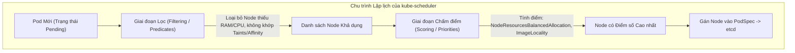
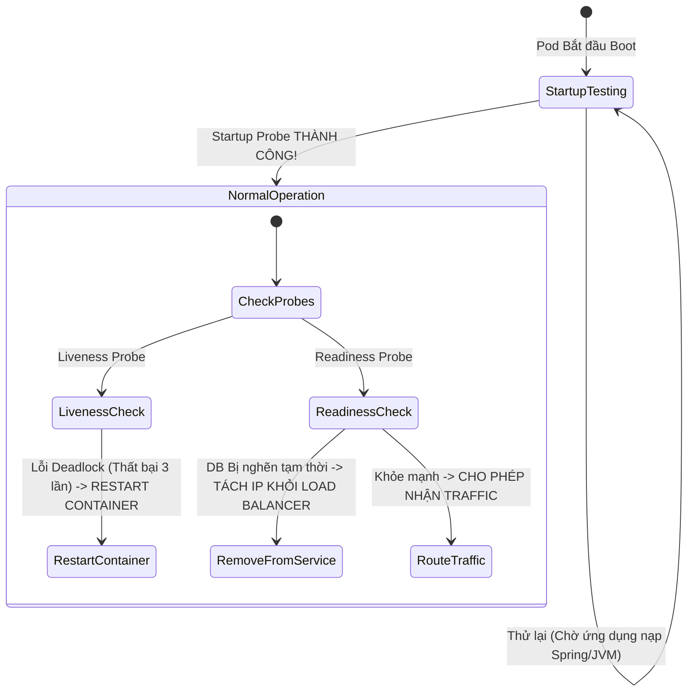
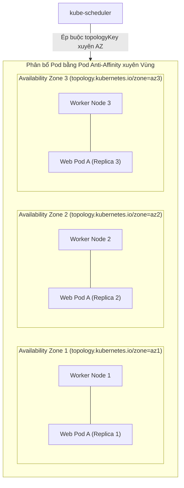
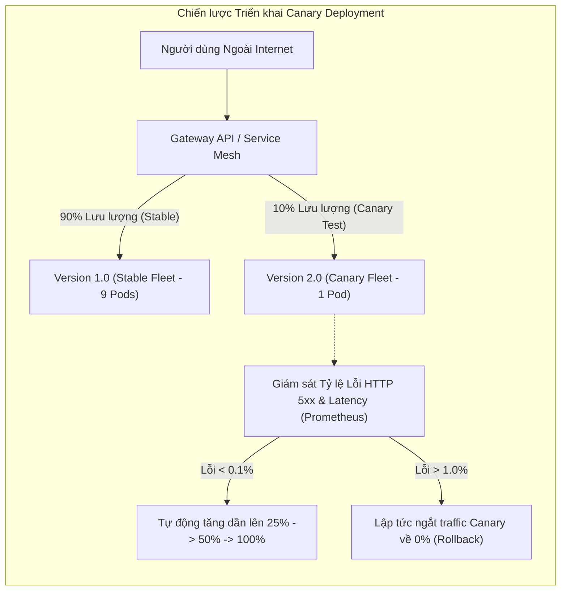

# 7.3. Scheduling, Autoscaling and Deployment Strategies (Lập lịch, Tự động Co giãn và Chiến lược Triển khai Kubernetes)

## Tổng quan về Lập lịch, Co giãn và Triển khai Nâng cao
Lập lịch (Scheduling), tự động co giãn (Autoscaling) và các chiến lược triển khai ứng dụng (Deployment Strategies) là trái tim vận hành của cụm Kubernetes. Hệ thống kết hợp giữa việc tối ưu hóa đóng gói tài nguyên vào phần cứng (Bin Packing Optimization), kiểm soát trạng thái tiến trình (Health Probes) và bảo vệ hệ thống trước sự cố thiếu hụt tài nguyên (OOM Eviction) để đạt được tính sẵn sàng cao và chi phí tối ưu.

Về mặt toán học và thuật toán co giãn:
Bộ tự động co giãn số lượng Pod theo chiều ngang (**Horizontal Pod Autoscaler - HPA**) tính toán số lượng Pods mong muốn theo công thức chuẩn:
$$\text{DesiredReplicas} = \left\lceil \text{CurrentReplicas} \times \left( \frac{\text{CurrentMetricValue}}{\text{TargetMetricValue}} \right) \right\rceil$$
Thuật toán bao gồm dung sai làm mịn (Tolerance band, mặc định $10\%$). Nếu tỉ lệ metric nằm trong khoảng $[0.9, 1.1]$, HPA sẽ không phát lệnh co giãn để tránh hiện tượng rung lắc số lượng Pod (Pod Churning / Flapping).

Về mặt ưu tiên tiêu diệt tiến trình khi cạn kiệt bộ nhớ RAM (**Linux OOM Score**):
Hệ thống tính điểm số điều chỉnh `oom_score_adj` dựa trên phân loại chất lượng dịch vụ (QoS Class):
$$\text{Guaranteed (Score: -997)} \ll \text{Burstable (Score: 2 - 999)} \ll \text{BestEffort (Score: 1000)}$$
Tiến trình có điểm số OOM càng cao sẽ là đối tượng đầu tiên bị Linux Kernel gửi lệnh `SIGKILL` khi máy chủ cạn kiệt RAM.



---

## 2. Chi tiết từng Keyword (Under-the-Hood Deep Dive)

---

### 1. Resource Management, QoS Classes & Health Probes

#### 1. Khái niệm bản chất (What & Why)
- **Resource Requests vs Limits**:
  - *Requests*: Mức tài nguyên tối thiểu mà Pod được cam kết cấp phát. **kube-scheduler chỉ sử dụng Requests** để tìm máy chủ có đủ dung lượng (không quan tâm Limits).
  - *Limits*: Mức trần tài nguyên tối đa mà Pod được phép tiêu thụ. Được thực thi trực tiếp bởi nhân Linux Kernel (`cgroups`).
- **Quality of Service (QoS) Classes**:
  - *Guaranteed (Cao cấp nhất)*: Khi mọi container trong Pod đều thiết lập `requests == limits` cho cả CPU và RAM. Pod được bảo vệ tối đa, gần như không bao giờ bị Evict trừ khi máy chủ cạn kiệt tài nguyên hệ thống cơ bản.
  - *Burstable (Trung bình)*: Khi `requests < limits`, hoặc chỉ thiết lập một trong hai. Cho phép Pod sử dụng vượt quá mức request khi máy chủ còn nhàn rỗi, nhưng sẽ bị bóp nghẹt nếu có tranh chấp.
  - *BestEffort (Thấp nhất)*: Không thiết lập bất kỳ thông số Requests hay Limits nào. Là đối tượng đầu tiên bị Kubelet tiêu diệt (Evicted) ngay khi máy chủ có dấu hiệu thiếu hụt tài nguyên (Memory Pressure).
- **Bộ ba Health Probes (Kiểm tra Sức khỏe Ứng dụng)**:
  - *Startup Probe*: Kiểm tra xem ứng dụng đã hoàn tất quá trình khởi động ban đầu chưa (dành cho các ứng dụng nặng mất nhiều phút để nạp cache hoặc JVM). Trong khi Startup Probe chưa thành công, Liveness và Readiness Probes bị vô hiệu hóa hoàn toàn, ngăn chặn việc Kubelet giết nhầm ứng dụng đang nạp dữ liệu.
  - *Liveness Probe*: Kiểm tra xem ứng dụng có còn sống hay bị rơi vào trạng thái bế tắc (Deadlock) không. Nếu kiểm tra thất bại $N$ lần liên tiếp, Kubelet lập tức gửi tín hiệu khởi động lại container (`RestartPolicy`).
  - *Readiness Probe*: Kiểm tra xem ứng dụng đã sẵn sàng tiếp nhận lưu lượng mạng (Traffic) chưa. Nếu thất bại, Kubelet **không khởi động lại container**, mà gỡ bỏ địa chỉ IP của Pod khỏi danh sách EndpointSlices của Service, ngăn chặn người dùng gặp lỗi HTTP 500/502.

#### 2. Cơ chế hoạt động sâu (Under the hood / Hardcore Internals)
- **Sự khác biệt cốt lõi giữa CPU Throttling và Memory OOMKilled**:
  - *CPU là tài nguyên nén được (Compressible Resource)*: Khi ứng dụng tiêu thụ vượt quá `cpu.limits`, Linux Kernel không giết tiến trình. Thay vào đó, bộ điều độ CFS Scheduler sẽ bóp nghẹt (Throttle) chu kỳ thực thi của CPU, khiến ứng dụng chạy chậm lại và độ trễ phản hồi (Response Latency) tăng vọt.
  - *Memory là tài nguyên không nén được (Incompressible Resource)*: RAM không thể "chạy chậm lại". Khi ứng dụng cố tình cấp phát bộ nhớ vượt quá `memory.limits`, Linux Kernel cgroups lập tức kích hoạt bộ dọn dẹp bộ nhớ khẩn cấp **OOM Killer**, gửi tín hiệu `SIGKILL` (Exit Code 137) để tiêu diệt tiến trình ngay tức khắc.

#### 3. Sơ đồ minh họa


#### 4. Code ví dụ thực chiến (Kubernetes PodSpec với Chuẩn QoS Guaranteed & Probes Toàn diện)
Manifest YAML chuẩn hóa cho một Microservice Backend đạt chuẩn chất lượng dịch vụ Guaranteed và cấu hình Probes hoàn chỉnh:

```yaml
apiVersion: v1
kind: Pod
metadata:
  name: payment-processor
  namespace: production
  labels:
    app: payment-processor
spec:
  containers:
    - name: payment-app
      image: company/payment-service:v2.4.0
      # Đạt chuẩn QoS: Guaranteed (Requests == Limits cho cả CPU và RAM)
      resources:
        requests:
          cpu: "1000m" # 1 vCPU
          memory: "2048Mi" # 2 GB RAM
        limits:
          cpu: "1000m"
          memory: "2048Mi"
      ports:
        - containerPort: 8080
          name: http-traffic
      # 1. Startup Probe: Cho phép tối đa 30 * 2s = 60s để ứng dụng khởi động
      startupProbe:
        httpGet:
          path: /health/startup
          port: 8080
        initialDelaySeconds: 5
        periodSeconds: 2
        failureThreshold: 30
      # 2. Liveness Probe: Kiểm tra trạng thái deadlock định kỳ mỗi 10s
      livenessProbe:
        httpGet:
          path: /health/liveness
          port: 8080
        periodSeconds: 10
        timeoutSeconds: 2
        failureThreshold: 3
      # 3. Readiness Probe: Kiểm tra kết nối tới Database và Cache mỗi 5s
      readinessProbe:
        httpGet:
          path: /health/readiness
          port: 8080
        periodSeconds: 5
        timeoutSeconds: 2
        failureThreshold: 2
```

#### 5. Ưu / Nhược điểm, Pitfalls & Anti-patterns
- **Guaranteed QoS**: Độ ổn định tối đa, loại bỏ hoàn toàn hiện tượng Noisy Neighbor. Tuy nhiên có thể dẫn đến việc lãng phí tài nguyên nếu ứng dụng được cấp phát dung lượng quá dư thừa (Over-provisioned).
- **Pitfall**: Đặt đường dẫn của Liveness Probe trùng với Readiness Probe và kiểm tra luôn cả kết nối cơ sở dữ liệu bên ngoài. Khi database bị quá tải tạm thời, toàn bộ các Pods trong cụm đồng loạt bị Liveness Probe giết và khởi động lại liên tục (Cascading Reboot Storm), khiến hệ thống hoàn toàn tê liệt.

#### 6. Ứng dụng thực tế trong Backend / Systems
- Cấu hình QoS Guaranteed cho các Pod xử lý thanh toán tài chính và định tuyến giao dịch trực tiếp, đảm bảo hệ thống không bao giờ bị OOMKilled trong các đợt cao điểm mua sắm.

---

### 2. Node & Pod Scheduling: Affinity, Anti-Affinity, Taints & Tolerations

#### 1. Khái niệm bản chất (What & Why)
- **Node Affinity**: Cơ chế chỉ định một Pod ưu tiên hoặc bắt buộc phải chạy trên một nhóm Worker Nodes cụ thể (dựa trên nhãn Labels của Node):
  - *`requiredDuringSchedulingIgnoredDuringExecution` (Hard)*: Bắt buộc phải thỏa mãn điều kiện nhãn thì mới lập lịch (nếu không có Node nào thỏa mãn, Pod sẽ ở trạng thái `Pending`).
  - *`preferredDuringSchedulingIgnoredDuringExecution` (Soft)*: Ưu tiên chọn Node thỏa mãn, nếu không có thì vẫn lập lịch vào các Node khác bình thường.
- **Pod Anti-Affinity (Chống Đồng định vị)**: Ngăn chặn các Pod cùng loại chạy chung trên cùng một máy chủ vật lý hoặc cùng một Availability Zone (dựa trên `topologyKey`). Đảm bảo tính sẵn sàng cao (High Availability): nếu một máy chủ hoặc cả một AZ bị mất điện, các Pod còn lại ở các AZ khác vẫn duy trì dịch vụ.
- **Taints & Tolerations (Nút Từ chối & Pod Khoan dung)**:
  - *Taint*: Được gán vào Node để xua đuổi các Pod không mong muốn (ví dụ: Node có gắn card GPU đắt tiền sẽ bị gắn Taint `gpu=true:NoSchedule`).
  - *Toleration*: Được gán vào PodSpec, cho phép Pod được phép "khoan dung" và chạy trên các Node bị Taint đó.
  - *Taint Effects*:
    - `NoSchedule`: Không lập lịch Pod mới vào Node này (nhưng các Pod cũ vẫn tiếp tục chạy).
    - `PreferNoSchedule`: Tránh lập lịch nếu có thể.
    - `NoExecute`: Lập tức trục xuất (Evict) các Pod đang chạy trên Node nếu Pod không có Toleration tương ứng.

#### 2. Cơ chế hoạt động sâu (Under the hood / Hardcore Internals)
- **Topology Spread Constraints (Phân bổ Đồng đều theo Không gian)**:
  - Pod Anti-Affinity cũ chỉ là bài toán nhị phân (Được phép hoặc Không được phép).
  - Chuẩn hiện đại sử dụng **Topology Spread Constraints** với chỉ số **`maxSkew`**:
    $$\text{maxSkew} = \left| \text{Số Pod trên Zone A} - \text{Số Pod trên Zone B} \right|$$
  - Scheduler liên tục kiểm tra độ lệch phân bổ giữa các Availability Zones (`topologyKey: topology.kubernetes.io/zone`). Nếu `maxSkew = 1`, hệ thống đảm bảo số lượng Pod trên các AZ không bao giờ chênh lệch nhau quá 1 Pod, bảo đảm khả năng phục hồi thảm họa hoàn hảo.

#### 3. Sơ đồ minh họa


#### 4. Code ví dụ thực chiến (Production Pod Anti-Affinity Manifest)
Manifest YAML minh họa việc phân tách các bản sao Pod ra các máy chủ và Availability Zone khác nhau để đạt chuẩn High Availability:

```yaml
apiVersion: apps/v1
kind: Deployment
metadata:
  name: resilient-backend
  namespace: production
spec:
  replicas: 3
  selector:
    matchLabels:
      app: resilient-backend
  template:
    metadata:
      labels:
        app: resilient-backend
    spec:
      affinity:
        # Ngăn chặn 2 Pod cùng chạy trên 1 Node vật lý
        podAntiAffinity:
          requiredDuringSchedulingIgnoredDuringExecution:
            - labelSelector:
                matchExpressions:
                  - key: app
                    operator: In
                    values:
                      - resilient-backend
              topologyKey: "kubernetes.io/hostname"
      # Phân bổ đồng đều xuyên suốt các Availability Zone
      topologySpreadConstraints:
        - maxSkew: 1
          topologyKey: "topology.kubernetes.io/zone"
          whenUnsatisfiable: DoNotSchedule
          labelSelector:
            matchLabels:
              app: resilient-backend
      containers:
        - name: app
          image: company/resilient-backend:v1.0
          resources:
            requests:
              cpu: "500m"
              memory: "1Gi"
```

#### 5. Ưu / Nhược điểm, Pitfalls & Anti-patterns
- **Pod Anti-Affinity**: Loại bỏ rủi ro Single Point of Failure; nhưng nếu dùng `required...` trong một cụm nhỏ không đủ số lượng máy chủ hoặc AZ, các Pod mới sẽ bị kẹt ở trạng thái `Pending` vĩnh viễn.

#### 6. Ứng dụng thực tế trong Backend / Systems
- Sử dụng Taints và Tolerations để cô lập một nhóm máy chủ gắn ổ đĩa NVMe siêu tốc độ chỉ dành riêng cho cụm cơ sở dữ liệu ClickHouse, ngăn không cho các Pod ứng dụng thông thường bị lập lịch vào.

---

### 3. Autoscaling & Advanced Deployments: HPA, VPA, Karpenter & Canary

#### 1. Khái niệm bản chất (What & Why)
- **Horizontal Pod Autoscaler (HPA)**: Tự động điều chỉnh số lượng bản sao Pods trong một Deployment dựa trên các chỉ số CPU, Memory hoặc Custom Metrics (ví dụ: Request Count per Second từ Prometheus).
- **Vertical Pod Autoscaler (VPA)**: Tự động phân tích lịch sử tiêu thụ và điều chỉnh lại mức Resource Requests/Limits của Pod. Thích hợp cho các dịch vụ khó mở rộng theo chiều ngang (như cron jobs, databases).
- **Cluster Autoscaler & Karpenter**:
  - *Cluster Autoscaler*: Bổ sung hoặc giảm bớt số lượng máy ảo Worker Nodes khi phát hiện có Pods ở trạng thái `Pending` do thiếu tài nguyên.
  - *Karpenter (CNCF / AWS)*: Trình cấp phát nút thế hệ mới không dùng Auto Scaling Groups. Khởi tạo trực tiếp đúng cấu hình máy ảo tối ưu (Just-in-time Right-sized EC2) chỉ trong vòng $\approx 30\text{s}$ để phục vụ đúng nhu cầu của Pod.
- **Pod Disruption Budgets (PDB)**: Rào chắn giới hạn số lượng Pod được phép gián đoạn đồng thời khi thực hiện các tác vụ bảo trì máy chủ (ví dụ: khi kỹ sư chạy lệnh `kubectl drain` để nâng cấp bản vá cho Node).
- **Canary & Blue-Green Deployments**:
  - *Blue-Green*: Duy trì 2 môi trường sản xuất song song độc lập hoàn chỉnh (Môi trường Blue chạy bản cũ, Môi trường Green chạy bản mới). Chuyển đổi $100\%$ lưu lượng tức thì ở tầng Load Balancer/Service.
  - *Canary Deployment*: Chuyển một tỷ lệ nhỏ lưu lượng ($5\% - 10\%$) tới phiên bản mới để thử nghiệm trên người dùng thực tế, liên tục kiểm tra tỷ lệ lỗi (Error Rate) và độ trễ trước khi nhân rộng ra $100\%$.

#### 2. Cơ chế hoạt động sâu (Under the hood / Hardcore Internals)
- **Vòng tuần hoàn Metrics Server và HPA Controller**:
  - Trên mỗi Node, Kubelet tích hợp module **cAdvisor** liên tục thu thập số liệu sử dụng CPU/RAM thực tế từ cgroups của từng container.
  - **Metrics Server** định kỳ (mặc định mỗi $15\text{s}$) gom số liệu từ cAdvisor của toàn bộ các Nodes và phơi bày qua Kubernetes Metrics API (`metrics.k8s.io`).
  - HPA Controller truy vấn Metrics API, tính toán giá trị trung bình trên toàn bộ các Pods hiện có, áp dụng công thức DesiredReplicas, và cập nhật trường `.spec.replicas` của Deployment nếu vượt ngưỡng dung sai.

#### 3. Sơ đồ minh họa


#### 4. Code ví dụ thực chiến (Kubernetes HPA Manifest with Custom Behavior)
Manifest cấu hình HPA thế hệ mới: Bao gồm kiểm soát tốc độ mở rộng (Scale-up) và trì hoãn thu hẹp (Scale-down Stabilization Window) để chống rung lắc:

```yaml
apiVersion: autoscaling/v2
kind: HorizontalPodAutoscaler
metadata:
  name: api-autoscaler
  namespace: production
spec:
  scaleTargetRef:
    apiVersion: apps/v1
    kind: Deployment
    name: api-service
  minReplicas: 3
  maxReplicas: 20
  metrics:
    # 1. Đo lường chỉ số CPU mục tiêu trung bình 70%
    - type: Resource
      resource:
        name: cpu
        target:
          type: Utilization
          averageUtilization: 70
    # 2. Đo lường chỉ số RAM mục tiêu trung bình 80%
    - type: Resource
      resource:
        name: memory
        target:
          type: Utilization
          averageUtilization: 80
  # Tùy chỉnh hành vi co giãn mượt mà
  behavior:
    scaleDown:
      stabilizationWindowSeconds: 300 # Chờ 5 phút ổn định trước khi giảm bớt Pod
      policies:
        - type: Percent
          value: 20 # Chỉ giảm tối đa 20% số lượng Pod mỗi phút
          periodSeconds: 60
    scaleUp:
      stabilizationWindowSeconds: 0 # Tăng tải phản ứng tức thì không chờ đợi
      policies:
        - type: Percent
          value: 100 # Cho phép nhân đôi số lượng Pod ngay lập tức khi chịu tải đột biến
          periodSeconds: 15
```

#### 5. Ưu / Nhược điểm, Pitfalls & Anti-patterns
- **HPA**: Phản ứng tuyệt vời trước các biến động lưu lượng; tuy nhiên nếu ứng dụng mất hơn 2 phút để warm-up, HPA không kịp cứu hệ thống khỏi hiện tượng sập tạm thời trong các đợt flash-sale (Cần kết hợp Scheduled Scaling hoặc Provisioned Concurrency).
- **Pitfall**: Cùng lúc kích hoạt cả HPA và VPA quản lý trên cùng một chỉ số CPU/RAM cho cùng một Deployment. Hai bộ điều khiển sẽ tạo ra cuộc chiến tranh chấp (Scaling Conflict), khiến Pod liên tục bị tăng giảm kích thước và khởi động lại không ngừng.

#### 6. Ứng dụng thực tế trong Backend / Systems
- Thiết lập Pod Disruption Budget (`minAvailable: 2`) kết hợp HPA cho hệ thống Backend API để đảm bảo ngay cả khi đội ngũ hạ tầng bảo trì nâng cấp Kubernetes version cho máy chủ, khách hàng vẫn trải nghiệm dịch vụ với zero downtime.
