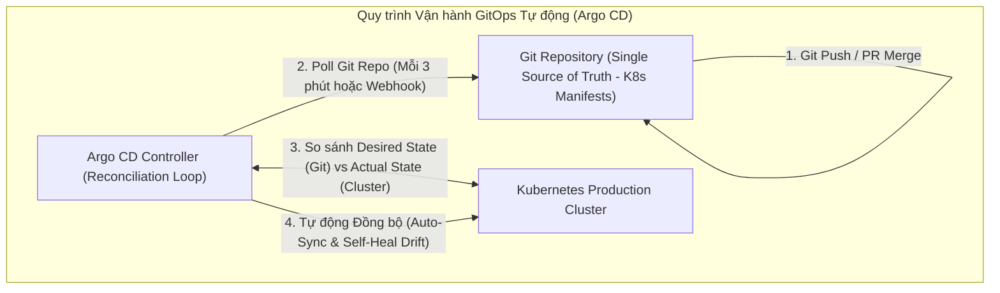
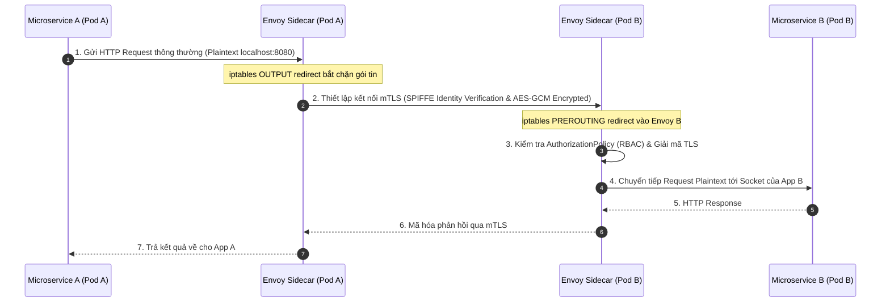
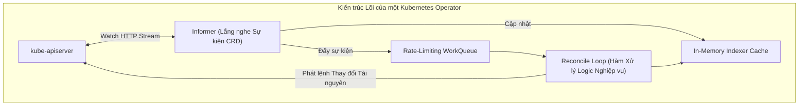
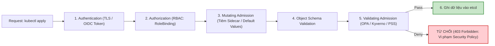

# 7.4. Kubernetes Advanced Ecosystem, GitOps and Security (Hệ sinh thái Nâng cao, GitOps và Bảo mật Kubernetes)

## Tổng quan về Hệ sinh thái Nâng cao, GitOps và Bảo mật Kubernetes
Hệ sinh thái Kubernetes hiện đại mở rộng vượt xa các đối tượng tính toán cơ bản để bao gồm vành đai bảo mật zero-trust ở tầng mạng (Network Policies, Service Mesh mTLS), mô hình mở rộng API tùy biến (Custom Resource Definitions & Operators), quy trình phân phối hạ tầng tự động qua Git (GitOps với Argo CD / Flux CD) và cơ chế phân quyền bảo mật nhiều tầng (RBAC, Pod Security Standards, Admission Webhooks).

Về mặt kiểm soát mạng ở tầng nhân Linux (eBPF vs iptables):
Các giải pháp CNI hiện đại như **Cilium** sử dụng công nghệ **eBPF (Extended Berkeley Packet Filter)** để tải trực tiếp các chương trình bytecode an toàn vào các điểm móc của Linux Kernel (như `sock_ops`, `XDP - eXpress Data Path`):
Thay vì phải di chuyển gói tin qua toàn bộ ngăn xếp mạng (TCP/IP Network Stack) và tra cứu hàng ngàn quy tắc iptables, eBPF can thiệp trực tiếp tại tầng Socket Layer:
$$\text{Socket-to-Socket Redirection: } \text{Socket A } (veth) \xrightarrow{\quad\text{eBPF BPF\_MAP}\quad} \text{Socket B } (veth)$$
Cơ chế này bỏ qua hoàn toàn chi phí đóng gói TCP, IP routing và Netfilter overhead, giúp giảm độ trễ giao tiếp giữa các Pods (Inter-pod latency) tới $40\%$.



---

## 2. Chi tiết từng Keyword (Under-the-Hood Deep Dive)

---

### 1. Network Policies & Service Mesh Integration

#### 1. Khái niệm bản chất (What & Why)
- **Network Policies (Chính sách Mạng)**: Tường lửa ảo ở tầng Pod (Layer-3 / Layer-4). Mặc định trong Kubernetes là **Non-isolated (Mọi Pod trong mọi Namespace đều có thể nói chuyện tự do với nhau)**. Network Policy cho phép thiết lập chế độ **Default Deny** và chỉ mở đúng các luồng giao tiếp Ingress/Egress cần thiết. Đòi hỏi CNI Plugin phải hỗ trợ (như Calico, Cilium, AWS VPC CNI with Network Policy agent).
- **Service Mesh (Istio, Linkerd, Consul)**: Tầng hạ tầng chuyên dụng quản lý giao tiếp giữa các dịch vụ (Service-to-Service Communication). Hoạt động bằng cách tiêm (Inject) một proxy cực nhẹ (thường là **Envoy Proxy**) vào chung Pod với ứng dụng dưới dạng Sidecar container:
  - *Mutual TLS (mTLS)*: Tự động mã hóa hai chiều toàn bộ traffic giữa các Pods với xác thực chứng chỉ số ngắn hạn (SPIFFE/SPIRE).
  - *Traffic Management*: Cân bằng tải nâng cao, Circuit Breaking, Fault Injection, Rate Limiting ở tầng Layer-7.
  - *Observability*: Tự động thu thập Distributed Tracing (Jaeger, Zipkin) và L7 metrics (RPS, Error rate, Latency) mà không cần sửa 1 dòng code ứng dụng.

#### 2. Cơ chế hoạt động sâu (Under the hood / Hardcore Internals)
- **Cơ chế Bắt chặn Gói tin (Traffic Interception via iptables REDIRECT)**:
  - Khi một Pod có Istio Sidecar khởi động, một Init Container (`istio-init`) chạy trước với đặc quyền `NET_ADMIN`.
  - Init container này lập trình lại bảng `iptables` bên trong Network Namespace của Pod:
    `iptables -t nat -A PREROUTING -p tcp -j REDIRECT --to-ports 15006`
    `iptables -t nat -A OUTPUT -p tcp -j REDIRECT --to-ports 15001`
  - Mọi gói tin TCP đi vào hoặc đi ra khỏi container ứng dụng đều bị Kernel tự động chuyển hướng (Redirect) vào cổng lắng nghe của Envoy Proxy (Port 15006/15001). Envoy thực hiện giải mã TLS, kiểm tra chính sách xác thực JWT, ghi log trace rồi mới chuyển gói tin cho ứng dụng.

#### 3. Sơ đồ minh họa


#### 4. Code ví dụ thực chiến (Kubernetes Default Deny Network Policy Manifest)
Manifest YAML thiết lập nguyên tắc Zero-Trust: Khóa toàn bộ mạng của Namespace và chỉ cho phép duy nhất Service Frontend gọi tới Backend trên cổng 8080:

```yaml
apiVersion: networking.k8s.io/v1
kind: NetworkPolicy
metadata:
  name: default-deny-all
  namespace: backend
spec:
  podSelector: {} # Áp dụng cho TOÀN BỘ Pods trong namespace backend
  policyTypes:
    - Ingress
    - Egress
---
apiVersion: networking.k8s.io/v1
kind: NetworkPolicy
metadata:
  name: allow-frontend-to-backend
  namespace: backend
spec:
  podSelector:
    matchLabels:
      app: core-api
  policyTypes:
    - Ingress
  ingress:
    - from:
        # Chỉ chấp thuận lưu lượng từ các Pod có nhãn role: frontend trong namespace frontend
        - namespaceSelector:
            matchLabels:
              kubernetes.io/metadata.name: frontend
          podSelector:
            matchLabels:
              role: frontend
      ports:
        - protocol: TCP
          port: 8080
```

#### 5. Ưu / Nhược điểm, Pitfalls & Anti-patterns
- **Service Mesh**: Cung cấp khả năng bảo mật zero-trust và quan sát tuyệt đối; tuy nhiên làm tăng độ trễ mạng thêm $\approx 1.5\text{ms} - 3\text{ms}$ cho mỗi bước nhảy (Hop) và tiêu tốn thêm một lượng CPU/RAM đáng kể cho các Envoy sidecars trên mỗi Pod.
- **Pitfall**: Viết Network Policy khóa Egress nhưng quên mở rule cho phép truy vấn DNS (UDP Port 53 tới `kube-dns` trong namespace `kube-system`). Kết quả là toàn bộ các Pods trong namespace không thể phân giải được bất kỳ tên miền nào và báo lỗi kết nối.

#### 6. Ứng dụng thực tế trong Backend / Systems
- Thiết lập mTLS bắt buộc kết hợp Network Policies nghiêm ngặt cho toàn bộ các vi dịch vụ xử lý dữ liệu thẻ tín dụng để đáp ứng tiêu chuẩn an toàn thông tin PCI-DSS.

---

### 2. Extensibility & GitOps: Helm, Kustomize, Operators & Argo CD

#### 1. Khái niệm bản chất (What & Why)
- **Helm**: Trình quản lý gói phần mềm (Package Manager) của Kubernetes. Đóng gói các tệp YAML phức tạp thành các **Helm Charts** tái sử dụng được, hỗ trợ quản lý tham số thông qua `values.yaml` và lưu giữ lịch sử phát hành (Release History) trong Kubernetes Secrets.
- **Kustomize**: Công cụ tùy biến cấu hình Kubernetes theo triết lý **Không dùng mẫu (Template-free)**. Sử dụng mô hình phân lớp (Base and Overlays) để kế thừa và ghi đè các cấu hình đặc thù cho từng môi trường (Development, Staging, Production) mà không làm biến đổi file gốc. Tích hợp sẵn trong lệnh `kubectl -k`.
- **Custom Resource Definitions (CRD) & Operators**:
  - *CRD*: Khả năng mở rộng API Server của Kubernetes để định nghĩa các loại tài nguyên hoàn toàn mới (ví dụ: `kind: PostgreSQLCluster`, `kind: KafkaTopic`).
  - *Operator Pattern*: Bộ điều khiển tùy biến (Custom Controller) kết hợp CRD với tri thức vận hành thực tế của chuyên gia (Domain Knowledge), tự động hóa các tác vụ quản trị phức tạp như sao lưu database, phục hồi failover và nâng cấp phiên bản không downtime.
- **GitOps (Argo CD, Flux CD)**: Triết lý vận hành trong đó **Kho lưu trữ Git là nguồn chân lý duy nhất (Single Source of Truth)** cho toàn bộ trạng thái mong muốn của hệ thống.
  - Sử dụng cơ chế kéo tự động (Pull-based Reconciliation): Controller chạy bên trong cụm định kỳ kiểm tra Git, phát hiện sai lệch cấu hình (**Configuration Drift**) và tự động hòa giải để đưa cụm về đúng phiên bản trên Git.

#### 2. Cơ chế hoạt động sâu (Under the hood / Hardcore Internals)
- **Vòng lặp bên trong của Kubernetes Operator (client-go Informers & WorkQueue)**:
  - Một Operator không bao giờ gọi API Server để thăm dò trạng thái liên tục.
  - Operator sử dụng thư viện `client-go` với các thành phần cốt lõi:
    - *Reflector & Informer*: Thiết lập một kết nối HTTP Streaming bền vững (**Watch API**) tới `kube-apiserver` để nhận các sự kiện thêm/sửa/xóa tức thì.
    - *Indexer Cache*: Lưu trữ bản sao dữ liệu trong RAM của Operator để tra cứu tức thời mà không làm quá tải API Server.
    - *WorkQueue with Rate Limiting*: Hàng đợi điều độ các tác vụ hòa giải (Reconcile), tự động thử lại với thuật toán Exponential Backoff khi gặp sự cố tạm thời.

#### 3. Sơ đồ minh họa


#### 4. Code ví dụ thực chiến (Go / Kubernetes Operator Reconcile Loop Logic)
Đoạn mã Golang mô phỏng hàm xử lý hòa giải (Reconcile) cốt lõi của một Kubernetes Operator:

```go
package main

import (
	"context"
	"fmt"
	"time"
)

// Mô phỏng đối tượng Custom Resource
type DatabaseClusterCR struct {
	Name      string
	Replicas  int
	Version   string
}

// Controller hòa giải trạng thái
type DatabaseOperatorController struct{}

func (c *DatabaseOperatorController) Reconcile(ctx context.Context, cr DatabaseClusterCR) error {
	fmt.Printf("[Operator Reconcile] Bắt đầu hòa giải tài nguyên: %s\n", cr.Name)

	// 1. Kiểm tra trạng thái thực tế hiện tại của cụm
	currentReplicas := 1 // Giả lập trạng thái thực tế đang có 1 Pod

	// 2. So sánh Desired State (trong CR) với Actual State
	if currentReplicas < cr.Replicas {
		diff := cr.Replicas - currentReplicas
		fmt.Printf("  -> [Action] Phát hiện thiếu hụt tài nguyên! Cần cấp phát thêm %d Pods...\n", diff)
		// Gọi K8s API tạo thêm Pods và PVC tương ứng
	} else if currentReplicas > cr.Replicas {
		fmt.Printf("  -> [Action] Số lượng Pod thực tế vượt mức mong muốn, tiến hành thu hẹp an toàn...\n")
	} else {
		fmt.Println("  -> [OK] Trạng thái thực tế hoàn toàn đồng nhất với Desired State trên Git!")
	}

	return nil
}

func main() {
	operator := &DatabaseOperatorController{}
	myCluster := DatabaseClusterCR{
		Name:     "production-postgres",
		Replicas: 3,
		Version:  "16.1",
	}

	_ = operator.Reconcile(context.Background(), myCluster)
}
```

#### 5. Ưu / Nhược điểm, Pitfalls & Anti-patterns
- **GitOps**: Loại bỏ hoàn toàn việc cấp quyền `kubectl write` trực tiếp cho con người, ngăn ngừa sai sót thao tác tay và lưu lại toàn bộ lịch sử thay đổi trên Git commit logs.
- **Pitfall**: Thực hiện lệnh `kubectl edit` trực tiếp trên Production để sửa lỗi tạm thời khi đang dùng Argo CD với cờ `selfHeal: true`. Chỉ sau 3 giây, Argo CD sẽ phát hiện sự sai lệch với Git và tự động ghi đè xóa sạch các thay đổi vừa sửa, đưa hệ thống trở lại trạng thái cũ!

#### 6. Ứng dụng thực tế trong Backend / Systems
- Thiết lập hệ thống GitOps toàn diện bằng Argo CD: Toàn bộ quá trình triển khai mã nguồn lên môi trường Production được kiểm soát thông qua các thao tác Pull Request (PR) và phê duyệt (Code Review) trên GitHub.

---

### 3. Kubernetes Security: RBAC, Admission Controllers & Observability

#### 1. Khái niệm bản chất (What & Why)
- **Role-Based Access Control (RBAC)**: Cơ chế phân quyền dựa trên vai trò. Xác định xem một chủ thể (User, Group, ServiceAccount) có quyền thực thi hành động gì (Verbs: `get`, `list`, `create`, `delete`) trên loại tài nguyên nào (Resources: `pods`, `services`, `secrets`):
  - *Role & RoleBinding*: Giới hạn trong phạm vi một Namespace cụ thể.
  - *ClusterRole & ClusterRoleBinding*: Có hiệu lực trên toàn bộ phạm vi cụm Kubernetes (Cluster-wide).
- **Pod Security Standards (PSS)**: Tiêu chuẩn bảo mật Pod cấp độ cụm của Kubernetes, thay thế cho PodSecurityPolicies (PSP) cũ. Chia làm 3 cấp độ:
  1. *Privileged*: Không hạn chế (dành cho hạ tầng CNI, kube-proxy).
  2. *Baseline*: Ngăn chặn các lỗ hổng leo thang đặc quyền cơ bản.
  3. *Restricted*: Tiêu chuẩn bảo mật cực hạn (Bắt buộc non-root, cấm cấp quyền root, cấm volume hostPath, ép buộc drop capabilities).
- **Admission Controllers (Bộ Kiểm soát Gia nhập)**: Các plugin can thiệp vào chuỗi xử lý của `kube-apiserver` trước khi đối tượng được ghi vào `etcd`:
  - *Mutating Webhooks*: Có quyền chỉnh sửa đối tượng (ví dụ: tự động tiêm Envoy Sidecar container, tự động gán nhãn).
  - *Validating Webhooks (Kyverno, OPA Gatekeeper)*: Có quyền chấp thuận hoặc từ chối yêu cầu (ví dụ: từ chối các Pod chạy image có tag `:latest`, từ chối Pod không có cấu hình Resource Limits).
- **Cluster Troubleshooting & Logging**:
  - Khung chẩn đoán lỗi tiêu chuẩn: `kubectl describe pod` (kiểm tra Events), `kubectl logs --previous` (xem log của container bị sập lần trước), `kubectl debug` (tiêm Ephemeral Container chứa công cụ chẩn đoán vào Pod đang chạy).
  - Nhận diện các điều kiện lỗi node: `MemoryPressure`, `DiskPressure`, `PIDPressure`.

#### 2. Cơ chế hoạt động sâu (Under the hood / Hardcore Internals)
- **Chuỗi Xử lý Request trong `kube-apiserver`**:
  - Gói tin HTTPS tới API Server phải đi qua 3 cổng kiểm soát nghiêm ngặt theo đúng thứ tự:
    $$\text{Client Request} \longrightarrow \mathbf{Authentication} \longrightarrow \mathbf{Authorization\ (RBAC)} \longrightarrow \mathbf{Mutating\ Webhooks} \longrightarrow \mathbf{Schema\ Validation} \longrightarrow \mathbf{Validating\ Webhooks} \longrightarrow \mathbf{etcd}$$
  - Nếu bất kỳ bước nào trong chuỗi từ chối, request sẽ bị hủy bỏ ngay lập tức và không bao giờ được ghi vào `etcd`.

#### 3. Sơ đồ minh họa


#### 4. Code ví dụ thực chiến (Kubernetes RBAC Least-Privilege Manifest)
Manifest định nghĩa quyền hạn tối thiểu (Principle of Least Privilege) cho một ServiceAccount của ứng dụng backend:

```yaml
apiVersion: v1
kind: ServiceAccount
metadata:
  name: api-reader-sa
  namespace: production
---
apiVersion: rbac.authorization.k8s.io/v1
kind: Role
metadata:
  name: pod-and-config-reader-role
  namespace: production
rules:
  # Chỉ cho phép đọc (get, list, watch) Pods và Services, KHÔNG cho phép sửa/xóa
  - apiGroups: [""]
    resources: ["pods", "services"]
    verbs: ["get", "list", "watch"]
  # Chỉ cho phép đọc ConfigMaps, cấm tuyệt đối đọc Secrets
  - apiGroups: [""]
    resources: ["configmaps"]
    verbs: ["get"]
---
apiVersion: rbac.authorization.k8s.io/v1
kind: RoleBinding
metadata:
  name: bind-api-reader
  namespace: production
subjects:
  - kind: ServiceAccount
    name: api-reader-sa
    namespace: production
roleRef:
  kind: Role
  name: pod-and-config-reader-role
  apiGroup: rbac.authorization.k8s.io
```

#### 5. Ưu / Nhược điểm, Pitfalls & Anti-patterns
- **Validating Admission Webhooks**: Ngăn chặn vi phạm bảo mật ngay từ cửa ngõ; tuy nhiên nếu Webhook Server bên ngoài bị sập hoặc timeout mà cấu hình `failurePolicy: Fail`, toàn bộ các lệnh triển khai trong cụm sẽ bị phong tỏa.
- **Pitfall**: Gán quyền `cluster-admin` (ClusterRole quyền lực cao nhất) cho ServiceAccount của ứng dụng để "tiện chạy cho nhanh", tạo ra lỗ hổng bảo mật chết người nếu container bị hacker chiếm quyền điều khiển.

#### 6. Ứng dụng thực tế trong Backend / Systems
- Thiết lập Kyverno Policy ép buộc toàn bộ Pods triển khai trên cụm sản xuất phải chạy bằng tài khoản Non-Root, có cấu hình Resource Limits đầy đủ và được tải về từ Registry nội bộ của công ty.
