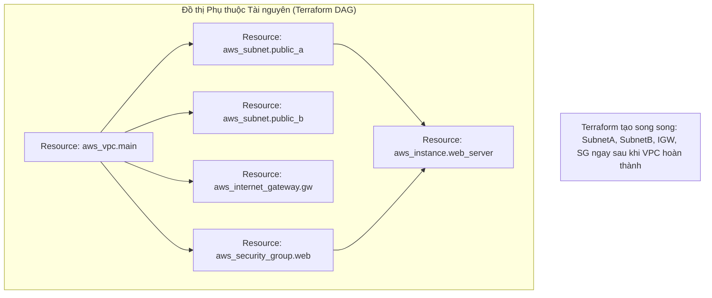
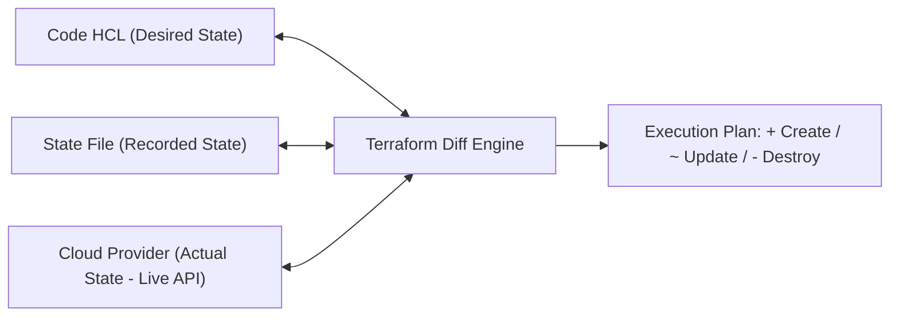
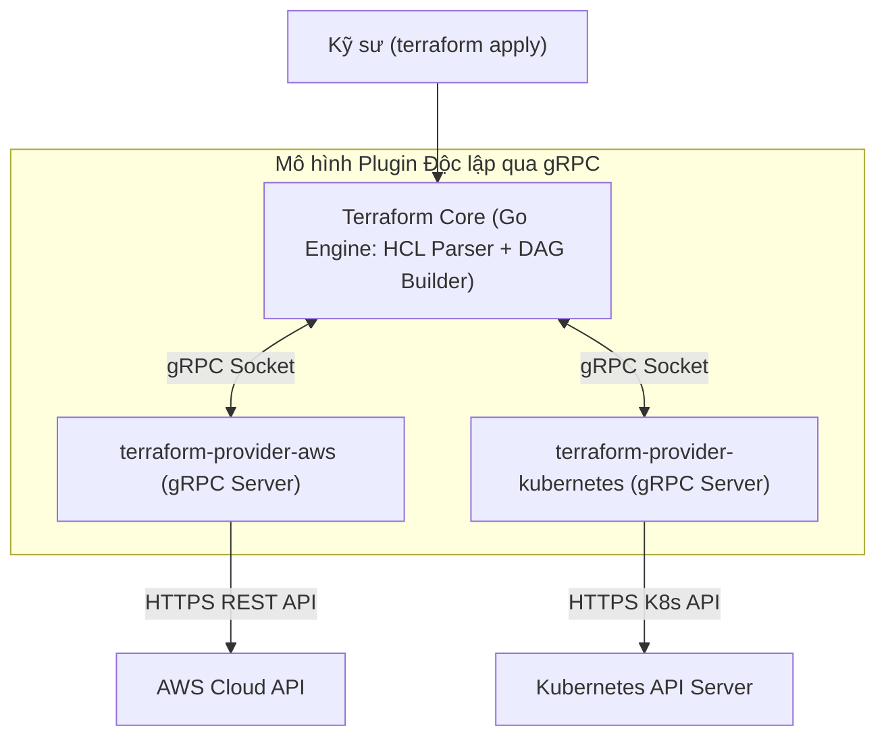

# 8.1. Infrastructure as Code Principles and Terraform Core (Nguyên lý Hạ tầng dưới dạng Mã nguồn và Cốt lõi Terraform)

## Tổng quan về Hạ tầng dưới dạng Mã nguồn (IaC) và Terraform
Hạ tầng dưới dạng Mã nguồn (Infrastructure as Code - IaC) là phương pháp quản lý, cấp phát và duy trì tài nguyên phần cứng, mạng và dịch vụ điện toán đám mây thông qua các tệp mã nguồn có thể đọc được bằng máy (Machine-readable Definition Files), thay vì thực hiện thủ công trên giao diện đồ họa web hoặc các câu lệnh CLI rời rạc.

Về mặt lý thuyết đồ thị và khoa học máy tính:
Terraform xây dựng một đồ thị có hướng không có chu trình (**Directed Acyclic Graph - DAG**) để biểu diễn toàn bộ các mối quan hệ phụ thuộc giữa các tài nguyên hạ tầng:
$$G = (V, E)$$
Trong đó:
- $V = \{r_1, r_2, \dots, r_n\}$: Tập hợp các tài nguyên hạ tầng (VPC, Subnet, EC2, Security Group, RDS).
- $E \subseteq V \times V$: Tập hợp các cạnh có hướng biểu thị quan hệ phụ thuộc ($r_A \to r_B$ nghĩa là $r_A$ phải được tạo trước $r_B$).
Dựa trên thuật toán sắp xếp tô-pô (**Topological Sort**), Terraform tự động xác định được:
1. Những tài nguyên độc lập nào có thể được cấp phát **song song (Parallel Provisioning)** qua nhiều luồng (Threads) để tối ưu thời gian.
2. Thứ tự tuần tự nghiêm ngặt khi tiêu hủy hoặc cập nhật tài nguyên nhằm tránh lỗi gãy liên kết tham chiếu.



---

## 2. Chi tiết từng Keyword (Under-the-Hood Deep Dive)

---

### 1. IaC Fundamentals: Declarative vs Imperative & Configuration Drift

#### 1. Khái niệm bản chất (What & Why)
- **Infrastructure as Code (IaC)**: Cho phép áp dụng các phương pháp kỹ thuật phần mềm tốt nhất (Version Control, Git Branching, Code Review, Automated Testing, CI/CD) vào việc quản trị hạ tầng hệ thống.
- **Declarative Infrastructure (Mô hình Khai báo - ví dụ: Terraform, CloudFormation, Kubernetes Manifests)**:
  - Lập trình viên chỉ cần mô tả **"Hệ thống mong muốn trông như thế nào"** (Desired State).
  - Công cụ tự động tính toán khoảng cách giữa hiện trạng thực tế và trạng thái mong muốn, sau đó thực hiện các bước cần thiết để đưa hệ thống về đúng đích đến. Có tính chất **Bảo toàn lũy thừa (Idempotent)**: chạy 1 lần hay 100 lần kết quả vẫn ra duy nhất 1 trạng thái đồng nhất.
- **Imperative Infrastructure (Mô hình Mệnh lệnh - ví dụ: Shell Scripts, AWS CLI, Ansible commands)**:
  - Lập trình viên phải viết chính xác từng bước hướng dẫn **"Làm thế nào để tạo hệ thống"** (How to do it).
  - Không có tính Idempotent tự nhiên: nếu script chạy lại lần 2 mà không có câu lệnh kiểm tra `if/else`, nó sẽ báo lỗi trùng tên hoặc tạo ra thêm tài nguyên trùng lặp.
- **Configuration Drift (Sai lệch Cấu hình)**:
  - Hiện tượng xảy ra khi trạng thái thực tế của tài nguyên trên cloud (Actual State) bị lệch so với mã nguồn IaC (Desired State).
  - Thường xảy ra do kỹ sư truy cập trực tiếp vào AWS Console sửa tay trong lúc khẩn cấp (Hotfix). Khi người khác chạy `terraform apply`, Terraform sẽ phát hiện sai lệch và cố gắng ghi đè hoặc tạo lại tài nguyên.

#### 2. Cơ chế hoạt động sâu (Under the hood / Hardcore Internals)
- **Chu trình Hòa giải Ba Trạng thái (The 3-Way Reconciliation Loop)**:
  - Khi bạn chạy lệnh `terraform plan`, Terraform thực hiện đối chiếu song song giữa 3 thực thể:
    1. **Desired State (Code HCL)**: Những gì bạn viết trong file `.tf`.
    2. **Recorded State (State File)**: Bức tranh hệ thống được ghi nhận ở lần apply thành công gần nhất.
    3. **Actual State (Cloud Reality)**: Trạng thái thực tế bằng cách gọi đồng thời hàng chục API tới CSP (`ec2:DescribeInstances`).
  - *Thuật toán Phân tích Khác biệt (Diffing Algorithm)*:
    $$\Delta = \text{Desired State} - \text{Actual State}$$
    Dựa trên $\Delta$, Terraform xác định hành động cho từng thuộc tính:
    - `~ update in-place`: Thay đổi tham số không gây phá hủy (ví dụ: sửa thẻ tag, đổi security group).
    - `+ create`: Tạo tài nguyên mới.
    - `- destroy`: Xóa tài nguyên không còn trong code.
    - `-/+ destroy and then create replacement`: Bắt buộc tiêu hủy và tạo mới nếu thay đổi thuộc tính bất biến (ví dụ: đổi AMI hoặc Subnet của EC2).

#### 3. Sơ đồ minh họa


#### 4. Code ví dụ thực chiến (C++ Topological Sort DAG Dependency Resolver)
Mô phỏng thuật toán sắp xếp tô-pô (Topological Sort sử dụng thuật toán Kahn / BFS) giải quyết đồ thị phụ thuộc tài nguyên trong Terraform Core:

```cpp
#include <iostream>
#include <vector>
#include <string>
#include <queue>
#include <unordered_map>

class IaCDependencyResolver {
private:
    std::unordered_map<std::string, std::vector<std::string>> adj_list;
    std::unordered_map<std::string, int> in_degree;

public:
    void addResource(const std::string& res) {
        if (in_degree.find(res) == in_degree.end()) {
            in_degree[res] = 0;
        }
    }

    void addDependency(const std::string& parent, const std::string& child) {
        // parent phải được tạo trước child: parent -> child
        addResource(parent);
        addResource(child);
        adj_list[parent].push_back(child);
        in_degree[child]++;
    }

    std::vector<std::string> resolveExecutionOrder() {
        std::queue<std::string> zero_in_degree;
        for (const auto& [node, deg] : in_degree) {
            if (deg == 0) {
                zero_in_degree.push(node);
            }
        }

        std::vector<std::string> execution_order;
        while (!zero_in_degree.empty()) {
            std::string curr = zero_in_degree.front();
            zero_in_degree.pop();
            execution_order.push_back(curr);

            for (const auto& neighbor : adj_list[curr]) {
                in_degree[neighbor]--;
                if (in_degree[neighbor] == 0) {
                    zero_in_degree.push(neighbor);
                }
            }
        }

        if (execution_order.size() != in_degree.size()) {
            throw std::runtime_error("Lỗi: Phát hiện vòng lặp chu trình trong đồ thị phụ thuộc (Cyclic Dependency Error)!");
        }

        return execution_order;
    }
};

int main() {
    IaCDependencyResolver resolver;
    resolver.addDependency("aws_vpc.main", "aws_subnet.public");
    resolver.addDependency("aws_vpc.main", "aws_security_group.web");
    resolver.addDependency("aws_subnet.public", "aws_instance.web");
    resolver.addDependency("aws_security_group.web", "aws_instance.web");

    try {
        auto order = resolver.resolveExecutionOrder();
        std::cout << "--- Thứ tự Cấp phát Hạ tầng Tuân thủ DAG ---\n";
        for (size_t i = 0; i < order.size(); ++i) {
            std::cout << "Bước " << (i + 1) << ": Tạo " << order[i] << "\n";
        }
    } catch (const std::exception& e) {
        std::cerr << e.what() << "\n";
    }

    return 0;
}
```

#### 5. Ưu / Nhược điểm, Pitfalls & Anti-patterns
- **Ưu điểm**: Khả năng tái tạo môi trường giống hệt nhau (Reproducible Infrastructure) trong vài phút; loại bỏ rủi ro sai sót do con người.
- **Pitfall**: Thực hiện sửa đổi trực tiếp trên Web Console (ClickOps) trong môi trường sản xuất, làm phát sinh Configuration Drift nghiêm trọng.

#### 6. Ứng dụng thực tế trong Backend / Systems
- Thiết lập toàn bộ hệ sinh thái môi trường Staging và Production bằng cùng một bộ mã nguồn IaC, đảm bảo tính đồng nhất tuyệt đối giữa hai môi trường (Environment Parity).

---

### 2. Terraform Core: Providers, Resources, Modules & Variables

#### 1. Khái niệm bản chất (What & Why)
- **Terraform Core**: Nhị phân CLI viết bằng Go, chịu trách nhiệm phân tích cú pháp ngôn ngữ HCL (HashiCorp Configuration Language), xây dựng đồ thị DAG và điều phối vòng đời tài nguyên.
- **Terraform Providers**: Các plugin độc lập giao tiếp với Terraform Core qua giao thức gRPC. Mỗi Provider (AWS, GCP, Azure, Kubernetes, GitHub) đóng vai trò dịch các khối tài nguyên khai báo trong HCL thành các lệnh gọi REST API cụ thể tới nhà cung cấp đó.
- **Terraform Resources**: Khối khai báo trung tâm biểu diễn một đối tượng hạ tầng vật lý hoặc logic thực tế (như `aws_instance`, `aws_s3_bucket`).
- **Terraform Data Sources**: Khối cho phép truy vấn và lấy thông tin từ các tài nguyên đã tồn tại sẵn trên cloud hoặc được quản lý ngoài Terraform (ví dụ: tìm ID của Ubuntu AMI mới nhất).
- **Terraform Modules**: Cơ chế đóng gói các tài nguyên HCL thành một khối logic tái sử dụng được (tương tự như một Class hoặc Hàm trong lập trình). Giúp chuẩn hóa kiến trúc trong toàn bộ doanh nghiệp.
- **Variables & Outputs**:
  - *Input Variables (`variable`)*: Tham số hóa module để linh hoạt giá trị theo từng môi trường. Hỗ trợ kiểm tra kiểu dữ liệu (Type Constraints) và quy tắc xác thực (Validation Rules).
  - *Outputs (`output`)*: Phơi bày các thông tin được tính toán của tài nguyên (như ID, Public IP, Database Endpoint) cho các module khác hoặc người dùng sử dụng.

#### 2. Cơ chế hoạt động sâu (Under the hood / Hardcore Internals)
- **Kiến trúc gRPC Plugin của Terraform**:
  - Khi gõ `terraform init`, Terraform Core không nhúng sẵn code của AWS hay GCP vào trong nhị phân của nó.
  - Thay vào đó, nó tải các nhị phân Provider riêng rẽ (ví dụ: `terraform-provider-aws_v5.x`) và lưu vào thư mục ẩn `.terraform/providers/`.
  - Khi thực thi lệnh `plan` hoặc `apply`, Terraform Core khởi động các nhị phân Provider thành các tiến trình con (Child Processes) chạy độc lập trên máy tính, và trao đổi schema dữ liệu thông qua các cổng **gRPC over IPC / Local TCP**.

#### 3. Sơ đồ minh họa


#### 4. Code ví dụ thực chiến (Production Terraform Reusable Module)
Module Terraform HCL chuẩn mực: Có kiểm tra kiểu dữ liệu, xác thực regex, gán tag tự động và xuất outputs:

```hcl
# ==============================================================
# File: modules/secure_vpc/variables.tf
# ==============================================================
variable "vpc_cidr" {
  type        = string
  description = "Dải mạng CIDR cho VPC (Bắt buộc phải là dải mạng nội bộ hợp lệ)"
  default     = "10.0.0.0/16"

  validation {
    condition     = can(cidrhost(variable.vpc_cidr, 0))
    error_message = "Giá trị vpc_cidr phải là một chuỗi định dạng CIDR IPv4 hợp lệ!"
  }
}

variable "environment" {
  type        = string
  description = "Môi trường triển khai (staging hoặc production)"
  
  validation {
    condition     = contains(["staging", "production"], variable.environment)
    error_message = "Môi trường chỉ được phép là 'staging' hoặc 'production'!"
  }
}

# ==============================================================
# File: modules/secure_vpc/main.tf
# ==============================================================
resource "aws_vpc" "this" {
  cidr_block           = var.vpc_cidr
  enable_dns_hostnames = true
  enable_dns_support   = true

  tags = {
    Name        = "${var.environment}-vpc"
    Environment = var.environment
    ManagedBy   = "Terraform"
  }
}

# Data source tra cứu danh sách Availability Zones khả dụng
data "aws_availability_zones" "available" {
  state = "available"
}

resource "aws_subnet" "private" {
  count             = 2
  vpc_id            = aws_vpc.this.id
  cidr_block        = cidrsubnet(var.vpc_cidr, 8, count.index + 10)
  availability_zone = data.aws_availability_zones.available.names[count.index]

  tags = {
    Name = "${var.environment}-private-subnet-${count.index + 1}"
    Tier = "Private"
  }
}

# ==============================================================
# File: modules/secure_vpc/outputs.tf
# ==============================================================
output "vpc_id" {
  value       = aws_vpc.this.id
  description = "Mã định danh ID của VPC vừa khởi tạo"
}

output "private_subnet_ids" {
  value       = aws_subnet.private[*].id
  description = "Danh sách IDs của các Subnet nội bộ"
}
```

#### 5. Ưu / Nhược điểm, Pitfalls & Anti-patterns
- **Ưu điểm**: Ngôn ngữ HCL có cấu trúc rõ ràng, hỗ trợ module hóa mạnh mẽ giúp các tổ chức tái sử dụng hàng ngàn dòng cấu hình.
- **Pitfall**: Lồng ghép module quá sâu (Nested Modules $> 4$ cấp). Việc này làm đồ thị phụ thuộc trở nên cực kỳ phức tạp, kéo dài thời gian chạy lệnh `terraform plan` lên hàng chục phút.

#### 6. Ứng dụng thực tế trong Backend / Systems
- Xây dựng kho lưu trữ Terraform Private Module Registry nội bộ cho công ty, chuẩn hóa các mẫu VPC, EKS Cluster và Aurora Database cho toàn bộ các nhóm sản phẩm sử dụng chung.
