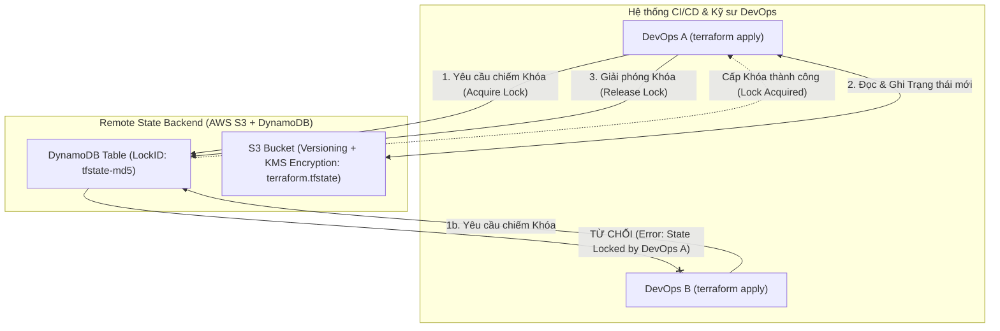
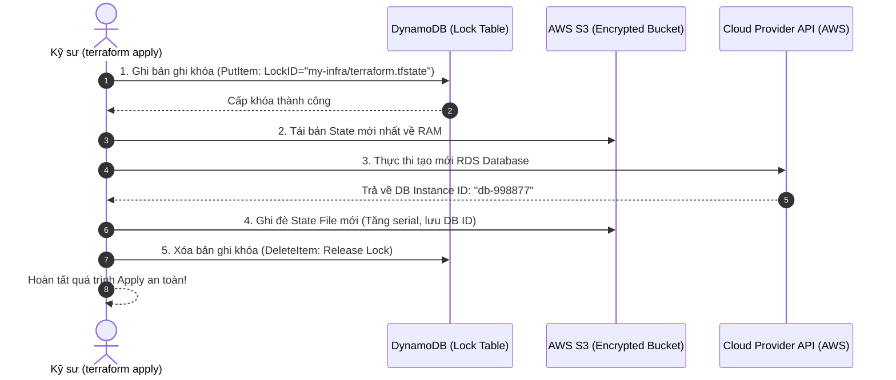
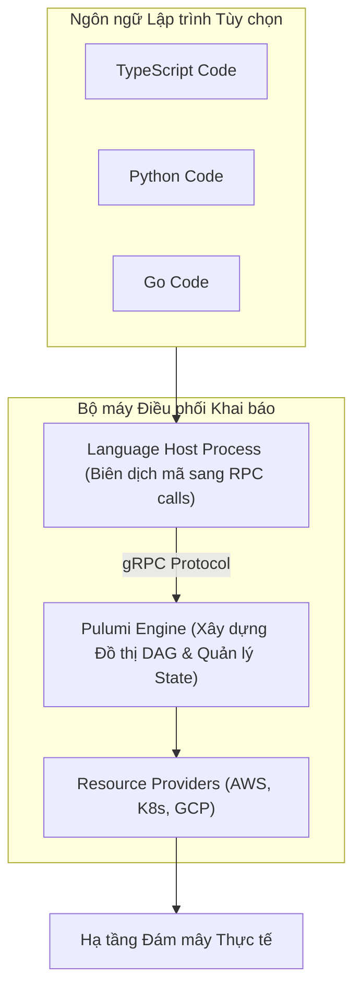
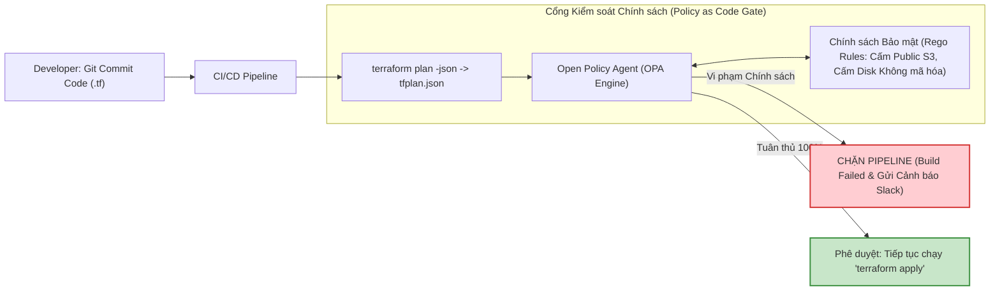

# 8.2. State Management, Tools and Policy as Code (Quản lý Trạng thái, Công cụ IaC và Chính sách dưới dạng Mã nguồn)

## Tổng quan về Quản lý Trạng thái và Chính sách dưới dạng Mã nguồn
Tệp trạng thái (State File) là thành phần nhạy cảm và quan trọng nhất trong hệ thống Terraform, đóng vai trò là cầu nối ánh xạ giữa mã nguồn khai báo (Declarative Code) và tài nguyên thực tế trên Cloud. Quản lý trạng thái từ xa (Remote State with Locking), kết hợp với các công cụ kiểm soát chính sách tự động (Policy as Code - OPA / Sentinel) đảm bảo tính toàn vẹn, ngăn chặn việc phá hủy tài nguyên ngoài ý muốn và thực thi các quy chuẩn tuân thủ nghiêm ngặt trong môi trường nhiều kỹ sư cùng làm việc.

Về mặt an toàn đồng thời trong hệ thống phân tán (Distributed Concurrency & Locking):
Khi hai kỹ sư hoặc hai luồng CI/CD cùng chạy lệnh `terraform apply` đồng thời, bài toán xung đột tranh chấp (Race Condition) sẽ xảy ra:
$$\text{Apply}_A \parallel \text{Apply}_B \implies \text{State File Corruption / Split-Brain}$$
Để loại bỏ hoàn toàn rủi ro này, Terraform sử dụng cơ chế **Khóa Trạng thái Phân tán (Distributed State Locking)** thông qua các dịch vụ có tính nhất quán tuần tự nghiêm ngặt (như AWS DynamoDB với phép ghi có điều kiện `PutItem` kết hợp `attribute_not_exists(LockID)`). Bất kỳ tiến trình nào không chiếm được khóa sẽ bị từ chối ngay lập tức và buộc phải chờ tiến trình trước hoàn tất.



---

## 2. Chi tiết từng Keyword (Under-the-Hood Deep Dive)

---

### 1. Terraform State: Remote State, Locking & State Manipulation

#### 1. Khái niệm bản chất (What & Why)
- **Terraform State (`terraform.tfstate`)**: Một tệp tin JSON lưu giữ siêu dữ liệu và mối quan hệ ánh xạ giữa các tài nguyên khai báo trong code và các mã ID thực tế do Cloud Provider cấp phát.
- **Remote State**: Cơ chế lưu trữ file state trên các dịch vụ lưu trữ đám mây dùng chung có tính bền bỉ cao (như AWS S3, Google Cloud Storage, Terraform Cloud) thay vì lưu trên ổ cứng cá nhân (Local State), cho phép đội ngũ kỹ sư cùng làm việc trên cùng một hạ tầng.
- **State Locking**: Cơ chế khóa tệp state trong suốt quá trình chạy `apply`, ngăn không cho người khác thực hiện các thay đổi chồng chéo làm hỏng file state.
- **State Manipulation (Thao tác Trạng thái Nâng cao)**:
  - `terraform import`: Đưa một tài nguyên đã tạo thủ công bằng tay từ trước trên Cloud Console vào trong sự quản lý của Terraform State mà không cần xóa đi tạo lại.
  - `terraform state mv`: Đổi tên hoặc di chuyển một tài nguyên giữa các module mà không làm Terraform hiểu lầm là phải xóa tài nguyên cũ đi và tạo tài nguyên mới.
  - `terraform state rm`: Gỡ bỏ một tài nguyên ra khỏi file state (tài nguyên thực tế trên Cloud vẫn còn nguyên vẹn, chỉ ngừng quản lý bởi Terraform).
- **Terraform Workspaces**: Cho phép sử dụng cùng một thư mục mã nguồn HCL để quản lý nhiều trạng thái hệ thống độc lập khác nhau (ví dụ: workspace `default`, `dev`, `prod`).

#### 2. Cơ chế hoạt động sâu (Under the hood / Hardcore Internals)
- **Cấu trúc JSON của Tệp State (`lineage` & `serial`)**:
  - Bên trong `terraform.tfstate`, có hai trường siêu dữ liệu sống còn:
    - `"lineage"`: Một chuỗi UUID duy nhất được tạo ra khi khởi tạo state lần đầu. Dùng để đảm bảo bạn không vô tình ghi đè state của một dự án hoàn toàn khác vào dự án hiện tại.
    - `"serial"`: Một số nguyên tự động tăng sau mỗi lần thay đổi state thành công. Nếu Terraform phát hiện file state trên S3 có `serial = 15` nhưng client gửi lên một bản cập nhật dựa trên `serial = 14`, hệ thống lập tức báo lỗi xung đột phiên bản cũ (Stale State Error).
- **Nguy cơ Rò rỉ Thông tin Mật trong State File**:
  - State file lưu trữ **toàn bộ các thuộc tính của tài nguyên ở dạng bản rõ (Plaintext)**, bao gồm cả mật khẩu root database, khóa bí mật TLS certificate, hoặc private keys.
  - Bắt buộc phải bảo vệ Remote State bằng mã hóa Server-Side Encryption (KMS), bật tính năng Bucket Versioning và phân quyền IAM tối thiểu (Không bao giờ commit file `.tfstate` lên GitHub).

#### 3. Sơ đồ minh họa


#### 4. Code ví dụ thực chiến (HCL S3 Remote Backend Configuration with DynamoDB Lock)
Cấu hình chuẩn mực để thiết lập Remote State bảo mật trên AWS:

```hcl
terraform {
  required_version = ">= 1.5.0"

  required_providers {
    aws = {
      source  = "hashicorp/aws"
      version = "~> 5.0"
    }
  }

  # Cấu hình Remote State Backend bảo mật
  backend "s3" {
    bucket         = "my-company-terraform-states-prod"
    key            = "core-platform/vpc-network/terraform.tfstate"
    region         = "ap-southeast-1"
    encrypt        = true                  # Ép buộc mã hóa SSE-S3 / SSE-KMS
    dynamodb_table = "terraform-state-locks" # Khóa trạng thái chống xung đột đồng thời
  }
}
```

#### 5. Ưu / Nhược điểm, Pitfalls & Anti-patterns
- **Remote State with Locking**: Tiêu chuẩn bắt buộc cho mọi đội ngũ DevOps chuyên nghiệp.
- **Pitfall**: Đang chạy `terraform apply` thì kỹ sư bị mất mạng hoặc ấn `Ctrl+C` thô bạo. Tiến trình bị ngắt đột ngột khiến bản ghi Lock trong DynamoDB không được giải phóng. Lần chạy tiếp theo sẽ bị lỗi `Error acquiring the state lock`. Kỹ sư phải dùng lệnh `terraform force-unlock <LOCK-ID>` sau khi đã xác minh chắc chắn không còn tiến trình ngầm nào đang chạy.

#### 6. Ứng dụng thực tế trong Backend / Systems
- Sử dụng lệnh `terraform import` để di dời an toàn một cụm cơ sở dữ liệu production cũ (vốn được tạo thủ công bằng tay từ 3 năm trước) vào quyền kiểm soát của mã nguồn Terraform mà không gây ra bất kỳ giây gián đoạn nào (Zero Downtime).

---

### 2. IaC Landscape: OpenTofu, Pulumi, CloudFormation, Bicep & Ansible

#### 1. Khái niệm bản chất (What & Why)
- **OpenTofu**: Bản fork hoàn toàn mở (Open-source fork under Linux Foundation) của Terraform sau khi HashiCorp thay đổi giấy phép sang BUSL (Business Source License). Đảm bảo tính tương thích $100\%$ với các cú pháp HCL và các Providers hiện hữu.
- **Pulumi**: Nền tảng IaC hiện đại cho phép sử dụng các **Ngôn ngữ Lập trình Đa năng thực thụ (General-Purpose Languages: TypeScript, Python, Go, C#)** thay vì phải học ngôn ngữ đặc thù như HCL. Hỗ trợ đầy đủ các tính năng lập trình nâng cao: vòng lặp `for`, kiểm tra điều kiện `if`, kế thừa Class, viết Unit Test bằng Jest/Mocha.
- **AWS CloudFormation & Azure Bicep**:
  - *CloudFormation (AWS Native)*: Công cụ IaC riêng của AWS (dạng JSON/YAML), không cần quản lý file state (AWS tự quản lý ngầm), hỗ trợ tính năng Rollback tự động khi deploy lỗi.
  - *Azure Bicep (Azure Native)*: Ngôn ngữ khai báo riêng của Microsoft Azure, cú pháp ngắn gọn hơn nhiều so với ARM Templates JSON cũ, tích hợp sâu và hỗ trợ ngay các dịch vụ mới của Azure trong ngày đầu ra mắt (Day-0 Support).
- **Ansible (Configuration Management - Quản lý Cấu hình)**:
  - Khác với Terraform (vốn tập trung vào việc tạo hạ tầng - Provisioning: tạo VM, tạo VPC), Ansible tập trung vào việc **cấu hình phần mềm bên trong máy chủ** (Configuration: cài đặt Nginx, cấu hình SSH, cập nhật file config, quản lý user).
  - Hoạt động theo cơ chế **Agentless** (kết nối qua SSH, không cần cài agent trên máy đích), định nghĩa tác vụ bằng YAML Playbooks.

#### 2. Cơ chế hoạt động sâu (Under the hood / Hardcore Internals)
- **Kiến trúc Pulumi: Từ Ngôn ngữ Lập trình sang Đồ thị Khai báo**:
  - Mặc dù bạn viết code bằng TypeScript hay Python, Pulumi **không phải là công cụ thực thi mệnh lệnh (Imperative)**.
  - Khi chạy `pulumi up`, mã nguồn TypeScript của bạn được thực thi để khởi tạo các đối tượng Resource.
  - Các đối tượng này được Pulumi Language SDK chuyển đổi thành các cuộc gọi RPC gửi về cho **Pulumi Engine**.
  - Pulumi Engine phân tích các tham chiếu Promise/Output, xây dựng nên đồ thị DAG khai báo giống hệt như Terraform, và chỉ thực thi các thao tác tạo tài nguyên thực sự thông qua các Resource Providers.

#### 3. Sơ đồ minh họa


#### 4. Code ví dụ thực chiến (TypeScript Pulumi Infrastructure Definition)
Khai báo hạ tầng đám mây sử dụng ngôn ngữ lập trình TypeScript với đầy đủ kiểu dữ liệu tường minh:

```typescript
import * as pulumi from "@pulumi/pulumi";
import * as aws from "@pulumi/aws";

// 1. Khởi tạo một VPC bảo mật với kiểu dữ liệu kiểm tra lúc biên dịch (Compile-time Type Checking)
const appVpc = new aws.ec2.Vpc("production-vpc", {
  cidrBlock: "10.0.0.0/16",
  enableDnsHostnames: true,
  enableDnsSupport: true,
  tags: {
    Environment: pulumi.getStack(), // Tự động lấy tên Stack (dev, staging, prod)
    ManagedBy: "Pulumi-TypeScript",
  },
});

// 2. Tạo một S3 Bucket với chính sách mã hóa bắt buộc
const secureBucket = new aws.s3.Bucket("app-assets-bucket", {
  serverSideEncryptionConfiguration: {
    rule: {
      applyServerSideEncryptionByDefault: {
        sseAlgorithm: "AES256",
      },
    },
  },
});

// 3. Xuất giá trị đầu ra (Outputs)
export const vpcId = appVpc.id;
export const bucketArn = secureBucket.arn;
```

#### 5. Ưu / Nhược điểm, Pitfalls & Anti-patterns
- **Terraform / OpenTofu**: Hệ sinh thái khổng lồ, cộng đồng lớn nhất, chuẩn mực công nghiệp.
- **Pulumi**: Tận dụng toàn bộ sức mạnh của hệ sinh thái lập trình (npm, pip), dễ dàng viết unit test; nhưng đòi hỏi kỹ sư phải có nền tảng lập trình tốt.
- **Ansible**: Tuyệt vời cho quản lý cấu hình truyền thống, nhưng chậm và kém hiệu quả khi dùng để cấp phát hạ tầng đám mây quy mô lớn so với Terraform.

#### 6. Ứng dụng thực tế trong Backend / Systems
- Mô hình phối hợp hoàn hảo: Sử dụng Terraform để tạo phần cứng (VPC, Subnets, EC2 Instances, Load Balancers), sau đó kích hoạt Ansible để cấu hình các dịch vụ Linux và cài đặt ứng dụng vào bên trong máy ảo.

---

### 3. Policy as Code: OPA, Sentinel & Infrastructure Testing

#### 1. Khái niệm bản chất (What & Why)
- **Policy as Code (PaC - Chính sách dưới dạng Mã nguồn)**: Phương pháp tiếp cận trong đó các quy chuẩn bảo mật, tuân thủ pháp lý và quản trị chi phí được viết dưới dạng mã nguồn kiểm thử tự động, được thực thi ngay trong chu trình CI/CD trước khi bất kỳ lệnh `apply` nào chạm tới Cloud.
- **Open Policy Agent (OPA) & Rego**: Công cụ kiểm tra chính sách đa năng mã nguồn mở thuộc CNCF. Sử dụng ngôn ngữ khai báo **Rego** để đánh giá dữ liệu JSON (như output của lệnh `terraform show -json`).
- **HashiCorp Sentinel**: Khung kiểm soát chính sách độc quyền tích hợp trong Terraform Cloud/Enterprise, hỗ trợ các quy tắc kiểm tra logic phức tạp với các mức độ cưỡng chế: `Advisory` (Cảnh báo), `Soft Mandatory` (Có thể ghi đè bởi quản lý), `Hard Mandatory` (Chặn đứng hoàn toàn).
- **Shift-Left Security & Testing**:
  - Dịch chuyển việc kiểm tra an toàn thông tin về giai đoạn sớm nhất của chu trình phát triển (giai đoạn viết code).
  - Các công cụ quét tĩnh (Static Analysis Tools): `tflint` (kiểm tra lỗi cú pháp và best practices), `tfsec` / `trivy` (quét lỗ hổng bảo mật và cấu hình sai).

#### 2. Cơ chế hoạt động sâu (Under the hood / Hardcore Internals)
- **Cơ chế Đánh giá Chính sách OPA với Terraform Plan JSON**:
  - Trước khi hạ tầng được tạo, kỹ sư chạy lệnh:
    `terraform plan -out=tfplan.binary && terraform show -json tfplan.binary > tfplan.json`
  - Tệp `tfplan.json` chứa toàn bộ cây tài nguyên dự kiến thay đổi (Resource Changes).
  - OPA nhận file JSON này làm đầu vào (`input`), biên dịch các quy tắc viết bằng ngôn ngữ Rego thành một cây quyết định trừu tượng (Abstract Syntax Tree), đánh giá tính hợp lệ và trả về quyết định `allow = true/false` kèm danh sách các vi phạm chỉ trong vài millisecond.

#### 3. Sơ đồ minh họa


#### 4. Code ví dụ thực chiến (OPA Rego Policy Enforcement Script)
Quy tắc bảo mật viết bằng ngôn ngữ Rego: Chặn đứng việc tạo S3 Bucket nếu không bật tính năng mã hóa SSE-KMS:

```rego
package terraform.security

import future.keywords.in

# Mặc định từ chối cấp phép nếu có bất kỳ vi phạm nào
default allow = false

# Lấy danh sách tất cả các tài nguyên S3 Bucket sắp được tạo hoặc sửa đổi
s3_resources := [res |
    res := input.resource_changes[_]
    res.type == "aws_s3_bucket"
    res.change.actions[_] in ["create", "update"]
]

# Vi phạm 1: Phát hiện S3 Bucket không có cấu hình mã hóa Server-Side Encryption
violations[msg] {
    some res in s3_resources
    not res.change.after.server_side_encryption_configuration
    msg := sprintf("[BẢO MẬT VI PHẠM] S3 Bucket '%v' không được cấu hình mã hóa bắt buộc!", [res.address])
}

# Cho phép áp dụng nếu danh sách vi phạm hoàn toàn rỗng
allow {
    count(violations) == 0
}
```

#### 5. Ưu / Nhược điểm, Pitfalls & Anti-patterns
- **Policy as Code**: Ngăn chặn các thảm họa rò rỉ dữ liệu trước khi chúng kịp xảy ra (Proactive Defense), thay vì phải đợi quét phát hiện sau khi sự cố đã rồi.
- **Pitfall**: Viết chính sách quá cứng nhắc mà không có cơ chế xử lý ngoại lệ (Exception Workflow). Khi có sự cố khẩn cấp cần tạo nhanh tài nguyên đặc thù, chính sách có thể chặn đứng nỗ lực khắc phục sự cố của đội ngũ kỹ thuật.

#### 6. Ứng dụng thực tế trong Backend / Systems
- Tích hợp OPA vào GitHub Actions: Tự động từ chối bất kỳ Pull Request hạ tầng nào cố tình mở cổng SSH 22 ra Internet (`0.0.0.0/0`) hoặc cố tình tạo máy ảo ngoài khu vực địa lý cho phép.
