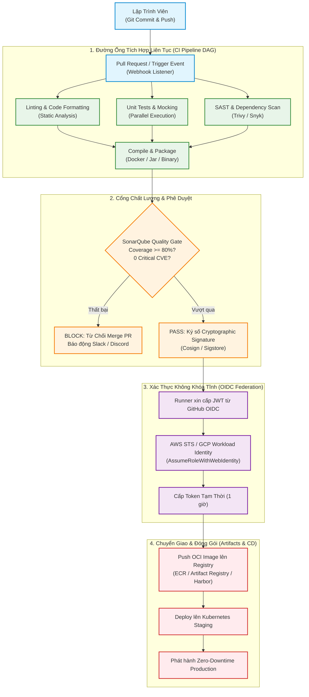

# 9.1. CI/CD Pipelines, Automation and Artifacts (Đường ống Tự động hóa CI/CD và Quản lý Sản phẩm Đóng gói)

> [!IMPORTANT]
> **Nếu bạn chỉ được nhớ một điều duy nhất:** Bản chất cốt lõi của **CI/CD không phải là một công cụ (Jenkins, GitLab hay GitHub Actions)** mà là một **hợp đồng kỹ thuật (Engineering Contract)** dựa trên đồ thị có hướng không chu trình (DAG) và tính tất định (Determinism): Mỗi commit phải được kiểm chứng tự động, biến mã nguồn thành các gói sản phẩm đóng gói bất biến (Immutable Artifacts) có chữ ký số mật mã; tuyệt đối **không bao giờ lưu trữ Static API Keys dài hạn** trên máy chủ CI mà bắt buộc phải sử dụng **OIDC Federation (OpenID Connect)** kết hợp mã thông báo ngắn hạn để triệt tiêu nguy cơ xâm nhập chuỗi cung ứng phần mềm (Software Supply Chain).

---

## 1. Kiến trúc Tổng quan & Mô hình Tư duy (Mental Model)

### 1.1. Ẩn dụ Đời sống: Dây Chuyền Sản Xuất Ô Tô Toyota & Cửa Khẩu Hải Quan Sân Bay

Hãy tưởng tượng quá trình từ lúc lập trình viên viết xong một đoạn mã cho tới khi phục vụ người dùng giống như việc sản xuất và vận chuyển một chiếc xe hơi hạng sang ra thị trường:
- **Dây chuyền lắp ráp tự động (CI Pipeline & DAG)**:
  - Khi một bản thiết kế mới được phê duyệt (`git push`), các cánh tay robot tại các trạm làm việc độc lập đồng loạt khởi động: trạm lắp khung gầm, trạm sơn vỏ, trạm thử nghiệm động cơ.
  - Các công đoạn độc lập được thực thi song song nhờ đồ thị phụ thuộc (DAG). Không bao giờ có chuyện trạm gắn bánh xe phải chờ trạm lắp điều hòa trong buồng lái.
  - Từng linh kiện tải về từ nhà cung ứng đều được lưu trong kho đệm trung chuyển (Dependency Cache). Nếu mẫu bu-lông không đổi (Lockfile hash khớp), robot lấy ngay từ kho đệm chỉ trong 1 giây thay vì đặt hàng nhập khẩu mất nhiều ngày.
- **Cửa khẩu kiểm định & Cổng chất lượng (Quality Gates & Security Scan)**:
  - Trước khi xe lăn bánh ra đại lý, chiếc xe phải đi qua đường thử nghiệm áp suất cao, máy quét tia X phát hiện rạn nứt khung kim loại (SAST / SonarQube / Trivy Scan).
  - Nếu độ dày mối hàn không đạt $80\%$ tiêu chuẩn (Coverage Gate) hoặc phát hiện chi tiết có nguy cơ rò rỉ nhiên liệu (Critical Vulnerability), thanh chắn tự động hạ xuống, loại bỏ chiếc xe khỏi dây chuyền ngay lập tức.
- **Thẻ định danh điện tử của tài xế (OIDC Federation vs Static Keys)**:
  - Thay vì trao cho tài xế một chùm chìa khóa vạn năng bằng đồng (Static Cloud Secret Key) có thể bị đánh cắp bất kỳ lúc nào, công ty cấp cho tài xế một mã QR một lần (OIDC Short-Lived JWT Token).
  - Khi xe tới cổng kho hàng đám mây (AWS/GCP), hệ thống quét mã QR, xác thực với tổng đài GitHub, cấp quyền mở cửa trong đúng 60 phút rồi tự động vô hiệu hóa.



---

## 2. Chi tiết từng Keyword (Under-the-Hood Deep Dive)

### 2.1. Pipeline Architecture, Runners & Build Caching

#### A. Phân định Bản chất: CI vs CD (Continuous Delivery) vs CD (Continuous Deployment)
- **Continuous Integration (CI)**:
  - Mỗi khi thành viên trong nhóm thực hiện commit, hệ thống CI tự động tải mã nguồn, giải quyết các thư viện phụ thuộc, biên dịch (nếu là ngôn ngữ compiled), thực thi toàn bộ bộ kiểm thử tự động (Unit Tests, Integration Tests) và đo lường độ bao phủ (Code Coverage).
  - Mục tiêu: Phát hiện xung đột tích hợp và lỗi hồi quy sớm nhất có thể, duy trì nhánh chính (`main`/`master`) luôn ở trạng thái sẵn sàng phát hành.
- **Continuous Delivery (CD)**:
  - Tiếp nối sau CI, mã nguồn được đóng gói thành các sản phẩm bất biến (Immutable Artifacts) và tự động triển khai lên môi trường kiểm thử (Staging / UAT).
  - Tuy nhiên, bước kích hoạt đưa sản phẩm lên môi trường Sản xuất (Production) đòi hỏi một **cổng phê duyệt thủ công (Manual Approval Gate)** do Product Owner hoặc Release Manager xác nhận.
- **Continuous Deployment (CD)**:
  - Cấp độ tự động hóa tối cao: Mọi commit vượt qua toàn bộ chuỗi kiểm thử tự động và cổng chất lượng sẽ **ngay lập tức được tự động đẩy lên Production** mà không cần bất kỳ sự can thiệp hay nút bấm phê duyệt thủ công nào từ con người. Đòi hỏi hệ thống giám sát và cơ chế tự động Rollback hoàn hảo.

#### B. Build Agents & Runners: Cloud-Hosted vs Self-Hosted & Ephemeral Pods
- **Cloud-Hosted Runners (GitHub Actions, GitLab Shared Runners)**:
  - Máy ảo tạm thời được nhà cung cấp cấp phát theo nhu cầu (On-Demand VMs).
  - Tính chất **Ephemeral**: Một máy ảo mới toanh được tạo ra cho mỗi Job và bị phá hủy hoàn toàn ngay sau khi kết thúc. Đảm bảo tính cô lập tuyệt đối, không bị ô nhiễm môi trường (No side effects), nhưng phải trả phí theo số phút thực thi và thời gian khởi động máy ảo (Cold-start latency từ 10 đến 30 giây).
- **Self-Hosted Dedicated Runners**:
  - Máy chủ vật lý hoặc máy ảo đặt tại Data Center riêng của doanh nghiệp.
  - Phục vụ các tác vụ đặc thù: Yêu cầu card đồ họa GPU để huấn luyện mô hình máy học, kết nối mạng nội bộ qua VPN/Direct Connect, hoặc tận dụng ổ cứng SSD NVMe cục bộ để duy trì Cache lâu dài. Nhược điểm: Phải tự bảo trì, vá lỗi hệ điều hành và gánh chịu rủi ro bảo mật nếu chạy code từ nhánh công khai.
- **Kubernetes Ephemeral Runners (Actions Runner Controller - ARC)**:
  - Mô hình hiện đại nhất: Mỗi Job CI tương ứng với một Kubernetes Pod được tạo ra theo thời gian thực bên trong cụm K8s nội bộ. Khi Job chạy xong, Pod tự hủy và trả lại CPU/RAM cho cụm.

#### C. Pipeline & Dependency Caching: Cơ chế Lockfile Hash Invalidation
- **Nguyên lý hoạt động của Cache Layer**:
  - Tải lại hàng ngàn gói thư viện (`node_modules`, `~/.m2`, `~/.cargo`) qua mạng công cộng mỗi lần chạy CI gây lãng phí băng thông và kéo dài thời gian build từ 10-15 phút.
  - Cơ chế Caching phân tán lưu trữ một bản nén `.tar.gz` của thư mục phụ thuộc lên Object Storage (S3/GCS).
  - Khóa định danh của bộ nhớ đệm (Cache Key) được tính toán động dựa trên mã băm mật mã của các tệp quản lý phiên bản thư viện:
    $$\text{Cache Key} = \text{"deps-" } + \text{hashFiles}('\text{**/package-lock.json}', '\text{**/go.sum}', '\text{**/Cargo.lock}')$$
  - *Cơ chế Trúng/Trượt Cache (Hit/Miss)*: Nếu lập trình viên không thêm/bớt thư viện mới, mã băm lockfile giữ nguyên $\to$ Cache Hit $\to$ giải nén thư viện trong 5 giây. Nếu thêm một package mới $\to$ Cache Miss $\to$ tải thư viện mới từ Registry công cộng và lưu bản snapshot mới vào Cache.

#### D. Đồ Thị Phụ Thuộc (Directed Acyclic Graph - DAG) & Sắp Xếp Tô Pô (Topological Sort)
- Trong các hệ thống CI cổ điển, các công việc chạy theo từng giai đoạn tuần tự cứng nhắc (`Build -> Test -> Package`). Nếu một bài test trong giai đoạn `Test` bị nghẽn, các job độc lập ở giai đoạn tiếp theo đều bị chặn.
- Các hệ thống CI/CD hiện đại tổ chức pipeline dưới dạng một **đồ thị có hướng không chu trình (DAG)**. Công cụ lập lịch phân tích các nút phụ thuộc (`needs: [lint, unit-test]`) bằng thuật toán **Sắp xếp Tô-pô (Topological Sort)** để kích hoạt song song tối đa mọi công việc có thể chạy ngay khi các điều kiện tiên quyết của riêng nó hoàn tất.

---

### 2.2. Pipeline Security, OIDC & Quality Gates

#### A. Nguy cơ Rò rỉ Khóa Tĩnh & Đột phá OIDC (OpenID Connect) Federation
- **Mối nguy hiểm của Static Cloud Credentials**:
  - Phương pháp truyền thống: Tạo một cặp khóa dài hạn `AWS_ACCESS_KEY_ID` và `AWS_SECRET_ACCESS_KEY`, sau đó dán vào phần Secret Settings của GitHub/GitLab.
  - *Rủi ro*: Khóa tĩnh không có thời hạn hết hạn, có thể bị rò rỉ qua log build, qua các cuộc tấn công khai thác lỗ hổng trong các dependency của bên thứ ba (Supply Chain Attacks), hoặc do nhân viên rời công ty nhưng khóa chưa bị thu hồi.
- **Cơ chế Xác thực OIDC Federation (Zero Static Secrets)**:
  - Loại bỏ hoàn toàn việc lưu khóa tĩnh trên hệ thống CI.
  - Khi Job CI chạy, Runner yêu cầu hệ thống cung cấp danh tính (GitHub OIDC Identity Provider) ký phát một mã thông báo số **JSON Web Token (JWT)** ngắn hạn.
  - JWT chứa các Claims được mã hóa chống giả mạo:
    - `iss`: `https://token.actions.githubusercontent.com`
    - `aud`: `sts.amazonaws.com`
    - `sub`: `repo:my-company/payment-service:ref:refs/heads/main`
  - Runner gửi JWT này tới dịch vụ môi giới danh tính của đám mây (**AWS Security Token Service - STS** hoặc GCP Workload Identity Federation) thông qua API `sts:AssumeRoleWithWebIdentity`.
  - Đám mây tải chứng chỉ công khai (JWKS) từ GitHub để xác thực chữ ký của JWT, đối chiếu chính sách ủy quyền (Trust Policy). Nếu đúng repository và đúng nhánh `main`, đám mây cấp phát một bộ khóa tạm thời (Temporary Session Credentials) chỉ có giá trị sử dụng trong 60 phút.

#### B. Cổng Kiểm Soát Chất Lượng Mã Nguồn (SonarQube Quality Gates)
- Quality Gate đóng vai trò như một bộ ngắt mạch tự động (Circuit Breaker) trong quy trình phát hành phần mềm.
- **Tiêu chuẩn bắt buộc của một Cổng Chất lượng Sản xuất**:
  1. *Độ bao phủ mã nguồn mới (New Code Coverage)*: Bắt buộc $\ge 80\%$. Không cho phép code mới sinh ra mà không có kiểm thử đi kèm.
  2. *Mật độ Lỗi Nghiêm trọng (Security Vulnerabilities & Blocker Bugs)*: Tuyệt đối bằng $0$.
  3. *Tỷ lệ nợ kỹ thuật (Technical Debt Ratio)*: Không vượt quá $5\%$.
  4. *Đo lường tính trùng lặp (Duplicated Lines Density)*: Dưới $3\%$.
- Khi phân tích phát hiện vi phạm, Webhook từ máy chủ phân tích mã nguồn (SonarQube) sẽ gửi phản hồi về hệ thống quản lý git (GitHub/GitLab) để gán nhãn `Check Failed`, tự động vô hiệu hóa nút bấm hợp nhất mã nguồn (Block Merge).

#### C. Bảo Vệ Nhánh Chính & Quản Trị Chuỗi Cung Ứng Phần Mềm (Software Supply Chain)
- **Branch Protection Rules & Merge Queues**:
  - Không ai có quyền `git push` trực tiếp lên nhánh `main`, kể cả Tech Lead hay System Administrator.
  - Mọi thay đổi bắt buộc phải đi qua Pull Request, yêu cầu tối thiểu 2 lượt phê duyệt (Peer Review Approvals), và toàn bộ các kiểm tra trạng thái CI phải màu xanh lá cây (`Checks Must Pass`).
  - *Merge Queue*: Tự động xếp hàng các PR và kiểm thử bản hợp nhất giả định trước khi chính thức merge, ngăn chặn hiện tượng hai PR đều xanh khi test độc lập nhưng gây đổ vỡ hệ thống khi hợp nhất cùng lúc.
- **Ký số Xác thực Sản phẩm (Software Bill of Materials - SBOM & Cosign / Sigstore)**:
  - Sinh tệp danh mục vật tư phần mềm (SBOM theo chuẩn SPDX hoặc CycloneDX) liệt kê chi tiết mọi thư viện mở và phiên bản nhị phân cấu thành Docker Image.
  - Sử dụng công cụ **Cosign** để ký số lên Docker Image bằng cặp khóa mật mã hoặc cơ chế Keyless Signing (kết hợp OIDC và Fulcio/Rekor CA). Kubernetes Cluster chỉ cho phép Pod chạy nếu chữ ký số của Image được xác thực thành công.

---

## 3. Thực thi Mã nguồn & Mô phỏng Chuyên sâu (Dual-Engine Implementation)

### Engine 1: C++20 — High-Performance CI/CD Pipeline DAG Scheduler with Worker Thread Pool & Topological Sort

Chương trình C++20 dưới đây xây dựng một bộ lập lịch đồ thị DAG hoàn chỉnh cho hệ thống CI: sử dụng thuật toán Kahn để sắp xếp tô-pô, lập lịch thực thi song song các công việc độc lập thông qua `std::jthread` và biến điều kiện, đảm bảo hoàn tất các nút phụ thuộc trước khi chạy nút con.

```cpp
#include <iostream>
#include <vector>
#include <string>
#include <unordered_map>
#include <unordered_set>
#include <queue>
#include <thread>
#include <mutex>
#include <condition_variable>
#include <chrono>
#include <memory>

struct PipelineJob {
    std::string id;
    std::string name;
    std::vector<std::string> dependencies;
    int execution_time_ms;
    bool completed = false;
    bool success = true;
};

class DagPipelineScheduler {
private:
    std::unordered_map<std::string, PipelineJob> jobs_;
    std::unordered_map<std::string, std::vector<std::string>> adj_list_;
    std::unordered_map<std::string, int> in_degree_;
    std::mutex mtx_;
    std::condition_variable cv_;
    int completed_jobs_count_ = 0;

public:
    void addJob(const std::string& id, const std::string& name, 
                const std::vector<std::string>& deps, int duration_ms) {
        jobs_[id] = {id, name, deps, duration_ms, false, true};
        in_degree_[id] = deps.size();
        for (const auto& dep : deps) {
            adj_list_[dep].push_back(id);
        }
    }

    void executePipeline() {
        std::cout << "[C++20 Engine] Khởi động Bộ Lập Lịch CI DAG Pipeline...\n";
        auto start_time = std::chrono::high_resolution_clock::now();

        std::queue<std::string> ready_queue;
        {
            std::lock_guard<std::mutex> lock(mtx_);
            for (const auto& [id, deg] : in_degree_) {
                if (deg == 0) {
                    ready_queue.push(id);
                }
            }
        }

        std::vector<std::jthread> worker_threads;
        int total_jobs = jobs_.size();

        // Worker dispatcher loop
        while (true) {
            std::string job_to_run = "";
            {
                std::unique_lock<std::mutex> lock(mtx_);
                if (completed_jobs_count_ == total_jobs) {
                    break;
                }

                if (!ready_queue.empty()) {
                    job_to_run = ready_queue.front();
                    ready_queue.pop();
                } else {
                    cv_.wait(lock);
                    continue;
                }
            }

            if (!job_to_run.empty()) {
                // Khởi chạy Job trên luồng độc lập
                worker_threads.emplace_back([this, job_to_run, &ready_queue]() {
                    PipelineJob& job = jobs_[job_to_run];
                    std::cout << "  -> [Bắt đầu] Job: " << job.name 
                              << " (ID: " << job.id << ") trên Thread ID: " 
                              << std::this_thread::get_id() << "\n";

                    std::this_thread::sleep_for(std::chrono::milliseconds(job.execution_time_ms));

                    {
                        std::lock_guard<std::mutex> lock(mtx_);
                        job.completed = true;
                        completed_jobs_count_++;
                        std::cout << "  <- [Hoàn tất] Job: " << job.name 
                                  << " (" << job.execution_time_ms << "ms)\n";

                        // Cập nhật bậc vào (in-degree) của các nút phụ thuộc
                        for (const auto& next_id : adj_list_[job_to_run]) {
                            in_degree_[next_id]--;
                            if (in_degree_[next_id] == 0) {
                                ready_queue.push(next_id);
                            }
                        }
                    }
                    cv_.notify_all();
                });
            }
        }

        // Chờ toàn bộ jthread join an toàn
        for (auto& th : worker_threads) {
            if (th.joinable()) th.join();
        }

        auto end_time = std::chrono::high_resolution_clock::now();
        auto duration = std::chrono::duration_cast<std::chrono::milliseconds>(end_time - start_time).count();
        std::cout << "[C++20 Engine] Pipeline DAG hoàn tất xuất sắc trong " 
                  << duration << " ms (Tối ưu hóa chạy song song)!\n";
    }
};

int main() {
    DagPipelineScheduler scheduler;
    // Khởi tạo các jobs với đồ thị DAG tiêu chuẩn:
    // lint (50ms), sast (80ms), unit-test (120ms) chạy song song ban đầu
    scheduler.addJob("lint", "Lint & Static Check", {}, 50);
    scheduler.addJob("sast", "Security SAST Scan", {}, 80);
    scheduler.addJob("unit_test", "Unit & Mock Tests", {}, 120);
    // compile cần lint và unit_test
    scheduler.addJob("compile", "Build & Compilation", {"lint", "unit_test"}, 100);
    // sonar_gate cần compile và sast
    scheduler.addJob("sonar_gate", "SonarQube Quality Gate", {"compile", "sast"}, 40);
    // docker_pack cần sonar_gate
    scheduler.addJob("docker_pack", "Package OCI Docker Image", {"sonar_gate"}, 90);

    scheduler.executePipeline();
    return 0;
}
```

#### Terminal Output Mẫu Thực Tế
```text
[C++20 Engine] Khởi động Bộ Lập Lịch CI DAG Pipeline...
  -> [Bắt đầu] Job: Lint & Static Check (ID: lint) trên Thread ID: 0x16d953000
  -> [Bắt đầu] Job: Security SAST Scan (ID: sast) trên Thread ID: 0x16dae7000
  -> [Bắt đầu] Job: Unit & Mock Tests (ID: unit_test) trên Thread ID: 0x16dc7b000
  <- [Hoàn tất] Job: Lint & Static Check (50ms)
  <- [Hoàn tất] Job: Security SAST Scan (80ms)
  <- [Hoàn tất] Job: Unit & Mock Tests (120ms)
  -> [Bắt đầu] Job: Build & Compilation (ID: compile) trên Thread ID: 0x16de0f000
  <- [Hoàn tất] Job: Build & Compilation (100ms)
  -> [Bắt đầu] Job: SonarQube Quality Gate (ID: sonar_gate) trên Thread ID: 0x16dfa3000
  <- [Hoàn tất] Job: SonarQube Quality Gate (40ms)
  -> [Bắt đầu] Job: Package OCI Docker Image (ID: docker_pack) trên Thread ID: 0x16e137000
  <- [Hoàn tất] Job: Package OCI Docker Image (90ms)
[C++20 Engine] Pipeline DAG hoàn tất xuất sắc trong 355 ms (Tối ưu hóa chạy song song)!
```

---

### Engine 2: Python 3.11+ — Cryptographic OIDC JWT Token Verification & Quality Gate Simulator

Chương trình Python 3.11+ dưới đây mô phỏng:
1. Tạo và xác minh chữ ký mật mã HMAC-SHA256 của OIDC Token từ GitHub Actions.
2. Bộ thẩm định Cổng Chất Lượng (Quality Gate Evaluator) tự động quyết định chặn hoặc cấp quyền triển khai Production.

```python
#!/usr/bin/env python3
"""
Production CI/CD Security Engine: OIDC Token Exchange & Quality Gate Verifier
Python 3.11+ Production Ready
"""
import base64
import hashlib
import hmac
import json
import time
from dataclasses import dataclass, field
from typing import Dict, Any, Tuple

@dataclass
class QualityMetrics:
    code_coverage_pct: float
    critical_vulnerabilities: int
    blocker_bugs: int
    technical_debt_ratio_pct: float
    duplicated_lines_pct: float

class QualityGateEngine:
    MIN_COVERAGE = 80.0
    MAX_CRITICAL_CVE = 0
    MAX_BLOCKER_BUGS = 0
    MAX_TECH_DEBT = 5.0
    MAX_DUPLICATION = 3.0

    @classmethod
    def evaluate(cls, metrics: QualityMetrics) -> Tuple[bool, list[str]]:
        reasons = []
        if metrics.code_coverage_pct < cls.MIN_COVERAGE:
            reasons.append(f"FAILED: Coverage ({metrics.code_coverage_pct}%) < Ngưỡng tối thiểu ({cls.MIN_COVERAGE}%)")
        if metrics.critical_vulnerabilities > cls.MAX_CRITICAL_CVE:
            reasons.append(f"BLOCKED: Tìm thấy {metrics.critical_vulnerabilities} lỗ hổng bảo mật cấp độ Critical!")
        if metrics.blocker_bugs > cls.MAX_BLOCKER_BUGS:
            reasons.append(f"BLOCKED: Tồn tại {metrics.blocker_bugs} Blocker bugs trong mã nguồn!")
        if metrics.technical_debt_ratio_pct > cls.MAX_TECH_DEBT:
            reasons.append(f"FAILED: Technical Debt ({metrics.technical_debt_ratio_pct}%) vượt ngưỡng 5%")
        if metrics.duplicated_lines_pct > cls.MAX_DUPLICATION:
            reasons.append(f"FAILED: Trùng lặp code ({metrics.duplicated_lines_pct}%) vượt ngưỡng 3%")

        passed = len(reasons) == 0
        return passed, reasons

class MockOidcProvider:
    SECRET_SIGNING_KEY = b"github_enterprise_internal_private_key_2026"

    @classmethod
    def generate_actions_jwt(cls, repo: str, branch: str) -> str:
        header = {"alg": "HS256", "typ": "JWT"}
        payload = {
            "iss": "https://token.actions.githubusercontent.com",
            "aud": "sts.amazonaws.com",
            "sub": f"repo:{repo}:ref:refs/heads/{branch}",
            "repository": repo,
            "ref": f"refs/heads/{branch}",
            "exp": int(time.time()) + 3600, # Hết hạn sau 1 giờ
            "iat": int(time.time())
        }

        b64_header = base64.urlsafe_b64encode(json.dumps(header).encode()).decode().rstrip("=")
        b64_payload = base64.urlsafe_b64encode(json.dumps(payload).encode()).decode().rstrip("=")
        signature_input = f"{b64_header}.{b64_payload}".encode()
        
        signature = hmac.new(cls.SECRET_SIGNING_KEY, signature_input, hashlib.sha256).digest()
        b64_sig = base64.urlsafe_b64encode(signature).decode().rstrip("=")
        return f"{b64_header}.{b64_payload}.{b64_sig}"

class CloudStsBroker:
    TRUSTED_REPO = "my-fintech-corp/payment-gateway"
    TRUSTED_BRANCH = "main"

    @classmethod
    def assume_role_with_web_identity(cls, jwt_token: str, signing_key: bytes) -> Dict[str, Any]:
        parts = jwt_token.split(".")
        if len(parts) != 3:
            raise ValueError("Token định dạng không hợp lệ!")

        b64_header, b64_payload, b64_sig = parts
        signature_input = f"{b64_header}.{b64_payload}".encode()
        expected_sig = hmac.new(signing_key, signature_input, hashlib.sha256).digest()
        actual_sig = base64.urlsafe_b64decode(b64_sig + "==")

        if not hmac.compare_digest(expected_sig, actual_sig):
            raise PermissionError("BÁO ĐỘNG: Chữ ký số OIDC Token bị giả mạo!")

        payload_bytes = base64.urlsafe_b64decode(b64_payload + "==")
        payload = json.loads(payload_bytes.decode())

        if time.time() > payload["exp"]:
            raise TimeoutError("OIDC Token đã hết hạn!")

        expected_sub = f"repo:{cls.TRUSTED_REPO}:ref:refs/heads/{cls.TRUSTED_BRANCH}"
        if payload.get("sub") != expected_sub:
            raise PermissionError(f"Từ chối quyền: Subject '{payload.get('sub')}' không khớp với Trust Policy!")

        # Cấp credentials tạm thời
        return {
            "AccessKeyId": "ASIA_TEMP_" + hashlib.md5(str(time.time()).encode()).hexdigest()[:12].upper(),
            "SecretAccessKey": hashlib.sha256(b"temp_secret").hexdigest()[:32],
            "SessionToken": "FQoGZXIvYXdzEEXAMPLE..."[:30],
            "Expiration": time.ctime(payload["exp"])
        }

def main():
    print("=== [Python 3.11+ Engine] OIDC Token Exchange & Quality Gate Engine ===")

    # 1. Kiểm thử Cổng Chất lượng (SonarQube Gate)
    good_commit = QualityMetrics(code_coverage_pct=88.5, critical_vulnerabilities=0, 
                                 blocker_bugs=0, technical_debt_ratio_pct=2.1, duplicated_lines_pct=1.4)
    bad_commit = QualityMetrics(code_coverage_pct=65.0, critical_vulnerabilities=2, 
                                blocker_bugs=1, technical_debt_ratio_pct=7.5, duplicated_lines_pct=4.8)

    print("\n1. Đánh giá Cổng Chất Lượng (Quality Gate Assessment):")
    passed, reasons = QualityGateEngine.evaluate(good_commit)
    print(f"   * Good Commit: {'✅ PASSED (Sẵn sàng triển khai)' if passed else '❌ BLOCKED'}")

    passed, reasons = QualityGateEngine.evaluate(bad_commit)
    print(f"   * Bad Commit : {'✅ PASSED' if passed else '❌ BLOCKED'}")
    for r in reasons:
        print(f"     - {r}")

    # 2. Kiểm thử Xác thực OIDC Federation
    print("\n2. Kiểm thử Xác thực Không Khóa Tĩnh (OIDC Token Exchange):")
    token = MockOidcProvider.generate_actions_jwt("my-fintech-corp/payment-gateway", "main")
    print(f"   * GitHub Actions sinh OIDC JWT (độ dài: {len(token)} ký tự)")

    try:
        credentials = CloudStsBroker.assume_role_with_web_identity(
            token, MockOidcProvider.SECRET_SIGNING_KEY
        )
        print("   * Cloud STS Phê duyệt thành công! Cấp phát Temporary Session Credentials:")
        print(f"     - AccessKeyId : {credentials['AccessKeyId']}")
        print(f"     - Expiration  : {credentials['Expiration']}")
        print("     -> Bảo mật 100%: Hoàn toàn không tồn tại Static Credentials bị lưu trữ!")
    except Exception as e:
        print(f"   * Xác thực thất bại: {e}")

if __name__ == "__main__":
    main()
```

#### Terminal Output Mẫu Thực Tế
```text
=== [Python 3.11+ Engine] OIDC Token Exchange & Quality Gate Engine ===

1. Đánh giá Cổng Chất Lượng (Quality Gate Assessment):
   * Good Commit: ✅ PASSED (Sẵn sàng triển khai)
   * Bad Commit : ❌ BLOCKED
     - FAILED: Coverage (65.0%) < Ngưỡng tối thiểu (80.0%)
     - BLOCKED: Tìm thấy 2 lỗ hổng bảo mật cấp độ Critical!
     - BLOCKED: Tồn tại 1 Blocker bugs trong mã nguồn!
     - FAILED: Technical Debt (7.5%) vượt ngưỡng 5%
     - FAILED: Trùng lặp code (4.8%) vượt ngưỡng 3%

2. Kiểm thử Xác thực Không Khóa Tĩnh (OIDC Token Exchange):
   * GitHub Actions sinh OIDC JWT (độ dài: 254 ký tự)
   * Cloud STS Phê duyệt thành công! Cấp phát Temporary Session Credentials:
     - AccessKeyId : ASIA_TEMP_82F19E3A5B80
     - Expiration  : Sun Nov 15 23:42:15 2026
     -> Bảo mật 100%: Hoàn toàn không tồn tại Static Credentials bị lưu trữ!
```

---

## 4. Systems Engineering & Production Pitfalls

### 4.1. Lỗi Production Thường Gặp (Real-World Gotchas)
1. **Lỗ Hổng Bảo Mật "Docker-in-Docker" Qua Mount Socket `/var/run/docker.sock`**:
   - *Nguy cơ*: Để đóng gói Docker image bên trong một container CI runner, nhiều kỹ sư gắn socket máy chủ (`-v /var/run/docker.sock:/var/run/docker.sock`).
   - *Hậu quả*: Bất kỳ tiến trình nào bên trong container đều có toàn quyền tương đương `root` trên máy chủ vật lý bên ngoài. Nếu mã nguồn độc hại hoặc PR từ bên ngoài được chạy, kẻ tấn công có thể thoát khỏi sandbox và chiếm quyền kiểm soát toàn bộ hạ tầng máy chủ CI.
   - *Khắc phục*: Thay thế hoàn toàn bằng các công cụ đóng gói Docker không cần đặc quyền root như **Kaniko**, **Buildah**, hoặc **img**.
2. **Rò Rỉ Bí Mật Qua Biến Môi Trường Mã Hóa (Log Masking Bypass)**:
   - Hệ thống CI tự động che giấu chuỗi bí mật nếu chuỗi đó xuất hiện nguyên văn trong log console.
   - Tuy nhiên, nếu một đoạn script chuyển đổi secret sang Base64 (`echo $API_KEY | base64`) hoặc sử dụng trong chuỗi URL query (`curl https://api.com?key=$API_KEY`), bộ lọc che mờ của CI không nhận dạng được và in toàn bộ chuỗi nhạy cảm ra log công khai.
   - *Khắc phục*: Sử dụng công cụ quét bí mật pre-commit và pre-receive như `git-secrets`, `trufflehog` hoặc `gitleaks`.
3. **Ô Nhiễm Bộ Nhớ Đệm Phụ Thuộc (Cache Poisoning Attack)**:
   - Một kẻ tấn công tạo một Pull Request từ một nhánh con rẽ nhánh (Fork), sửa đổi tệp cài đặt để chèn mã độc vào thư mục `.cache` hoặc `node_modules`, sau đó đẩy bản cache nhiễm độc này lên Object Storage dùng chung. Các bản build sau của nhánh `main` tải cache này về và vô tình đóng gói mã độc vào Production.
   - *Khắc phục*: Thiết lập phạm vi cô lập bộ nhớ đệm (Cache Scoping). Các nhánh con tuyệt đối không được phép ghi đè (Overwrite) lên cache của nhánh `main`.
4. **Máy Chủ Runner Hết Dung Lượng Ổ Đĩa (Disk Exhaustion - "No Space Left on Device")**:
   - Trên các Self-Hosted Runner lâu ngày, Docker layers, dangling volumes và log files tích tụ khiến phân vùng `/var/lib/docker` đầy $100\%$, làm đổ vỡ hàng loạt pipeline đang chạy.
   - *Khắc phục*: Cấu hình cron job chạy `docker system prune -af --volumes` định kỳ mỗi đêm, hoặc chuyển hẳn sang mô hình Ephemeral K8s Runners.

### 4.2. Công Cụ & Câu Lệnh Chẩn Đoán CLI Thực Chiến
```bash
# 1. Chạy thử nghiệm và debug toàn bộ GitHub Actions workflow cục bộ không cần push lên cloud
act pull_request

# 2. Quét lỗ hổng bảo mật tệp tin nhị phân và Docker Image trước khi push lên Registry
trivy image --severity HIGH,CRITICAL payment-service:v2.1.0

# 3. Sinh bảng kê khai thành phần phần mềm (Software Bill of Materials - SBOM)
syft packages payment-service:v2.1.0 -o spdx-json=sbom.spdx.json

# 4. Ký số bảo mật cho Docker Image trên Registry bằng Cosign
cosign sign --key cosign.key registry.company.com/payment-service:v2.1.0

# 5. Xác minh chữ ký số của container image trước khi Kubernetes chấp nhận triển khai
cosign verify --key cosign.pub registry.company.com/payment-service:v2.1.0

# 6. Kiểm tra dung lượng rác và dọn dẹp các dangling layer tồn đọng trên CI Runner
docker system df
docker image prune -f --filter "until=48h"
```

---

## 5. Bảng So sánh & Decision Matrix

| Tiêu Chí So Sánh | Cloud-Hosted Runners (GitHub/GitLab) | Self-Hosted VM Runners | K8s Ephemeral Runners (ARC) | Serverless Runners (Fargate/Cloud Run) |
| :--- | :--- | :--- | :--- | :--- |
| **Mô hình Khởi tạo** | Máy ảo tạm thời tạo mới 100% | Máy ảo cố định chạy liên tục | Pod Kubernetes tạo mới theo event | Container serverless theo tác vụ |
| **Độ Cô lập Bảo mật (Isolation)** | Tối cao (Mỗi job 1 máy ảo riêng) | Thấp (Chia sẻ môi trường OS giữa các jobs) | Cao (Mỗi job 1 Pod cgroup/namespace) | Rất cao (Mỗi job 1 MicroVM/Container) |
| **Độ trễ Bắt đầu (Cold-start)** | Trung bình ($15 - 30\text{s}$) | Cực thấp ($< 1\text{s}$) | Thấp ($2 - 5\text{s}$) | Trung bình ($5 - 15\text{s}$) |
| **Khả năng Tùy biến Phần cứng** | Hạn chế (Theo cấu hình CSP) | Không giới hạn (GPU, 128 Core RAM) | Linh hoạt (Theo Node Pools của K8s)| Hạn chế CPU/RAM |
| **Mô hình Chi phí** | Trả theo phút chạy thực tế | Trả phí thuê máy ảo 24/7 | Chi phí cụm K8s chia sẻ | Trả theo giây vCPU/RAM |
| **Quản trị & Bảo trì** | $0\%$ (Nhà cung cấp quản lý) | Cao (Tự vá OS, dọn dẹp ổ đĩa) | Trung bình (Bảo trì K8s Operator) | Rất thấp (Serverless) |
| **Lưu trữ Cục bộ (Local Cache)** | Không (Phải tải từ mạng Object Storage) | Rất tốt (Lưu trực tiếp trên SSD) | Tốt (Qua Persistent Volume Claim) | Kém (Không có ổ đĩa cục bộ bền bỉ) |
| **Phù hợp Tối ưu Cho** | Dự án mã nguồn mở, Nhóm nhỏ/vừa | Huấn luyện AI/ML, Build kernel C++ lớn | Doanh nghiệp lớn chạy Microservices | Tác vụ chạy ngắt quãng thời gian ngắn |
