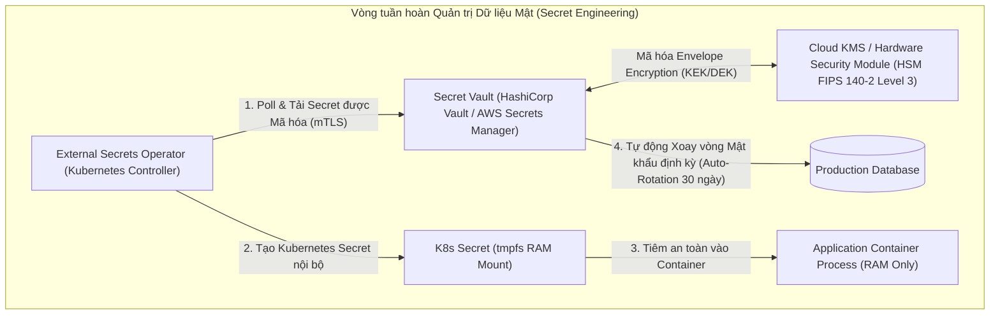
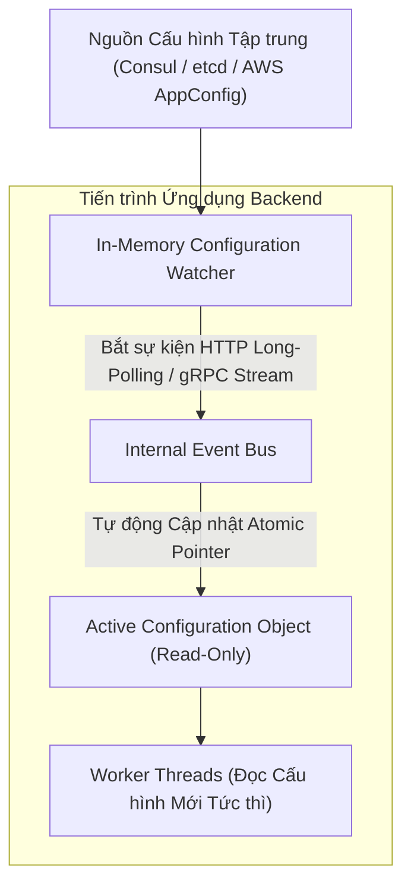
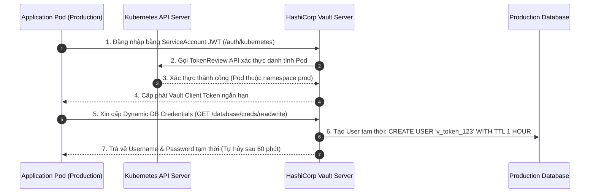
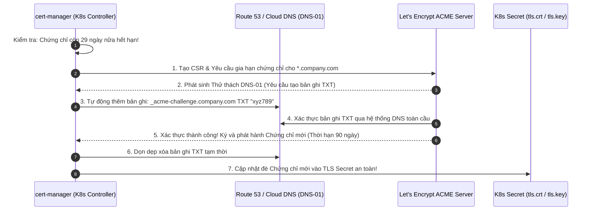

# 10.1. Configuration and Secret Engineering (Kỹ thuật Quản lý Cấu hình và Dữ liệu Mật)

## Tổng quan về Quản lý Cấu hình và Dữ liệu Mật
Quản lý cấu hình (Configuration Management) và bảo mật dữ liệu mật (Secret Engineering) là nền tảng cốt lõi đảm bảo tính di động, an toàn và khả năng vận hành linh hoạt của các hệ thống phân tán. Hệ thống phân tách hoàn toàn giữa **Mã nguồn (Code)**, **Dữ liệu cấu hình môi trường (Non-sensitive Config)** và **Dữ liệu mật nhạy cảm (Secrets: Passwords, Private Keys, API Tokens)**.

Về mặt mật mã học và bảo vệ bí mật phân tán (Shamir's Secret Sharing Scheme):
Các hệ thống quản lý dữ liệu mật cấp độ quân sự như **HashiCorp Vault** bảo vệ Master Key của hệ thống bằng thuật toán chia sẻ bí mật của Adi Shamir $(k, n)$-threshold:
Khóa chính $S$ được phân rã thành $n$ mảnh khóa độc lập (Key Shares). Để tái tạo lại Master Key $S$ và mở khóa hệ thống (Unseal Vault), bắt buộc phải có sự phối hợp đồng thời của ít nhất $k$ mảnh khóa $(k \le n)$:
$$f(x) = S + a_1 x + a_2 x^2 + \dots + a_{k-1} x^{k-1} \pmod p$$
Bất kỳ một nhóm nào sở hữu ít hơn $k$ mảnh khóa $(k - 1)$ đều hoàn toàn **không thể trích xuất được bất kỳ thông tin nào** về khóa chính $S$, loại bỏ rủi ro một cá nhân quản trị viên duy nhất có thể giải mã toàn bộ dữ liệu mật của công ty.



---

## 2. Chi tiết từng Keyword (Under-the-Hood Deep Dive)

---

### 1. Configuration Management, Hierarchy & Dynamic Reloading

#### 1. Khái niệm bản chất (What & Why)
- **Configuration Hierarchy (Phân cấp Cấu hình)**: Nguyên tắc ưu tiên nạp cấu hình từ nhiều nguồn khác nhau. Thứ tự ưu tiên giảm dần chuẩn mực:
  $$\textbf{CLI Arguments} > \textbf{Environment Variables} > \textbf{Environment Specific File (.env.production)} > \textbf{Base Config File (config.yaml)} > \textbf{Default Values in Code}$$
- **Configuration Validation (Xác thực Cấu hình chặt chẽ)**: Ép buộc ứng dụng phải kiểm tra tính hợp lệ của toàn bộ biến môi trường ngay khi khởi động (Fail-fast Startup). Nếu thiếu một biến bắt buộc (như `DATABASE_URL`) hoặc sai định dạng port, ứng dụng phải lập tức dừng tiến trình và báo lỗi rõ ràng, thay vì khởi động nửa vời rồi sập giữa chừng khi phục vụ khách hàng.
- **Dynamic Configuration & Centralized Config**:
  - *Centralized Config*: Lưu trữ cấu hình tập trung tại một nguồn phân tán (Consul, etcd, Spring Cloud Config, AWS AppConfig).
  - *Dynamic Reloading*: Khả năng cập nhật các thông số hoạt động của ứng dụng (như Log Level từ `INFO` sang `DEBUG`, hoặc tăng Connection Pool Size) ngay lập tức trong thời gian thực mà không cần khởi động lại tiến trình hay gây rớt kết nối mạng.

#### 2. Cơ chế hoạt động sâu (Under the hood / Hardcore Internals)
- **Bảo vệ Vùng nhớ Dữ liệu Mật trong Linux Kernel (`mlock` & `MADV_DONTDUMP`)**:
  - Khi ứng dụng nạp secret (như private key) vào bộ nhớ RAM, nếu hệ thống bị thiếu hụt bộ nhớ, nhân Linux có thể hoán đổi (Swap) vùng RAM đó xuống ổ cứng vật lý (`/swapfile`). Hacker có thể đọc được secret từ file swap.
  - Các hệ thống an toàn sử dụng system call **`mlock(buffer, size)`** để khóa cứng vùng nhớ trong RAM vật lý, cấm không cho Linux Kernel swap xuống đĩa.
  - Đồng thời kích hoạt **`madvise(buffer, size, MADV_DONTDUMP)`**: Nếu ứng dụng bị crash và tạo ra file kết xuất bộ nhớ (Core Dump), vùng nhớ chứa secret sẽ tự động bị loại bỏ khỏi file dump, ngăn ngừa rò rỉ khóa bí mật qua file log lỗi.

#### 3. Sơ đồ minh họa


#### 4. Code ví dụ thực chiến (TypeScript Strict Configuration Schema Validator)
Triển khai bộ xác thực cấu hình môi trường chuẩn Fail-Fast sử dụng Zod schema:

```typescript
import { z } from "zod";

// Định nghĩa lược đồ kiểm tra tính hợp lệ của cấu hình hệ thống
const EnvironmentSchema = z.object({
  NODE_ENV: z.enum(["development", "staging", "production"]).default("development"),
  PORT: z.string().transform(Number).pipe(z.number().int().min(1024).max(65535)).default("8080"),
  DATABASE_URL: z.string().url("DATABASE_URL phải là một URL kết nối hợp lệ!"),
  CACHE_TTL_SECONDS: z.string().transform(Number).pipe(z.number().positive()).default("300"),
  ENABLE_RATE_LIMITER: z.string().transform((val) => val === "true").default("true"),
});

export type AppConfig = z.infer<typeof EnvironmentSchema>;

export class ConfigurationBootstrap {
  public static loadAndValidate(): AppConfig {
    console.log("[Config Bootstrap] Đang nạp và kiểm định cấu hình môi trường...");
    const result = EnvironmentSchema.safeParse(process.env);

    if (!result.success) {
      console.error("=======================================================");
      console.error("[CẤU HÌNH KHÔNG HỢP LỆ - KHỞI ĐỘNG THẤT BẠI (FAIL-FAST)]");
      console.error("Danh sách các trường cấu hình bị lỗi hoặc thiếu:");
      for (const issue of result.error.issues) {
        console.error(`  -> Biến [${issue.path.join(".")}]: ${issue.message}`);
      }
      console.error("=======================================================");
      process.exit(1); // Ép buộc dừng tiến trình ngay lập tức
    }

    console.log("[Config Bootstrap] Cấu hình hợp lệ! Tiếp tục khởi động máy chủ...");
    return result.data;
  }
}

// Chạy thử nghiệm kiểm tra
if (process.env.NODE_ENV !== "test") {
  // Giả lập thiếu DATABASE_URL để kiểm chứng cơ chế Fail-Fast
  try {
    ConfigurationBootstrap.loadAndValidate();
  } catch (err) {
    // Catch trong môi trường test
  }
}
```

#### 5. Ưu / Nhược điểm, Pitfalls & Anti-patterns
- **Ưu điểm**: Đảm bảo $100\%$ không bao giờ xảy ra lỗi runtime do thiếu biến môi trường giữa đêm; hỗ trợ điều chỉnh hành vi hệ thống tức thời mà không cần deploy.
- **Pitfall**: Lưu trữ các tham số nhạy cảm (như mật khẩu DB) chung vào tệp cấu hình không mã hóa và commit lên Git.

#### 6. Ứng dụng thực tế trong Backend / Systems
- Thiết lập tính năng Dynamic Logging Level: Cho phép kỹ sư chuyển đổi mức log của một microservice từ `ERROR` sang `DEBUG` trong 10 phút để truy vết lỗi trên người dùng thực tế mà không cần restart Pod.

---

### 2. Secret Management, Rotation & HashiCorp Vault

#### 1. Khái niệm bản chất (What & Why)
- **Secret Management (Quản lý Dữ liệu Mật)**: Hệ thống chuyên dụng để lưu trữ, mã hóa, kiểm soát truy cập và kiểm toán (Audit Trail) các thông tin nhạy cảm.
- **Secret Rotation (Xoay vòng Dữ liệu Mật)**: Quy trình định kỳ thay đổi mật khẩu, API keys hoặc chứng chỉ số (ví dụ: mỗi 30 hoặc 90 ngày một lần). Đảm bảo nếu một mã khóa bị rò rỉ mà không ai biết, kẻ tấn công cũng chỉ có thể lợi dụng nó trong một khoảng thời gian giới hạn.
- **HashiCorp Vault**: Nền tảng quản lý bí mật tiêu chuẩn công nghiệp:
  - *Static Secrets*: Lưu trữ mật khẩu tĩnh được mã hóa trong KV engine.
  - *Dynamic Secrets (Bí mật Động)*: Vault tự động tạo ra các tài khoản tạm thời theo yêu cầu (Just-in-Time Credentials). Ví dụ: khi ứng dụng cần kết nối database, Vault tạo ngay một user MySQL mới có quyền hạn vừa đủ và tự động hủy (Revoke) user đó sau 1 giờ.
- **External Secrets Operator (ESO)**: Kubernetes Operator kết nối trực tiếp cụm K8s với các kho bí mật bên ngoài (HashiCorp Vault, AWS Secrets Manager, GCP Secret Manager, Azure Key Vault). ESO tự động đồng bộ secret từ kho ngoài vào thành native `Kubernetes Secret` bên trong cụm, giúp loại bỏ hoàn toàn việc lưu trữ mật khẩu trong file manifest hay kho mã nguồn Git.

#### 2. Cơ chế hoạt động sâu (Under the hood / Hardcore Internals)
- **Quy trình Xác thực Không dùng Mật khẩu của Kubernetes với HashiCorp Vault**:
  1. Khi một Pod khởi chạy, Kubelet tự động gắn kết một Token nhận diện ngắn hạn của Kubernetes ServiceAccount vào thư mục `/var/run/secrets/kubernetes.io/serviceaccount/token`.
  2. Ứng dụng đọc token này và gửi tới Vault qua API endpoint `POST /v1/auth/kubernetes/login`.
  3. Vault gọi ngược lại `TokenReview` API của Kubernetes Control Plane để xác minh: *"Token này có đúng là của Pod thuộc namespace production hay không?"*.
  4. Sau khi xác thực thành công, Vault cấp phát một Vault Token có thời hạn (Lease) kèm theo chính sách phân quyền (Vault Policy) tương ứng, cho phép ứng dụng đọc dữ liệu mật mà hai bên không cần chia sẻ bất kỳ mật khẩu tĩnh nào từ trước.

#### 3. Sơ đồ minh họa


#### 4. Code ví dụ thực chiến (C++ Memory Zeroization & Secret Sanitization)
Đoạn mã C++ minh họa việc xóa sạch dữ liệu mật khỏi bộ nhớ RAM (Memory Zeroization) bằng hàm chuẩn `explicit_bzero` / `memset_s` để chống tấn công đọc trộm RAM (Memory Dumping):

```cpp
#include <iostream>
#include <cstring>
#include <string>

class SecureSecretBuffer {
private:
    char* secret_data{nullptr};
    size_t length{0};

public:
    explicit SecureSecretBuffer(const std::string& input) : length(input.length()) {
        secret_data = new char[length + 1];
        std::memcpy(secret_data, input.c_str(), length);
        secret_data[length] = '\0';
        std::cout << "[Secure Buffer] Đã nạp dữ liệu mật vào RAM an toàn.\n";
    }

    ~SecureSecretBuffer() {
        if (secret_data) {
            // Sử dụng hàm an toàn để ngăn cản Compiler Optimizer tự ý bỏ qua lệnh xóa bộ nhớ!
            // Trên Linux glibc dùng explicit_bzero, trên Windows dùng SecureZeroMemory
#if defined(__GLIBC__)
            explicit_bzero(secret_data, length);
#else
            volatile char* p = secret_data;
            while (length--) *p++ = 0;
#endif
            delete[] secret_data;
            std::cout << "[Secure Buffer] GIẢI PHÓNG AN TOÀN: Toàn bộ vùng nhớ RAM đã được ghi đè 0 (Zeroized)!\n";
        }
    }

    void processSecret() const {
        std::cout << "[Processing] Thực hiện xác thực cryptographic hash với secret...\n";
    }
};

int main() {
    {
        SecureSecretBuffer key("SUPER_SECRET_DATABASE_PASSWORD_9988");
        key.processSecret();
    } // Ra khỏi scope: Destructor tự động kích hoạt zeroization ngay lập tức!
    return 0;
}
```

#### 5. Ưu / Nhược điểm, Pitfalls & Anti-patterns
- **Dynamic Secrets**: Loại bỏ $100\%$ rủi ro rò rỉ mật khẩu dài hạn; kiểm toán chính xác microservice nào đã truy cập database vào thời điểm nào.
- **Pitfall**: Đọc secret từ Vault nhưng lưu vào biến toàn cục tĩnh (Static Variable) và không lắng nghe sự kiện hết hạn Lease Time. Khi Vault hủy user sau 1 giờ, ứng dụng sẽ bị từ chối kết nối và liên tục báo lỗi `Access Denied`.

#### 6. Ứng dụng thực tế trong Backend / Systems
- Thiết lập quy trình tự động xoay vòng mật khẩu (Automated Rotation) bằng AWS Secrets Manager kết hợp Lambda: Tự động đổi mật khẩu tài khoản Master của Amazon Aurora PostgreSQL vào lúc 3h sáng chủ nhật hàng tuần mà không gây gián đoạn hệ thống.

---

### 3. KMS, HSM & Automated TLS Certificate Lifecycle (ACME)

#### 1. Khái niệm bản chất (What & Why)
- **Key Management Service (KMS)**: Dịch vụ đám mây quản lý khóa mã hóa tập trung. Khóa chính của khách hàng (Customer Master Key - CMK / KEK) được bảo vệ tuyệt đối và không bao giờ rời khỏi ranh giới phần cứng của hệ thống.
- **Hardware Security Modules (HSM)**: Thiết bị phần cứng vật lý chuyên dụng đạt chuẩn chống giả mạo **FIPS 140-2 / 140-3 Level 3**. Có các cảm biến phát hiện xâm nhập vật lý: nếu kẻ xấu cố tình tháo vỏ hoặc can thiệp điện áp, chip HSM sẽ kích hoạt cơ chế tự hủy (Zeroization) để xóa sạch toàn bộ khóa mật mã trong microsecond.
- **Automated Certificate Lifecycle (ACME Protocol & cert-manager)**:
  - Giao thức tự động quản lý chứng chỉ số SSL/TLS (**Automated Certificate Management Environment - ACME** chuẩn hóa bởi Let's Encrypt).
  - Công cụ **cert-manager** chạy trên Kubernetes tự động hóa $100\%$ quy trình xin cấp mới, xác thực quyền sở hữu tên miền, và gia hạn chứng chỉ trước ngày hết hạn (thường là 30 ngày trước khi hết hạn 90 ngày của Let's Encrypt).
- **Thử thách Xác thực Tên miền (ACME Challenges)**:
  - *HTTP-01 Challenge*: Máy chủ Let's Encrypt gửi request HTTP tới đường dẫn `http://<domain>/.well-known/acme-challenge/<token>`. Phù hợp cho các ứng dụng web phơi bày ra Internet.
  - *DNS-01 Challenge*: Tự động tạo một bản ghi `TXT` trên hệ thống DNS (như AWS Route 53, Cloudflare). Phương pháp duy nhất hỗ trợ tạo **Chứng chỉ Wildcard (`*.example.com`)** và hoạt động được cho các hệ thống nằm hoàn toàn trong mạng riêng nội bộ không có IP công cộng.

#### 2. Cơ chế hoạt động sâu (Under the hood / Hardcore Internals)
- **Vòng tuần hoàn Gia hạn Chứng chỉ của cert-manager**:
  - `cert-manager` giám sát đối tượng `Certificate` trong cụm Kubernetes.
  - Khi thời gian sống còn lại của chứng chỉ $< 30$ ngày, controller tự động sinh một cặp khóa RSA/ECDSA mới ngay trong bộ nhớ và tạo một Yêu cầu Ký Chứng chỉ (**Certificate Signing Request - CSR**).
  - Gửi CSR tới ACME Server (Let's Encrypt) $\to$ Vượt qua xác thực DNS-01 $\to$ Nhận chứng chỉ số có chữ ký hợp lệ $\to$ Ghi đè vào Kubernetes TLS Secret $\to$ Kích hoạt Pod Ingress / Envoy Proxy nạp lại chứng chỉ mới trong RAM mà không cần restart server.

#### 3. Sơ đồ minh họa


#### 4. Code ví dụ thực chiến (Kubernetes cert-manager ClusterIssuer & Certificate Manifest)
Manifest YAML cấu hình tự động hóa cấp phát và gia hạn chứng chỉ Wildcard TLS qua DNS-01 challenge:

```yaml
apiVersion: cert-manager.io/v1
kind: ClusterIssuer
metadata:
  name: letsencrypt-production-dns
spec:
  acme:
    server: https://acme-v02.api.letsencrypt.org/directory
    email: security-team@mycompany.com
    privateKeySecretRef:
      name: letsencrypt-account-key
    solvers:
      - dns01:
          route53:
            region: ap-southeast-1
            # Xác thực không dùng password thông qua IAM Role của K8s ServiceAccount
---
apiVersion: cert-manager.io/v1
kind: Certificate
metadata:
  name: wildcard-production-cert
  namespace: production
spec:
  secretName: wildcard-production-tls # Secret lưu kết quả chứng chỉ
  issuerRef:
    name: letsencrypt-production-dns
    kind: ClusterIssuer
  dnsNames:
    - "mycompany.com"
    - "*.mycompany.com" # Chứng chỉ Wildcard
  renewBefore: 720h # 720 giờ = 30 ngày trước khi hết hạn sẽ tự động gia hạn
```

#### 5. Ưu / Nhược điểm, Pitfalls & Anti-patterns
- **Automated TLS**: Loại bỏ $100\%$ sự cố sập web kinh điển do quên gia hạn chứng chỉ SSL hàng năm; mã hóa đạt chuẩn A+ của SSL Labs.
- **Pitfall**: Vượt quá hạn mức yêu cầu của Let's Encrypt (Rate Limits: tối đa 5 lần thử thất bại mỗi giờ cho cùng một tài khoản). Khi cấu hình sai DNS solver trong môi trường test, tài khoản có thể bị khóa tạm thời trong nhiều ngày.

#### 6. Ứng dụng thực tế trong Backend / Systems
- Thiết lập hệ thống bảo mật tự động cho cổng API Gateway: cert-manager tự động gia hạn chứng chỉ TLS cho hàng trăm subdomains của khách hàng doanh nghiệp mà không cần bất kỳ sự can thiệp thủ công nào từ đội ngũ vận hành.
